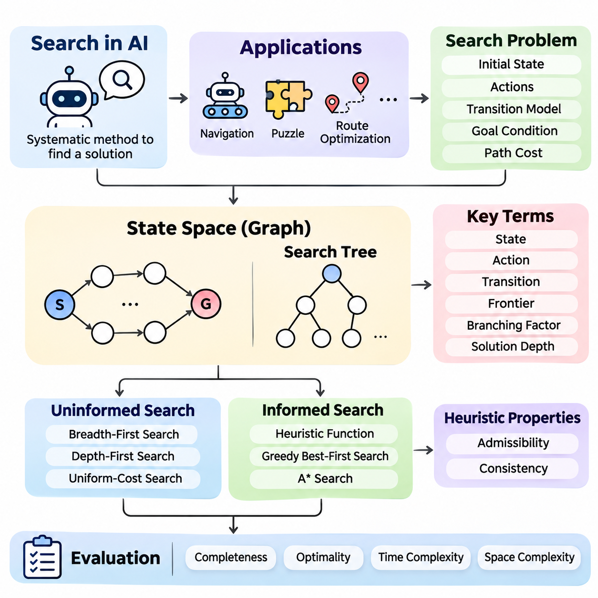
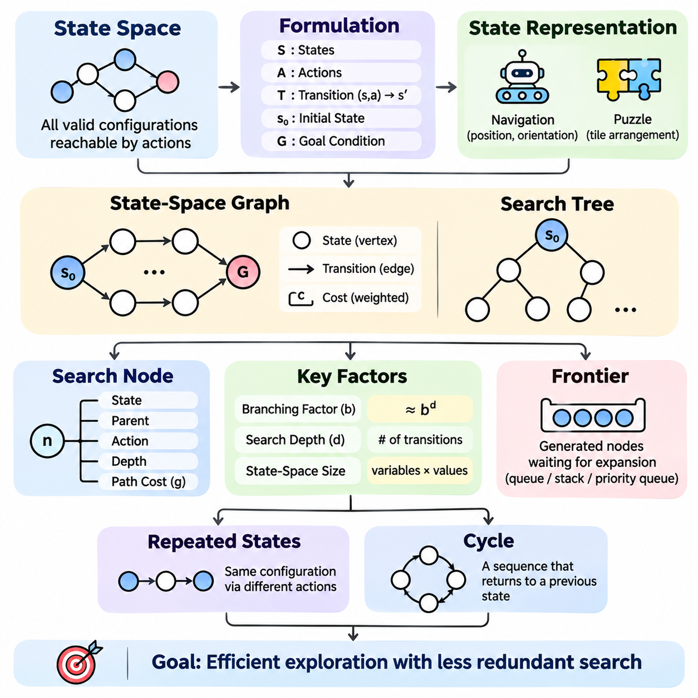
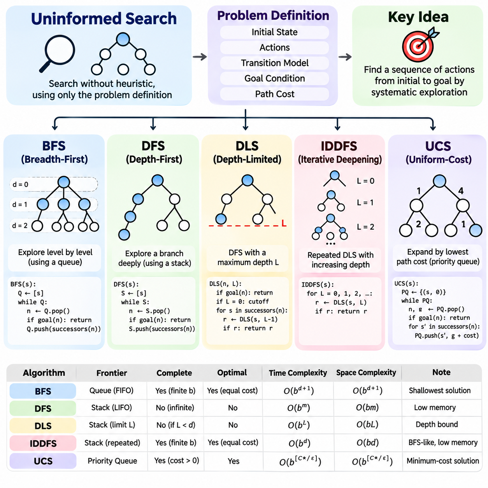
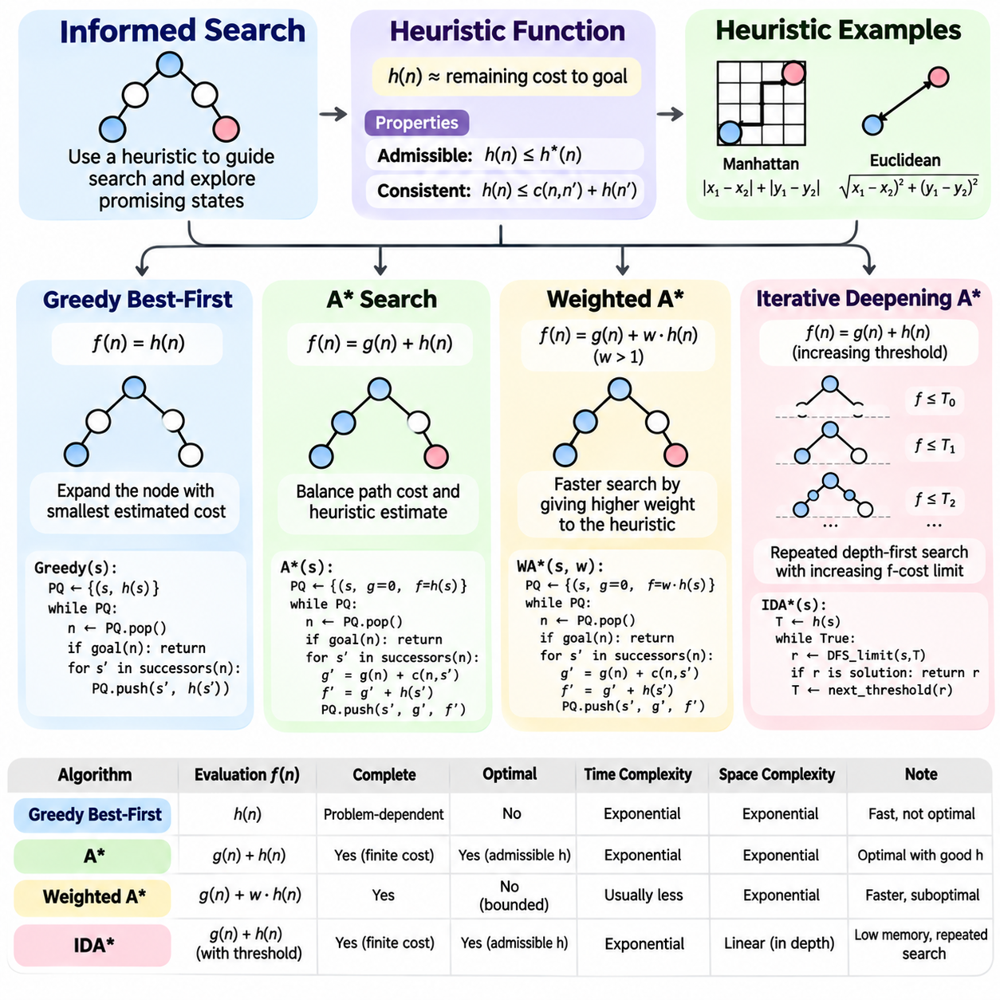
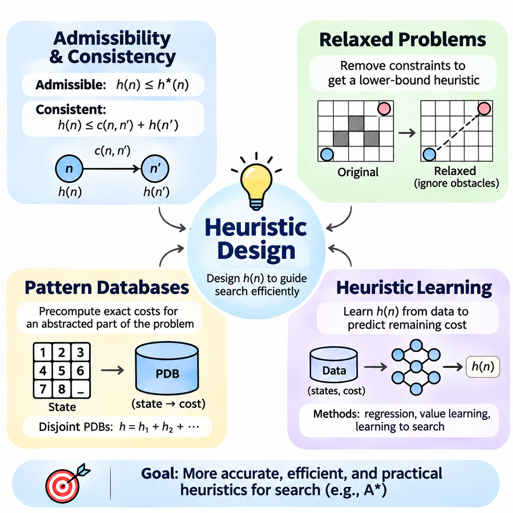
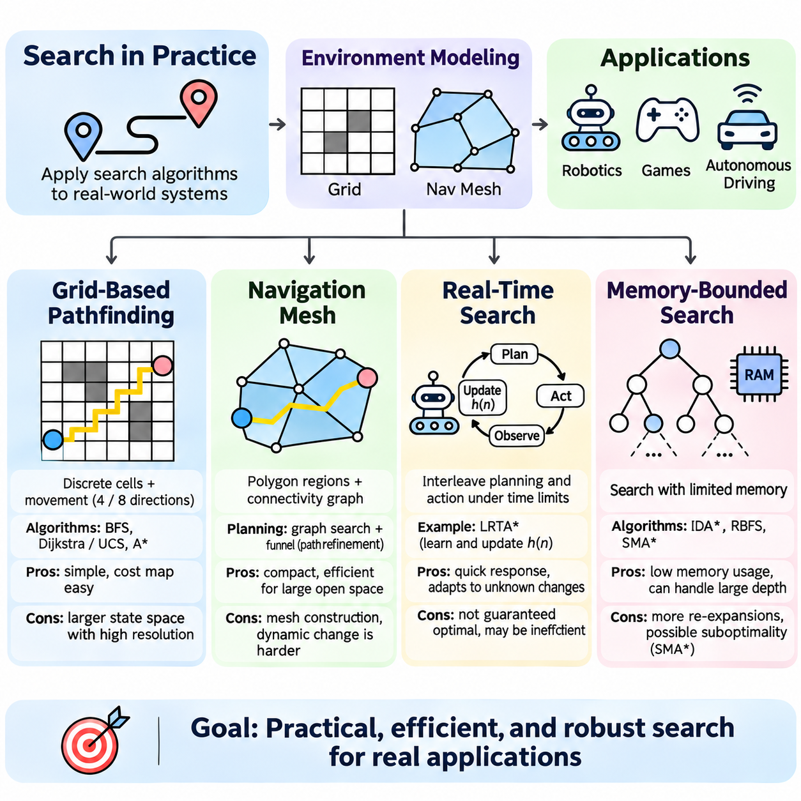
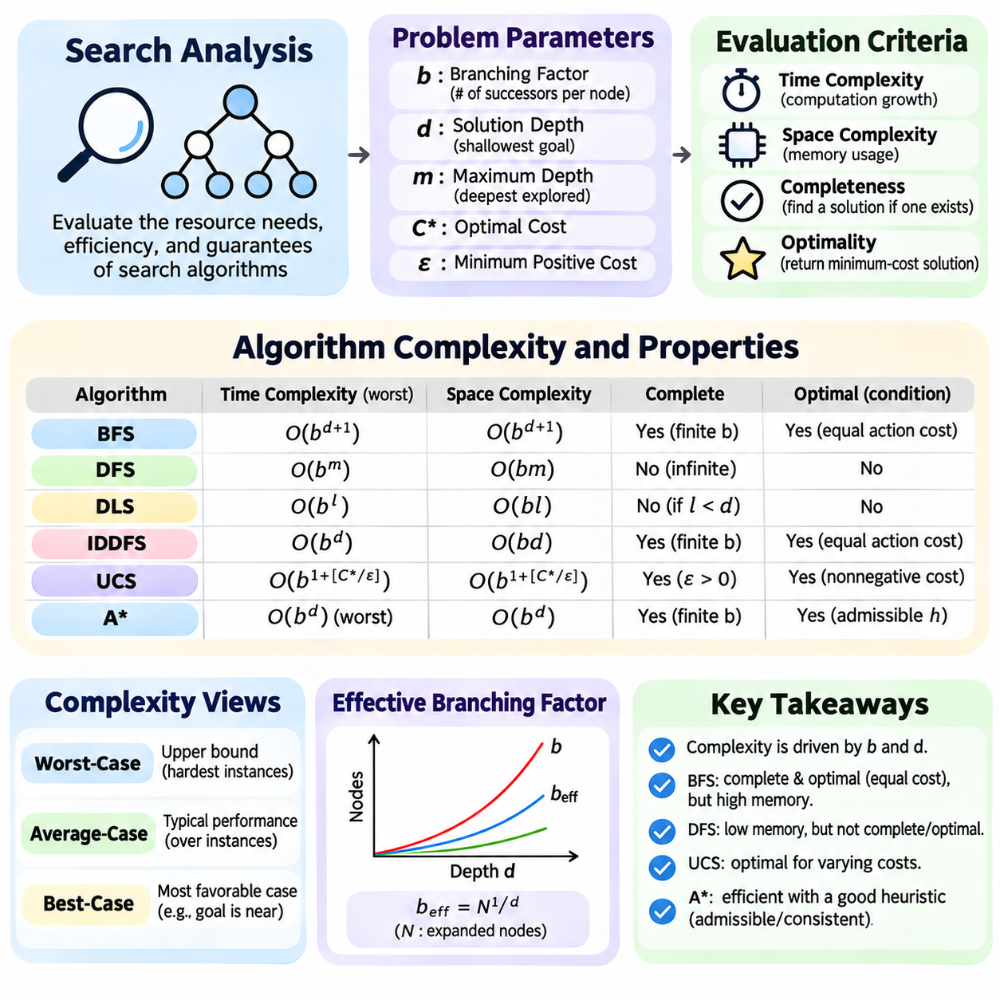
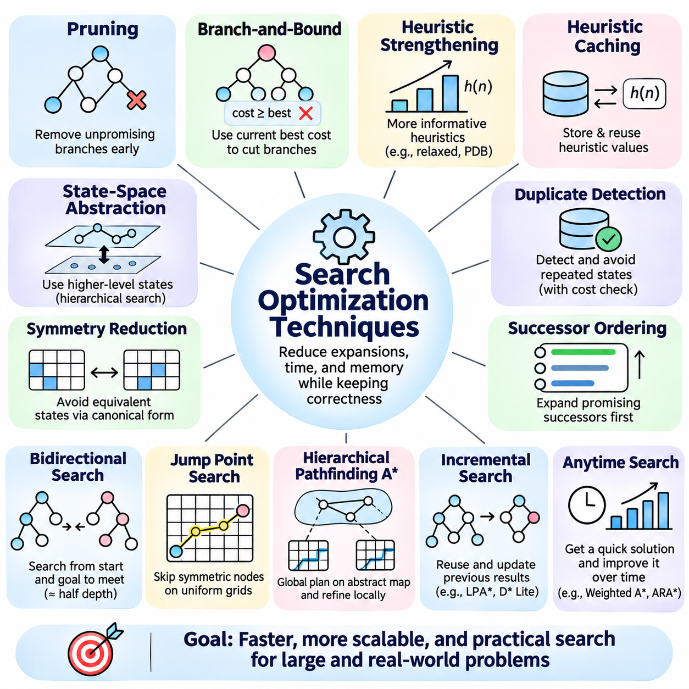
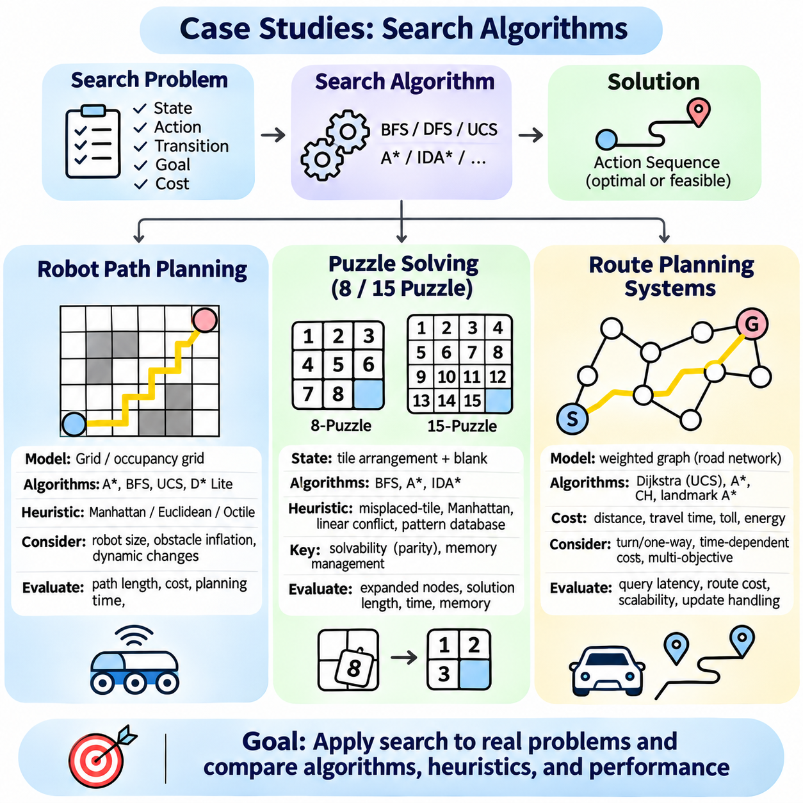

**Volume 01. Classical AI Search and Planning**


# 01. Search Algorithms

## 01.01 Introduction to Search

{width="7.268055555555556in" height="7.268055555555556in"}

Search is one of the fundamental mechanisms of classical artificial intelligence, providing a systematic method for discovering solutions among multiple possible actions and states. Rather than relying exclusively on predefined instructions, a search-based intelligent agent explores alternative configurations, evaluates their relevance, and identifies a sequence of decisions that transforms an initial situation into a desired outcome.

The importance of search originates from the complexity of intelligent decision-making. Many problems cannot be solved through a single calculation because their solutions require several dependent choices. Robot navigation, puzzle solving, route optimization, and automated planning illustrate situations where an agent must consider alternative actions while satisfying environmental constraints and operational objectives.

A search problem is generally defined through an initial state, a collection of available actions, a transition model, a goal condition, and a path-cost function. The initial state describes the starting configuration, while the transition model determines how actions modify that configuration. The goal condition identifies acceptable solutions, and the path-cost function measures the accumulated expense of reaching them.

A state represents a meaningful configuration of the problem environment at a particular point in the decision process. Depending on the application, it may describe a robot\'s location, the arrangement of puzzle tiles, or the allocation of resources. Effective state representation preserves information necessary for decision-making while excluding irrelevant details that would unnecessarily increase computational complexity.

Actions define the possible transformations between states and establish the structure of the search problem. In a grid-navigation environment, actions might include moving north, south, east, or west. In a puzzle, an action may exchange the position of an empty tile with an adjacent tile. Each action must satisfy applicable constraints before the resulting state can be considered valid.

The transition model specifies the relationship between an existing state, an executed action, and the resulting state. In deterministic environments, an action applied to a particular state produces a predictable successor. This assumption simplifies classical search because the agent can construct possible future configurations without repeatedly interacting with the physical environment during every planning step.

The state space contains all configurations reachable through valid sequences of actions from the initial state. Its structure can be represented mathematically as a graph, where vertices correspond to states and directed edges represent transitions. The number of reachable states may grow rapidly as problem complexity increases, making exhaustive exploration computationally impractical for many realistic applications.

A search tree describes the exploration process rather than the underlying problem itself. Each tree node represents a particular path leading to a state, meaning that different nodes may correspond to the same underlying configuration. This distinction becomes important when repeated states or cycles occur, because uncontrolled exploration can waste resources or repeatedly revisit previously examined configurations.

The search frontier maintains nodes that have been generated but not yet expanded. A search algorithm repeatedly selects a node from this frontier, examines whether it satisfies the goal condition, and generates eligible successors when further exploration is necessary. The selection strategy determines the order of exploration and strongly influences computational efficiency, solution quality, and memory requirements.

Uninformed search algorithms explore the state space without using estimates of how close a state is to the goal. Breadth-first search expands shallow nodes first, while depth-first search follows a branch before exploring alternatives. Uniform-cost search selects nodes according to accumulated path cost. These methods provide foundational approaches for understanding how exploration order affects algorithmic behavior.

Informed search algorithms incorporate heuristic knowledge to guide exploration toward promising regions of the state space. A heuristic function estimates the remaining cost or distance from a state to a goal. Greedy best-first search prioritizes estimated proximity, whereas A\\\* search combines accumulated path cost with estimated remaining cost to balance progress toward the goal against the expense already incurred.

The effectiveness of heuristic search depends heavily on the quality of the heuristic function. An informative estimate can reduce unnecessary exploration, while a weak estimate may provide little advantage over uninformed methods. Properties such as admissibility and consistency are especially important because they support theoretical guarantees about optimality and the behavior of algorithms such as A\\\*.

Search algorithms are commonly evaluated through completeness, optimality, time complexity, and space complexity. Completeness indicates whether an algorithm is guaranteed to find a solution when one exists under specified assumptions. Optimality concerns whether the returned solution minimizes the defined cost. Time and space complexity characterize the computational resources required as the search problem becomes larger.

The branching factor describes the number of successors generated from a typical state, while solution depth indicates the number of transitions required to reach a goal. These quantities help explain why search can become computationally expensive. Even when individual state transitions are inexpensive, a large branching factor combined with substantial depth can produce an enormous number of candidate paths.

Path cost provides a quantitative basis for comparing alternative solutions. In a simple navigation problem, every movement may have equal cost, making the shortest path desirable. More realistic environments may assign different costs according to distance, energy consumption, travel time, or terrain difficulty. Consequently, the most efficient solution depends on the objective encoded within the search formulation.

Graph search improves practical efficiency by maintaining information about previously explored states. This mechanism can prevent repeated expansion of identical configurations and reduce unnecessary computation. However, implementations must handle situations where a cheaper path to an existing state is discovered, particularly when using cost-sensitive algorithms and heuristics that do not satisfy consistency requirements.

Real-world search introduces additional challenges involving limited memory, incomplete environmental knowledge, and changing operating conditions. A robot may encounter obstacles that were absent from its original map, requiring the search process to update its representation and compute an alternative route. Such conditions motivate real-time search, incremental replanning, and memory-bounded approaches.

Grid-based pathfinding provides a practical example of classical search in robotics and autonomous navigation. The environment is divided into traversable and restricted cells, and neighboring cells define candidate transitions. Algorithms such as A\\\* can identify collision-free routes through the grid, although actual vehicle deployment also requires consideration of physical dimensions, motion constraints, and environmental uncertainty.

Navigation meshes provide another representation for pathfinding, particularly in virtual environments and applications involving continuous movement across accessible regions. Instead of treating every small location as an independent grid cell, a navigation mesh organizes traversable space into connected geometric regions. Search can then operate over their connectivity before generating a suitable geometric path.

Puzzle-solving problems provide controlled environments for studying search behavior. The 8-puzzle and 15-puzzle require rearranging numbered tiles into a target configuration through legal movements. These problems offer well-defined states, actions, and goal conditions, making them useful for comparing uninformed exploration, heuristic evaluation, repeated-state detection, and computational complexity.

Route planning systems demonstrate how search principles extend to transportation networks and logistics operations. Intersections or locations can represent states, while roads and connections define transitions. Costs may incorporate distance, travel duration, or other operational factors. Selecting an appropriate search algorithm enables efficient route discovery across networks containing numerous alternative connections.

Search also provides an essential foundation for automated planning, where the objective is to determine a sequence of actions satisfying a specified goal. While basic pathfinding emphasizes movement between locations, planning problems may involve logical preconditions, action effects, and dependencies between tasks. Search methods therefore connect directly to broader classical AI mechanisms for reasoning and decision-making.

Search-based intelligence differs from machine learning because a search algorithm does not necessarily require training data or learned parameters. Its behavior can be determined through explicit state representations, transition rules, and exploration strategies. Nevertheless, learning methods can complement search by estimating heuristic values, predicting useful actions, or improving the selection of promising alternatives.

The practical design of a search system requires careful coordination between problem formulation, algorithm selection, and computational constraints. A theoretically optimal algorithm may be unsuitable when memory is severely restricted or decisions must be produced within strict deadlines. Engineering decisions must therefore balance solution quality, response time, resource consumption, and the reliability required by the application.

A complete understanding of search establishes the foundation for subsequent study of state spaces, search trees, uninformed algorithms, informed algorithms, heuristic design, and optimization techniques. These concepts collectively explain how intelligent systems transform complex decision problems into structured computational processes, enabling systematic exploration and goal-directed behavior across a wide range of AI applications.

탐색(Search)은 고전 인공지능(Classical Artificial Intelligence)의 기본 메커니즘 중 하나로, 여러 가능한 행동(Action)과 상태(State) 가운데 해결책(Solution)을 체계적으로 발견하는 방법을 제공한다. 탐색 기반 지능형 에이전트(Search-Based Intelligent Agent)는 미리 정의된 명령에만 의존하지 않고 다양한 상태 구성을 탐색하고, 각 상태의 적합성을 평가하며, 초기 상황을 원하는 목표 상태로 변환하는 일련의 의사결정을 수행한다.

탐색의 중요성은 지능형 의사결정(Intelligent Decision-Making)의 복잡성에서 비롯된다. 많은 문제는 여러 단계의 상호 의존적인 선택을 요구하기 때문에 단일 계산만으로 해결할 수 없다. 로봇 내비게이션(Robot Navigation), 퍼즐 해결(Puzzle Solving), 경로 최적화(Route Optimization), 자동 계획(Automated Planning)은 에이전트가 환경 제약조건(Environmental Constraints)과 운영 목표(Operational Objectives)를 충족하면서 다양한 행동을 검토해야 하는 대표적인 사례이다.

탐색 문제(Search Problem)는 일반적으로 초기 상태(Initial State), 사용 가능한 행동 집합(Action Set), 상태 전이 모델(Transition Model), 목표 조건(Goal Condition), 경로 비용 함수(Path-Cost Function)로 정의된다. 초기 상태는 시작 구성을 나타내고, 상태 전이 모델은 행동이 상태를 어떻게 변화시키는지 결정한다. 목표 조건은 허용 가능한 해결책을 식별하며, 경로 비용 함수는 목표에 도달하는 과정에서 누적되는 비용을 측정한다.

상태(State)는 의사결정 과정의 특정 시점에서 문제 환경을 나타내는 의미 있는 구성을 의미한다. 응용 분야에 따라 로봇의 위치, 퍼즐 타일의 배열 또는 자원 할당 상태를 표현할 수 있다. 효과적인 상태 표현(State Representation)은 의사결정에 필요한 정보를 유지하면서 계산 복잡도(Computational Complexity)를 불필요하게 증가시키는 관련 없는 세부 정보를 제외해야 한다.

행동(Action)은 상태 사이에서 가능한 변환을 정의하며 탐색 문제의 구조를 형성한다. 격자 기반 내비게이션(Grid-Based Navigation)에서는 북쪽, 남쪽, 동쪽 또는 서쪽으로 이동하는 행동이 포함될 수 있다. 퍼즐에서는 빈 타일과 인접한 타일의 위치를 교환하는 행동이 가능하다. 각 행동은 결과 상태(Resulting State)가 유효한 것으로 인정되기 전에 적용 가능한 제약조건(Constraints)을 충족해야 한다.

상태 전이 모델(Transition Model)은 현재 상태, 실행된 행동, 결과 상태 사이의 관계를 정의한다. 결정론적 환경(Deterministic Environment)에서는 특정 상태에 행동을 적용하면 예측 가능한 후속 상태(Successor State)가 생성된다. 이러한 가정은 탐색의 각 계획 단계에서 물리적 환경과 반복적으로 상호작용하지 않고도 미래 상태를 구성할 수 있으므로 고전 탐색(Classical Search)을 단순화한다.

상태 공간(State Space)은 초기 상태에서 유효한 행동의 연속을 통해 도달할 수 있는 모든 상태 구성을 포함한다. 이 구조는 정점(Vertex)이 상태에 대응하고 방향 간선(Directed Edge)이 상태 전이를 나타내는 그래프(Graph)로 수학적으로 표현할 수 있다. 문제의 복잡성이 증가하면 도달 가능한 상태의 수가 급격히 증가할 수 있으며, 이로 인해 많은 실제 응용에서 완전 탐색(Exhaustive Search)은 계산상 비현실적이 된다.

탐색 트리(Search Tree)는 문제 자체의 구조가 아니라 탐색 과정을 나타낸다. 각 트리 노드(Tree Node)는 특정 상태에 도달하는 하나의 경로를 표현하므로 서로 다른 노드가 동일한 실제 상태에 대응할 수 있다. 이러한 구분은 반복 상태(Repeated States)나 순환(Cycles)이 발생할 때 중요하며, 탐색을 적절히 제어하지 않으면 계산 자원이 낭비되거나 이미 검토한 상태를 반복적으로 방문할 수 있다.

탐색 프런티어(Search Frontier)는 생성되었지만 아직 확장되지 않은 노드들을 관리한다. 탐색 알고리즘(Search Algorithm)은 프런티어에서 노드를 선택하고 목표 조건의 충족 여부를 검사하며, 추가 탐색이 필요하면 유효한 후속 노드를 생성하는 과정을 반복한다. 노드 선택 전략(Selection Strategy)은 탐색 순서를 결정하고 계산 효율성(Computational Efficiency), 해결책 품질(Solution Quality), 메모리 요구량(Memory Requirements)에 큰 영향을 미친다.

비정보 탐색(Uninformed Search) 알고리즘은 현재 상태가 목표에 얼마나 가까운지를 추정하는 정보 없이 상태 공간을 탐색한다. 너비 우선 탐색(Breadth-First Search, BFS)은 얕은 깊이의 노드를 먼저 확장하고, 깊이 우선 탐색(Depth-First Search, DFS)은 다른 경로를 탐색하기 전에 하나의 분기를 따라 진행한다. 균일 비용 탐색(Uniform-Cost Search, UCS)은 누적 경로 비용을 기준으로 노드를 선택한다. 이러한 방법은 탐색 순서가 알고리즘의 동작에 미치는 영향을 이해하는 기초가 된다.

정보 탐색(Informed Search) 알고리즘은 휴리스틱 지식(Heuristic Knowledge)을 활용하여 유망한 상태 공간 영역으로 탐색을 유도한다. 휴리스틱 함수(Heuristic Function)는 현재 상태에서 목표까지 남아 있는 비용이나 거리를 추정한다. 탐욕적 최선 우선 탐색(Greedy Best-First Search)은 목표까지의 추정 거리를 우선시하고, A\\\* 탐색(A\\\* Search)은 누적 경로 비용과 추정 잔여 비용을 결합하여 목표 접근성과 이미 발생한 비용 사이의 균형을 유지한다.

휴리스틱 탐색(Heuristic Search)의 효과는 휴리스틱 함수의 품질에 크게 의존한다. 유용한 추정값은 불필요한 탐색을 줄일 수 있지만, 정보가 부족한 추정값은 비정보 탐색에 비해 큰 이점을 제공하지 못할 수 있다. 허용성(Admissibility)과 일관성(Consistency)은 특히 중요하며, A\\\*와 같은 알고리즘의 최적성(Optimality) 및 탐색 동작에 대한 이론적 보장을 뒷받침한다.

탐색 알고리즘은 일반적으로 완전성(Completeness), 최적성(Optimality), 시간 복잡도(Time Complexity), 공간 복잡도(Space Complexity)를 기준으로 평가한다. 완전성은 명시된 가정하에서 해결책이 존재할 경우 알고리즘이 이를 반드시 발견하는지를 나타낸다. 최적성은 반환된 해결책이 정의된 비용을 최소화하는지를 의미한다. 시간 및 공간 복잡도는 탐색 문제가 커질 때 필요한 계산 자원의 특성을 설명한다.

분기 계수(Branching Factor)는 일반적인 상태에서 생성되는 후속 상태의 수를 나타내며, 해결 깊이(Solution Depth)는 목표에 도달하기 위해 필요한 상태 전이 횟수를 의미한다. 이러한 요소는 탐색의 계산 비용이 증가하는 원인을 설명한다. 개별 상태 전이의 계산 비용이 작더라도 높은 분기 계수와 깊은 해결 깊이가 결합되면 탐색해야 할 후보 경로의 수가 매우 커질 수 있다.

경로 비용(Path Cost)은 대안적인 해결책을 정량적으로 비교하는 기준을 제공한다. 단순한 내비게이션 문제에서는 모든 이동에 동일한 비용을 부여하여 최단 경로(Shortest Path)를 선호할 수 있다. 그러나 실제 환경에서는 이동 거리, 에너지 소비(Energy Consumption), 이동 시간(Travel Time), 지형 난이도(Terrain Difficulty)에 따라 서로 다른 비용을 부여할 수 있다. 따라서 가장 효율적인 해결책은 탐색 문제에 정의된 목적함수(Objective Function)에 따라 달라진다.

그래프 탐색(Graph Search)은 이전에 탐색한 상태에 대한 정보를 유지하여 실제 계산 효율성을 향상시킨다. 이 메커니즘은 동일한 상태의 반복 확장을 방지하고 불필요한 계산을 줄일 수 있다. 그러나 기존 상태에 도달하는 더 저렴한 경로가 발견되는 상황을 적절히 처리해야 하며, 특히 비용 기반 탐색(Cost-Sensitive Search)과 일관성 조건을 만족하지 않는 휴리스틱을 사용할 때 이러한 처리가 중요하다.

실제 환경의 탐색에는 제한된 메모리(Limited Memory), 불완전한 환경 정보(Incomplete Environmental Knowledge), 변화하는 운영 조건(Changing Operating Conditions)과 같은 추가적인 문제가 존재한다. 로봇은 초기 지도에 없던 장애물을 발견할 수 있으며, 이 경우 환경 표현을 갱신하고 대체 경로를 계산해야 한다. 이러한 조건은 실시간 탐색(Real-Time Search), 점진적 재계획(Incremental Replanning), 메모리 제한 탐색(Memory-Bounded Search)의 필요성을 높인다.

격자 기반 경로 탐색(Grid-Based Pathfinding)은 로봇공학(Robotics)과 자율 내비게이션(Autonomous Navigation)에서 고전 탐색을 적용하는 실용적인 사례이다. 환경을 이동 가능한 셀(Traversable Cell)과 제한된 셀(Restricted Cell)로 구분하고 인접 셀 사이의 이동을 후보 상태 전이로 정의한다. A\\\*와 같은 알고리즘은 격자에서 충돌 없는 경로(Collision-Free Path)를 탐색할 수 있지만, 실제 차량에 적용하려면 물리적 크기, 운동 제약조건(Motion Constraints), 환경 불확실성(Environmental Uncertainty)도 고려해야 한다.

내비게이션 메시(Navigation Mesh)는 특히 가상 환경(Virtual Environment)과 연속적인 이동이 필요한 응용에서 사용되는 또 다른 경로 탐색 표현 방식이다. 모든 작은 위치를 독립적인 격자 셀로 처리하는 대신 이동 가능한 공간을 연결된 기하학적 영역(Geometric Regions)으로 구성한다. 이후 탐색은 이러한 영역 사이의 연결성(Connectivity)을 기반으로 수행되며, 적절한 기하학적 경로(Geometric Path)를 생성하는 데 활용된다.

퍼즐 해결(Puzzle Solving) 문제는 탐색 알고리즘의 동작을 연구하기 위한 통제된 환경을 제공한다. 8-퍼즐(8-Puzzle)과 15-퍼즐(15-Puzzle)은 합법적인 이동을 통해 숫자 타일을 목표 배열로 재구성해야 하는 문제이다. 이러한 문제는 상태, 행동, 목표 조건이 명확하게 정의되어 있어 비정보 탐색, 휴리스틱 평가(Heuristic Evaluation), 반복 상태 탐지(Repeated-State Detection), 계산 복잡도를 비교하는 데 유용하다.

경로 계획 시스템(Route Planning System)은 탐색 원리가 교통망(Transportation Network)과 물류 운영(Logistics Operations)으로 확장되는 방식을 보여준다. 교차로나 위치를 상태로 표현하고 도로와 연결 관계를 상태 전이로 정의할 수 있다. 비용에는 거리, 이동 시간 또는 기타 운영 요소가 포함될 수 있다. 적절한 탐색 알고리즘을 선택하면 수많은 대체 연결 경로가 존재하는 네트워크에서도 효율적인 경로를 발견할 수 있다.

탐색은 특정 목표를 만족하는 행동의 연속을 결정하는 자동 계획(Automated Planning)의 핵심 기반이기도 하다. 기본적인 경로 탐색(Pathfinding)이 위치 사이의 이동을 강조한다면, 계획 문제(Planning Problem)는 논리적 사전조건(Logical Preconditions), 행동 효과(Action Effects), 작업 간 의존관계(Task Dependencies)를 포함할 수 있다. 따라서 탐색 방법은 추론(Reasoning)과 의사결정(Decision-Making)을 수행하는 고전 인공지능의 보다 광범위한 메커니즘과 직접 연결된다.

탐색 기반 지능(Search-Based Intelligence)은 반드시 학습 데이터(Training Data)나 학습된 매개변수(Learned Parameters)를 필요로 하지 않는다는 점에서 기계학습(Machine Learning)과 구별된다. 탐색 알고리즘의 동작은 명시적인 상태 표현, 상태 전이 규칙, 탐색 전략에 의해 결정될 수 있다. 그러나 학습 방법은 휴리스틱 값 추정, 유용한 행동 예측, 유망한 대안 선택의 개선을 통해 탐색을 보완할 수 있다.

실용적인 탐색 시스템(Search System)을 설계하려면 문제 정식화(Problem Formulation), 알고리즘 선택(Algorithm Selection), 계산 제약조건(Computational Constraints)을 신중하게 조정해야 한다. 이론적으로 최적인 알고리즘이라도 메모리가 심하게 제한되거나 엄격한 시간 내에 의사결정을 내려야 하는 환경에서는 적합하지 않을 수 있다. 따라서 시스템 엔지니어링(System Engineering)은 해결책 품질, 응답 시간(Response Time), 자원 소비(Resource Consumption), 응용에서 요구하는 신뢰성(Reliability) 사이의 균형을 고려해야 한다.

탐색에 대한 포괄적인 이해는 상태 공간(State Space), 탐색 트리(Search Tree), 비정보 탐색(Uninformed Search), 정보 탐색(Informed Search), 휴리스틱 설계(Heuristic Design), 탐색 최적화 기법(Search Optimization Techniques)을 학습하기 위한 기초를 제공한다. 이러한 개념은 지능형 시스템이 복잡한 의사결정 문제를 구조화된 계산 과정으로 변환하고, 다양한 인공지능 응용에서 체계적인 탐색과 목표 지향적 행동(Goal-Directed Behavior)을 수행하는 원리를 설명한다.

## 01.02 State Space and Search Trees

{width="7.268055555555556in" height="7.268055555555556in"}

State spaces and search trees provide the structural foundation for classical artificial intelligence search algorithms. They describe how a problem can be represented as interconnected configurations and how an intelligent agent systematically explores possible solutions. Understanding these structures is essential for designing search methods that balance computational efficiency, solution quality, and memory consumption.

A state space represents the collection of all valid configurations that can be reached from an initial state through permitted actions. Each state captures the information necessary to describe a particular problem configuration. In robot navigation, a state may represent position and orientation, while in puzzle solving, it may describe the arrangement of tiles on a board.

The mathematical formulation of a state space typically includes a set of states, an action set, and a transition function. The transition function maps a state and an applicable action to a successor state in deterministic problems. Together, these elements define the connectivity of the problem and establish which configurations are reachable through valid sequences of decisions.

The initial state establishes the starting point of the search process, while the goal condition identifies configurations that satisfy the desired objective. A problem may contain a single goal state or multiple acceptable goal states. Search algorithms must discover a valid sequence of transitions connecting the initial state to at least one goal configuration.

State representation directly influences the computational complexity of search. A representation containing unnecessary variables may produce an excessively large state space, while an overly simplified representation may omit important constraints. Effective modeling preserves the information required for valid decisions while minimizing redundant or irrelevant distinctions between configurations.

A state-space graph represents states as vertices and valid transitions as directed edges. Each edge corresponds to an action that transforms one configuration into another. When transitions have associated costs, the graph becomes weighted. This representation supports mathematical analysis of reachability, connectivity, shortest paths, and alternative routes through the problem.

A search tree differs from a state-space graph because it represents the history of exploration rather than only the unique states of the problem. Each tree node corresponds to a particular sequence of actions leading from the root to a state. Consequently, multiple tree nodes may reference the same underlying state when different action sequences reach an identical configuration.

The root node of a search tree represents the initial state and contains no preceding action. Child nodes are generated by applying valid actions to the state associated with their parent. Repeated expansion produces additional levels of the tree, with each level representing another step in the sequence of decisions considered by the search algorithm.

A search node commonly stores the associated state, a reference to its parent, the action used to reach it, its depth, and its accumulated path cost. These attributes support solution reconstruction and algorithm-specific prioritization. The parent relationship allows the final solution path to be recovered by tracing backward from a discovered goal node to the root.

The branching factor describes the number of successor nodes generated during expansion. If each node produces approximately b successors, the number of nodes at depth d may approach b raised to the power d. This exponential growth explains why even moderately deep search problems can require substantial computational resources when the branching factor is large.

Search depth measures the number of transitions separating a node from the root. Depth is particularly important in algorithms that prioritize shallow solutions or restrict exploration to a predefined limit. However, depth and path cost are not necessarily equivalent because individual transitions may have different costs depending on the characteristics of the environment.

The frontier contains generated nodes awaiting expansion and forms the operational boundary between explored and unexplored regions. Different search algorithms organize this collection using queues, stacks, or priority queues. The ordering policy determines which node is expanded next and therefore controls the direction, efficiency, and behavior of the search process.

Repeated states occur when different action sequences lead to the same configuration. For example, a robot may move east and then west, returning to its original position. Without repeated-state detection, a search algorithm may explore equivalent configurations many times, increasing execution time and potentially creating unbounded exploration in environments containing cycles.

Graph-search implementations commonly maintain an explored-state collection to reduce redundant expansions. Depending on the algorithm, they may also record the best known cost of reaching each state. When a lower-cost path is discovered, the corresponding record may need updating, and previously expanded states may require reconsideration under certain search strategies.

Cycles arise when a sequence of transitions returns to an earlier state. A cycle may involve only two configurations or a longer chain of actions. Detecting cycles is essential for preventing unnecessary exploration, especially in depth-first search. Path-based cycle checking and global repeated-state detection offer different tradeoffs between memory consumption and computational efficiency.

State-space size depends on the number of variables, their possible values, and the constraints governing valid combinations. A problem with several independent variables can produce a combinatorial number of configurations. Constraints may eliminate many combinations, but the remaining reachable space can still be extremely large, requiring careful representation and efficient exploration.

Implicit state-space representation avoids constructing the entire graph before searching. Instead, successor states are generated dynamically when a node is expanded. This approach is widely used because explicitly storing every possible configuration is often impractical. Successor-generation functions therefore play a central role in the implementation of scalable search algorithms.

Explicit graph representations remain useful when the environment is relatively small, stable, and repeatedly queried. Road networks, predefined navigation graphs, and structured dependency systems may benefit from stored connectivity information. The choice between explicit and implicit representations depends on graph size, update frequency, available memory, and the computational cost of generating successors.

Path cost is accumulated along the transitions connecting the initial state to a search node. When every action has identical cost, minimizing the number of transitions also minimizes total path cost. In weighted environments, however, a deeper path may be less expensive than a shallower alternative, making cost-aware exploration necessary for finding optimal solutions.

Goal testing determines whether the state associated with a selected node satisfies the desired condition. The timing of this test affects algorithm behavior and guarantees. Some methods test nodes when they are generated, while others test them when selected for expansion. Correct implementation depends on the search strategy and the assumptions governing path costs.

State abstraction reduces problem complexity by grouping configurations that are equivalent for a particular decision objective. For example, a navigation planner may ignore minor geometric details when computing a high-level route. Although abstraction can reduce search effort, excessive simplification may produce paths that violate constraints or cannot be executed in the original environment.

Hierarchical representations organize complex problems into multiple levels of detail. A robot may first search among rooms or regions and subsequently compute precise movements within selected areas. This decomposition reduces the number of configurations considered at each stage, although the resulting solution quality depends on how accurately higher-level relationships represent lower-level feasibility and costs.

In robotic applications, state spaces may include position, orientation, velocity, and other motion-related variables. Search trees can represent alternative movement sequences, but valid transitions must respect physical constraints. Vehicle dimensions, turning limitations, obstacles, and motion feasibility influence which states and transitions are acceptable during planning.

Puzzle environments illustrate the relationship between state spaces and search trees particularly clearly. In the 8-puzzle, each legal arrangement of tiles represents a state, and moving a tile into the empty position defines a transition. Different movement sequences can reach the same arrangement, demonstrating why the number of search-tree nodes may exceed the number of unique reachable states.

The design of state spaces and search trees determines how effectively search algorithms can operate. Accurate state modeling ensures that solutions correspond to valid problem configurations, while efficient node management limits redundant computation. These principles establish the conceptual foundation for breadth-first search, depth-first search, uniform-cost search, heuristic search, and advanced planning systems.

상태 공간(State Space)과 탐색 트리(Search Tree)는 고전 인공지능(Classical Artificial Intelligence)의 탐색 알고리즘(Search Algorithm)을 구성하는 구조적 기반을 제공한다. 이들은 문제를 상호 연결된 상태 구성으로 표현하는 방법과 지능형 에이전트(Intelligent Agent)가 가능한 해결책을 체계적으로 탐색하는 과정을 설명한다. 이러한 구조를 이해하는 것은 계산 효율성(Computational Efficiency), 해결책 품질(Solution Quality), 메모리 소비(Memory Consumption) 사이의 균형을 유지하는 탐색 방법을 설계하는 데 필수적이다.

상태 공간(State Space)은 초기 상태(Initial State)에서 허용된 행동(Action)을 통해 도달할 수 있는 모든 유효한 상태 구성의 집합을 나타낸다. 각 상태(State)는 특정 문제 구성을 설명하는 데 필요한 정보를 포함한다. 로봇 내비게이션(Robot Navigation)에서 상태는 위치(Position)와 방향(Orientation)을 나타낼 수 있으며, 퍼즐 해결(Puzzle Solving)에서는 보드 위에 배열된 타일(Tile)의 구성을 표현할 수 있다.

상태 공간의 수학적 정식화(Mathematical Formulation)는 일반적으로 상태 집합(State Set), 행동 집합(Action Set), 상태 전이 함수(Transition Function)를 포함한다. 결정론적 문제(Deterministic Problem)에서 상태 전이 함수는 현재 상태와 적용 가능한 행동을 후속 상태(Successor State)에 대응시킨다. 이러한 요소들은 문제의 연결 구조(Connectivity)를 정의하고 유효한 의사결정의 연속을 통해 도달할 수 있는 상태 구성을 결정한다.

초기 상태(Initial State)는 탐색 과정(Search Process)의 시작점을 설정하며, 목표 조건(Goal Condition)은 원하는 목적을 만족하는 상태 구성을 식별한다. 문제에는 하나의 목표 상태(Goal State)가 존재할 수도 있고 여러 개의 허용 가능한 목표 상태가 존재할 수도 있다. 탐색 알고리즘은 초기 상태에서 적어도 하나의 목표 상태까지 연결되는 유효한 상태 전이(Transition)의 연속을 발견해야 한다.

상태 표현(State Representation)은 탐색의 계산 복잡도(Computational Complexity)에 직접적인 영향을 미친다. 불필요한 변수를 포함하는 표현은 지나치게 큰 상태 공간을 생성할 수 있으며, 반대로 과도하게 단순화된 표현은 중요한 제약조건(Constraints)을 누락할 수 있다. 효과적인 모델링(Modeling)은 유효한 의사결정에 필요한 정보를 보존하면서 상태 구성 사이의 중복되거나 관련성이 낮은 차이를 최소화해야 한다.

상태 공간 그래프(State-Space Graph)는 상태를 정점(Vertex)으로 표현하고 유효한 상태 전이를 방향 간선(Directed Edge)으로 나타낸다. 각 간선은 하나의 상태 구성을 다른 구성으로 변환하는 행동에 대응한다. 상태 전이에 비용이 부여되면 가중 그래프(Weighted Graph)가 형성된다. 이러한 표현은 도달 가능성(Reachability), 연결성(Connectivity), 최단 경로(Shortest Path), 대체 경로(Alternative Route)에 대한 수학적 분석을 지원한다.

탐색 트리(Search Tree)는 문제의 고유한 상태만을 나타내는 상태 공간 그래프와 달리 탐색 과정의 이력(Exploration History)을 표현한다. 각 트리 노드(Tree Node)는 루트(Root)에서 특정 상태에 도달하는 행동의 연속에 대응한다. 따라서 서로 다른 행동 순서가 동일한 상태 구성에 도달하면 여러 트리 노드가 동일한 실제 상태를 참조할 수 있다.

탐색 트리의 루트 노드(Root Node)는 초기 상태를 나타내며 이전 행동을 포함하지 않는다. 자식 노드(Child Node)는 부모 노드(Parent Node)에 연결된 상태에 유효한 행동을 적용하여 생성된다. 이러한 확장(Expansion)을 반복하면 트리의 추가적인 계층(Level)이 형성되며, 각 계층은 탐색 알고리즘이 고려하는 의사결정 과정에서 한 단계 더 진행된 상태를 나타낸다.

탐색 노드(Search Node)는 일반적으로 연결된 상태(State), 부모 노드 참조(Parent Reference), 해당 노드에 도달하기 위해 수행한 행동(Action), 깊이(Depth), 누적 경로 비용(Accumulated Path Cost)을 저장한다. 이러한 속성은 해결 경로 복원(Solution Reconstruction)과 알고리즘별 우선순위 결정(Prioritization)을 지원한다. 부모 관계(Parent Relationship)를 이용하면 발견된 목표 노드에서 루트까지 역추적하여 최종 해결 경로를 복원할 수 있다.

분기 계수(Branching Factor)는 노드를 확장할 때 생성되는 후속 노드(Successor Node)의 수를 나타낸다. 각 노드가 평균적으로 b개의 후속 노드를 생성한다면 깊이 d에서의 노드 수는 b의 d제곱에 가까워질 수 있다. 이러한 지수적 증가(Exponential Growth)는 분기 계수가 큰 경우 탐색 깊이가 비교적 작더라도 상당한 계산 자원(Computational Resources)이 필요할 수 있음을 설명한다.

탐색 깊이(Search Depth)는 특정 노드와 루트 사이에 존재하는 상태 전이의 수를 측정한다. 깊이는 얕은 해결책을 우선적으로 탐색하거나 미리 정의된 깊이 제한(Depth Limit) 내에서 탐색하는 알고리즘에서 특히 중요하다. 그러나 개별 상태 전이의 비용이 환경 특성에 따라 달라질 수 있으므로 깊이와 경로 비용(Path Cost)이 반드시 동일한 의미를 갖는 것은 아니다.

프런티어(Frontier)는 생성되었지만 아직 확장되지 않은 노드들을 포함하며, 탐색된 영역(Explored Region)과 탐색되지 않은 영역(Unexplored Region) 사이의 운영상 경계를 형성한다. 탐색 알고리즘은 큐(Queue), 스택(Stack), 우선순위 큐(Priority Queue)를 사용하여 이 노드 집합을 관리한다. 노드 정렬 정책(Ordering Policy)은 다음에 확장할 노드를 결정하므로 탐색 방향, 효율성, 동작 특성을 제어한다.

반복 상태(Repeated State)는 서로 다른 행동의 연속이 동일한 상태 구성으로 이어질 때 발생한다. 예를 들어 로봇이 동쪽으로 이동한 다음 서쪽으로 이동하면 원래 위치로 돌아올 수 있다. 반복 상태 탐지(Repeated-State Detection)가 없다면 탐색 알고리즘은 동일한 상태 구성을 여러 번 탐색하여 실행 시간이 증가하고, 순환(Cycle)이 존재하는 환경에서는 탐색이 무한히 지속될 가능성도 있다.

그래프 탐색(Graph Search) 구현에서는 일반적으로 탐색 완료 상태 집합(Explored-State Collection)을 유지하여 중복 확장을 줄인다. 알고리즘에 따라 각 상태에 도달하는 현재까지의 최소 비용(Best Known Cost)을 기록할 수도 있다. 더 낮은 비용의 경로가 발견되면 해당 기록을 갱신해야 하며, 특정 탐색 전략에서는 이미 확장한 상태를 다시 검토해야 할 수도 있다.

순환(Cycle)은 일련의 상태 전이가 이전 상태로 되돌아올 때 발생한다. 순환은 두 개의 상태 사이에서 형성될 수도 있고 더 긴 행동의 연속으로 구성될 수도 있다. 순환 탐지(Cycle Detection)는 특히 깊이 우선 탐색(Depth-First Search)에서 불필요한 탐색을 방지하는 데 필수적이다. 경로 기반 순환 검사(Path-Based Cycle Checking)와 전역 반복 상태 탐지(Global Repeated-State Detection)는 메모리 소비와 계산 효율성 사이에서 서로 다른 절충 관계(Tradeoff)를 제공한다.

상태 공간의 크기(State-Space Size)는 변수의 수, 각 변수가 가질 수 있는 값, 유효한 조합을 제한하는 제약조건에 따라 결정된다. 여러 독립적인 변수를 포함하는 문제는 조합적으로 많은 상태 구성을 생성할 수 있다. 제약조건이 상당수의 조합을 제거하더라도 도달 가능한 상태 공간(Reachable State Space)은 여전히 매우 클 수 있으므로 신중한 상태 표현과 효율적인 탐색이 필요하다.

암시적 상태 공간 표현(Implicit State-Space Representation)은 탐색을 시작하기 전에 전체 그래프를 구성하지 않는다. 대신 노드가 확장될 때 후속 상태를 동적으로 생성한다. 모든 가능한 상태 구성을 명시적으로 저장하는 것은 비현실적인 경우가 많으므로 이러한 접근 방식이 널리 사용된다. 따라서 후속 상태 생성 함수(Successor-Generation Function)는 확장 가능한 탐색 알고리즘(Scalable Search Algorithm)의 구현에서 핵심적인 역할을 한다.

명시적 그래프 표현(Explicit Graph Representation)은 환경이 비교적 작고 안정적이며 반복적으로 탐색되는 경우에 유용하다. 도로망(Road Network), 사전 정의된 내비게이션 그래프(Navigation Graph), 구조화된 의존성 시스템(Structured Dependency System)은 저장된 연결 정보(Connectivity Information)를 활용할 수 있다. 명시적 표현과 암시적 표현의 선택은 그래프 크기, 갱신 빈도(Update Frequency), 사용 가능한 메모리, 후속 상태 생성에 필요한 계산 비용에 따라 결정된다.

경로 비용(Path Cost)은 초기 상태에서 탐색 노드까지 연결되는 상태 전이를 따라 누적된다. 모든 행동의 비용이 동일하다면 상태 전이 횟수를 최소화하는 것이 전체 경로 비용을 최소화하는 것과 같다. 그러나 가중 환경(Weighted Environment)에서는 더 깊은 경로가 얕은 경로보다 비용이 낮을 수 있으므로 최적 해결책(Optimal Solution)을 발견하려면 비용 인식 탐색(Cost-Aware Search)이 필요하다.

목표 검사(Goal Testing)는 선택된 노드에 연결된 상태가 원하는 목표 조건을 만족하는지 판단한다. 이러한 검사를 수행하는 시점은 알고리즘의 동작과 이론적 보장에 영향을 미친다. 일부 탐색 방법은 노드가 생성될 때 목표 검사를 수행하고, 다른 방법은 노드가 확장을 위해 선택될 때 검사를 수행한다. 올바른 구현은 탐색 전략(Search Strategy)과 경로 비용에 적용되는 가정에 따라 달라진다.

상태 추상화(State Abstraction)는 특정 의사결정 목표에서 동등한 의미를 갖는 상태 구성들을 하나로 묶어 문제의 복잡성을 줄인다. 예를 들어 내비게이션 계획기(Navigation Planner)는 상위 수준 경로(High-Level Route)를 계산할 때 세부적인 기하학적 정보를 무시할 수 있다. 추상화는 탐색 비용을 줄일 수 있지만 지나친 단순화는 제약조건을 위반하거나 원래 환경에서 실행할 수 없는 경로를 생성할 수 있다.

계층적 표현(Hierarchical Representation)은 복잡한 문제를 여러 세부 수준(Level of Detail)으로 구성한다. 로봇은 먼저 방이나 영역 사이의 경로를 탐색한 다음 선택된 영역 내부에서 정밀한 이동 경로를 계산할 수 있다. 이러한 분해(Decomposition)는 각 단계에서 고려해야 할 상태 구성의 수를 줄이지만, 최종 해결책의 품질은 상위 수준의 관계가 하위 수준의 실행 가능성(Feasibility)과 비용을 얼마나 정확하게 반영하는지에 따라 달라진다.

로봇 응용(Robotic Application)에서 상태 공간은 위치(Position), 방향(Orientation), 속도(Velocity), 기타 운동 관련 변수(Motion-Related Variables)를 포함할 수 있다. 탐색 트리는 대안적인 이동 순서를 표현할 수 있지만 유효한 상태 전이는 물리적 제약조건(Physical Constraints)을 충족해야 한다. 차량 크기(Vehicle Dimensions), 회전 제한(Turning Limitations), 장애물(Obstacles), 운동 가능성(Motion Feasibility)은 계획 과정에서 허용되는 상태와 상태 전이를 결정한다.

퍼즐 환경(Puzzle Environment)은 상태 공간과 탐색 트리 사이의 관계를 명확하게 보여준다. 8-퍼즐(8-Puzzle)에서 타일의 각 합법적인 배열은 하나의 상태를 나타내며, 빈 공간으로 타일을 이동하는 행동은 상태 전이(Transition)를 정의한다. 서로 다른 이동 순서가 동일한 배열에 도달할 수 있으므로 탐색 트리의 노드 수가 고유한 도달 가능 상태(Unique Reachable State)의 수보다 많아질 수 있음을 보여준다.

상태 공간과 탐색 트리의 설계는 탐색 알고리즘이 얼마나 효과적으로 동작할 수 있는지를 결정한다. 정확한 상태 모델링(State Modeling)은 해결책이 유효한 문제 구성에 대응하도록 보장하며, 효율적인 노드 관리(Node Management)는 중복 계산을 제한한다. 이러한 원리는 너비 우선 탐색(Breadth-First Search), 깊이 우선 탐색(Depth-First Search), 균일 비용 탐색(Uniform-Cost Search), 휴리스틱 탐색(Heuristic Search), 고급 계획 시스템(Advanced Planning Systems)을 이해하기 위한 개념적 기반을 형성한다.

## 01.03 Uninformed Search Overview

{width="7.268055555555556in" height="7.268055555555556in"}

Uninformed search algorithms provide systematic methods for exploring state spaces without relying on heuristic estimates of the remaining distance to a goal. These algorithms use only the problem definition, including the initial state, available actions, transition model, goal condition, and path costs. Their behavior depends on how generated nodes are organized and selected for expansion during the search process.

The fundamental objective of uninformed search is to discover a valid sequence of actions connecting an initial state to a goal state. Because no additional guidance about goal proximity is available, exploration follows predetermined structural or cost-based rules. Breadth-first search, depth-first search, depth-limited search, iterative deepening, and uniform-cost search represent the principal approaches.

Breadth-first search, commonly abbreviated as BFS, explores the search tree level by level, expanding all nodes at a given depth before proceeding to deeper levels. It maintains the frontier using a first-in, first-out queue, ensuring that nodes generated earlier are processed first. This exploration strategy is particularly suitable for problems where the shallowest solution is desired.

BFS is complete when the branching factor is finite and a solution exists at finite depth. It is also optimal when every action has the same positive cost, because the shallowest solution then has the lowest accumulated path cost. However, its memory requirements increase rapidly as the search frontier expands, making large state spaces difficult to explore efficiently.

The computational complexity of BFS depends primarily on the branching factor and the depth of the shallowest goal. With branching factor b and solution depth d, time and memory requirements can grow exponentially with d. Although BFS offers predictable exploration behavior and useful guarantees, its substantial memory consumption often limits its applicability to deeply structured problems.

Depth-first search, abbreviated as DFS, follows one branch of the search tree as deeply as possible before returning to explore alternative branches. It commonly uses a last-in, first-out stack or recursive function calls. By prioritizing recently generated nodes, DFS can reach deep configurations quickly without maintaining the complete frontier of shallower search levels.

DFS generally requires substantially less memory than BFS because it stores the current exploration path and the alternative branches awaiting examination. In a tree with maximum depth m and branching factor b, conventional depth-first tree search requires space proportional to b times m. This characteristic makes DFS attractive when memory resources are limited.

Despite its memory efficiency, DFS does not guarantee an optimal solution and may fail to terminate in infinite-depth spaces or cyclic search structures without appropriate safeguards. The first discovered goal may lie along a much longer path than another available solution. Its completeness therefore depends on assumptions about the search space and the implementation of cycle detection.

Depth-limited search extends DFS by imposing a maximum permitted exploration depth. Nodes reaching the predefined limit are not expanded further, preventing the algorithm from descending indefinitely. This modification is useful when a reasonable upper bound on solution depth is known or when computational resources require strict control over the depth of exploration.

The depth limit introduces an important tradeoff between computational efficiency and solution accessibility. A limit that is too small may prevent the algorithm from reaching an existing goal, while an excessively large limit reduces the practical benefits of restricting exploration. Depth-limited search can distinguish a depth cutoff from genuine failure when its implementation explicitly tracks these outcomes.

Depth-limited search preserves the memory advantages of DFS while providing a predictable bound on exploration depth. Its time complexity remains exponential in the selected depth limit in the worst case, but memory consumption grows approximately linearly with that limit for a fixed branching factor. The algorithm is not generally optimal because it does not prioritize lower-cost solutions.

Iterative deepening depth-first search, commonly called IDDFS, combines the shallow-solution preference of BFS with the memory efficiency of DFS. It repeatedly executes depth-limited search while gradually increasing the permitted depth. The initial iteration explores only the root, and subsequent iterations examine progressively deeper portions of the search tree.

Although IDDFS revisits nodes near the root during successive iterations, the repeated work is often relatively small compared with the total number of nodes at the deepest explored level. In exponentially growing search trees, most nodes occur near the maximum depth. Consequently, iterative deepening can provide BFS-like solution guarantees while retaining DFS-like memory requirements.

IDDFS is complete for finite branching factors when a goal exists at finite depth, and it is optimal when all actions have equal positive costs. Its time complexity is exponential in solution depth, while its memory requirements grow approximately linearly with depth for a fixed branching factor. These properties make it useful when solution depth is unknown and memory is constrained.

Uniform-cost search, abbreviated as UCS, expands nodes according to their accumulated path cost rather than their depth. It maintains a priority queue ordered by the cost of reaching each candidate node from the initial state. This strategy allows the algorithm to discover minimum-cost solutions even when individual actions have different costs.

UCS is closely related to Dijkstra\'s shortest-path algorithm and can be understood as a cost-sensitive generalization of breadth-first search. When all actions have identical positive costs, UCS expands nodes in nondecreasing depth order, apart from tie-breaking differences. With variable costs, however, it may explore deeper but inexpensive paths before shallower alternatives.

The optimality of UCS depends on selecting a goal when it is removed from the priority queue for expansion rather than merely when it is generated. With nonnegative edge costs, appropriate best-cost bookkeeping, and standard graph-search handling, UCS can return an optimal solution. Completeness additionally requires conditions preventing infinitely many expansions below the optimal solution cost.

The computational demands of UCS depend on the distribution of action costs and the number of states reachable below the optimal solution cost. Unlike BFS, its complexity cannot be characterized solely by solution depth. When action costs are bounded below by a positive constant, conventional complexity bounds can be expressed using the optimal solution cost and minimum step cost.

The frontier management strategy is the principal distinction among uninformed search methods. BFS uses a FIFO queue, DFS uses a LIFO stack, depth-limited search adds a depth restriction, IDDFS repeats bounded DFS, and UCS uses a cost-ordered priority queue. These differences determine exploration order, memory consumption, completeness, and optimality guarantees.

Repeated-state detection is essential when uninformed search operates on graphs containing cycles or multiple paths to identical states. An explored-state collection can reduce redundant expansions, but cost-sensitive algorithms must also preserve information about the cheapest known route. Incorrect duplicate handling may reduce efficiency or invalidate guarantees about finding minimum-cost solutions.

The selection of an uninformed search algorithm depends on problem characteristics and operational constraints. BFS is appropriate for shallow solutions with uniform costs, while DFS emphasizes low memory consumption. Depth-limited search controls exploration depth, IDDFS balances memory efficiency with shallow-goal discovery, and UCS prioritizes minimum accumulated cost.

Robotic navigation provides practical examples of these distinctions. BFS can identify minimum-step routes on uniform-cost grids, while UCS handles terrain-dependent movement costs. DFS may support exploratory traversal when optimality is unnecessary, and depth-limited methods can restrict computational effort. Real-world deployment additionally requires obstacle handling, motion constraints, and safety validation.

Puzzle solving and route planning also demonstrate the usefulness of uninformed search. BFS and IDDFS can solve discrete puzzles when solution depth is the primary objective, whereas UCS is suitable for weighted transportation networks. These applications illustrate how the same state-space representation can produce different exploration behavior depending on the selected algorithm.

Uninformed search establishes an essential baseline for evaluating more advanced search strategies. Its theoretical properties reveal the relationships among exploration order, branching factor, solution depth, path cost, and memory consumption. Understanding these relationships prepares the foundation for informed search, heuristic design, A\\\* search, and increasingly sophisticated planning systems.

비정보 탐색(Uninformed Search) 알고리즘은 목표까지 남은 거리에 대한 휴리스틱 추정(Heuristic Estimate)에 의존하지 않고 상태 공간(State Space)을 체계적으로 탐색하는 방법을 제공한다. 이러한 알고리즘은 초기 상태(Initial State), 사용 가능한 행동(Action), 상태 전이 모델(Transition Model), 목표 조건(Goal Condition), 경로 비용(Path Cost)을 포함하는 문제 정의(Problem Definition)만을 사용한다. 알고리즘의 동작은 생성된 노드를 어떻게 구성하고 탐색 과정에서 확장할 노드를 어떻게 선택하는지에 따라 결정된다.

비정보 탐색의 기본 목표는 초기 상태에서 목표 상태(Goal State)까지 연결되는 유효한 행동의 연속을 발견하는 것이다. 목표까지의 근접성(Goal Proximity)에 관한 추가적인 정보가 없으므로 탐색은 미리 정의된 구조적 규칙(Structural Rules)이나 비용 기반 규칙(Cost-Based Rules)에 따라 진행된다. 너비 우선 탐색(Breadth-First Search), 깊이 우선 탐색(Depth-First Search), 깊이 제한 탐색(Depth-Limited Search), 반복 심화 탐색(Iterative Deepening Search), 균일 비용 탐색(Uniform-Cost Search)이 대표적인 접근 방식이다.

너비 우선 탐색(Breadth-First Search, BFS)은 탐색 트리(Search Tree)를 깊이별로 탐색하며, 특정 깊이에 있는 모든 노드를 확장한 후 다음 깊이로 진행한다. 먼저 입력된 노드가 먼저 처리되는 선입선출 큐(First-In, First-Out Queue, FIFO Queue)를 사용하여 프런티어(Frontier)를 관리한다. 이러한 탐색 전략은 가장 얕은 깊이에 존재하는 해결책(Shallowest Solution)을 찾는 문제에 특히 적합하다.

너비 우선 탐색은 분기 계수(Branching Factor)가 유한하고 유한한 깊이에 해결책이 존재할 때 완전성(Completeness)을 보장한다. 또한 모든 행동이 동일한 양의 비용(Positive Cost)을 가지면 가장 얕은 해결책이 최소 누적 경로 비용(Accumulated Path Cost)을 가지므로 최적성(Optimality)도 보장된다. 그러나 탐색 프런티어가 확장되면서 메모리 요구량(Memory Requirements)이 급격하게 증가하므로 대규모 상태 공간을 효율적으로 탐색하기 어려울 수 있다.

너비 우선 탐색의 계산 복잡도(Computational Complexity)는 주로 분기 계수와 가장 얕은 목표의 깊이에 따라 결정된다. 분기 계수를 b, 해결 깊이(Solution Depth)를 d라고 하면 시간 및 메모리 요구량은 d에 대해 지수적으로 증가할 수 있다. 너비 우선 탐색은 예측 가능한 탐색 동작과 유용한 이론적 보장을 제공하지만, 상당한 메모리 소비로 인해 깊은 구조를 가진 문제에 적용하는 데 한계가 있다.

깊이 우선 탐색(Depth-First Search, DFS)은 탐색 트리의 한 분기를 가능한 한 깊이 따라간 후 되돌아와 다른 분기를 탐색한다. 일반적으로 후입선출 스택(Last-In, First-Out Stack, LIFO Stack)이나 재귀 함수 호출(Recursive Function Call)을 사용한다. 최근 생성된 노드를 우선적으로 탐색하므로 얕은 탐색 계층의 전체 프런티어를 유지하지 않고도 깊은 상태 구성에 빠르게 도달할 수 있다.

깊이 우선 탐색은 현재 탐색 경로(Current Exploration Path)와 아직 검토하지 않은 대체 분기(Alternative Branches)를 저장하므로 일반적으로 너비 우선 탐색보다 훨씬 적은 메모리를 요구한다. 최대 깊이가 m이고 분기 계수가 b인 트리에서 일반적인 깊이 우선 트리 탐색(Depth-First Tree Search)의 공간 복잡도(Space Complexity)는 b와 m의 곱에 비례한다. 이러한 특성은 메모리 자원이 제한된 환경에서 깊이 우선 탐색을 유용하게 만든다.

깊이 우선 탐색은 메모리 효율성이 높지만 최적 해결책(Optimal Solution)을 보장하지 않으며, 적절한 보호 메커니즘이 없다면 무한 깊이 공간(Infinite-Depth Space)이나 순환 탐색 구조(Cyclic Search Structure)에서 종료되지 않을 수 있다. 처음 발견한 목표가 다른 해결책보다 훨씬 긴 경로에 존재할 수도 있다. 따라서 완전성은 탐색 공간에 대한 가정과 순환 탐지(Cycle Detection)의 구현 방식에 따라 달라진다.

깊이 제한 탐색(Depth-Limited Search, DLS)은 최대 허용 탐색 깊이(Maximum Permitted Exploration Depth)를 설정하여 깊이 우선 탐색을 확장한 방법이다. 미리 정의된 깊이 제한(Depth Limit)에 도달한 노드는 더 이상 확장하지 않으므로 알고리즘이 무한히 깊은 방향으로 진행하는 것을 방지한다. 이러한 방법은 해결 깊이의 합리적인 상한을 알고 있거나 계산 자원 제약으로 탐색 깊이를 엄격하게 제어해야 할 때 유용하다.

깊이 제한은 계산 효율성(Computational Efficiency)과 해결책 접근 가능성(Solution Accessibility) 사이에 중요한 절충 관계(Tradeoff)를 형성한다. 제한이 지나치게 작으면 실제로 존재하는 목표에 도달하지 못할 수 있으며, 반대로 지나치게 크면 탐색 범위를 제한하는 실질적인 이점이 감소한다. 깊이 제한 탐색은 구현 과정에서 이러한 결과를 명시적으로 추적하면 깊이 제한에 따른 중단(Cutoff)과 실제 탐색 실패(Failure)를 구분할 수 있다.

깊이 제한 탐색은 깊이 우선 탐색의 메모리 효율성을 유지하면서 탐색 깊이에 대한 예측 가능한 상한을 제공한다. 최악의 경우 시간 복잡도(Time Complexity)는 선택한 깊이 제한에 대해 여전히 지수적으로 증가하지만, 분기 계수가 고정되어 있다면 메모리 소비는 깊이 제한에 대략 선형적으로 증가한다. 이 알고리즘은 낮은 비용의 해결책을 우선적으로 탐색하지 않으므로 일반적으로 최적성을 보장하지 않는다.

반복 심화 깊이 우선 탐색(Iterative Deepening Depth-First Search, IDDFS)은 너비 우선 탐색의 얕은 해결책 우선 특성과 깊이 우선 탐색의 메모리 효율성을 결합한다. 허용 깊이를 점진적으로 증가시키면서 깊이 제한 탐색을 반복적으로 실행한다. 첫 번째 반복에서는 루트 노드(Root Node)만 탐색하고, 이후 반복에서는 탐색 트리의 더 깊은 영역을 단계적으로 검토한다.

반복 심화 깊이 우선 탐색은 연속된 반복 과정에서 루트에 가까운 노드를 다시 방문하지만, 이러한 중복 작업은 가장 깊은 탐색 계층의 전체 노드 수에 비해 상대적으로 작은 경우가 많다. 지수적으로 성장하는 탐색 트리에서는 대부분의 노드가 최대 깊이 근처에 존재하기 때문이다. 따라서 반복 심화 탐색은 깊이 우선 탐색과 유사한 메모리 요구량을 유지하면서 너비 우선 탐색과 유사한 해결책 보장을 제공할 수 있다.

반복 심화 깊이 우선 탐색은 분기 계수가 유한하고 유한한 깊이에 목표가 존재할 때 완전성을 보장하며, 모든 행동이 동일한 양의 비용을 가지면 최적성도 보장한다. 시간 복잡도는 해결 깊이에 대해 지수적으로 증가하지만, 분기 계수가 고정된 경우 메모리 요구량은 깊이에 대략 선형적으로 증가한다. 이러한 특성은 해결 깊이를 알 수 없고 메모리가 제한된 환경에서 유용하다.

균일 비용 탐색(Uniform-Cost Search, UCS)은 노드의 깊이가 아니라 누적 경로 비용(Accumulated Path Cost)을 기준으로 노드를 확장한다. 초기 상태에서 각 후보 노드까지 도달하는 비용을 기준으로 정렬된 우선순위 큐(Priority Queue)를 유지한다. 이러한 전략을 사용하면 개별 행동의 비용이 서로 다른 환경에서도 최소 비용 해결책(Minimum-Cost Solution)을 발견할 수 있다.

균일 비용 탐색은 다익스트라 최단 경로 알고리즘(Dijkstra\'s Shortest-Path Algorithm)과 밀접하게 관련되어 있으며, 너비 우선 탐색을 비용에 민감하도록 일반화한 방법으로 이해할 수 있다. 모든 행동이 동일한 양의 비용을 가지면 동률 처리(Tie-Breaking) 방식에 따른 차이를 제외하고 깊이가 증가하는 순서로 노드를 확장한다. 그러나 비용이 서로 다르면 얕은 경로보다 깊지만 비용이 낮은 경로를 먼저 탐색할 수 있다.

균일 비용 탐색의 최적성은 목표 노드가 단순히 생성되었을 때가 아니라 우선순위 큐에서 제거되어 확장 대상으로 선택될 때 목표 검사를 수행하는 것에 달려 있다. 음이 아닌 간선 비용(Nonnegative Edge Cost), 적절한 최적 비용 기록(Best-Cost Bookkeeping), 표준 그래프 탐색 처리(Standard Graph-Search Handling)를 적용하면 최적 해결책을 반환할 수 있다. 완전성을 위해서는 최적 해결책 비용보다 낮은 비용에서 무한한 확장이 발생하지 않도록 하는 추가 조건이 필요하다.

균일 비용 탐색의 계산 요구량은 행동 비용(Action Cost)의 분포와 최적 해결책 비용보다 낮은 비용으로 도달할 수 있는 상태의 수에 따라 달라진다. 너비 우선 탐색과 달리 계산 복잡도를 해결 깊이만으로 설명할 수 없다. 행동 비용에 양의 하한(Positive Lower Bound)이 존재하면 최적 해결책 비용(Optimal Solution Cost)과 최소 단계 비용(Minimum Step Cost)을 이용하여 일반적인 복잡도 경계를 표현할 수 있다.

프런티어 관리 전략(Frontier Management Strategy)은 비정보 탐색 방법들을 구분하는 핵심 요소이다. 너비 우선 탐색은 선입선출 큐(FIFO Queue)를 사용하고, 깊이 우선 탐색은 후입선출 스택(LIFO Stack)을 사용한다. 깊이 제한 탐색은 깊이 제약을 추가하고, 반복 심화 깊이 우선 탐색은 제한된 깊이의 탐색을 반복하며, 균일 비용 탐색은 비용순 우선순위 큐(Cost-Ordered Priority Queue)를 사용한다. 이러한 차이는 탐색 순서, 메모리 소비, 완전성, 최적성 보장을 결정한다.

비정보 탐색이 순환(Cycle)이나 동일한 상태로 이어지는 여러 경로를 포함한 그래프에서 수행될 때 반복 상태 탐지(Repeated-State Detection)는 필수적이다. 탐색 완료 상태 집합(Explored-State Collection)은 중복 확장을 줄일 수 있지만, 비용에 민감한 알고리즘은 현재까지 알려진 최소 비용 경로(Cheapest Known Route)에 관한 정보도 유지해야 한다. 중복 상태를 잘못 처리하면 효율성이 감소하거나 최소 비용 해결책을 발견한다는 이론적 보장이 무효화될 수 있다.

비정보 탐색 알고리즘의 선택은 문제 특성(Problem Characteristics)과 운영 제약조건(Operational Constraints)에 따라 달라진다. 너비 우선 탐색은 비용이 균일하고 얕은 해결책이 필요한 문제에 적합하며, 깊이 우선 탐색은 낮은 메모리 소비를 중시한다. 깊이 제한 탐색은 탐색 깊이를 제어하고, 반복 심화 깊이 우선 탐색은 메모리 효율성과 얕은 목표 발견 사이의 균형을 유지하며, 균일 비용 탐색은 최소 누적 비용을 우선시한다.

로봇 내비게이션(Robot Navigation)은 이러한 차이를 보여주는 실용적인 사례이다. 너비 우선 탐색은 균일 비용 격자(Uniform-Cost Grid)에서 최소 이동 단계 경로를 찾을 수 있으며, 균일 비용 탐색은 지형에 따라 이동 비용이 달라지는 환경을 처리한다. 깊이 우선 탐색은 최적성이 필요하지 않은 탐색적 이동(Exploratory Traversal)에 활용할 수 있고, 깊이 제한 방법은 계산 노력을 제한할 수 있다. 실제 배치에서는 장애물 처리(Obstacle Handling), 운동 제약조건(Motion Constraints), 안전 검증(Safety Validation)도 추가로 필요하다.

퍼즐 해결(Puzzle Solving)과 경로 계획(Route Planning) 역시 비정보 탐색의 유용성을 보여준다. 너비 우선 탐색과 반복 심화 깊이 우선 탐색은 해결 깊이가 주요 목표인 이산 퍼즐(Discrete Puzzle)을 해결할 수 있으며, 균일 비용 탐색은 가중 교통망(Weighted Transportation Network)에 적합하다. 이러한 응용은 동일한 상태 공간 표현(State-Space Representation)이라도 선택한 알고리즘에 따라 서로 다른 탐색 동작이 나타날 수 있음을 보여준다.

비정보 탐색은 보다 발전된 탐색 전략(Advanced Search Strategy)을 평가하기 위한 필수적인 기준선(Baseline)을 제공한다. 이론적 특성은 탐색 순서(Exploration Order), 분기 계수(Branching Factor), 해결 깊이(Solution Depth), 경로 비용(Path Cost), 메모리 소비(Memory Consumption) 사이의 관계를 설명한다. 이러한 관계를 이해하면 정보 탐색(Informed Search), 휴리스틱 설계(Heuristic Design), A\\\* 탐색(A\\\* Search), 더욱 정교한 계획 시스템(Planning Systems)을 학습하기 위한 기초를 마련할 수 있다.

## 01.04 Informed Search Overview

{width="7.268055555555556in" height="7.268055555555556in"}

Informed search algorithms improve the efficiency of classical state-space exploration by incorporating problem-specific knowledge into node selection. Unlike uninformed search, which relies primarily on structural or accumulated-cost information, informed search estimates the potential value of unexplored states. This guidance helps an intelligent agent prioritize promising paths and reduce unnecessary exploration.

The central principle of informed search is to evaluate candidate states according to their estimated relevance to the goal. A search algorithm maintains a frontier of generated nodes and selects the next node using an evaluation function. Different algorithms combine accumulated path cost and estimated remaining cost in different ways, producing distinct tradeoffs among speed, memory consumption, completeness, and optimality.

A heuristic function, commonly denoted h(n), estimates the remaining cost from a search node n to a goal state. It provides approximate guidance without requiring complete exploration of the state space. Heuristics may be derived from geometric distance, simplified problem models, domain-specific constraints, or previously computed information, depending on the characteristics of the application.

The quality of a heuristic strongly influences search performance. A heuristic that closely approximates the true remaining cost can direct exploration toward useful states, while a weak heuristic may offer little improvement over uninformed methods. However, computationally expensive heuristics can offset their benefits, making the balance between estimation accuracy and evaluation overhead an important engineering consideration.

Admissibility and consistency are fundamental properties of heuristic functions. An admissible heuristic never overestimates the actual minimum remaining cost, while a consistent heuristic satisfies a triangle-inequality relationship across transitions. These properties are important for establishing optimality guarantees and determining whether previously expanded states must be reconsidered during graph search.

Common heuristic examples include Manhattan distance and Euclidean distance in spatial navigation problems. Manhattan distance measures movement along coordinate axes, while Euclidean distance represents straight-line separation. Their suitability depends on permitted movements and transition costs. A distance estimate is not automatically admissible unless it respects the actual movement model.

Greedy best-first search selects the frontier node with the smallest estimated remaining cost, using the evaluation function f(n) = h(n). It focuses on apparent proximity to the goal without directly accounting for the cost already accumulated. This strategy can discover solutions quickly when heuristic guidance is accurate, particularly in environments where promising routes are easy to distinguish.

The main limitation of greedy best-first search is its disregard for accumulated path cost. A route that appears close to the goal may involve expensive transitions, obstacles, or long detours. Consequently, greedy search does not generally guarantee an optimal solution. Its completeness also depends on the search-space structure and implementation, including repeated-state handling and the presence of infinite paths.

A\\\* search combines accumulated path cost and estimated remaining cost through the evaluation function f(n) = g(n) + h(n). Here, g(n) represents the known cost from the initial state to node n, while h(n) estimates the remaining cost. By considering both components, A\\\* balances the expense of previous decisions against the expected cost of reaching the goal.

A\\\* is widely used because it can provide optimal solutions under appropriate assumptions. With an admissible heuristic and suitable handling of improved paths, A\\\* graph search can preserve optimality. Consistent heuristics simplify implementation because the best path to a state is established when that state is expanded, assuming conventional nonnegative transition costs.

The behavior of A\\\* depends on the relationship between accumulated cost and heuristic guidance. When h(n) equals zero for every node, A\\\* behaves like uniform-cost search. As the heuristic becomes more informative while remaining admissible, A\\\* can avoid exploring many states that are unlikely to contribute to an optimal solution. Nevertheless, difficult problems may still require extensive exploration.

A\\\* typically maintains an open collection of frontier nodes and records information about previously examined states. A priority queue selects the node with the smallest evaluation value, while best-known path costs support duplicate detection and path improvement. Efficient data structures are essential because priority updates, state comparisons, and memory allocation can significantly influence execution time.

The memory requirements of A\\\* represent one of its principal limitations. In large search spaces, the number of generated nodes can increase exponentially with solution depth. Maintaining frontier entries and state records may therefore consume substantial memory, even when heuristic guidance reduces the number of expansions compared with uninformed search.

Weighted A\\\* modifies the conventional A\\\* evaluation function by increasing the influence of heuristic guidance. A common formulation is f(n) = g(n) + w h(n), where w is greater than one. Increasing the weight encourages exploration toward states estimated to be closer to the goal, potentially reducing search effort at the expense of optimality.

Weighted A\\\* is useful when finding a satisfactory solution quickly is more important than guaranteeing the absolute minimum cost. Under standard assumptions, including an admissible heuristic and suitable search implementation, it can provide bounded-suboptimal solutions whose cost does not exceed the optimal cost multiplied by the heuristic weight. Actual performance depends on the problem and implementation.

The heuristic weight controls the balance between solution quality and search speed. A weight of one recovers conventional A\\\*, while larger values place greater emphasis on estimated remaining cost. Excessive weighting may direct exploration toward misleading routes, so selecting the weight requires evaluating computational constraints, acceptable solution costs, and application-specific requirements.

Iterative deepening A\\\*, commonly called IDA\\\*, combines heuristic cost evaluation with repeated depth-first exploration. Instead of maintaining a potentially large priority queue, it performs depth-first searches constrained by a threshold on f(n) = g(n) + h(n). Nodes whose evaluation values exceed the current threshold are excluded from further expansion during that iteration.

IDA\\\* begins with an evaluation threshold commonly determined by the initial state\'s heuristic value. If no solution is discovered, the threshold increases, typically to the smallest evaluation value that exceeded the previous limit. This process repeats until a goal is found or the search determines that no acceptable solution remains under the applicable assumptions.

The primary advantage of IDA\\\* is its relatively low memory consumption. Conventional depth-first implementations maintain the current search path and limited auxiliary information rather than storing the entire frontier. However, repeated iterations revisit previously examined states, and the resulting computational overhead can become substantial when threshold increases produce many overlapping searches.

IDA\\\* can preserve optimality when the heuristic is admissible and the search procedure correctly handles path costs and threshold progression. Completeness requires additional assumptions, such as finite branching and suitable positive action-cost bounds. Its practical efficiency depends on heuristic accuracy, cost distribution, repeated-state handling, and the number of threshold iterations required.

Heuristic search performance is influenced by the branching factor, solution depth, heuristic accuracy, and distribution of transition costs. A strong heuristic can substantially reduce the effective branching factor, but no heuristic guarantees efficient exploration for every problem. Search efficiency must therefore be evaluated through actual node expansions, execution time, memory consumption, and solution cost.

In robotic navigation, informed search enables route planning through environments containing obstacles, restricted regions, and variable movement costs. Greedy search may produce rapid approximate routes, while A\\\* supports cost-optimal planning under suitable models. Weighted A\\\* offers faster bounded-suboptimal planning, and IDA\\\* provides an alternative when memory availability is severely constrained.

Puzzle solving provides another important application of informed search. Manhattan distance can estimate the remaining movements required to arrange tiles into a target configuration. A\\\* uses this estimate to guide optimal solution discovery, while IDA\\\* is particularly useful for larger puzzles where storing extensive search frontiers would require excessive memory.

Selecting an informed search algorithm requires balancing theoretical guarantees against operational requirements. Greedy best-first search emphasizes estimated goal proximity, A\\\* balances accumulated and remaining costs, Weighted A\\\* trades optimality for stronger heuristic guidance, and IDA\\\* reduces memory demands through iterative cost thresholds. The appropriate choice depends on solution quality, available resources, and response-time constraints.

Informed search establishes a foundation for advanced heuristic design, optimal pathfinding, real-time planning, and autonomous decision-making. Its central contribution is the integration of domain knowledge with systematic state-space exploration. Understanding heuristic functions and the differences among Greedy Best-First Search, A\\\*, Weighted A\\\*, and IDA\\\* enables the design of more efficient and reliable intelligent search systems.

정보 탐색(Informed Search) 알고리즘은 문제별 지식(Problem-Specific Knowledge)을 노드 선택(Node Selection)에 반영하여 고전적인 상태 공간 탐색(State-Space Exploration)의 효율성을 향상시킨다. 주로 구조적 정보나 누적 비용에 의존하는 비정보 탐색(Uninformed Search)과 달리, 정보 탐색은 아직 탐색하지 않은 상태의 잠재적 가치(Potential Value)를 추정한다. 이러한 정보는 지능형 에이전트(Intelligent Agent)가 유망한 경로를 우선적으로 선택하고 불필요한 탐색을 줄이는 데 도움을 준다.

정보 탐색의 핵심 원리는 목표와의 추정 관련성(Estimated Relevance)을 기준으로 후보 상태(Candidate State)를 평가하는 것이다. 탐색 알고리즘은 생성된 노드의 프런티어(Frontier)를 유지하고 평가 함수(Evaluation Function)를 사용하여 다음에 확장할 노드를 선택한다. 알고리즘마다 누적 경로 비용(Accumulated Path Cost)과 추정 잔여 비용(Estimated Remaining Cost)을 서로 다른 방식으로 결합하며, 이에 따라 탐색 속도, 메모리 소비, 완전성(Completeness), 최적성(Optimality) 사이에 서로 다른 절충 관계(Tradeoff)가 형성된다.

휴리스틱 함수(Heuristic Function)는 일반적으로 h(n)으로 표현하며, 탐색 노드(Search Node) n에서 목표 상태(Goal State)까지 남아 있는 비용을 추정한다. 이 함수는 전체 상태 공간을 완전히 탐색하지 않고도 근사적인 탐색 방향을 제공한다. 휴리스틱은 응용 분야의 특성에 따라 기하학적 거리(Geometric Distance), 단순화된 문제 모델(Simplified Problem Model), 도메인별 제약조건(Domain-Specific Constraints), 사전에 계산된 정보(Precomputed Information) 등을 기반으로 구성할 수 있다.

휴리스틱의 품질(Heuristic Quality)은 탐색 성능(Search Performance)에 큰 영향을 미친다. 실제 잔여 비용(True Remaining Cost)을 정확하게 근사하는 휴리스틱은 탐색을 유용한 상태로 유도할 수 있지만, 정보가 부족한 휴리스틱은 비정보 탐색에 비해 큰 개선 효과를 제공하지 못할 수 있다. 그러나 계산 비용이 높은 휴리스틱은 자체 평가에 필요한 연산 부담으로 인해 이점을 상쇄할 수 있으므로 추정 정확도(Estimation Accuracy)와 평가 오버헤드(Evaluation Overhead) 사이의 균형이 중요하다.

허용성(Admissibility)과 일관성(Consistency)은 휴리스틱 함수의 기본적인 속성이다. 허용 가능한 휴리스틱(Admissible Heuristic)은 실제 최소 잔여 비용을 절대로 과대평가하지 않으며, 일관된 휴리스틱(Consistent Heuristic)은 상태 전이 사이에서 삼각 부등식(Triangle Inequality) 관계를 만족한다. 이러한 속성은 최적성 보장(Optimality Guarantee)을 확립하고 그래프 탐색(Graph Search)에서 이전에 확장한 상태를 다시 검토해야 하는지 결정하는 데 중요하다.

대표적인 휴리스틱에는 공간 내비게이션(Spatial Navigation) 문제에서 사용하는 맨해튼 거리(Manhattan Distance)와 유클리드 거리(Euclidean Distance)가 있다. 맨해튼 거리는 좌표축을 따라 이동하는 거리를 측정하며, 유클리드 거리는 두 지점 사이의 직선 거리를 나타낸다. 이들의 적합성은 허용된 이동 방식(Permitted Movements)과 상태 전이 비용(Transition Costs)에 따라 달라진다. 거리 추정값이 실제 이동 모델(Movement Model)을 반영하지 않으면 자동으로 허용성이 보장되는 것은 아니다.

탐욕적 최선 우선 탐색(Greedy Best-First Search)은 평가 함수 f(n) = h(n)을 사용하여 추정 잔여 비용이 가장 작은 프런티어 노드를 선택한다. 이 방법은 이미 누적된 경로 비용을 직접 고려하지 않고 목표까지의 추정 근접성(Estimated Goal Proximity)에 집중한다. 휴리스틱 정보가 정확하고 유망한 경로를 쉽게 구별할 수 있는 환경에서는 이러한 전략을 통해 해결책을 빠르게 발견할 수 있다.

탐욕적 최선 우선 탐색의 주요 한계는 누적 경로 비용(Accumulated Path Cost)을 고려하지 않는다는 점이다. 목표에 가까워 보이는 경로라도 높은 이동 비용, 장애물(Obstacles), 긴 우회 경로(Detours)를 포함할 수 있다. 따라서 탐욕적 탐색(Greedy Search)은 일반적으로 최적 해결책(Optimal Solution)을 보장하지 않는다. 완전성 역시 반복 상태 처리(Repeated-State Handling), 무한 경로(Infinite Paths)의 존재 여부 등 탐색 공간 구조와 구현 방식에 따라 달라진다.

A\\\* 탐색(A\\\* Search)은 평가 함수 f(n) = g(n) + h(n)을 통해 누적 경로 비용과 추정 잔여 비용을 결합한다. 여기서 g(n)은 초기 상태(Initial State)에서 노드 n까지 도달하는 데 필요한 알려진 비용을 나타내며, h(n)은 목표까지 남은 비용을 추정한다. 두 요소를 함께 고려함으로써 A\\\*는 이전 의사결정에서 발생한 비용과 목표에 도달하기 위해 예상되는 비용 사이의 균형을 유지한다.

A\\\* 탐색은 적절한 가정하에서 최적 해결책을 제공할 수 있기 때문에 널리 사용된다. 허용 가능한 휴리스틱(Admissible Heuristic)과 개선된 경로(Improved Path)에 대한 적절한 처리를 적용하면 A\\\* 그래프 탐색은 최적성을 유지할 수 있다. 일관된 휴리스틱(Consistent Heuristic)은 일반적인 음이 아닌 상태 전이 비용(Nonnegative Transition Cost)을 가정할 때 상태가 확장되는 시점에 해당 상태까지의 최적 경로가 확정되므로 구현을 단순화한다.

A\\\* 탐색의 동작은 누적 비용과 휴리스틱 정보 사이의 관계에 따라 달라진다. 모든 노드에서 h(n)이 0이면 A\\\*는 균일 비용 탐색(Uniform-Cost Search)과 동일하게 동작한다. 휴리스틱이 허용성을 유지하면서 더 많은 정보를 제공하면 A\\\*는 최적 해결책에 기여할 가능성이 낮은 여러 상태의 탐색을 피할 수 있다. 그러나 복잡한 문제에서는 여전히 광범위한 탐색이 필요할 수 있다.

A\\\*는 일반적으로 프런티어 노드의 열린 집합(Open Collection)과 이전에 검토한 상태에 대한 정보를 관리한다. 우선순위 큐(Priority Queue)는 평가값(Evaluation Value)이 가장 작은 노드를 선택하며, 현재까지 알려진 최소 경로 비용(Best-Known Path Cost)은 중복 상태 탐지(Duplicate Detection)와 경로 개선(Path Improvement)을 지원한다. 우선순위 갱신(Priority Update), 상태 비교(State Comparison), 메모리 할당(Memory Allocation)은 실행 시간에 큰 영향을 줄 수 있으므로 효율적인 자료구조(Data Structure)가 필수적이다.

A\\\*의 메모리 요구량(Memory Requirements)은 주요 한계 중 하나이다. 대규모 상태 공간에서는 생성되는 노드의 수가 해결 깊이(Solution Depth)에 따라 지수적으로 증가할 수 있다. 따라서 휴리스틱 정보가 비정보 탐색보다 확장 노드 수를 줄이더라도 프런티어 항목(Frontier Entry)과 상태 기록(State Record)을 유지하는 데 상당한 메모리가 필요할 수 있다.

가중 A\\\* 탐색(Weighted A\\\* Search)은 휴리스틱 정보의 영향력을 높여 기존 A\\\* 평가 함수를 수정한다. 일반적인 수식은 f(n) = g(n) + w h(n)이며, 여기서 가중치(Weight) w는 1보다 크다. 가중치를 증가시키면 목표에 더 가까운 것으로 추정되는 상태를 우선적으로 탐색하도록 유도할 수 있으며, 최적성을 일부 희생하는 대신 탐색에 필요한 계산량을 줄일 가능성이 있다.

가중 A\\\* 탐색은 절대적인 최소 비용을 보장하는 것보다 만족할 만한 해결책(Satisfactory Solution)을 빠르게 발견하는 것이 중요한 상황에서 유용하다. 허용 가능한 휴리스틱과 적절한 탐색 구현을 포함한 표준 가정(Standard Assumptions)하에서는 최적 비용에 휴리스틱 가중치를 곱한 값을 초과하지 않는 비용을 갖는 제한적 준최적 해결책(Bounded-Suboptimal Solution)을 제공할 수 있다. 실제 성능은 문제 특성과 구현 방식에 따라 달라진다.

휴리스틱 가중치(Heuristic Weight)는 해결책 품질(Solution Quality)과 탐색 속도(Search Speed) 사이의 균형을 제어한다. 가중치가 1이면 기존 A\\\* 탐색과 동일하며, 값이 커질수록 추정 잔여 비용의 영향력이 증가한다. 그러나 지나치게 큰 가중치는 잘못된 경로(Misleading Route)로 탐색을 유도할 수 있으므로 계산 제약조건(Computational Constraints), 허용 가능한 해결 비용(Acceptable Solution Cost), 응용별 요구사항(Application-Specific Requirements)을 평가하여 가중치를 선택해야 한다.

반복 심화 A\\\* 탐색(Iterative Deepening A\\\*, IDA\\\*)은 휴리스틱 비용 평가(Heuristic Cost Evaluation)와 반복적인 깊이 우선 탐색(Depth-First Exploration)을 결합한다. 잠재적으로 큰 우선순위 큐를 유지하는 대신 f(n) = g(n) + h(n)에 대한 임계값(Threshold)을 기준으로 제한된 깊이 우선 탐색을 수행한다. 현재 임계값을 초과하는 평가값을 가진 노드는 해당 반복 과정에서 더 이상 확장하지 않는다.

IDA\\\*는 일반적으로 초기 상태의 휴리스틱 값으로 결정되는 평가 임계값(Evaluation Threshold)에서 탐색을 시작한다. 해결책을 발견하지 못하면 임계값을 증가시키며, 일반적으로 이전 임계값을 초과했던 평가값 가운데 가장 작은 값으로 설정한다. 이러한 과정은 목표를 발견하거나 적용된 가정하에서 더 이상 허용 가능한 해결책이 없다고 판단할 때까지 반복된다.

IDA\\\*의 주요 장점은 상대적으로 낮은 메모리 소비(Memory Consumption)이다. 일반적인 깊이 우선 구현은 전체 프런티어를 저장하는 대신 현재 탐색 경로(Current Search Path)와 제한된 보조 정보(Auxiliary Information)를 유지한다. 그러나 반복 과정에서 이전에 검토한 상태를 다시 방문하므로 중복 탐색이 발생하며, 임계값 증가로 인해 상당히 많은 중복 탐색이 수행되면 계산 오버헤드(Computational Overhead)가 커질 수 있다.

IDA\\\*는 휴리스틱이 허용성을 만족하고 탐색 절차가 경로 비용(Path Cost)과 임계값 증가(Threshold Progression)를 올바르게 처리하면 최적성을 유지할 수 있다. 완전성을 보장하려면 유한한 분기 계수(Finite Branching Factor)와 적절한 양의 행동 비용 하한(Positive Action-Cost Bound) 등 추가적인 가정이 필요하다. 실제 효율성은 휴리스틱 정확도(Heuristic Accuracy), 비용 분포(Cost Distribution), 반복 상태 처리, 필요한 임계값 반복 횟수에 따라 달라진다.

휴리스틱 탐색(Heuristic Search)의 성능은 분기 계수(Branching Factor), 해결 깊이(Solution Depth), 휴리스틱 정확도, 상태 전이 비용 분포(Transition-Cost Distribution)의 영향을 받는다. 강력한 휴리스틱은 유효 분기 계수(Effective Branching Factor)를 크게 줄일 수 있지만 모든 문제에서 효율적인 탐색을 보장하지는 않는다. 따라서 실제 확장 노드 수(Node Expansions), 실행 시간(Execution Time), 메모리 소비, 해결 비용(Solution Cost)을 통해 탐색 효율성을 평가해야 한다.

로봇 내비게이션(Robot Navigation)에서 정보 탐색은 장애물, 제한 구역(Restricted Regions), 가변 이동 비용(Variable Movement Costs)이 존재하는 환경의 경로 계획(Route Planning)을 지원한다. 탐욕적 탐색은 빠른 근사 경로(Approximate Route)를 생성할 수 있으며, A\\\*는 적절한 모델에서 비용 최적 경로 계획(Cost-Optimal Planning)을 지원한다. 가중 A\\\*는 더 빠른 제한적 준최적 계획(Bounded-Suboptimal Planning)을 제공하고, IDA\\\*는 메모리가 심하게 제한된 경우 대안으로 활용할 수 있다.

퍼즐 해결(Puzzle Solving)은 정보 탐색의 또 다른 중요한 응용 분야이다. 맨해튼 거리(Manhattan Distance)는 타일을 목표 배열(Target Configuration)로 배치하기 위해 필요한 잔여 이동 횟수를 추정하는 데 사용할 수 있다. A\\\*는 이러한 추정값을 활용하여 최적 해결책의 발견을 유도하며, IDA\\\*는 광범위한 탐색 프런티어를 저장하는 데 과도한 메모리가 필요한 대형 퍼즐(Larger Puzzle)에서 특히 유용하다.

정보 탐색 알고리즘을 선택하려면 이론적 보장(Theoretical Guarantees)과 운영 요구사항(Operational Requirements) 사이의 균형을 고려해야 한다. 탐욕적 최선 우선 탐색은 목표까지의 추정 근접성을 강조하고, A\\\*는 누적 비용과 잔여 비용의 균형을 유지한다. 가중 A\\\*는 더 강한 휴리스틱 유도를 위해 최적성을 일부 희생하며, IDA\\\*는 반복적인 비용 임계값(Cost Threshold)을 사용하여 메모리 요구량을 줄인다. 적절한 선택은 해결책 품질, 사용 가능한 자원, 응답 시간 제약(Response-Time Constraints)에 따라 달라진다.

정보 탐색은 고급 휴리스틱 설계(Advanced Heuristic Design), 최적 경로 탐색(Optimal Pathfinding), 실시간 계획(Real-Time Planning), 자율 의사결정(Autonomous Decision-Making)의 기반을 형성한다. 핵심적인 기여는 도메인 지식(Domain Knowledge)을 체계적인 상태 공간 탐색과 통합하는 것이다. 휴리스틱 함수와 탐욕적 최선 우선 탐색(Greedy Best-First Search), A\\\* 탐색(A\\\* Search), 가중 A\\\* 탐색(Weighted A\\\*), 반복 심화 A\\\* 탐색(IDA\\\*)의 차이를 이해하면 더욱 효율적이고 신뢰할 수 있는 지능형 탐색 시스템(Intelligent Search System)을 설계할 수 있다.

## 01.05 Heuristic Design

{width="7.268055555555556in" height="7.268055555555556in"}

Heuristic design is a fundamental component of informed search because it determines how effectively an algorithm estimates the remaining cost of reaching a goal. A well-designed heuristic reduces unnecessary state expansions while preserving the properties required by the selected search strategy. Its development involves mathematical guarantees, problem simplification, precomputed knowledge, and increasingly, data-driven learning methods.

A heuristic function h(n) assigns an estimated remaining cost to a search node n. Ideally, this estimate approaches the true optimal cost h\\\*(n) without requiring the full computational effort needed to calculate it exactly. The usefulness of a heuristic depends on its accuracy, evaluation speed, memory requirements, and compatibility with the assumptions of the search algorithm.

Admissibility is a central requirement for optimal heuristic search. A heuristic is admissible when h(n) never exceeds h\\\*(n) for any reachable state, assuming nonnegative costs and a zero estimate at the goal. This lower-bound property allows algorithms such as A\\\* to use heuristic guidance without excluding potentially optimal solutions under appropriate search conditions.

Consistency, also called monotonicity, imposes a stronger local relationship between neighboring states. For every transition from n to n\' with cost c(n,n\'), a consistent heuristic satisfies h(n) ≤ c(n,n\') + h(n\'). With h(goal) = 0, consistency implies admissibility and ensures that A\\\* evaluation values do not decrease along a search path.

The distinction between admissibility and consistency becomes especially important in graph search. An admissible but inconsistent heuristic can still support optimal A\\\* search when improved paths are handled correctly. However, previously expanded states may need reopening. Consistent heuristics simplify duplicate handling because a state expanded with its minimum path cost does not require later reconsideration.

Heuristic dominance provides a useful principle for comparing admissible estimates. If two heuristics satisfy h1(n) ≥ h2(n) for every state while remaining admissible, h1 dominates h2 by providing an equally strong or stronger lower bound. Stronger estimates generally reduce unnecessary exploration, although their computational cost must also be considered when comparing practical performance.

Multiple admissible heuristics can be combined using their maximum value without losing admissibility. The resulting estimate is at least as informative as each individual component. Adding heuristic values requires greater care because overlapping cost contributions can cause overestimation. Safe additive combinations depend on valid cost partitioning or independently accounted transition costs.

Relaxed problems provide a systematic approach to constructing admissible heuristics. A relaxed problem removes selected constraints from the original problem while preserving relevant states and actions. Because the relaxed problem permits additional solutions or cheaper alternatives, its optimal solution cost cannot exceed the optimal cost of the original problem when the relaxation is constructed correctly.

In grid-based navigation, a relaxed problem may ignore obstacles while retaining movement costs and geometric restrictions. The resulting shortest distance can provide a lower bound on the actual route cost. Manhattan distance is suitable for certain axis-aligned movement models, while Euclidean distance can be appropriate when movement costs are bounded by physical travel distance.

Puzzle solving offers another illustration of relaxation-based heuristic design. In sliding-tile puzzles, ignoring restrictions imposed by other tiles allows each tile\'s displacement to be estimated independently. Summing Manhattan distances provides an admissible estimate when each legal move shifts one tile by one grid position and each move has unit cost.

The effectiveness of relaxed-problem heuristics depends on which constraints are removed. Eliminating too many restrictions produces inexpensive but weak estimates, while preserving more constraints may improve accuracy at substantial computational expense. Heuristic engineering therefore involves finding simplified models that remain computationally manageable while retaining important structural information.

Pattern databases provide another powerful method for generating heuristic estimates. A pattern database stores exact solution costs for an abstracted subset of problem variables. These values are typically computed before the main search and retrieved during execution, replacing repeated online calculations with efficient table lookups.

Pattern database construction begins by selecting a pattern of relevant state variables and defining an abstraction that ignores or groups the remaining variables. A backward search from abstract goal states can compute optimal abstract distances. The resulting lookup table associates abstract configurations with their minimum costs, providing reusable heuristic information.

When abstraction preserves a valid lower-bound relationship, pattern database values are admissible for the original problem. Larger patterns often provide more informative estimates because they retain additional interactions among variables. However, database size can grow combinatorially, creating substantial storage requirements and potentially expensive preprocessing.

Disjoint pattern databases can support additive heuristics when action costs are partitioned so that no transition cost is counted more than once. For example, different groups of puzzle tiles may be assigned separate abstract costs. Summing their corresponding database estimates can produce a stronger admissible heuristic than relying on a single small pattern.

Pattern selection is an important optimization problem. Patterns should capture influential interactions while remaining small enough for practical storage and lookup. Compression, symmetry reduction, hierarchical abstraction, and selective database construction can reduce memory requirements. These techniques allow pattern databases to support increasingly complex search problems.

Heuristic learning extends traditional design by estimating remaining costs from data rather than relying exclusively on manually derived formulas. Supervised learning can train regression models using states paired with known or approximate cost-to-go values. Neural networks, decision trees, and other predictive models can learn relationships that are difficult to express analytically.

Training data for heuristic learning may be generated through exact search on smaller problems, sampled optimal trajectories, simulation, or previously solved instances. Each training example associates a state representation with a target cost estimate. Data quality is critical because inaccurate labels or insufficient coverage can produce misleading predictions in unfamiliar regions of the state space.

Feature representation strongly influences learned heuristic performance. Relevant features may include geometric distances, obstacle configurations, remaining tasks, graph connectivity, or abstract state descriptors. A model must capture information associated with future solution cost while remaining efficient enough to evaluate repeatedly during search.

Learned heuristics introduce an important challenge because prediction accuracy does not automatically guarantee admissibility or consistency. A neural model may overestimate remaining cost even when its average prediction error is small. Consequently, using an unconstrained learned heuristic in conventional A\\\* can invalidate optimality guarantees unless additional safeguards are applied.

One approach combines learned estimates with analytically verified lower bounds. A guaranteed admissible heuristic can remain responsible for optimality, while learned predictions influence secondary ordering or tie-breaking. Other methods seek certified lower bounds through constrained model construction, formal verification, or conservative correction procedures supported by valid guarantees.

Learning can also optimize heuristic selection rather than directly predicting cost-to-go. A system may choose among several admissible heuristics according to state characteristics or estimated evaluation overhead. Adaptive selection can reduce computational effort when different heuristics perform well in different regions, provided the resulting search policy preserves the required correctness conditions.

The practical quality of a heuristic must be evaluated through complete search performance rather than prediction accuracy alone. Relevant measurements include expanded nodes, generated nodes, heuristic evaluation time, peak memory consumption, solution cost, and total execution time. A more accurate heuristic may perform worse if its evaluation overhead exceeds the savings from reduced exploration.

Heuristic design is particularly important in robotic navigation, automated planning, and combinatorial optimization. Geometric lower bounds support pathfinding, relaxed task models guide planning, and pattern databases accelerate structured puzzle search. Learned heuristics can incorporate complex environmental relationships, although safety-critical applications require careful validation of their reliability.

Effective heuristic engineering combines theoretical correctness with practical efficiency. Admissibility and consistency establish useful guarantees, relaxed problems provide principled lower bounds, pattern databases exploit precomputed abstractions, and heuristic learning introduces adaptable data-driven estimates. Together, these methods form the foundation for scalable, efficient, and reliable informed search systems.

휴리스틱 설계(Heuristic Design)는 알고리즘이 목표까지 남은 비용을 얼마나 효과적으로 추정하는지를 결정하므로 정보 탐색(Informed Search)의 핵심 구성 요소이다. 잘 설계된 휴리스틱(Heuristic)은 선택한 탐색 전략(Search Strategy)에 필요한 속성을 유지하면서 불필요한 상태 확장(State Expansion)을 줄인다. 휴리스틱 개발에는 수학적 보장(Mathematical Guarantees), 문제 단순화(Problem Simplification), 사전 계산된 지식(Precomputed Knowledge), 그리고 점차 중요해지고 있는 데이터 기반 학습(Data-Driven Learning) 방법이 포함된다.

휴리스틱 함수(Heuristic Function) h(n)은 탐색 노드(Search Node) n에서 목표까지 남아 있는 비용의 추정값을 제공한다. 이상적으로 이러한 추정값은 정확한 계산에 필요한 전체 연산을 수행하지 않으면서 실제 최적 비용(True Optimal Cost) h\\\*(n)에 근접해야 한다. 휴리스틱의 유용성은 추정 정확도(Accuracy), 평가 속도(Evaluation Speed), 메모리 요구량(Memory Requirements), 탐색 알고리즘의 가정과의 호환성(Compatibility)에 따라 결정된다.

허용성(Admissibility)은 최적 휴리스틱 탐색(Optimal Heuristic Search)의 핵심 요구조건이다. 음이 아닌 비용(Nonnegative Costs)을 가정하고 목표에서의 추정값이 0일 때, 도달 가능한 모든 상태에 대해 h(n)이 h\\\*(n)을 초과하지 않으면 해당 휴리스틱은 허용 가능하다(Admissible). 이러한 하한 속성(Lower-Bound Property)을 통해 A\\\*와 같은 알고리즘은 적절한 탐색 조건에서 잠재적인 최적 해결책(Optimal Solution)을 배제하지 않으면서 휴리스틱 정보를 활용할 수 있다.

일관성(Consistency)은 단조성(Monotonicity)이라고도 하며, 인접한 상태 사이에 더 강한 국소적 관계(Local Relationship)를 요구한다. 노드 n에서 n\'으로 이동하는 모든 상태 전이(Transition)에 대해 비용이 c(n,n\')일 때, 일관된 휴리스틱(Consistent Heuristic)은 h(n) ≤ c(n,n\') + h(n\')을 만족한다. 또한 h(goal) = 0이면 일관성은 허용성을 함의하며, 탐색 경로를 따라 A\\\* 평가값(Evaluation Value)이 감소하지 않도록 보장한다.

허용성과 일관성의 차이는 특히 그래프 탐색(Graph Search)에서 중요하다. 허용 가능하지만 일관되지 않은 휴리스틱(Admissible but Inconsistent Heuristic)도 개선된 경로(Improved Path)를 올바르게 처리하면 최적 A\\\* 탐색을 지원할 수 있다. 그러나 이미 확장된 상태를 다시 열어야 하는 재개방(Reopening)이 필요할 수 있다. 일관된 휴리스틱은 최소 경로 비용(Minimum Path Cost)으로 확장된 상태를 나중에 다시 검토할 필요가 없으므로 중복 상태 처리(Duplicate Handling)를 단순화한다.

휴리스틱 지배 관계(Heuristic Dominance)는 허용 가능한 추정값을 비교하는 유용한 원리를 제공한다. 두 휴리스틱이 모두 허용성을 유지하면서 모든 상태에서 h1(n) ≥ h2(n)을 만족한다면, h1은 h2보다 같거나 더 강한 하한을 제공하므로 h2를 지배한다(Dominates). 더 강한 추정값은 일반적으로 불필요한 탐색을 줄이지만, 실제 성능을 비교할 때는 휴리스틱 자체의 계산 비용(Computational Cost)도 고려해야 한다.

여러 허용 가능한 휴리스틱은 최댓값(Maximum Value)을 사용하여 결합하더라도 허용성을 잃지 않는다. 이렇게 얻은 추정값은 각각의 개별 휴리스틱만큼 또는 그 이상으로 많은 정보를 제공한다. 그러나 휴리스틱 값을 더하는 경우에는 중복된 비용 기여(Overlapping Cost Contributions)로 인해 과대평가(Overestimation)가 발생할 수 있으므로 주의해야 한다. 안전한 가산 결합(Additive Combination)을 위해서는 유효한 비용 분할(Cost Partitioning)이나 독립적으로 계산된 상태 전이 비용이 필요하다.

완화 문제(Relaxed Problem)는 허용 가능한 휴리스틱을 체계적으로 구성하는 방법을 제공한다. 완화 문제는 원래 문제(Original Problem)의 관련 상태와 행동을 유지하면서 선택된 제약조건(Constraints)을 제거한다. 올바르게 구성된 완화 문제는 추가적인 해결책이나 더 저렴한 대안을 허용하므로 완화 문제의 최적 해결 비용(Optimal Solution Cost)은 원래 문제의 최적 비용을 초과할 수 없다.

격자 기반 내비게이션(Grid-Based Navigation)에서 완화 문제는 이동 비용과 기하학적 제한(Geometric Restrictions)을 유지하면서 장애물(Obstacles)을 무시하도록 구성할 수 있다. 이렇게 계산한 최단 거리(Shortest Distance)는 실제 경로 비용의 하한(Lower Bound)을 제공할 수 있다. 맨해튼 거리(Manhattan Distance)는 특정 축 정렬 이동 모델(Axis-Aligned Movement Model)에 적합하며, 유클리드 거리(Euclidean Distance)는 이동 비용이 물리적 이동 거리와 적절한 관계를 갖는 경우에 활용할 수 있다.

퍼즐 해결(Puzzle Solving)은 완화 기반 휴리스틱 설계(Relaxation-Based Heuristic Design)의 또 다른 사례이다. 슬라이딩 타일 퍼즐(Sliding-Tile Puzzle)에서 다른 타일에 의해 발생하는 제약을 무시하면 각 타일의 이동 거리를 독립적으로 추정할 수 있다. 각 합법적인 이동(Legal Move)이 하나의 타일을 격자 한 칸만큼 이동시키고 이동 비용이 1인 경우, 맨해튼 거리의 합(Sum of Manhattan Distances)은 허용 가능한 추정값을 제공한다.

완화 문제 휴리스틱(Relaxed-Problem Heuristic)의 효과는 어떤 제약조건을 제거하는지에 따라 달라진다. 지나치게 많은 제약을 제거하면 계산은 간단하지만 정보력이 약한 추정값(Weak Estimate)이 생성되며, 더 많은 제약을 유지하면 정확도가 높아지는 대신 상당한 계산 비용이 발생할 수 있다. 따라서 휴리스틱 공학(Heuristic Engineering)은 중요한 구조적 정보(Structural Information)를 유지하면서 계산 가능한 단순화 모델(Simplified Model)을 찾는 과정이다.

패턴 데이터베이스(Pattern Database)는 휴리스틱 추정값을 생성하는 또 다른 강력한 방법이다. 패턴 데이터베이스는 문제 변수(Problem Variables)의 추상화된 부분집합(Abstracted Subset)에 대한 정확한 해결 비용(Exact Solution Cost)을 저장한다. 이러한 값은 일반적으로 본 탐색(Main Search) 이전에 계산되며 실행 중에 조회되므로, 반복적인 온라인 계산(Online Calculation)을 효율적인 테이블 조회(Table Lookup)로 대체할 수 있다.

패턴 데이터베이스 구축(Pattern Database Construction)은 관련 상태 변수의 패턴(Pattern)을 선택하고 나머지 변수를 무시하거나 그룹화하는 추상화(Abstraction)를 정의하는 과정에서 시작한다. 추상 목표 상태(Abstract Goal State)로부터 역방향 탐색(Backward Search)을 수행하면 최적 추상 거리(Optimal Abstract Distance)를 계산할 수 있다. 결과적으로 생성된 조회 테이블(Lookup Table)은 추상 상태 구성과 최소 비용을 연결하여 재사용 가능한 휴리스틱 정보를 제공한다.

추상화가 유효한 하한 관계(Valid Lower-Bound Relationship)를 유지한다면 패턴 데이터베이스의 값은 원래 문제에 대해 허용 가능하다. 더 큰 패턴은 변수 사이의 추가적인 상호작용(Interactions)을 유지하므로 일반적으로 더 많은 정보를 제공한다. 그러나 데이터베이스 크기(Database Size)는 조합적으로 증가할 수 있으며, 이로 인해 상당한 저장 공간(Storage Requirements)과 높은 사전 처리 비용(Preprocessing Cost)이 발생할 수 있다.

서로소 패턴 데이터베이스(Disjoint Pattern Database)는 동일한 상태 전이 비용이 두 번 이상 계산되지 않도록 행동 비용(Action Cost)을 분할하면 가산 휴리스틱(Additive Heuristic)을 지원할 수 있다. 예를 들어 퍼즐 타일을 여러 그룹으로 나누고 각 그룹에 별도의 추상 비용(Abstract Cost)을 할당할 수 있다. 해당 데이터베이스 추정값을 합산하면 하나의 작은 패턴만 사용하는 것보다 더 강한 허용 가능한 휴리스틱을 구성할 수 있다.

패턴 선택(Pattern Selection)은 중요한 최적화 문제(Optimization Problem)이다. 패턴은 영향력이 큰 상호작용을 포착하면서도 실제 저장과 조회가 가능한 크기를 유지해야 한다. 압축(Compression), 대칭성 축소(Symmetry Reduction), 계층적 추상화(Hierarchical Abstraction), 선택적 데이터베이스 구축(Selective Database Construction)은 메모리 요구량을 줄일 수 있다. 이러한 기법은 패턴 데이터베이스를 더욱 복잡한 탐색 문제에 적용할 수 있도록 한다.

휴리스틱 학습(Heuristic Learning)은 수작업으로 도출한 수식에만 의존하지 않고 데이터로부터 잔여 비용을 추정하는 방식으로 기존 설계를 확장한다. 지도 학습(Supervised Learning)은 상태와 알려진 비용 또는 근사적인 목표 도달 비용(Cost-to-Go Value)을 연결한 데이터를 이용하여 회귀 모델(Regression Model)을 학습할 수 있다. 신경망(Neural Network), 의사결정 트리(Decision Tree), 기타 예측 모델(Predictive Model)은 분석적으로 표현하기 어려운 관계를 학습할 수 있다.

휴리스틱 학습을 위한 훈련 데이터(Training Data)는 소규모 문제에 대한 정확한 탐색(Exact Search), 표본화된 최적 궤적(Sampled Optimal Trajectory), 시뮬레이션(Simulation), 이전에 해결된 문제 사례(Solved Instance)를 통해 생성할 수 있다. 각 훈련 예제(Training Example)는 상태 표현(State Representation)과 목표 비용 추정값(Target Cost Estimate)을 연결한다. 부정확한 레이블(Inaccurate Label)이나 부족한 데이터 범위(Insufficient Coverage)는 익숙하지 않은 상태 공간 영역에서 잘못된 예측을 생성할 수 있으므로 데이터 품질(Data Quality)이 중요하다.

특징 표현(Feature Representation)은 학습된 휴리스틱(Learned Heuristic)의 성능에 큰 영향을 미친다. 관련 특징에는 기하학적 거리(Geometric Distance), 장애물 구성(Obstacle Configuration), 남은 작업(Remaining Tasks), 그래프 연결성(Graph Connectivity), 추상 상태 기술자(Abstract State Descriptor) 등이 포함될 수 있다. 모델은 미래 해결 비용(Future Solution Cost)과 관련된 정보를 포착하면서도 탐색 과정에서 반복적으로 평가할 수 있을 만큼 효율적이어야 한다.

학습된 휴리스틱은 예측 정확도(Prediction Accuracy)가 자동으로 허용성이나 일관성을 보장하지 않는다는 중요한 문제를 제기한다. 신경망 모델(Neural Model)은 평균 예측 오차(Average Prediction Error)가 작더라도 잔여 비용을 과대평가할 수 있다. 따라서 추가적인 보호 장치(Safeguards) 없이 제약되지 않은 학습 휴리스틱(Unconstrained Learned Heuristic)을 기존 A\\\*에 적용하면 최적성 보장이 무효화될 수 있다.

한 가지 접근 방식은 학습된 추정값(Learned Estimate)을 분석적으로 검증된 하한(Analytically Verified Lower Bound)과 결합하는 것이다. 최적성을 보장하는 허용 가능한 휴리스틱은 계속해서 최적성 판단을 담당하고, 학습된 예측값은 보조 정렬(Secondary Ordering)이나 동률 해소(Tie-Breaking)에 영향을 줄 수 있다. 다른 방법으로는 제약된 모델 구성(Constrained Model Construction), 형식 검증(Formal Verification), 유효한 보장에 기반한 보수적 보정(Conservative Correction)을 통해 인증된 하한(Certified Lower Bound)을 생성할 수 있다.

학습은 목표 도달 비용을 직접 예측하는 대신 휴리스틱 선택(Heuristic Selection)을 최적화하는 데도 활용할 수 있다. 시스템은 상태 특성(State Characteristics)이나 추정 평가 오버헤드(Estimated Evaluation Overhead)에 따라 여러 허용 가능한 휴리스틱 중 하나를 선택할 수 있다. 서로 다른 휴리스틱이 상태 공간의 각 영역에서 다른 성능을 보일 때 적응형 선택(Adaptive Selection)은 필요한 정확성 조건(Correctness Conditions)을 유지하면서 계산량을 줄일 수 있다.

휴리스틱의 실질적인 품질(Practical Quality)은 예측 정확도만이 아니라 전체 탐색 성능(Complete Search Performance)을 통해 평가해야 한다. 관련 측정 지표에는 확장 노드 수(Expanded Nodes), 생성 노드 수(Generated Nodes), 휴리스틱 평가 시간(Heuristic Evaluation Time), 최대 메모리 소비(Peak Memory Consumption), 해결 비용(Solution Cost), 전체 실행 시간(Total Execution Time)이 포함된다. 더 정확한 휴리스틱이라도 평가 오버헤드가 탐색 감소로 얻는 이익을 초과하면 성능이 나빠질 수 있다.

휴리스틱 설계는 로봇 내비게이션(Robotic Navigation), 자동 계획(Automated Planning), 조합 최적화(Combinatorial Optimization)에서 특히 중요하다. 기하학적 하한(Geometric Lower Bound)은 경로 탐색(Pathfinding)을 지원하고, 완화된 작업 모델(Relaxed Task Model)은 계획 수립을 유도하며, 패턴 데이터베이스는 구조화된 퍼즐 탐색(Structured Puzzle Search)을 가속한다. 학습된 휴리스틱은 복잡한 환경 관계(Environmental Relationships)를 반영할 수 있지만, 안전 필수 응용(Safety-Critical Application)에서는 신뢰성(Reliability)에 대한 신중한 검증이 필요하다.

효과적인 휴리스틱 공학(Heuristic Engineering)은 이론적 정확성(Theoretical Correctness)과 실질적인 효율성(Practical Efficiency)을 결합한다. 허용성과 일관성은 유용한 이론적 보장을 확립하고, 완화 문제는 원칙적인 하한(Principled Lower Bound)을 제공하며, 패턴 데이터베이스는 사전 계산된 추상화(Precomputed Abstraction)를 활용하고, 휴리스틱 학습은 적응 가능한 데이터 기반 추정값(Adaptive Data-Driven Estimate)을 도입한다. 이러한 방법들은 확장 가능하고 효율적이며 신뢰할 수 있는 정보 탐색 시스템(Informed Search System)의 기반을 형성한다.

## 01.06 Search in Practice

{width="7.268055555555556in" height="7.268055555555556in"}

Practical search systems transform theoretical algorithms into operational solutions for navigation, robotics, interactive environments, and autonomous decision-making. Their effectiveness depends not only on the selected search strategy but also on environmental representation, computational resources, and response-time constraints. Grid-based pathfinding, navigation meshes, real-time search, and memory-bounded methods address these engineering challenges.

Search implementation begins by converting the physical or virtual environment into a structured state space. The representation determines which locations are reachable, how movements are generated, and how transition costs are assigned. A useful model must preserve essential constraints while remaining compact enough for efficient planning, particularly when the environment contains many obstacles or continuously changing conditions.

Grid-based pathfinding divides an environment into discrete cells that represent traversable or blocked regions. Each accessible cell becomes a state, while permitted movements between neighboring cells define transitions. Four-connected grids allow horizontal and vertical movement, whereas eight-connected grids additionally permit diagonal transitions, increasing flexibility but requiring careful movement-cost modeling.

The spatial resolution of a grid strongly influences planning accuracy and computational expense. Fine grids capture narrow passages and detailed obstacle boundaries but produce larger search spaces. Coarse grids reduce memory consumption and processing time while potentially overlooking important geometric constraints. Resolution selection therefore balances navigational precision, map size, and available computing capacity.

Breadth-first search can identify minimum-step paths in uniform-cost grids, while Dijkstra\'s algorithm or uniform-cost search handles varying movement costs. A\\\* incorporates geometric heuristics to prioritize promising routes and often reduces node expansions. Manhattan distance is suitable for four-connected movement, while octile distance can guide eight-connected grids with appropriate diagonal costs.

Practical grid planners must account for obstacles, robot dimensions, and collision margins. Obstacle inflation expands blocked regions according to the robot\'s footprint and required clearance. This transformation allows a point-based planner to approximate the motion of a finite-sized robot. However, orientation-dependent geometry and nonholonomic motion constraints may require richer state representations.

Grid-based planning also supports cost maps that assign different traversal penalties to terrain conditions. Rough surfaces, steep slopes, restricted areas, and regions near obstacles may receive higher costs. The resulting planner can prefer safer or more efficient routes rather than simply minimizing geometric distance, provided that transition costs accurately represent the intended planning objectives.

Navigation meshes represent traversable space using connected polygons instead of uniformly sized cells. Each polygon describes a region where movement is permitted, and adjacency relationships identify possible transitions between regions. This representation is especially useful in large open environments because relatively few polygons can describe spaces that would otherwise require many grid cells.

Navigation mesh construction typically begins with geometric analysis of obstacles and accessible surfaces. The environment is decomposed into convex or approximately convex polygons, and connectivity information is generated for adjacent regions. Polygon boundaries, portals, and clearance restrictions determine how an agent can move between neighboring areas while avoiding collisions.

Pathfinding on a navigation mesh often searches a graph of connected polygons to identify a corridor from the start to the goal. The resulting corridor can then be refined using geometric techniques such as the funnel algorithm. This refinement produces a shorter path through polygon portals, reducing unnecessary turns introduced by the abstract graph representation.

Navigation meshes offer efficient representations for games, simulation environments, and certain mobile robot applications. Their effectiveness depends on the quality of geometric decomposition and the handling of agent dimensions. Dynamic obstacles remain challenging because a static navigation mesh may require local avoidance, temporary connectivity changes, or partial reconstruction when accessibility changes.

The choice between grids and navigation meshes depends on environmental structure and planning requirements. Grids simplify cost-map integration and local updates, while navigation meshes often provide compact representations of large traversable regions. Hybrid systems may combine polygon-based global routing with grid-based local planning to exploit the advantages of both representations.

Real-time search addresses environments where an agent must select actions under strict computational deadlines. Unlike conventional offline planning, which may search extensively before execution, real-time methods interleave planning and action. The agent performs limited computation, executes an available action, observes the resulting state, and continues planning as new information becomes available.

Real-time heuristic search algorithms limit the amount of exploration performed during each decision cycle. Learning Real-Time A\\\*, commonly called LRTA\\\*, updates heuristic estimates as the agent encounters previously underestimated states. These updates help reduce repeated mistakes and improve future decisions, although the agent may initially follow inefficient paths while learning the environment.

Real-time planning introduces a tradeoff between immediate action quality and computational responsiveness. Increasing the planning horizon can improve decisions but also increases processing requirements. Short horizons support rapid reactions but may cause local detours or repeated exploration. Practical systems must select planning budgets that satisfy control deadlines while maintaining acceptable navigation performance.

Dynamic environments require search systems to respond to changes in obstacles, movement costs, and connectivity. Replanning from the beginning after every update can be computationally expensive. Incremental search methods, including Lifelong Planning A\\\* and D\\\* Lite, reuse information from previous searches to update paths efficiently when relevant environmental conditions change.

In autonomous robotics, real-time search must operate alongside perception, localization, obstacle avoidance, and motion control. A global planner may generate a route through a known map, while a local planner adjusts motion according to nearby obstacles and updated sensor measurements. The planning architecture must ensure that delayed or incomplete search results do not compromise safe vehicle operation.

Memory-bounded search addresses situations where conventional algorithms such as A\\\* generate more states than available memory can store. Instead of maintaining an unrestricted frontier, these methods limit retained search information. The objective is to preserve useful heuristic guidance while reducing storage requirements, even when doing so introduces repeated computation or weaker performance guarantees.

Iterative Deepening A\\\* performs repeated depth-first searches using thresholds on accumulated and estimated remaining costs. Its memory consumption is typically proportional to search depth rather than the total number of generated states. This makes IDA\\\* useful for large combinatorial problems, although repeated iterations may revisit many states and increase execution time.

Recursive Best-First Search, abbreviated RBFS, uses recursive exploration while tracking alternative path evaluation values. It follows the most promising available branch but can backtrack when its estimated cost exceeds the best alternative. RBFS requires relatively little memory compared with conventional A\\\*, although previously discarded branches may need to be regenerated during later exploration.

Simplified Memory-Bounded A\\\*, known as SMA\\\*, retains as many promising nodes as available memory permits. When memory becomes exhausted, it removes less promising leaf nodes while preserving information needed to reconsider their branches. With sufficient memory and appropriate assumptions, SMA\\\* can recover optimal solutions, but severe memory restrictions may increase repeated expansions.

Memory-bounded search involves a fundamental exchange between storage and computation. Discarding nodes reduces memory consumption but may require regenerating states and repeating heuristic evaluations. The practical outcome depends on memory capacity, branching factor, heuristic quality, and the distribution of path costs. Effective implementations monitor both peak memory usage and total search effort.

Search systems in practice frequently combine multiple planning methods. A robot may use a navigation mesh or coarse grid for global routing, a detailed local cost map for obstacle handling, and a real-time planner for immediate movement decisions. Memory-aware search strategies can support constrained computing platforms, while incremental replanning reduces the cost of environmental updates.

Engineering evaluation should consider more than whether a path reaches the goal. Important measurements include planning latency, path length, accumulated traversal cost, collision clearance, memory consumption, replanning frequency, and robustness under environmental changes. Reproducible benchmarks should test different map sizes, obstacle densities, computational budgets, and dynamic conditions.

Practical search design requires coordinated decisions about representation, algorithm selection, heuristic quality, and computational constraints. Grid-based pathfinding provides structured spatial planning, navigation meshes offer compact geometric routing, real-time search supports continuous action, and memory-bounded methods control resource consumption. Together, these techniques connect classical search theory with deployable intelligent systems.

실용적인 탐색 시스템(Practical Search System)은 이론적인 알고리즘을 내비게이션(Navigation), 로보틱스(Robotics), 상호작용 환경(Interactive Environment), 자율 의사결정(Autonomous Decision-Making)을 위한 실제 운영 솔루션으로 전환한다. 이러한 시스템의 효과는 선택한 탐색 전략(Search Strategy)뿐만 아니라 환경 표현(Environmental Representation), 계산 자원(Computational Resources), 응답 시간 제약(Response-Time Constraints)에 따라 달라진다. 격자 기반 경로 탐색(Grid-Based Pathfinding), 내비게이션 메시(Navigation Mesh), 실시간 탐색(Real-Time Search), 메모리 제한 탐색(Memory-Bounded Search)은 이러한 공학적 과제를 해결하기 위한 방법이다.

탐색 구현(Search Implementation)은 물리적 또는 가상 환경(Physical or Virtual Environment)을 구조화된 상태 공간(State Space)으로 변환하는 과정에서 시작된다. 환경 표현은 어떤 위치에 도달할 수 있는지, 이동 행동을 어떻게 생성하는지, 상태 전이 비용(Transition Cost)을 어떻게 할당하는지를 결정한다. 유용한 모델은 필수적인 제약조건(Constraints)을 유지하면서 효율적인 계획(Planning)이 가능할 정도로 간결해야 하며, 특히 많은 장애물이나 지속적으로 변화하는 조건을 포함하는 환경에서 이러한 특성이 중요하다.

격자 기반 경로 탐색(Grid-Based Pathfinding)은 환경을 이동 가능한 영역(Traversable Region)과 차단된 영역(Blocked Region)을 나타내는 이산 셀(Discrete Cell)로 분할한다. 접근 가능한 각 셀은 하나의 상태(State)가 되며, 인접한 셀 사이에서 허용되는 이동은 상태 전이(Transition)를 정의한다. 4방향 연결 격자(Four-Connected Grid)는 수평 및 수직 이동을 허용하며, 8방향 연결 격자(Eight-Connected Grid)는 대각선 이동까지 허용하여 유연성을 높이지만 이동 비용(Movement Cost)을 신중하게 모델링해야 한다.

격자의 공간 해상도(Spatial Resolution)는 계획 정확도(Planning Accuracy)와 계산 비용(Computational Expense)에 큰 영향을 미친다. 고해상도 격자(Fine Grid)는 좁은 통로와 세밀한 장애물 경계를 표현할 수 있지만 더 큰 탐색 공간(Search Space)을 생성한다. 저해상도 격자(Coarse Grid)는 메모리 소비와 처리 시간을 줄이지만 중요한 기하학적 제약조건(Geometric Constraints)을 놓칠 수 있다. 따라서 해상도 선택(Resolution Selection)은 내비게이션 정밀도(Navigational Precision), 지도 크기(Map Size), 사용 가능한 계산 능력(Computing Capacity) 사이의 균형을 고려해야 한다.

너비 우선 탐색(Breadth-First Search)은 균일 비용 격자(Uniform-Cost Grid)에서 최소 이동 단계 경로(Minimum-Step Path)를 찾을 수 있으며, 다익스트라 알고리즘(Dijkstra\'s Algorithm)이나 균일 비용 탐색(Uniform-Cost Search)은 서로 다른 이동 비용을 처리할 수 있다. A\\\* 탐색(A\\\* Search)은 기하학적 휴리스틱(Geometric Heuristic)을 활용하여 유망한 경로를 우선적으로 탐색하므로 노드 확장(Node Expansion)을 줄일 수 있다. 맨해튼 거리(Manhattan Distance)는 4방향 이동에 적합하며, 옥타일 거리(Octile Distance)는 적절한 대각선 이동 비용을 사용하는 8방향 격자 탐색을 지원한다.

실용적인 격자 경로 계획기(Grid Planner)는 장애물(Obstacles), 로봇 크기(Robot Dimensions), 충돌 여유 거리(Collision Margin)를 고려해야 한다. 장애물 팽창(Obstacle Inflation)은 로봇의 점유 형상(Robot Footprint)과 필요한 이격 거리(Required Clearance)에 따라 차단 영역을 확장한다. 이러한 변환을 통해 점 기반 경로 계획기(Point-Based Planner)는 유한한 크기를 가진 로봇의 움직임을 근사적으로 처리할 수 있다. 그러나 방향에 따라 달라지는 기하학적 형상(Orientation-Dependent Geometry)과 비홀로노믹 운동 제약(Nonholonomic Motion Constraints)은 더 풍부한 상태 표현(State Representation)을 요구할 수 있다.

격자 기반 계획(Grid-Based Planning)은 지형 조건(Terrain Conditions)에 따라 서로 다른 이동 페널티(Traversal Penalty)를 할당하는 비용 지도(Cost Map)도 지원한다. 거친 노면(Rough Surface), 급경사(Steep Slope), 제한 구역(Restricted Area), 장애물 인접 영역에는 더 높은 비용을 부여할 수 있다. 상태 전이 비용이 의도한 계획 목표(Planning Objective)를 정확하게 반영한다면 경로 계획기는 단순히 기하학적 거리를 최소화하는 대신 더 안전하거나 효율적인 경로를 선택할 수 있다.

내비게이션 메시(Navigation Mesh)는 균일한 크기의 셀 대신 연결된 다각형(Connected Polygon)을 사용하여 이동 가능한 공간(Traversable Space)을 표현한다. 각 다각형은 이동이 허용되는 영역을 나타내며, 인접 관계(Adjacency Relationship)는 영역 사이에서 가능한 상태 전이를 식별한다. 이러한 표현은 상대적으로 적은 수의 다각형으로 많은 격자 셀이 필요한 공간을 설명할 수 있으므로 넓고 개방된 환경(Large Open Environment)에서 특히 유용하다.

내비게이션 메시 구축(Navigation Mesh Construction)은 일반적으로 장애물과 접근 가능한 표면에 대한 기하학적 분석(Geometric Analysis)에서 시작된다. 환경은 볼록 다각형(Convex Polygon) 또는 근사 볼록 다각형(Approximately Convex Polygon)으로 분해되며, 인접 영역 사이의 연결 정보(Connectivity Information)가 생성된다. 다각형 경계(Polygon Boundary), 통과 구간(Portal), 이격 거리 제약(Clearance Restriction)은 에이전트(Agent)가 충돌을 피하면서 인접 영역 사이를 이동하는 방법을 결정한다.

내비게이션 메시에서의 경로 탐색(Pathfinding)은 일반적으로 연결된 다각형 그래프(Connected Polygon Graph)를 탐색하여 시작점에서 목표까지 이어지는 경로 통로(Corridor)를 찾는다. 이후 퍼널 알고리즘(Funnel Algorithm)과 같은 기하학적 기법(Geometric Technique)을 사용하여 경로 통로를 정제할 수 있다. 이러한 정제 과정은 다각형 사이의 통과 구간을 따라 더 짧은 경로를 생성하며, 추상 그래프 표현(Abstract Graph Representation)으로 인해 발생하는 불필요한 방향 전환을 줄인다.

내비게이션 메시는 게임(Game), 시뮬레이션 환경(Simulation Environment), 일부 이동 로봇 응용(Mobile Robot Application)에서 효율적인 공간 표현을 제공한다. 그 효과는 기하학적 분해(Geometric Decomposition)의 품질과 에이전트 크기(Agent Dimensions)의 처리 방식에 따라 달라진다. 동적 장애물(Dynamic Obstacle)은 정적 내비게이션 메시(Static Navigation Mesh)에서 처리하기 어려우며, 접근 가능성이 변화하면 국소 회피(Local Avoidance), 임시 연결성 변경(Temporary Connectivity Change), 부분 재구성(Partial Reconstruction)이 필요할 수 있다.

격자와 내비게이션 메시 중 어떤 표현을 선택할지는 환경 구조(Environmental Structure)와 계획 요구사항(Planning Requirements)에 따라 달라진다. 격자는 비용 지도 통합(Cost-Map Integration)과 국소 갱신(Local Update)을 단순화하며, 내비게이션 메시는 넓은 이동 가능 영역을 간결하게 표현할 수 있다. 하이브리드 시스템(Hybrid System)은 두 표현의 장점을 활용하기 위해 다각형 기반 전역 경로 탐색(Polygon-Based Global Routing)과 격자 기반 국소 계획(Grid-Based Local Planning)을 결합할 수 있다.

실시간 탐색(Real-Time Search)은 엄격한 계산 마감시간(Computational Deadline) 내에서 에이전트가 행동을 선택해야 하는 환경을 다룬다. 실행 전에 광범위한 탐색을 수행할 수 있는 기존 오프라인 계획(Offline Planning)과 달리, 실시간 방법은 계획과 행동을 교대로 수행한다. 에이전트는 제한된 계산을 수행하고 사용 가능한 행동을 실행한 다음 결과 상태(Resulting State)를 관측하며, 새로운 정보가 제공됨에 따라 계획을 계속 진행한다.

실시간 휴리스틱 탐색(Real-Time Heuristic Search) 알고리즘은 각 의사결정 주기(Decision Cycle)에서 수행하는 탐색량을 제한한다. 학습형 실시간 A\\\*(Learning Real-Time A\\\*, LRTA\\\*)는 에이전트가 이전에 과소평가된 상태(Underestimated State)를 경험하면서 휴리스틱 추정값(Heuristic Estimate)을 갱신한다. 이러한 갱신은 반복적인 잘못된 판단을 줄이고 이후 의사결정을 개선하는 데 도움을 주지만, 환경을 학습하는 초기 단계에서는 비효율적인 경로를 따라 이동할 수 있다.

실시간 계획(Real-Time Planning)은 즉각적인 행동 품질(Immediate Action Quality)과 계산 응답성(Computational Responsiveness) 사이의 절충 관계(Tradeoff)를 형성한다. 계획 지평(Planning Horizon)을 늘리면 의사결정 품질이 향상될 수 있지만 계산 요구량도 증가한다. 짧은 계획 지평은 빠른 반응을 지원하지만 국소적인 우회(Local Detour)나 반복 탐색(Repeated Exploration)을 유발할 수 있다. 실용적인 시스템은 허용 가능한 내비게이션 성능을 유지하면서 제어 마감시간(Control Deadline)을 만족하는 계획 예산(Planning Budget)을 선택해야 한다.

동적 환경(Dynamic Environment)에서는 탐색 시스템이 장애물, 이동 비용, 연결성(Connectivity)의 변화에 대응해야 한다. 환경이 갱신될 때마다 처음부터 다시 계획하는 것은 계산 비용이 높을 수 있다. 평생 계획 A\\\*(Lifelong Planning A\\\*)와 D\\\* Lite를 포함하는 증분 탐색(Incremental Search) 방법은 이전 탐색에서 얻은 정보를 재사용하여 관련 환경 조건이 변화할 때 경로를 효율적으로 갱신한다.

자율 로보틱스(Autonomous Robotics)에서 실시간 탐색은 인지(Perception), 위치 추정(Localization), 장애물 회피(Obstacle Avoidance), 운동 제어(Motion Control)와 함께 동작해야 한다. 전역 계획기(Global Planner)는 알려진 지도를 통해 경로를 생성하고, 국소 계획기(Local Planner)는 주변 장애물과 갱신된 센서 측정값(Sensor Measurements)에 따라 움직임을 조정할 수 있다. 계획 아키텍처(Planning Architecture)는 지연되거나 불완전한 탐색 결과가 차량의 안전한 운행(Safe Vehicle Operation)을 저해하지 않도록 구성되어야 한다.

메모리 제한 탐색(Memory-Bounded Search)은 A\\\*와 같은 기존 알고리즘이 사용 가능한 메모리보다 많은 상태를 생성하는 상황을 해결한다. 이러한 방법은 제한 없이 확장되는 프런티어를 유지하는 대신 저장되는 탐색 정보(Search Information)의 양을 제한한다. 목표는 저장 요구량(Storage Requirements)을 줄이면서 유용한 휴리스틱 정보(Heuristic Guidance)를 유지하는 것이며, 이 과정에서 반복 계산(Repeated Computation)이나 성능 보장 약화가 발생할 수 있다.

반복 심화 A\\\*(Iterative Deepening A\\\*, IDA\\\*)는 누적 비용(Accumulated Cost)과 추정 잔여 비용(Estimated Remaining Cost)에 대한 임계값(Threshold)을 사용하여 깊이 우선 탐색(Depth-First Search)을 반복한다. 메모리 소비는 일반적으로 생성된 전체 상태 수가 아니라 탐색 깊이(Search Depth)에 비례한다. 이러한 특성은 IDA\\\*를 대규모 조합 문제(Combinatorial Problem)에 유용하게 만들지만, 반복 과정에서 많은 상태를 다시 방문하여 실행 시간이 증가할 수 있다.

재귀적 최선 우선 탐색(Recursive Best-First Search, RBFS)은 대체 경로(Alternative Path)의 평가값(Evaluation Value)을 추적하면서 재귀적 탐색(Recursive Exploration)을 수행한다. 가장 유망한 분기를 따라가지만 추정 비용이 최선의 대안(Best Alternative)을 초과하면 역추적(Backtracking)을 수행할 수 있다. RBFS는 기존 A\\\*보다 상대적으로 적은 메모리를 요구하지만, 이전에 제거한 분기를 나중에 다시 탐색할 때 재생성(Regeneration)이 필요할 수 있다.

단순화된 메모리 제한 A\\\*(Simplified Memory-Bounded A\\\*, SMA\\\*)는 사용 가능한 메모리가 허용하는 범위에서 최대한 많은 유망한 노드를 유지한다. 메모리가 소진되면 가능성이 낮은 리프 노드(Leaf Node)를 제거하면서 해당 분기를 다시 검토하는 데 필요한 정보를 보존한다. 충분한 메모리와 적절한 가정이 충족되면 SMA\\\*는 최적 해결책을 찾을 수 있지만, 메모리 제약이 심하면 반복적인 노드 확장(Repeated Expansion)이 증가할 수 있다.

메모리 제한 탐색은 저장 공간(Storage)과 계산량(Computation) 사이의 근본적인 교환 관계를 포함한다. 노드를 제거하면 메모리 소비는 감소하지만 상태를 재생성하고 휴리스틱 평가(Heuristic Evaluation)를 반복해야 할 수 있다. 실제 결과는 메모리 용량(Memory Capacity), 분기 계수(Branching Factor), 휴리스틱 품질(Heuristic Quality), 경로 비용 분포(Path-Cost Distribution)에 따라 달라진다. 효과적인 구현은 최대 메모리 사용량(Peak Memory Usage)과 전체 탐색 작업량(Total Search Effort)을 함께 모니터링한다.

실제 탐색 시스템은 여러 계획 방법(Planning Methods)을 결합하는 경우가 많다. 로봇은 전역 경로 탐색(Global Routing)에 내비게이션 메시나 저해상도 격자(Coarse Grid)를 사용하고, 장애물 처리에는 상세한 국소 비용 지도(Local Cost Map)를 사용하며, 즉각적인 이동 결정에는 실시간 계획기(Real-Time Planner)를 사용할 수 있다. 메모리 인식 탐색 전략(Memory-Aware Search Strategy)은 계산 자원이 제한된 플랫폼을 지원하며, 증분 재계획(Incremental Replanning)은 환경 갱신에 필요한 비용을 줄인다.

공학적 평가(Engineering Evaluation)는 경로가 목표에 도달하는지 여부만을 고려해서는 안 된다. 중요한 측정 지표에는 계획 지연시간(Planning Latency), 경로 길이(Path Length), 누적 이동 비용(Accumulated Traversal Cost), 충돌 이격 거리(Collision Clearance), 메모리 소비(Memory Consumption), 재계획 빈도(Replanning Frequency), 환경 변화에 대한 강건성(Robustness)이 포함된다. 재현 가능한 벤치마크(Reproducible Benchmark)는 다양한 지도 크기, 장애물 밀도(Obstacle Density), 계산 예산(Computational Budget), 동적 조건(Dynamic Conditions)을 시험해야 한다.

실용적인 탐색 설계(Practical Search Design)는 환경 표현, 알고리즘 선택(Algorithm Selection), 휴리스틱 품질, 계산 제약조건(Computational Constraints)에 대한 통합적인 의사결정을 요구한다. 격자 기반 경로 탐색은 구조화된 공간 계획(Structured Spatial Planning)을 제공하고, 내비게이션 메시는 간결한 기하학적 경로 탐색(Geometric Routing)을 지원한다. 실시간 탐색은 연속적인 행동(Continuous Action)을 지원하며, 메모리 제한 방법은 자원 소비(Resource Consumption)를 제어한다. 이러한 기법들은 고전 탐색 이론(Classical Search Theory)을 실제 배치 가능한 지능형 시스템(Deployable Intelligent System)과 연결한다.

## 01.07 Search Complexity and Analysis

{width="7.268055555555556in" height="7.268055555555556in"}

Search complexity analysis examines the computational resources required to explore state spaces and discover solutions. It provides a systematic framework for evaluating algorithm efficiency, scalability, and practical feasibility. The primary measures include time complexity, space complexity, completeness, and optimality, each describing a different aspect of search behavior under specified problem conditions.

Time complexity describes how computational effort grows as the search problem becomes larger or deeper. It is commonly expressed using asymptotic notation such as Big O, which characterizes an upper bound on growth. Search analysis often counts generated or expanded nodes rather than individual processor instructions, allowing algorithms to be compared independently of specific hardware implementations.

Space complexity measures the maximum memory required during execution. Search algorithms typically store frontier nodes, explored states, parent references, and accumulated path costs. Memory consumption can become the dominant limitation in large state spaces, particularly when algorithms retain many alternative paths. Consequently, low time complexity does not necessarily imply practical efficiency.

The branching factor, commonly represented by b, describes the number of successor nodes generated from a search node. When branching is approximately uniform, the number of nodes at depth d grows proportionally to b raised to d. This exponential expansion explains why modest increases in branching factor or solution depth can dramatically increase computational requirements.

Solution depth, denoted d, represents the number of transitions along the shallowest path to a goal. Maximum search depth, denoted m, describes the deepest level that may be explored. These parameters are important because algorithms prioritize different regions of the search tree. Breadth-first methods emphasize shallow levels, whereas depth-first methods may explore much deeper branches.

Breadth-first search has time and space complexity commonly expressed as O(b\^(d+1)) under conventional tree-search analysis. It systematically explores increasing depths and therefore requires storing large frontiers. Its completeness follows from finite branching, while optimality requires equal action costs or another condition ensuring that shallower solutions are never more expensive.

Depth-first search has worst-case time complexity O(b\^m) for a finite tree with maximum depth m. Its space complexity is approximately O(bm) when successor alternatives are stored incrementally. Although memory requirements are comparatively small, DFS may spend substantial time exploring unproductive branches and can fail to terminate in infinite-depth spaces.

Depth-limited search restricts exploration to a predefined maximum depth l. Its worst-case time complexity is O(b\^l), while memory consumption is approximately O(bl) for conventional implementations. The depth restriction prevents indefinite descent, but a goal deeper than the selected limit cannot be reached. Therefore, completeness depends on the relationship between the limit and actual solution depth.

Iterative deepening depth-first search repeatedly performs depth-limited exploration with increasing limits. Its time complexity is O(b\^d) for a fixed branching factor greater than one, while space complexity is O(bd). Repeated visits to shallow nodes introduce overhead, but most nodes in exponentially growing trees occur near the deepest level, making the repeated work relatively inexpensive.

Uniform-cost search orders expansions according to accumulated path cost rather than depth. Its complexity depends on the optimal solution cost C\\\* and the minimum positive action cost epsilon. Under conventional assumptions, a tree-search bound is O(b\^(1+floor(C\\\*/epsilon))). The number of low-cost alternatives can therefore dominate computation even when the optimal solution is relatively shallow.

Heuristic search introduces estimated remaining costs to guide exploration. A\\\* evaluates nodes using f(n) = g(n) + h(n), combining accumulated cost and heuristic estimates. Its worst-case time and memory requirements may remain exponential, but informative heuristics can substantially reduce the number of expanded nodes compared with uninformed methods.

The effective branching factor provides an empirical measure of heuristic search efficiency. It represents the branching factor of an idealized uniform tree that would generate approximately the same number of nodes as the observed search. Lower effective branching factors indicate more focused exploration, although comparisons should account for solution depth, problem difficulty, and heuristic evaluation costs.

Completeness describes whether an algorithm is guaranteed to find a solution when one exists under specified assumptions. Breadth-first search is complete with finite branching and finite solution depth, while unrestricted depth-first search may fail in infinite spaces. Uniform-cost search requires suitable positive-cost conditions, and heuristic methods have guarantees determined by their search policies.

Optimality describes whether the returned solution minimizes the required objective, commonly accumulated path cost. Breadth-first search is optimal under uniform positive action costs, while uniform-cost search handles varying nonnegative costs under suitable termination conditions. A\\\* can preserve optimality with admissible heuristics and correct graph-search handling, whereas greedy search generally cannot.

Worst-case complexity provides an upper bound on resource consumption for difficult instances, but it does not necessarily predict typical performance. Average-case analysis considers a distribution of problem instances, while best-case analysis examines favorable conditions. Practical benchmarking should report observed behavior across representative environments rather than relying exclusively on asymptotic expressions.

Tree search and graph search exhibit different complexity characteristics because graph search can detect repeated states. Maintaining an explored-state collection reduces redundant expansions but increases memory requirements. The resulting tradeoff depends on graph connectivity, cycle frequency, and the number of alternative paths reaching identical states. Efficient duplicate detection can significantly improve performance.

The number of unique reachable states, often denoted V, and transitions, denoted E, provide another basis for complexity analysis. On explicit finite graphs, breadth-first search runs in O(V+E) time using adjacency lists. Dijkstra-style search with a binary heap commonly requires O((V+E)log V) time, assuming nonnegative edge costs and standard priority-queue operations.

Priority-queue operations contribute additional overhead to cost-based and heuristic search. Insertion, removal, and priority updates commonly require logarithmic time with binary heaps. Hash-based state indexing can support efficient duplicate detection, while memory allocation and parent-path reconstruction add implementation costs. These factors matter when search spaces contain millions of states.

Memory complexity can determine whether an otherwise efficient algorithm is deployable. A\\\* may retain extensive frontier and state information, whereas iterative deepening and recursive best-first methods use substantially less memory. Memory-bounded approaches exchange storage for repeated computation, demonstrating that time and space efficiency cannot always be optimized independently.

Search complexity is also influenced by state representation and successor generation. Compact representations reduce memory per node, while efficient transition functions lower expansion costs. Abstraction, pruning, symmetry reduction, and constraint propagation can reduce the effective search space. However, preprocessing and additional bookkeeping must be included when evaluating total computational expense.

Heuristic evaluation introduces a further tradeoff between computational effort per node and the total number of expanded nodes. A sophisticated heuristic may reduce exploration substantially but require expensive calculations. A simpler heuristic may evaluate quickly while expanding more states. Total execution time therefore depends on both heuristic computation and the broader search-management overhead.

In robotic navigation, complexity analysis must consider map resolution, obstacle density, movement constraints, and replanning frequency. Increasing grid resolution expands the number of candidate states, while orientation and velocity variables add dimensions to the search space. Dynamic environments introduce repeated planning costs, making incremental algorithms and hierarchical representations valuable.

Real-time systems require complexity analysis beyond total execution time. Planning latency, worst-case response time, memory bounds, and deadline compliance become essential operational measures. Algorithms that perform efficiently on average may still be unsuitable when occasional long searches violate control requirements. Bounded computation and safe fallback behavior are therefore important design considerations.

Experimental evaluation should compare algorithms using consistent state representations, identical goal conditions, and equivalent computational environments. Useful measurements include generated nodes, expanded nodes, peak memory, execution time, solution depth, and accumulated path cost. Repeated trials across varying problem sizes help distinguish systematic scaling behavior from implementation-specific variation.

Search complexity analysis connects mathematical guarantees with practical engineering decisions. Branching factor, solution depth, path costs, heuristic quality, and memory availability jointly determine algorithm behavior. Understanding these relationships enables informed selection among breadth-first, depth-first, uniform-cost, heuristic, and memory-bounded methods while supporting scalable and reliable intelligent planning systems.

탐색 복잡도 분석(Search Complexity Analysis)은 상태 공간(State Space)을 탐색하고 해결책을 발견하는 데 필요한 계산 자원(Computational Resources)을 조사한다. 이는 알고리즘 효율성(Algorithm Efficiency), 확장성(Scalability), 실질적인 실행 가능성(Practical Feasibility)을 평가하기 위한 체계적인 프레임워크(Framework)를 제공한다. 주요 측정 기준에는 시간 복잡도(Time Complexity), 공간 복잡도(Space Complexity), 완전성(Completeness), 최적성(Optimality)이 포함되며, 각각은 특정 문제 조건에서 나타나는 탐색 동작의 서로 다른 측면을 설명한다.

시간 복잡도(Time Complexity)는 탐색 문제가 커지거나 깊어질 때 계산 작업량(Computational Effort)이 어떻게 증가하는지를 설명한다. 일반적으로 증가율의 상한을 나타내는 빅오 표기법(Big O Notation)과 같은 점근적 표기법(Asymptotic Notation)을 사용하여 표현한다. 탐색 분석에서는 개별 프로세서 명령어(Processor Instruction)보다 생성 노드(Generated Node)나 확장 노드(Expanded Node)의 수를 계산하는 경우가 많으며, 이를 통해 특정 하드웨어 구현과 독립적으로 알고리즘을 비교할 수 있다.

공간 복잡도(Space Complexity)는 실행 중 필요한 최대 메모리 용량(Maximum Memory Requirement)을 측정한다. 탐색 알고리즘은 일반적으로 프런티어 노드(Frontier Node), 탐색 완료 상태(Explored State), 부모 노드 참조(Parent Reference), 누적 경로 비용(Accumulated Path Cost)을 저장한다. 특히 여러 대체 경로(Alternative Path)를 유지하는 알고리즘에서는 대규모 상태 공간의 메모리 소비가 주요 제약조건이 될 수 있다. 따라서 낮은 시간 복잡도가 반드시 실질적인 효율성을 의미하지는 않는다.

분기 계수(Branching Factor)는 일반적으로 b로 표현하며, 탐색 노드에서 생성되는 후속 노드(Successor Node)의 수를 나타낸다. 분기 구조가 대체로 균일한 경우 깊이 d에서의 노드 수는 b의 d제곱에 비례하여 증가한다. 이러한 지수적 확장(Exponential Expansion)은 분기 계수나 해결 깊이(Solution Depth)가 조금만 증가하더라도 계산 요구량(Computational Requirements)이 급격하게 증가할 수 있는 이유를 설명한다.

해결 깊이(Solution Depth)는 d로 표현하며, 목표까지 도달하는 가장 얕은 경로에 포함된 상태 전이(Transition)의 수를 나타낸다. 최대 탐색 깊이(Maximum Search Depth)는 m으로 표현하며, 탐색할 수 있는 가장 깊은 계층을 의미한다. 이러한 매개변수(Parameter)는 알고리즘마다 탐색 트리(Search Tree)의 서로 다른 영역을 우선적으로 탐색하기 때문에 중요하다. 너비 우선 탐색(Breadth-First Search)은 얕은 계층을 우선시하지만 깊이 우선 탐색(Depth-First Search)은 훨씬 깊은 분기를 탐색할 수 있다.

너비 우선 탐색(Breadth-First Search)의 시간 복잡도와 공간 복잡도는 일반적인 트리 탐색 분석(Tree-Search Analysis)에서 O(b\^(d+1))로 표현된다. 이 알고리즘은 깊이를 순차적으로 증가시키며 탐색하므로 큰 프런티어(Frontier)를 저장해야 한다. 분기 계수가 유한하면 완전성이 보장되며, 최적성을 보장하려면 모든 행동 비용(Action Cost)이 동일하거나 얕은 해결책이 더 깊은 해결책보다 비용이 높지 않도록 하는 다른 조건이 필요하다.

깊이 우선 탐색(Depth-First Search)은 최대 깊이가 m인 유한 트리에서 최악의 경우 시간 복잡도(Worst-Case Time Complexity)가 O(b\^m)이다. 후속 노드의 대체 경로를 점진적으로 저장하는 경우 공간 복잡도는 대략 O(bm)이다. 메모리 요구량은 상대적으로 작지만 생산적이지 않은 분기(Unproductive Branch)를 탐색하는 데 상당한 시간을 소비할 수 있으며, 무한 깊이 공간(Infinite-Depth Space)에서는 종료되지 않을 수도 있다.

깊이 제한 탐색(Depth-Limited Search)은 미리 정의된 최대 깊이 l까지 탐색을 제한한다. 최악의 경우 시간 복잡도는 O(b\^l)이며, 일반적인 구현에서 메모리 소비는 대략 O(bl)이다. 깊이 제한(Depth Restriction)은 무한히 깊은 탐색을 방지하지만 선택한 제한보다 깊은 곳에 있는 목표에는 도달할 수 없다. 따라서 완전성은 깊이 제한과 실제 해결 깊이 사이의 관계에 따라 결정된다.

반복 심화 깊이 우선 탐색(Iterative Deepening Depth-First Search)은 깊이 제한을 점진적으로 증가시키면서 제한된 탐색을 반복적으로 수행한다. 분기 계수가 1보다 큰 고정값인 경우 시간 복잡도는 O(b\^d)이며, 공간 복잡도는 O(bd)이다. 얕은 노드를 반복적으로 방문하면서 오버헤드(Overhead)가 발생하지만, 지수적으로 성장하는 탐색 트리에서는 대부분의 노드가 가장 깊은 계층 근처에 존재하므로 반복 작업의 상대적인 비용은 크지 않다.

균일 비용 탐색(Uniform-Cost Search)은 깊이가 아니라 누적 경로 비용(Accumulated Path Cost)을 기준으로 노드 확장 순서를 결정한다. 계산 복잡도는 최적 해결책 비용(Optimal Solution Cost) C\\\*와 최소 양의 행동 비용(Minimum Positive Action Cost) epsilon에 따라 달라진다. 일반적인 가정하에서 트리 탐색의 복잡도 경계는 O(b\^(1+floor(C\\\*/epsilon)))로 표현할 수 있다. 따라서 최적 해결책이 비교적 얕더라도 비용이 낮은 대체 경로의 수가 계산량을 지배할 수 있다.

휴리스틱 탐색(Heuristic Search)은 추정 잔여 비용(Estimated Remaining Cost)을 도입하여 탐색 방향을 결정한다. A\\\* 탐색(A\\\* Search)은 f(n) = g(n) + h(n)을 사용하여 누적 비용(Accumulated Cost)과 휴리스틱 추정값(Heuristic Estimate)을 결합한다. 최악의 경우 시간 및 메모리 요구량은 여전히 지수적으로 증가할 수 있지만, 정보력이 높은 휴리스틱(Informative Heuristic)은 비정보 탐색(Uninformed Search)에 비해 확장 노드 수를 상당히 줄일 수 있다.

유효 분기 계수(Effective Branching Factor)는 휴리스틱 탐색 효율성을 경험적으로 측정하는 지표이다. 이는 실제 탐색에서 관측된 노드 수와 거의 동일한 수의 노드를 생성하는 이상적인 균일 트리(Idealized Uniform Tree)의 분기 계수를 의미한다. 유효 분기 계수가 낮을수록 탐색이 더 집중적으로 수행되었음을 나타내지만, 비교할 때는 해결 깊이, 문제 난이도(Problem Difficulty), 휴리스틱 평가 비용(Heuristic Evaluation Cost)을 함께 고려해야 한다.

완전성(Completeness)은 지정된 가정하에서 해결책이 존재하면 알고리즘이 반드시 이를 발견하는지를 나타낸다. 너비 우선 탐색은 유한한 분기 계수(Finite Branching Factor)와 유한한 해결 깊이(Finite Solution Depth)를 가진 경우 완전하지만, 제한 없는 깊이 우선 탐색(Unrestricted Depth-First Search)은 무한 공간에서 실패할 수 있다. 균일 비용 탐색은 적절한 양의 비용 조건(Positive-Cost Conditions)이 필요하며, 휴리스틱 탐색 방법의 완전성 보장은 각 탐색 정책(Search Policy)에 따라 달라진다.

최적성(Optimality)은 반환된 해결책이 요구된 목적함수(Objective Function), 일반적으로 누적 경로 비용을 최소화하는지를 나타낸다. 너비 우선 탐색은 균일한 양의 행동 비용(Uniform Positive Action Costs)에서 최적이며, 균일 비용 탐색은 적절한 종료 조건(Termination Conditions)하에서 서로 다른 음이 아닌 비용(Nonnegative Costs)을 처리할 수 있다. A\\\*는 허용 가능한 휴리스틱(Admissible Heuristic)과 올바른 그래프 탐색 처리를 통해 최적성을 유지할 수 있지만, 탐욕적 탐색(Greedy Search)은 일반적으로 이를 보장하지 않는다.

최악의 경우 복잡도(Worst-Case Complexity)는 어려운 문제 사례에서 발생할 수 있는 자원 소비의 상한을 제공하지만 일반적인 성능을 반드시 예측하지는 않는다. 평균 경우 분석(Average-Case Analysis)은 문제 사례의 분포를 고려하며, 최선의 경우 분석(Best-Case Analysis)은 유리한 조건을 검토한다. 실용적인 벤치마킹(Practical Benchmarking)은 점근적 표현에만 의존하지 않고 대표적인 환경에서 관측된 동작을 보고해야 한다.

트리 탐색(Tree Search)과 그래프 탐색(Graph Search)은 반복 상태(Repeated State)를 탐지할 수 있는지에 따라 서로 다른 복잡도 특성을 나타낸다. 탐색 완료 상태 집합(Explored-State Collection)을 유지하면 중복 확장(Redundant Expansion)을 줄일 수 있지만 메모리 요구량은 증가한다. 이러한 절충 관계(Tradeoff)는 그래프 연결성(Graph Connectivity), 순환 발생 빈도(Cycle Frequency), 동일한 상태에 도달하는 대체 경로의 수에 따라 달라진다. 효율적인 중복 상태 탐지(Duplicate Detection)는 성능을 크게 향상시킬 수 있다.

고유한 도달 가능 상태(Unique Reachable State)의 수를 V, 상태 전이(Transition)의 수를 E로 표현하면 복잡도 분석을 위한 또 다른 기준을 얻을 수 있다. 명시적인 유한 그래프(Explicit Finite Graph)에서 너비 우선 탐색은 인접 리스트(Adjacency List)를 사용할 때 O(V+E)의 시간 복잡도를 가진다. 이진 힙(Binary Heap)을 사용하는 다익스트라 방식 탐색(Dijkstra-Style Search)은 음이 아닌 간선 비용과 표준 우선순위 큐 연산(Priority-Queue Operations)을 가정하면 일반적으로 O((V+E)log V)의 시간이 필요하다.

우선순위 큐 연산(Priority-Queue Operation)은 비용 기반 탐색(Cost-Based Search)과 휴리스틱 탐색에 추가적인 오버헤드를 발생시킨다. 이진 힙에서는 삽입(Insertion), 제거(Removal), 우선순위 갱신(Priority Update)에 일반적으로 로그 시간(Logarithmic Time)이 필요하다. 해시 기반 상태 인덱싱(Hash-Based State Indexing)은 효율적인 중복 상태 탐지를 지원하며, 메모리 할당(Memory Allocation)과 부모 경로 복원(Parent-Path Reconstruction)도 구현 비용에 영향을 준다. 이러한 요소는 탐색 공간에 수백만 개의 상태가 존재할 때 특히 중요하다.

메모리 복잡도(Memory Complexity)는 다른 측면에서 효율적인 알고리즘이 실제 시스템에 배치 가능한지를 결정할 수 있다. A\\\*는 광범위한 프런티어와 상태 정보를 유지할 수 있지만, 반복 심화 탐색(Iterative Deepening Search)과 재귀적 최선 우선 탐색(Recursive Best-First Search)은 훨씬 적은 메모리를 사용한다. 메모리 제한 접근 방식(Memory-Bounded Approach)은 저장 공간을 줄이는 대신 반복 계산을 수행하므로 시간 효율성과 공간 효율성을 항상 독립적으로 최적화할 수는 없음을 보여준다.

탐색 복잡도는 상태 표현(State Representation)과 후속 상태 생성(Successor Generation)의 영향도 받는다. 간결한 상태 표현(Compact Representation)은 노드당 메모리 사용량을 줄이며, 효율적인 상태 전이 함수(Transition Function)는 확장 비용(Expansion Cost)을 낮춘다. 추상화(Abstraction), 가지치기(Pruning), 대칭성 축소(Symmetry Reduction), 제약 전파(Constraint Propagation)는 유효 탐색 공간(Effective Search Space)을 줄일 수 있다. 그러나 전체 계산 비용을 평가할 때는 사전 처리(Preprocessing)와 추가적인 상태 관리 비용(Bookkeeping Cost)도 포함해야 한다.

휴리스틱 평가(Heuristic Evaluation)는 노드당 계산량과 전체 확장 노드 수 사이에 추가적인 절충 관계를 형성한다. 정교한 휴리스틱(Sophisticated Heuristic)은 탐색 범위를 크게 줄일 수 있지만 계산 비용이 높은 평가를 요구할 수 있다. 단순한 휴리스틱(Simple Heuristic)은 빠르게 평가되지만 더 많은 상태를 확장할 수 있다. 따라서 전체 실행 시간(Total Execution Time)은 휴리스틱 계산뿐만 아니라 전반적인 탐색 관리 오버헤드(Search-Management Overhead)에 따라 결정된다.

로봇 내비게이션(Robotic Navigation)에서 복잡도 분석은 지도 해상도(Map Resolution), 장애물 밀도(Obstacle Density), 운동 제약조건(Motion Constraints), 재계획 빈도(Replanning Frequency)를 고려해야 한다. 격자 해상도(Grid Resolution)가 증가하면 후보 상태(Candidate State)의 수가 늘어나며, 방향(Orientation)과 속도(Velocity) 변수가 추가되면 상태 공간의 차원(Dimensionality)이 증가한다. 동적 환경(Dynamic Environment)은 반복적인 계획 비용을 발생시키므로 증분 알고리즘(Incremental Algorithm)과 계층적 표현(Hierarchical Representation)이 유용하다.

실시간 시스템(Real-Time System)은 전체 실행 시간을 넘어서는 복잡도 분석이 필요하다. 계획 지연시간(Planning Latency), 최악의 경우 응답 시간(Worst-Case Response Time), 메모리 상한(Memory Bound), 마감시간 준수(Deadline Compliance)가 필수적인 운영 지표가 된다. 평균적으로 효율적인 알고리즘이라도 간헐적으로 긴 탐색 시간이 발생하여 제어 요구사항(Control Requirements)을 위반하면 적합하지 않을 수 있다. 따라서 제한된 계산(Bounded Computation)과 안전한 대체 동작(Safe Fallback Behavior)은 중요한 설계 고려사항이다.

실험적 평가(Experimental Evaluation)는 일관된 상태 표현, 동일한 목표 조건(Goal Conditions), 동등한 계산 환경(Computational Environments)을 사용하여 알고리즘을 비교해야 한다. 유용한 측정 지표에는 생성 노드 수, 확장 노드 수, 최대 메모리 사용량(Peak Memory), 실행 시간, 해결 깊이, 누적 경로 비용이 포함된다. 다양한 문제 크기에서 반복 실험(Repeated Trial)을 수행하면 체계적인 확장 특성(Systematic Scaling Behavior)과 구현별 변동(Implementation-Specific Variation)을 구분하는 데 도움이 된다.

탐색 복잡도 분석은 수학적 보장(Mathematical Guarantees)과 실용적인 공학적 의사결정(Engineering Decisions)을 연결한다. 분기 계수, 해결 깊이, 경로 비용(Path Costs), 휴리스틱 품질(Heuristic Quality), 메모리 가용성(Memory Availability)은 함께 알고리즘의 동작을 결정한다. 이러한 관계를 이해하면 너비 우선 탐색, 깊이 우선 탐색, 균일 비용 탐색, 휴리스틱 탐색, 메모리 제한 탐색 중에서 적절한 방법을 선택할 수 있으며, 확장 가능하고 신뢰할 수 있는 지능형 계획 시스템(Intelligent Planning System)을 구축하는 데 도움이 된다.

## 01.08 Search Optimization Techniques

{width="7.268055555555556in" height="7.268055555555556in"}

Search optimization techniques improve the efficiency of exploring state spaces while preserving the correctness requirements of a chosen algorithm. Their primary objective is to reduce unnecessary node expansions, computational overhead, and memory consumption. Effective optimization combines algorithmic improvements, heuristic guidance, structural simplification, and implementation-level engineering to support increasingly complex search problems.

Pruning eliminates search branches that cannot contribute to a valid or preferable solution. By identifying unproductive alternatives before full exploration, pruning reduces the effective search space. Safe pruning requires mathematical justification when completeness or optimality must be preserved. Incorrect elimination rules may discard feasible paths or optimal solutions, making validation essential.

Branch-and-bound maintains the cost of the best solution discovered and uses lower bounds to reject branches that cannot improve it. When a node\'s optimistic completion cost is no better than the incumbent solution, further exploration becomes unnecessary for finding a strictly better result. The effectiveness of this technique depends on strong lower bounds and early discovery of competitive solutions.

Heuristic strengthening improves search efficiency by producing more informative estimates of remaining solution cost. Relaxed problems, pattern databases, and abstraction-based methods provide principled lower bounds for optimal search. Stronger admissible heuristics generally reduce expansions, although expensive evaluations can offset these savings. Practical optimization therefore considers both heuristic accuracy and evaluation overhead.

Heuristic caching stores previously computed estimates so that repeated visits to equivalent states do not require recalculation. This approach is valuable when heuristic evaluation involves complex geometric reasoning or database queries. Cache effectiveness depends on state equivalence, memory capacity, and access patterns. Dynamic environments additionally require invalidation when relevant problem conditions change.

State-space abstraction reduces complexity by grouping similar states into higher-level representations. Instead of exploring every detailed configuration, an algorithm first reasons about abstract regions or relationships. Hierarchical search can subsequently refine abstract solutions into executable paths. Abstraction improves scalability but must preserve sufficient information to avoid misleading or infeasible plans.

Symmetry reduction identifies states that differ in representation but are equivalent under valid transformations. By mapping equivalent configurations to a canonical form, the search avoids exploring redundant alternatives. This method is especially useful in combinatorial puzzles, scheduling, and multi-agent systems. Correctness depends on preserving goal relationships, transition behavior, and relevant path costs.

Duplicate detection prevents repeated exploration of states reached through different paths. Hash tables and canonical state representations support efficient identification of previously encountered configurations. In cost-sensitive search, a repeated state cannot always be discarded because the newly discovered path may have a lower accumulated cost. Proper cost comparison and reopening policies are therefore essential.

Successor ordering determines which candidate states are examined first. Prioritizing promising successors can accelerate discovery of feasible solutions and strengthen pruning through improved incumbent costs. In depth-first and branch-and-bound search, ordering can dramatically influence practical runtime. However, ordering alone does not guarantee fewer expansions under every search algorithm or problem configuration.

Bidirectional search explores simultaneously from the initial state and the goal, attempting to connect the two search frontiers. For suitable reversible problems with uniform branching, balanced exploration can reduce an exponential search depth from d to approximately d/2 per direction. Its applicability depends on efficient predecessor generation, manageable goal representations, and correct frontier intersection handling.

Jump Point Search accelerates pathfinding on suitable uniform-cost grids by skipping intermediate nodes along symmetric movement sequences. Rather than expanding every neighboring cell, it identifies strategically important jump points where movement decisions become necessary. The method can substantially reduce expansions on compatible maps, but its standard assumptions restrict direct application to arbitrary weighted terrain.

Hierarchical Pathfinding A\\\* organizes large environments into regions and precomputes connectivity between representative entrances. Global planning operates on an abstract graph, while local searches refine selected segments into detailed paths. This approach reduces repeated computation in large maps, although abstraction choices and route refinement may introduce suboptimal paths.

Incremental search reuses previous planning results when the environment or search problem changes. Algorithms such as Lifelong Planning A\\\* and D\\\* Lite update affected costs and priorities instead of rebuilding every solution from the beginning. Their benefits are greatest when changes are localized and previous search information remains relevant. Extensive environmental changes can reduce the advantage of reuse.

Anytime search produces an initial feasible solution quickly and improves its quality as additional computation becomes available. Weighted A\\\* prioritizes rapid exploration using amplified heuristic estimates, potentially sacrificing optimality for speed. Anytime Repairing A\\\* progressively adjusts search parameters and reuses information to improve solutions, making such methods useful under flexible computational budgets.

Memory optimization reduces the storage burden of large search frontiers and explored-state collections. Compact state encoding, efficient parent references, bitsets, and compressed representations can decrease memory per node. Algorithms such as IDA\\\*, RBFS, and SMA\\\* further limit retained search information. These approaches often exchange additional computation for lower peak memory consumption.

Priority-queue optimization improves the management of frontier nodes in cost-based search. Binary heaps provide efficient insertion and extraction, while specialized queues may exploit restricted edge-cost structures. Lazy deletion can simplify priority updates by retaining obsolete entries until removal. Implementation choices should consider queue size, duplicate frequency, and the cost of maintaining consistent state records.

Parallel search distributes exploration across multiple processors or computing nodes. Independent branches, frontier partitions, and parallel successor evaluations can increase throughput when sufficient computational resources are available. However, synchronization, load balancing, duplicate detection, and communication overhead can reduce efficiency. Preserving deterministic behavior and optimality guarantees may require additional coordination.

GPU acceleration can improve search-related workloads with substantial data parallelism, including heuristic evaluation, cost-map processing, and batched successor generation. Massive parallel execution is most effective when operations are regular and memory access is predictable. Irregular graph traversal and frequent synchronization may limit acceleration, making hybrid CPU-GPU architectures more practical for some applications.

Constraint propagation reduces the search space by identifying inconsistent variable assignments before deeper exploration. In scheduling, routing, and configuration problems, local constraints can eliminate impossible combinations early. Forward checking and consistency enforcement strengthen this process by updating feasible domains after decisions. The computational cost of propagation must be balanced against the branches it eliminates.

Search optimization also benefits from preprocessing and reusable environmental knowledge. Connectivity analysis, landmark distances, geometric decomposition, and precomputed shortest-path information can reduce online planning costs. Preprocessing is particularly valuable when many queries share the same environment. Its effectiveness decreases when frequent changes invalidate stored structures or require expensive updates.

Adaptive optimization selects search strategies according to observed problem characteristics and resource availability. A system may adjust heuristic strength, planning horizon, abstraction level, or memory allocation during execution. Such adaptation can improve robustness across diverse environments, but switching policies must respect algorithmic guarantees and avoid excessive monitoring or reconfiguration overhead.

The effectiveness of optimization techniques must be evaluated using complete execution costs rather than isolated node counts. Relevant measurements include expanded states, heuristic computation time, preprocessing overhead, memory consumption, solution quality, and response latency. An optimization that reduces expansions may still perform poorly if additional bookkeeping or synchronization exceeds the computational savings.

Robotic navigation illustrates how multiple optimization methods operate together. Hierarchical routing reduces global search complexity, obstacle-aware pruning removes invalid movements, and incremental replanning handles changing environments. Real-time constraints may favor anytime methods, while embedded processors benefit from compact representations. The resulting architecture must balance efficiency with safety and predictable execution.

Search optimization is most successful when techniques are selected according to problem structure and operational requirements. Pruning, abstraction, symmetry reduction, heuristic improvement, bidirectional exploration, incremental updates, and resource-aware execution address different sources of computational inefficiency. Their coordinated application enables scalable search systems without unnecessarily sacrificing correctness, solution quality, or reliability.

탐색 최적화 기법(Search Optimization Techniques)은 선택한 알고리즘의 정확성 요구조건(Correctness Requirements)을 유지하면서 상태 공간(State Space)을 탐색하는 효율성을 향상시킨다. 주요 목적은 불필요한 노드 확장(Node Expansion), 계산 오버헤드(Computational Overhead), 메모리 소비(Memory Consumption)를 줄이는 것이다. 효과적인 최적화는 알고리즘 개선(Algorithmic Improvement), 휴리스틱 안내(Heuristic Guidance), 구조적 단순화(Structural Simplification), 구현 수준의 공학적 최적화(Implementation-Level Engineering)를 결합하여 점점 복잡해지는 탐색 문제를 지원한다.

가지치기(Pruning)는 유효하거나 더 나은 해결책에 기여할 수 없는 탐색 분기(Search Branch)를 제거한다. 전체 탐색을 수행하기 전에 생산적이지 않은 대안(Unproductive Alternative)을 식별함으로써 유효 탐색 공간(Effective Search Space)을 줄인다. 완전성(Completeness)이나 최적성(Optimality)을 유지해야 하는 경우 안전한 가지치기(Safe Pruning)에는 수학적 정당화(Mathematical Justification)가 필요하다. 잘못된 제거 규칙(Elimination Rule)은 실행 가능한 경로(Feasible Path)나 최적 해결책(Optimal Solution)을 제거할 수 있으므로 검증이 필수적이다.

분기 한정법(Branch-and-Bound)은 지금까지 발견한 최선의 해결책 비용을 유지하고 하한(Lower Bound)을 사용하여 이를 개선할 수 없는 분기를 제거한다. 노드의 낙관적 완료 비용(Optimistic Completion Cost)이 현재 최선의 해결책(Incumbent Solution)보다 더 나은 결과를 제공할 수 없다면, 엄격하게 더 나은 해결책을 찾기 위한 추가 탐색은 불필요하다. 이 기법의 효과는 강력한 하한과 경쟁력 있는 해결책을 조기에 발견하는 능력에 따라 달라진다.

휴리스틱 강화(Heuristic Strengthening)는 남은 해결 비용(Remaining Solution Cost)에 대해 더 많은 정보를 제공하는 추정값을 생성하여 탐색 효율성을 향상시킨다. 완화 문제(Relaxed Problem), 패턴 데이터베이스(Pattern Database), 추상화 기반 방법(Abstraction-Based Method)은 최적 탐색(Optimal Search)을 위한 원칙적인 하한(Principled Lower Bound)을 제공한다. 더 강한 허용 가능한 휴리스틱(Admissible Heuristic)은 일반적으로 노드 확장을 줄이지만, 높은 평가 비용(Evaluation Cost)이 이러한 이점을 상쇄할 수 있다. 따라서 실용적인 최적화에서는 휴리스틱 정확도(Heuristic Accuracy)와 평가 오버헤드를 함께 고려한다.

휴리스틱 캐싱(Heuristic Caching)은 이전에 계산한 추정값을 저장하여 동일한 상태(Equivalent State)를 반복적으로 방문할 때 다시 계산할 필요가 없도록 한다. 이러한 접근 방식은 휴리스틱 평가에 복잡한 기하학적 추론(Geometric Reasoning)이나 데이터베이스 조회(Database Query)가 포함되는 경우 유용하다. 캐시 효율성(Cache Effectiveness)은 상태 동등성(State Equivalence), 메모리 용량(Memory Capacity), 접근 패턴(Access Pattern)에 따라 달라진다. 동적 환경(Dynamic Environment)에서는 관련 문제 조건이 변경될 때 캐시 무효화(Cache Invalidation)도 필요하다.

상태 공간 추상화(State-Space Abstraction)는 유사한 상태를 상위 수준의 표현(Higher-Level Representation)으로 그룹화하여 복잡도를 줄인다. 알고리즘은 모든 세부 구성을 탐색하는 대신 먼저 추상 영역(Abstract Region)이나 관계를 대상으로 추론한다. 이후 계층적 탐색(Hierarchical Search)은 추상 해결책(Abstract Solution)을 실행 가능한 경로(Executable Path)로 구체화할 수 있다. 추상화는 확장성(Scalability)을 향상시키지만, 잘못된 계획이나 실행 불가능한 계획을 방지하기 위해 충분한 정보를 유지해야 한다.

대칭성 축소(Symmetry Reduction)는 표현은 다르지만 유효한 변환(Valid Transformation)에 따라 동등한 상태를 식별한다. 동등한 상태 구성을 정규 형태(Canonical Form)로 매핑함으로써 탐색은 중복된 대안(Redundant Alternative)을 탐색하지 않을 수 있다. 이 방법은 조합 퍼즐(Combinatorial Puzzle), 일정 계획(Scheduling), 다중 에이전트 시스템(Multi-Agent System)에서 특히 유용하다. 정확성을 유지하려면 목표 관계(Goal Relationship), 상태 전이 동작(Transition Behavior), 관련 경로 비용(Path Cost)을 보존해야 한다.

중복 상태 탐지(Duplicate Detection)는 서로 다른 경로를 통해 도달한 상태를 반복적으로 탐색하는 것을 방지한다. 해시 테이블(Hash Table)과 정규 상태 표현(Canonical State Representation)은 이전에 방문한 상태를 효율적으로 식별하도록 지원한다. 비용 민감 탐색(Cost-Sensitive Search)에서는 새롭게 발견한 경로의 누적 비용(Accumulated Cost)이 더 낮을 수 있으므로 반복 상태를 항상 제거할 수는 없다. 따라서 적절한 비용 비교(Cost Comparison)와 재개방 정책(Reopening Policy)이 필수적이다.

후속 상태 순서화(Successor Ordering)는 어떤 후보 상태(Candidate State)를 먼저 검사할지를 결정한다. 유망한 후속 상태를 우선적으로 처리하면 실행 가능한 해결책을 더 빨리 발견하고 현재 최선의 비용(Incumbent Cost)을 개선하여 가지치기 효과를 강화할 수 있다. 깊이 우선 탐색(Depth-First Search)과 분기 한정 탐색(Branch-and-Bound Search)에서는 탐색 순서가 실제 실행 시간(Runtime)에 큰 영향을 미칠 수 있다. 그러나 순서화만으로 모든 탐색 알고리즘이나 문제 구성에서 노드 확장 감소가 보장되는 것은 아니다.

양방향 탐색(Bidirectional Search)은 초기 상태(Initial State)와 목표 상태(Goal State)에서 동시에 탐색을 진행하여 두 탐색 프런티어(Search Frontier)를 연결하려고 한다. 균일한 분기 구조를 가진 적절한 가역 문제(Reversible Problem)에서는 균형 잡힌 탐색을 통해 각 방향의 지수적 탐색 깊이를 d에서 대략 d/2로 줄일 수 있다. 적용 가능성은 효율적인 선행 상태 생성(Predecessor Generation), 관리 가능한 목표 표현(Goal Representation), 정확한 프런티어 교차 처리(Frontier Intersection Handling)에 따라 달라진다.

점프 포인트 탐색(Jump Point Search)은 적합한 균일 비용 격자(Uniform-Cost Grid)에서 대칭적인 이동 순서(Symmetric Movement Sequence)를 따라 중간 노드를 건너뛰어 경로 탐색을 가속한다. 모든 인접 셀을 확장하는 대신 이동 방향을 결정해야 하는 전략적으로 중요한 점프 포인트(Jump Point)를 식별한다. 이 방법은 호환 가능한 지도에서 노드 확장을 크게 줄일 수 있지만, 표준 알고리즘의 가정 때문에 임의의 가중 지형(Weighted Terrain)에 직접 적용하는 데는 제약이 있다.

계층적 경로 탐색 A\\\*(Hierarchical Pathfinding A\\\*, HPA\\\*)는 대규모 환경을 여러 영역으로 구성하고 대표적인 출입구(Representative Entrance) 사이의 연결성을 사전 계산한다. 전역 계획(Global Planning)은 추상 그래프(Abstract Graph)에서 수행되며, 국소 탐색(Local Search)은 선택된 구간을 상세 경로(Detailed Path)로 구체화한다. 이러한 접근 방식은 대규모 지도에서 반복 계산을 줄이지만, 추상화 선택(Abstraction Choice)과 경로 정제(Path Refinement)에 따라 비최적 경로(Suboptimal Path)가 생성될 수 있다.

증분 탐색(Incremental Search)은 환경이나 탐색 문제가 변경될 때 이전 계획 결과(Previous Planning Result)를 재사용한다. 평생 계획 A\\\*(Lifelong Planning A\\\*)와 D\\\* Lite 같은 알고리즘은 모든 해결책을 처음부터 다시 구성하는 대신 영향을 받은 비용과 우선순위(Priority)를 갱신한다. 이러한 방법은 변화가 국소적이고 이전 탐색 정보가 여전히 유효할 때 가장 큰 이점을 제공한다. 환경 변화가 광범위하면 정보 재사용(Information Reuse)의 장점이 감소할 수 있다.

애니타임 탐색(Anytime Search)은 초기의 실행 가능한 해결책(Feasible Solution)을 빠르게 생성하고 추가 계산 시간이 주어질수록 품질을 개선한다. 가중 A\\\*(Weighted A\\\*)는 확대된 휴리스틱 추정값(Amplified Heuristic Estimate)을 사용하여 빠른 탐색을 우선시하며, 속도를 높이는 대신 최적성을 일부 희생할 수 있다. 애니타임 복구 A\\\*(Anytime Repairing A\\\*)는 탐색 매개변수(Search Parameter)를 점진적으로 조정하고 정보를 재사용하여 해결책을 개선하므로 유연한 계산 예산(Computational Budget)이 있는 환경에 유용하다.

메모리 최적화(Memory Optimization)는 대규모 탐색 프런티어와 탐색 완료 상태 집합(Explored-State Collection)의 저장 부담을 줄인다. 간결한 상태 인코딩(Compact State Encoding), 효율적인 부모 노드 참조(Parent Reference), 비트셋(Bitset), 압축 표현(Compressed Representation)은 노드당 메모리 사용량을 줄일 수 있다. IDA\\\*, RBFS, SMA\\\*와 같은 알고리즘은 저장되는 탐색 정보를 추가로 제한한다. 이러한 접근 방식은 일반적으로 최대 메모리 소비(Peak Memory Consumption)를 낮추는 대신 추가 계산을 수행한다.

우선순위 큐 최적화(Priority-Queue Optimization)는 비용 기반 탐색(Cost-Based Search)에서 프런티어 노드의 관리 효율성을 향상시킨다. 이진 힙(Binary Heap)은 효율적인 삽입(Insertion)과 추출(Extraction)을 제공하며, 특수한 큐(Specialized Queue)는 제한된 간선 비용 구조(Edge-Cost Structure)를 활용할 수 있다. 지연 삭제(Lazy Deletion)는 오래된 항목(Obsolete Entry)을 실제 제거 시점까지 유지하여 우선순위 갱신을 단순화할 수 있다. 구현 방식은 큐 크기(Queue Size), 중복 발생 빈도(Duplicate Frequency), 일관된 상태 기록(State Record)을 유지하는 비용을 고려해야 한다.

병렬 탐색(Parallel Search)은 탐색 작업을 여러 프로세서(Processor)나 계산 노드(Computing Node)에 분산한다. 독립적인 분기(Independent Branch), 프런티어 분할(Frontier Partition), 병렬 후속 상태 평가(Parallel Successor Evaluation)는 충분한 계산 자원이 있을 때 처리량(Throughput)을 증가시킬 수 있다. 그러나 동기화(Synchronization), 부하 분산(Load Balancing), 중복 상태 탐지, 통신 오버헤드(Communication Overhead)는 효율성을 떨어뜨릴 수 있다. 결정적 동작(Deterministic Behavior)과 최적성 보장을 유지하려면 추가적인 조정(Coordination)이 필요할 수 있다.

GPU 가속(GPU Acceleration)은 휴리스틱 평가, 비용 지도 처리(Cost-Map Processing), 배치 기반 후속 상태 생성(Batched Successor Generation)처럼 데이터 병렬성(Data Parallelism)이 높은 탐색 관련 작업의 성능을 향상시킬 수 있다. 대규모 병렬 실행(Massive Parallel Execution)은 연산이 규칙적이고 메모리 접근(Memory Access)이 예측 가능할 때 가장 효과적이다. 불규칙한 그래프 순회(Irregular Graph Traversal)와 빈번한 동기화는 가속 효과를 제한할 수 있으므로 일부 응용에서는 하이브리드 CPU-GPU 아키텍처(Hybrid CPU-GPU Architecture)가 더 실용적이다.

제약 전파(Constraint Propagation)는 더 깊은 탐색을 수행하기 전에 일관되지 않은 변수 할당(Inconsistent Variable Assignment)을 식별하여 탐색 공간을 줄인다. 일정 계획(Scheduling), 경로 계획(Routing), 구성 문제(Configuration Problem)에서는 국소 제약조건(Local Constraint)을 통해 불가능한 조합을 조기에 제거할 수 있다. 전방 검사(Forward Checking)와 일관성 강제(Consistency Enforcement)는 의사결정 이후 가능한 값의 영역(Feasible Domain)을 갱신하여 이 과정을 강화한다. 제약 전파의 계산 비용은 제거되는 분기의 수와 균형을 이루어야 한다.

탐색 최적화는 사전 처리(Preprocessing)와 재사용 가능한 환경 지식(Reusable Environmental Knowledge)을 통해서도 개선된다. 연결성 분석(Connectivity Analysis), 랜드마크 거리(Landmark Distance), 기하학적 분해(Geometric Decomposition), 사전 계산된 최단 경로 정보(Precomputed Shortest-Path Information)는 온라인 계획 비용(Online Planning Cost)을 줄일 수 있다. 사전 처리는 여러 탐색 요청이 동일한 환경을 공유할 때 특히 유용하다. 그러나 빈번한 환경 변화로 저장된 구조가 무효화되거나 높은 갱신 비용(Update Cost)이 발생하면 효과가 감소한다.

적응형 최적화(Adaptive Optimization)는 관측된 문제 특성(Problem Characteristics)과 자원 가용성(Resource Availability)에 따라 탐색 전략을 선택한다. 시스템은 실행 중 휴리스틱 강도(Heuristic Strength), 계획 지평(Planning Horizon), 추상화 수준(Abstraction Level), 메모리 할당(Memory Allocation)을 조정할 수 있다. 이러한 적응은 다양한 환경에서 강건성(Robustness)을 향상시킬 수 있지만, 정책 전환(Policy Switching)은 알고리즘의 보장 조건을 준수하고 과도한 모니터링이나 재구성 오버헤드(Reconfiguration Overhead)를 방지해야 한다.

최적화 기법의 효과는 개별 노드 수가 아니라 전체 실행 비용(Complete Execution Cost)을 기준으로 평가해야 한다. 관련 측정 지표에는 확장 상태 수(Expanded States), 휴리스틱 계산 시간(Heuristic Computation Time), 사전 처리 오버헤드(Preprocessing Overhead), 메모리 소비, 해결책 품질(Solution Quality), 응답 지연시간(Response Latency)이 포함된다. 노드 확장을 줄이는 최적화라도 추가적인 상태 관리(Bookkeeping)나 동기화 비용이 계산 절감 효과를 초과하면 성능이 저하될 수 있다.

로봇 내비게이션(Robotic Navigation)은 여러 최적화 방법이 함께 작동하는 방식을 보여준다. 계층적 경로 탐색(Hierarchical Routing)은 전역 탐색 복잡도(Global Search Complexity)를 줄이고, 장애물 인식 가지치기(Obstacle-Aware Pruning)는 유효하지 않은 이동을 제거하며, 증분 재계획(Incremental Replanning)은 변화하는 환경을 처리한다. 실시간 제약조건(Real-Time Constraints)에서는 애니타임 방법이 유리할 수 있으며, 임베디드 프로세서(Embedded Processor)는 간결한 상태 표현의 이점을 얻는다. 결과적으로 전체 아키텍처는 효율성, 안전성(Safety), 예측 가능한 실행(Predictable Execution) 사이의 균형을 유지해야 한다.

탐색 최적화는 문제 구조(Problem Structure)와 운영 요구사항(Operational Requirements)에 따라 적절한 기법을 선택할 때 가장 효과적이다. 가지치기, 추상화, 대칭성 축소, 휴리스틱 개선(Heuristic Improvement), 양방향 탐색, 증분 갱신(Incremental Update), 자원 인식 실행(Resource-Aware Execution)은 서로 다른 계산 비효율성(Computational Inefficiency)의 원인을 해결한다. 이러한 기법을 통합적으로 적용하면 정확성(Correctness), 해결책 품질, 신뢰성(Reliability)을 불필요하게 희생하지 않으면서 확장 가능한 탐색 시스템(Scalable Search System)을 구축할 수 있다.

## 01.09 Case Studies

{width="7.268055555555556in" height="7.268055555555556in"}

Case studies demonstrate how classical search algorithms solve practical problems by connecting state-space representations, transition models, heuristic functions, and optimization objectives. Robot path planning, sliding-tile puzzles, and route planning systems illustrate different computational requirements. Their analysis reveals how problem structure influences algorithm selection, solution quality, and operational efficiency.

Robot path planning determines a collision-free sequence of movements from an initial configuration to a desired destination. The search problem includes the robot\'s position, environmental obstacles, permissible movements, and transition costs. Depending on the application, the objective may involve minimizing travel distance, execution time, energy consumption, or exposure to hazardous regions.

A common robot navigation model represents the environment as an occupancy grid containing free, occupied, and unknown cells. Each traversable cell becomes a candidate search state, while neighboring cells define possible movements. Grid resolution determines spatial precision and computational complexity. Higher resolution improves obstacle representation but increases the number of states requiring evaluation.

For a mobile robot operating on a known grid, A\\\* search provides an effective method for generating collision-free paths. The algorithm combines accumulated travel cost with a heuristic estimate of remaining distance. Manhattan, Euclidean, or octile distance may be selected according to movement rules. An admissible heuristic supports optimal pathfinding when the search implementation satisfies the necessary conditions.

Robot dimensions introduce constraints that cannot be represented by point-based navigation alone. Obstacle inflation incorporates the robot footprint and required clearance into the planning map. More complex vehicles may require configuration-space representations containing orientation or steering states. Such models capture turning limitations and nonholonomic motion but substantially increase search complexity.

Dynamic environments create additional challenges because obstacles and accessible regions may change during execution. Incremental planners such as D\\\* Lite reuse previous search information to update routes efficiently. A global planner can provide long-range guidance while a local planner responds to nearby obstacles. Reliable navigation requires coordination between planning, perception, localization, and motion control.

Robot path planning performance can be evaluated using path length, traversal cost, planning latency, collision clearance, and replanning frequency. A shortest geometric path may not be the safest or most energy-efficient route. Cost maps can incorporate terrain difficulty, slope, and obstacle proximity. Experimental comparisons should use consistent maps, robot constraints, and environmental conditions.

Sliding-tile puzzles provide controlled environments for studying heuristic search and combinatorial complexity. The 8-puzzle contains eight numbered tiles and one empty position arranged in a three-by-three grid. The 15-puzzle extends this structure to a four-by-four grid. A legal action exchanges the empty position with an adjacent tile, creating a new state.

The state representation for a sliding-tile puzzle records the arrangement of numbered tiles and the blank position. The objective is to transform an initial arrangement into a predefined goal configuration. Each legal movement can be assigned unit cost, making the optimal solution the one requiring the fewest moves. This formulation supports systematic comparison of breadth-first, uniform-cost, and heuristic search.

Not every tile arrangement is reachable from a given initial state. Sliding-tile puzzles preserve permutation parity constraints that divide configurations into disconnected reachability classes. Solvability tests can reject impossible instances before search begins. For the standard 8-puzzle, only half of the nine-factorial tile arrangements are reachable from a fixed goal configuration.

Breadth-first search can solve the 8-puzzle optimally under unit movement costs, but its memory requirements increase rapidly with explored states. A\\\* improves efficiency by prioritizing states according to accumulated moves and estimated remaining moves. The 15-puzzle presents a substantially larger search space, making heuristic strength and memory management particularly important.

The misplaced-tile heuristic counts numbered tiles occupying incorrect goal positions. It is admissible because each misplaced tile must move at least once. Manhattan distance sums the horizontal and vertical displacement of each numbered tile from its goal location. Under standard sliding rules and unit costs, this estimate is also admissible and generally provides stronger guidance.

More advanced puzzle heuristics capture interactions that Manhattan distance overlooks. Linear-conflict enhancements identify tiles whose relative ordering requires additional movements. Pattern databases store exact abstract distances for selected tile groups, providing stronger lower bounds. Disjoint pattern databases can combine compatible estimates without double-counting movement costs.

Iterative Deepening A\\\* is particularly useful for solving difficult 15-puzzle instances because it combines heuristic guidance with depth-first memory efficiency. It repeatedly explores states under increasing evaluation thresholds. Strong heuristics reduce the number of visited states, while compact representations limit storage requirements. Repeated expansions remain an important computational tradeoff.

Puzzle experiments commonly measure expanded nodes, solution length, execution time, and peak memory consumption. Instances should be grouped by difficulty and tested with identical goal definitions. Comparing misplaced-tile, Manhattan-distance, and pattern-database heuristics demonstrates how improved lower bounds influence search efficiency while preserving optimality under appropriate conditions.

Route planning systems apply graph search to transportation networks, logistics operations, and geographic navigation. Intersections, stations, or transportation facilities become graph vertices, while roads and connections become edges. Edge weights may represent distance, travel time, financial cost, or energy consumption. The selected objective determines how routes are evaluated.

Dijkstra\'s algorithm computes shortest paths in networks with nonnegative edge weights. A\\\* accelerates goal-directed routing by incorporating lower-bound estimates of remaining travel cost. Straight-line distance can support distance-based routing, while travel-time heuristics require valid assumptions about maximum achievable speed. Incorrect heuristic bounds may invalidate optimality guarantees.

Large transportation networks require specialized preprocessing and query optimization. Contraction hierarchies simplify route queries by introducing shortcut edges while preserving relevant shortest-path relationships. Landmark-based A\\\* methods use precomputed distances to strengthen heuristic estimates. These techniques exchange preprocessing time and storage for faster repeated route calculations.

Real-world route planning must consider turn restrictions, one-way streets, vehicle dimensions, road classifications, and access limitations. Time-dependent networks introduce changing edge costs associated with traffic conditions or transportation schedules. When travel times depend on departure time, algorithms must account for temporal consistency and appropriate assumptions about waiting and network behavior.

Multi-objective routing extends conventional shortest-path search by considering competing criteria such as travel time, fuel consumption, toll charges, and environmental impact. A single route may not simultaneously minimize every objective. Pareto-optimal search identifies alternatives that cannot improve one criterion without worsening another, allowing route selection according to operational preferences.

Dynamic route planning continuously incorporates traffic updates, incidents, road closures, and revised travel estimates. Replanning methods can reuse previous routes or search information when conditions change. However, frequent updates introduce computational overhead and may cause unstable route switching. Practical systems therefore balance responsiveness with route stability and execution predictability.

Route planning performance is evaluated through query latency, route cost, preprocessing expense, memory usage, and adaptation to network changes. Large-scale experiments should include urban, suburban, and highway networks with different connectivity patterns. Evaluation must distinguish optimality under the modeled costs from actual travel outcomes, which may differ because of uncertain conditions.

These case studies demonstrate that search algorithms must be adapted to the structure of each application. Robot planning emphasizes geometry, collision constraints, and real-time execution. Sliding-tile puzzles emphasize combinatorial complexity and heuristic quality. Transportation routing emphasizes large graphs, repeated queries, and changing costs. Together, they illustrate the practical foundations of efficient intelligent search.

사례 연구(Case Studies)는 상태 공간 표현(State-Space Representation), 상태 전이 모델(Transition Model), 휴리스틱 함수(Heuristic Function), 최적화 목표(Optimization Objective)를 연결하여 고전 탐색 알고리즘(Classical Search Algorithm)이 실제 문제를 해결하는 방식을 보여준다. 로봇 경로 계획(Robot Path Planning), 슬라이딩 타일 퍼즐(Sliding-Tile Puzzle), 경로 계획 시스템(Route Planning System)은 서로 다른 계산 요구사항(Computational Requirements)을 설명한다. 이러한 사례의 분석은 문제 구조(Problem Structure)가 알고리즘 선택(Algorithm Selection), 해결책 품질(Solution Quality), 운영 효율성(Operational Efficiency)에 어떤 영향을 미치는지 보여준다.

로봇 경로 계획(Robot Path Planning)은 초기 구성(Initial Configuration)에서 원하는 목적지(Destination)까지 충돌이 없는 이동 순서(Collision-Free Movement Sequence)를 결정한다. 탐색 문제에는 로봇 위치(Robot Position), 환경 장애물(Environmental Obstacles), 허용 가능한 이동(Permissible Movements), 상태 전이 비용(Transition Costs)이 포함된다. 응용 분야에 따라 목표는 이동 거리(Travel Distance), 실행 시간(Execution Time), 에너지 소비(Energy Consumption), 위험 지역 노출(Exposure to Hazardous Regions)을 최소화하는 것이 될 수 있다.

일반적인 로봇 내비게이션 모델(Robot Navigation Model)은 환경을 자유 셀(Free Cell), 점유 셀(Occupied Cell), 미확인 셀(Unknown Cell)로 구성된 점유 격자(Occupancy Grid)로 표현한다. 이동 가능한 각 셀(Traversable Cell)은 탐색 후보 상태(Candidate Search State)가 되며, 인접 셀은 가능한 이동을 정의한다. 격자 해상도(Grid Resolution)는 공간 정밀도(Spatial Precision)와 계산 복잡도(Computational Complexity)를 결정한다. 높은 해상도는 장애물 표현(Obstacle Representation)을 개선하지만 평가해야 하는 상태의 수를 증가시킨다.

알려진 격자 환경에서 동작하는 이동 로봇(Mobile Robot)의 경우 A\\\* 탐색(A\\\* Search)은 충돌 없는 경로(Collision-Free Path)를 생성하는 효과적인 방법을 제공한다. 이 알고리즘은 누적 이동 비용(Accumulated Travel Cost)과 남은 거리의 휴리스틱 추정값(Heuristic Estimate)을 결합한다. 이동 규칙(Movement Rules)에 따라 맨해튼 거리(Manhattan Distance), 유클리드 거리(Euclidean Distance), 옥타일 거리(Octile Distance)를 선택할 수 있다. 허용 가능한 휴리스틱(Admissible Heuristic)은 탐색 구현이 필요한 조건을 충족할 때 최적 경로 탐색(Optimal Pathfinding)을 지원한다.

로봇의 크기(Robot Dimensions)는 점 기반 내비게이션(Point-Based Navigation)만으로 표현할 수 없는 제약조건을 도입한다. 장애물 팽창(Obstacle Inflation)은 로봇 점유 형상(Robot Footprint)과 필요한 이격 거리(Required Clearance)를 계획 지도(Planning Map)에 반영한다. 더 복잡한 차량은 방향(Orientation)이나 조향 상태(Steering State)를 포함하는 구성 공간 표현(Configuration-Space Representation)이 필요할 수 있다. 이러한 모델은 회전 제한(Turning Limitations)과 비홀로노믹 운동(Nonholonomic Motion)을 표현하지만 탐색 복잡도를 크게 증가시킨다.

동적 환경(Dynamic Environment)은 실행 중 장애물과 접근 가능한 영역(Accessible Region)이 변화할 수 있으므로 추가적인 과제를 발생시킨다. D\\\* Lite와 같은 증분 계획기(Incremental Planner)는 이전 탐색 정보(Previous Search Information)를 재사용하여 경로를 효율적으로 갱신한다. 전역 계획기(Global Planner)는 장거리 경로 안내(Long-Range Guidance)를 제공하고, 국소 계획기(Local Planner)는 주변 장애물에 대응할 수 있다. 신뢰할 수 있는 내비게이션(Reliable Navigation)을 위해서는 계획(Planning), 인지(Perception), 위치 추정(Localization), 운동 제어(Motion Control) 사이의 협력이 필요하다.

로봇 경로 계획의 성능은 경로 길이(Path Length), 이동 비용(Traversal Cost), 계획 지연시간(Planning Latency), 충돌 이격 거리(Collision Clearance), 재계획 빈도(Replanning Frequency)를 사용하여 평가할 수 있다. 기하학적으로 가장 짧은 경로(Shortest Geometric Path)가 반드시 가장 안전하거나 에너지 효율적인 경로는 아니다. 비용 지도(Cost Map)는 지형 난이도(Terrain Difficulty), 경사도(Slope), 장애물 근접도(Obstacle Proximity)를 반영할 수 있다. 실험 비교(Experimental Comparison)에서는 일관된 지도, 로봇 제약조건(Robot Constraints), 환경 조건(Environmental Conditions)을 사용해야 한다.

슬라이딩 타일 퍼즐(Sliding-Tile Puzzle)은 휴리스틱 탐색(Heuristic Search)과 조합 복잡도(Combinatorial Complexity)를 연구하기 위한 통제된 환경(Controlled Environment)을 제공한다. 8-퍼즐(8-Puzzle)은 3×3 격자에 배치된 8개의 번호 타일(Numbered Tile)과 하나의 빈칸(Empty Position)으로 구성된다. 15-퍼즐(15-Puzzle)은 이러한 구조를 4×4 격자로 확장한다. 합법적인 행동(Legal Action)은 빈칸과 인접한 타일의 위치를 교환하여 새로운 상태를 생성한다.

슬라이딩 타일 퍼즐의 상태 표현(State Representation)은 번호 타일의 배열(Arrangement)과 빈칸 위치(Blank Position)를 기록한다. 목표는 초기 배열(Initial Arrangement)을 미리 정의된 목표 구성(Goal Configuration)으로 변환하는 것이다. 각 합법적인 이동에 단위 비용(Unit Cost)을 부여할 수 있으며, 이 경우 최적 해결책(Optimal Solution)은 가장 적은 이동 횟수(Fewest Moves)를 요구하는 해결책이 된다. 이러한 문제 정식화(Problem Formulation)는 너비 우선 탐색(Breadth-First Search), 균일 비용 탐색(Uniform-Cost Search), 휴리스틱 탐색을 체계적으로 비교할 수 있도록 한다.

모든 타일 배열이 주어진 초기 상태(Initial State)에서 도달 가능한 것은 아니다. 슬라이딩 타일 퍼즐은 순열 패리티 제약조건(Permutation Parity Constraints)을 유지하며, 이로 인해 상태 구성은 서로 연결되지 않은 도달 가능성 클래스(Reachability Classes)로 나뉜다. 해결 가능성 검사(Solvability Test)는 탐색을 시작하기 전에 불가능한 문제 사례(Unsolvable Instance)를 제거할 수 있다. 표준 8-퍼즐에서는 9!개의 타일 배열 중 절반만 고정된 목표 구성에서 도달할 수 있다.

너비 우선 탐색은 단위 이동 비용(Unit Movement Cost)을 가진 8-퍼즐을 최적으로 해결할 수 있지만, 탐색 상태가 증가하면서 메모리 요구량(Memory Requirements)이 빠르게 증가한다. A\\\* 탐색은 누적 이동 횟수(Accumulated Moves)와 추정 잔여 이동 횟수(Estimated Remaining Moves)를 기준으로 상태의 우선순위를 결정하여 효율성을 개선한다. 15-퍼즐은 훨씬 더 큰 탐색 공간(Search Space)을 가지므로 휴리스틱의 강도(Heuristic Strength)와 메모리 관리(Memory Management)가 특히 중요하다.

잘못 배치된 타일 휴리스틱(Misplaced-Tile Heuristic)은 목표 위치(Goal Position)에 있지 않은 번호 타일의 수를 계산한다. 잘못 배치된 각 타일은 최소 한 번 이동해야 하므로 이 휴리스틱은 허용 가능하다(Admissible). 맨해튼 거리(Manhattan Distance)는 각 번호 타일의 현재 위치와 목표 위치 사이의 수평 및 수직 변위(Horizontal and Vertical Displacement)를 합산한다. 표준 슬라이딩 규칙(Standard Sliding Rules)과 단위 비용 조건에서 이 추정값 역시 허용 가능하며 일반적으로 더 강력한 탐색 안내(Heuristic Guidance)를 제공한다.

더 발전된 퍼즐 휴리스틱(Advanced Puzzle Heuristic)은 맨해튼 거리가 고려하지 못하는 타일 사이의 상호작용(Interactions)을 반영한다. 선형 충돌 개선 기법(Linear-Conflict Enhancement)은 타일의 상대적인 순서(Relative Ordering) 때문에 추가 이동이 필요한 경우를 식별한다. 패턴 데이터베이스(Pattern Database)는 선택된 타일 그룹(Tile Group)에 대한 정확한 추상 거리(Exact Abstract Distance)를 저장하여 더 강한 하한(Lower Bound)을 제공한다. 서로소 패턴 데이터베이스(Disjoint Pattern Database)는 이동 비용을 중복 계산하지 않으면서 호환 가능한 추정값을 결합할 수 있다.

반복 심화 A\\\*(Iterative Deepening A\\\*, IDA\\\*)는 휴리스틱 안내와 깊이 우선 탐색의 메모리 효율성(Depth-First Memory Efficiency)을 결합하므로 어려운 15-퍼즐 문제를 해결하는 데 특히 유용하다. 이 알고리즘은 점진적으로 증가하는 평가 임계값(Evaluation Threshold) 아래에서 상태를 반복적으로 탐색한다. 강력한 휴리스틱은 방문 상태(Visited States)의 수를 줄이며, 간결한 상태 표현(Compact Representation)은 저장 요구량(Storage Requirements)을 제한한다. 반복적인 노드 확장(Repeated Expansion)은 여전히 중요한 계산상의 절충 관계(Computational Tradeoff)로 남는다.

퍼즐 실험(Puzzle Experiment)은 일반적으로 확장 노드 수(Expanded Nodes), 해결책 길이(Solution Length), 실행 시간(Execution Time), 최대 메모리 소비(Peak Memory Consumption)를 측정한다. 문제 사례(Instance)는 난이도(Difficulty)에 따라 그룹화하고 동일한 목표 정의(Goal Definition)를 사용하여 시험해야 한다. 잘못 배치된 타일, 맨해튼 거리, 패턴 데이터베이스 휴리스틱을 비교하면 적절한 조건에서 최적성을 유지하면서 개선된 하한이 탐색 효율성에 어떤 영향을 미치는지 확인할 수 있다.

경로 계획 시스템(Route Planning System)은 교통망(Transportation Network), 물류 운영(Logistics Operation), 지리적 내비게이션(Geographic Navigation)에 그래프 탐색(Graph Search)을 적용한다. 교차로(Intersection), 역(Station), 교통 시설(Transportation Facility)은 그래프 정점(Graph Vertex)이 되며, 도로와 연결 구간은 간선(Edge)이 된다. 간선 가중치(Edge Weight)는 거리(Distance), 이동 시간(Travel Time), 금전적 비용(Financial Cost), 에너지 소비(Energy Consumption)를 나타낼 수 있다. 선택한 목적함수(Objective Function)는 경로를 평가하는 방식을 결정한다.

다익스트라 알고리즘(Dijkstra\'s Algorithm)은 음이 아닌 간선 가중치(Nonnegative Edge Weight)를 가진 네트워크에서 최단 경로(Shortest Path)를 계산한다. A\\\* 탐색은 남은 이동 비용에 대한 하한 추정값(Lower-Bound Estimate)을 도입하여 목표 지향 경로 탐색(Goal-Directed Routing)을 가속한다. 직선 거리(Straight-Line Distance)는 거리 기반 경로 탐색(Distance-Based Routing)을 지원할 수 있으며, 이동 시간 휴리스틱(Travel-Time Heuristic)은 달성 가능한 최대 속도(Maximum Achievable Speed)에 대한 유효한 가정을 필요로 한다. 잘못된 휴리스틱 하한은 최적성 보장(Optimality Guarantees)을 무효화할 수 있다.

대규모 교통망(Large Transportation Network)에서는 특수한 사전 처리(Preprocessing)와 질의 최적화(Query Optimization)가 필요하다. 축약 계층(Contraction Hierarchies)은 관련 최단 경로 관계(Shortest-Path Relationship)를 보존하면서 지름길 간선(Shortcut Edge)을 도입하여 경로 질의를 단순화한다. 랜드마크 기반 A\\\*(Landmark-Based A\\\*)는 사전 계산된 거리(Precomputed Distance)를 사용하여 휴리스틱 추정값을 강화한다. 이러한 기법은 사전 처리 시간과 저장 공간을 추가로 사용하여 반복적인 경로 계산(Route Calculation)을 더 빠르게 수행하도록 한다.

실제 경로 계획(Real-World Route Planning)은 회전 제한(Turn Restrictions), 일방통행 도로(One-Way Streets), 차량 크기(Vehicle Dimensions), 도로 분류(Road Classifications), 접근 제한(Access Limitations)을 고려해야 한다. 시간 의존 네트워크(Time-Dependent Network)는 교통 상황(Traffic Conditions)이나 교통 운행 일정(Transportation Schedules)에 따라 변화하는 간선 비용을 도입한다. 이동 시간이 출발 시각(Departure Time)에 따라 달라지는 경우 알고리즘은 시간적 일관성(Temporal Consistency)과 대기 및 네트워크 동작(Waiting and Network Behavior)에 대한 적절한 가정을 고려해야 한다.

다목적 경로 탐색(Multi-Objective Routing)은 이동 시간, 연료 소비(Fuel Consumption), 통행료(Toll Charges), 환경 영향(Environmental Impact)과 같은 경쟁적인 평가 기준(Competing Criteria)을 고려하여 기존 최단 경로 탐색을 확장한다. 하나의 경로가 모든 목적을 동시에 최소화할 수는 없다. 파레토 최적 탐색(Pareto-Optimal Search)은 하나의 기준을 개선하면 다른 기준이 악화되는 대안들을 식별하여 운영 선호도(Operational Preferences)에 따라 경로를 선택할 수 있도록 한다.

동적 경로 계획(Dynamic Route Planning)은 교통 정보 갱신(Traffic Updates), 사고(Incidents), 도로 폐쇄(Road Closures), 수정된 이동 시간 추정값(Revised Travel Estimates)을 지속적으로 반영한다. 재계획 방법(Replanning Method)은 조건이 변화할 때 이전 경로나 탐색 정보를 재사용할 수 있다. 그러나 빈번한 갱신은 계산 오버헤드(Computational Overhead)를 증가시키고 불안정한 경로 전환(Unstable Route Switching)을 유발할 수 있다. 따라서 실용적인 시스템은 응답성(Responsiveness), 경로 안정성(Route Stability), 실행 예측 가능성(Execution Predictability) 사이의 균형을 유지한다.

경로 계획 성능(Route Planning Performance)은 질의 지연시간(Query Latency), 경로 비용(Route Cost), 사전 처리 비용(Preprocessing Expense), 메모리 사용량(Memory Usage), 네트워크 변화에 대한 적응 능력(Adaptation to Network Changes)을 통해 평가한다. 대규모 실험(Large-Scale Experiment)에는 서로 다른 연결 구조(Connectivity Pattern)를 가진 도시(Urban), 교외(Suburban), 고속도로(Highway) 네트워크가 포함되어야 한다. 평가는 모델링된 비용(Modelled Costs)에 따른 최적성과 불확실한 조건(Uncertain Conditions) 때문에 달라질 수 있는 실제 이동 결과(Actual Travel Outcomes)를 구분해야 한다.

이러한 사례 연구는 탐색 알고리즘이 각 응용 분야의 구조(Application Structure)에 맞게 조정되어야 함을 보여준다. 로봇 경로 계획은 기하학(Geometry), 충돌 제약조건(Collision Constraints), 실시간 실행(Real-Time Execution)을 강조한다. 슬라이딩 타일 퍼즐은 조합 복잡도와 휴리스틱 품질(Heuristic Quality)을 강조한다. 교통 경로 탐색(Transportation Routing)은 대규모 그래프(Large Graph), 반복 질의(Repeated Queries), 변화하는 비용(Changing Costs)을 강조한다. 이들은 함께 효율적인 지능형 탐색(Efficient Intelligent Search)의 실용적인 기반을 설명한다.
