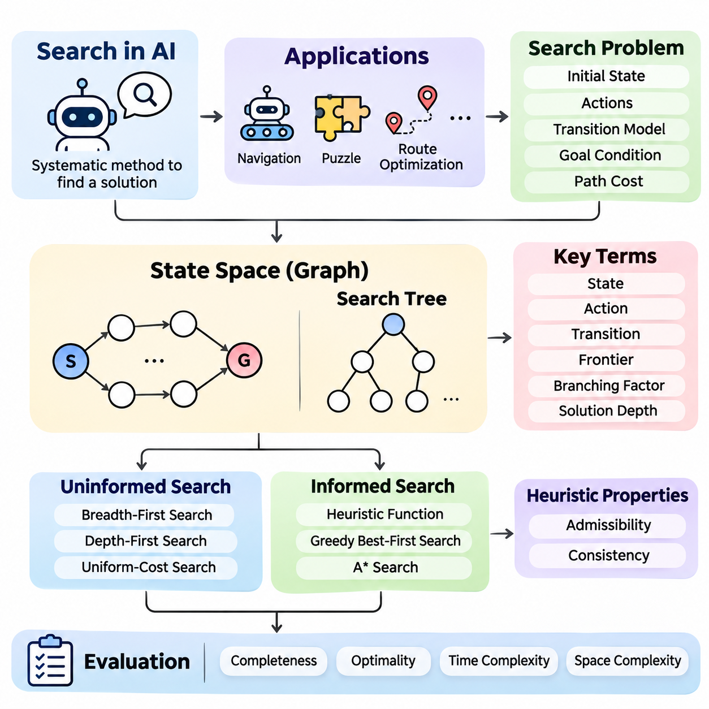
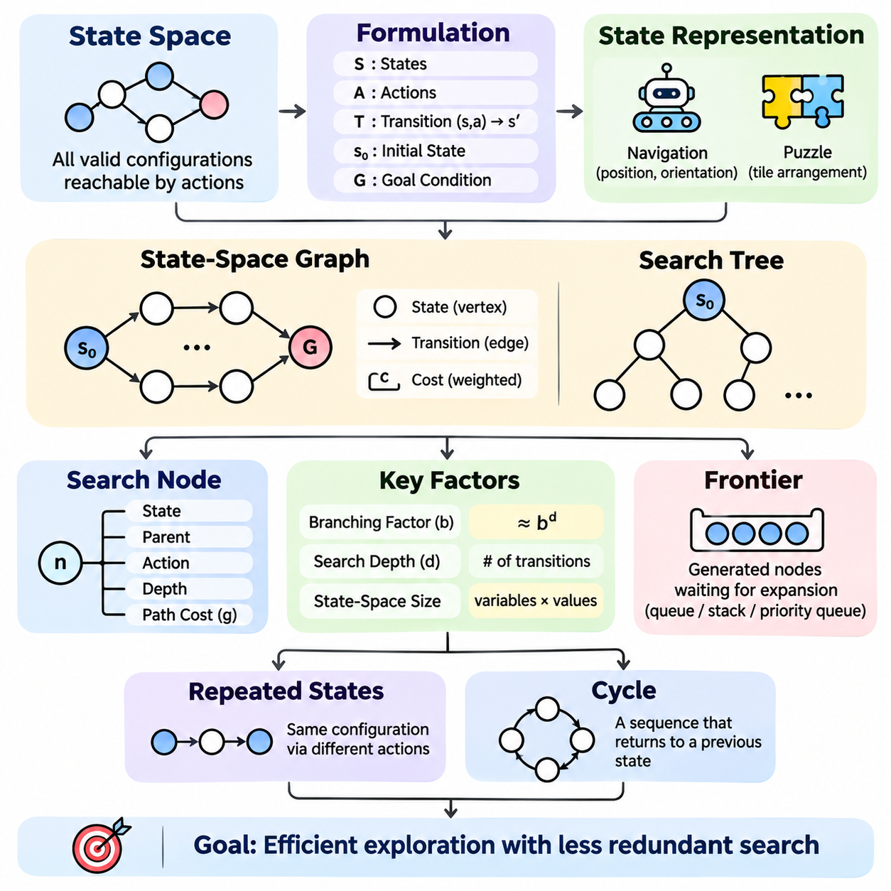
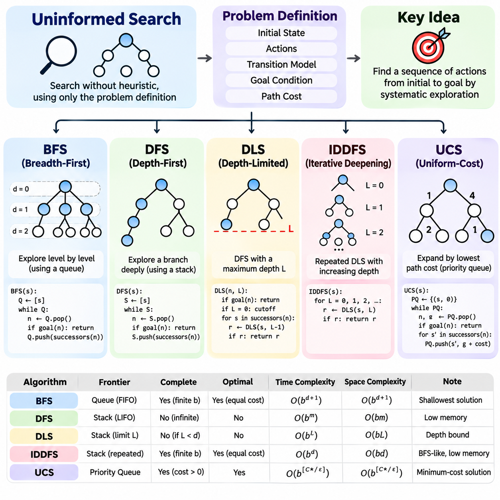
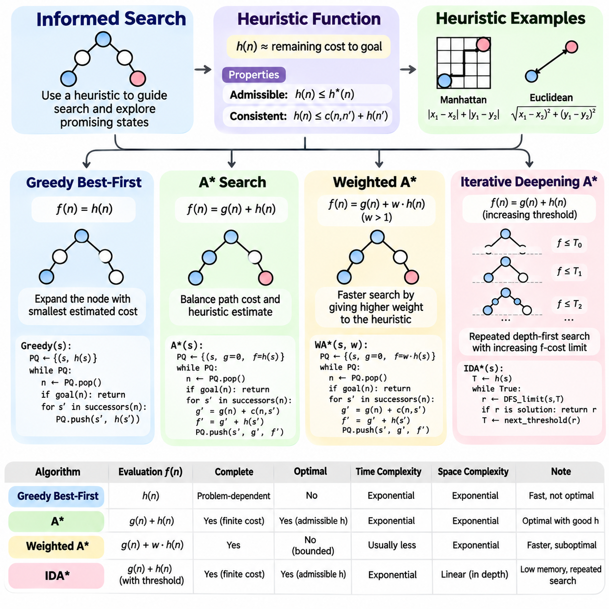
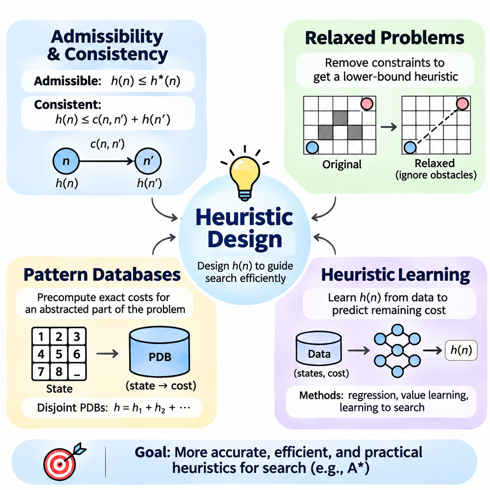
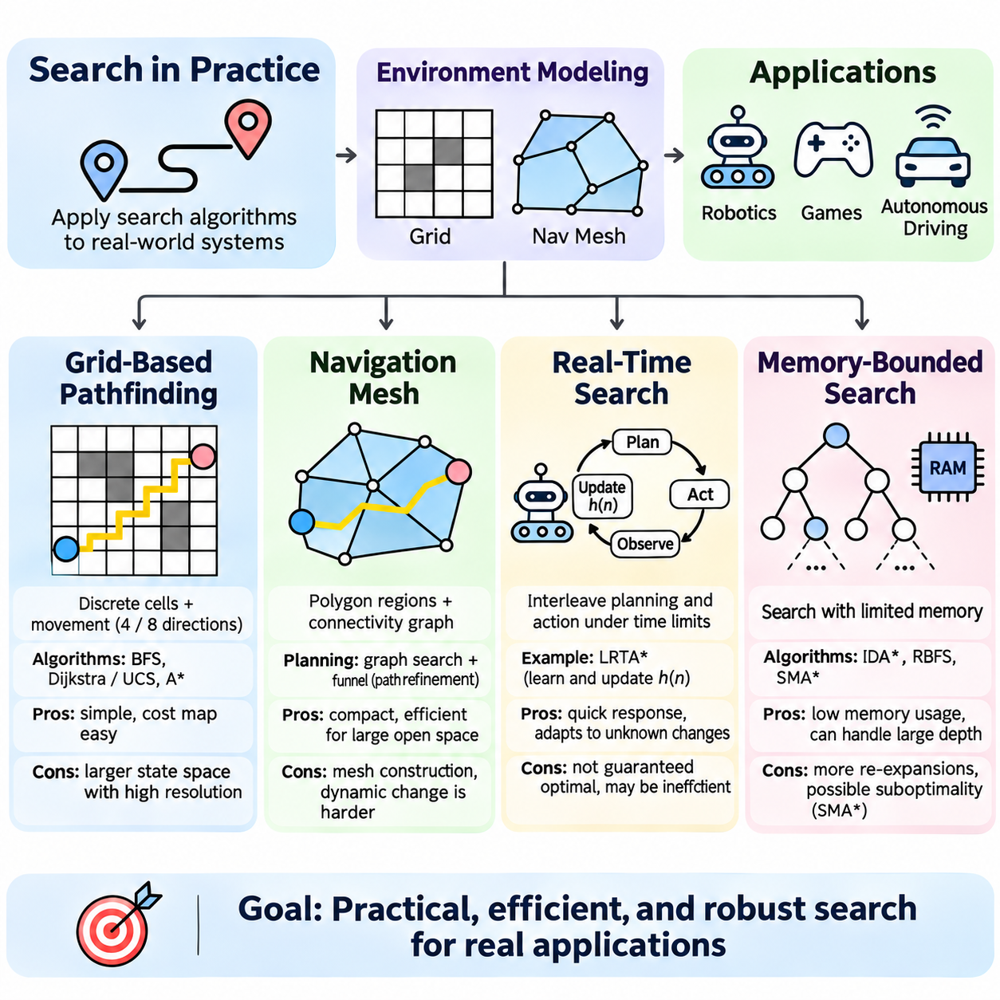
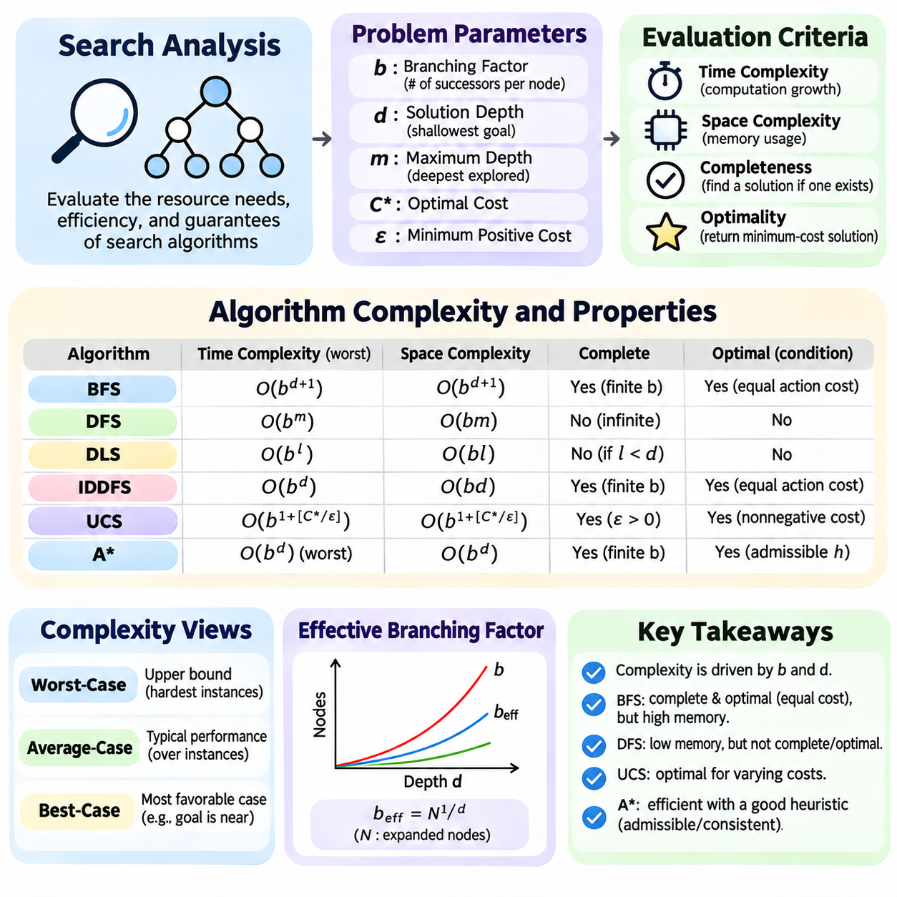
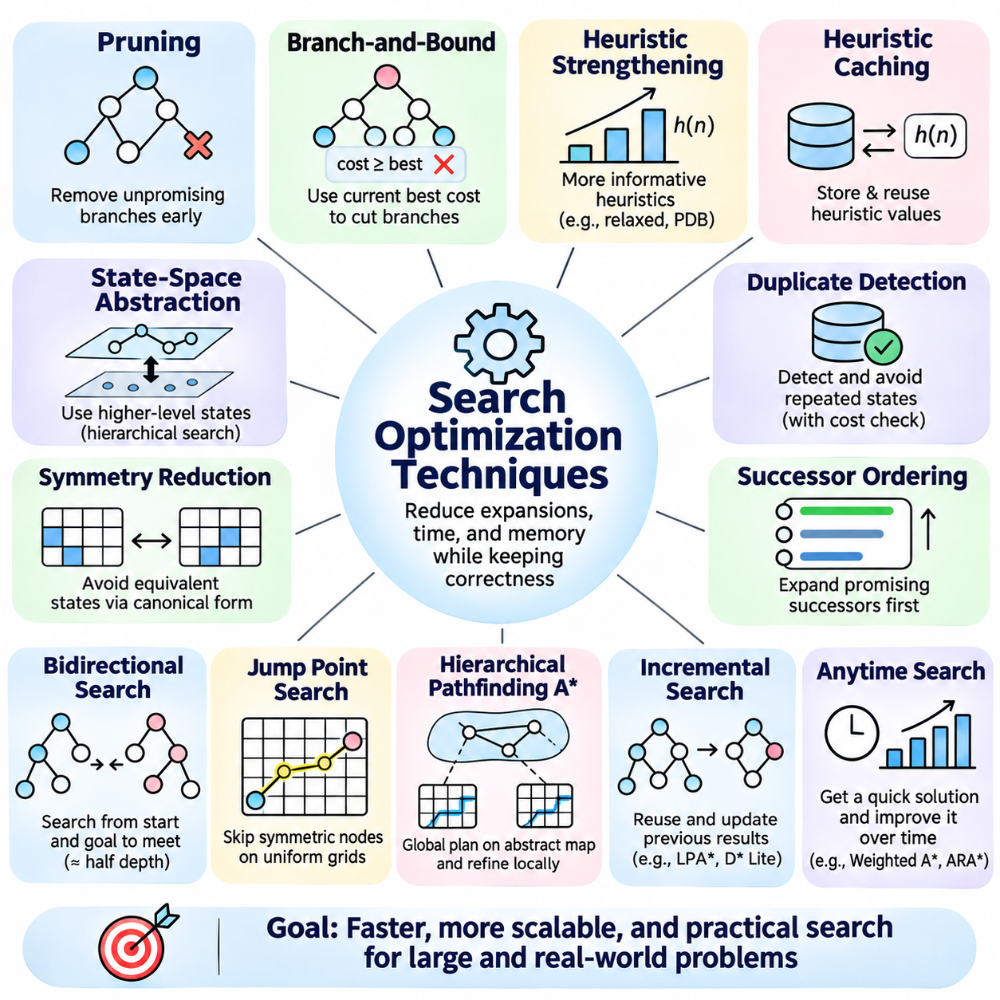
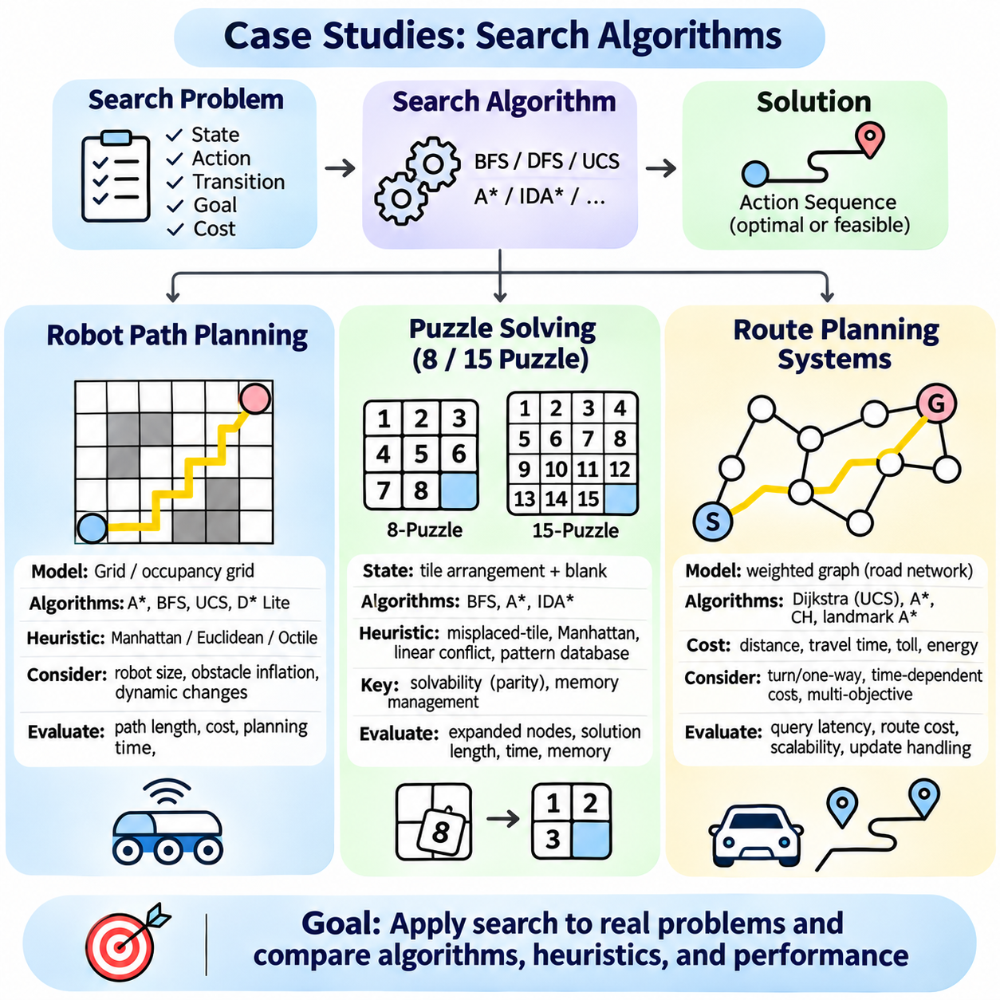

**Volume 01. Classical AI Search and Planning**

# 01. Search Algorithms

## 01.01 Introduction to Search

{width="7.268055555555556in" height="7.268055555555556in"}

Search is one of the fundamental mechanisms of classical artificial intelligence, providing a systematic method for discovering solutions among multiple possible actions and states. Rather than relying exclusively on predefined instructions, a search-based intelligent agent explores alternative configurations, evaluates their relevance, and identifies a sequence of decisions that transforms an initial situation into a desired outcome.

The importance of search originates from the complexity of intelligent decision-making. Many problems cannot be solved through a single calculation because their solutions require several dependent choices. Robot navigation, puzzle solving, route optimization, and automated planning illustrate situations where an agent must consider alternative actions while satisfying environmental constraints and operational objectives.

A search problem is generally defined through an initial state, a collection of available actions, a transition model, a goal condition, and a path-cost function. The initial state describes the starting configuration, while the transition model determines how actions modify that configuration. The goal condition identifies acceptable solutions, and the path-cost function measures the accumulated expense of reaching them.

A state represents a meaningful configuration of the problem environment at a particular point in the decision process. Depending on the application, it may describe a robot\'s location, the arrangement of puzzle tiles, or the allocation of resources. Effective state representation preserves information necessary for decision-making while excluding irrelevant details that would unnecessarily increase computational complexity.

Actions define the possible transformations between states and establish the structure of the search problem. In a grid-navigation environment, actions might include moving north, south, east, or west. In a puzzle, an action may exchange the position of an empty tile with an adjacent tile. Each action must satisfy applicable constraints before the resulting state can be considered valid.

The transition model specifies the relationship between an existing state, an executed action, and the resulting state. In deterministic environments, an action applied to a particular state produces a predictable successor. This assumption simplifies classical search because the agent can construct possible future configurations without repeatedly interacting with the physical environment during every planning step.

The state space contains all configurations reachable through valid sequences of actions from the initial state. Its structure can be represented mathematically as a graph, where vertices correspond to states and directed edges represent transitions. The number of reachable states may grow rapidly as problem complexity increases, making exhaustive exploration computationally impractical for many realistic applications.

A search tree describes the exploration process rather than the underlying problem itself. Each tree node represents a particular path leading to a state, meaning that different nodes may correspond to the same underlying configuration. This distinction becomes important when repeated states or cycles occur, because uncontrolled exploration can waste resources or repeatedly revisit previously examined configurations.

The search frontier maintains nodes that have been generated but not yet expanded. A search algorithm repeatedly selects a node from this frontier, examines whether it satisfies the goal condition, and generates eligible successors when further exploration is necessary. The selection strategy determines the order of exploration and strongly influences computational efficiency, solution quality, and memory requirements.

Uninformed search algorithms explore the state space without using estimates of how close a state is to the goal. Breadth-first search expands shallow nodes first, while depth-first search follows a branch before exploring alternatives. Uniform-cost search selects nodes according to accumulated path cost. These methods provide foundational approaches for understanding how exploration order affects algorithmic behavior.

Informed search algorithms incorporate heuristic knowledge to guide exploration toward promising regions of the state space. A heuristic function estimates the remaining cost or distance from a state to a goal. Greedy best-first search prioritizes estimated proximity, whereas A\\\* search combines accumulated path cost with estimated remaining cost to balance progress toward the goal against the expense already incurred.

The effectiveness of heuristic search depends heavily on the quality of the heuristic function. An informative estimate can reduce unnecessary exploration, while a weak estimate may provide little advantage over uninformed methods. Properties such as admissibility and consistency are especially important because they support theoretical guarantees about optimality and the behavior of algorithms such as A\\\*.

Search algorithms are commonly evaluated through completeness, optimality, time complexity, and space complexity. Completeness indicates whether an algorithm is guaranteed to find a solution when one exists under specified assumptions. Optimality concerns whether the returned solution minimizes the defined cost. Time and space complexity characterize the computational resources required as the search problem becomes larger.

The branching factor describes the number of successors generated from a typical state, while solution depth indicates the number of transitions required to reach a goal. These quantities help explain why search can become computationally expensive. Even when individual state transitions are inexpensive, a large branching factor combined with substantial depth can produce an enormous number of candidate paths.

Path cost provides a quantitative basis for comparing alternative solutions. In a simple navigation problem, every movement may have equal cost, making the shortest path desirable. More realistic environments may assign different costs according to distance, energy consumption, travel time, or terrain difficulty. Consequently, the most efficient solution depends on the objective encoded within the search formulation.

Graph search improves practical efficiency by maintaining information about previously explored states. This mechanism can prevent repeated expansion of identical configurations and reduce unnecessary computation. However, implementations must handle situations where a cheaper path to an existing state is discovered, particularly when using cost-sensitive algorithms and heuristics that do not satisfy consistency requirements.

Real-world search introduces additional challenges involving limited memory, incomplete environmental knowledge, and changing operating conditions. A robot may encounter obstacles that were absent from its original map, requiring the search process to update its representation and compute an alternative route. Such conditions motivate real-time search, incremental replanning, and memory-bounded approaches.

Grid-based pathfinding provides a practical example of classical search in robotics and autonomous navigation. The environment is divided into traversable and restricted cells, and neighboring cells define candidate transitions. Algorithms such as A\\\* can identify collision-free routes through the grid, although actual vehicle deployment also requires consideration of physical dimensions, motion constraints, and environmental uncertainty.

Navigation meshes provide another representation for pathfinding, particularly in virtual environments and applications involving continuous movement across accessible regions. Instead of treating every small location as an independent grid cell, a navigation mesh organizes traversable space into connected geometric regions. Search can then operate over their connectivity before generating a suitable geometric path.

Puzzle-solving problems provide controlled environments for studying search behavior. The 8-puzzle and 15-puzzle require rearranging numbered tiles into a target configuration through legal movements. These problems offer well-defined states, actions, and goal conditions, making them useful for comparing uninformed exploration, heuristic evaluation, repeated-state detection, and computational complexity.

Route planning systems demonstrate how search principles extend to transportation networks and logistics operations. Intersections or locations can represent states, while roads and connections define transitions. Costs may incorporate distance, travel duration, or other operational factors. Selecting an appropriate search algorithm enables efficient route discovery across networks containing numerous alternative connections.

Search also provides an essential foundation for automated planning, where the objective is to determine a sequence of actions satisfying a specified goal. While basic pathfinding emphasizes movement between locations, planning problems may involve logical preconditions, action effects, and dependencies between tasks. Search methods therefore connect directly to broader classical AI mechanisms for reasoning and decision-making.

Search-based intelligence differs from machine learning because a search algorithm does not necessarily require training data or learned parameters. Its behavior can be determined through explicit state representations, transition rules, and exploration strategies. Nevertheless, learning methods can complement search by estimating heuristic values, predicting useful actions, or improving the selection of promising alternatives.

The practical design of a search system requires careful coordination between problem formulation, algorithm selection, and computational constraints. A theoretically optimal algorithm may be unsuitable when memory is severely restricted or decisions must be produced within strict deadlines. Engineering decisions must therefore balance solution quality, response time, resource consumption, and the reliability required by the application.

A complete understanding of search establishes the foundation for subsequent study of state spaces, search trees, uninformed algorithms, informed algorithms, heuristic design, and optimization techniques. These concepts collectively explain how intelligent systems transform complex decision problems into structured computational processes, enabling systematic exploration and goal-directed behavior across a wide range of AI applications.

## 01.02 State Space and Search Trees

{width="7.268055555555556in" height="7.268055555555556in"}

State spaces and search trees provide the structural foundation for classical artificial intelligence search algorithms. They describe how a problem can be represented as interconnected configurations and how an intelligent agent systematically explores possible solutions. Understanding these structures is essential for designing search methods that balance computational efficiency, solution quality, and memory consumption.

A state space represents the collection of all valid configurations that can be reached from an initial state through permitted actions. Each state captures the information necessary to describe a particular problem configuration. In robot navigation, a state may represent position and orientation, while in puzzle solving, it may describe the arrangement of tiles on a board.

The mathematical formulation of a state space typically includes a set of states, an action set, and a transition function. The transition function maps a state and an applicable action to a successor state in deterministic problems. Together, these elements define the connectivity of the problem and establish which configurations are reachable through valid sequences of decisions.

The initial state establishes the starting point of the search process, while the goal condition identifies configurations that satisfy the desired objective. A problem may contain a single goal state or multiple acceptable goal states. Search algorithms must discover a valid sequence of transitions connecting the initial state to at least one goal configuration.

State representation directly influences the computational complexity of search. A representation containing unnecessary variables may produce an excessively large state space, while an overly simplified representation may omit important constraints. Effective modeling preserves the information required for valid decisions while minimizing redundant or irrelevant distinctions between configurations.

A state-space graph represents states as vertices and valid transitions as directed edges. Each edge corresponds to an action that transforms one configuration into another. When transitions have associated costs, the graph becomes weighted. This representation supports mathematical analysis of reachability, connectivity, shortest paths, and alternative routes through the problem.

A search tree differs from a state-space graph because it represents the history of exploration rather than only the unique states of the problem. Each tree node corresponds to a particular sequence of actions leading from the root to a state. Consequently, multiple tree nodes may reference the same underlying state when different action sequences reach an identical configuration.

The root node of a search tree represents the initial state and contains no preceding action. Child nodes are generated by applying valid actions to the state associated with their parent. Repeated expansion produces additional levels of the tree, with each level representing another step in the sequence of decisions considered by the search algorithm.

A search node commonly stores the associated state, a reference to its parent, the action used to reach it, its depth, and its accumulated path cost. These attributes support solution reconstruction and algorithm-specific prioritization. The parent relationship allows the final solution path to be recovered by tracing backward from a discovered goal node to the root.

The branching factor describes the number of successor nodes generated during expansion. If each node produces approximately b successors, the number of nodes at depth d may approach b raised to the power d. This exponential growth explains why even moderately deep search problems can require substantial computational resources when the branching factor is large.

Search depth measures the number of transitions separating a node from the root. Depth is particularly important in algorithms that prioritize shallow solutions or restrict exploration to a predefined limit. However, depth and path cost are not necessarily equivalent because individual transitions may have different costs depending on the characteristics of the environment.

The frontier contains generated nodes awaiting expansion and forms the operational boundary between explored and unexplored regions. Different search algorithms organize this collection using queues, stacks, or priority queues. The ordering policy determines which node is expanded next and therefore controls the direction, efficiency, and behavior of the search process.

Repeated states occur when different action sequences lead to the same configuration. For example, a robot may move east and then west, returning to its original position. Without repeated-state detection, a search algorithm may explore equivalent configurations many times, increasing execution time and potentially creating unbounded exploration in environments containing cycles.

Graph-search implementations commonly maintain an explored-state collection to reduce redundant expansions. Depending on the algorithm, they may also record the best known cost of reaching each state. When a lower-cost path is discovered, the corresponding record may need updating, and previously expanded states may require reconsideration under certain search strategies.

Cycles arise when a sequence of transitions returns to an earlier state. A cycle may involve only two configurations or a longer chain of actions. Detecting cycles is essential for preventing unnecessary exploration, especially in depth-first search. Path-based cycle checking and global repeated-state detection offer different tradeoffs between memory consumption and computational efficiency.

State-space size depends on the number of variables, their possible values, and the constraints governing valid combinations. A problem with several independent variables can produce a combinatorial number of configurations. Constraints may eliminate many combinations, but the remaining reachable space can still be extremely large, requiring careful representation and efficient exploration.

Implicit state-space representation avoids constructing the entire graph before searching. Instead, successor states are generated dynamically when a node is expanded. This approach is widely used because explicitly storing every possible configuration is often impractical. Successor-generation functions therefore play a central role in the implementation of scalable search algorithms.

Explicit graph representations remain useful when the environment is relatively small, stable, and repeatedly queried. Road networks, predefined navigation graphs, and structured dependency systems may benefit from stored connectivity information. The choice between explicit and implicit representations depends on graph size, update frequency, available memory, and the computational cost of generating successors.

Path cost is accumulated along the transitions connecting the initial state to a search node. When every action has identical cost, minimizing the number of transitions also minimizes total path cost. In weighted environments, however, a deeper path may be less expensive than a shallower alternative, making cost-aware exploration necessary for finding optimal solutions.

Goal testing determines whether the state associated with a selected node satisfies the desired condition. The timing of this test affects algorithm behavior and guarantees. Some methods test nodes when they are generated, while others test them when selected for expansion. Correct implementation depends on the search strategy and the assumptions governing path costs.

State abstraction reduces problem complexity by grouping configurations that are equivalent for a particular decision objective. For example, a navigation planner may ignore minor geometric details when computing a high-level route. Although abstraction can reduce search effort, excessive simplification may produce paths that violate constraints or cannot be executed in the original environment.

Hierarchical representations organize complex problems into multiple levels of detail. A robot may first search among rooms or regions and subsequently compute precise movements within selected areas. This decomposition reduces the number of configurations considered at each stage, although the resulting solution quality depends on how accurately higher-level relationships represent lower-level feasibility and costs.

In robotic applications, state spaces may include position, orientation, velocity, and other motion-related variables. Search trees can represent alternative movement sequences, but valid transitions must respect physical constraints. Vehicle dimensions, turning limitations, obstacles, and motion feasibility influence which states and transitions are acceptable during planning.

Puzzle environments illustrate the relationship between state spaces and search trees particularly clearly. In the 8-puzzle, each legal arrangement of tiles represents a state, and moving a tile into the empty position defines a transition. Different movement sequences can reach the same arrangement, demonstrating why the number of search-tree nodes may exceed the number of unique reachable states.

The design of state spaces and search trees determines how effectively search algorithms can operate. Accurate state modeling ensures that solutions correspond to valid problem configurations, while efficient node management limits redundant computation. These principles establish the conceptual foundation for breadth-first search, depth-first search, uniform-cost search, heuristic search, and advanced planning systems.

## 01.03 Uninformed Search Overview

{width="7.268055555555556in" height="7.268055555555556in"}

Uninformed search algorithms provide systematic methods for exploring state spaces without relying on heuristic estimates of the remaining distance to a goal. These algorithms use only the problem definition, including the initial state, available actions, transition model, goal condition, and path costs. Their behavior depends on how generated nodes are organized and selected for expansion during the search process.

The fundamental objective of uninformed search is to discover a valid sequence of actions connecting an initial state to a goal state. Because no additional guidance about goal proximity is available, exploration follows predetermined structural or cost-based rules. Breadth-first search, depth-first search, depth-limited search, iterative deepening, and uniform-cost search represent the principal approaches.

Breadth-first search, commonly abbreviated as BFS, explores the search tree level by level, expanding all nodes at a given depth before proceeding to deeper levels. It maintains the frontier using a first-in, first-out queue, ensuring that nodes generated earlier are processed first. This exploration strategy is particularly suitable for problems where the shallowest solution is desired.

BFS is complete when the branching factor is finite and a solution exists at finite depth. It is also optimal when every action has the same positive cost, because the shallowest solution then has the lowest accumulated path cost. However, its memory requirements increase rapidly as the search frontier expands, making large state spaces difficult to explore efficiently.

The computational complexity of BFS depends primarily on the branching factor and the depth of the shallowest goal. With branching factor b and solution depth d, time and memory requirements can grow exponentially with d. Although BFS offers predictable exploration behavior and useful guarantees, its substantial memory consumption often limits its applicability to deeply structured problems.

Depth-first search, abbreviated as DFS, follows one branch of the search tree as deeply as possible before returning to explore alternative branches. It commonly uses a last-in, first-out stack or recursive function calls. By prioritizing recently generated nodes, DFS can reach deep configurations quickly without maintaining the complete frontier of shallower search levels.

DFS generally requires substantially less memory than BFS because it stores the current exploration path and the alternative branches awaiting examination. In a tree with maximum depth m and branching factor b, conventional depth-first tree search requires space proportional to b times m. This characteristic makes DFS attractive when memory resources are limited.

Despite its memory efficiency, DFS does not guarantee an optimal solution and may fail to terminate in infinite-depth spaces or cyclic search structures without appropriate safeguards. The first discovered goal may lie along a much longer path than another available solution. Its completeness therefore depends on assumptions about the search space and the implementation of cycle detection.

Depth-limited search extends DFS by imposing a maximum permitted exploration depth. Nodes reaching the predefined limit are not expanded further, preventing the algorithm from descending indefinitely. This modification is useful when a reasonable upper bound on solution depth is known or when computational resources require strict control over the depth of exploration.

The depth limit introduces an important tradeoff between computational efficiency and solution accessibility. A limit that is too small may prevent the algorithm from reaching an existing goal, while an excessively large limit reduces the practical benefits of restricting exploration. Depth-limited search can distinguish a depth cutoff from genuine failure when its implementation explicitly tracks these outcomes.

Depth-limited search preserves the memory advantages of DFS while providing a predictable bound on exploration depth. Its time complexity remains exponential in the selected depth limit in the worst case, but memory consumption grows approximately linearly with that limit for a fixed branching factor. The algorithm is not generally optimal because it does not prioritize lower-cost solutions.

Iterative deepening depth-first search, commonly called IDDFS, combines the shallow-solution preference of BFS with the memory efficiency of DFS. It repeatedly executes depth-limited search while gradually increasing the permitted depth. The initial iteration explores only the root, and subsequent iterations examine progressively deeper portions of the search tree.

Although IDDFS revisits nodes near the root during successive iterations, the repeated work is often relatively small compared with the total number of nodes at the deepest explored level. In exponentially growing search trees, most nodes occur near the maximum depth. Consequently, iterative deepening can provide BFS-like solution guarantees while retaining DFS-like memory requirements.

IDDFS is complete for finite branching factors when a goal exists at finite depth, and it is optimal when all actions have equal positive costs. Its time complexity is exponential in solution depth, while its memory requirements grow approximately linearly with depth for a fixed branching factor. These properties make it useful when solution depth is unknown and memory is constrained.

Uniform-cost search, abbreviated as UCS, expands nodes according to their accumulated path cost rather than their depth. It maintains a priority queue ordered by the cost of reaching each candidate node from the initial state. This strategy allows the algorithm to discover minimum-cost solutions even when individual actions have different costs.

UCS is closely related to Dijkstra\'s shortest-path algorithm and can be understood as a cost-sensitive generalization of breadth-first search. When all actions have identical positive costs, UCS expands nodes in nondecreasing depth order, apart from tie-breaking differences. With variable costs, however, it may explore deeper but inexpensive paths before shallower alternatives.

The optimality of UCS depends on selecting a goal when it is removed from the priority queue for expansion rather than merely when it is generated. With nonnegative edge costs, appropriate best-cost bookkeeping, and standard graph-search handling, UCS can return an optimal solution. Completeness additionally requires conditions preventing infinitely many expansions below the optimal solution cost.

The computational demands of UCS depend on the distribution of action costs and the number of states reachable below the optimal solution cost. Unlike BFS, its complexity cannot be characterized solely by solution depth. When action costs are bounded below by a positive constant, conventional complexity bounds can be expressed using the optimal solution cost and minimum step cost.

The frontier management strategy is the principal distinction among uninformed search methods. BFS uses a FIFO queue, DFS uses a LIFO stack, depth-limited search adds a depth restriction, IDDFS repeats bounded DFS, and UCS uses a cost-ordered priority queue. These differences determine exploration order, memory consumption, completeness, and optimality guarantees.

Repeated-state detection is essential when uninformed search operates on graphs containing cycles or multiple paths to identical states. An explored-state collection can reduce redundant expansions, but cost-sensitive algorithms must also preserve information about the cheapest known route. Incorrect duplicate handling may reduce efficiency or invalidate guarantees about finding minimum-cost solutions.

The selection of an uninformed search algorithm depends on problem characteristics and operational constraints. BFS is appropriate for shallow solutions with uniform costs, while DFS emphasizes low memory consumption. Depth-limited search controls exploration depth, IDDFS balances memory efficiency with shallow-goal discovery, and UCS prioritizes minimum accumulated cost.

Robotic navigation provides practical examples of these distinctions. BFS can identify minimum-step routes on uniform-cost grids, while UCS handles terrain-dependent movement costs. DFS may support exploratory traversal when optimality is unnecessary, and depth-limited methods can restrict computational effort. Real-world deployment additionally requires obstacle handling, motion constraints, and safety validation.

Puzzle solving and route planning also demonstrate the usefulness of uninformed search. BFS and IDDFS can solve discrete puzzles when solution depth is the primary objective, whereas UCS is suitable for weighted transportation networks. These applications illustrate how the same state-space representation can produce different exploration behavior depending on the selected algorithm.

Uninformed search establishes an essential baseline for evaluating more advanced search strategies. Its theoretical properties reveal the relationships among exploration order, branching factor, solution depth, path cost, and memory consumption. Understanding these relationships prepares the foundation for informed search, heuristic design, A\\\* search, and increasingly sophisticated planning systems.

## 01.04 Informed Search Overview

{width="7.268055555555556in" height="7.268055555555556in"}

Informed search algorithms improve the efficiency of classical state-space exploration by incorporating problem-specific knowledge into node selection. Unlike uninformed search, which relies primarily on structural or accumulated-cost information, informed search estimates the potential value of unexplored states. This guidance helps an intelligent agent prioritize promising paths and reduce unnecessary exploration.

The central principle of informed search is to evaluate candidate states according to their estimated relevance to the goal. A search algorithm maintains a frontier of generated nodes and selects the next node using an evaluation function. Different algorithms combine accumulated path cost and estimated remaining cost in different ways, producing distinct tradeoffs among speed, memory consumption, completeness, and optimality.

A heuristic function, commonly denoted h(n), estimates the remaining cost from a search node n to a goal state. It provides approximate guidance without requiring complete exploration of the state space. Heuristics may be derived from geometric distance, simplified problem models, domain-specific constraints, or previously computed information, depending on the characteristics of the application.

The quality of a heuristic strongly influences search performance. A heuristic that closely approximates the true remaining cost can direct exploration toward useful states, while a weak heuristic may offer little improvement over uninformed methods. However, computationally expensive heuristics can offset their benefits, making the balance between estimation accuracy and evaluation overhead an important engineering consideration.

Admissibility and consistency are fundamental properties of heuristic functions. An admissible heuristic never overestimates the actual minimum remaining cost, while a consistent heuristic satisfies a triangle-inequality relationship across transitions. These properties are important for establishing optimality guarantees and determining whether previously expanded states must be reconsidered during graph search.

Common heuristic examples include Manhattan distance and Euclidean distance in spatial navigation problems. Manhattan distance measures movement along coordinate axes, while Euclidean distance represents straight-line separation. Their suitability depends on permitted movements and transition costs. A distance estimate is not automatically admissible unless it respects the actual movement model.

Greedy best-first search selects the frontier node with the smallest estimated remaining cost, using the evaluation function f(n) = h(n). It focuses on apparent proximity to the goal without directly accounting for the cost already accumulated. This strategy can discover solutions quickly when heuristic guidance is accurate, particularly in environments where promising routes are easy to distinguish.

The main limitation of greedy best-first search is its disregard for accumulated path cost. A route that appears close to the goal may involve expensive transitions, obstacles, or long detours. Consequently, greedy search does not generally guarantee an optimal solution. Its completeness also depends on the search-space structure and implementation, including repeated-state handling and the presence of infinite paths.

A\\\* search combines accumulated path cost and estimated remaining cost through the evaluation function f(n) = g(n) + h(n). Here, g(n) represents the known cost from the initial state to node n, while h(n) estimates the remaining cost. By considering both components, A\\\* balances the expense of previous decisions against the expected cost of reaching the goal.

A\\\* is widely used because it can provide optimal solutions under appropriate assumptions. With an admissible heuristic and suitable handling of improved paths, A\\\* graph search can preserve optimality. Consistent heuristics simplify implementation because the best path to a state is established when that state is expanded, assuming conventional nonnegative transition costs.

The behavior of A\\\* depends on the relationship between accumulated cost and heuristic guidance. When h(n) equals zero for every node, A\\\* behaves like uniform-cost search. As the heuristic becomes more informative while remaining admissible, A\\\* can avoid exploring many states that are unlikely to contribute to an optimal solution. Nevertheless, difficult problems may still require extensive exploration.

A\\\* typically maintains an open collection of frontier nodes and records information about previously examined states. A priority queue selects the node with the smallest evaluation value, while best-known path costs support duplicate detection and path improvement. Efficient data structures are essential because priority updates, state comparisons, and memory allocation can significantly influence execution time.

The memory requirements of A\\\* represent one of its principal limitations. In large search spaces, the number of generated nodes can increase exponentially with solution depth. Maintaining frontier entries and state records may therefore consume substantial memory, even when heuristic guidance reduces the number of expansions compared with uninformed search.

Weighted A\\\* modifies the conventional A\\\* evaluation function by increasing the influence of heuristic guidance. A common formulation is f(n) = g(n) + w h(n), where w is greater than one. Increasing the weight encourages exploration toward states estimated to be closer to the goal, potentially reducing search effort at the expense of optimality.

Weighted A\\\* is useful when finding a satisfactory solution quickly is more important than guaranteeing the absolute minimum cost. Under standard assumptions, including an admissible heuristic and suitable search implementation, it can provide bounded-suboptimal solutions whose cost does not exceed the optimal cost multiplied by the heuristic weight. Actual performance depends on the problem and implementation.

The heuristic weight controls the balance between solution quality and search speed. A weight of one recovers conventional A\\\*, while larger values place greater emphasis on estimated remaining cost. Excessive weighting may direct exploration toward misleading routes, so selecting the weight requires evaluating computational constraints, acceptable solution costs, and application-specific requirements.

Iterative deepening A\\\*, commonly called IDA\\\*, combines heuristic cost evaluation with repeated depth-first exploration. Instead of maintaining a potentially large priority queue, it performs depth-first searches constrained by a threshold on f(n) = g(n) + h(n). Nodes whose evaluation values exceed the current threshold are excluded from further expansion during that iteration.

IDA\\\* begins with an evaluation threshold commonly determined by the initial state\'s heuristic value. If no solution is discovered, the threshold increases, typically to the smallest evaluation value that exceeded the previous limit. This process repeats until a goal is found or the search determines that no acceptable solution remains under the applicable assumptions.

The primary advantage of IDA\\\* is its relatively low memory consumption. Conventional depth-first implementations maintain the current search path and limited auxiliary information rather than storing the entire frontier. However, repeated iterations revisit previously examined states, and the resulting computational overhead can become substantial when threshold increases produce many overlapping searches.

IDA\\\* can preserve optimality when the heuristic is admissible and the search procedure correctly handles path costs and threshold progression. Completeness requires additional assumptions, such as finite branching and suitable positive action-cost bounds. Its practical efficiency depends on heuristic accuracy, cost distribution, repeated-state handling, and the number of threshold iterations required.

Heuristic search performance is influenced by the branching factor, solution depth, heuristic accuracy, and distribution of transition costs. A strong heuristic can substantially reduce the effective branching factor, but no heuristic guarantees efficient exploration for every problem. Search efficiency must therefore be evaluated through actual node expansions, execution time, memory consumption, and solution cost.

In robotic navigation, informed search enables route planning through environments containing obstacles, restricted regions, and variable movement costs. Greedy search may produce rapid approximate routes, while A\\\* supports cost-optimal planning under suitable models. Weighted A\\\* offers faster bounded-suboptimal planning, and IDA\\\* provides an alternative when memory availability is severely constrained.

Puzzle solving provides another important application of informed search. Manhattan distance can estimate the remaining movements required to arrange tiles into a target configuration. A\\\* uses this estimate to guide optimal solution discovery, while IDA\\\* is particularly useful for larger puzzles where storing extensive search frontiers would require excessive memory.

Selecting an informed search algorithm requires balancing theoretical guarantees against operational requirements. Greedy best-first search emphasizes estimated goal proximity, A\\\* balances accumulated and remaining costs, Weighted A\\\* trades optimality for stronger heuristic guidance, and IDA\\\* reduces memory demands through iterative cost thresholds. The appropriate choice depends on solution quality, available resources, and response-time constraints.

Informed search establishes a foundation for advanced heuristic design, optimal pathfinding, real-time planning, and autonomous decision-making. Its central contribution is the integration of domain knowledge with systematic state-space exploration. Understanding heuristic functions and the differences among Greedy Best-First Search, A\\\*, Weighted A\\\*, and IDA\\\* enables the design of more efficient and reliable intelligent search systems.

## 01.05 Heuristic Design

{width="7.268055555555556in" height="7.268055555555556in"}

Heuristic design is a fundamental component of informed search because it determines how effectively an algorithm estimates the remaining cost of reaching a goal. A well-designed heuristic reduces unnecessary state expansions while preserving the properties required by the selected search strategy. Its development involves mathematical guarantees, problem simplification, precomputed knowledge, and increasingly, data-driven learning methods.

A heuristic function h(n) assigns an estimated remaining cost to a search node n. Ideally, this estimate approaches the true optimal cost h\\\*(n) without requiring the full computational effort needed to calculate it exactly. The usefulness of a heuristic depends on its accuracy, evaluation speed, memory requirements, and compatibility with the assumptions of the search algorithm.

Admissibility is a central requirement for optimal heuristic search. A heuristic is admissible when h(n) never exceeds h\\\*(n) for any reachable state, assuming nonnegative costs and a zero estimate at the goal. This lower-bound property allows algorithms such as A\\\* to use heuristic guidance without excluding potentially optimal solutions under appropriate search conditions.

Consistency, also called monotonicity, imposes a stronger local relationship between neighboring states. For every transition from n to n\' with cost c(n,n\'), a consistent heuristic satisfies h(n) ≤ c(n,n\') + h(n\'). With h(goal) = 0, consistency implies admissibility and ensures that A\\\* evaluation values do not decrease along a search path.

The distinction between admissibility and consistency becomes especially important in graph search. An admissible but inconsistent heuristic can still support optimal A\\\* search when improved paths are handled correctly. However, previously expanded states may need reopening. Consistent heuristics simplify duplicate handling because a state expanded with its minimum path cost does not require later reconsideration.

Heuristic dominance provides a useful principle for comparing admissible estimates. If two heuristics satisfy h1(n) ≥ h2(n) for every state while remaining admissible, h1 dominates h2 by providing an equally strong or stronger lower bound. Stronger estimates generally reduce unnecessary exploration, although their computational cost must also be considered when comparing practical performance.

Multiple admissible heuristics can be combined using their maximum value without losing admissibility. The resulting estimate is at least as informative as each individual component. Adding heuristic values requires greater care because overlapping cost contributions can cause overestimation. Safe additive combinations depend on valid cost partitioning or independently accounted transition costs.

Relaxed problems provide a systematic approach to constructing admissible heuristics. A relaxed problem removes selected constraints from the original problem while preserving relevant states and actions. Because the relaxed problem permits additional solutions or cheaper alternatives, its optimal solution cost cannot exceed the optimal cost of the original problem when the relaxation is constructed correctly.

In grid-based navigation, a relaxed problem may ignore obstacles while retaining movement costs and geometric restrictions. The resulting shortest distance can provide a lower bound on the actual route cost. Manhattan distance is suitable for certain axis-aligned movement models, while Euclidean distance can be appropriate when movement costs are bounded by physical travel distance.

Puzzle solving offers another illustration of relaxation-based heuristic design. In sliding-tile puzzles, ignoring restrictions imposed by other tiles allows each tile\'s displacement to be estimated independently. Summing Manhattan distances provides an admissible estimate when each legal move shifts one tile by one grid position and each move has unit cost.

The effectiveness of relaxed-problem heuristics depends on which constraints are removed. Eliminating too many restrictions produces inexpensive but weak estimates, while preserving more constraints may improve accuracy at substantial computational expense. Heuristic engineering therefore involves finding simplified models that remain computationally manageable while retaining important structural information.

Pattern databases provide another powerful method for generating heuristic estimates. A pattern database stores exact solution costs for an abstracted subset of problem variables. These values are typically computed before the main search and retrieved during execution, replacing repeated online calculations with efficient table lookups.

Pattern database construction begins by selecting a pattern of relevant state variables and defining an abstraction that ignores or groups the remaining variables. A backward search from abstract goal states can compute optimal abstract distances. The resulting lookup table associates abstract configurations with their minimum costs, providing reusable heuristic information.

When abstraction preserves a valid lower-bound relationship, pattern database values are admissible for the original problem. Larger patterns often provide more informative estimates because they retain additional interactions among variables. However, database size can grow combinatorially, creating substantial storage requirements and potentially expensive preprocessing.

Disjoint pattern databases can support additive heuristics when action costs are partitioned so that no transition cost is counted more than once. For example, different groups of puzzle tiles may be assigned separate abstract costs. Summing their corresponding database estimates can produce a stronger admissible heuristic than relying on a single small pattern.

Pattern selection is an important optimization problem. Patterns should capture influential interactions while remaining small enough for practical storage and lookup. Compression, symmetry reduction, hierarchical abstraction, and selective database construction can reduce memory requirements. These techniques allow pattern databases to support increasingly complex search problems.

Heuristic learning extends traditional design by estimating remaining costs from data rather than relying exclusively on manually derived formulas. Supervised learning can train regression models using states paired with known or approximate cost-to-go values. Neural networks, decision trees, and other predictive models can learn relationships that are difficult to express analytically.

Training data for heuristic learning may be generated through exact search on smaller problems, sampled optimal trajectories, simulation, or previously solved instances. Each training example associates a state representation with a target cost estimate. Data quality is critical because inaccurate labels or insufficient coverage can produce misleading predictions in unfamiliar regions of the state space.

Feature representation strongly influences learned heuristic performance. Relevant features may include geometric distances, obstacle configurations, remaining tasks, graph connectivity, or abstract state descriptors. A model must capture information associated with future solution cost while remaining efficient enough to evaluate repeatedly during search.

Learned heuristics introduce an important challenge because prediction accuracy does not automatically guarantee admissibility or consistency. A neural model may overestimate remaining cost even when its average prediction error is small. Consequently, using an unconstrained learned heuristic in conventional A\\\* can invalidate optimality guarantees unless additional safeguards are applied.

One approach combines learned estimates with analytically verified lower bounds. A guaranteed admissible heuristic can remain responsible for optimality, while learned predictions influence secondary ordering or tie-breaking. Other methods seek certified lower bounds through constrained model construction, formal verification, or conservative correction procedures supported by valid guarantees.

Learning can also optimize heuristic selection rather than directly predicting cost-to-go. A system may choose among several admissible heuristics according to state characteristics or estimated evaluation overhead. Adaptive selection can reduce computational effort when different heuristics perform well in different regions, provided the resulting search policy preserves the required correctness conditions.

The practical quality of a heuristic must be evaluated through complete search performance rather than prediction accuracy alone. Relevant measurements include expanded nodes, generated nodes, heuristic evaluation time, peak memory consumption, solution cost, and total execution time. A more accurate heuristic may perform worse if its evaluation overhead exceeds the savings from reduced exploration.

Heuristic design is particularly important in robotic navigation, automated planning, and combinatorial optimization. Geometric lower bounds support pathfinding, relaxed task models guide planning, and pattern databases accelerate structured puzzle search. Learned heuristics can incorporate complex environmental relationships, although safety-critical applications require careful validation of their reliability.

Effective heuristic engineering combines theoretical correctness with practical efficiency. Admissibility and consistency establish useful guarantees, relaxed problems provide principled lower bounds, pattern databases exploit precomputed abstractions, and heuristic learning introduces adaptable data-driven estimates. Together, these methods form the foundation for scalable, efficient, and reliable informed search systems.

## 01.06 Search in Practice

{width="7.268055555555556in" height="7.268055555555556in"}

Practical search systems transform theoretical algorithms into operational solutions for navigation, robotics, interactive environments, and autonomous decision-making. Their effectiveness depends not only on the selected search strategy but also on environmental representation, computational resources, and response-time constraints. Grid-based pathfinding, navigation meshes, real-time search, and memory-bounded methods address these engineering challenges.

Search implementation begins by converting the physical or virtual environment into a structured state space. The representation determines which locations are reachable, how movements are generated, and how transition costs are assigned. A useful model must preserve essential constraints while remaining compact enough for efficient planning, particularly when the environment contains many obstacles or continuously changing conditions.

Grid-based pathfinding divides an environment into discrete cells that represent traversable or blocked regions. Each accessible cell becomes a state, while permitted movements between neighboring cells define transitions. Four-connected grids allow horizontal and vertical movement, whereas eight-connected grids additionally permit diagonal transitions, increasing flexibility but requiring careful movement-cost modeling.

The spatial resolution of a grid strongly influences planning accuracy and computational expense. Fine grids capture narrow passages and detailed obstacle boundaries but produce larger search spaces. Coarse grids reduce memory consumption and processing time while potentially overlooking important geometric constraints. Resolution selection therefore balances navigational precision, map size, and available computing capacity.

Breadth-first search can identify minimum-step paths in uniform-cost grids, while Dijkstra\'s algorithm or uniform-cost search handles varying movement costs. A\\\* incorporates geometric heuristics to prioritize promising routes and often reduces node expansions. Manhattan distance is suitable for four-connected movement, while octile distance can guide eight-connected grids with appropriate diagonal costs.

Practical grid planners must account for obstacles, robot dimensions, and collision margins. Obstacle inflation expands blocked regions according to the robot\'s footprint and required clearance. This transformation allows a point-based planner to approximate the motion of a finite-sized robot. However, orientation-dependent geometry and nonholonomic motion constraints may require richer state representations.

Grid-based planning also supports cost maps that assign different traversal penalties to terrain conditions. Rough surfaces, steep slopes, restricted areas, and regions near obstacles may receive higher costs. The resulting planner can prefer safer or more efficient routes rather than simply minimizing geometric distance, provided that transition costs accurately represent the intended planning objectives.

Navigation meshes represent traversable space using connected polygons instead of uniformly sized cells. Each polygon describes a region where movement is permitted, and adjacency relationships identify possible transitions between regions. This representation is especially useful in large open environments because relatively few polygons can describe spaces that would otherwise require many grid cells.

Navigation mesh construction typically begins with geometric analysis of obstacles and accessible surfaces. The environment is decomposed into convex or approximately convex polygons, and connectivity information is generated for adjacent regions. Polygon boundaries, portals, and clearance restrictions determine how an agent can move between neighboring areas while avoiding collisions.

Pathfinding on a navigation mesh often searches a graph of connected polygons to identify a corridor from the start to the goal. The resulting corridor can then be refined using geometric techniques such as the funnel algorithm. This refinement produces a shorter path through polygon portals, reducing unnecessary turns introduced by the abstract graph representation.

Navigation meshes offer efficient representations for games, simulation environments, and certain mobile robot applications. Their effectiveness depends on the quality of geometric decomposition and the handling of agent dimensions. Dynamic obstacles remain challenging because a static navigation mesh may require local avoidance, temporary connectivity changes, or partial reconstruction when accessibility changes.

The choice between grids and navigation meshes depends on environmental structure and planning requirements. Grids simplify cost-map integration and local updates, while navigation meshes often provide compact representations of large traversable regions. Hybrid systems may combine polygon-based global routing with grid-based local planning to exploit the advantages of both representations.

Real-time search addresses environments where an agent must select actions under strict computational deadlines. Unlike conventional offline planning, which may search extensively before execution, real-time methods interleave planning and action. The agent performs limited computation, executes an available action, observes the resulting state, and continues planning as new information becomes available.

Real-time heuristic search algorithms limit the amount of exploration performed during each decision cycle. Learning Real-Time A\\\*, commonly called LRTA\\\*, updates heuristic estimates as the agent encounters previously underestimated states. These updates help reduce repeated mistakes and improve future decisions, although the agent may initially follow inefficient paths while learning the environment.

Real-time planning introduces a tradeoff between immediate action quality and computational responsiveness. Increasing the planning horizon can improve decisions but also increases processing requirements. Short horizons support rapid reactions but may cause local detours or repeated exploration. Practical systems must select planning budgets that satisfy control deadlines while maintaining acceptable navigation performance.

Dynamic environments require search systems to respond to changes in obstacles, movement costs, and connectivity. Replanning from the beginning after every update can be computationally expensive. Incremental search methods, including Lifelong Planning A\\\* and D\\\* Lite, reuse information from previous searches to update paths efficiently when relevant environmental conditions change.

In autonomous robotics, real-time search must operate alongside perception, localization, obstacle avoidance, and motion control. A global planner may generate a route through a known map, while a local planner adjusts motion according to nearby obstacles and updated sensor measurements. The planning architecture must ensure that delayed or incomplete search results do not compromise safe vehicle operation.

Memory-bounded search addresses situations where conventional algorithms such as A\\\* generate more states than available memory can store. Instead of maintaining an unrestricted frontier, these methods limit retained search information. The objective is to preserve useful heuristic guidance while reducing storage requirements, even when doing so introduces repeated computation or weaker performance guarantees.

Iterative Deepening A\\\* performs repeated depth-first searches using thresholds on accumulated and estimated remaining costs. Its memory consumption is typically proportional to search depth rather than the total number of generated states. This makes IDA\\\* useful for large combinatorial problems, although repeated iterations may revisit many states and increase execution time.

Recursive Best-First Search, abbreviated RBFS, uses recursive exploration while tracking alternative path evaluation values. It follows the most promising available branch but can backtrack when its estimated cost exceeds the best alternative. RBFS requires relatively little memory compared with conventional A\\\*, although previously discarded branches may need to be regenerated during later exploration.

Simplified Memory-Bounded A\\\*, known as SMA\\\*, retains as many promising nodes as available memory permits. When memory becomes exhausted, it removes less promising leaf nodes while preserving information needed to reconsider their branches. With sufficient memory and appropriate assumptions, SMA\\\* can recover optimal solutions, but severe memory restrictions may increase repeated expansions.

Memory-bounded search involves a fundamental exchange between storage and computation. Discarding nodes reduces memory consumption but may require regenerating states and repeating heuristic evaluations. The practical outcome depends on memory capacity, branching factor, heuristic quality, and the distribution of path costs. Effective implementations monitor both peak memory usage and total search effort.

Search systems in practice frequently combine multiple planning methods. A robot may use a navigation mesh or coarse grid for global routing, a detailed local cost map for obstacle handling, and a real-time planner for immediate movement decisions. Memory-aware search strategies can support constrained computing platforms, while incremental replanning reduces the cost of environmental updates.

Engineering evaluation should consider more than whether a path reaches the goal. Important measurements include planning latency, path length, accumulated traversal cost, collision clearance, memory consumption, replanning frequency, and robustness under environmental changes. Reproducible benchmarks should test different map sizes, obstacle densities, computational budgets, and dynamic conditions.

Practical search design requires coordinated decisions about representation, algorithm selection, heuristic quality, and computational constraints. Grid-based pathfinding provides structured spatial planning, navigation meshes offer compact geometric routing, real-time search supports continuous action, and memory-bounded methods control resource consumption. Together, these techniques connect classical search theory with deployable intelligent systems.

## 01.07 Search Complexity and Analysis

{width="7.268055555555556in" height="7.268055555555556in"}

Search complexity analysis examines the computational resources required to explore state spaces and discover solutions. It provides a systematic framework for evaluating algorithm efficiency, scalability, and practical feasibility. The primary measures include time complexity, space complexity, completeness, and optimality, each describing a different aspect of search behavior under specified problem conditions.

Time complexity describes how computational effort grows as the search problem becomes larger or deeper. It is commonly expressed using asymptotic notation such as Big O, which characterizes an upper bound on growth. Search analysis often counts generated or expanded nodes rather than individual processor instructions, allowing algorithms to be compared independently of specific hardware implementations.

Space complexity measures the maximum memory required during execution. Search algorithms typically store frontier nodes, explored states, parent references, and accumulated path costs. Memory consumption can become the dominant limitation in large state spaces, particularly when algorithms retain many alternative paths. Consequently, low time complexity does not necessarily imply practical efficiency.

The branching factor, commonly represented by b, describes the number of successor nodes generated from a search node. When branching is approximately uniform, the number of nodes at depth d grows proportionally to b raised to d. This exponential expansion explains why modest increases in branching factor or solution depth can dramatically increase computational requirements.

Solution depth, denoted d, represents the number of transitions along the shallowest path to a goal. Maximum search depth, denoted m, describes the deepest level that may be explored. These parameters are important because algorithms prioritize different regions of the search tree. Breadth-first methods emphasize shallow levels, whereas depth-first methods may explore much deeper branches.

Breadth-first search has time and space complexity commonly expressed as O(b\^(d+1)) under conventional tree-search analysis. It systematically explores increasing depths and therefore requires storing large frontiers. Its completeness follows from finite branching, while optimality requires equal action costs or another condition ensuring that shallower solutions are never more expensive.

Depth-first search has worst-case time complexity O(b\^m) for a finite tree with maximum depth m. Its space complexity is approximately O(bm) when successor alternatives are stored incrementally. Although memory requirements are comparatively small, DFS may spend substantial time exploring unproductive branches and can fail to terminate in infinite-depth spaces.

Depth-limited search restricts exploration to a predefined maximum depth l. Its worst-case time complexity is O(b\^l), while memory consumption is approximately O(bl) for conventional implementations. The depth restriction prevents indefinite descent, but a goal deeper than the selected limit cannot be reached. Therefore, completeness depends on the relationship between the limit and actual solution depth.

Iterative deepening depth-first search repeatedly performs depth-limited exploration with increasing limits. Its time complexity is O(b\^d) for a fixed branching factor greater than one, while space complexity is O(bd). Repeated visits to shallow nodes introduce overhead, but most nodes in exponentially growing trees occur near the deepest level, making the repeated work relatively inexpensive.

Uniform-cost search orders expansions according to accumulated path cost rather than depth. Its complexity depends on the optimal solution cost C\\\* and the minimum positive action cost epsilon. Under conventional assumptions, a tree-search bound is O(b\^(1+floor(C\\\*/epsilon))). The number of low-cost alternatives can therefore dominate computation even when the optimal solution is relatively shallow.

Heuristic search introduces estimated remaining costs to guide exploration. A\\\* evaluates nodes using f(n) = g(n) + h(n), combining accumulated cost and heuristic estimates. Its worst-case time and memory requirements may remain exponential, but informative heuristics can substantially reduce the number of expanded nodes compared with uninformed methods.

The effective branching factor provides an empirical measure of heuristic search efficiency. It represents the branching factor of an idealized uniform tree that would generate approximately the same number of nodes as the observed search. Lower effective branching factors indicate more focused exploration, although comparisons should account for solution depth, problem difficulty, and heuristic evaluation costs.

Completeness describes whether an algorithm is guaranteed to find a solution when one exists under specified assumptions. Breadth-first search is complete with finite branching and finite solution depth, while unrestricted depth-first search may fail in infinite spaces. Uniform-cost search requires suitable positive-cost conditions, and heuristic methods have guarantees determined by their search policies.

Optimality describes whether the returned solution minimizes the required objective, commonly accumulated path cost. Breadth-first search is optimal under uniform positive action costs, while uniform-cost search handles varying nonnegative costs under suitable termination conditions. A\\\* can preserve optimality with admissible heuristics and correct graph-search handling, whereas greedy search generally cannot.

Worst-case complexity provides an upper bound on resource consumption for difficult instances, but it does not necessarily predict typical performance. Average-case analysis considers a distribution of problem instances, while best-case analysis examines favorable conditions. Practical benchmarking should report observed behavior across representative environments rather than relying exclusively on asymptotic expressions.

Tree search and graph search exhibit different complexity characteristics because graph search can detect repeated states. Maintaining an explored-state collection reduces redundant expansions but increases memory requirements. The resulting tradeoff depends on graph connectivity, cycle frequency, and the number of alternative paths reaching identical states. Efficient duplicate detection can significantly improve performance.

The number of unique reachable states, often denoted V, and transitions, denoted E, provide another basis for complexity analysis. On explicit finite graphs, breadth-first search runs in O(V+E) time using adjacency lists. Dijkstra-style search with a binary heap commonly requires O((V+E)log V) time, assuming nonnegative edge costs and standard priority-queue operations.

Priority-queue operations contribute additional overhead to cost-based and heuristic search. Insertion, removal, and priority updates commonly require logarithmic time with binary heaps. Hash-based state indexing can support efficient duplicate detection, while memory allocation and parent-path reconstruction add implementation costs. These factors matter when search spaces contain millions of states.

Memory complexity can determine whether an otherwise efficient algorithm is deployable. A\\\* may retain extensive frontier and state information, whereas iterative deepening and recursive best-first methods use substantially less memory. Memory-bounded approaches exchange storage for repeated computation, demonstrating that time and space efficiency cannot always be optimized independently.

Search complexity is also influenced by state representation and successor generation. Compact representations reduce memory per node, while efficient transition functions lower expansion costs. Abstraction, pruning, symmetry reduction, and constraint propagation can reduce the effective search space. However, preprocessing and additional bookkeeping must be included when evaluating total computational expense.

Heuristic evaluation introduces a further tradeoff between computational effort per node and the total number of expanded nodes. A sophisticated heuristic may reduce exploration substantially but require expensive calculations. A simpler heuristic may evaluate quickly while expanding more states. Total execution time therefore depends on both heuristic computation and the broader search-management overhead.

In robotic navigation, complexity analysis must consider map resolution, obstacle density, movement constraints, and replanning frequency. Increasing grid resolution expands the number of candidate states, while orientation and velocity variables add dimensions to the search space. Dynamic environments introduce repeated planning costs, making incremental algorithms and hierarchical representations valuable.

Real-time systems require complexity analysis beyond total execution time. Planning latency, worst-case response time, memory bounds, and deadline compliance become essential operational measures. Algorithms that perform efficiently on average may still be unsuitable when occasional long searches violate control requirements. Bounded computation and safe fallback behavior are therefore important design considerations.

Experimental evaluation should compare algorithms using consistent state representations, identical goal conditions, and equivalent computational environments. Useful measurements include generated nodes, expanded nodes, peak memory, execution time, solution depth, and accumulated path cost. Repeated trials across varying problem sizes help distinguish systematic scaling behavior from implementation-specific variation.

Search complexity analysis connects mathematical guarantees with practical engineering decisions. Branching factor, solution depth, path costs, heuristic quality, and memory availability jointly determine algorithm behavior. Understanding these relationships enables informed selection among breadth-first, depth-first, uniform-cost, heuristic, and memory-bounded methods while supporting scalable and reliable intelligent planning systems.

## 01.08 Search Optimization Techniques

{width="7.268055555555556in" height="7.268055555555556in"}

Search optimization techniques improve the efficiency of exploring state spaces while preserving the correctness requirements of a chosen algorithm. Their primary objective is to reduce unnecessary node expansions, computational overhead, and memory consumption. Effective optimization combines algorithmic improvements, heuristic guidance, structural simplification, and implementation-level engineering to support increasingly complex search problems.

Pruning eliminates search branches that cannot contribute to a valid or preferable solution. By identifying unproductive alternatives before full exploration, pruning reduces the effective search space. Safe pruning requires mathematical justification when completeness or optimality must be preserved. Incorrect elimination rules may discard feasible paths or optimal solutions, making validation essential.

Branch-and-bound maintains the cost of the best solution discovered and uses lower bounds to reject branches that cannot improve it. When a node\'s optimistic completion cost is no better than the incumbent solution, further exploration becomes unnecessary for finding a strictly better result. The effectiveness of this technique depends on strong lower bounds and early discovery of competitive solutions.

Heuristic strengthening improves search efficiency by producing more informative estimates of remaining solution cost. Relaxed problems, pattern databases, and abstraction-based methods provide principled lower bounds for optimal search. Stronger admissible heuristics generally reduce expansions, although expensive evaluations can offset these savings. Practical optimization therefore considers both heuristic accuracy and evaluation overhead.

Heuristic caching stores previously computed estimates so that repeated visits to equivalent states do not require recalculation. This approach is valuable when heuristic evaluation involves complex geometric reasoning or database queries. Cache effectiveness depends on state equivalence, memory capacity, and access patterns. Dynamic environments additionally require invalidation when relevant problem conditions change.

State-space abstraction reduces complexity by grouping similar states into higher-level representations. Instead of exploring every detailed configuration, an algorithm first reasons about abstract regions or relationships. Hierarchical search can subsequently refine abstract solutions into executable paths. Abstraction improves scalability but must preserve sufficient information to avoid misleading or infeasible plans.

Symmetry reduction identifies states that differ in representation but are equivalent under valid transformations. By mapping equivalent configurations to a canonical form, the search avoids exploring redundant alternatives. This method is especially useful in combinatorial puzzles, scheduling, and multi-agent systems. Correctness depends on preserving goal relationships, transition behavior, and relevant path costs.

Duplicate detection prevents repeated exploration of states reached through different paths. Hash tables and canonical state representations support efficient identification of previously encountered configurations. In cost-sensitive search, a repeated state cannot always be discarded because the newly discovered path may have a lower accumulated cost. Proper cost comparison and reopening policies are therefore essential.

Successor ordering determines which candidate states are examined first. Prioritizing promising successors can accelerate discovery of feasible solutions and strengthen pruning through improved incumbent costs. In depth-first and branch-and-bound search, ordering can dramatically influence practical runtime. However, ordering alone does not guarantee fewer expansions under every search algorithm or problem configuration.

Bidirectional search explores simultaneously from the initial state and the goal, attempting to connect the two search frontiers. For suitable reversible problems with uniform branching, balanced exploration can reduce an exponential search depth from d to approximately d/2 per direction. Its applicability depends on efficient predecessor generation, manageable goal representations, and correct frontier intersection handling.

Jump Point Search accelerates pathfinding on suitable uniform-cost grids by skipping intermediate nodes along symmetric movement sequences. Rather than expanding every neighboring cell, it identifies strategically important jump points where movement decisions become necessary. The method can substantially reduce expansions on compatible maps, but its standard assumptions restrict direct application to arbitrary weighted terrain.

Hierarchical Pathfinding A\\\* organizes large environments into regions and precomputes connectivity between representative entrances. Global planning operates on an abstract graph, while local searches refine selected segments into detailed paths. This approach reduces repeated computation in large maps, although abstraction choices and route refinement may introduce suboptimal paths.

Incremental search reuses previous planning results when the environment or search problem changes. Algorithms such as Lifelong Planning A\\\* and D\\\* Lite update affected costs and priorities instead of rebuilding every solution from the beginning. Their benefits are greatest when changes are localized and previous search information remains relevant. Extensive environmental changes can reduce the advantage of reuse.

Anytime search produces an initial feasible solution quickly and improves its quality as additional computation becomes available. Weighted A\\\* prioritizes rapid exploration using amplified heuristic estimates, potentially sacrificing optimality for speed. Anytime Repairing A\\\* progressively adjusts search parameters and reuses information to improve solutions, making such methods useful under flexible computational budgets.

Memory optimization reduces the storage burden of large search frontiers and explored-state collections. Compact state encoding, efficient parent references, bitsets, and compressed representations can decrease memory per node. Algorithms such as IDA\\\*, RBFS, and SMA\\\* further limit retained search information. These approaches often exchange additional computation for lower peak memory consumption.

Priority-queue optimization improves the management of frontier nodes in cost-based search. Binary heaps provide efficient insertion and extraction, while specialized queues may exploit restricted edge-cost structures. Lazy deletion can simplify priority updates by retaining obsolete entries until removal. Implementation choices should consider queue size, duplicate frequency, and the cost of maintaining consistent state records.

Parallel search distributes exploration across multiple processors or computing nodes. Independent branches, frontier partitions, and parallel successor evaluations can increase throughput when sufficient computational resources are available. However, synchronization, load balancing, duplicate detection, and communication overhead can reduce efficiency. Preserving deterministic behavior and optimality guarantees may require additional coordination.

GPU acceleration can improve search-related workloads with substantial data parallelism, including heuristic evaluation, cost-map processing, and batched successor generation. Massive parallel execution is most effective when operations are regular and memory access is predictable. Irregular graph traversal and frequent synchronization may limit acceleration, making hybrid CPU-GPU architectures more practical for some applications.

Constraint propagation reduces the search space by identifying inconsistent variable assignments before deeper exploration. In scheduling, routing, and configuration problems, local constraints can eliminate impossible combinations early. Forward checking and consistency enforcement strengthen this process by updating feasible domains after decisions. The computational cost of propagation must be balanced against the branches it eliminates.

Search optimization also benefits from preprocessing and reusable environmental knowledge. Connectivity analysis, landmark distances, geometric decomposition, and precomputed shortest-path information can reduce online planning costs. Preprocessing is particularly valuable when many queries share the same environment. Its effectiveness decreases when frequent changes invalidate stored structures or require expensive updates.

Adaptive optimization selects search strategies according to observed problem characteristics and resource availability. A system may adjust heuristic strength, planning horizon, abstraction level, or memory allocation during execution. Such adaptation can improve robustness across diverse environments, but switching policies must respect algorithmic guarantees and avoid excessive monitoring or reconfiguration overhead.

The effectiveness of optimization techniques must be evaluated using complete execution costs rather than isolated node counts. Relevant measurements include expanded states, heuristic computation time, preprocessing overhead, memory consumption, solution quality, and response latency. An optimization that reduces expansions may still perform poorly if additional bookkeeping or synchronization exceeds the computational savings.

Robotic navigation illustrates how multiple optimization methods operate together. Hierarchical routing reduces global search complexity, obstacle-aware pruning removes invalid movements, and incremental replanning handles changing environments. Real-time constraints may favor anytime methods, while embedded processors benefit from compact representations. The resulting architecture must balance efficiency with safety and predictable execution.

Search optimization is most successful when techniques are selected according to problem structure and operational requirements. Pruning, abstraction, symmetry reduction, heuristic improvement, bidirectional exploration, incremental updates, and resource-aware execution address different sources of computational inefficiency. Their coordinated application enables scalable search systems without unnecessarily sacrificing correctness, solution quality, or reliability.

## 01.09 Case Studies

{width="7.268055555555556in" height="7.268055555555556in"}

Case studies demonstrate how classical search algorithms solve practical problems by connecting state-space representations, transition models, heuristic functions, and optimization objectives. Robot path planning, sliding-tile puzzles, and route planning systems illustrate different computational requirements. Their analysis reveals how problem structure influences algorithm selection, solution quality, and operational efficiency.

Robot path planning determines a collision-free sequence of movements from an initial configuration to a desired destination. The search problem includes the robot\'s position, environmental obstacles, permissible movements, and transition costs. Depending on the application, the objective may involve minimizing travel distance, execution time, energy consumption, or exposure to hazardous regions.

A common robot navigation model represents the environment as an occupancy grid containing free, occupied, and unknown cells. Each traversable cell becomes a candidate search state, while neighboring cells define possible movements. Grid resolution determines spatial precision and computational complexity. Higher resolution improves obstacle representation but increases the number of states requiring evaluation.

For a mobile robot operating on a known grid, A\\\* search provides an effective method for generating collision-free paths. The algorithm combines accumulated travel cost with a heuristic estimate of remaining distance. Manhattan, Euclidean, or octile distance may be selected according to movement rules. An admissible heuristic supports optimal pathfinding when the search implementation satisfies the necessary conditions.

Robot dimensions introduce constraints that cannot be represented by point-based navigation alone. Obstacle inflation incorporates the robot footprint and required clearance into the planning map. More complex vehicles may require configuration-space representations containing orientation or steering states. Such models capture turning limitations and nonholonomic motion but substantially increase search complexity.

Dynamic environments create additional challenges because obstacles and accessible regions may change during execution. Incremental planners such as D\\\* Lite reuse previous search information to update routes efficiently. A global planner can provide long-range guidance while a local planner responds to nearby obstacles. Reliable navigation requires coordination between planning, perception, localization, and motion control.

Robot path planning performance can be evaluated using path length, traversal cost, planning latency, collision clearance, and replanning frequency. A shortest geometric path may not be the safest or most energy-efficient route. Cost maps can incorporate terrain difficulty, slope, and obstacle proximity. Experimental comparisons should use consistent maps, robot constraints, and environmental conditions.

Sliding-tile puzzles provide controlled environments for studying heuristic search and combinatorial complexity. The 8-puzzle contains eight numbered tiles and one empty position arranged in a three-by-three grid. The 15-puzzle extends this structure to a four-by-four grid. A legal action exchanges the empty position with an adjacent tile, creating a new state.

The state representation for a sliding-tile puzzle records the arrangement of numbered tiles and the blank position. The objective is to transform an initial arrangement into a predefined goal configuration. Each legal movement can be assigned unit cost, making the optimal solution the one requiring the fewest moves. This formulation supports systematic comparison of breadth-first, uniform-cost, and heuristic search.

Not every tile arrangement is reachable from a given initial state. Sliding-tile puzzles preserve permutation parity constraints that divide configurations into disconnected reachability classes. Solvability tests can reject impossible instances before search begins. For the standard 8-puzzle, only half of the nine-factorial tile arrangements are reachable from a fixed goal configuration.

Breadth-first search can solve the 8-puzzle optimally under unit movement costs, but its memory requirements increase rapidly with explored states. A\\\* improves efficiency by prioritizing states according to accumulated moves and estimated remaining moves. The 15-puzzle presents a substantially larger search space, making heuristic strength and memory management particularly important.

The misplaced-tile heuristic counts numbered tiles occupying incorrect goal positions. It is admissible because each misplaced tile must move at least once. Manhattan distance sums the horizontal and vertical displacement of each numbered tile from its goal location. Under standard sliding rules and unit costs, this estimate is also admissible and generally provides stronger guidance.

More advanced puzzle heuristics capture interactions that Manhattan distance overlooks. Linear-conflict enhancements identify tiles whose relative ordering requires additional movements. Pattern databases store exact abstract distances for selected tile groups, providing stronger lower bounds. Disjoint pattern databases can combine compatible estimates without double-counting movement costs.

Iterative Deepening A\\\* is particularly useful for solving difficult 15-puzzle instances because it combines heuristic guidance with depth-first memory efficiency. It repeatedly explores states under increasing evaluation thresholds. Strong heuristics reduce the number of visited states, while compact representations limit storage requirements. Repeated expansions remain an important computational tradeoff.

Puzzle experiments commonly measure expanded nodes, solution length, execution time, and peak memory consumption. Instances should be grouped by difficulty and tested with identical goal definitions. Comparing misplaced-tile, Manhattan-distance, and pattern-database heuristics demonstrates how improved lower bounds influence search efficiency while preserving optimality under appropriate conditions.

Route planning systems apply graph search to transportation networks, logistics operations, and geographic navigation. Intersections, stations, or transportation facilities become graph vertices, while roads and connections become edges. Edge weights may represent distance, travel time, financial cost, or energy consumption. The selected objective determines how routes are evaluated.

Dijkstra\'s algorithm computes shortest paths in networks with nonnegative edge weights. A\\\* accelerates goal-directed routing by incorporating lower-bound estimates of remaining travel cost. Straight-line distance can support distance-based routing, while travel-time heuristics require valid assumptions about maximum achievable speed. Incorrect heuristic bounds may invalidate optimality guarantees.

Large transportation networks require specialized preprocessing and query optimization. Contraction hierarchies simplify route queries by introducing shortcut edges while preserving relevant shortest-path relationships. Landmark-based A\\\* methods use precomputed distances to strengthen heuristic estimates. These techniques exchange preprocessing time and storage for faster repeated route calculations.

Real-world route planning must consider turn restrictions, one-way streets, vehicle dimensions, road classifications, and access limitations. Time-dependent networks introduce changing edge costs associated with traffic conditions or transportation schedules. When travel times depend on departure time, algorithms must account for temporal consistency and appropriate assumptions about waiting and network behavior.

Multi-objective routing extends conventional shortest-path search by considering competing criteria such as travel time, fuel consumption, toll charges, and environmental impact. A single route may not simultaneously minimize every objective. Pareto-optimal search identifies alternatives that cannot improve one criterion without worsening another, allowing route selection according to operational preferences.

Dynamic route planning continuously incorporates traffic updates, incidents, road closures, and revised travel estimates. Replanning methods can reuse previous routes or search information when conditions change. However, frequent updates introduce computational overhead and may cause unstable route switching. Practical systems therefore balance responsiveness with route stability and execution predictability.

Route planning performance is evaluated through query latency, route cost, preprocessing expense, memory usage, and adaptation to network changes. Large-scale experiments should include urban, suburban, and highway networks with different connectivity patterns. Evaluation must distinguish optimality under the modeled costs from actual travel outcomes, which may differ because of uncertain conditions.

These case studies demonstrate that search algorithms must be adapted to the structure of each application. Robot planning emphasizes geometry, collision constraints, and real-time execution. Sliding-tile puzzles emphasize combinatorial complexity and heuristic quality. Transportation routing emphasizes large graphs, repeated queries, and changing costs. Together, they illustrate the practical foundations of efficient intelligent search.
