**Volume 01. Classical AI Search and Planning**


# 02. Game AI and Adversarial Search

## 02.01 Introduction to Game AI

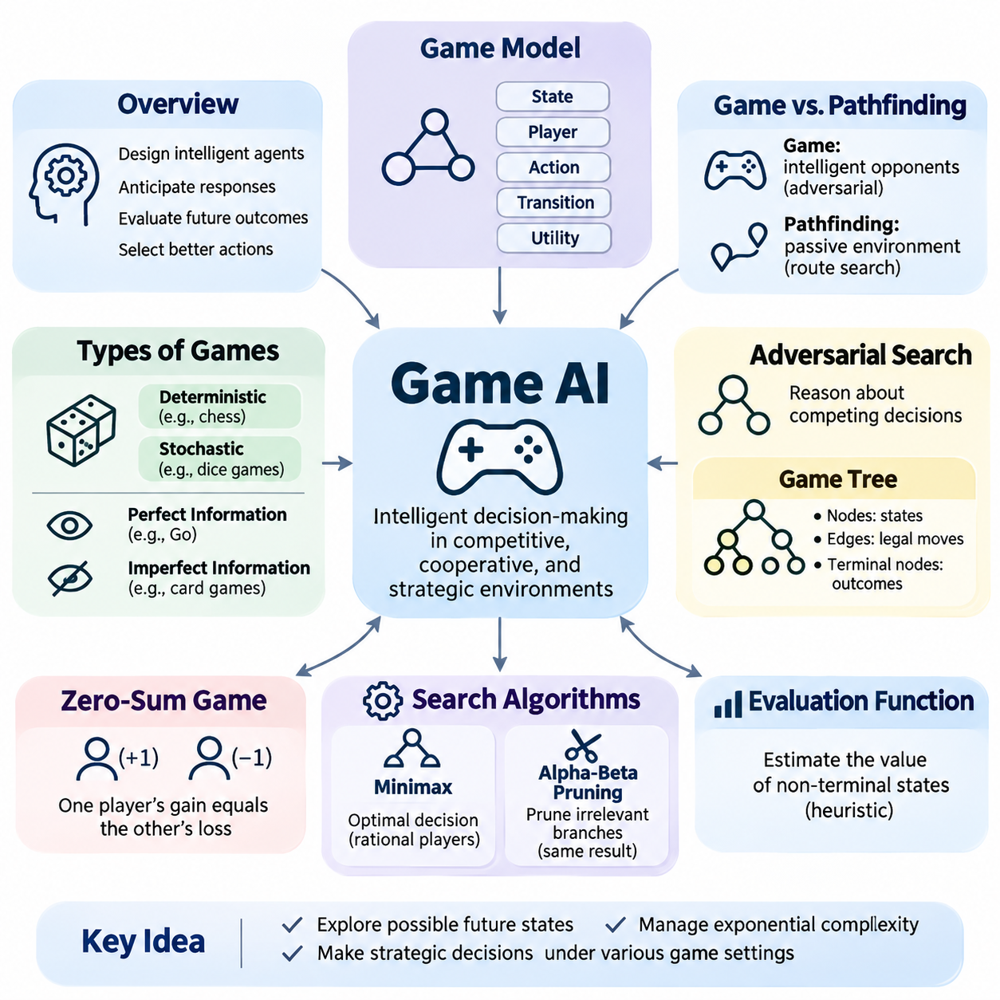{width="7.268055555555556in" height="7.268055555555556in"}

Game Artificial Intelligence (Game AI) is a fundamental branch of artificial intelligence concerned with designing agents that make intelligent decisions in competitive, cooperative, and strategic environments. Unlike conventional search problems, game environments often involve multiple decision-makers whose actions influence one another. An intelligent game agent must anticipate possible responses, evaluate future consequences, and select actions that improve its chances of achieving objectives.

The development of Game AI has played an important role in the history of artificial intelligence. Early research focused on mathematical games such as chess, checkers, and tic-tac-toe because their rules and outcomes could be represented precisely. These environments provided controlled settings for investigating logical reasoning, search algorithms, decision-making, and computational complexity. Many techniques developed for games later influenced planning, optimization, and autonomous systems.

A game can be represented mathematically through a collection of states, players, legal actions, transition rules, and outcome functions. A state describes the current configuration of the environment, while an action represents a decision available to a player. Transition rules determine how actions modify the state, and terminal conditions identify when the game ends. Utility functions assign numerical values to outcomes, allowing artificial agents to compare alternative strategies systematically.

Game AI differs from ordinary pathfinding because the environment may contain intelligent opponents rather than passive obstacles. In pathfinding, an agent searches for a route through a relatively predictable state space. In adversarial games, another player actively selects actions that may undermine the agent\'s objectives. Consequently, the quality of a decision depends not only on its immediate consequences but also on how opponents might respond during subsequent turns.

Adversarial search provides a computational framework for reasoning about competing decisions. Instead of examining only the actions available to one agent, adversarial search considers sequences of alternating actions involving multiple players. These sequences form a game tree in which nodes represent states and edges represent legal moves. By exploring possible future states, an agent estimates the strategic value of available actions and identifies promising decisions.

Game trees provide an intuitive representation of sequential decision-making. The root node corresponds to the current game state, while its children represent states reachable through legal actions. Additional levels describe possible responses and counterresponses. Terminal nodes represent completed games, and their utility values indicate wins, losses, draws, or other outcomes. The number of possible nodes generally grows exponentially with search depth, creating significant computational challenges.

The branching factor of a game describes the average number of legal actions available at each decision point. If the branching factor is b and the search depth is d, a complete game tree may contain a number of nodes proportional to b raised to the power d. This exponential growth explains why exhaustive search becomes impractical in complex games. Efficient Game AI therefore requires techniques that reduce unnecessary exploration while preserving useful strategic information.

One of the most important distinctions in Game AI concerns deterministic and stochastic environments. In deterministic games, the next state is completely determined by the current state and selected action. Chess and tic-tac-toe are common examples. Stochastic games introduce random events such as dice rolls or probabilistic outcomes. These environments require agents to evaluate expected consequences rather than assuming that every action produces a single predictable result.

Another important distinction concerns perfect and imperfect information. In perfect-information games, every player can observe the complete game state relevant to decision-making. Chess and Go belong to this category. Imperfect-information games contain hidden information, such as concealed cards or unknown opponent resources. Intelligent agents operating in these environments must maintain beliefs about possible states and make decisions under uncertainty.

Two-player zero-sum games provide a particularly useful foundation for studying adversarial reasoning. In these games, one player\'s gain corresponds directly to the other player\'s loss. The competing objectives can be represented using a single utility function with opposite signs for the two players. This structure simplifies mathematical analysis and supports algorithms that select actions by considering the strongest possible responses from an opponent.

The Minimax algorithm is a classical method for decision-making in deterministic, two-player, zero-sum games with perfect information. It assumes that both players act rationally according to their respective objectives. One player attempts to maximize utility, while the opponent attempts to minimize it. By recursively evaluating alternative moves and countermeasures, Minimax identifies an action that achieves the best guaranteed outcome under these assumptions.

Although Minimax provides a principled decision-making framework, its computational requirements increase rapidly with search depth. Alpha-beta pruning addresses this limitation by eliminating branches that cannot influence the final decision under the current search bounds. By maintaining estimates of achievable outcomes, the algorithm avoids exploring strategically irrelevant alternatives. Effective move ordering can substantially increase pruning efficiency without changing the Minimax result.

Evaluation functions allow game agents to estimate the quality of nonterminal states when exhaustive search is impossible. Rather than continuing until the game ends, an agent stops at a selected search depth and assigns heuristic scores to the resulting positions. These scores may incorporate material advantage, positional control, mobility, threats, and long-term strategic potential. Evaluation quality strongly influences decision accuracy when computational resources are limited.

Search depth and evaluation accuracy create an important engineering tradeoff. Deeper search can reveal tactical consequences that shallow analysis overlooks, but additional exploration requires greater computational resources. Strong evaluation functions can compensate for limited depth by providing informative estimates of future outcomes. Practical Game AI systems balance search complexity, evaluation quality, available memory, and decision deadlines to achieve reliable performance.

Iterative deepening improves practical search by repeatedly examining the game tree at increasing depth limits. An agent first completes a shallow search and then progressively explores deeper alternatives while computational time remains available. This approach provides a valid intermediate decision even when execution is interrupted. It also generates useful move-ordering information that can improve the efficiency of subsequent searches.

Transposition tables address another source of inefficiency in game-tree exploration. Different sequences of actions may lead to the same game state, causing conventional search algorithms to evaluate identical positions repeatedly. A transposition table stores previously computed information using a compact state identifier, often generated through hashing. Reusing these results can reduce redundant calculations and improve search performance, particularly in games with recurring positions.

Monte Carlo Tree Search offers an alternative approach to game decision-making through selective exploration and statistical estimation. Instead of expanding the entire game tree uniformly, it concentrates computational effort on actions that appear promising. The algorithm repeatedly performs selection, expansion, simulation or evaluation, and value backpropagation. Over successive iterations, statistical evidence helps the agent identify actions with favorable estimated outcomes.

The Upper Confidence Bound applied to Trees, commonly called UCT, provides a mechanism for balancing exploration and exploitation within Monte Carlo Tree Search. Exploration encourages examination of actions with limited information, while exploitation favors actions that have produced strong results. UCT combines estimated action values with uncertainty-related exploration bonuses. This balance helps prevent premature commitment to apparently favorable but insufficiently tested strategies.

Game AI also involves reasoning about opponents whose strategies may differ from ideal mathematical assumptions. Real opponents can make mistakes, follow recognizable patterns, or adapt their behavior over time. Opponent modeling attempts to estimate these tendencies from observed actions and historical information. Such models can support adaptive strategies, although exploiting a predicted weakness may introduce additional risk when the opponent behaves unexpectedly.

Real-time games introduce further complexity because decisions must be made continuously or under strict time constraints. Unlike turn-based games, real-time strategy environments may require simultaneous resource allocation, movement planning, tactical coordination, and opponent prediction. Agents must prioritize relevant information and respond before opportunities disappear. Hierarchical decision-making and selective search help manage these computational demands.

Modern Game AI increasingly combines classical search algorithms with machine learning techniques. Neural networks can estimate state values, predict promising actions, and learn useful representations from game experience. Search algorithms then use these predictions to guide exploration and improve decision quality. This combination demonstrates how symbolic reasoning and learned knowledge can complement one another rather than functioning as mutually exclusive approaches.

Chess and Go illustrate different computational characteristics of strategic games. Chess contains complex tactical interactions in which accurate evaluation and selective search are essential. Go presents an exceptionally large action space and requires understanding of long-range positional relationships. Both games have motivated important advances in search efficiency, evaluation methods, and learning-guided decision-making, providing valuable benchmarks for artificial intelligence research.

The engineering of a Game AI system requires more than selecting an algorithm. Developers must implement reliable state representations, legal-action generation, transition functions, terminal-state detection, and evaluation mechanisms. Search components must operate within defined time and memory limits. Testing should verify rule correctness, reproducibility, computational performance, and strategic behavior across diverse game situations rather than relying only on successful demonstrations.

Game AI performance can be evaluated through win rates, tournament results, decision latency, search depth, and computational efficiency. Controlled experiments should compare agents under consistent rules, hardware conditions, and time budgets. Repeated matches against different opponents help reveal strengths and weaknesses that individual games may conceal. Statistical analysis is necessary because observed outcomes can be influenced by randomness, opponent selection, and starting positions.

The principles of Game AI extend beyond entertainment and competitive board games. Adversarial reasoning can support cybersecurity defense, negotiation, resource competition, strategic planning, and multi-agent coordination. In autonomous robotics, similar reasoning can help agents anticipate the behavior of other decision-makers. These applications require careful adaptation because real-world environments often contain uncertainty, incomplete information, continuous actions, and objectives that are not strictly zero-sum.

Understanding Game AI establishes a foundation for studying Minimax, alpha-beta pruning, heuristic evaluation, iterative deepening, transposition tables, Monte Carlo Tree Search, and stochastic decision-making. These methods demonstrate how intelligent behavior emerges from structured representations, strategic anticipation, and efficient computation. Together, they provide a classical framework for developing agents capable of reasoning about competing objectives and making informed decisions in dynamic environments.

게임 인공지능(Game Artificial Intelligence, Game AI)은 경쟁적, 협력적, 전략적 환경에서 지능적인 의사결정(Intelligent Decision-Making)을 수행하는 에이전트(Agent)를 설계하는 인공지능의 핵심 분야이다. 일반적인 탐색 문제(Search Problem)와 달리 게임 환경에는 서로의 행동에 영향을 미치는 여러 의사결정 주체가 존재한다. 지능형 게임 에이전트는 상대방의 가능한 대응을 예측하고, 미래의 결과를 평가하며, 목표 달성 가능성을 높이는 행동을 선택해야 한다.

게임 인공지능(Game AI)의 발전은 인공지능 역사에서 중요한 역할을 수행하였다. 초기 연구는 체스(Chess), 체커(Checkers), 틱택토(Tic-Tac-Toe)와 같이 규칙과 결과를 명확하게 표현할 수 있는 수학적 게임에 집중하였다. 이러한 환경은 논리적 추론(Logical Reasoning), 탐색 알고리즘(Search Algorithm), 의사결정(Decision-Making), 계산 복잡도(Computational Complexity)를 연구하기 위한 통제된 실험 환경을 제공하였다. 게임을 위해 개발된 많은 기술은 이후 계획 수립(Planning), 최적화(Optimization), 자율 시스템(Autonomous Systems)에도 영향을 미쳤다.

게임(Game)은 상태(State), 플레이어(Player), 합법적 행동(Legal Action), 상태 전이 규칙(Transition Rule), 결과 함수(Outcome Function)의 집합으로 수학적으로 표현할 수 있다. 상태는 현재 환경의 구성을 나타내며, 행동은 플레이어가 선택할 수 있는 결정을 의미한다. 상태 전이 규칙은 행동에 따라 상태가 어떻게 변화하는지 결정하고, 종료 조건(Terminal Condition)은 게임의 종료 여부를 판단한다. 효용 함수(Utility Function)는 결과에 수치적 가치를 부여하여 인공지능 에이전트가 여러 전략을 체계적으로 비교할 수 있도록 한다.

게임 인공지능(Game AI)은 환경에 수동적인 장애물 대신 지능적인 상대방이 존재할 수 있다는 점에서 일반적인 경로 탐색(Pathfinding)과 구별된다. 경로 탐색에서는 비교적 예측 가능한 상태 공간(State Space)에서 목적지까지의 경로를 찾는다. 반면 적대적 게임(Adversarial Game)에서는 다른 플레이어가 에이전트의 목표를 방해하는 행동을 능동적으로 선택한다. 따라서 의사결정의 품질은 즉각적인 결과뿐 아니라 이후 차례에서 상대방이 어떻게 대응하는지에 따라 달라진다.

적대적 탐색(Adversarial Search)은 경쟁적인 의사결정을 추론하기 위한 계산적 프레임워크(Computational Framework)를 제공한다. 하나의 에이전트가 선택할 수 있는 행동만 검토하는 대신 여러 플레이어가 번갈아 수행하는 행동의 연속을 고려한다. 이러한 행동의 연속은 노드(Node)가 상태를 나타내고 간선(Edge)이 합법적인 이동을 나타내는 게임 트리(Game Tree)를 형성한다. 에이전트는 가능한 미래 상태를 탐색하여 행동의 전략적 가치를 추정하고 유망한 결정을 식별한다.

게임 트리(Game Tree)는 순차적 의사결정(Sequential Decision-Making)을 직관적으로 표현한다. 루트 노드(Root Node)는 현재 게임 상태에 해당하며, 자식 노드(Child Node)는 합법적인 행동을 통해 도달할 수 있는 상태를 나타낸다. 추가적인 계층은 상대방의 대응과 이에 대한 재대응을 표현한다. 단말 노드(Terminal Node)는 종료된 게임을 나타내며, 효용 값(Utility Value)은 승리, 패배, 무승부 또는 다른 결과를 의미한다. 가능한 노드의 수는 일반적으로 탐색 깊이에 따라 지수적으로 증가하므로 상당한 계산상의 어려움이 발생한다.

게임의 분기 계수(Branching Factor)는 각 의사결정 지점에서 선택할 수 있는 합법적인 행동의 평균 개수를 의미한다. 분기 계수가 b이고 탐색 깊이(Search Depth)가 d라면 완전한 게임 트리의 노드 수는 b의 d제곱에 비례하는 규모로 증가할 수 있다. 이러한 지수적 증가(Exponential Growth)는 복잡한 게임에서 완전 탐색(Exhaustive Search)이 비현실적인 이유를 설명한다. 따라서 효율적인 게임 인공지능은 유용한 전략적 정보를 유지하면서 불필요한 탐색을 줄이는 기술을 필요로 한다.

게임 인공지능(Game AI)의 중요한 구분 중 하나는 결정론적 환경(Deterministic Environment)과 확률적 환경(Stochastic Environment)이다. 결정론적 게임에서는 현재 상태와 선택된 행동에 의해 다음 상태가 완전히 결정된다. 체스와 틱택토가 대표적인 예이다. 확률적 게임에서는 주사위 결과나 확률적인 사건과 같은 무작위 요소가 도입된다. 이러한 환경에서 에이전트는 모든 행동이 하나의 예측 가능한 결과를 생성한다고 가정하는 대신 기대 결과(Expected Outcome)를 평가해야 한다.

또 다른 중요한 구분은 완전 정보(Perfect Information)와 불완전 정보(Imperfect Information)이다. 완전 정보 게임에서는 모든 플레이어가 의사결정에 필요한 전체 게임 상태를 관찰할 수 있다. 체스와 바둑(Go)이 이 범주에 속한다. 불완전 정보 게임에는 숨겨진 카드나 알려지지 않은 상대방의 자원과 같은 비공개 정보(Hidden Information)가 존재한다. 이러한 환경에서 지능형 에이전트는 가능한 상태에 대한 믿음(Belief)을 유지하고 불확실성(Uncertainty) 아래에서 의사결정을 수행해야 한다.

2인 제로섬 게임(Two-Player Zero-Sum Game)은 적대적 추론(Adversarial Reasoning)을 연구하기 위한 유용한 기초를 제공한다. 이러한 게임에서는 한 플레이어의 이득이 다른 플레이어의 손실과 직접적으로 대응한다. 경쟁하는 목표는 두 플레이어에 대해 부호가 반대인 하나의 효용 함수(Utility Function)로 표현할 수 있다. 이러한 구조는 수학적 분석을 단순화하며, 상대방이 선택할 수 있는 가장 강력한 대응을 고려하여 행동을 결정하는 알고리즘을 지원한다.

미니맥스 알고리즘(Minimax Algorithm)은 완전 정보를 가진 결정론적 2인 제로섬 게임에서 의사결정을 수행하는 고전적인 방법이다. 이 알고리즘은 두 플레이어가 각자의 목표에 따라 합리적으로 행동한다고 가정한다. 한 플레이어는 효용을 최대화(Maximize)하려 하고, 상대방은 이를 최소화(Minimize)하려 한다. 미니맥스는 가능한 행동과 대응을 재귀적으로 평가하여 이러한 가정 아래에서 보장할 수 있는 최선의 결과를 달성하는 행동을 식별한다.

미니맥스(Minimax)는 원칙적인 의사결정 프레임워크를 제공하지만 탐색 깊이가 증가하면 계산 요구량이 급격히 증가한다. 알파-베타 가지치기(Alpha-Beta Pruning)는 현재 탐색 경계에서 최종 결정에 영향을 줄 수 없는 분기를 제거하여 이러한 한계를 완화한다. 달성 가능한 결과의 추정 범위를 유지함으로써 전략적으로 불필요한 대안의 탐색을 회피한다. 효과적인 이동 순서 결정(Move Ordering)은 미니맥스 결과를 변경하지 않으면서 가지치기 효율을 크게 향상시킬 수 있다.

평가 함수(Evaluation Function)는 완전 탐색이 불가능한 경우 종료되지 않은 상태(Nonterminal State)의 품질을 추정할 수 있도록 한다. 에이전트는 게임이 종료될 때까지 탐색하는 대신 정해진 탐색 깊이에서 중단하고 해당 위치에 휴리스틱 점수(Heuristic Score)를 부여한다. 이러한 점수에는 기물의 가치, 위치적 우위, 이동 가능성, 위협 요소, 장기적인 전략적 잠재력이 반영될 수 있다. 계산 자원이 제한된 상황에서는 평가 함수의 품질이 의사결정 정확도에 큰 영향을 미친다.

탐색 깊이(Search Depth)와 평가 정확도(Evaluation Accuracy) 사이에는 중요한 공학적 절충 관계(Engineering Tradeoff)가 존재한다. 깊은 탐색은 얕은 분석에서 놓칠 수 있는 전술적 결과를 발견하지만 추가적인 계산 자원이 필요하다. 우수한 평가 함수는 미래 결과에 대한 유용한 추정치를 제공하여 제한된 탐색 깊이를 보완할 수 있다. 실제 게임 인공지능 시스템은 안정적인 성능을 달성하기 위해 탐색 복잡도, 평가 품질, 사용 가능한 메모리, 의사결정 시간 제한을 균형 있게 고려한다.

반복 심화 탐색(Iterative Deepening)은 탐색 깊이 제한을 점진적으로 증가시키면서 게임 트리를 반복적으로 분석하여 실제 탐색 성능을 향상시킨다. 에이전트는 먼저 얕은 탐색을 완료한 다음 계산 시간이 허용되는 동안 더 깊은 대안을 탐색한다. 이러한 접근 방식은 실행이 중단되더라도 이미 계산된 유효한 중간 결정을 제공한다. 또한 이전 탐색에서 얻은 이동 순서 정보를 활용하여 후속 탐색의 효율을 높일 수 있다.

전치 테이블(Transposition Table)은 게임 트리 탐색에서 발생하는 또 다른 비효율성을 해결한다. 서로 다른 행동 순서가 동일한 게임 상태에 도달할 수 있기 때문에 일반적인 탐색 알고리즘은 같은 위치를 반복적으로 평가할 수 있다. 전치 테이블은 일반적으로 해싱(Hashing)을 통해 생성한 압축된 상태 식별자를 사용하여 이전 계산 결과를 저장한다. 이러한 결과를 재사용하면 중복 계산을 줄이고, 특히 동일한 위치가 반복적으로 등장하는 게임에서 탐색 성능을 향상시킬 수 있다.

몬테카를로 트리 탐색(Monte Carlo Tree Search, MCTS)은 선택적 탐색(Selective Exploration)과 통계적 추정(Statistical Estimation)을 통해 게임 의사결정을 수행하는 대안적인 접근 방식이다. 전체 게임 트리를 균일하게 확장하는 대신 유망한 행동에 계산 자원을 집중한다. 알고리즘은 선택(Selection), 확장(Expansion), 시뮬레이션 또는 평가(Simulation or Evaluation), 가치 역전파(Value Backpropagation)를 반복한다. 반복 과정에서 축적된 통계적 근거를 바탕으로 유리한 예상 결과를 제공하는 행동을 식별한다.

트리에 적용된 신뢰 상한(Upper Confidence Bound Applied to Trees, UCT)은 몬테카를로 트리 탐색에서 탐색(Exploration)과 활용(Exploitation)의 균형을 조절하는 메커니즘을 제공한다. 탐색은 정보가 부족한 행동을 조사하도록 유도하며, 활용은 이전에 우수한 결과를 생성한 행동을 선호한다. UCT는 추정된 행동 가치와 불확실성을 반영한 탐색 보너스(Exploration Bonus)를 결합한다. 이러한 균형은 충분히 검증되지 않은 유망한 전략에 지나치게 일찍 집중하는 현상을 방지하는 데 도움이 된다.

게임 인공지능(Game AI)은 이상적인 수학적 가정과 다른 전략을 사용하는 상대방에 대한 추론도 포함한다. 실제 상대방은 실수를 하거나 특정한 행동 패턴을 따르거나 시간이 지나면서 전략을 조정할 수 있다. 상대방 모델링(Opponent Modeling)은 관찰된 행동과 과거 정보를 이용하여 이러한 경향을 추정한다. 이러한 모델은 적응형 전략(Adaptive Strategy)을 지원할 수 있지만 상대방이 예상과 다르게 행동하면 예측된 약점을 활용하는 전략이 추가적인 위험을 초래할 수 있다.

실시간 게임(Real-Time Game)은 의사결정을 지속적으로 수행하거나 엄격한 시간 제약 아래에서 수행해야 하므로 추가적인 복잡성을 가진다. 턴 기반 게임(Turn-Based Game)과 달리 실시간 전략 게임(Real-Time Strategy Game)은 자원 배분, 이동 계획, 전술적 협력, 상대방 예측을 동시에 요구할 수 있다. 에이전트는 중요한 정보의 우선순위를 결정하고 기회가 사라지기 전에 대응해야 한다. 계층적 의사결정(Hierarchical Decision-Making)과 선택적 탐색은 이러한 계산 요구를 관리하는 데 도움이 된다.

현대 게임 인공지능(Game AI)은 고전적인 탐색 알고리즘(Classical Search Algorithm)과 머신러닝(Machine Learning)을 점점 더 긴밀하게 결합하고 있다. 신경망(Neural Network)은 상태 가치를 추정하고, 유망한 행동을 예측하며, 게임 경험으로부터 유용한 표현(Representation)을 학습할 수 있다. 탐색 알고리즘은 이러한 예측을 활용하여 탐색 방향을 결정하고 의사결정 품질을 향상시킨다. 이러한 결합은 기호적 추론(Symbolic Reasoning)과 학습된 지식(Learned Knowledge)이 서로 배타적인 방식이 아니라 상호 보완적으로 작동할 수 있음을 보여준다.

체스(Chess)와 바둑(Go)은 전략적 게임의 서로 다른 계산적 특성을 보여준다. 체스에는 정확한 평가와 선택적 탐색이 중요한 복잡한 전술적 상호작용이 존재한다. 바둑은 매우 큰 행동 공간(Action Space)을 가지며 장거리 위치 관계에 대한 이해가 필요하다. 두 게임 모두 탐색 효율, 평가 방법, 학습 기반 의사결정(Learning-Guided Decision-Making)의 중요한 발전을 촉진하였으며 인공지능 연구를 위한 유용한 벤치마크(Benchmark)를 제공하였다.

게임 인공지능 시스템(Game AI System)의 엔지니어링은 단순히 알고리즘을 선택하는 것 이상의 작업을 요구한다. 개발자는 신뢰할 수 있는 상태 표현(State Representation), 합법적 행동 생성(Legal Action Generation), 상태 전이 함수(State Transition Function), 종료 상태 판정(Terminal-State Detection), 평가 메커니즘(Evaluation Mechanism)을 구현해야 한다. 탐색 구성요소는 정해진 시간과 메모리 한계 내에서 동작해야 한다. 테스트는 성공적인 시연에만 의존하지 않고 다양한 게임 상황에서 규칙의 정확성, 재현성, 계산 성능, 전략적 행동을 검증해야 한다.

게임 인공지능(Game AI)의 성능은 승률(Win Rate), 토너먼트 결과(Tournament Result), 의사결정 지연시간(Decision Latency), 탐색 깊이(Search Depth), 계산 효율(Computational Efficiency)을 통해 평가할 수 있다. 통제된 실험(Controlled Experiment)은 동일한 규칙, 하드웨어 조건, 시간 예산 아래에서 에이전트를 비교해야 한다. 다양한 상대방과 반복적으로 대결하면 개별 게임에서 드러나지 않는 강점과 약점을 발견할 수 있다. 관찰된 결과는 무작위성, 상대방 선택, 초기 위치의 영향을 받을 수 있으므로 통계적 분석(Statistical Analysis)이 필요하다.

게임 인공지능(Game AI)의 원리는 오락과 경쟁적인 보드게임을 넘어 다양한 분야에 적용된다. 적대적 추론(Adversarial Reasoning)은 사이버보안 방어(Cybersecurity Defense), 협상(Negotiation), 자원 경쟁(Resource Competition), 전략적 계획(Strategic Planning), 다중 에이전트 협력(Multi-Agent Coordination)을 지원할 수 있다. 자율 로보틱스(Autonomous Robotics)에서도 유사한 추론을 통해 다른 의사결정 주체의 행동을 예측할 수 있다. 다만 실제 환경에는 불확실성, 불완전 정보, 연속적인 행동, 비제로섬 목표가 존재하므로 적절한 기술적 조정이 필요하다.

게임 인공지능(Game AI)에 대한 이해는 미니맥스(Minimax), 알파-베타 가지치기(Alpha-Beta Pruning), 휴리스틱 평가(Heuristic Evaluation), 반복 심화 탐색(Iterative Deepening), 전치 테이블(Transposition Table), 몬테카를로 트리 탐색(Monte Carlo Tree Search), 확률적 의사결정(Stochastic Decision-Making)을 학습하기 위한 기초를 확립한다. 이러한 방법은 구조화된 표현, 전략적 예측, 효율적인 계산을 통해 지능적 행동이 어떻게 구현되는지 보여준다. 이들은 경쟁적인 목표를 추론하고 동적 환경에서 정보에 기반한 의사결정을 수행할 수 있는 에이전트를 개발하기 위한 고전적인 프레임워크를 제공한다.

## 02.02 Two Player Zero Sum Games

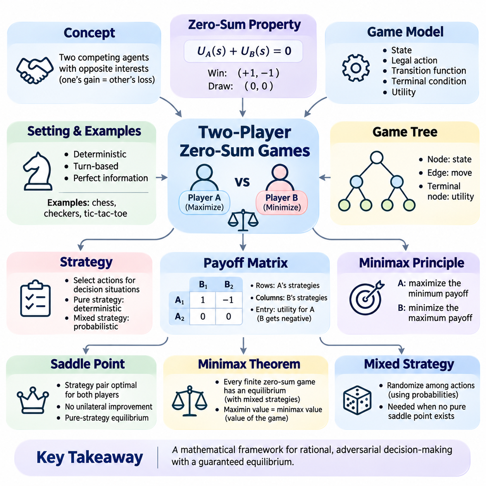{width="7.268055555555556in" height="7.268055555555556in"}

Two-player zero-sum games provide a fundamental mathematical framework for studying strategic decision-making in artificial intelligence. These games involve two competing agents whose interests are strictly opposed, meaning that one player\'s gain corresponds to an equal loss for the other. This relationship allows competitive interactions to be represented through a single utility function, making zero-sum games particularly suitable for adversarial search and formal analysis.

The zero-sum property describes a situation in which the combined utilities of both players remain constant at zero. If Player A receives a utility of positive one, Player B receives negative one. A draw may assign zero utility to both participants. More generally, the utility functions satisfy U_A(s) + U_B(s) = 0 for every relevant outcome s. This mathematical relationship captures the strictly competitive nature of the interaction.

A two-player game can be formally described using a set of states, legal actions, transition functions, terminal conditions, and utility values. Each state represents a particular configuration of the game, while legal actions determine the choices available to the active player. A transition function describes how the game evolves after an action. Terminal states identify completed games, and utility functions measure the desirability of their outcomes.

In deterministic, turn-based games with perfect information, both players observe the complete game state and alternate their decisions according to established rules. Chess, checkers, and tic-tac-toe provide familiar examples when their outcomes are modeled using opposing utilities. Because every legal action produces a predictable successor state, these games can be represented as explicit game trees suitable for systematic adversarial reasoning.

The game tree represents all possible sequences of actions beginning from an initial state. Each node corresponds to a game configuration, and each edge represents a legal move. Nodes alternate between the decisions of Player A and Player B, reflecting their opposing objectives. Terminal nodes contain utility values that determine the outcome of each complete sequence. This structure provides the foundation for recursive game-search algorithms.

The distinction between maximizing and minimizing players is central to zero-sum reasoning. The maximizing player attempts to select actions that produce the highest possible utility, while the minimizing player attempts to reduce that same utility. Since their objectives are directly opposed, evaluating an action requires considering the opponent\'s strongest response. This principle transforms ordinary state-space search into adversarial decision-making.

Rational decision-making in zero-sum games assumes that each player selects strategies consistent with maximizing their own utility. When both players understand the rules and available information, their decisions can be analyzed through strategic optimization. However, rationality does not necessarily imply perfect prediction or unlimited computational ability. Practical agents operate under restrictions involving search depth, processing time, and incomplete strategic knowledge.

A strategy specifies how a player selects actions across possible decision situations. In a sequential game, a complete strategy defines an action for every decision point that the player might encounter. A pure strategy selects actions deterministically, whereas a mixed strategy assigns probabilities to alternative choices. These representations provide different ways to model strategic behavior and analyze interactions between competing agents.

The payoff matrix offers a compact representation of finite strategic-form zero-sum games. Rows represent strategies available to Player A, while columns represent strategies available to Player B. Each matrix entry specifies the utility received by Player A for the corresponding strategy combination. Player B receives the negative of that value. This representation is particularly useful when analyzing simultaneous decisions and strategic equilibrium.

The minimax principle provides a mathematical foundation for selecting robust strategies against rational opponents. Player A seeks to maximize the minimum payoff that Player B can impose, while Player B seeks to minimize the maximum payoff available to Player A. This reasoning emphasizes guaranteed performance rather than optimistic predictions. It is especially important when the opponent\'s strategic choices cannot be controlled directly.

The maximin value represents the best guaranteed payoff that the maximizing player can secure by selecting an appropriate strategy. Conversely, the minimax value represents the smallest upper bound that the minimizing player can enforce. In finite zero-sum games, the maximin value cannot exceed the minimax value when considering pure strategies. Equality indicates the existence of a pure-strategy saddle point.

A saddle point occurs when a strategy combination is simultaneously optimal against the opponent\'s selected strategy for both players. Neither player can improve their outcome through a unilateral strategy change. Such an outcome forms a pure-strategy Nash equilibrium in a zero-sum game. However, not every zero-sum game possesses a saddle point in pure strategies, making randomized strategies important for general solutions.

The minimax theorem establishes that every finite two-player zero-sum game has an equilibrium when mixed strategies are permitted. Under this theorem, the maximum guaranteed expected payoff equals the minimum enforceable expected payoff. This common quantity is called the value of the game. The theorem provides a rigorous connection between competitive optimization, probability distributions, and equilibrium-based strategic reasoning.

Mixed strategies become necessary when deterministic choices can be exploited by an informed opponent. In games such as matching pennies, repeatedly selecting one fixed action allows the opponent to respond advantageously. Randomizing between available actions prevents predictable exploitation and can establish an optimal expected payoff. The resulting probabilities are not arbitrary but are determined by the strategic relationships among available choices.

Sequential zero-sum games can be analyzed using backward induction when the game tree is finite and sufficiently small. The procedure begins by evaluating terminal states and then propagates optimal values toward earlier decision points. At maximizing nodes, the highest child value is selected, while minimizing nodes select the lowest value. This recursive structure directly motivates the classical Minimax search algorithm.

Backward induction assumes that future decisions will be made optimally according to the players\' objectives. Consequently, the value assigned to a state reflects the outcome that can be guaranteed against an optimal opponent. This approach avoids relying on an opponent\'s mistakes or favorable behavior. Nevertheless, its computational requirements increase rapidly as the number of legal actions and possible decision sequences grows.

The branching factor determines how many successor states are typically generated from a game position. If each state offers approximately b legal actions and the search extends to depth d, exhaustive exploration may require computational effort proportional to b raised to the power d. This exponential complexity limits the practical depth of exact game-tree analysis and motivates selective exploration, pruning, and heuristic evaluation.

Zero-sum game models distinguish between the theoretical value of a position and the value estimated by a practical search algorithm. The theoretical value assumes optimal play throughout the remaining game. An estimated value may depend on limited search depth, heuristic evaluation, or statistical sampling. Understanding this distinction is essential because computationally constrained agents cannot always identify the mathematically optimal decision.

Evaluation functions approximate the strategic value of nonterminal states when complete backward induction is infeasible. These functions transform observable game features into numerical estimates of advantage or disadvantage. In chess, relevant features may include material balance, king safety, mobility, and positional control. Their purpose is to approximate the expected strategic consequences of a position without exploring every possible continuation.

Alpha-beta pruning improves minimax search by excluding branches that cannot change the final decision under the current bounds. The algorithm maintains information about the best alternatives already available to the maximizing and minimizing players. When a branch cannot improve the relevant decision, further exploration becomes unnecessary. This optimization preserves exact minimax results for the searched tree while reducing computational effort.

Not all competitive interactions can be accurately represented as zero-sum games. In many real-world situations, participants may benefit simultaneously, experience unequal losses, or pursue partially aligned objectives. Such interactions require general-sum game models rather than strictly opposing utility functions. Recognizing this limitation prevents inappropriate application of zero-sum assumptions to cooperative or mixed-motive environments.

Information availability also influences the appropriate solution method. Perfect-information games permit direct evaluation of observable states and legal continuations. Imperfect-information games introduce hidden states, private observations, and uncertainty about opponent knowledge. In these settings, strategies may depend on information sets and probability distributions rather than individual fully observed states, requiring more sophisticated equilibrium and search methods.

Stochastic zero-sum games incorporate random events into the transition process while preserving opposing utility objectives. An action may lead to several possible successor states with different probabilities. Strategic evaluation must therefore combine adversarial reasoning with expected utility calculations. These models connect classical game-tree search with probabilistic decision-making and provide foundations for reasoning in uncertain competitive environments.

Two-player zero-sum games have applications beyond traditional board games. Competitive cybersecurity, strategic resource allocation, adversarial planning, and certain pursuit-evasion problems can be modeled using opposing objectives. In autonomous systems, related methods help analyze interactions between agents with conflicting goals. Their usefulness depends on whether the chosen utility functions accurately represent the underlying competition.

The study of two-player zero-sum games establishes the theoretical foundation for Minimax, alpha-beta pruning, evaluation functions, and advanced adversarial search methods. By connecting utility theory, strategic optimization, equilibrium concepts, and computational search, these games provide a systematic framework for understanding competitive intelligence. They demonstrate how rational agents can select defensible actions while anticipating the strongest possible responses from their opponents.

2인 제로섬 게임(Two-Player Zero-Sum Game)은 인공지능에서 전략적 의사결정(Strategic Decision-Making)을 연구하기 위한 기본적인 수학적 프레임워크(Mathematical Framework)를 제공한다. 이러한 게임에는 이해관계가 완전히 대립하는 두 개의 경쟁 에이전트(Competing Agent)가 참여하며, 한 플레이어의 이득은 다른 플레이어의 동일한 크기의 손실에 해당한다. 이러한 관계를 통해 경쟁적 상호작용을 하나의 효용 함수(Utility Function)로 표현할 수 있으므로 제로섬 게임은 적대적 탐색(Adversarial Search)과 형식적 분석(Formal Analysis)에 특히 적합하다.

제로섬 속성(Zero-Sum Property)은 두 플레이어의 효용을 합한 값이 항상 0으로 유지되는 상황을 의미한다. 플레이어 A(Player A)가 양의 1이라는 효용을 얻으면 플레이어 B(Player B)는 음의 1이라는 효용을 얻는다. 무승부(Draw)는 두 참가자 모두에게 0의 효용을 부여할 수 있다. 보다 일반적으로 효용 함수는 모든 관련 결과 s에 대해 U_A(s) + U_B(s) = 0이라는 관계를 만족한다. 이러한 수학적 관계는 상호작용의 엄격한 경쟁적 특성을 나타낸다.

2인 게임(Two-Player Game)은 상태(State), 합법적 행동(Legal Action), 상태 전이 함수(Transition Function), 종료 조건(Terminal Condition), 효용 값(Utility Value)을 사용하여 형식적으로 설명할 수 있다. 각 상태는 게임의 특정 구성을 나타내며, 합법적 행동은 현재 차례의 플레이어가 선택할 수 있는 대안을 결정한다. 상태 전이 함수는 행동 이후 게임이 어떻게 변화하는지 설명한다. 종료 상태(Terminal State)는 완료된 게임을 식별하며, 효용 함수는 결과의 바람직한 정도를 측정한다.

완전 정보(Perfect Information)를 가진 결정론적 턴 기반 게임(Deterministic Turn-Based Game)에서는 두 플레이어가 전체 게임 상태를 관찰하고 정해진 규칙에 따라 번갈아 의사결정을 수행한다. 체스(Chess), 체커(Checkers), 틱택토(Tic-Tac-Toe)는 결과를 서로 반대되는 효용으로 모델링할 때 대표적인 사례가 된다. 모든 합법적 행동이 예측 가능한 후속 상태(Successor State)를 생성하므로 이러한 게임은 체계적인 적대적 추론(Adversarial Reasoning)에 적합한 명시적 게임 트리(Game Tree)로 표현할 수 있다.

게임 트리(Game Tree)는 초기 상태(Initial State)에서 시작하는 모든 가능한 행동 순서를 나타낸다. 각 노드(Node)는 게임의 특정 구성을 의미하고, 각 간선(Edge)은 합법적인 이동을 나타낸다. 노드는 플레이어 A와 플레이어 B의 의사결정이 번갈아 나타나는 구조를 가지며, 이는 두 플레이어의 대립하는 목표를 반영한다. 단말 노드(Terminal Node)에는 완전한 행동 순서의 결과를 결정하는 효용 값이 포함된다. 이러한 구조는 재귀적 게임 탐색 알고리즘(Recursive Game-Search Algorithm)의 기초를 제공한다.

최대화 플레이어(Maximizing Player)와 최소화 플레이어(Minimizing Player)의 구분은 제로섬 추론(Zero-Sum Reasoning)의 핵심이다. 최대화 플레이어는 가능한 가장 높은 효용을 생성하는 행동을 선택하려 하고, 최소화 플레이어는 동일한 효용을 낮추려고 한다. 두 플레이어의 목표가 직접적으로 대립하므로 특정 행동을 평가하려면 상대방의 가장 강력한 대응을 고려해야 한다. 이러한 원리는 일반적인 상태 공간 탐색(State-Space Search)을 적대적 의사결정(Adversarial Decision-Making)으로 전환한다.

제로섬 게임에서 합리적 의사결정(Rational Decision-Making)은 각 플레이어가 자신의 효용을 최대화하는 목표에 부합하는 전략을 선택한다고 가정한다. 두 플레이어가 규칙과 이용 가능한 정보를 이해하고 있다면 전략적 최적화(Strategic Optimization)를 통해 의사결정을 분석할 수 있다. 그러나 합리성(Rationality)이 반드시 완벽한 예측이나 무제한적인 계산 능력을 의미하지는 않는다. 실제 에이전트는 탐색 깊이, 처리 시간, 불완전한 전략적 지식과 관련된 제약 아래에서 동작한다.

전략(Strategy)은 플레이어가 가능한 의사결정 상황에서 행동을 선택하는 방법을 정의한다. 순차적 게임(Sequential Game)에서 완전한 전략(Complete Strategy)은 플레이어가 마주할 수 있는 모든 의사결정 지점에 대해 행동을 지정한다. 순수 전략(Pure Strategy)은 행동을 결정론적으로 선택하는 반면, 혼합 전략(Mixed Strategy)은 여러 행동에 확률을 할당한다. 이러한 표현은 전략적 행동을 모델링하고 경쟁하는 에이전트 사이의 상호작용을 분석하기 위한 서로 다른 방법을 제공한다.

보수 행렬(Payoff Matrix)은 유한한 전략형 제로섬 게임(Finite Strategic-Form Zero-Sum Game)을 간결하게 표현하는 방법이다. 행(Row)은 플레이어 A가 사용할 수 있는 전략을 나타내고, 열(Column)은 플레이어 B가 사용할 수 있는 전략을 나타낸다. 각 행렬 원소(Matrix Entry)는 해당 전략 조합에서 플레이어 A가 받는 효용을 지정한다. 플레이어 B는 그 값의 음수를 효용으로 받는다. 이러한 표현은 동시 의사결정(Simultaneous Decision-Making)과 전략적 균형(Strategic Equilibrium)을 분석할 때 특히 유용하다.

미니맥스 원리(Minimax Principle)는 합리적인 상대방에 대응하여 강건한 전략(Robust Strategy)을 선택하기 위한 수학적 기초를 제공한다. 플레이어 A는 플레이어 B가 강제할 수 있는 최소 보수를 최대화하려 하고, 플레이어 B는 플레이어 A가 얻을 수 있는 최대 보수를 최소화하려 한다. 이러한 추론은 낙관적인 예측보다 보장된 성능(Guaranteed Performance)을 강조한다. 상대방의 전략적 선택을 직접 통제할 수 없는 상황에서 특히 중요하다.

최대최소 값(Maximin Value)은 최대화 플레이어가 적절한 전략을 선택하여 확보할 수 있는 최선의 보장 보수(Guaranteed Payoff)를 의미한다. 반대로 최소최대 값(Minimax Value)은 최소화 플레이어가 강제할 수 있는 가장 작은 상한값(Upper Bound)을 의미한다. 유한 제로섬 게임에서 순수 전략만 고려할 경우 최대최소 값은 최소최대 값을 초과할 수 없다. 두 값이 같다는 것은 순수 전략 안장점(Pure-Strategy Saddle Point)이 존재한다는 의미이다.

안장점(Saddle Point)은 두 플레이어가 상대방이 선택한 전략에 대해 동시에 최적의 전략을 선택한 상태에서 발생한다. 어느 플레이어도 자신의 전략만 일방적으로 변경하여 결과를 개선할 수 없다. 이러한 결과는 제로섬 게임에서 순수 전략 내시 균형(Pure-Strategy Nash Equilibrium)을 형성한다. 그러나 모든 제로섬 게임이 순수 전략 안장점을 가지는 것은 아니므로 일반적인 해를 구하기 위해서는 무작위화 전략(Randomized Strategy)이 중요하다.

미니맥스 정리(Minimax Theorem)는 혼합 전략(Mixed Strategy)을 허용하면 모든 유한 2인 제로섬 게임에 균형(Equilibrium)이 존재한다는 사실을 확립한다. 이 정리에 따르면 보장할 수 있는 최대 기대 보수(Maximum Guaranteed Expected Payoff)는 상대방이 강제할 수 있는 최소 기대 보수(Minimum Enforceable Expected Payoff)와 같다. 이러한 공통된 값을 게임의 가치(Value of the Game)라고 한다. 이 정리는 경쟁적 최적화, 확률 분포, 균형 기반 전략적 추론 사이의 엄밀한 관계를 제공한다.

혼합 전략(Mixed Strategy)은 결정론적인 선택이 정보를 가진 상대방에게 악용될 수 있는 상황에서 필요하다. 동전 맞추기 게임(Matching Pennies)과 같은 게임에서 하나의 고정된 행동을 반복적으로 선택하면 상대방이 유리하게 대응할 수 있다. 사용 가능한 행동 사이에서 무작위화(Randomization)를 수행하면 예측 가능한 행동의 악용을 방지하고 최적의 기대 보수(Expected Payoff)를 확보할 수 있다. 이러한 확률은 임의로 결정되는 것이 아니라 선택 가능한 행동 사이의 전략적 관계에 따라 결정된다.

순차적 제로섬 게임(Sequential Zero-Sum Game)은 게임 트리가 유한하고 충분히 작을 경우 역방향 귀납법(Backward Induction)을 사용하여 분석할 수 있다. 이 절차는 종료 상태를 평가하는 것에서 시작하여 최적의 값을 이전 의사결정 지점으로 전파한다. 최대화 노드(Maximizing Node)에서는 가장 높은 자식 노드의 값을 선택하고, 최소화 노드(Minimizing Node)에서는 가장 낮은 값을 선택한다. 이러한 재귀적 구조는 고전적인 미니맥스 탐색 알고리즘(Minimax Search Algorithm)의 직접적인 기초가 된다.

역방향 귀납법(Backward Induction)은 미래의 의사결정이 플레이어의 목표에 따라 최적으로 수행된다고 가정한다. 따라서 특정 상태에 부여된 값은 최적의 상대방에 맞서 보장할 수 있는 결과를 반영한다. 이러한 접근 방식은 상대방의 실수나 유리한 행동에 의존하지 않는다. 그러나 합법적인 행동의 수와 가능한 의사결정 순서가 증가할수록 계산 요구량(Computational Requirement)이 빠르게 증가한다.

분기 계수(Branching Factor)는 게임의 특정 위치에서 일반적으로 생성되는 후속 상태(Successor State)의 수를 결정한다. 각 상태에서 약 b개의 합법적인 행동이 가능하고 탐색 깊이가 d까지 확장된다면 완전 탐색(Exhaustive Exploration)에 필요한 계산량은 b의 d제곱에 비례할 수 있다. 이러한 지수적 복잡도(Exponential Complexity)는 정확한 게임 트리 분석의 실질적인 탐색 깊이를 제한하며, 선택적 탐색(Selective Exploration), 가지치기(Pruning), 휴리스틱 평가(Heuristic Evaluation)의 필요성을 높인다.

제로섬 게임 모델(Zero-Sum Game Model)은 특정 위치의 이론적 가치(Theoretical Value)와 실제 탐색 알고리즘이 추정한 가치(Estimated Value)를 구분한다. 이론적 가치는 게임이 종료될 때까지 양측이 최적으로 행동한다고 가정한다. 반면 추정 가치는 제한된 탐색 깊이, 휴리스틱 평가 또는 통계적 샘플링(Statistical Sampling)에 의존할 수 있다. 계산 자원이 제한된 에이전트가 항상 수학적으로 최적인 결정을 식별할 수 있는 것은 아니므로 이러한 차이를 이해하는 것이 중요하다.

평가 함수(Evaluation Function)는 완전한 역방향 귀납법(Backward Induction)을 적용하기 어려운 경우 종료되지 않은 상태(Nonterminal State)의 전략적 가치를 근사한다. 이러한 함수는 관찰 가능한 게임 특징(Game Feature)을 유리함 또는 불리함을 나타내는 수치적 추정값으로 변환한다. 체스에서는 기물의 가치 균형(Material Balance), 킹의 안전성(King Safety), 이동 가능성(Mobility), 위치적 통제(Positional Control) 등이 중요한 특징이 될 수 있다. 평가 함수의 목적은 모든 가능한 진행을 탐색하지 않고도 특정 위치의 예상 전략적 결과를 근사하는 것이다.

알파-베타 가지치기(Alpha-Beta Pruning)는 현재 탐색 경계(Search Bound)에서 최종 결정을 변경할 수 없는 분기를 제외하여 미니맥스 탐색(Minimax Search)을 개선한다. 이 알고리즘은 최대화 플레이어와 최소화 플레이어가 이미 확보한 최선의 대안에 대한 정보를 유지한다. 특정 분기가 관련 의사결정을 개선할 수 없다면 추가 탐색은 불필요해진다. 이러한 최적화는 탐색 대상 트리에 대한 정확한 미니맥스 결과를 유지하면서 계산량을 줄인다.

모든 경쟁적 상호작용(Competitive Interaction)을 제로섬 게임으로 정확하게 표현할 수 있는 것은 아니다. 많은 실제 상황에서는 참가자들이 동시에 이익을 얻거나, 서로 다른 크기의 손실을 경험하거나, 부분적으로 일치하는 목표를 추구할 수 있다. 이러한 상호작용에는 엄격하게 대립하는 효용 함수 대신 일반합 게임 모델(General-Sum Game Model)이 필요하다. 이러한 한계를 인식하면 협력적 환경이나 혼합 동기 환경(Mixed-Motive Environment)에 제로섬 가정을 부적절하게 적용하는 것을 방지할 수 있다.

정보의 가용성(Information Availability) 역시 적절한 해결 방법에 영향을 미친다. 완전 정보 게임(Perfect-Information Game)은 관찰 가능한 상태와 합법적인 후속 진행을 직접 평가할 수 있다. 불완전 정보 게임(Imperfect-Information Game)에는 숨겨진 상태(Hidden State), 비공개 관찰(Private Observation), 상대방의 지식에 대한 불확실성이 존재한다. 이러한 환경에서는 전략이 완전히 관찰된 개별 상태가 아니라 정보 집합(Information Set)과 확률 분포(Probability Distribution)에 의존할 수 있으므로 더욱 정교한 균형 분석과 탐색 방법이 필요하다.

확률적 제로섬 게임(Stochastic Zero-Sum Game)은 서로 대립하는 효용 목표를 유지하면서 상태 전이 과정(Transition Process)에 무작위 사건(Random Event)을 포함한다. 하나의 행동은 서로 다른 확률을 가진 여러 후속 상태로 이어질 수 있다. 따라서 전략적 평가(Strategic Evaluation)는 적대적 추론(Adversarial Reasoning)과 기대 효용 계산(Expected Utility Calculation)을 결합해야 한다. 이러한 모델은 고전적인 게임 트리 탐색을 확률적 의사결정(Probabilistic Decision-Making)과 연결하며 불확실한 경쟁 환경에서 추론하기 위한 기초를 제공한다.

2인 제로섬 게임(Two-Player Zero-Sum Game)은 전통적인 보드게임을 넘어 다양한 분야에 적용된다. 경쟁적 사이버보안(Competitive Cybersecurity), 전략적 자원 배분(Strategic Resource Allocation), 적대적 계획(Adversarial Planning), 일부 추격-회피 문제(Pursuit-Evasion Problem)는 대립하는 목표를 사용하여 모델링할 수 있다. 자율 시스템(Autonomous System)에서도 관련 방법은 상충하는 목표를 가진 에이전트 사이의 상호작용을 분석하는 데 도움이 된다. 이러한 방법의 유용성은 선택된 효용 함수가 실제 경쟁 관계를 얼마나 정확하게 표현하는지에 따라 달라진다.

2인 제로섬 게임(Two-Player Zero-Sum Game)에 대한 연구는 미니맥스(Minimax), 알파-베타 가지치기(Alpha-Beta Pruning), 평가 함수(Evaluation Function), 고급 적대적 탐색 방법(Advanced Adversarial Search Method)의 이론적 기초를 확립한다. 효용 이론(Utility Theory), 전략적 최적화(Strategic Optimization), 균형 개념(Equilibrium Concept), 계산적 탐색(Computational Search)을 연결함으로써 경쟁적 지능(Competitive Intelligence)을 이해하기 위한 체계적인 프레임워크를 제공한다. 또한 합리적 에이전트(Rational Agent)가 상대방의 가장 강력한 대응을 예측하면서 방어 가능한 행동을 선택하는 방법을 보여준다.

## 02.03 Minimax Algorithm [w/Code]

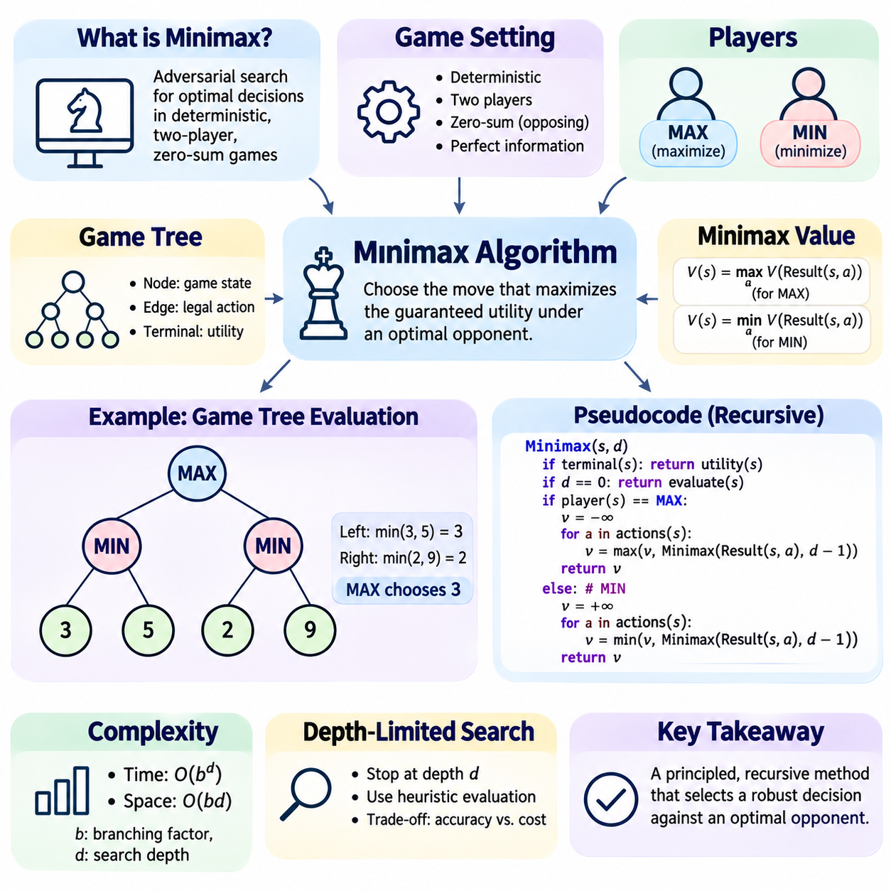{width="7.268055555555556in" height="7.268055555555556in"}

The Minimax algorithm is a foundational adversarial search method used to determine optimal decisions in deterministic, two-player, zero-sum games with perfect information. It evaluates possible sequences of actions by assuming that both players pursue opposing objectives and act optimally. The algorithm selects the move that maximizes the player\'s guaranteed utility against the strongest possible response from an opponent.

Minimax originates from game theory and provides a computational interpretation of rational strategic behavior. Its central principle is that a player should evaluate decisions according to the worst outcome an optimal opponent can enforce. Rather than selecting actions based on optimistic predictions, Minimax identifies strategies that remain defensible under adversarial conditions. This makes it particularly valuable in competitive decision-making.

A Minimax problem is represented using a game tree in which nodes correspond to game states and edges represent legal actions. The root node describes the current position, while successive levels represent alternating decisions by two players. Terminal nodes contain utility values associated with completed games. By propagating these values backward through the tree, the algorithm determines the strategic value of each available action.

The two players are conventionally called MAX and MIN. MAX attempts to maximize the utility function, while MIN attempts to minimize the same function. At a MAX node, the algorithm selects the highest value among successor states. At a MIN node, it selects the lowest value. This alternating optimization structure captures the essential relationship between competing agents in a zero-sum environment.

The recursive Minimax procedure begins by checking whether the current state is terminal. If the game has ended, the algorithm returns the corresponding utility value without further exploration. Otherwise, it generates legal actions and recursively evaluates their successor states. The returned values are combined using maximization or minimization according to the player whose turn it is.

For a MAX state s, the Minimax value can be expressed as V(s) = max V(Result(s,a)) over all legal actions a. For a MIN state, the corresponding expression uses the minimum operator instead of the maximum. At terminal states, V(s) equals the utility assigned to the completed game. These recursive equations define how strategic values propagate through alternating decisions.

Consider a simplified game in which MAX can select between two possible moves. The first move allows MIN to choose between terminal utilities of 3 and 5, while the second allows MIN to choose between 2 and 9. Because MIN selects the smaller outcome, the first move receives a value of 3 and the second receives 2. MAX therefore chooses the first move, guaranteeing utility 3 against optimal opposition.

This example illustrates why Minimax differs from greedy decision-making. A greedy agent might prefer the second move because it contains a possible utility of 9. However, that favorable result depends on the opponent selecting a disadvantageous response. Minimax instead considers the outcome the opponent can enforce and chooses the action with the strongest guaranteed value under optimal play.

Backward induction provides the mathematical foundation for Minimax evaluation. The algorithm first determines the values of terminal positions and then calculates the values of their parent nodes. Each parent selects the maximum or minimum value according to the active player. Repeating this process toward the root produces the optimal decision for the current position, assuming complete search and correct utility assignments.

The correctness of Minimax depends on several assumptions. The environment must follow known transition rules, players must have access to the relevant game state, and utilities must accurately represent their objectives. Standard Minimax also assumes deterministic transitions and opposing utility functions. Under these conditions, exhaustive search identifies an optimal strategy against an opponent who also plays optimally.

Minimax can be implemented using recursive depth-first search, which explores one sequence of actions before returning to evaluate alternatives. This approach avoids storing the entire game tree simultaneously. Instead, the algorithm maintains the current search path and necessary local information. Recursive implementation is conceptually simple and closely follows the mathematical definition of the algorithm.

The computational complexity of Minimax is primarily determined by the branching factor and search depth. If each position has approximately b legal moves and the tree is explored to depth d, the time complexity is O(b\^d). This exponential growth makes exhaustive search impractical for complex games. The space complexity of a depth-first implementation is typically O(bd) when successor states are stored at each recursive level.

Search depth represents the number of consecutive actions examined before evaluation stops. Increasing depth allows the algorithm to identify longer tactical sequences and anticipate more distant consequences. However, deeper exploration also increases computational requirements dramatically. Practical systems must therefore balance strategic accuracy against processing time, available memory, and the complexity of the game environment.

Depth-limited Minimax addresses the difficulty of exploring complete game trees by stopping recursion after a predetermined number of levels. When the depth limit is reached before a terminal state, the algorithm invokes a heuristic evaluation function. This function estimates the strategic quality of the current position and returns an approximate utility. The resulting decision depends on both search depth and evaluation accuracy.

Evaluation functions translate observable game characteristics into numerical estimates of advantage. In chess, these characteristics may include material balance, king safety, mobility, and positional control. In simpler games, evaluation may depend on potential winning lines, available moves, or immediate threats. A well-designed function should distinguish favorable positions from dangerous ones while remaining computationally efficient.

The horizon effect is a significant limitation of depth-limited Minimax. It occurs when an important event lies just beyond the search boundary, causing the algorithm to underestimate its consequences. For example, a position may appear favorable because an unavoidable material loss occurs one move beyond the evaluated depth. Extending selected tactical sequences through quiescence search can reduce this problem.

Move ordering influences the efficiency of optimized Minimax implementations. Although ordinary exhaustive Minimax evaluates all relevant branches regardless of their order, pruning methods benefit from examining promising actions first. Good ordering increases the likelihood that strong bounds become available early. Common ordering strategies prioritize captures, immediate threats, previously successful moves, and actions recommended by earlier searches.

Alpha-beta pruning is the most widely used optimization associated with Minimax. It maintains lower and upper bounds on achievable values and eliminates branches that cannot affect the final decision. The resulting algorithm produces the same value as ordinary Minimax when searching the same tree with identical terminal evaluations. Effective move ordering can substantially reduce the number of evaluated positions.

Iterative deepening further improves practical Minimax search by repeatedly exploring the game tree with increasing depth limits. The algorithm first completes a shallow search and then uses its results to guide deeper searches. This approach provides a valid intermediate decision when time expires unexpectedly. It also supports move ordering and integration with transposition tables, improving search efficiency under fixed time budgets.

Transposition tables store previously evaluated game positions to avoid redundant calculations. Different action sequences may lead to identical states, particularly in games with reversible moves or repeated configurations. By associating state hashes with search results, an engine can reuse relevant evaluations. Correct implementations must distinguish exact values from search bounds and account for search depth and game-state identity.

Minimax assumes optimal opponent behavior, which provides robustness but may not maximize practical performance against imperfect opponents. Human players and limited agents frequently make mistakes or follow predictable patterns. An agent designed exclusively around worst-case outcomes may ignore opportunities that depend on opponent weaknesses. Opponent modeling can supplement Minimax when exploiting such behavior is strategically appropriate.

The algorithm is most naturally suited to deterministic, turn-based, perfect-information games. Stochastic environments require additional reasoning about chance outcomes, often through Expectiminimax. Imperfect-information games require representations of hidden information and uncertainty. Simultaneous-action games may require mixed strategies and equilibrium analysis rather than straightforward alternating MAX and MIN nodes.

Testing a Minimax implementation requires verifying legal move generation, terminal-state recognition, utility calculations, and recursive value propagation. Small games such as tic-tac-toe provide useful environments because complete game trees can be explored and expected outcomes can be checked. Additional tests should examine forced wins, unavoidable losses, draws, depth limits, and situations where multiple actions have equal values.

Performance evaluation should measure decision quality alongside computational cost. Relevant metrics include nodes explored, search depth, execution time, memory consumption, and the percentage of optimal decisions on known test positions. Comparing ordinary Minimax with alpha-beta pruning and iterative deepening reveals how search optimizations affect efficiency. Controlled experiments should use consistent hardware, rules, and evaluation functions.

Minimax provides a conceptual bridge between classical search, game theory, and intelligent decision-making. Its recursive structure demonstrates how an agent can reason about competing objectives by anticipating future responses. Although exhaustive exploration becomes computationally expensive in complex environments, depth limits, heuristic evaluation, pruning, and caching make the approach practical. These principles remain fundamental to modern adversarial search systems.

미니맥스 알고리즘(Minimax Algorithm)은 완전 정보(Perfect Information)를 가진 결정론적(Deterministic) 2인 제로섬 게임(Two-Player Zero-Sum Game)에서 최적의 의사결정을 수행하기 위해 사용되는 기본적인 적대적 탐색 방법(Adversarial Search Method)이다. 이 알고리즘은 두 플레이어가 서로 대립하는 목표를 추구하고 최적으로 행동한다고 가정하여 가능한 행동 순서를 평가한다. 상대방의 가장 강력한 대응에 맞서 보장할 수 있는 효용(Utility)을 최대화하는 행동을 선택한다.

미니맥스(Minimax)는 게임 이론(Game Theory)에서 유래하였으며 합리적인 전략적 행동(Rational Strategic Behavior)을 계산적으로 해석하는 방법을 제공한다. 핵심 원리는 상대방이 강제할 수 있는 최악의 결과를 기준으로 자신의 결정을 평가해야 한다는 것이다. 낙관적인 예측에 따라 행동을 선택하는 대신 적대적인 조건에서도 방어 가능한 전략을 식별한다. 이러한 특성으로 인해 미니맥스는 경쟁적 의사결정(Competitive Decision-Making)에서 특히 중요한 가치를 가진다.

미니맥스 문제(Minimax Problem)는 노드(Node)가 게임 상태(Game State)에 해당하고 간선(Edge)이 합법적 행동(Legal Action)을 나타내는 게임 트리(Game Tree)를 사용하여 표현한다. 루트 노드(Root Node)는 현재 위치를 설명하며, 연속되는 계층은 두 플레이어가 번갈아 수행하는 의사결정을 나타낸다. 단말 노드(Terminal Node)에는 종료된 게임과 관련된 효용 값(Utility Value)이 포함된다. 알고리즘은 이러한 값을 트리의 하위 계층에서 상위 계층으로 역전파하여 사용 가능한 각 행동의 전략적 가치를 결정한다.

두 플레이어는 일반적으로 최대화 플레이어(MAX)와 최소화 플레이어(MIN)로 구분한다. MAX는 효용 함수(Utility Function)를 최대화하려 하고, MIN은 동일한 함수를 최소화하려 한다. MAX 노드에서는 후속 상태(Successor State) 중 가장 높은 값을 선택하고, MIN 노드에서는 가장 낮은 값을 선택한다. 이러한 교대 최적화 구조(Alternating Optimization Structure)는 제로섬 환경에서 경쟁하는 에이전트 사이의 핵심적인 관계를 표현한다.

재귀적 미니맥스 절차(Recursive Minimax Procedure)는 현재 상태가 종료 상태(Terminal State)인지 확인하는 것으로 시작한다. 게임이 종료되었다면 추가 탐색 없이 해당 효용 값을 반환한다. 그렇지 않으면 합법적 행동을 생성하고 각 행동에 따른 후속 상태를 재귀적으로 평가한다. 반환된 값은 현재 차례의 플레이어에 따라 최대화(Maximization) 또는 최소화(Minimization) 연산을 적용하여 결합한다.

MAX 상태 s에 대한 미니맥스 값(Minimax Value)은 모든 합법적 행동 a에 대해 V(s) = max V(Result(s,a))로 표현할 수 있다. MIN 상태에서는 최대 연산자(Maximum Operator) 대신 최소 연산자(Minimum Operator)를 사용한다. 종료 상태에서 V(s)는 완료된 게임에 할당된 효용 값과 같다. 이러한 재귀 방정식(Recursive Equation)은 두 플레이어의 의사결정이 번갈아 수행되는 과정에서 전략적 가치가 어떻게 전파되는지를 정의한다.

MAX가 두 가지 가능한 행동 중 하나를 선택할 수 있는 단순화된 게임을 생각해 볼 수 있다. 첫 번째 행동에서는 MIN이 효용 값 3과 5 중 하나를 선택할 수 있고, 두 번째 행동에서는 2와 9 중 하나를 선택할 수 있다. MIN은 더 작은 결과를 선택하므로 첫 번째 행동의 가치는 3이고 두 번째 행동의 가치는 2가 된다. 따라서 MAX는 최적으로 행동하는 상대방에 맞서 효용 3을 보장하는 첫 번째 행동을 선택한다.

이러한 사례는 미니맥스(Minimax)가 탐욕적 의사결정(Greedy Decision-Making)과 어떻게 다른지를 보여준다. 탐욕적 에이전트(Greedy Agent)는 가능한 효용 값 9가 포함되어 있다는 이유로 두 번째 행동을 선호할 수 있다. 그러나 이러한 유리한 결과는 상대방이 자신에게 불리한 대응을 선택하는 경우에만 가능하다. 반면 미니맥스는 상대방이 강제할 수 있는 결과를 고려하고 최적의 플레이(Optimal Play) 아래에서 가장 높은 보장 가치를 제공하는 행동을 선택한다.

역방향 귀납법(Backward Induction)은 미니맥스 평가(Minimax Evaluation)의 수학적 기초를 제공한다. 알고리즘은 먼저 종료 위치(Terminal Position)의 가치를 결정한 다음 부모 노드(Parent Node)의 가치를 계산한다. 각 부모 노드는 현재 차례의 플레이어에 따라 최대값 또는 최소값을 선택한다. 이러한 과정을 루트 노드까지 반복하면 완전 탐색(Complete Search)과 정확한 효용 값 할당을 가정할 때 현재 위치에 대한 최적의 의사결정을 얻을 수 있다.

미니맥스(Minimax)의 정확성은 여러 가정에 의존한다. 환경은 알려진 상태 전이 규칙(Transition Rule)을 따라야 하며, 플레이어는 관련 게임 상태에 접근할 수 있어야 하고, 효용 값은 목표를 정확하게 표현해야 한다. 표준 미니맥스(Standard Minimax)는 결정론적 상태 전이(Deterministic Transition)와 서로 대립하는 효용 함수도 가정한다. 이러한 조건에서 완전 탐색은 최적으로 행동하는 상대방에 대응하는 최적 전략(Optimal Strategy)을 식별한다.

미니맥스(Minimax)는 재귀적 깊이 우선 탐색(Recursive Depth-First Search)을 사용하여 구현할 수 있으며, 하나의 행동 순서를 먼저 탐색한 다음 되돌아와 다른 대안을 평가한다. 이러한 접근 방식은 전체 게임 트리를 동시에 메모리에 저장할 필요가 없다. 대신 알고리즘은 현재 탐색 경로(Search Path)와 필요한 지역 정보(Local Information)를 유지한다. 재귀적 구현(Recursive Implementation)은 개념적으로 단순하며 알고리즘의 수학적 정의를 직접적으로 반영한다.

미니맥스(Minimax)의 계산 복잡도(Computational Complexity)는 주로 분기 계수(Branching Factor)와 탐색 깊이(Search Depth)에 의해 결정된다. 각 위치에서 평균적으로 b개의 합법적인 이동이 가능하고 깊이 d까지 탐색한다면 시간 복잡도(Time Complexity)는 O(b\^d)가 된다. 이러한 지수적 증가(Exponential Growth)는 복잡한 게임에서 완전 탐색을 비현실적으로 만든다. 각 재귀 계층에서 후속 상태를 저장하는 깊이 우선 구현의 공간 복잡도(Space Complexity)는 일반적으로 O(bd)이다.

탐색 깊이(Search Depth)는 평가가 중단되기 전까지 조사하는 연속적인 행동의 수를 나타낸다. 탐색 깊이가 증가하면 알고리즘은 더 긴 전술적 행동 순서(Tactical Sequence)를 식별하고 더 먼 미래의 결과를 예측할 수 있다. 그러나 깊은 탐색은 계산 요구량도 급격하게 증가시킨다. 따라서 실제 시스템에서는 전략적 정확도(Strategic Accuracy)와 처리 시간(Processing Time), 사용 가능한 메모리(Available Memory), 게임 환경의 복잡성 사이에서 균형을 유지해야 한다.

깊이 제한 미니맥스(Depth-Limited Minimax)는 미리 정해진 계층 수에 도달하면 재귀 탐색을 중단하여 전체 게임 트리를 탐색하기 어려운 문제를 해결한다. 종료 상태에 도달하기 전에 깊이 제한(Depth Limit)에 도달하면 알고리즘은 휴리스틱 평가 함수(Heuristic Evaluation Function)를 호출한다. 이 함수는 현재 위치의 전략적 품질을 추정하고 근사 효용 값(Approximate Utility)을 반환한다. 결과적으로 의사결정은 탐색 깊이와 평가 정확도 모두에 의존한다.

평가 함수(Evaluation Function)는 관찰 가능한 게임 특성(Game Characteristic)을 유리함의 정도를 나타내는 수치적 추정값으로 변환한다. 체스에서는 기물의 가치 균형(Material Balance), 킹의 안전성(King Safety), 이동 가능성(Mobility), 위치적 통제(Positional Control) 등이 이러한 특성에 포함될 수 있다. 단순한 게임에서는 승리 가능 경로(Potential Winning Line), 사용 가능한 이동, 즉각적인 위협을 기준으로 평가할 수 있다. 우수한 평가 함수는 계산 효율을 유지하면서 유리한 위치와 위험한 위치를 구분해야 한다.

수평선 효과(Horizon Effect)는 깊이 제한 미니맥스(Depth-Limited Minimax)의 중요한 한계이다. 이는 중요한 사건이 탐색 경계(Search Boundary) 바로 바깥에 존재하여 알고리즘이 그 결과를 과소평가할 때 발생한다. 예를 들어 피할 수 없는 기물 손실(Material Loss)이 평가 깊이보다 한 수 뒤에서 발생하기 때문에 현재 위치가 유리하게 보일 수 있다. 정적 탐색(Quiescence Search)을 통해 선택된 전술적 행동 순서를 추가로 탐색하면 이러한 문제를 완화할 수 있다.

이동 순서 결정(Move Ordering)은 최적화된 미니맥스 구현(Optimized Minimax Implementation)의 효율에 영향을 미친다. 일반적인 완전 미니맥스는 탐색 순서와 관계없이 모든 관련 분기를 평가하지만, 가지치기 방법(Pruning Method)은 유망한 행동을 먼저 조사할 때 더 큰 이점을 얻는다. 우수한 이동 순서는 강력한 탐색 경계(Search Bound)를 조기에 확보할 가능성을 높인다. 일반적인 방법으로는 기물 포획(Capture), 즉각적인 위협(Immediate Threat), 이전에 성공한 이동, 이전 탐색에서 추천된 행동을 우선적으로 평가하는 방식이 있다.

알파-베타 가지치기(Alpha-Beta Pruning)는 미니맥스(Minimax)와 관련된 가장 널리 사용되는 최적화 방법이다. 이 방법은 달성 가능한 값의 하한(Lower Bound)과 상한(Upper Bound)을 유지하면서 최종 결정에 영향을 미칠 수 없는 분기를 제거한다. 동일한 트리를 동일한 종료 평가(Terminal Evaluation)로 탐색할 경우 일반 미니맥스와 같은 값을 생성한다. 효과적인 이동 순서 결정(Move Ordering)은 평가해야 하는 위치의 수를 크게 줄일 수 있다.

반복 심화 탐색(Iterative Deepening)은 탐색 깊이 제한을 점진적으로 증가시키면서 게임 트리를 반복적으로 탐색하여 실제 미니맥스 탐색 성능을 개선한다. 알고리즘은 먼저 얕은 탐색을 완료하고 그 결과를 이용하여 더 깊은 탐색을 수행한다. 이러한 접근 방식은 예상하지 못한 시점에 시간이 만료되더라도 유효한 중간 결정을 제공한다. 또한 이동 순서 결정과 전치 테이블(Transposition Table)의 통합을 지원하여 고정된 시간 예산(Time Budget) 아래에서 탐색 효율을 높인다.

전치 테이블(Transposition Table)은 이전에 평가한 게임 위치를 저장하여 중복 계산을 방지한다. 특히 되돌릴 수 있는 이동(Reversible Move)이나 반복되는 구성이 존재하는 게임에서는 서로 다른 행동 순서가 동일한 상태에 도달할 수 있다. 상태 해시(State Hash)를 탐색 결과와 연결하면 엔진은 관련 평가 결과를 재사용할 수 있다. 올바른 구현에서는 정확한 값(Exact Value)과 탐색 경계(Search Bound)를 구분하고 탐색 깊이 및 게임 상태의 동일성(Game-State Identity)을 고려해야 한다.

미니맥스(Minimax)는 상대방의 최적 행동(Optimal Opponent Behavior)을 가정하므로 강건성(Robustness)을 제공하지만 불완전한 상대방에 대한 실제 성능을 항상 최대화하지는 못할 수 있다. 인간 플레이어와 제한된 인공지능 에이전트는 자주 실수하거나 예측 가능한 행동 패턴을 따른다. 최악의 결과만을 기준으로 설계된 에이전트는 상대방의 약점에 의존하는 기회를 무시할 수 있다. 이러한 행동을 활용하는 것이 전략적으로 적절한 경우 상대방 모델링(Opponent Modeling)을 미니맥스와 결합할 수 있다.

미니맥스 알고리즘(Minimax Algorithm)은 결정론적(Deterministic), 턴 기반(Turn-Based), 완전 정보(Perfect-Information) 게임에 가장 자연스럽게 적용된다. 확률적 환경(Stochastic Environment)에서는 우연한 결과(Chance Outcome)에 대한 추가적인 추론이 필요하며, 일반적으로 기대 미니맥스(Expectiminimax)를 사용할 수 있다. 불완전 정보 게임(Imperfect-Information Game)은 숨겨진 정보(Hidden Information)와 불확실성(Uncertainty)을 표현해야 한다. 동시 행동 게임(Simultaneous-Action Game)은 단순히 MAX와 MIN 노드를 번갈아 사용하는 방식 대신 혼합 전략(Mixed Strategy)과 균형 분석(Equilibrium Analysis)이 필요할 수 있다.

미니맥스 구현(Minimax Implementation)을 테스트하려면 합법적 이동 생성(Legal Move Generation), 종료 상태 인식(Terminal-State Recognition), 효용 계산(Utility Calculation), 재귀적 가치 전파(Recursive Value Propagation)의 정확성을 검증해야 한다. 틱택토(Tic-Tac-Toe)와 같은 소규모 게임은 전체 게임 트리를 탐색하고 예상 결과를 확인할 수 있으므로 유용한 테스트 환경을 제공한다. 추가 테스트에서는 강제 승리(Forced Win), 피할 수 없는 패배(Unavoidable Loss), 무승부(Draw), 깊이 제한(Depth Limit), 여러 행동이 동일한 가치를 가지는 상황을 검토해야 한다.

성능 평가(Performance Evaluation)는 계산 비용(Computational Cost)과 함께 의사결정 품질(Decision Quality)을 측정해야 한다. 관련 지표에는 탐색한 노드 수(Nodes Explored), 탐색 깊이(Search Depth), 실행 시간(Execution Time), 메모리 사용량(Memory Consumption), 정답이 알려진 테스트 위치에서 최적의 결정을 선택한 비율(Optimal Decision Rate)이 포함된다. 일반 미니맥스를 알파-베타 가지치기 및 반복 심화 탐색과 비교하면 탐색 최적화가 효율에 미치는 영향을 확인할 수 있다. 통제된 실험(Controlled Experiment)은 동일한 하드웨어, 규칙, 평가 함수를 사용해야 한다.

미니맥스(Minimax)는 고전적 탐색(Classical Search), 게임 이론(Game Theory), 지능적 의사결정(Intelligent Decision-Making)을 연결하는 개념적 가교(Conceptual Bridge)를 제공한다. 재귀적 구조(Recursive Structure)는 에이전트가 미래의 대응을 예측하여 경쟁하는 목표를 추론하는 방법을 보여준다. 복잡한 환경에서는 완전 탐색(Exhaustive Exploration)의 계산 비용이 매우 커지지만 깊이 제한(Depth Limit), 휴리스틱 평가(Heuristic Evaluation), 가지치기(Pruning), 캐싱(Caching)을 통해 실제 적용이 가능해진다. 이러한 원리는 현대 적대적 탐색 시스템(Modern Adversarial Search System)의 핵심적인 기초로 남아 있다.

## 02.04 Alpha Beta Pruning [w/Code]

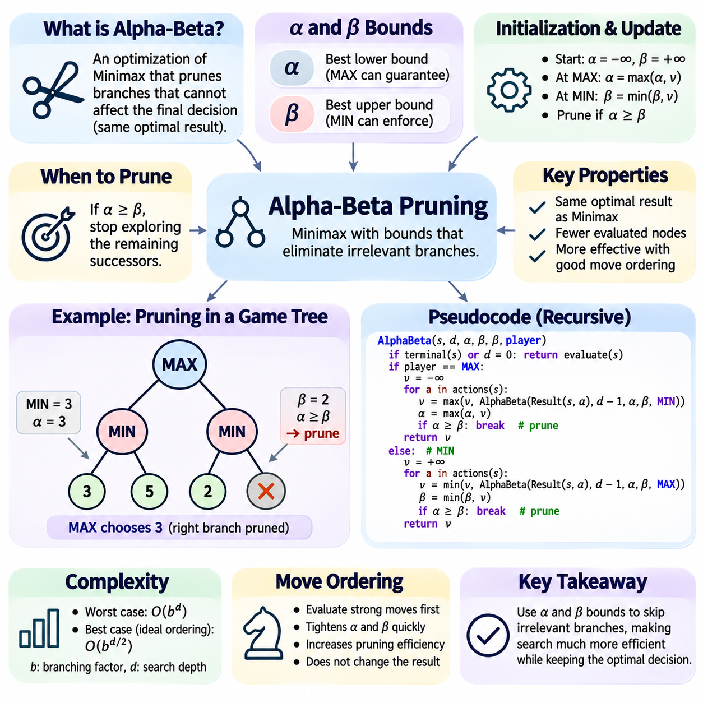{width="7.268055555555556in" height="7.268055555555556in"}

Alpha-beta pruning is a fundamental optimization technique for the Minimax algorithm in adversarial game-tree search. It reduces the number of states evaluated by eliminating branches that cannot influence the final decision. The algorithm preserves the optimal result of Minimax while avoiding unnecessary computation. This makes it particularly valuable in deterministic, two-player, zero-sum games where exhaustive exploration becomes expensive.

The central principle of alpha-beta pruning is that some game-tree branches can be ignored once sufficient information about competing alternatives has been obtained. If a player already possesses a better guaranteed option, exploring an inferior alternative cannot improve the decision. Alpha-beta pruning formalizes this reasoning through numerical bounds that track the best outcomes available to maximizing and minimizing players.

The algorithm introduces two parameters called alpha and beta. Alpha represents the best lower bound on the value that the maximizing player can guarantee along the current search path. Beta represents the best upper bound that the minimizing player can enforce. These bounds are updated as successor states are evaluated, allowing the search procedure to determine when further exploration cannot affect an ancestor\'s decision.

At the beginning of a search, alpha is initialized to negative infinity and beta to positive infinity. These values indicate that no meaningful bounds have yet been established. As the algorithm explores legal actions, alpha increases when MAX discovers stronger alternatives, while beta decreases when MIN identifies lower-valued responses. The narrowing interval provides information about which branches remain strategically relevant.

At a maximizing node, the algorithm evaluates successor states and maintains the highest value discovered so far. Whenever a new successor produces a better result, the node\'s current best value is updated. Alpha is also increased when this result improves the inherited lower bound. If alpha becomes greater than or equal to beta, the remaining successors can be pruned because the minimizing ancestor already has a preferable alternative.

At a minimizing node, the procedure follows the opposite logic. Each successor is evaluated, and the smallest discovered value becomes the current best result. Beta decreases whenever the node establishes a stronger upper bound. If beta becomes less than or equal to alpha, the remaining branches are discarded because a maximizing ancestor already possesses an alternative that makes further exploration unnecessary.

The pruning condition is commonly expressed as alpha greater than or equal to beta. This inequality indicates that the current search interval has closed and additional exploration cannot improve the relevant decision. Importantly, pruning does not imply that the unexplored branches have been evaluated or that their exact values are known. It only establishes that their values are unnecessary for determining the optimal choice.

Consider a MAX root with two MIN children. The first MIN subtree contains terminal utilities of 3 and 5, producing a value of 3 and establishing alpha equal to 3 at the root. In the second MIN subtree, the first examined terminal state has utility 2. Because MIN can enforce a result no greater than 2, the remaining successors can be pruned. MAX will prefer the first subtree regardless of their values.

This example illustrates how alpha-beta pruning uses previously explored alternatives to avoid redundant computation. The second subtree does not require complete evaluation because its minimizing player has already demonstrated a response worse for MAX than the available alternative. The final root decision remains unchanged. Consequently, pruning improves computational efficiency without sacrificing the exact Minimax result for the searched tree.

Alpha-beta pruning is typically implemented as a recursive depth-first search. Each recursive call receives the current state, remaining search depth, alpha bound, beta bound, and player role. Terminal states return exact utility values, while depth-limited states return heuristic estimates. Internal nodes recursively examine legal actions, update their best values and bounds, and terminate exploration when a cutoff condition occurs.

The correctness of alpha-beta pruning follows from the opposing objectives of MAX and MIN. A maximizing player never prefers a smaller value when a larger guaranteed value is available, while a minimizing player never prefers a larger value when a smaller one is available. Once an alternative is proven unable to influence an ancestor\'s selection, its remaining descendants become irrelevant to the final Minimax calculation.

Move ordering has a major influence on pruning efficiency. When strong moves are evaluated early, alpha and beta bounds tighten quickly, increasing the probability of subsequent cutoffs. Poor ordering delays useful bounds and forces the algorithm to examine more nodes. Although move ordering changes computational cost, it does not change the Minimax value returned by a correct exhaustive alpha-beta implementation.

In the worst case, alpha-beta pruning provides little improvement over ordinary Minimax, requiring time proportional to O(b\^d), where b is the branching factor and d is the search depth. With ideal move ordering and favorable tree structure, the effective complexity can approach O(b\^(d/2)). This improvement allows approximately twice the search depth under comparable computational budgets in suitable conditions.

The theoretical improvement of alpha-beta pruning becomes especially important in games with large branching factors. Chess engines may examine millions of positions while selecting a move, making reductions in explored nodes highly valuable. However, actual performance depends on the game structure, evaluation function, move ordering, and available computational resources. The ideal complexity reduction should not be interpreted as a universal guarantee.

Practical move ordering methods prioritize actions likely to produce strong evaluations or early cutoffs. Captures, immediate tactical threats, previously successful moves, and principal variation moves are common candidates. History heuristics and killer-move heuristics use information from earlier searches to rank actions. These techniques improve the probability that strategically important branches are examined before less promising alternatives.

Iterative deepening strengthens alpha-beta pruning by repeatedly searching the game tree with increasing depth limits. Results from shallower searches provide estimates of promising actions and help establish effective move ordering for deeper iterations. This approach also supports time-constrained decision-making because a completed shallower search provides a usable move when the available computation time expires.

Transposition tables complement alpha-beta pruning by storing information about previously evaluated positions. Different action sequences may reach identical game states, allowing cached results to reduce repeated exploration. Table entries can contain exact values, lower bounds, or upper bounds, depending on how the search terminated. Correct reuse requires checking search depth, state identity, and the type of stored bound.

A transposition-table entry produced by a cutoff may not represent the exact Minimax value of the position. Instead, it may establish only that the value is at least or at most a particular threshold. Treating such bounds as exact values can introduce incorrect decisions. Reliable implementations therefore distinguish exact evaluations from lower-bound and upper-bound results and apply them consistently during later searches.

Depth-limited alpha-beta search relies on heuristic evaluation functions when terminal states cannot be reached within the computational budget. These functions estimate the strategic quality of intermediate positions using relevant game features. Although alpha-beta pruning preserves the Minimax result for the explored search tree, the resulting decision may differ from optimal full-game play because heuristic estimates can be inaccurate.

The horizon effect remains a challenge in alpha-beta search because important tactical consequences may lie beyond the selected depth limit. Quiescence search addresses this problem by extending exploration through tactically unstable positions, such as sequences involving captures or immediate threats. By delaying evaluation until a relatively stable position is reached, the algorithm can reduce misleading assessments caused by abrupt search termination.

Aspiration windows provide another optimization by beginning a search with a narrow alpha-beta interval centered around an expected position value. When the true search result falls outside this interval, the algorithm must repeat the search using wider bounds. If the initial estimate is accurate, the narrow interval can produce more cutoffs and reduce computation. This technique is commonly combined with iterative deepening.

Principal variation search exploits the expectation that the first examined move is often the strongest candidate. After searching the leading move with a full window, subsequent moves may initially be tested using narrower windows. If a candidate appears capable of improving the current result, additional searching may be required. This method builds upon alpha-beta pruning and benefits from accurate move ordering.

Alpha-beta pruning also requires careful handling of terminal states, legal-action generation, and game-specific rules. Checkmate, stalemate, repetition, and other termination conditions must be evaluated consistently. Incorrect state transitions or inconsistent utility conventions can invalidate pruning assumptions. The search procedure must also ensure that the maximizing and minimizing roles correspond correctly to the active player.

Testing alpha-beta pruning should begin with small game trees whose exact Minimax values are known. The optimized algorithm must return the same root value as exhaustive Minimax while examining fewer nodes when pruning opportunities exist. Tests should include favorable and unfavorable move ordering, repeated values, terminal positions, and different search depths. Instrumentation can record node visits, cutoff counts, and evaluation calls.

Performance evaluation should compare alpha-beta pruning with ordinary Minimax under identical game rules, search depths, and evaluation functions. Useful metrics include execution time, expanded nodes, evaluated leaves, cutoff frequency, and memory consumption. Experiments should also examine how move ordering and transposition tables affect performance. Repeated trials help distinguish systematic improvements from variation caused by different game positions.

Alpha-beta pruning demonstrates how logical bounds can transform exhaustive adversarial search into a more efficient decision-making process. Its importance extends beyond reducing computation because it establishes a foundation for iterative deepening, transposition-table search, aspiration windows, and advanced game-engine optimization. By preserving Minimax decisions while eliminating irrelevant branches, it remains a central technique in classical Game AI.

알파-베타 가지치기(Alpha-Beta Pruning)는 적대적 게임 트리 탐색(Adversarial Game-Tree Search)에서 미니맥스 알고리즘(Minimax Algorithm)을 최적화하는 핵심 기술이다. 최종 의사결정에 영향을 미칠 수 없는 분기를 제거하여 평가해야 하는 상태의 수를 줄인다. 이 알고리즘은 불필요한 계산을 방지하면서 미니맥스의 최적 결과를 유지한다. 이러한 특성으로 인해 완전 탐색(Exhaustive Exploration)의 계산 비용이 높은 결정론적(Deterministic) 2인 제로섬 게임(Two-Player Zero-Sum Game)에서 특히 유용하다.

알파-베타 가지치기(Alpha-Beta Pruning)의 핵심 원리는 경쟁하는 대안에 대한 충분한 정보를 확보하면 일부 게임 트리 분기를 무시할 수 있다는 것이다. 플레이어가 이미 더 나은 결과를 보장하는 선택지를 가지고 있다면 열등한 대안을 추가로 탐색하더라도 의사결정을 개선할 수 없다. 알파-베타 가지치기는 최대화 플레이어(Maximizing Player)와 최소화 플레이어(Minimizing Player)가 확보할 수 있는 최선의 결과를 추적하는 수치적 경계(Numerical Bound)를 통해 이러한 추론을 형식화한다.

이 알고리즘은 알파(Alpha)와 베타(Beta)라는 두 가지 매개변수(Parameter)를 도입한다. 알파는 현재 탐색 경로(Search Path)에서 최대화 플레이어가 보장할 수 있는 값의 최선의 하한(Lower Bound)을 나타낸다. 베타는 최소화 플레이어가 강제할 수 있는 값의 최선의 상한(Upper Bound)을 나타낸다. 이러한 경계는 후속 상태(Successor State)를 평가하면서 갱신되며, 탐색 절차가 추가적인 탐색이 상위 노드(Ancestor Node)의 결정에 영향을 미칠 수 있는지 판단하도록 한다.

탐색을 시작할 때 알파(Alpha)는 음의 무한대(Negative Infinity)로, 베타(Beta)는 양의 무한대(Positive Infinity)로 초기화한다. 이러한 값은 아직 의미 있는 경계가 설정되지 않았음을 나타낸다. 알고리즘이 합법적 행동(Legal Action)을 탐색하는 동안 MAX가 더 강력한 대안을 발견하면 알파가 증가하고, MIN이 더 낮은 가치를 가진 대응을 발견하면 베타가 감소한다. 점차 좁아지는 구간은 어떤 분기가 전략적으로 여전히 중요한지 판단하는 정보를 제공한다.

최대화 노드(Maximizing Node)에서 알고리즘은 후속 상태를 평가하고 지금까지 발견한 가장 높은 값을 유지한다. 새로운 후속 상태가 더 좋은 결과를 생성하면 해당 노드의 현재 최선 값(Current Best Value)을 갱신한다. 이 결과가 전달받은 하한(Inherited Lower Bound)을 개선하면 알파도 증가한다. 알파가 베타보다 크거나 같아지면 최소화 역할의 상위 노드가 이미 더 유리한 대안을 가지고 있으므로 나머지 후속 상태를 가지치기(Pruning)할 수 있다.

최소화 노드(Minimizing Node)에서는 반대 논리를 적용한다. 각 후속 상태를 평가하고 발견된 가장 작은 값을 현재 최선의 결과로 유지한다. 해당 노드가 더 강력한 상한(Upper Bound)을 설정할 때마다 베타가 감소한다. 베타가 알파보다 작거나 같아지면 최대화 역할의 상위 노드가 이미 추가 탐색을 불필요하게 만드는 대안을 가지고 있으므로 나머지 분기를 제거한다.

가지치기 조건(Pruning Condition)은 일반적으로 알파가 베타보다 크거나 같다는 부등식으로 표현한다. 이 부등식은 현재 탐색 구간(Search Interval)이 닫혔으며 추가적인 탐색이 관련 의사결정을 개선할 수 없음을 의미한다. 중요한 점은 가지치기가 탐색하지 않은 분기를 이미 평가했거나 정확한 값을 알고 있다는 의미가 아니라는 것이다. 단지 최적의 선택을 결정하는 데 해당 분기의 값이 필요하지 않다는 사실을 확인한 것이다.

두 개의 MIN 자식 노드(Child Node)를 가진 MAX 루트 노드(Root Node)를 생각해 볼 수 있다. 첫 번째 MIN 하위 트리(Subtree)는 종료 효용 값(Terminal Utility Value) 3과 5를 포함하므로 가치 3을 생성하고 루트의 알파를 3으로 설정한다. 두 번째 MIN 하위 트리에서 처음 평가한 종료 상태의 효용이 2라면 MIN은 2 이하의 결과를 강제할 수 있다. 따라서 나머지 후속 상태를 가지치기할 수 있으며, MAX는 해당 값과 관계없이 첫 번째 하위 트리를 선호한다.

이러한 사례는 알파-베타 가지치기(Alpha-Beta Pruning)가 이전에 탐색한 대안을 활용하여 중복 계산(Redundant Computation)을 방지하는 방법을 보여준다. 두 번째 하위 트리에서는 최소화 플레이어가 이미 MAX에게 기존 대안보다 불리한 대응을 제시할 수 있음을 확인했으므로 완전한 평가가 필요하지 않다. 최종 루트 결정(Root Decision)은 변경되지 않는다. 따라서 가지치기는 탐색 대상 트리에 대한 정확한 미니맥스 결과(Exact Minimax Result)를 유지하면서 계산 효율(Computational Efficiency)을 향상시킨다.

알파-베타 가지치기(Alpha-Beta Pruning)는 일반적으로 재귀적 깊이 우선 탐색(Recursive Depth-First Search)으로 구현한다. 각 재귀 호출(Recursive Call)은 현재 상태(Current State), 남은 탐색 깊이(Remaining Search Depth), 알파 경계(Alpha Bound), 베타 경계(Beta Bound), 플레이어 역할(Player Role)을 전달받는다. 종료 상태는 정확한 효용 값을 반환하고, 깊이 제한 상태(Depth-Limited State)는 휴리스틱 추정값(Heuristic Estimate)을 반환한다. 내부 노드(Internal Node)는 합법적 행동을 재귀적으로 평가하고 최선 값과 경계를 갱신하며 차단 조건(Cutoff Condition)이 발생하면 탐색을 종료한다.

알파-베타 가지치기(Alpha-Beta Pruning)의 정확성은 MAX와 MIN의 대립하는 목표에서 비롯된다. 최대화 플레이어는 더 큰 보장 가치가 존재할 때 더 작은 값을 선호하지 않으며, 최소화 플레이어는 더 작은 값이 가능할 때 더 큰 값을 선호하지 않는다. 특정 대안이 상위 노드의 선택에 영향을 미칠 수 없다는 사실이 증명되면 해당 대안의 나머지 하위 노드(Descendant Node)는 최종 미니맥스 계산에서 불필요해진다.

이동 순서 결정(Move Ordering)은 가지치기 효율(Pruning Efficiency)에 큰 영향을 미친다. 강력한 이동을 먼저 평가하면 알파와 베타 경계가 빠르게 좁아져 이후 차단(Cutoff)이 발생할 가능성이 증가한다. 반대로 부적절한 이동 순서는 유용한 경계의 설정을 지연시키고 더 많은 노드를 평가하도록 만든다. 이동 순서는 계산 비용을 변화시키지만 올바르게 구현된 완전 알파-베타 탐색(Exhaustive Alpha-Beta Search)이 반환하는 미니맥스 값은 변경하지 않는다.

최악의 경우(Worst Case) 알파-베타 가지치기(Alpha-Beta Pruning)는 일반 미니맥스(Minimax)에 비해 거의 개선되지 않을 수 있으며, 분기 계수(Branching Factor)가 b이고 탐색 깊이(Search Depth)가 d일 때 O(b\^d)에 비례하는 시간이 필요하다. 이상적인 이동 순서(Ideal Move Ordering)와 유리한 트리 구조에서는 유효 복잡도(Effective Complexity)가 O(b\^(d/2))에 가까워질 수 있다. 이러한 개선은 적절한 조건에서 비슷한 계산 예산으로 탐색 깊이를 약 두 배까지 확장할 수 있도록 한다.

알파-베타 가지치기(Alpha-Beta Pruning)의 이론적 개선 효과는 분기 계수(Branching Factor)가 큰 게임에서 특히 중요하다. 체스 엔진(Chess Engine)은 하나의 이동을 선택하는 동안 수백만 개의 위치를 평가할 수 있으므로 탐색 노드 수를 줄이는 것이 매우 중요하다. 그러나 실제 성능은 게임 구조(Game Structure), 평가 함수(Evaluation Function), 이동 순서 결정(Move Ordering), 사용 가능한 계산 자원(Computational Resource)에 따라 달라진다. 이상적인 복잡도 감소를 모든 상황에서 보장되는 결과로 해석해서는 안 된다.

실용적인 이동 순서 결정 방법(Move Ordering Method)은 강력한 평가 결과나 조기 차단(Early Cutoff)을 생성할 가능성이 높은 행동을 우선적으로 처리한다. 기물 포획(Capture), 즉각적인 전술적 위협(Immediate Tactical Threat), 이전에 성공한 이동, 주 변형 이동(Principal Variation Move)이 대표적인 후보이다. 이력 휴리스틱(History Heuristic)과 킬러 무브 휴리스틱(Killer-Move Heuristic)은 이전 탐색에서 얻은 정보를 이용하여 행동의 우선순위를 결정한다. 이러한 기술은 전략적으로 중요한 분기를 덜 유망한 대안보다 먼저 탐색할 가능성을 높인다.

반복 심화 탐색(Iterative Deepening)은 탐색 깊이 제한(Depth Limit)을 점진적으로 증가시키면서 게임 트리를 반복적으로 탐색하여 알파-베타 가지치기(Alpha-Beta Pruning)의 성능을 강화한다. 얕은 탐색에서 얻은 결과는 유망한 행동을 추정하고 더 깊은 반복에서 효과적인 이동 순서를 설정하는 데 사용된다. 또한 완료된 얕은 탐색이 계산 시간 만료 시 활용 가능한 이동을 제공하므로 시간 제약이 있는 의사결정(Time-Constrained Decision-Making)을 지원한다.

전치 테이블(Transposition Table)은 이전에 평가한 위치에 대한 정보를 저장하여 알파-베타 가지치기(Alpha-Beta Pruning)를 보완한다. 서로 다른 행동 순서가 동일한 게임 상태에 도달할 수 있으므로 캐시된 결과(Cached Result)를 활용하면 반복 탐색을 줄일 수 있다. 테이블 항목(Table Entry)은 탐색이 종료된 방식에 따라 정확한 값(Exact Value), 하한(Lower Bound), 상한(Upper Bound)을 포함할 수 있다. 올바른 재사용을 위해서는 탐색 깊이(Search Depth), 상태 동일성(State Identity), 저장된 경계의 유형(Bound Type)을 확인해야 한다.

차단(Cutoff)에 의해 생성된 전치 테이블 항목(Transposition-Table Entry)은 해당 위치의 정확한 미니맥스 값(Exact Minimax Value)을 나타내지 않을 수 있다. 대신 실제 값이 특정 임계값(Threshold) 이상이거나 이하라는 사실만 제공할 수 있다. 이러한 경계를 정확한 값으로 처리하면 잘못된 의사결정이 발생할 수 있다. 따라서 신뢰할 수 있는 구현은 정확한 평가(Exact Evaluation), 하한 결과(Lower-Bound Result), 상한 결과(Upper-Bound Result)를 구분하고 이후 탐색에서 일관되게 적용해야 한다.

깊이 제한 알파-베타 탐색(Depth-Limited Alpha-Beta Search)은 계산 예산(Computational Budget) 내에서 종료 상태에 도달할 수 없는 경우 휴리스틱 평가 함수(Heuristic Evaluation Function)에 의존한다. 이러한 함수는 관련 게임 특징(Game Feature)을 이용하여 중간 위치(Intermediate Position)의 전략적 품질을 추정한다. 알파-베타 가지치기는 탐색한 트리에 대한 미니맥스 결과를 보존하지만 휴리스틱 추정값이 부정확할 수 있으므로 결과적인 의사결정은 전체 게임에서의 최적 플레이(Optimal Full-Game Play)와 다를 수 있다.

수평선 효과(Horizon Effect)는 중요한 전술적 결과가 선택된 탐색 깊이 제한(Depth Limit) 바깥에 존재할 수 있기 때문에 알파-베타 탐색에서도 여전히 문제가 된다. 정적 탐색(Quiescence Search)은 기물 포획이나 즉각적인 위협과 같이 전술적으로 불안정한 위치(Tactically Unstable Position)에 대한 탐색을 연장하여 이러한 문제를 해결한다. 비교적 안정적인 위치에 도달할 때까지 평가를 지연함으로써 갑작스러운 탐색 종료로 발생하는 잘못된 평가를 줄일 수 있다.

열망 윈도우(Aspiration Window)는 예상 위치 가치(Expected Position Value)를 중심으로 좁은 알파-베타 구간(Alpha-Beta Interval)을 설정하여 탐색을 시작하는 또 다른 최적화 방법이다. 실제 탐색 결과가 이 구간을 벗어나면 알고리즘은 더 넓은 경계를 사용하여 탐색을 반복해야 한다. 초기 추정값이 정확하다면 좁은 구간은 더 많은 차단을 발생시키고 계산량을 줄일 수 있다. 이러한 기술은 일반적으로 반복 심화 탐색(Iterative Deepening)과 결합하여 사용된다.

주 변형 탐색(Principal Variation Search)은 처음 평가한 이동이 가장 강력한 후보일 가능성이 높다는 가정을 활용한다. 선행 이동(Leading Move)을 전체 윈도우(Full Window)로 탐색한 다음 후속 이동은 더 좁은 윈도우(Narrow Window)를 사용하여 먼저 검사할 수 있다. 특정 후보가 현재 결과를 개선할 가능성이 있는 것으로 나타나면 추가 탐색이 필요할 수 있다. 이 방법은 알파-베타 가지치기를 기반으로 하며 정확한 이동 순서 결정(Move Ordering)의 이점을 활용한다.

알파-베타 가지치기(Alpha-Beta Pruning)는 종료 상태(Terminal State), 합법적 행동 생성(Legal-Action Generation), 게임별 규칙(Game-Specific Rule)을 신중하게 처리해야 한다. 체크메이트(Checkmate), 스테일메이트(Stalemate), 반복 상태(Repetition), 기타 종료 조건(Termination Condition)을 일관되게 평가해야 한다. 잘못된 상태 전이(State Transition)나 일관되지 않은 효용 규칙(Utility Convention)은 가지치기 가정을 무효화할 수 있다. 탐색 절차는 최대화 역할과 최소화 역할이 현재 차례의 플레이어(Active Player)에 올바르게 대응하는지도 보장해야 한다.

알파-베타 가지치기(Alpha-Beta Pruning)의 테스트는 정확한 미니맥스 값이 알려진 작은 게임 트리에서 시작해야 한다. 최적화된 알고리즘은 가지치기 기회가 존재할 때 더 적은 노드를 탐색하면서도 완전 미니맥스(Exhaustive Minimax)와 동일한 루트 값(Root Value)을 반환해야 한다. 테스트에는 유리한 이동 순서, 불리한 이동 순서, 동일한 값의 반복, 종료 위치, 서로 다른 탐색 깊이가 포함되어야 한다. 계측 기능(Instrumentation)을 통해 노드 방문 수(Node Visit), 차단 횟수(Cutoff Count), 평가 함수 호출 횟수(Evaluation Call)를 기록할 수 있다.

성능 평가(Performance Evaluation)는 동일한 게임 규칙(Game Rule), 탐색 깊이(Search Depth), 평가 함수(Evaluation Function)를 적용하여 알파-베타 가지치기와 일반 미니맥스를 비교해야 한다. 유용한 지표에는 실행 시간(Execution Time), 확장된 노드 수(Expanded Node), 평가된 리프 노드 수(Evaluated Leaf), 차단 빈도(Cutoff Frequency), 메모리 사용량(Memory Consumption)이 포함된다. 또한 이동 순서 결정과 전치 테이블이 성능에 미치는 영향을 분석해야 한다. 반복 실험(Repeated Trial)은 게임 위치 차이로 발생하는 변동과 체계적인 성능 개선을 구분하는 데 도움이 된다.

알파-베타 가지치기(Alpha-Beta Pruning)는 논리적 경계(Logical Bound)를 활용하여 완전한 적대적 탐색(Exhaustive Adversarial Search)을 더욱 효율적인 의사결정 과정(Decision-Making Process)으로 전환하는 방법을 보여준다. 그 중요성은 단순한 계산량 감소를 넘어 반복 심화 탐색(Iterative Deepening), 전치 테이블 탐색(Transposition-Table Search), 열망 윈도우(Aspiration Window), 고급 게임 엔진 최적화(Advanced Game-Engine Optimization)의 기초를 제공한다는 데 있다. 미니맥스의 의사결정을 유지하면서 불필요한 분기를 제거하므로 고전적 게임 인공지능(Classical Game AI)의 핵심 기술로 활용되고 있다.

## 02.05 Evaluation Functions

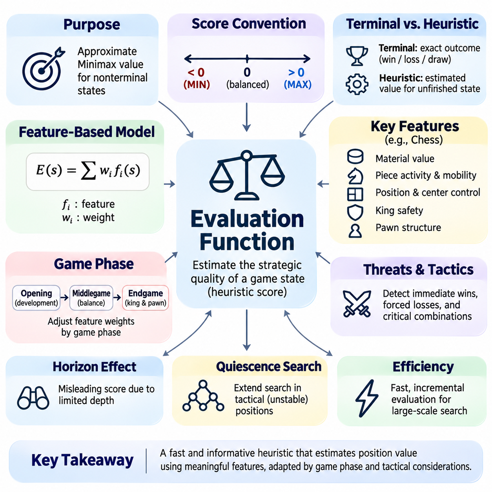{width="7.268055555555556in" height="7.268055555555556in"}

Evaluation functions are essential components of adversarial search systems that estimate the strategic quality of game states without exploring every possible continuation. In complex games, exhaustive Minimax search is computationally impractical because the game tree grows exponentially. Evaluation functions address this limitation by assigning numerical scores to nonterminal positions, enabling intelligent decisions within restricted computational budgets.

The primary objective of an evaluation function is to approximate the true Minimax value of a position. This value represents the outcome achievable when both players follow optimal strategies until the game ends. Since computing exact values often requires exploring enormous game trees, heuristic evaluation provides an efficient approximation. The quality of this approximation strongly influences the effectiveness of depth-limited adversarial search.

An evaluation function typically maps a game state to a numerical score representing advantage or disadvantage. Positive values may indicate favorable conditions for MAX, while negative values indicate favorable conditions for MIN. A score near zero often represents a balanced position. Maintaining a consistent scoring convention is essential because Minimax and alpha-beta pruning rely on meaningful comparisons between evaluated states.

Terminal-state utilities and heuristic evaluation scores serve different purposes. Terminal utilities represent actual outcomes such as victory, defeat, or draw, while heuristic scores estimate the potential value of unfinished positions. A robust implementation should preserve this distinction and ensure that terminal outcomes dominate ordinary positional advantages. Otherwise, the algorithm may prefer material gains over an available forced victory.

Feature-based evaluation functions combine measurable characteristics of a game position into an overall score. A common formulation is E(s) = w1f1(s) + w2f2(s) + \... + wnfn(s), where each feature describes a relevant property and each weight represents its importance. This weighted linear model is computationally efficient, interpretable, and suitable for classical game engines that require frequent position evaluations.

Feature selection determines which aspects of a game state contribute to its estimated strategic value. Useful features should reflect meaningful advantages, disadvantages, threats, and opportunities. They must also be inexpensive enough to calculate repeatedly during search. Poorly selected features may introduce misleading signals, while redundant features can distort evaluations if their contributions are counted multiple times.

In chess, material balance is one of the most familiar evaluation features. Different pieces receive approximate numerical values reflecting their relative strategic importance. A typical system assigns higher values to queens and rooks than to bishops, knights, or pawns. Material evaluation provides a useful baseline, but it cannot fully capture positional compensation, tactical threats, or long-term strategic opportunities.

Positional evaluation extends material scoring by considering how effectively pieces occupy and control the board. Relevant factors include central control, piece activity, mobility, pawn structure, and king safety. Piece-square tables can assign different values to the same piece depending on its location. These mechanisms allow evaluation functions to distinguish positions with identical material counts but different strategic potential.

Mobility measures the number or quality of legal actions available to a player. Greater mobility often indicates flexibility and the ability to respond to future threats. However, mobility is not universally beneficial, because some available moves may be strategically weak or dangerous. Effective evaluation functions therefore consider mobility together with positional context, tactical vulnerability, and game-specific objectives.

King safety illustrates how evaluation features may depend on interactions between multiple game elements. A king surrounded by protective pawns may be safer than one exposed to open attacking lines. Threats from opposing pieces, nearby weaknesses, and available escape squares can influence the safety estimate. Such relationships demonstrate why independent feature scores may be insufficient for accurately representing complex positions.

Evaluation functions must account for changing strategic priorities across different phases of a game. In chess, opening positions emphasize development and central control, while endgames often emphasize king activity and pawn promotion. A phase-dependent evaluation function adjusts feature weights according to the current position. This adaptive approach reduces errors caused by applying fixed strategic priorities throughout the entire game.

Threat detection is another important component of heuristic evaluation. Immediate winning opportunities, forced losses, captures, and tactical combinations may dominate ordinary positional considerations. An evaluation function that overlooks such threats can produce highly misleading scores. Incorporating tactical features or extending search through unstable positions helps align estimated values with the consequences of future actions.

The horizon effect occurs when a depth-limited search stops immediately before an important event. A position may appear favorable even though an unavoidable loss exists just beyond the search boundary. Evaluation functions alone cannot eliminate this problem because they operate on incomplete search information. Quiescence search reduces the effect by continuing selected tactical sequences until relatively stable positions are reached.

Computational efficiency is a fundamental design requirement for evaluation functions. During Minimax or alpha-beta search, the evaluation procedure may execute millions of times. Expensive calculations can reduce the number of positions examined within a fixed time budget. Therefore, evaluation quality must be balanced against execution cost, with emphasis on features that provide useful strategic information efficiently.

Incremental evaluation improves efficiency by updating previously calculated scores after each move instead of recomputing every feature from the beginning. For example, moving a piece changes its positional contribution, while capturing an opponent\'s piece changes material balance. Maintaining relevant intermediate values can substantially reduce repeated calculations. This technique is especially valuable in high-performance game engines.

Feature normalization helps combine measurements with different numerical ranges. Material scores, mobility counts, positional bonuses, and threat indicators may otherwise contribute disproportionately to the final result. Scaling features to comparable ranges makes weight selection more manageable. Nevertheless, normalization should preserve strategically meaningful differences rather than forcing every feature to have equal influence.

Weight tuning determines the relative importance of evaluation features. Initial weights may come from expert knowledge, empirical observations, or simplified game-theoretic reasoning. Subsequent optimization can use automated experiments and performance feedback. The objective is not necessarily to reproduce human judgments, but to improve the quality of decisions produced by the complete search system.

Machine learning provides an alternative to manually designed evaluation functions. Supervised learning can estimate position values from labeled game states, while reinforcement learning can improve evaluations through interaction and self-play. Neural networks can capture nonlinear relationships between features that weighted linear models may miss. However, learned evaluation functions require appropriate training data, validation, and computational resources.

The integration of neural evaluation with classical search creates hybrid Game AI systems. A neural network estimates the value of a position, while Minimax or alpha-beta pruning explores possible future actions. This combination separates approximate strategic assessment from explicit tactical reasoning. Its effectiveness depends on inference latency, model accuracy, search depth, and the consistency of the evaluation scale.

Evaluation uncertainty is an important consideration when interpreting heuristic scores. A numerical estimate does not necessarily represent a guaranteed outcome or a calibrated probability of winning. Two positions with similar scores may have different tactical risks or levels of uncertainty. Systems that distinguish estimated value from confidence can support more informed search allocation and decision analysis.

Evaluation functions must remain consistent with the game\'s rules and utility structure. In zero-sum games, a score favorable to one player should correspond to a disadvantage for the opponent under the chosen convention. Incorrect perspective handling can reverse strategic preferences and invalidate search results. Implementations must carefully distinguish fixed-player evaluation from side-to-move evaluation, particularly when using Negamax.

Testing evaluation functions requires examining positions with known strategic characteristics. Useful cases include forced wins, unavoidable losses, balanced positions, material imbalances, tactical threats, and phase transitions. Individual feature contributions should be inspected to detect unexpected behavior. Comparing heuristic rankings against deeper searches or trusted reference evaluations can reveal systematic weaknesses.

Performance assessment should evaluate both predictive quality and practical playing strength. Relevant measures include agreement with reference values, ranking accuracy, evaluation latency, search nodes per second, and results against benchmark opponents. Ablation experiments can determine whether particular features improve decisions. Reliable comparisons require consistent search settings, hardware conditions, and representative game positions.

Evaluation functions form the bridge between exhaustive strategic reasoning and practical computational constraints. Their design requires combining domain knowledge, mathematical modeling, efficient implementation, and empirical validation. Although no heuristic can guarantee perfect decisions in every complex position, carefully constructed evaluation functions substantially improve adversarial search. They remain central to classical and hybrid Game AI architectures.

평가 함수(Evaluation Function)는 가능한 모든 후속 진행을 탐색하지 않고 게임 상태(Game State)의 전략적 품질(Strategic Quality)을 추정하는 적대적 탐색 시스템(Adversarial Search System)의 핵심 구성 요소이다. 복잡한 게임에서는 게임 트리(Game Tree)가 지수적으로 증가하기 때문에 완전한 미니맥스 탐색(Exhaustive Minimax Search)을 수행하는 것이 계산적으로 비현실적이다. 평가 함수는 비종료 위치(Nonterminal Position)에 수치 점수(Numerical Score)를 부여하여 이러한 한계를 해결하고 제한된 계산 예산(Computational Budget) 내에서 지능적인 의사결정을 가능하게 한다.

평가 함수(Evaluation Function)의 주요 목적은 특정 위치의 실제 미니맥스 값(True Minimax Value)을 근사하는 것이다. 이 값은 두 플레이어가 게임이 종료될 때까지 최적 전략(Optimal Strategy)을 따를 경우 달성할 수 있는 결과를 나타낸다. 정확한 값을 계산하려면 방대한 게임 트리를 탐색해야 하는 경우가 많으므로 휴리스틱 평가(Heuristic Evaluation)는 효율적인 근사 방법을 제공한다. 이러한 근사의 품질은 깊이 제한 적대적 탐색(Depth-Limited Adversarial Search)의 효과에 큰 영향을 미친다.

평가 함수(Evaluation Function)는 일반적으로 게임 상태(Game State)를 유리함 또는 불리함을 나타내는 수치 점수(Numerical Score)로 변환한다. 양수 값(Positive Value)은 MAX에게 유리한 조건을 나타내고, 음수 값(Negative Value)은 MIN에게 유리한 조건을 나타낼 수 있다. 0에 가까운 점수는 일반적으로 균형 잡힌 위치(Balanced Position)를 의미한다. 미니맥스(Minimax)와 알파-베타 가지치기(Alpha-Beta Pruning)는 평가된 상태 사이의 의미 있는 비교에 의존하므로 일관된 점수 체계(Scoring Convention)를 유지하는 것이 중요하다.

종료 상태 효용(Terminal-State Utility)과 휴리스틱 평가 점수(Heuristic Evaluation Score)는 서로 다른 목적을 가진다. 종료 효용은 승리(Victory), 패배(Defeat), 무승부(Draw)와 같은 실제 결과를 나타내지만, 휴리스틱 점수는 종료되지 않은 위치의 잠재적 가치를 추정한다. 강건한 구현(Robust Implementation)은 이러한 차이를 유지하고 종료 결과가 일반적인 위치적 이점(Positional Advantage)보다 우선하도록 보장해야 한다. 그렇지 않으면 알고리즘이 강제 승리(Forced Victory)를 선택할 수 있음에도 기물 획득(Material Gain)을 선호할 수 있다.

특징 기반 평가 함수(Feature-Based Evaluation Function)는 게임 위치에서 측정 가능한 특성을 결합하여 전체 점수를 계산한다. 일반적인 표현은 E(s) = w1f1(s) + w2f2(s) + \... + wnfn(s)이며, 각 특징(Feature)은 관련 속성을 설명하고 각 가중치(Weight)는 해당 특징의 중요도를 나타낸다. 이러한 가중 선형 모델(Weighted Linear Model)은 계산 효율이 높고 해석 가능성(Interpretability)이 우수하며 빈번한 위치 평가가 필요한 고전적 게임 엔진(Classical Game Engine)에 적합하다.

특징 선택(Feature Selection)은 게임 상태의 어떤 측면이 추정된 전략적 가치(Estimated Strategic Value)에 기여하는지를 결정한다. 유용한 특징은 의미 있는 이점(Advantage), 불리한 조건(Disadvantage), 위협(Threat), 기회(Opportunity)를 반영해야 한다. 또한 탐색 과정에서 반복적으로 계산할 수 있을 만큼 계산 비용이 낮아야 한다. 부적절하게 선택된 특징은 잘못된 신호(Misleading Signal)를 생성할 수 있으며, 중복 특징(Redundant Feature)은 동일한 기여를 여러 번 계산하여 평가 결과를 왜곡할 수 있다.

체스(Chess)에서 기물 가치 균형(Material Balance)은 가장 널리 알려진 평가 특징 중 하나이다. 서로 다른 기물(Piece)에는 상대적인 전략적 중요도를 반영하는 근사 수치 값이 부여된다. 일반적인 시스템에서는 퀸(Queen)과 룩(Rook)에 비숍(Bishop), 나이트(Knight), 폰(Pawn)보다 높은 가치를 부여한다. 기물 가치 평가는 유용한 기준선(Baseline)을 제공하지만 위치적 보상(Positional Compensation), 전술적 위협(Tactical Threat), 장기적인 전략적 기회(Long-Term Strategic Opportunity)를 완전히 표현할 수는 없다.

위치 평가(Positional Evaluation)는 기물이 보드(Board)를 얼마나 효과적으로 점유하고 통제하는지를 고려하여 기물 가치 평가를 확장한다. 관련 요소에는 중앙 통제(Central Control), 기물 활동성(Piece Activity), 이동 가능성(Mobility), 폰 구조(Pawn Structure), 킹의 안전성(King Safety)이 포함된다. 기물 위치 테이블(Piece-Square Table)은 동일한 기물이라도 위치에 따라 서로 다른 가치를 부여할 수 있다. 이러한 메커니즘을 통해 평가 함수는 기물 수가 동일하더라도 전략적 잠재력(Strategic Potential)이 서로 다른 위치를 구분할 수 있다.

이동 가능성(Mobility)은 플레이어가 사용할 수 있는 합법적 행동(Legal Action)의 수 또는 품질을 측정한다. 높은 이동 가능성은 일반적으로 유연성(Flexibility)과 미래의 위협에 대응할 수 있는 능력을 나타낸다. 그러나 사용 가능한 일부 이동은 전략적으로 약하거나 위험할 수 있으므로 이동 가능성이 항상 유리한 것은 아니다. 따라서 효과적인 평가 함수는 위치적 맥락(Positional Context), 전술적 취약성(Tactical Vulnerability), 게임별 목표(Game-Specific Objective)와 함께 이동 가능성을 고려한다.

킹의 안전성(King Safety)은 평가 특징이 여러 게임 요소 사이의 상호작용에 따라 달라질 수 있음을 보여준다. 보호하는 폰으로 둘러싸인 킹은 공격 경로에 노출된 킹보다 안전할 수 있다. 상대 기물의 위협, 주변의 약점, 사용 가능한 탈출 칸(Escape Square)은 안전성 추정값(Safety Estimate)에 영향을 미친다. 이러한 관계는 독립적인 특징 점수(Independent Feature Score)만으로는 복잡한 위치를 정확하게 표현하기 어려울 수 있음을 보여준다.

평가 함수(Evaluation Function)는 게임의 여러 단계(Game Phase)에 따라 변화하는 전략적 우선순위(Strategic Priority)를 고려해야 한다. 체스에서 오프닝(Opening)은 기물 전개(Development)와 중앙 통제(Central Control)를 강조하는 반면, 엔드게임(Endgame)은 킹의 활동성(King Activity)과 폰 승격(Pawn Promotion)을 중요하게 고려한다. 단계 의존적 평가 함수(Phase-Dependent Evaluation Function)는 현재 위치에 따라 특징 가중치(Feature Weight)를 조정한다. 이러한 적응형 접근 방식(Adaptive Approach)은 게임 전체에 고정된 전략적 우선순위를 적용하여 발생하는 오류를 줄인다.

위협 탐지(Threat Detection)는 휴리스틱 평가(Heuristic Evaluation)의 또 다른 중요한 구성 요소이다. 즉각적인 승리 기회(Immediate Winning Opportunity), 강제 패배(Forced Loss), 기물 포획(Capture), 전술적 조합(Tactical Combination)은 일반적인 위치적 고려 사항보다 우선할 수 있다. 이러한 위협을 간과하는 평가 함수는 매우 잘못된 점수를 생성할 수 있다. 전술적 특징(Tactical Feature)을 포함하거나 불안정한 위치(Unstable Position)에 대한 탐색을 연장하면 추정 가치와 미래 행동의 결과 사이의 일치도를 높일 수 있다.

수평선 효과(Horizon Effect)는 깊이 제한 탐색(Depth-Limited Search)이 중요한 사건이 발생하기 직전에 중단될 때 나타난다. 탐색 경계(Search Boundary) 바로 너머에 피할 수 없는 손실이 존재하더라도 현재 위치가 유리하게 평가될 수 있다. 평가 함수만으로는 불완전한 탐색 정보(Incomplete Search Information)를 기반으로 동작하기 때문에 이러한 문제를 완전히 제거할 수 없다. 정적 탐색(Quiescence Search)은 비교적 안정적인 위치에 도달할 때까지 선택된 전술적 행동 순서(Tactical Sequence)를 계속 탐색하여 이러한 영향을 줄인다.

계산 효율(Computational Efficiency)은 평가 함수(Evaluation Function)를 설계할 때 반드시 고려해야 하는 기본 요구사항이다. 미니맥스(Minimax) 또는 알파-베타 탐색(Alpha-Beta Search)에서는 평가 절차가 수백만 번 실행될 수 있다. 계산 비용이 높은 연산은 고정된 시간 예산(Time Budget) 내에서 탐색할 수 있는 위치의 수를 감소시킨다. 따라서 평가 품질(Evaluation Quality)과 실행 비용(Execution Cost) 사이의 균형을 유지하면서 유용한 전략적 정보를 효율적으로 제공하는 특징에 중점을 두어야 한다.

증분 평가(Incremental Evaluation)는 매번 모든 특징을 처음부터 다시 계산하는 대신 각 이동 이후 이전에 계산한 점수를 갱신하여 효율을 높인다. 예를 들어 기물을 이동하면 해당 기물의 위치적 기여(Positional Contribution)가 변하고, 상대 기물을 포획하면 기물 가치 균형(Material Balance)이 달라진다. 관련 중간값(Intermediate Value)을 유지하면 반복 계산을 크게 줄일 수 있다. 이러한 기술은 특히 고성능 게임 엔진(High-Performance Game Engine)에서 중요한 가치를 가진다.

특징 정규화(Feature Normalization)는 서로 다른 수치 범위(Numerical Range)를 가진 측정값을 결합하는 데 도움이 된다. 기물 점수(Material Score), 이동 가능 횟수(Mobility Count), 위치 보너스(Positional Bonus), 위협 지표(Threat Indicator)는 정규화하지 않으면 최종 결과에 불균형하게 기여할 수 있다. 특징을 비교 가능한 범위로 조정하면 가중치 선택(Weight Selection)을 더욱 쉽게 관리할 수 있다. 그러나 정규화는 모든 특징에 동일한 영향력을 강제하기보다 전략적으로 의미 있는 차이를 유지해야 한다.

가중치 조정(Weight Tuning)은 평가 특징(Evaluation Feature)의 상대적 중요도를 결정한다. 초기 가중치는 전문가 지식(Expert Knowledge), 경험적 관찰(Empirical Observation), 단순화된 게임 이론적 추론(Game-Theoretic Reasoning)에서 얻을 수 있다. 이후 자동화된 실험(Automated Experiment)과 성능 피드백(Performance Feedback)을 활용하여 최적화할 수 있다. 목표는 반드시 인간의 판단을 재현하는 것이 아니라 전체 탐색 시스템(Complete Search System)이 생성하는 의사결정의 품질을 개선하는 것이다.

기계학습(Machine Learning)은 수작업으로 설계한 평가 함수(Manually Designed Evaluation Function)를 대체할 수 있는 방법을 제공한다. 지도학습(Supervised Learning)은 레이블이 부여된 게임 상태(Labeled Game State)로부터 위치 가치를 추정할 수 있으며, 강화학습(Reinforcement Learning)은 상호작용과 자기 대국(Self-Play)을 통해 평가를 개선할 수 있다. 신경망(Neural Network)은 가중 선형 모델이 놓칠 수 있는 특징 사이의 비선형 관계(Nonlinear Relationship)를 학습할 수 있다. 그러나 학습 기반 평가 함수(Learned Evaluation Function)에는 적절한 학습 데이터, 검증, 계산 자원이 필요하다.

신경망 평가(Neural Evaluation)와 고전적 탐색(Classical Search)의 통합은 하이브리드 게임 인공지능 시스템(Hybrid Game AI System)을 형성한다. 신경망은 특정 위치의 가치를 추정하고, 미니맥스(Minimax) 또는 알파-베타 가지치기(Alpha-Beta Pruning)는 가능한 미래 행동을 탐색한다. 이러한 결합은 근사적 전략 평가(Approximate Strategic Assessment)와 명시적 전술 추론(Explicit Tactical Reasoning)을 분리한다. 효과는 추론 지연 시간(Inference Latency), 모델 정확도(Model Accuracy), 탐색 깊이(Search Depth), 평가 척도의 일관성(Evaluation Scale Consistency)에 따라 달라진다.

평가 불확실성(Evaluation Uncertainty)은 휴리스틱 점수(Heuristic Score)를 해석할 때 중요한 고려 사항이다. 수치적 추정값(Numerical Estimate)이 반드시 보장된 결과나 보정된 승리 확률(Calibrated Winning Probability)을 나타내는 것은 아니다. 비슷한 점수를 가진 두 위치라도 전술적 위험(Tactical Risk)이나 불확실성 수준(Uncertainty Level)은 다를 수 있다. 추정 가치(Estimated Value)와 신뢰도(Confidence)를 구분하는 시스템은 더욱 정교한 탐색 자원 할당(Search Allocation)과 의사결정 분석(Decision Analysis)을 지원할 수 있다.

평가 함수(Evaluation Function)는 게임 규칙(Game Rule)과 효용 구조(Utility Structure)에 일관되게 부합해야 한다. 제로섬 게임(Zero-Sum Game)에서 한 플레이어에게 유리한 점수는 선택된 점수 체계에 따라 상대방에게 불리한 결과에 해당해야 한다. 관점 처리(Perspective Handling)가 잘못되면 전략적 선호(Strategic Preference)가 반대로 해석되어 탐색 결과가 무효화될 수 있다. 특히 네가맥스(Negamax)를 사용할 때는 고정 플레이어 기준 평가(Fixed-Player Evaluation)와 현재 차례 플레이어 기준 평가(Side-to-Move Evaluation)를 신중하게 구분해야 한다.

평가 함수(Evaluation Function)를 테스트하려면 전략적 특성이 알려진 위치를 조사해야 한다. 유용한 테스트 사례에는 강제 승리(Forced Win), 피할 수 없는 패배(Unavoidable Loss), 균형 잡힌 위치(Balanced Position), 기물 불균형(Material Imbalance), 전술적 위협(Tactical Threat), 게임 단계 전환(Phase Transition)이 포함된다. 예상하지 못한 동작을 탐지하기 위해 개별 특징의 기여도(Feature Contribution)를 검사해야 한다. 휴리스틱 순위(Heuristic Ranking)를 더 깊은 탐색 결과나 신뢰할 수 있는 기준 평가(Reference Evaluation)와 비교하면 체계적인 약점을 발견할 수 있다.

성능 평가(Performance Assessment)는 예측 품질(Predictive Quality)과 실제 대국 성능(Practical Playing Strength)을 모두 평가해야 한다. 관련 측정 지표에는 기준값과의 일치도(Agreement with Reference Values), 순위 정확도(Ranking Accuracy), 평가 지연 시간(Evaluation Latency), 초당 탐색 노드 수(Search Nodes per Second), 벤치마크 상대방(Benchmark Opponent)에 대한 경기 결과가 포함된다. 제거 실험(Ablation Experiment)은 특정 특징이 의사결정을 개선하는지 확인할 수 있다. 신뢰할 수 있는 비교를 위해서는 일관된 탐색 설정(Search Setting), 하드웨어 조건(Hardware Condition), 대표적인 게임 위치(Representative Game Position)가 필요하다.

평가 함수(Evaluation Function)는 완전한 전략적 추론(Exhaustive Strategic Reasoning)과 실제 계산 제약(Practical Computational Constraint)을 연결하는 가교 역할을 한다. 평가 함수를 설계하려면 도메인 지식(Domain Knowledge), 수학적 모델링(Mathematical Modeling), 효율적인 구현(Efficient Implementation), 경험적 검증(Empirical Validation)을 결합해야 한다. 어떤 휴리스틱(Heuristic)도 모든 복잡한 위치에서 완벽한 의사결정을 보장할 수는 없지만 신중하게 설계된 평가 함수는 적대적 탐색(Adversarial Search)의 성능을 크게 향상시킨다. 평가 함수는 고전적 게임 인공지능(Classical Game AI)과 하이브리드 게임 인공지능 아키텍처(Hybrid Game AI Architecture)의 핵심 구성 요소로 남아 있다.

## 02.06 Iterative Deepening in Games [w/Code]

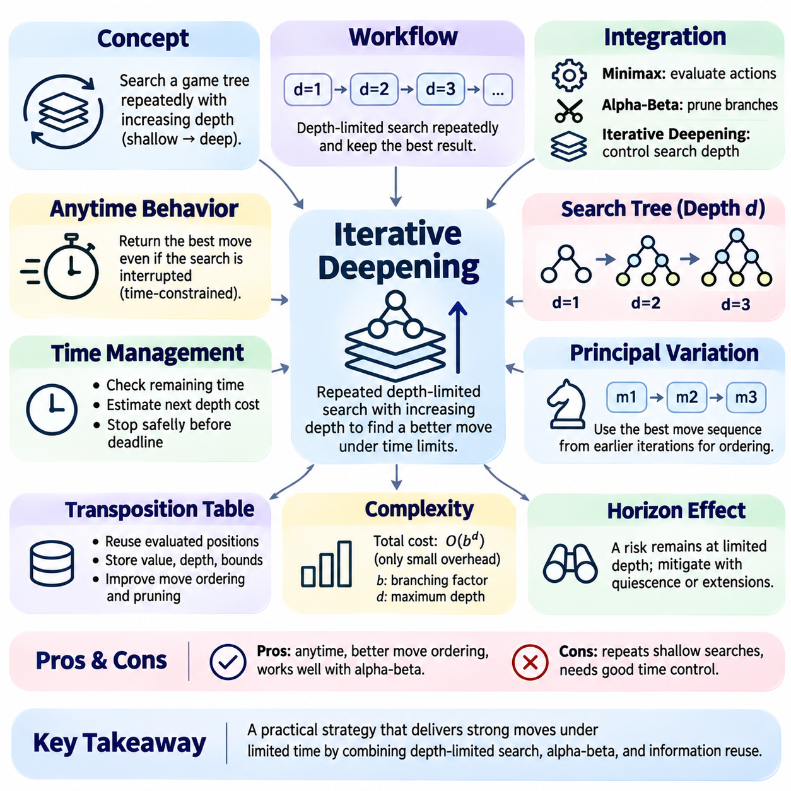{width="7.268055555555556in" height="7.268055555555556in"}

Iterative deepening is a search strategy that repeatedly explores a game tree with progressively increasing depth limits. It combines the decision quality of deeper adversarial search with the flexibility of shallow searches. Rather than committing immediately to a computationally expensive search, the algorithm completes several bounded searches and retains the best available decision. This approach is particularly useful in time-constrained Game AI systems.

The central principle of iterative deepening is to perform a sequence of depth-limited searches, beginning with a shallow depth and gradually extending the search horizon. A typical implementation searches depths one, two, three, and continues until a stopping condition is reached. Each completed iteration produces a candidate move and an estimated position value. The latest completed result remains available if a deeper iteration cannot finish.

Iterative deepening is commonly integrated with Minimax and alpha-beta pruning. Minimax determines the strategic value of alternative actions, while alpha-beta pruning eliminates branches that cannot influence the final decision. Iterative deepening controls how deeply these procedures explore the game tree. Together, these mechanisms provide a practical framework for adversarial reasoning under limited computational resources.

The algorithm begins by generating legal actions from the current game state and performing a depth-limited search. Once the first iteration finishes, the depth limit increases and the search begins again from the root. This process continues while sufficient time or computational resources remain. Although earlier levels are revisited, information collected during previous iterations can improve the efficiency of subsequent searches.

A major advantage of iterative deepening is its anytime behavior. An anytime algorithm can return a valid result even when computation is interrupted before the planned search finishes. In game-playing systems, this means the engine can use the best move from the most recently completed iteration. The property is especially important when decision deadlines are strict or available processing time varies unpredictably.

Time management is a critical component of practical iterative deepening. A game engine must determine whether sufficient time remains to begin another search iteration. Search duration can increase rapidly with depth, making exact completion-time predictions difficult. Engines therefore estimate future costs using previous iteration times, observed branching behavior, and remaining time budgets while preserving a margin for safe termination.

The computational cost of iterative deepening initially appears wasteful because shallow positions are evaluated repeatedly. However, in exponentially growing trees, the deepest iteration typically accounts for most of the search effort. If the branching factor is b and the maximum depth is d, the total work remains O(b\^d) for conventional exhaustive search. Thus, repeated shallow exploration usually introduces only a limited multiplicative overhead.

The effectiveness of iterative deepening increases substantially when combined with alpha-beta pruning. Earlier iterations identify promising moves that can be searched first during deeper iterations. Strong move ordering tightens alpha and beta bounds sooner, allowing more branches to be pruned. Consequently, the information gained from shallow searches may compensate for their additional computational cost and sometimes improve overall search efficiency.

The principal variation represents the sequence of moves considered strongest by the current search. After completing an iteration, the engine can retain this sequence and prioritize its first move in the next iteration. Following previously successful moves often improves move ordering throughout the tree. However, the principal variation may change as deeper searches reveal tactical consequences that were invisible at shallower depths.

Transposition tables provide another mechanism for reusing information across iterations. These tables store previously examined positions, their estimated values, search depths, and bound classifications. When a deeper search encounters a known position, the stored entry can guide move ordering or support valid bound-based cutoffs. Reusing cached information reduces redundant calculations and strengthens the interaction between iterative deepening and alpha-beta pruning.

Correct transposition-table integration requires careful handling of search depth and value reliability. A result obtained at a shallow depth cannot automatically replace an evaluation requiring deeper exploration. Nevertheless, its recommended move may remain useful for ordering actions. Exact values, lower bounds, and upper bounds must be distinguished to prevent invalid pruning decisions. These safeguards preserve the logical correctness of the search.

Iterative deepening also improves responsiveness in interactive applications. A game engine may display its current best move, estimated position score, and completed search depth while computation continues. Such intermediate results provide useful feedback without requiring the final iteration to finish. In competitive systems, however, the engine should commit to an action only according to its decision deadline and operational constraints.

Depth limits can be defined using conventional search plies, where one ply corresponds to a single player\'s action. Increasing the depth by one ply extends the search by one additional decision level. Some engines instead use selective extensions or reductions that produce nonuniform search depths. In these systems, iterative deepening still organizes successive searches, but the meaning of nominal depth requires careful interpretation.

The horizon effect remains relevant because each iteration evaluates positions at a finite search boundary. Important tactical events may lie just beyond the current depth limit, producing misleading evaluations. Deeper iterations can reveal some previously hidden consequences, but they cannot eliminate the problem entirely. Quiescence search and selective extensions help stabilize evaluations by exploring tactically important continuations beyond nominal depth limits.

Aspiration windows can further optimize iterative deepening by using the score from a completed iteration to predict the value of the next search. Instead of beginning with unrestricted alpha-beta bounds, the engine searches within a narrow interval around the expected score. Accurate predictions can increase pruning efficiency. If the actual value falls outside the interval, the engine must repeat the search with expanded bounds.

Search instability occurs when estimated position values or preferred moves change significantly between successive depths. Such changes may indicate tactical complexity, evaluation weaknesses, or important consequences beyond the previous horizon. Practical engines can monitor score fluctuations and principal variation changes to adjust time allocation. However, instability does not necessarily imply that the deeper result is incorrect.

Adaptive time allocation extends iterative deepening by assigning additional computation to difficult decisions. Positions containing forcing moves, tactical threats, or unstable evaluations may justify deeper exploration. Relatively simple positions may require less time. A time-management controller can combine remaining game time, iteration growth rates, and position complexity to decide whether another iteration is worthwhile.

The interaction between iterative deepening and evaluation functions is particularly important. Every completed depth-limited search depends on heuristic estimates for positions that have not reached terminal states. Increasing depth generally provides more tactical context, but it does not guarantee that every deeper estimate is more accurate. Evaluation quality, search selectivity, and tactical coverage jointly determine the reliability of the resulting move.

In deterministic two-player zero-sum games, iterative deepening does not alter the theoretical Minimax objective. It changes the computational schedule used to approximate or determine the optimal decision. When a complete game tree is eventually explored with correct utility values, the resulting decision agrees with exhaustive Minimax. Under practical depth and time restrictions, the engine instead relies on the strongest completed search available.

Implementation typically uses an outer loop that increases the depth limit and invokes an alpha-beta search routine. The routine returns a score, a preferred move, and optionally a principal variation. After successful completion, the engine updates its stored best result. If a deadline interrupts the next iteration, the engine retains the previous completed result rather than treating a partially explored root as fully evaluated.

Interruption handling requires particular care because a partially completed iteration may contain inconsistent comparisons between root moves. Some actions may have been searched deeply while others remain unexplored. Returning the temporary best move without accounting for incomplete coverage can introduce strategic errors. Reliable implementations track completion status explicitly and preserve the last fully validated root decision.

Testing iterative deepening should verify that each completed iteration produces the same result as an independent depth-limited search using equivalent settings. Additional tests should examine time expiration, interrupted recursion, legal move preservation, and transposition-table reuse. Small deterministic games provide useful reference environments. Instrumentation should record completed depth, explored nodes, elapsed time, and selected moves.

Performance evaluation should compare fixed-depth search with iterative deepening under identical time limits and hardware conditions. Relevant metrics include achieved search depth, nodes per second, decision quality, cutoff frequency, and deadline compliance. Experiments should also isolate the effects of move ordering, aspiration windows, and caching. These comparisons reveal whether repeated searches produce measurable improvements in practical playing strength.

Iterative deepening provides a foundation for reliable, time-aware adversarial search by combining progressive exploration with reusable intermediate results. Its value extends beyond controlling depth because it supports effective move ordering, transposition-table integration, adaptive time management, and robust interruption handling. Together with Minimax and alpha-beta pruning, it remains a central engineering technique in classical and hybrid Game AI systems.

반복 심화 탐색(Iterative Deepening)은 탐색 깊이 제한(Depth Limit)을 점진적으로 증가시키면서 게임 트리(Game Tree)를 반복적으로 탐색하는 탐색 전략(Search Strategy)이다. 이 방법은 깊은 적대적 탐색(Adversarial Search)의 의사결정 품질(Decision Quality)과 얕은 탐색의 유연성(Flexibility)을 결합한다. 계산 비용이 높은 탐색을 처음부터 수행하는 대신 여러 번의 제한된 탐색(Bounded Search)을 완료하고 사용 가능한 최선의 결정을 유지한다. 이러한 접근 방식은 특히 시간 제약이 있는 게임 인공지능(Game AI) 시스템에서 유용하다.

반복 심화 탐색(Iterative Deepening)의 핵심 원리는 얕은 깊이에서 시작하여 탐색 범위(Search Horizon)를 점진적으로 확장하는 일련의 깊이 제한 탐색(Depth-Limited Search)을 수행하는 것이다. 일반적인 구현에서는 깊이 1, 2, 3을 차례로 탐색하고 종료 조건(Stopping Condition)에 도달할 때까지 계속 진행한다. 완료된 각 반복(Iteration)은 후보 이동(Candidate Move)과 추정 위치 가치(Estimated Position Value)를 생성한다. 더 깊은 반복을 완료하지 못하더라도 가장 최근에 완료된 결과를 사용할 수 있다.

반복 심화 탐색(Iterative Deepening)은 일반적으로 미니맥스(Minimax) 및 알파-베타 가지치기(Alpha-Beta Pruning)와 통합된다. 미니맥스는 대안 행동(Alternative Action)의 전략적 가치를 결정하고, 알파-베타 가지치기는 최종 결정에 영향을 미칠 수 없는 분기를 제거한다. 반복 심화 탐색은 이러한 절차가 게임 트리를 얼마나 깊이 탐색할지를 제어한다. 이 세 가지 메커니즘은 제한된 계산 자원(Computational Resource) 아래에서 적대적 추론(Adversarial Reasoning)을 수행하기 위한 실용적인 프레임워크를 제공한다.

알고리즘은 현재 게임 상태(Current Game State)에서 합법적 행동(Legal Action)을 생성하고 깊이 제한 탐색(Depth-Limited Search)을 수행하는 것으로 시작한다. 첫 번째 반복이 완료되면 깊이 제한을 증가시키고 루트 노드(Root Node)에서 다시 탐색을 시작한다. 이 과정은 충분한 시간이나 계산 자원이 남아 있는 동안 계속된다. 이전에 탐색한 계층을 다시 방문하지만 이전 반복에서 수집한 정보를 활용하면 후속 탐색의 효율을 향상시킬 수 있다.

반복 심화 탐색(Iterative Deepening)의 주요 장점은 애니타임 특성(Anytime Behavior)이다. 애니타임 알고리즘(Anytime Algorithm)은 계획된 탐색이 완료되기 전에 계산이 중단되더라도 유효한 결과를 반환할 수 있다. 게임 플레이 시스템(Game-Playing System)에서는 가장 최근에 완료된 반복에서 얻은 최선의 이동(Best Move)을 사용할 수 있다는 의미이다. 이러한 특성은 의사결정 마감 시간(Decision Deadline)이 엄격하거나 사용 가능한 처리 시간이 예측하기 어렵게 변하는 상황에서 특히 중요하다.

시간 관리(Time Management)는 실용적인 반복 심화 탐색(Iterative Deepening)의 핵심 구성 요소이다. 게임 엔진(Game Engine)은 다음 탐색 반복을 시작할 수 있는 충분한 시간이 남아 있는지 판단해야 한다. 탐색 깊이가 증가하면 탐색 시간이 급격하게 증가할 수 있으므로 정확한 완료 시간(Completion Time)을 예측하기 어렵다. 따라서 엔진은 이전 반복의 실행 시간, 관찰된 분기 특성(Branching Behavior), 남은 시간 예산(Time Budget)을 활용하여 미래 계산 비용을 추정하고 안전한 종료를 위한 여유 시간을 확보한다.

반복 심화 탐색(Iterative Deepening)은 얕은 위치를 반복적으로 평가하기 때문에 처음에는 계산 낭비처럼 보일 수 있다. 그러나 지수적으로 증가하는 트리(Exponentially Growing Tree)에서는 가장 깊은 반복이 일반적으로 전체 탐색 작업의 대부분을 차지한다. 분기 계수(Branching Factor)가 b이고 최대 깊이(Maximum Depth)가 d라면 일반적인 완전 탐색(Exhaustive Search)의 전체 계산량은 여전히 O(b\^d)이다. 따라서 얕은 탐색의 반복은 일반적으로 제한적인 배수의 추가 비용만 발생시킨다.

반복 심화 탐색(Iterative Deepening)의 효과는 알파-베타 가지치기(Alpha-Beta Pruning)와 결합할 때 크게 증가한다. 이전 반복에서 유망한 이동(Promising Move)을 식별하면 더 깊은 반복에서 해당 이동을 먼저 탐색할 수 있다. 우수한 이동 순서 결정(Move Ordering)은 알파와 베타 경계(Alpha and Beta Bounds)를 더 빠르게 좁혀 더 많은 분기를 제거할 수 있도록 한다. 따라서 얕은 탐색에서 얻은 정보는 추가 계산 비용을 상쇄하고 경우에 따라 전체 탐색 효율(Search Efficiency)을 향상시킬 수 있다.

주 변형(Principal Variation)은 현재 탐색에서 가장 강력하다고 판단되는 이동의 순서(Move Sequence)를 나타낸다. 반복이 완료되면 엔진은 이 순서를 저장하고 다음 반복에서 첫 번째 이동을 우선적으로 탐색할 수 있다. 이전에 성공한 이동을 우선적으로 탐색하면 트리 전체의 이동 순서 결정(Move Ordering)을 개선할 수 있다. 그러나 더 깊은 탐색에서 얕은 깊이에서는 보이지 않았던 전술적 결과(Tactical Consequence)가 발견되면 주 변형이 변경될 수 있다.

전치 테이블(Transposition Table)은 반복 사이에서 정보를 재사용하기 위한 또 다른 메커니즘을 제공한다. 이러한 테이블은 이전에 탐색한 위치, 추정 가치(Estimated Value), 탐색 깊이(Search Depth), 경계 분류(Bound Classification)를 저장한다. 더 깊은 탐색에서 이미 알려진 위치를 만나면 저장된 항목을 사용하여 이동 순서를 결정하거나 유효한 경계 기반 차단(Bound-Based Cutoff)을 수행할 수 있다. 캐시된 정보(Cached Information)를 재사용하면 중복 계산을 줄이고 반복 심화 탐색과 알파-베타 가지치기의 결합 효과를 강화할 수 있다.

전치 테이블(Transposition Table)을 올바르게 통합하려면 탐색 깊이(Search Depth)와 값의 신뢰성(Value Reliability)을 신중하게 처리해야 한다. 얕은 깊이에서 얻은 결과가 더 깊은 탐색을 요구하는 평가를 자동으로 대체할 수는 없다. 그러나 해당 결과에서 추천한 이동(Recommended Move)은 행동 순서를 결정하는 데 여전히 유용할 수 있다. 잘못된 가지치기 결정을 방지하려면 정확한 값(Exact Value), 하한(Lower Bound), 상한(Upper Bound)을 구분해야 한다. 이러한 보호 조치는 탐색의 논리적 정확성(Logical Correctness)을 유지한다.

반복 심화 탐색(Iterative Deepening)은 대화형 응용 프로그램(Interactive Application)의 응답성(Responsiveness)도 향상시킨다. 게임 엔진은 계산이 진행되는 동안 현재 최선의 이동(Current Best Move), 추정 위치 점수(Estimated Position Score), 완료된 탐색 깊이(Completed Search Depth)를 표시할 수 있다. 이러한 중간 결과(Intermediate Result)는 최종 반복이 완료될 때까지 기다리지 않고도 유용한 피드백을 제공한다. 그러나 경쟁 시스템(Competitive System)에서는 의사결정 마감 시간과 운영 제약(Operational Constraint)에 따라 행동을 확정해야 한다.

탐색 깊이 제한(Depth Limit)은 일반적인 탐색 플라이(Search Ply)를 사용하여 정의할 수 있으며, 하나의 플라이(Ply)는 한 플레이어의 단일 행동에 해당한다. 깊이를 한 플라이 증가시키면 탐색이 하나의 추가 의사결정 계층(Decision Level)만큼 확장된다. 일부 엔진은 선택적 확장(Selective Extension)이나 축소(Reduction)를 사용하여 균일하지 않은 탐색 깊이(Nonuniform Search Depth)를 생성한다. 이러한 시스템에서도 반복 심화 탐색은 연속적인 탐색을 구성하지만 명목상 깊이(Nominal Depth)의 의미를 신중하게 해석해야 한다.

수평선 효과(Horizon Effect)는 각 반복이 유한한 탐색 경계(Search Boundary)에서 위치를 평가하기 때문에 여전히 중요한 문제이다. 중요한 전술적 사건(Tactical Event)이 현재 깊이 제한 바로 너머에 존재하면 잘못된 평가가 발생할 수 있다. 더 깊은 반복은 이전에 숨겨져 있던 일부 결과를 발견할 수 있지만 이 문제를 완전히 제거하지는 못한다. 정적 탐색(Quiescence Search)과 선택적 확장(Selective Extension)은 명목상 깊이 제한을 넘어 전술적으로 중요한 후속 진행을 탐색하여 평가를 안정화하는 데 도움이 된다.

열망 윈도우(Aspiration Window)는 완료된 반복에서 얻은 점수를 사용하여 다음 탐색의 가치를 예측함으로써 반복 심화 탐색(Iterative Deepening)을 추가로 최적화할 수 있다. 제한이 없는 알파-베타 경계(Unrestricted Alpha-Beta Bound)로 시작하는 대신 예상 점수(Expected Score)를 중심으로 좁은 구간(Narrow Interval)을 탐색한다. 예측이 정확하면 가지치기 효율(Pruning Efficiency)을 높일 수 있다. 실제 값이 해당 구간을 벗어나면 엔진은 확장된 경계(Expanded Bound)를 사용하여 탐색을 반복해야 한다.

탐색 불안정성(Search Instability)은 연속적인 탐색 깊이 사이에서 추정 위치 가치(Estimated Position Value)나 선호 이동(Preferred Move)이 크게 변화할 때 발생한다. 이러한 변화는 전술적 복잡성(Tactical Complexity), 평가 함수의 약점(Evaluation Weakness), 이전 탐색 범위(Search Horizon) 너머의 중요한 결과를 나타낼 수 있다. 실제 엔진은 점수 변동(Score Fluctuation)과 주 변형 변화(Principal Variation Change)를 관찰하여 시간 할당(Time Allocation)을 조정할 수 있다. 그러나 불안정성이 반드시 더 깊은 탐색 결과가 잘못되었다는 의미는 아니다.

적응형 시간 할당(Adaptive Time Allocation)은 어려운 의사결정에 추가 계산 자원을 배정하여 반복 심화 탐색(Iterative Deepening)을 확장한다. 강제 이동(Forcing Move), 전술적 위협(Tactical Threat), 불안정한 평가(Unstable Evaluation)가 포함된 위치에서는 더 깊은 탐색이 필요할 수 있다. 비교적 단순한 위치에서는 더 적은 시간이 필요할 수 있다. 시간 관리 제어기(Time-Management Controller)는 남은 게임 시간(Remaining Game Time), 반복 증가율(Iteration Growth Rate), 위치 복잡성(Position Complexity)을 결합하여 추가 반복의 가치가 있는지 판단할 수 있다.

반복 심화 탐색(Iterative Deepening)과 평가 함수(Evaluation Function)의 상호작용은 특히 중요하다. 완료된 모든 깊이 제한 탐색(Depth-Limited Search)은 종료 상태에 도달하지 않은 위치에 대한 휴리스틱 추정값(Heuristic Estimate)에 의존한다. 탐색 깊이가 증가하면 일반적으로 더 많은 전술적 맥락(Tactical Context)을 확보할 수 있지만 모든 깊은 추정값이 반드시 더 정확하다는 보장은 없다. 평가 품질(Evaluation Quality), 탐색 선택성(Search Selectivity), 전술적 탐색 범위(Tactical Coverage)가 함께 최종 이동의 신뢰성을 결정한다.

결정론적 2인 제로섬 게임(Deterministic Two-Player Zero-Sum Game)에서 반복 심화 탐색(Iterative Deepening)은 이론적인 미니맥스 목표(Theoretical Minimax Objective)를 변경하지 않는다. 대신 최적의 결정을 근사하거나 결정하는 데 사용되는 계산 일정(Computational Schedule)을 변경한다. 정확한 효용 값(Utility Value)을 사용하여 전체 게임 트리를 최종적으로 탐색하면 결과적인 의사결정은 완전 미니맥스(Exhaustive Minimax)와 일치한다. 실제 깊이 및 시간 제약에서는 가장 강력한 완료 탐색(Completed Search)의 결과를 사용한다.

일반적인 구현(Implementation)은 깊이 제한(Depth Limit)을 증가시키면서 알파-베타 탐색 루틴(Alpha-Beta Search Routine)을 호출하는 외부 반복문(Outer Loop)을 사용한다. 탐색 루틴은 점수(Score), 선호 이동(Preferred Move), 선택적으로 주 변형(Principal Variation)을 반환한다. 탐색이 성공적으로 완료되면 엔진은 저장된 최선의 결과(Best Result)를 갱신한다. 마감 시간(Deadline)으로 인해 다음 반복이 중단되면 부분적으로 탐색된 루트(Root)를 완전히 평가된 것으로 처리하지 않고 이전에 완료된 결과를 유지한다.

중단 처리(Interruption Handling)는 부분적으로 완료된 반복에서 루트 이동(Root Move) 사이의 비교가 일관되지 않을 수 있으므로 특별한 주의가 필요하다. 일부 행동은 깊이 탐색되었지만 다른 행동은 아직 탐색되지 않았을 수 있다. 불완전한 탐색 범위(Incomplete Coverage)를 고려하지 않고 임시 최선 이동(Temporary Best Move)을 반환하면 전략적 오류(Strategic Error)가 발생할 수 있다. 신뢰할 수 있는 구현은 완료 상태(Completion Status)를 명시적으로 추적하고 마지막으로 완전히 검증된 루트 결정(Validated Root Decision)을 유지한다.

반복 심화 탐색(Iterative Deepening)을 테스트하려면 완료된 각 반복이 동일한 설정을 사용하는 독립적인 깊이 제한 탐색(Independent Depth-Limited Search)과 같은 결과를 생성하는지 검증해야 한다. 추가 테스트에서는 시간 만료(Time Expiration), 재귀 탐색 중단(Interrupted Recursion), 합법적 이동 유지(Legal Move Preservation), 전치 테이블 재사용(Transposition-Table Reuse)을 검사해야 한다. 소규모 결정론적 게임(Small Deterministic Game)은 유용한 기준 테스트 환경(Reference Environment)을 제공한다. 계측 기능(Instrumentation)은 완료된 깊이(Completed Depth), 탐색 노드 수(Explored Nodes), 경과 시간(Elapsed Time), 선택된 이동(Selected Move)을 기록해야 한다.

성능 평가(Performance Evaluation)는 동일한 시간 제한(Time Limit)과 하드웨어 조건(Hardware Condition)에서 고정 깊이 탐색(Fixed-Depth Search)과 반복 심화 탐색(Iterative Deepening)을 비교해야 한다. 관련 지표에는 달성한 탐색 깊이(Achieved Search Depth), 초당 탐색 노드 수(Nodes per Second), 의사결정 품질(Decision Quality), 차단 빈도(Cutoff Frequency), 마감 시간 준수율(Deadline Compliance)이 포함된다. 또한 이동 순서 결정(Move Ordering), 열망 윈도우(Aspiration Window), 캐싱(Caching)의 효과를 개별적으로 분석해야 한다. 이러한 비교를 통해 반복 탐색이 실제 대국 성능(Practical Playing Strength)을 측정 가능하게 개선하는지 확인할 수 있다.

반복 심화 탐색(Iterative Deepening)은 점진적 탐색(Progressive Exploration)과 재사용 가능한 중간 결과(Reusable Intermediate Result)를 결합하여 신뢰할 수 있는 시간 인식 적대적 탐색(Time-Aware Adversarial Search)의 기초를 제공한다. 그 가치는 단순한 탐색 깊이 제어를 넘어 효과적인 이동 순서 결정(Move Ordering), 전치 테이블 통합(Transposition-Table Integration), 적응형 시간 관리(Adaptive Time Management), 강건한 중단 처리(Robust Interruption Handling)를 지원하는 데 있다. 미니맥스(Minimax) 및 알파-베타 가지치기(Alpha-Beta Pruning)와 함께 고전적 게임 인공지능(Classical Game AI)과 하이브리드 게임 인공지능 시스템(Hybrid Game AI System)의 핵심 엔지니어링 기술로 활용되고 있다.

## 02.07 Transposition Tables

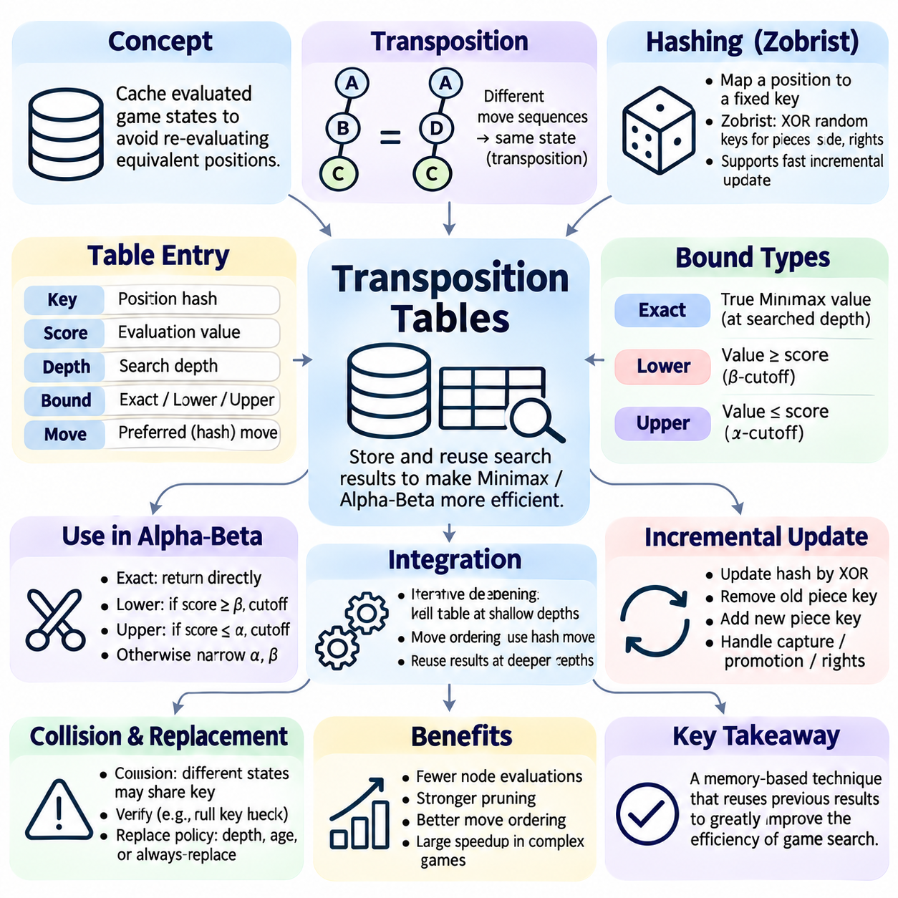{width="7.268055555555556in" height="7.268055555555556in"}

Transposition tables are caching structures used in adversarial game-tree search to avoid repeatedly evaluating identical positions. Different sequences of legal moves can lead to the same game state, creating redundant branches within the search tree. By storing previously computed results and retrieving them when equivalent positions reappear, transposition tables reduce computational effort and improve the efficiency of Minimax and alpha-beta search.

A transposition occurs when two or more distinct move sequences reach an equivalent game position. Although these sequences occupy different branches of the game tree, their resulting states may have identical strategic values under the same search conditions. Transposition tables exploit this property by treating repeated positions as reusable computational results. This transforms part of the search process from tree exploration into graph-based state reuse.

The fundamental operation of a transposition table is a lookup performed before expanding a game state. The search algorithm computes a compact identifier representing the position and checks whether a corresponding entry already exists. If the stored information is applicable, the algorithm can reuse its value or search bounds. Otherwise, normal exploration continues, and the resulting information may be stored for future searches.

Hashing provides the primary mechanism for identifying previously encountered positions. A hash function maps a complete game state to a fixed-size numerical key suitable for efficient lookup. Ideally, equivalent states produce identical keys, while different states produce different keys. Because finite hash values cannot guarantee uniqueness across all possible positions, implementations must account for potential collisions and verification requirements.

Zobrist hashing is widely used in board-game engines because it supports efficient incremental updates. Each relevant combination of piece type, player, and board location receives a pseudorandom bit pattern. The position hash is calculated by combining these patterns using bitwise XOR operations. Additional components represent side to move, special movement rights, and other state variables that influence legal actions.

Incremental hashing updates the position key after each move without recomputing the entire board representation. When a piece moves, its previous contribution is removed through XOR and its new contribution is added. Captures, promotions, and changes in special rights require corresponding updates. This approach makes hashing inexpensive enough to perform during large-scale recursive search, where millions of state transitions may occur.

A transposition-table entry typically contains a position key, evaluated score, search depth, bound classification, and preferred move. The key identifies the position, while the score represents information obtained from a previous search. Depth indicates how thoroughly the position was examined. Bound classification describes whether the score is exact or represents a limit, and the preferred move supports efficient ordering in later searches.

Exact values are stored when the search determines the Minimax value for the explored depth and evaluation conditions. Lower-bound entries indicate that the position value is at least the stored score, while upper-bound entries indicate that it is at most that score. These distinctions are essential because alpha-beta cutoffs often terminate exploration before an exact value is known. Incorrect interpretation can invalidate pruning decisions.

During alpha-beta search, a stored exact value can be returned directly when its depth and state conditions satisfy the current request. A lower bound may cause a cutoff if it reaches or exceeds beta, while an upper bound may cause a cutoff if it reaches or falls below alpha. Otherwise, the stored bounds may narrow the search window. Entries that are too shallow can still provide useful move-ordering information.

Search depth is a critical condition for reliable cache reuse. An evaluation obtained from a shallow search generally cannot substitute for a deeper search requiring additional tactical analysis. Implementations therefore compare the stored depth with the requested depth before accepting a cached result. However, the stored best move may remain valuable even when its score is insufficient for direct reuse, improving subsequent search efficiency.

Transposition tables interact closely with iterative deepening. Earlier search iterations populate the table with position evaluations and preferred moves. Later iterations revisit many of these positions at greater depths, allowing cached information to guide exploration. This improves move ordering and increases the effectiveness of alpha-beta pruning. The resulting performance benefit may exceed the computational savings obtained from avoiding repeated evaluations alone.

The preferred move stored in a transposition-table entry is often called the hash move. When the position is encountered again, the engine searches this move before other legal alternatives, provided it remains valid. Strong early moves establish useful alpha-beta bounds and increase pruning opportunities. Consequently, even entries whose scores cannot be reused directly may substantially improve search performance.

Hash collisions occur when different game states produce the same stored identifier or table location. A collision does not necessarily imply that the states are equivalent. Engines commonly retain a sufficiently large verification key and compare it before reusing an entry. If the key does not match, the stored information must not be treated as belonging to the current position. Collision handling is essential for search reliability.

Table capacity is limited by available memory, so practical implementations must decide which entries to retain when storage becomes full. Replacement policies may prioritize deeper searches, recently accessed positions, or entries from the current search generation. Depth-preferred replacement protects expensive evaluations, while aging mechanisms prevent obsolete entries from occupying the table indefinitely. These policies balance reuse potential against memory constraints.

A fixed-size transposition table is often implemented as an array indexed by selected bits of the position hash. This structure supports constant-time expected lookup and predictable memory usage. Some engines use multiple entries per index to reduce destructive replacement conflicts. The choice of table organization affects cache hit rates, memory locality, and synchronization requirements in parallel search systems.

State identity must include every variable that can influence legal actions, evaluation, or game termination. In chess, this includes piece placement, side to move, castling rights, and en passant availability where relevant. Repetition rules and move counters may also affect whether cached values remain valid. Omitting important state information can cause the engine to reuse results from positions that are superficially similar but strategically different.

Repetition detection requires special treatment because repeated positions may trigger draws or other game-specific outcomes. A position\'s value can depend on the history of states leading to it rather than its current board configuration alone. Consequently, repetition-dependent evaluations should not automatically be stored as history-independent exact values. Reliable engines separate position caching from history-sensitive termination logic.

Mate scores also require careful handling when stored in transposition tables. Search engines often encode faster victories and slower defeats using scores adjusted by distance to termination. Because the same position may be encountered at different search plies, stored mate scores may need normalization before storage and restoration during retrieval. Without this adjustment, cached values can incorrectly represent the preferred distance to victory or defeat.

Transposition tables can be combined with aspiration windows and principal variation search. Cached bounds help establish narrower search intervals, while stored preferred moves guide the examination of promising continuations. These interactions strengthen pruning efficiency but require consistent interpretation of exact scores and bounds. Incorrect cache integration can produce subtle errors that are difficult to detect through ordinary gameplay testing.

Parallel game-tree search introduces additional challenges because multiple workers may access and update the same table simultaneously. Shared tables improve information reuse but create risks involving concurrent writes, inconsistent entries, and replacement conflicts. Implementations may use atomic operations, carefully ordered writes, or thread-local structures. The appropriate design depends on hardware architecture and performance requirements.

Testing transposition tables requires verifying both correctness and computational benefit. A search using caching should produce decisions consistent with an equivalent uncached search under the same evaluation and depth settings. Tests should cover repeated positions, collisions, replacement behavior, bound reuse, and mate-score normalization. Deliberately small tables can expose replacement conflicts and help identify errors that rarely appear under normal conditions.

Performance measurement should include table hit rate, usable-hit rate, collision frequency, replacement count, explored nodes, and execution time. A high hit rate does not necessarily guarantee faster search because entries may be too shallow or provide limited pruning benefits. Experiments should compare different table sizes, replacement policies, and move-ordering configurations while maintaining consistent game positions and computational conditions.

Transposition tables demonstrate how memory-based reuse can improve classical adversarial search without changing its underlying strategic objective. By combining state hashing, cached evaluations, search bounds, and preferred moves, they reduce redundant exploration and strengthen alpha-beta pruning. Their effectiveness depends on correct state representation, disciplined cache management, and careful integration with iterative deepening and advanced search techniques.

전치 테이블(Transposition Table)은 동일한 위치를 반복적으로 평가하지 않도록 적대적 게임 트리 탐색(Adversarial Game-Tree Search)에서 사용하는 캐싱 구조(Caching Structure)이다. 서로 다른 합법적 이동 순서(Legal Move Sequence)가 동일한 게임 상태(Game State)에 도달할 수 있으며, 이로 인해 탐색 트리(Search Tree) 내부에 중복 분기(Redundant Branch)가 생성된다. 이전에 계산한 결과를 저장하고 동일한 위치가 다시 나타날 때 이를 검색하여 재사용함으로써 전치 테이블은 계산량을 줄이고 미니맥스(Minimax) 및 알파-베타 탐색(Alpha-Beta Search)의 효율을 향상시킨다.

전치(Transposition)는 서로 다른 두 개 이상의 이동 순서(Move Sequence)가 동등한 게임 위치(Equivalent Game Position)에 도달할 때 발생한다. 이러한 이동 순서는 게임 트리의 서로 다른 분기에 존재하지만, 동일한 탐색 조건(Search Condition)에서 결과 상태가 같은 전략적 가치(Strategic Value)를 가질 수 있다. 전치 테이블(Transposition Table)은 반복되는 위치를 재사용 가능한 계산 결과(Reusable Computational Result)로 취급하여 이러한 특성을 활용한다. 이를 통해 탐색 과정의 일부가 트리 탐색(Tree Exploration)에서 그래프 기반 상태 재사용(Graph-Based State Reuse)으로 전환된다.

전치 테이블(Transposition Table)의 기본 동작은 게임 상태를 확장하기 전에 조회(Lookup)를 수행하는 것이다. 탐색 알고리즘(Search Algorithm)은 해당 위치를 나타내는 간결한 식별자(Compact Identifier)를 계산하고 대응하는 항목(Entry)이 이미 존재하는지 확인한다. 저장된 정보가 현재 탐색에 적용 가능하다면 해당 값이나 탐색 경계(Search Bound)를 재사용할 수 있다. 그렇지 않으면 일반적인 탐색을 계속 수행하고, 그 결과를 이후 탐색에서 활용할 수 있도록 저장할 수 있다.

해싱(Hashing)은 이전에 방문한 위치를 식별하기 위한 주요 메커니즘이다. 해시 함수(Hash Function)는 완전한 게임 상태(Complete Game State)를 효율적인 조회에 적합한 고정 크기의 수치 키(Fixed-Size Numerical Key)로 변환한다. 이상적으로 동등한 상태는 동일한 키를 생성하고 서로 다른 상태는 서로 다른 키를 생성해야 한다. 그러나 유한한 해시 값(Finite Hash Value)은 모든 가능한 위치에 대해 고유성을 보장할 수 없으므로 구현에서는 잠재적인 충돌(Collision)과 검증 요구사항(Verification Requirement)을 고려해야 한다.

조브리스트 해싱(Zobrist Hashing)은 효율적인 증분 갱신(Incremental Update)을 지원하므로 보드게임 엔진(Board-Game Engine)에서 널리 사용된다. 기물 유형(Piece Type), 플레이어(Player), 보드 위치(Board Location)의 각 관련 조합에는 의사난수 비트 패턴(Pseudorandom Bit Pattern)이 할당된다. 위치 해시(Position Hash)는 이러한 패턴을 비트 단위 배타적 논리합(Bitwise XOR) 연산으로 결합하여 계산한다. 추가 구성 요소는 현재 차례(Side to Move), 특수 이동 권한(Special Movement Right), 합법적 행동에 영향을 미치는 기타 상태 변수를 표현한다.

증분 해싱(Incremental Hashing)은 전체 보드 표현(Board Representation)을 다시 계산하지 않고 각 이동 이후 위치 키(Position Key)를 갱신한다. 기물이 이동하면 XOR 연산을 통해 이전 기여 값을 제거하고 새로운 기여 값을 추가한다. 기물 포획(Capture), 승격(Promotion), 특수 권한 변경(Change in Special Rights)에도 대응하는 갱신이 필요하다. 이러한 접근 방식은 수백만 번의 상태 전이(State Transition)가 발생할 수 있는 대규모 재귀 탐색(Recursive Search)에서도 해싱을 효율적으로 수행할 수 있도록 한다.

전치 테이블 항목(Transposition-Table Entry)은 일반적으로 위치 키(Position Key), 평가 점수(Evaluated Score), 탐색 깊이(Search Depth), 경계 분류(Bound Classification), 선호 이동(Preferred Move)을 포함한다. 키는 위치를 식별하고 점수는 이전 탐색에서 얻은 정보를 나타낸다. 탐색 깊이는 해당 위치를 얼마나 깊이 조사했는지를 나타낸다. 경계 분류는 점수가 정확한 값인지 또는 경계값인지 설명하며, 선호 이동은 이후 탐색에서 효율적인 이동 순서 결정(Move Ordering)을 지원한다.

정확한 값(Exact Value)은 탐색한 깊이와 평가 조건(Evaluation Condition)에 대해 미니맥스 값(Minimax Value)이 결정되었을 때 저장된다. 하한 항목(Lower-Bound Entry)은 위치의 가치가 저장된 점수 이상임을 나타내고, 상한 항목(Upper-Bound Entry)은 저장된 점수 이하임을 나타낸다. 알파-베타 차단(Alpha-Beta Cutoff)은 정확한 값이 알려지기 전에 탐색을 종료하는 경우가 많으므로 이러한 구분은 필수적이다. 이를 잘못 해석하면 가지치기 결정(Pruning Decision)의 정확성이 훼손될 수 있다.

알파-베타 탐색(Alpha-Beta Search)에서 저장된 정확한 값(Exact Value)은 깊이와 상태 조건(State Condition)이 현재 요청을 만족할 경우 직접 반환할 수 있다. 하한(Lower Bound)이 베타(Beta) 이상이면 차단(Cutoff)이 발생할 수 있고, 상한(Upper Bound)이 알파(Alpha) 이하이면 차단이 발생할 수 있다. 그렇지 않은 경우 저장된 경계를 이용하여 탐색 윈도우(Search Window)를 좁힐 수 있다. 탐색 깊이가 충분하지 않은 항목도 이동 순서 결정(Move Ordering)에 유용한 정보를 제공할 수 있다.

탐색 깊이(Search Depth)는 신뢰할 수 있는 캐시 재사용(Cache Reuse)을 위한 핵심 조건이다. 얕은 탐색(Shallow Search)에서 얻은 평가 결과는 일반적으로 추가적인 전술 분석(Tactical Analysis)이 필요한 깊은 탐색(Deeper Search)을 대체할 수 없다. 따라서 구현에서는 캐시된 결과를 사용하기 전에 저장된 깊이(Stored Depth)와 요청된 깊이(Requested Depth)를 비교한다. 그러나 저장된 최선의 이동(Best Move)은 점수를 직접 재사용하기에 충분하지 않은 경우에도 후속 탐색의 효율을 높이는 데 유용할 수 있다.

전치 테이블(Transposition Table)은 반복 심화 탐색(Iterative Deepening)과 밀접하게 상호작용한다. 이전 탐색 반복(Search Iteration)은 위치 평가(Position Evaluation)와 선호 이동(Preferred Move)을 테이블에 저장한다. 이후 반복에서는 이러한 위치를 더 깊은 수준에서 다시 방문하므로 캐시된 정보를 활용하여 탐색을 유도할 수 있다. 이는 이동 순서 결정(Move Ordering)을 개선하고 알파-베타 가지치기(Alpha-Beta Pruning)의 효과를 높인다. 결과적인 성능 향상은 단순히 반복 평가를 방지하여 얻는 계산 절감 효과보다 클 수 있다.

전치 테이블 항목(Transposition-Table Entry)에 저장된 선호 이동(Preferred Move)은 일반적으로 해시 이동(Hash Move)이라고 한다. 동일한 위치를 다시 만나면 엔진은 해당 이동이 여전히 합법적인 경우 다른 대안보다 먼저 탐색한다. 강력한 이동을 조기에 탐색하면 유용한 알파-베타 경계(Alpha-Beta Bound)를 설정하고 가지치기 기회(Pruning Opportunity)를 증가시킬 수 있다. 따라서 점수를 직접 재사용할 수 없는 항목도 탐색 성능(Search Performance)을 크게 향상시킬 수 있다.

해시 충돌(Hash Collision)은 서로 다른 게임 상태(Game State)가 동일한 저장 식별자(Stored Identifier) 또는 테이블 위치(Table Location)를 생성할 때 발생한다. 충돌이 발생했다고 해서 해당 상태들이 동등하다는 의미는 아니다. 엔진은 일반적으로 충분히 큰 검증 키(Verification Key)를 유지하고 항목을 재사용하기 전에 이를 비교한다. 키가 일치하지 않으면 저장된 정보를 현재 위치에 속한 것으로 취급해서는 안 된다. 충돌 처리(Collision Handling)는 탐색 신뢰성(Search Reliability)을 보장하기 위한 필수 요소이다.

테이블 용량(Table Capacity)은 사용 가능한 메모리(Available Memory)에 의해 제한되므로 실제 구현에서는 저장 공간이 가득 찼을 때 어떤 항목을 유지할지 결정해야 한다. 교체 정책(Replacement Policy)은 더 깊은 탐색, 최근 접근한 위치, 현재 탐색 세대(Search Generation)에 속한 항목을 우선할 수 있다. 깊이 우선 교체(Depth-Preferred Replacement)는 계산 비용이 높은 평가 결과를 보호하고, 노화 메커니즘(Aging Mechanism)은 오래된 항목이 테이블을 무기한 점유하지 않도록 한다. 이러한 정책은 재사용 가능성(Reuse Potential)과 메모리 제약(Memory Constraint) 사이의 균형을 유지한다.

고정 크기 전치 테이블(Fixed-Size Transposition Table)은 일반적으로 위치 해시(Position Hash)의 선택된 비트(Selected Bit)를 인덱스로 사용하는 배열(Array)로 구현된다. 이러한 구조는 평균적으로 상수 시간(Constant-Time)의 조회와 예측 가능한 메모리 사용량(Predictable Memory Usage)을 지원한다. 일부 엔진은 파괴적인 교체 충돌(Destructive Replacement Conflict)을 줄이기 위해 하나의 인덱스에 여러 항목을 저장한다. 테이블 구성(Table Organization)은 캐시 적중률(Cache Hit Rate), 메모리 지역성(Memory Locality), 병렬 탐색 시스템(Parallel Search System)의 동기화 요구사항(Synchronization Requirement)에 영향을 미친다.

상태 동일성(State Identity)은 합법적 행동(Legal Action), 평가(Evaluation), 게임 종료(Game Termination)에 영향을 미칠 수 있는 모든 변수를 포함해야 한다. 체스에서는 기물 배치(Piece Placement), 현재 차례(Side to Move), 캐슬링 권한(Castling Rights), 관련된 경우 앙파상 가능 여부(En Passant Availability)가 포함된다. 반복 규칙(Repetition Rule)과 이동 카운터(Move Counter)도 캐시된 값의 유효성에 영향을 미칠 수 있다. 중요한 상태 정보를 누락하면 표면적으로 유사하지만 전략적으로 다른 위치의 결과를 재사용하는 오류가 발생할 수 있다.

반복 상태 탐지(Repetition Detection)는 반복된 위치가 무승부(Draw) 또는 게임별 결과(Game-Specific Outcome)를 발생시킬 수 있으므로 특별한 처리가 필요하다. 특정 위치의 가치는 현재 보드 구성(Current Board Configuration)만이 아니라 해당 위치에 도달하기까지의 상태 이력(State History)에 따라 달라질 수 있다. 따라서 반복에 의존하는 평가 결과(Repetition-Dependent Evaluation)를 이력과 무관한 정확한 값(History-Independent Exact Value)으로 자동 저장해서는 안 된다. 신뢰할 수 있는 엔진은 위치 캐싱(Position Caching)과 이력에 민감한 종료 판단(History-Sensitive Termination Logic)을 분리한다.

메이트 점수(Mate Score)도 전치 테이블(Transposition Table)에 저장할 때 신중하게 처리해야 한다. 탐색 엔진(Search Engine)은 종료까지의 거리(Distance to Termination)에 따라 점수를 조정하여 빠른 승리와 늦은 패배를 구분하는 경우가 많다. 동일한 위치가 서로 다른 탐색 플라이(Search Ply)에서 나타날 수 있으므로 저장된 메이트 점수는 저장 전에 정규화(Normalization)하고 조회할 때 복원(Restoration)해야 할 수 있다. 이러한 조정이 없으면 캐시된 값이 승리 또는 패배까지의 선호 거리를 잘못 표현할 수 있다.

전치 테이블(Transposition Table)은 열망 윈도우(Aspiration Window) 및 주 변형 탐색(Principal Variation Search)과 결합할 수 있다. 캐시된 경계(Cached Bound)는 더 좁은 탐색 구간(Search Interval)을 설정하는 데 도움이 되고, 저장된 선호 이동(Preferred Move)은 유망한 후속 진행(Promising Continuation)의 탐색 순서를 결정한다. 이러한 상호작용은 가지치기 효율(Pruning Efficiency)을 높이지만 정확한 점수(Exact Score)와 경계(Bound)를 일관되게 해석해야 한다. 잘못된 캐시 통합(Cache Integration)은 일반적인 게임 플레이 테스트에서 발견하기 어려운 미묘한 오류를 발생시킬 수 있다.

병렬 게임 트리 탐색(Parallel Game-Tree Search)은 여러 작업자(Worker)가 동일한 테이블에 동시에 접근하고 갱신할 수 있으므로 추가적인 문제를 발생시킨다. 공유 테이블(Shared Table)은 정보 재사용을 개선하지만 동시 쓰기(Concurrent Write), 일관되지 않은 항목(Inconsistent Entry), 교체 충돌(Replacement Conflict)과 관련된 위험을 초래한다. 구현에서는 원자적 연산(Atomic Operation), 신중하게 설계된 쓰기 순서(Ordered Write), 스레드별 지역 구조(Thread-Local Structure)를 사용할 수 있다. 적절한 설계는 하드웨어 아키텍처(Hardware Architecture)와 성능 요구사항(Performance Requirement)에 따라 달라진다.

전치 테이블(Transposition Table)의 테스트는 정확성(Correctness)과 계산상의 이점(Computational Benefit)을 모두 검증해야 한다. 캐싱을 사용하는 탐색은 동일한 평가 및 깊이 설정에서 캐싱을 사용하지 않는 탐색(Uncached Search)과 일관된 의사결정을 생성해야 한다. 테스트에는 반복 위치(Repeated Position), 해시 충돌(Hash Collision), 교체 동작(Replacement Behavior), 경계 재사용(Bound Reuse), 메이트 점수 정규화(Mate-Score Normalization)가 포함되어야 한다. 의도적으로 작은 테이블을 사용하면 교체 충돌을 드러내고 일반적인 조건에서는 거의 나타나지 않는 오류를 식별하는 데 도움이 된다.

성능 측정(Performance Measurement)에는 테이블 적중률(Table Hit Rate), 사용 가능한 적중률(Usable-Hit Rate), 충돌 빈도(Collision Frequency), 교체 횟수(Replacement Count), 탐색 노드 수(Explored Nodes), 실행 시간(Execution Time)이 포함되어야 한다. 높은 적중률이 반드시 더 빠른 탐색을 보장하는 것은 아니다. 저장된 항목의 탐색 깊이가 부족하거나 가지치기에 제공하는 이점이 제한적일 수 있기 때문이다. 실험에서는 동일한 게임 위치와 계산 조건을 유지하면서 서로 다른 테이블 크기(Table Size), 교체 정책(Replacement Policy), 이동 순서 설정(Move-Ordering Configuration)을 비교해야 한다.

전치 테이블(Transposition Table)은 메모리 기반 재사용(Memory-Based Reuse)이 기본적인 전략적 목표(Strategic Objective)를 변경하지 않으면서 고전적 적대적 탐색(Classical Adversarial Search)을 개선하는 방법을 보여준다. 상태 해싱(State Hashing), 캐시된 평가(Cached Evaluation), 탐색 경계(Search Bound), 선호 이동(Preferred Move)을 결합하여 중복 탐색을 줄이고 알파-베타 가지치기(Alpha-Beta Pruning)를 강화한다. 그 효과는 정확한 상태 표현(State Representation), 체계적인 캐시 관리(Cache Management), 반복 심화 탐색(Iterative Deepening) 및 고급 탐색 기술(Advanced Search Technique)과의 신중한 통합에 따라 결정된다.

## 02.08 Monte Carlo Tree Search [w/Code]

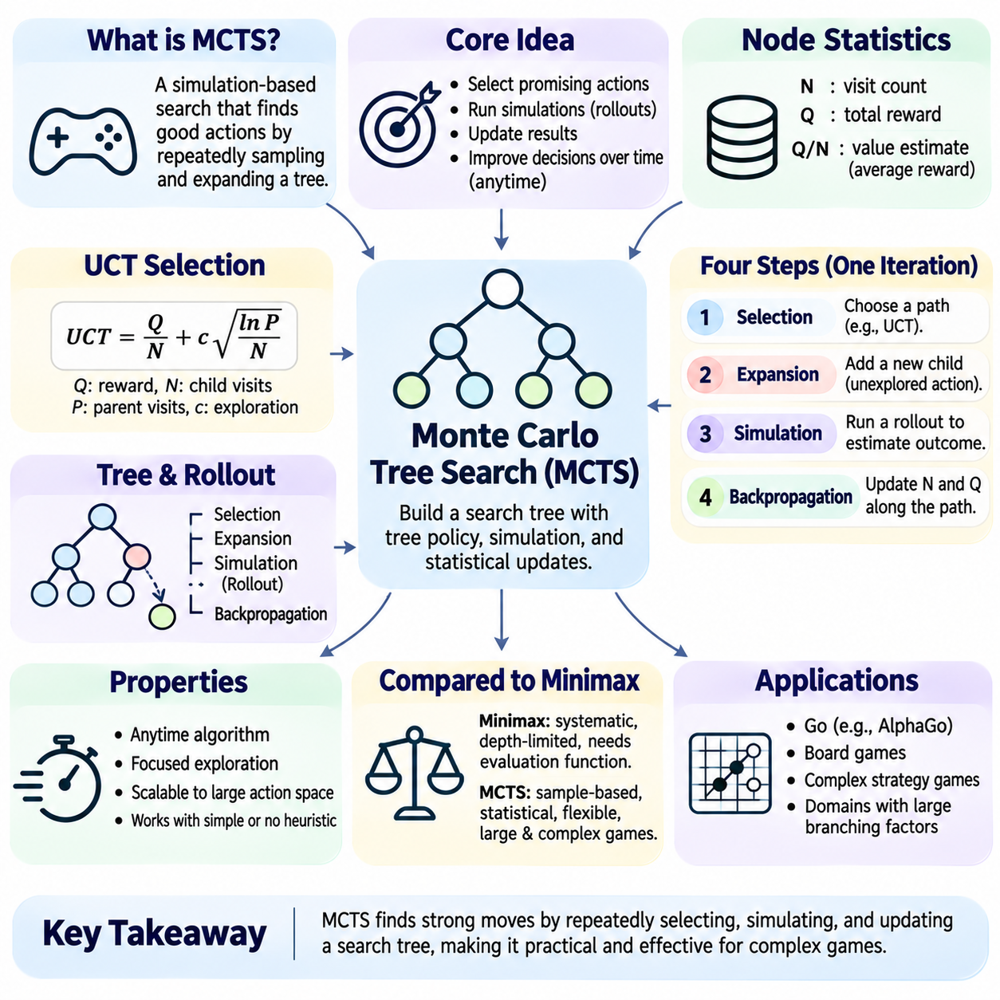{width="7.268055555555556in" height="7.268055555555556in"}

Monte Carlo Tree Search (MCTS) is a decision-making algorithm that combines selective tree exploration with statistical sampling to identify promising actions in complex games. Unlike exhaustive Minimax search, MCTS does not attempt to evaluate every possible continuation. Instead, it allocates computational resources toward actions that appear strategically valuable. This approach is particularly effective when branching factors are large and accurate heuristic evaluation functions are difficult to construct.

The fundamental principle of MCTS is to estimate action quality through repeated simulations and progressively improve these estimates as additional computational resources become available. Each simulation contributes information about potential outcomes, allowing the algorithm to refine its understanding of the search space. MCTS therefore operates as an anytime algorithm, producing increasingly informed decisions while maintaining a usable action recommendation.

MCTS organizes explored game states into a search tree whose nodes represent positions and whose edges represent available actions. Each node typically maintains a visit count and accumulated outcome statistics. These values summarize the evidence gathered through previous simulations. Rather than constructing the complete game tree, MCTS expands selected branches incrementally, concentrating attention on regions that offer favorable outcomes or remain insufficiently explored.

A standard MCTS iteration consists of four interconnected stages: selection, expansion, simulation, and backpropagation. Selection identifies a promising path through the existing tree, while expansion introduces a previously unexplored successor. Simulation estimates the potential outcome from the new state, and backpropagation updates statistics along the selected path. Repeating this process gradually improves action-value estimates and the distribution of search effort.

During selection, the algorithm begins at the root and repeatedly chooses child nodes according to a tree policy. The policy must balance exploiting actions with favorable estimated outcomes against exploring alternatives whose values remain uncertain. Pure exploitation risks overlooking strong but rarely visited actions, while excessive exploration wastes computational resources. Effective selection policies manage this tradeoff using statistical confidence estimates.

The Upper Confidence Bound applied to Trees (UCT) algorithm is a widely used selection strategy for MCTS. A common expression is UCT = Q/N + c√(ln(P)/N), where Q is accumulated reward, N is the child visit count, P is the parent visit count, and c controls exploration strength. The first term represents estimated action value, while the second encourages exploration of less frequently visited actions. Unvisited actions require explicit priority handling.

Expansion occurs when selection reaches a node with unexplored legal actions or another designated expansion condition. The algorithm generates a successor state and adds a corresponding child node to the search tree. Depending on the implementation, expansion may introduce one child per iteration or several children simultaneously. Incremental expansion limits memory consumption and allows the tree to grow according to the evidence collected during search.

The simulation stage, also called rollout, estimates the value of a newly expanded state by generating a sequence of actions until a terminal condition or predefined stopping point is reached. A simple rollout policy selects legal actions randomly, while more advanced policies incorporate domain knowledge. The resulting outcome provides a sample of the state\'s potential value rather than an exact prediction of optimal play.

Simulation quality strongly influences MCTS performance. Random rollouts are computationally inexpensive but may produce misleading estimates in games requiring precise tactical decisions. Heuristic rollout policies can improve realism by favoring strategically meaningful actions. However, more sophisticated simulations increase computational cost and may introduce systematic bias. Effective systems balance rollout accuracy, execution speed, and statistical diversity.

Backpropagation transfers the simulation result through the nodes visited during the current iteration. Each node updates its visit count and accumulated reward statistics. In two-player zero-sum games, reward interpretation must remain consistent with the player perspective used by the tree policy. Implementations may alternate reward signs or store values from a fixed player\'s viewpoint. Incorrect perspective handling can reverse strategic preferences.

After many iterations, the root contains statistical information about the available actions. The final move may be selected according to the highest visit count or the greatest estimated value, depending on the application. Visit-count selection often provides greater stability because it reflects accumulated search allocation. The chosen action is therefore based on sampled evidence rather than exhaustive enumeration of all possible game outcomes.

The computational behavior of MCTS differs fundamentally from depth-limited Minimax search. Minimax typically expands a structured portion of the game tree and applies heuristic evaluations at its boundaries. MCTS distributes exploration unevenly according to observed rewards and uncertainty. This flexibility makes MCTS attractive for games with large action spaces, although its effectiveness depends on how well sampled outcomes represent strategically important possibilities.

MCTS became especially influential in computer Go, where traditional evaluation functions and exhaustive tactical search faced substantial difficulties. The enormous number of possible board configurations makes uniform exploration impractical. MCTS concentrates simulations on promising continuations and estimates their relative quality through statistical outcomes. Its success in Go demonstrated the potential of sampling-based planning for complex strategic environments.

The exploration constant influences how aggressively MCTS investigates uncertain actions. A larger value encourages broader exploration, while a smaller value emphasizes actions with favorable existing estimates. No single setting is optimal for every game or computational budget. Parameter tuning should consider reward scale, branching factor, simulation quality, and the number of iterations available before a decision must be made.

MCTS can be improved through progressive widening, which limits the number of children considered at a node until sufficient visits have accumulated. This technique is useful when action spaces are extremely large or continuous. Rather than expanding every legal action immediately, the algorithm gradually introduces additional alternatives. Progressive widening concentrates computational resources while preserving opportunities to investigate new actions.

Transposition handling can also improve MCTS by recognizing states reached through different action sequences. A transposition table may associate equivalent positions with shared statistics or reusable information. However, merging nodes changes the statistical structure from a tree toward a directed graph and complicates backpropagation. Careful bookkeeping is required to avoid inconsistent visit counts, duplicated updates, or incorrect value attribution.

Parallel MCTS distributes simulations across multiple processing units to increase the number of samples collected within a fixed time budget. Independent workers may explore separate trees or cooperate through shared statistics. Shared-tree implementations require synchronization and mechanisms such as virtual loss to discourage excessive simultaneous exploration of identical branches. Parallel efficiency depends on contention, communication overhead, and workload distribution.

Neural networks can enhance MCTS by providing policy priors and value estimates. A policy network predicts promising actions, while a value network estimates the expected outcome of a position without requiring complete random rollouts. These predictions guide exploration and reduce dependence on handcrafted heuristics. The resulting architecture combines learned representations with explicit search, as demonstrated by modern neural game-playing systems.

Predictor-guided MCTS often uses a selection rule that combines estimated action value with an exploration bonus weighted by policy probabilities. This approach is commonly associated with Predictor Upper Confidence Trees (PUCT). Policy priors concentrate early exploration on plausible moves, while visit statistics gradually refine the search distribution. The effectiveness of this method depends on model calibration, exploration parameters, and sufficient search coverage.

MCTS is not guaranteed to discover critical tactical sequences within limited computation. Rare but decisive moves may receive insufficient attention when simulations or selection policies assign them low priority. This limitation is particularly important in games where a single overlooked action causes an immediate loss. Tactical verification, informed priors, and hybrid search mechanisms can reduce these weaknesses without eliminating sampling uncertainty.

Evaluation of MCTS should examine decision quality, simulation throughput, memory consumption, and sensitivity to computational budgets. Relevant measurements include simulations per second, root visit distributions, estimated action values, and performance against benchmark opponents. Experiments should vary exploration parameters, rollout policies, and iteration limits. Repeated trials are necessary because stochastic sampling introduces variability into search outcomes.

Implementation testing should verify legal action generation, node expansion, visit-count updates, reward propagation, and final move selection. Small games with known optimal strategies provide useful reference environments for checking convergence behavior. Additional tests should examine terminal states, unvisited children, interrupted simulations, and parallel synchronization. Reproducible random seeds help isolate implementation errors from ordinary statistical variation.

Monte Carlo Tree Search provides a flexible framework for decision-making under large search spaces and restricted computational resources. Its combination of selective expansion, statistical evaluation, and repeated simulation enables effective planning without requiring exhaustive game-tree exploration. Although sampling introduces uncertainty and tactical limitations, integration with heuristics, neural networks, and parallel computation makes MCTS a central technique in classical and modern Game AI.

몬테카를로 트리 탐색(Monte Carlo Tree Search, MCTS)은 선택적 트리 탐색(Selective Tree Exploration)과 통계적 샘플링(Statistical Sampling)을 결합하여 복잡한 게임에서 유망한 행동(Promising Action)을 식별하는 의사결정 알고리즘(Decision-Making Algorithm)이다. 완전한 미니맥스 탐색(Exhaustive Minimax Search)과 달리 MCTS는 가능한 모든 후속 진행을 평가하지 않는다. 대신 전략적으로 가치가 높아 보이는 행동에 계산 자원(Computational Resource)을 집중적으로 할당한다. 이러한 접근 방식은 분기 계수(Branching Factor)가 크고 정확한 휴리스틱 평가 함수(Heuristic Evaluation Function)를 설계하기 어려운 상황에서 특히 효과적이다.

MCTS의 기본 원리는 반복적인 시뮬레이션(Repeated Simulation)을 통해 행동의 품질(Action Quality)을 추정하고 추가 계산 자원을 사용할 수 있을 때마다 이러한 추정값을 점진적으로 개선하는 것이다. 각 시뮬레이션은 잠재적 결과(Potential Outcome)에 대한 정보를 제공하여 알고리즘이 탐색 공간(Search Space)에 대한 이해를 정교하게 발전시킬 수 있도록 한다. 따라서 MCTS는 애니타임 알고리즘(Anytime Algorithm)으로 동작하며, 사용 가능한 행동 추천(Action Recommendation)을 유지하면서 점점 더 많은 정보를 반영한 의사결정을 생성한다.

MCTS는 탐색된 게임 상태(Game State)를 탐색 트리(Search Tree)로 구성하며, 노드(Node)는 위치(Position)를 나타내고 간선(Edge)은 사용 가능한 행동(Available Action)을 나타낸다. 각 노드는 일반적으로 방문 횟수(Visit Count)와 누적 결과 통계(Accumulated Outcome Statistics)를 유지한다. 이러한 값은 이전 시뮬레이션에서 수집한 증거를 요약한다. MCTS는 전체 게임 트리를 구성하는 대신 선택된 분기를 점진적으로 확장하며, 유리한 결과를 제공하거나 아직 충분히 탐색되지 않은 영역에 집중한다.

표준 MCTS 반복(Standard MCTS Iteration)은 선택(Selection), 확장(Expansion), 시뮬레이션(Simulation), 역전파(Backpropagation)의 네 가지 상호 연결된 단계로 구성된다. 선택 단계는 기존 트리에서 유망한 경로(Promising Path)를 식별하고, 확장 단계는 이전에 탐색하지 않은 후속 상태(Successor State)를 추가한다. 시뮬레이션은 새로운 상태의 잠재적 결과를 추정하며, 역전파는 선택된 경로의 통계 정보를 갱신한다. 이 과정을 반복하면 행동 가치 추정(Action-Value Estimation)과 탐색 자원 배분(Search Effort Distribution)이 점진적으로 개선된다.

선택(Selection) 단계에서 알고리즘은 루트 노드(Root Node)에서 시작하여 트리 정책(Tree Policy)에 따라 자식 노드(Child Node)를 반복적으로 선택한다. 이 정책은 유리한 추정 결과를 가진 행동을 활용하는 것과 아직 가치가 불확실한 대안을 탐색하는 것 사이에서 균형을 유지해야 한다. 활용(Exploitation)에만 집중하면 방문 횟수가 적지만 강력한 행동을 놓칠 수 있으며, 지나친 탐색(Exploration)은 계산 자원을 낭비한다. 효과적인 선택 정책은 통계적 신뢰도 추정(Statistical Confidence Estimate)을 활용하여 이러한 상충 관계(Tradeoff)를 관리한다.

트리에 적용된 신뢰 상한(Upper Confidence Bound Applied to Trees, UCT) 알고리즘은 MCTS에서 널리 사용되는 선택 전략(Selection Strategy)이다. 일반적인 표현은 UCT = Q/N + c√(ln(P)/N)이며, Q는 누적 보상(Accumulated Reward), N은 자식 노드 방문 횟수(Child Visit Count), P는 부모 노드 방문 횟수(Parent Visit Count), c는 탐색 강도(Exploration Strength)를 제어한다. 첫 번째 항은 추정 행동 가치(Estimated Action Value)를 나타내고, 두 번째 항은 방문 횟수가 적은 행동의 탐색을 장려한다. 방문하지 않은 행동(Unvisited Action)은 별도의 우선순위 처리가 필요하다.

확장(Expansion)은 선택 과정이 아직 탐색하지 않은 합법적 행동(Unexplored Legal Action)을 가진 노드에 도달하거나 다른 지정된 확장 조건(Expansion Condition)을 만족할 때 발생한다. 알고리즘은 후속 상태(Successor State)를 생성하고 대응하는 자식 노드(Child Node)를 탐색 트리에 추가한다. 구현 방식에 따라 한 번의 반복에서 하나의 자식 노드만 추가하거나 여러 자식 노드를 동시에 추가할 수 있다. 점진적 확장(Incremental Expansion)은 메모리 사용량(Memory Consumption)을 제한하고 탐색 과정에서 수집된 증거에 따라 트리가 성장하도록 한다.

시뮬레이션(Simulation) 단계는 롤아웃(Rollout)이라고도 하며, 새롭게 확장된 상태에서 종료 조건(Terminal Condition)이나 미리 정의된 중단 지점(Stopping Point)에 도달할 때까지 일련의 행동을 생성하여 상태의 가치를 추정한다. 단순한 롤아웃 정책(Rollout Policy)은 합법적 행동을 무작위로 선택하지만, 고급 정책은 도메인 지식(Domain Knowledge)을 활용한다. 결과는 최적 플레이(Optimal Play)에 대한 정확한 예측이 아니라 해당 상태의 잠재적 가치에 대한 표본(Sample)을 제공한다.

시뮬레이션 품질(Simulation Quality)은 MCTS의 성능에 큰 영향을 미친다. 무작위 롤아웃(Random Rollout)은 계산 비용이 낮지만 정밀한 전술적 판단(Tactical Decision)이 필요한 게임에서는 잘못된 추정값을 생성할 수 있다. 휴리스틱 롤아웃 정책(Heuristic Rollout Policy)은 전략적으로 의미 있는 행동을 우선하여 현실성을 개선할 수 있다. 그러나 정교한 시뮬레이션은 계산 비용을 증가시키고 체계적 편향(Systematic Bias)을 유발할 수 있다. 효과적인 시스템은 롤아웃 정확도(Rollout Accuracy), 실행 속도(Execution Speed), 통계적 다양성(Statistical Diversity) 사이의 균형을 유지한다.

역전파(Backpropagation)는 현재 반복에서 방문한 노드를 따라 시뮬레이션 결과(Simulation Result)를 전달한다. 각 노드는 방문 횟수(Visit Count)와 누적 보상 통계(Accumulated Reward Statistics)를 갱신한다. 2인 제로섬 게임(Two-Player Zero-Sum Game)에서는 보상 해석(Reward Interpretation)이 트리 정책에서 사용하는 플레이어 관점(Player Perspective)과 일관되어야 한다. 구현에서는 보상 부호(Reward Sign)를 번갈아 변경하거나 고정된 플레이어 관점(Fixed-Player Viewpoint)에서 값을 저장할 수 있다. 잘못된 관점 처리는 전략적 선호(Strategic Preference)를 반대로 만들 수 있다.

많은 반복이 수행된 후 루트 노드(Root Node)에는 사용 가능한 행동에 대한 통계 정보(Statistical Information)가 축적된다. 최종 이동(Final Move)은 응용 분야에 따라 가장 높은 방문 횟수(Highest Visit Count) 또는 가장 큰 추정 가치(Estimated Value)를 기준으로 선택할 수 있다. 방문 횟수 기반 선택(Visit-Count Selection)은 누적된 탐색 자원 배분(Search Allocation)을 반영하므로 일반적으로 더 높은 안정성을 제공한다. 따라서 선택된 행동은 가능한 모든 게임 결과의 완전한 열거(Exhaustive Enumeration)가 아니라 샘플링된 증거(Sampled Evidence)에 기반한다.

MCTS의 계산 특성(Computational Behavior)은 깊이 제한 미니맥스 탐색(Depth-Limited Minimax Search)과 근본적으로 다르다. 미니맥스는 일반적으로 게임 트리의 구조화된 일부를 확장하고 탐색 경계(Search Boundary)에서 휴리스틱 평가(Heuristic Evaluation)를 적용한다. 반면 MCTS는 관찰된 보상(Observed Reward)과 불확실성(Uncertainty)에 따라 탐색을 불균등하게 분배한다. 이러한 유연성은 행동 공간(Action Space)이 큰 게임에서 MCTS를 매력적인 방법으로 만들지만, 효과는 샘플링된 결과가 전략적으로 중요한 가능성을 얼마나 잘 표현하는지에 따라 달라진다.

MCTS는 컴퓨터 바둑(Computer Go)에서 특히 큰 영향을 미쳤으며, 기존의 평가 함수(Evaluation Function)와 완전한 전술 탐색(Exhaustive Tactical Search)이 상당한 어려움에 직면했던 문제를 해결하는 데 기여했다. 가능한 보드 구성(Board Configuration)의 수가 매우 많아 균일한 탐색(Uniform Exploration)은 비현실적이다. MCTS는 유망한 후속 진행(Promising Continuation)에 시뮬레이션을 집중하고 통계적 결과를 통해 상대적 품질을 추정한다. 바둑에서의 성공은 복잡한 전략적 환경에서 샘플링 기반 계획(Sampling-Based Planning)의 가능성을 보여주었다.

탐색 상수(Exploration Constant)는 MCTS가 불확실한 행동을 얼마나 적극적으로 조사하는지에 영향을 미친다. 값이 클수록 폭넓은 탐색(Broader Exploration)을 장려하고, 값이 작을수록 기존 추정값이 유리한 행동을 강조한다. 모든 게임이나 계산 예산(Computational Budget)에 최적인 단일 설정은 존재하지 않는다. 매개변수 조정(Parameter Tuning)은 보상 척도(Reward Scale), 분기 계수(Branching Factor), 시뮬레이션 품질(Simulation Quality), 의사결정 이전에 수행할 수 있는 반복 횟수(Iteration Count)를 고려해야 한다.

MCTS는 충분한 방문 횟수가 누적될 때까지 노드에서 고려하는 자식 노드 수를 제한하는 점진적 확장 폭 조절(Progressive Widening)을 통해 개선할 수 있다. 이 기술은 행동 공간(Action Space)이 매우 크거나 연속적인 경우에 유용하다. 모든 합법적 행동(Legal Action)을 즉시 확장하는 대신 알고리즘은 추가 대안(Alternative Action)을 점진적으로 도입한다. 점진적 확장 폭 조절은 새로운 행동을 조사할 기회를 유지하면서 계산 자원을 집중적으로 활용한다.

전치 처리(Transposition Handling)는 서로 다른 행동 순서(Action Sequence)를 통해 도달한 상태를 인식함으로써 MCTS를 개선할 수 있다. 전치 테이블(Transposition Table)은 동등한 위치(Equivalent Position)를 공유 통계(Shared Statistics) 또는 재사용 가능한 정보(Reusable Information)와 연결할 수 있다. 그러나 노드를 병합하면 통계적 구조(Statistical Structure)가 트리에서 방향 그래프(Directed Graph)로 변화하고 역전파(Backpropagation)가 복잡해진다. 일관되지 않은 방문 횟수(Inconsistent Visit Count), 중복 갱신(Duplicated Update), 잘못된 가치 귀속(Incorrect Value Attribution)을 방지하려면 신중한 기록 관리(Bookkeeping)가 필요하다.

병렬 MCTS(Parallel MCTS)는 고정된 시간 예산(Time Budget) 내에서 수집하는 표본(Sample)의 수를 증가시키기 위해 여러 처리 장치(Processing Unit)에 시뮬레이션을 분산한다. 독립적인 작업자(Independent Worker)는 별도의 트리를 탐색하거나 공유 통계(Shared Statistics)를 통해 협력할 수 있다. 공유 트리 구현(Shared-Tree Implementation)에서는 동기화(Synchronization)와 동일한 분기에 대한 과도한 동시 탐색을 억제하기 위한 가상 손실(Virtual Loss)과 같은 메커니즘이 필요하다. 병렬 효율(Parallel Efficiency)은 자원 경합(Contention), 통신 오버헤드(Communication Overhead), 작업 부하 분산(Workload Distribution)에 따라 달라진다.

신경망(Neural Network)은 정책 사전 확률(Policy Prior)과 가치 추정값(Value Estimate)을 제공하여 MCTS를 강화할 수 있다. 정책 네트워크(Policy Network)는 유망한 행동을 예측하고, 가치 네트워크(Value Network)는 완전한 무작위 롤아웃 없이 위치의 예상 결과(Expected Outcome)를 추정한다. 이러한 예측은 탐색을 유도하고 수작업 휴리스틱(Handcrafted Heuristic)에 대한 의존도를 줄인다. 결과적인 아키텍처는 현대 신경망 기반 게임 시스템(Neural Game-Playing System)에서 입증된 것처럼 학습된 표현(Learned Representation)과 명시적 탐색(Explicit Search)을 결합한다.

예측기 유도 MCTS(Predictor-Guided MCTS)는 일반적으로 추정 행동 가치(Estimated Action Value)와 정책 확률(Policy Probability)에 의해 가중된 탐색 보너스(Exploration Bonus)를 결합하는 선택 규칙(Selection Rule)을 사용한다. 이러한 접근 방식은 예측기 신뢰 상한 트리(Predictor Upper Confidence Trees, PUCT)와 관련된다. 정책 사전 확률(Policy Prior)은 초기 탐색을 가능성이 높은 이동에 집중시키고, 방문 통계(Visit Statistics)는 점진적으로 탐색 분포(Search Distribution)를 정교하게 조정한다. 이 방법의 효과는 모델 보정(Model Calibration), 탐색 매개변수(Exploration Parameter), 충분한 탐색 범위(Search Coverage)에 따라 달라진다.

MCTS는 제한된 계산량(Computational Budget) 내에서 결정적인 전술적 순서(Critical Tactical Sequence)를 반드시 발견한다고 보장할 수 없다. 드물지만 결정적인 이동(Rare but Decisive Move)은 시뮬레이션이나 선택 정책(Selection Policy)이 낮은 우선순위를 부여하면 충분히 탐색되지 않을 수 있다. 이러한 한계는 단 하나의 행동을 놓치는 것이 즉각적인 패배(Immediate Loss)로 이어지는 게임에서 특히 중요하다. 전술적 검증(Tactical Verification), 정보 기반 사전 확률(Informed Prior), 하이브리드 탐색 메커니즘(Hybrid Search Mechanism)은 샘플링 불확실성(Sampling Uncertainty)을 완전히 제거하지는 못하지만 이러한 약점을 줄일 수 있다.

MCTS의 평가(Evaluation)는 의사결정 품질(Decision Quality), 시뮬레이션 처리량(Simulation Throughput), 메모리 사용량(Memory Consumption), 계산 예산에 대한 민감도(Sensitivity to Computational Budget)를 조사해야 한다. 관련 측정값에는 초당 시뮬레이션 횟수(Simulations per Second), 루트 방문 분포(Root Visit Distribution), 추정 행동 가치(Estimated Action Value), 벤치마크 상대방(Benchmark Opponent)에 대한 성능이 포함된다. 실험에서는 탐색 매개변수(Exploration Parameter), 롤아웃 정책(Rollout Policy), 반복 제한(Iteration Limit)을 변화시켜야 한다. 확률적 샘플링(Stochastic Sampling)은 탐색 결과에 변동성을 유발하므로 반복 실험(Repeated Trial)이 필요하다.

구현 테스트(Implementation Testing)는 합법적 행동 생성(Legal Action Generation), 노드 확장(Node Expansion), 방문 횟수 갱신(Visit-Count Update), 보상 전파(Reward Propagation), 최종 이동 선택(Final Move Selection)을 검증해야 한다. 최적 전략(Optimal Strategy)이 알려진 소규모 게임(Small Game)은 수렴 동작(Convergence Behavior)을 확인하기 위한 유용한 기준 환경(Reference Environment)을 제공한다. 추가 테스트에서는 종료 상태(Terminal State), 방문하지 않은 자식 노드(Unvisited Child), 중단된 시뮬레이션(Interrupted Simulation), 병렬 동기화(Parallel Synchronization)를 검사해야 한다. 재현 가능한 난수 시드(Reproducible Random Seed)는 구현 오류와 일반적인 통계적 변동(Statistical Variation)을 구분하는 데 도움이 된다.

몬테카를로 트리 탐색(Monte Carlo Tree Search, MCTS)은 방대한 탐색 공간(Search Space)과 제한된 계산 자원(Computational Resource) 아래에서 의사결정을 수행하기 위한 유연한 프레임워크를 제공한다. 선택적 확장(Selective Expansion), 통계적 평가(Statistical Evaluation), 반복 시뮬레이션(Repeated Simulation)을 결합하여 전체 게임 트리를 완전히 탐색하지 않고도 효과적인 계획(Planning)을 수행할 수 있다. 샘플링에는 불확실성과 전술적 한계(Tactical Limitation)가 존재하지만 휴리스틱(Heuristic), 신경망(Neural Network), 병렬 계산(Parallel Computation)과의 통합을 통해 MCTS는 고전적 및 현대 게임 인공지능(Classical and Modern Game AI)의 핵심 기술로 활용되고 있다.

## 02.09 UCT Upper Confidence Bound

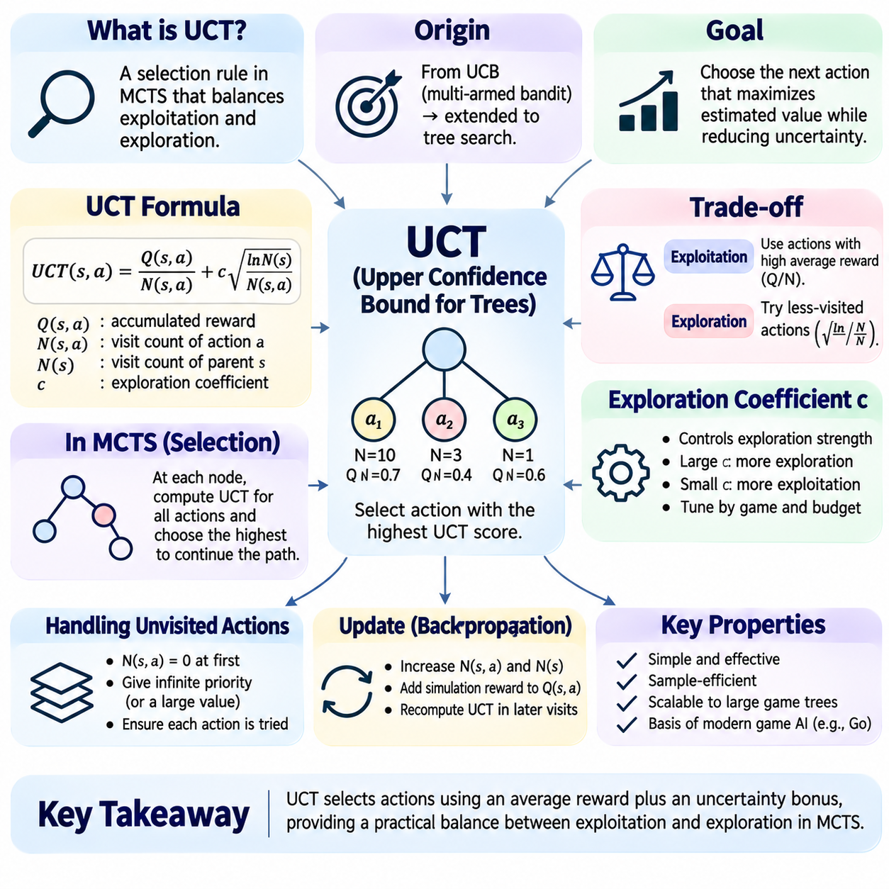{width="7.268055555555556in" height="7.268055555555556in"}

Upper Confidence Bound applied to Trees (UCT) is a statistical selection algorithm used in Monte Carlo Tree Search (MCTS) to balance exploration and exploitation. It determines which actions should receive additional simulations by combining estimated rewards with uncertainty-based exploration bonuses. UCT enables selective allocation of computational resources and provides a principled alternative to uniformly exploring every branch of a game tree.

UCT originates from the Upper Confidence Bound (UCB) family of algorithms developed for multi-armed bandit problems. In these problems, a decision-maker repeatedly chooses among actions with unknown reward distributions. The objective is to maximize accumulated reward while learning which actions perform best. UCT extends this principle to hierarchical game-tree search, where each node represents a decision involving multiple possible actions.

The exploration-exploitation tradeoff is the central challenge addressed by UCT. Exploitation prioritizes actions with high observed average rewards, while exploration investigates actions whose values remain uncertain because they have received fewer samples. Excessive exploitation may overlook stronger alternatives, whereas excessive exploration wastes computation on weak actions. UCT balances these competing objectives through an explicit confidence-based selection rule.

A common UCT selection formula is UCT(s,a) = Q(s,a)/N(s,a) + c√(ln N(s)/N(s,a)). Here, Q(s,a) represents accumulated reward for action a in state s, N(s,a) is the action visit count, and N(s) is the parent-state visit count. The exploration coefficient c determines the strength of the uncertainty bonus. This formula assumes consistent reward scaling and requires special handling when an action has never been visited.

The exploitation component Q(s,a)/N(s,a) estimates the average reward obtained from previous simulations of an action. Higher average rewards suggest that the action has produced favorable outcomes under the current simulation policy. However, these estimates are statistical observations rather than exact Minimax values. Their reliability depends on sample size, rollout quality, and the distribution of outcomes generated by subsequent decisions.

The exploration component c√(ln N(s)/N(s,a)) increases the priority of actions with relatively few visits. As an action receives more simulations, its exploration bonus decreases, reflecting reduced statistical uncertainty. Meanwhile, the logarithmic dependence on parent visits ensures that alternative actions continue receiving occasional attention. This mechanism discourages premature commitment to actions that initially appear superior.

The exploration coefficient c controls how strongly the algorithm favors uncertain actions over those with favorable observed values. Large coefficients promote broader exploration, while smaller coefficients emphasize exploitation. The appropriate value depends on reward normalization, branching factor, and computational budget. Poorly calibrated exploration can produce inefficient sampling or cause the search to overlook strategically important alternatives.

Unvisited actions require explicit initialization because their average reward and exploration terms are undefined when the visit count is zero. A common implementation assigns unvisited legal actions effectively infinite selection priority until each has been sampled. Alternative implementations use explicit expansion rules or prior estimates. Regardless of the method, the algorithm must ensure that legal actions receive an opportunity for exploration.

UCT operates recursively within the selection stage of MCTS. Beginning at the root node, the algorithm evaluates available child actions and selects the one with the highest UCT score. This procedure continues through existing nodes until an expandable position or terminal state is reached. The subsequent expansion, simulation, and backpropagation stages update statistics, allowing future UCT decisions to incorporate newly collected evidence.

Visit counts are essential because they determine both the reliability of reward estimates and the magnitude of exploration bonuses. Each completed simulation updates the statistics associated with the selected path. As visit counts increase, the search increasingly distinguishes actions supported by substantial evidence from those supported by limited observations. These updates gradually reshape the allocation of computational effort across the tree.

Reward representation must remain consistent with the objectives of the game. In two-player zero-sum games, a favorable outcome for one player represents an unfavorable outcome for the opponent. UCT implementations may store rewards from the perspective of the player making the decision at each node or use a fixed reference player with appropriate transformations. Incorrect perspective handling can cause the algorithm to prefer losing actions.

The statistical justification of UCT is related to confidence-bound methods that manage uncertainty in repeated decision-making. Under suitable assumptions, UCB-based selection balances sampling and reward maximization while limiting unnecessary exploration. However, theoretical guarantees for simple bandit problems do not transfer unchanged to every finite-budget game-tree search. Tree dependencies, rollout policies, and nonstationary estimates complicate analysis.

UCT differs from deterministic Minimax because it does not systematically enumerate every action sequence to a fixed depth. Instead, it allocates simulations according to estimated outcomes and statistical uncertainty. Minimax explicitly models optimal adversarial responses, while standard UCT estimates values through sampled continuations. Both approaches support strategic planning, but they differ in computational structure, evaluation requirements, and finite-budget behavior.

UCT is especially useful in games with large branching factors where exhaustive exploration is impractical. It concentrates simulations on promising actions while retaining mechanisms for investigating alternatives. This property contributed to the effectiveness of MCTS in computer Go and other complex planning environments. Nevertheless, high branching factors can also dilute sampling effort, making sufficient exploration difficult under tight time constraints.

Simulation policy quality strongly affects UCT because the exploitation term depends on sampled outcomes. Random rollouts may provide inexpensive estimates but can misrepresent positions requiring precise tactical play. Domain-informed policies may produce more meaningful outcomes while increasing computational cost. Consequently, UCT performance reflects both the selection rule and the quality of the simulations used to estimate action values.

UCT can exhibit slow discovery of rare but decisive actions. A critical defensive move may appear unattractive under noisy simulations, causing insufficient exploration before a deadline. Likewise, deceptive positions may produce favorable average rewards despite hidden tactical weaknesses. Tactical extensions, informed rollout policies, and complementary deterministic search can reduce these limitations without guaranteeing complete tactical coverage.

Progressive widening extends UCT to environments containing extremely large or continuous action spaces. Instead of considering every available action immediately, the algorithm limits the number of expanded children according to accumulated visits. Additional actions become eligible as the parent receives more simulations. This approach concentrates early computational effort while gradually increasing exploration diversity.

Neural-guided search modifies confidence-based selection by incorporating learned policy probabilities. Predictor Upper Confidence Trees (PUCT) commonly uses an exploration bonus weighted by a policy prior, directing early search toward actions predicted to be promising. Unlike standard UCT, which relies primarily on visit statistics and observed rewards, PUCT introduces learned action preferences. Both approaches require careful exploration calibration.

Parallel UCT enables multiple workers to perform simulations concurrently, increasing sampling throughput. Shared-tree implementations must coordinate access to visit counts and accumulated rewards. Virtual loss can temporarily discourage workers from selecting the same branch, improving exploration diversity. However, synchronization overhead and delayed statistical updates may affect selection behavior and reduce parallel efficiency.

Practical UCT implementations should maintain clear numerical conventions and stable update procedures. Reward values may be normalized to a bounded interval, while visit counts should use sufficiently large integer representations. Logarithms, square roots, and division operations must be handled safely. Efficient implementations may cache intermediate statistics or optimize selection calculations to reduce overhead during millions of iterations.

Testing UCT requires verifying action selection, exploration bonuses, visit-count updates, and reward consistency. Controlled multi-armed bandit experiments can demonstrate whether the algorithm explores uncertain alternatives and increasingly favors stronger actions. Small deterministic games provide additional validation of adversarial behavior. Fixed random seeds help distinguish implementation defects from expected statistical variation.

Performance evaluation should examine decision quality across different simulation budgets, exploration coefficients, and rollout policies. Relevant metrics include simulations per second, root visit distributions, action-value estimation error, and results against benchmark opponents. Repeated trials are necessary to quantify variance and confidence intervals. Comparisons should use consistent computational limits and representative game positions.

UCT provides a mathematical foundation for balancing exploration and exploitation within Monte Carlo Tree Search. By combining average sampled rewards with confidence-based exploration bonuses, it directs computation toward promising actions without permanently excluding uncertain alternatives. Its effectiveness depends on reward interpretation, simulation quality, parameter calibration, and computational resources. UCT remains a fundamental component of statistical Game AI and modern search-based planning systems.

트리에 적용된 신뢰 상한(Upper Confidence Bound Applied to Trees, UCT)은 몬테카를로 트리 탐색(Monte Carlo Tree Search, MCTS)에서 탐색(Exploration)과 활용(Exploitation) 사이의 균형을 유지하기 위해 사용하는 통계적 선택 알고리즘(Statistical Selection Algorithm)이다. UCT는 추정 보상(Estimated Reward)과 불확실성 기반 탐색 보너스(Uncertainty-Based Exploration Bonus)를 결합하여 어떤 행동에 추가 시뮬레이션을 할당할지 결정한다. 이를 통해 계산 자원(Computational Resource)을 선택적으로 배분하고 게임 트리의 모든 분기를 균일하게 탐색하는 방식에 대한 체계적인 대안을 제공한다.

UCT는 다중 슬롯머신 문제(Multi-Armed Bandit Problem)를 해결하기 위해 개발된 신뢰 상한(Upper Confidence Bound, UCB) 알고리즘 계열에서 유래하였다. 이러한 문제에서 의사결정자(Decision-Maker)는 보상 분포(Reward Distribution)를 알 수 없는 여러 행동 중 하나를 반복적으로 선택한다. 목표는 어떤 행동이 가장 우수한 성능을 보이는지 학습하면서 누적 보상(Accumulated Reward)을 최대화하는 것이다. UCT는 이러한 원리를 각 노드가 여러 가능한 행동을 포함하는 의사결정을 나타내는 계층적 게임 트리 탐색(Hierarchical Game-Tree Search)으로 확장한다.

탐색과 활용의 상충 관계(Exploration-Exploitation Tradeoff)는 UCT가 해결하려는 핵심 과제이다. 활용(Exploitation)은 관찰된 평균 보상(Average Reward)이 높은 행동을 우선하고, 탐색(Exploration)은 표본 수가 적어 가치가 불확실한 행동을 조사한다. 활용에 지나치게 집중하면 더 강력한 대안을 놓칠 수 있으며, 과도한 탐색은 약한 행동에 계산 자원을 낭비한다. UCT는 명시적인 신뢰도 기반 선택 규칙(Confidence-Based Selection Rule)을 통해 이러한 경쟁적인 목표 사이의 균형을 유지한다.

일반적인 UCT 선택 공식(Selection Formula)은 UCT(s,a) = Q(s,a)/N(s,a) + c√(ln N(s)/N(s,a))이다. 여기서 Q(s,a)는 상태 s에서 행동 a의 누적 보상(Accumulated Reward), N(s,a)는 행동 방문 횟수(Action Visit Count), N(s)는 부모 상태 방문 횟수(Parent-State Visit Count)를 나타낸다. 탐색 계수(Exploration Coefficient) c는 불확실성 보너스(Uncertainty Bonus)의 강도를 결정한다. 이 공식은 일관된 보상 척도(Reward Scaling)를 가정하며, 행동을 한 번도 방문하지 않은 경우 별도의 처리가 필요하다.

활용 구성 요소(Exploitation Component)인 Q(s,a)/N(s,a)는 특정 행동의 이전 시뮬레이션에서 얻은 평균 보상(Average Reward)을 추정한다. 평균 보상이 높다는 것은 현재 시뮬레이션 정책(Simulation Policy)에서 해당 행동이 유리한 결과를 생성했음을 의미한다. 그러나 이러한 추정값은 정확한 미니맥스 값(Exact Minimax Value)이 아니라 통계적 관찰값(Statistical Observation)이다. 신뢰성은 표본 크기(Sample Size), 롤아웃 품질(Rollout Quality), 후속 의사결정에서 생성되는 결과 분포(Outcome Distribution)에 따라 달라진다.

탐색 구성 요소(Exploration Component)인 c√(ln N(s)/N(s,a))는 상대적으로 방문 횟수가 적은 행동의 우선순위를 높인다. 특정 행동에 대한 시뮬레이션이 증가하면 탐색 보너스(Exploration Bonus)는 감소하며, 이는 통계적 불확실성(Statistical Uncertainty)이 줄어들었음을 반영한다. 동시에 부모 노드 방문 횟수에 대한 로그 의존성(Logarithmic Dependence)은 다른 행동도 간헐적으로 탐색되도록 한다. 이러한 메커니즘은 초기에 우수해 보이는 행동에 지나치게 일찍 집중하는 것을 방지한다.

탐색 계수(Exploration Coefficient) c는 알고리즘이 기존 관찰값이 유리한 행동보다 불확실한 행동을 얼마나 강하게 선호할지를 제어한다. 계수가 크면 폭넓은 탐색(Broader Exploration)을 촉진하고, 작으면 활용(Exploitation)을 강조한다. 적절한 값은 보상 정규화(Reward Normalization), 분기 계수(Branching Factor), 계산 예산(Computational Budget)에 따라 달라진다. 탐색 강도가 적절하게 조정되지 않으면 비효율적인 샘플링(Inefficient Sampling)이 발생하거나 전략적으로 중요한 대안을 놓칠 수 있다.

방문하지 않은 행동(Unvisited Action)은 방문 횟수(Visit Count)가 0일 때 평균 보상과 탐색 항(Exploration Term)이 정의되지 않으므로 명시적인 초기화(Initialization)가 필요하다. 일반적인 구현에서는 모든 합법적 행동(Legal Action)이 적어도 한 번 샘플링될 때까지 방문하지 않은 행동에 사실상 무한한 선택 우선순위(Infinite Selection Priority)를 부여한다. 다른 구현에서는 명시적인 확장 규칙(Expansion Rule)이나 사전 추정값(Prior Estimate)을 사용한다. 어떤 방법을 사용하든 합법적 행동에 탐색 기회를 제공해야 한다.

UCT는 MCTS의 선택 단계(Selection Stage)에서 재귀적으로 동작한다. 루트 노드(Root Node)에서 시작하여 사용 가능한 자식 행동(Child Action)을 평가하고 UCT 점수가 가장 높은 행동을 선택한다. 이 절차는 확장 가능한 위치(Expandable Position)나 종료 상태(Terminal State)에 도달할 때까지 기존 노드를 따라 계속된다. 이후 확장(Expansion), 시뮬레이션(Simulation), 역전파(Backpropagation) 단계에서 통계 정보가 갱신되므로 이후 UCT 의사결정에는 새롭게 수집된 증거가 반영된다.

방문 횟수(Visit Count)는 보상 추정값(Reward Estimate)의 신뢰성과 탐색 보너스(Exploration Bonus)의 크기를 모두 결정하므로 필수적이다. 완료된 각 시뮬레이션은 선택된 경로(Selected Path)와 관련된 통계 정보를 갱신한다. 방문 횟수가 증가하면 탐색은 충분한 증거에 의해 뒷받침되는 행동과 제한된 관찰에 의존하는 행동을 점점 더 명확하게 구분한다. 이러한 갱신은 트리 전체에 걸친 계산 자원 배분(Computational Effort Allocation)을 점진적으로 변화시킨다.

보상 표현(Reward Representation)은 게임의 목표(Game Objective)와 일관성을 유지해야 한다. 2인 제로섬 게임(Two-Player Zero-Sum Game)에서 한 플레이어에게 유리한 결과는 상대 플레이어에게 불리한 결과를 의미한다. UCT 구현에서는 각 노드에서 의사결정을 수행하는 플레이어의 관점(Player Perspective)으로 보상을 저장하거나 적절한 변환(Transformation)을 적용한 고정 기준 플레이어(Fixed Reference Player)의 관점을 사용할 수 있다. 잘못된 관점 처리는 알고리즘이 패배하는 행동(Losing Action)을 선호하게 만들 수 있다.

UCT의 통계적 정당성(Statistical Justification)은 반복적인 의사결정에서 불확실성을 관리하는 신뢰 경계 방법(Confidence-Bound Method)과 관련된다. 적절한 가정(Assumption) 아래에서 UCB 기반 선택(UCB-Based Selection)은 불필요한 탐색을 제한하면서 샘플링과 보상 최대화(Reward Maximization) 사이의 균형을 유지한다. 그러나 단순한 슬롯머신 문제(Bandit Problem)에 대한 이론적 보장(Theoretical Guarantee)이 제한된 계산 예산의 모든 게임 트리 탐색에 그대로 적용되는 것은 아니다. 트리 의존성(Tree Dependency), 롤아웃 정책(Rollout Policy), 비정상적 추정값(Nonstationary Estimate)은 분석을 복잡하게 만든다.

UCT는 고정 깊이까지 모든 행동 순서(Action Sequence)를 체계적으로 열거하지 않는다는 점에서 결정론적 미니맥스(Deterministic Minimax)와 다르다. 대신 추정 결과(Estimated Outcome)와 통계적 불확실성(Statistical Uncertainty)에 따라 시뮬레이션을 할당한다. 미니맥스는 최적의 적대적 대응(Optimal Adversarial Response)을 명시적으로 모델링하지만, 표준 UCT는 샘플링된 후속 진행(Sampled Continuation)을 통해 가치를 추정한다. 두 접근 방식 모두 전략적 계획(Strategic Planning)을 지원하지만 계산 구조, 평가 요구사항, 제한된 예산에서의 동작이 서로 다르다.

UCT는 완전한 탐색(Exhaustive Exploration)이 비현실적인 큰 분기 계수(Large Branching Factor)를 가진 게임에서 특히 유용하다. 유망한 행동에 시뮬레이션을 집중하면서 다른 대안을 조사하기 위한 메커니즘도 유지한다. 이러한 특성은 컴퓨터 바둑(Computer Go)과 복잡한 계획 환경(Complex Planning Environment)에서 MCTS의 효과를 높이는 데 기여하였다. 그러나 높은 분기 계수는 샘플링 자원을 분산시켜 엄격한 시간 제약(Tight Time Constraint) 아래에서 충분한 탐색을 어렵게 만들 수도 있다.

시뮬레이션 정책 품질(Simulation Policy Quality)은 활용 항(Exploitation Term)이 샘플링된 결과에 의존하기 때문에 UCT에 큰 영향을 미친다. 무작위 롤아웃(Random Rollout)은 계산 비용이 낮은 추정값을 제공할 수 있지만 정밀한 전술적 플레이(Tactical Play)가 필요한 위치를 잘못 표현할 수 있다. 도메인 정보를 활용하는 정책(Domain-Informed Policy)은 계산 비용을 증가시키는 대신 더 의미 있는 결과를 생성할 수 있다. 따라서 UCT 성능은 선택 규칙(Selection Rule)뿐 아니라 행동 가치(Action Value)를 추정하는 데 사용되는 시뮬레이션 품질에도 영향을 받는다.

UCT는 드물지만 결정적인 행동(Rare but Decisive Action)을 발견하는 데 오랜 시간이 걸릴 수 있다. 중요한 방어 이동(Critical Defensive Move)은 잡음이 많은 시뮬레이션(Noisy Simulation)에서 매력적이지 않게 평가되어 마감 시간 이전에 충분히 탐색되지 않을 수 있다. 마찬가지로 기만적인 위치(Deceptive Position)는 숨겨진 전술적 약점(Tactical Weakness)이 존재함에도 유리한 평균 보상을 생성할 수 있다. 전술적 확장(Tactical Extension), 정보 기반 롤아웃 정책(Informed Rollout Policy), 보완적인 결정론적 탐색(Deterministic Search)은 완전한 전술 탐색을 보장하지는 못하지만 이러한 한계를 줄일 수 있다.

점진적 확장 폭 조절(Progressive Widening)은 매우 크거나 연속적인 행동 공간(Continuous Action Space)을 가진 환경으로 UCT를 확장한다. 모든 사용 가능한 행동을 즉시 고려하는 대신 누적 방문 횟수(Accumulated Visit Count)에 따라 확장되는 자식 노드(Expanded Child Node)의 수를 제한한다. 부모 노드(Parent Node)에 더 많은 시뮬레이션이 누적되면 추가 행동을 탐색 대상으로 포함할 수 있다. 이러한 접근 방식은 초기 계산 자원을 집중시키면서 탐색 다양성(Exploration Diversity)을 점진적으로 증가시킨다.

신경망 유도 탐색(Neural-Guided Search)은 학습된 정책 확률(Learned Policy Probability)을 통합하여 신뢰도 기반 선택(Confidence-Based Selection)을 수정한다. 예측기 신뢰 상한 트리(Predictor Upper Confidence Trees, PUCT)는 일반적으로 정책 사전 확률(Policy Prior)로 가중된 탐색 보너스(Exploration Bonus)를 사용하여 초기 탐색을 유망하다고 예측된 행동으로 유도한다. 방문 통계(Visit Statistics)와 관찰된 보상(Observed Reward)에 주로 의존하는 표준 UCT와 달리 PUCT는 학습된 행동 선호도(Learned Action Preference)를 도입한다. 두 접근 방식 모두 신중한 탐색 강도 조정(Exploration Calibration)이 필요하다.

병렬 UCT(Parallel UCT)는 여러 작업자(Worker)가 동시에 시뮬레이션을 수행하도록 하여 샘플링 처리량(Sampling Throughput)을 증가시킨다. 공유 트리 구현(Shared-Tree Implementation)에서는 방문 횟수(Visit Count)와 누적 보상(Accumulated Reward)에 대한 접근을 조정해야 한다. 가상 손실(Virtual Loss)은 작업자가 동일한 분기를 선택하지 않도록 일시적으로 억제하여 탐색 다양성(Exploration Diversity)을 개선할 수 있다. 그러나 동기화 오버헤드(Synchronization Overhead)와 지연된 통계 갱신(Delayed Statistical Update)은 선택 동작에 영향을 미치고 병렬 효율(Parallel Efficiency)을 감소시킬 수 있다.

실용적인 UCT 구현(Practical UCT Implementation)은 명확한 수치 규칙(Numerical Convention)과 안정적인 갱신 절차(Stable Update Procedure)를 유지해야 한다. 보상 값(Reward Value)은 제한된 구간(Bounded Interval)으로 정규화할 수 있으며, 방문 횟수(Visit Count)는 충분히 큰 정수 표현(Integer Representation)을 사용해야 한다. 로그(Logarithm), 제곱근(Square Root), 나눗셈(Division) 연산은 안전하게 처리해야 한다. 효율적인 구현에서는 중간 통계값(Intermediate Statistics)을 캐싱하거나 선택 계산(Selection Calculation)을 최적화하여 수백만 번의 반복에서 발생하는 오버헤드를 줄일 수 있다.

UCT 테스트(Testing)는 행동 선택(Action Selection), 탐색 보너스(Exploration Bonus), 방문 횟수 갱신(Visit-Count Update), 보상 일관성(Reward Consistency)을 검증해야 한다. 통제된 다중 슬롯머신 실험(Controlled Multi-Armed Bandit Experiment)은 알고리즘이 불확실한 대안을 탐색하면서 점진적으로 더 강력한 행동을 선호하는지 보여줄 수 있다. 소규모 결정론적 게임(Small Deterministic Game)은 적대적 동작(Adversarial Behavior)을 추가로 검증하는 데 유용하다. 고정 난수 시드(Fixed Random Seed)는 구현 결함(Implementation Defect)과 예상되는 통계적 변동(Statistical Variation)을 구분하는 데 도움이 된다.

성능 평가(Performance Evaluation)는 서로 다른 시뮬레이션 예산(Simulation Budget), 탐색 계수(Exploration Coefficient), 롤아웃 정책(Rollout Policy)에 따른 의사결정 품질(Decision Quality)을 조사해야 한다. 관련 지표에는 초당 시뮬레이션 횟수(Simulations per Second), 루트 방문 분포(Root Visit Distribution), 행동 가치 추정 오차(Action-Value Estimation Error), 벤치마크 상대방(Benchmark Opponent)에 대한 경기 결과가 포함된다. 분산(Variance)과 신뢰 구간(Confidence Interval)을 정량화하려면 반복 실험(Repeated Trial)이 필요하다. 비교 실험에서는 일관된 계산 제한(Computational Limit)과 대표적인 게임 위치(Representative Game Position)를 사용해야 한다.

UCT는 몬테카를로 트리 탐색(Monte Carlo Tree Search)에서 탐색(Exploration)과 활용(Exploitation)의 균형을 유지하기 위한 수학적 기초(Mathematical Foundation)를 제공한다. 평균 샘플 보상(Average Sampled Reward)과 신뢰도 기반 탐색 보너스(Confidence-Based Exploration Bonus)를 결합하여 불확실한 대안을 영구적으로 제외하지 않으면서 유망한 행동에 계산 자원을 집중시킨다. 그 효과는 보상 해석(Reward Interpretation), 시뮬레이션 품질(Simulation Quality), 매개변수 보정(Parameter Calibration), 계산 자원(Computational Resource)에 따라 달라진다. UCT는 통계적 게임 인공지능(Statistical Game AI)과 현대 탐색 기반 계획 시스템(Modern Search-Based Planning System)의 핵심 구성 요소로 활용되고 있다.

## 02.10 Stochastic and Imperfect Information Games

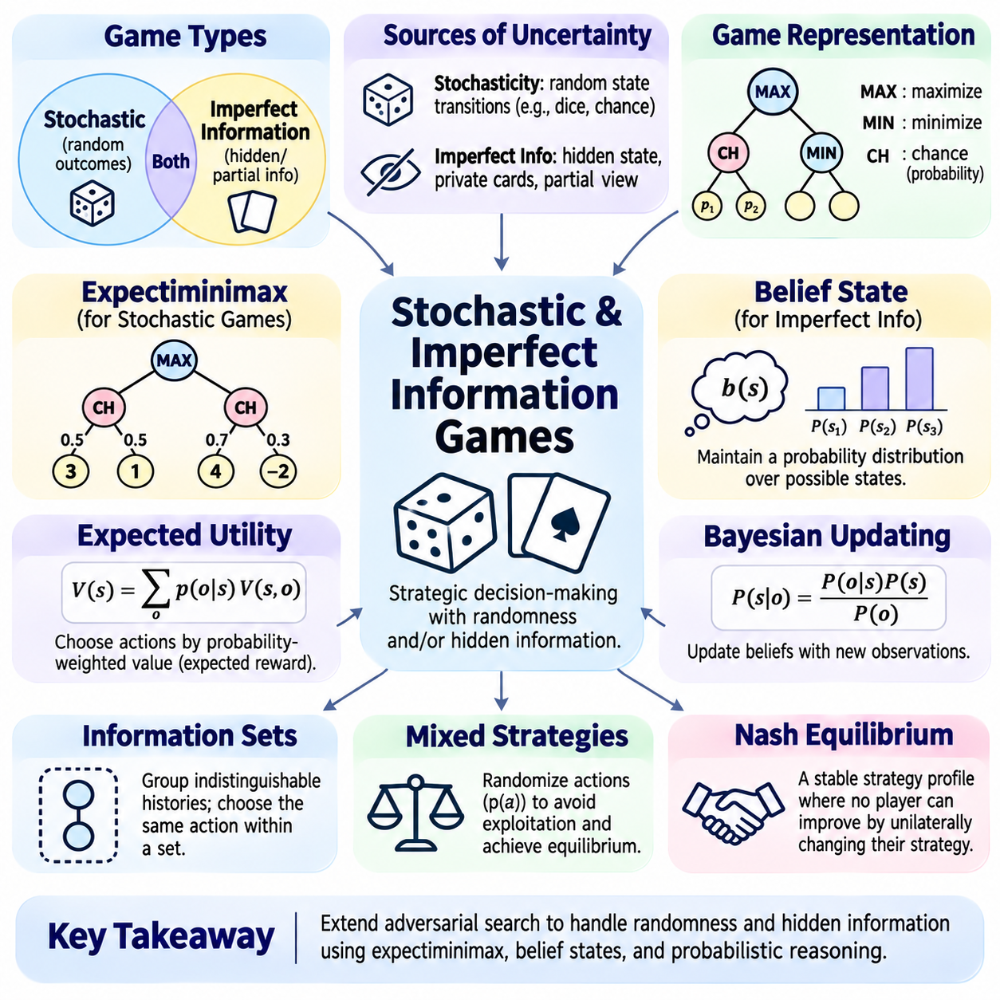{width="7.268055555555556in" height="7.268055555555556in"}

Stochastic and imperfect-information games extend classical adversarial search by introducing randomness, hidden information, or both. Unlike deterministic perfect-information games, players cannot always predict exact state transitions or observe every relevant variable. Effective decision-making therefore requires reasoning about probabilities, uncertainty, and opponent behavior. These games provide important models for strategic interaction under incomplete knowledge.

Stochastic games contain random events that influence how the game evolves. Dice rolls, shuffled cards, environmental disturbances, and probabilistic outcomes may alter the state after an action is selected. Even when every player observes the current state, future transitions may remain uncertain. Game AI must evaluate possible outcomes according to their probabilities rather than assuming that each action produces one deterministic successor.

Imperfect-information games restrict what players can observe about the true game state. Hidden cards, concealed actions, private objectives, and partially visible environments create uncertainty about relevant variables. Two distinct underlying states may appear identical to a player. Consequently, decision-making must operate on available observations and information histories rather than assuming complete access to the actual state.

Stochasticity and imperfect information represent different sources of uncertainty. Stochasticity concerns randomness in state transitions, while imperfect information concerns uncertainty about the current or past state. A game may contain either property independently or combine both. For example, a board game with visible dice outcomes may be stochastic but fully observable, whereas a hidden-card game may involve both random dealing and private information.

Expectiminimax extends Minimax to games containing probabilistic events. In addition to maximizing and minimizing decision nodes, the search tree includes chance nodes representing random outcomes. At a chance node, the algorithm computes a probability-weighted average of successor values. This mechanism allows strategic decisions to account for uncertain consequences while preserving adversarial reasoning at player-controlled nodes.

The value of a chance node can be expressed as V(s) = Σ p(o\|s)V(s,o), where p(o\|s) is the probability of outcome o and V(s,o) is the value of the resulting state. The probabilities must form a valid distribution over possible outcomes. Unlike a maximizing or minimizing node, a chance node does not select the best or worst successor. It combines outcomes according to the game\'s probabilistic transition model.

Expectiminimax can become computationally expensive because chance outcomes increase the effective branching factor. Every random event may introduce several additional successors, multiplying the number of positions requiring evaluation. Depth limits, outcome sampling, probability pruning, and approximate evaluation can reduce this burden. However, approximation methods must preserve sufficiently accurate estimates of strategically important risks.

Expected utility provides a common basis for choosing actions under uncertainty. An action is evaluated by combining the utility of each possible outcome with its probability. Maximizing expected utility is appropriate when the utility function correctly represents the decision-maker\'s preferences. Risk-sensitive objectives may instead penalize severe losses, reward robustness, or consider variance and worst-case outcomes alongside expected value.

Belief states provide a mathematical representation of uncertainty in imperfect-information games. A belief state assigns probabilities to possible underlying states consistent with the player\'s observations. As actions occur and new information becomes available, these probabilities are updated. Planning over belief states allows an agent to reason about hidden information without pretending that one uncertain state is known to be true.

Bayesian updating is a common mechanism for maintaining beliefs. Given a prior distribution and a new observation, the agent computes revised probabilities using the likelihood of that observation under each possible state. The resulting posterior distribution supports future decisions. Accurate updating requires appropriate models of observations, transitions, and opponent behavior, which may themselves be uncertain.

Information sets group decision histories that a player cannot distinguish using available information. A strategy in an imperfect-information game must prescribe the same action distribution for histories within the same information set. This prevents the agent from exploiting hidden information unavailable to the player. Information-set representations are central to extensive-form games and algorithms designed for strategic reasoning under partial observability.

Opponent modeling introduces additional complexity because another player\'s hidden intentions and strategy may influence observed actions. An agent can maintain hypotheses about opponent preferences, behavioral tendencies, or possible private information. Observations can update these hypotheses over time. However, assuming that opponents follow a fixed or perfectly rational strategy may produce fragile decisions when their behavior changes.

Mixed strategies allow players to randomize their actions according to probability distributions. In imperfect-information games, predictable deterministic behavior can be exploited by opponents who infer hidden intentions. Strategic randomization can reduce this vulnerability and is essential in many equilibrium solutions. The appropriate action probabilities depend on the game\'s payoff structure, available information, and interactions between competing strategies.

Nash equilibrium provides a fundamental solution concept for strategic games. At equilibrium, no player can improve their expected payoff through a unilateral strategy change while other strategies remain fixed. In two-player zero-sum games, equilibrium strategies are closely related to minimax-optimal behavior. Computing these strategies in large imperfect-information games is difficult because the number of information sets and possible strategies can be enormous.

Counterfactual Regret Minimization (CFR) is an influential approach for approximating equilibrium strategies in extensive-form imperfect-information games. It repeatedly updates strategies by measuring regret for alternative actions at information sets. Over repeated iterations, average strategies can approach equilibrium under suitable conditions. CFR and its variants have been particularly important in computational poker and other hidden-information environments.

Information Set Monte Carlo Tree Search (ISMCTS) adapts simulation-based planning to imperfect-information games. Rather than treating the hidden state as fully known, it samples possible states consistent with available information and organizes decisions around information sets. This reduces some problems associated with ordinary state-based search. Nevertheless, sampling quality and the representation of hidden information remain critical to performance.

Determinization is a practical technique that samples a complete hidden state and solves the resulting perfect-information game. Repeating this process across sampled states can provide approximate action evaluations. However, determinization may introduce strategy fusion, where the search assumes different actions can be chosen using hidden information unavailable to the player. It may also underestimate the strategic importance of gathering information.

Information-gathering actions can have value even when they provide little immediate reward. Revealing an opponent\'s card, observing an uncertain region, or testing a hidden condition may improve later decisions. This creates a distinction between immediate utility and the value of information. Effective planning must consider how current actions change future knowledge, available strategies, and the quality of subsequent decisions.

Partial observability also creates challenges involving memory and history. The current observation may not contain enough information to determine an appropriate action. Agents may need to retain previous observations, actions, and inferred events to construct a meaningful belief state. Recurrent models, Bayesian filters, and explicit history tracking can support this process, although memory requirements increase with game complexity.

Scalability remains a major engineering challenge because uncertainty expands both the physical state space and the space of possible beliefs. Exact belief-state planning may become infeasible in large games. Particle-based approximations, abstraction, sampled search, and learned value functions can reduce computational demands. These methods trade theoretical precision for practical decision quality under limited resources.

Evaluation should measure more than immediate winning rates. Relevant criteria include expected payoff, exploitability, robustness against different opponent strategies, belief calibration, and computational efficiency. Experiments should include hidden-state variations, stochastic outcomes, and opponents with diverse behaviors. Repeated trials and confidence intervals are necessary because randomness can obscure meaningful performance differences.

Implementation testing must verify probability normalization, legal information access, chance-node calculations, belief updates, and consistent strategy selection within information sets. Small games with analytically known solutions provide valuable reference cases. Tests should also detect accidental information leakage, incorrect opponent perspectives, and unstable sampling behavior. Reproducible experiments help distinguish algorithmic weaknesses from implementation errors.

Stochastic and imperfect-information games demonstrate that strategic intelligence requires more than searching visible action sequences. Effective systems must combine probabilistic reasoning, belief-state estimation, opponent modeling, and uncertainty-aware planning. Expectiminimax, CFR, and information-set search provide complementary approaches to these challenges. Together, they extend classical Game AI toward realistic decision-making under randomness and incomplete information.

확률적 게임(Stochastic Game)과 불완전 정보 게임(Imperfect-Information Game)은 무작위성(Randomness), 숨겨진 정보(Hidden Information) 또는 두 요소를 모두 도입하여 고전적 적대적 탐색(Classical Adversarial Search)을 확장한다. 결정론적 완전 정보 게임(Deterministic Perfect-Information Game)과 달리 플레이어는 정확한 상태 전이(State Transition)를 항상 예측하거나 모든 관련 변수를 관찰할 수 없다. 따라서 효과적인 의사결정(Decision-Making)을 위해서는 확률(Probability), 불확실성(Uncertainty), 상대방 행동(Opponent Behavior)에 대한 추론이 필요하다. 이러한 게임은 불완전한 지식(Incomplete Knowledge) 아래에서 이루어지는 전략적 상호작용(Strategic Interaction)을 모델링하는 데 중요한 역할을 한다.

확률적 게임(Stochastic Game)은 게임의 진행 방식에 영향을 미치는 무작위 사건(Random Event)을 포함한다. 주사위 굴리기(Dice Roll), 카드 섞기(Shuffled Cards), 환경적 교란(Environmental Disturbance), 확률적 결과(Probabilistic Outcome)는 행동이 선택된 이후 상태를 변화시킬 수 있다. 모든 플레이어가 현재 상태(Current State)를 관찰할 수 있더라도 미래의 상태 전이(Future State Transition)는 불확실할 수 있다. 게임 인공지능(Game AI)은 각 행동이 하나의 결정론적 후속 상태(Deterministic Successor)를 생성한다고 가정하는 대신 가능한 결과를 발생 확률에 따라 평가해야 한다.

불완전 정보 게임(Imperfect-Information Game)은 플레이어가 실제 게임 상태(True Game State)에 대해 관찰할 수 있는 정보를 제한한다. 숨겨진 카드(Hidden Card), 비공개 행동(Concealed Action), 개인별 목표(Private Objective), 부분적으로 관찰 가능한 환경(Partially Visible Environment)은 관련 변수에 대한 불확실성을 발생시킨다. 서로 다른 두 실제 상태(Underlying State)가 플레이어에게 동일하게 보일 수 있다. 따라서 의사결정은 실제 상태에 완전히 접근할 수 있다고 가정하는 대신 사용 가능한 관찰(Available Observation)과 정보 이력(Information History)을 기반으로 수행해야 한다.

확률성(Stochasticity)과 불완전 정보(Imperfect Information)는 서로 다른 불확실성의 원천(Source of Uncertainty)을 나타낸다. 확률성은 상태 전이(State Transition)의 무작위성과 관련되고, 불완전 정보는 현재 또는 과거 상태에 대한 불확실성과 관련된다. 게임은 이러한 특성 중 하나만 포함하거나 두 가지를 모두 결합할 수 있다. 예를 들어 주사위 결과가 공개되는 보드게임(Board Game)은 확률적이지만 완전히 관찰 가능할 수 있으며, 숨겨진 카드를 사용하는 게임은 무작위 카드 분배(Random Dealing)와 비공개 정보(Private Information)를 모두 포함할 수 있다.

기대 미니맥스(Expectiminimax)는 확률적 사건(Probabilistic Event)이 포함된 게임으로 미니맥스(Minimax)를 확장한 알고리즘이다. 탐색 트리(Search Tree)에는 최대화 결정 노드(Maximizing Decision Node)와 최소화 결정 노드(Minimizing Decision Node) 외에도 무작위 결과를 나타내는 확률 노드(Chance Node)가 포함된다. 확률 노드에서 알고리즘은 후속 상태 가치(Successor Value)의 확률 가중 평균(Probability-Weighted Average)을 계산한다. 이러한 메커니즘은 플레이어가 제어하는 노드에서 적대적 추론(Adversarial Reasoning)을 유지하면서 불확실한 결과를 전략적 의사결정에 반영할 수 있도록 한다.

확률 노드(Chance Node)의 가치는 V(s) = Σ p(o\|s)V(s,o)로 표현할 수 있으며, 여기서 p(o\|s)는 결과 o의 발생 확률(Outcome Probability)이고 V(s,o)는 해당 결과로 생성된 상태의 가치(Resulting State Value)이다. 확률은 가능한 결과에 대해 유효한 확률 분포(Probability Distribution)를 구성해야 한다. 최대화 노드(Maximizing Node)나 최소화 노드(Minimizing Node)와 달리 확률 노드는 최선 또는 최악의 후속 상태를 선택하지 않는다. 대신 게임의 확률적 전이 모델(Probabilistic Transition Model)에 따라 결과를 결합한다.

기대 미니맥스(Expectiminimax)는 확률적 결과가 실질적인 분기 계수(Effective Branching Factor)를 증가시키기 때문에 계산 비용이 높아질 수 있다. 각 무작위 사건(Random Event)은 여러 추가 후속 상태(Additional Successor)를 생성할 수 있으며, 이로 인해 평가해야 하는 위치의 수가 급격하게 증가한다. 깊이 제한(Depth Limit), 결과 샘플링(Outcome Sampling), 확률 가지치기(Probability Pruning), 근사 평가(Approximate Evaluation)는 이러한 부담을 줄일 수 있다. 그러나 근사 방법은 전략적으로 중요한 위험(Strategically Important Risk)에 대해 충분히 정확한 추정값을 유지해야 한다.

기대 효용(Expected Utility)은 불확실성 아래에서 행동을 선택하기 위한 일반적인 기준을 제공한다. 행동은 가능한 각 결과의 효용(Utility)과 발생 확률을 결합하여 평가된다. 효용 함수(Utility Function)가 의사결정자의 선호도(Decision-Maker Preference)를 올바르게 표현한다면 기대 효용 최대화(Expected Utility Maximization)는 적절한 접근 방식이다. 반면 위험 민감형 목표(Risk-Sensitive Objective)는 심각한 손실(Severe Loss)에 불이익을 부여하거나 강건성(Robustness)을 보상하며, 기대값과 함께 분산(Variance) 및 최악의 결과(Worst-Case Outcome)를 고려할 수 있다.

믿음 상태(Belief State)는 불완전 정보 게임(Imperfect-Information Game)에서 불확실성을 수학적으로 표현하는 방법을 제공한다. 믿음 상태는 플레이어의 관찰(Observation)과 일치하는 가능한 실제 상태(Underlying State)에 확률을 할당한다. 행동이 발생하고 새로운 정보를 사용할 수 있게 되면 이러한 확률이 갱신된다. 믿음 상태 기반 계획(Belief-State Planning)은 불확실한 하나의 상태가 실제 상태라고 가정하지 않고도 숨겨진 정보(Hidden Information)에 대해 추론할 수 있도록 한다.

베이즈 갱신(Bayesian Updating)은 믿음(Belief)을 유지하기 위한 일반적인 메커니즘이다. 사전 분포(Prior Distribution)와 새로운 관찰(New Observation)이 주어지면 에이전트(Agent)는 각 가능한 상태에서 해당 관찰이 발생할 우도(Likelihood)를 사용하여 수정된 확률을 계산한다. 그 결과로 얻은 사후 분포(Posterior Distribution)는 이후 의사결정을 지원한다. 정확한 갱신을 위해서는 관찰 모델(Observation Model), 전이 모델(Transition Model), 상대방 행동 모델(Opponent Behavior Model)이 적절해야 하며, 이러한 모델 자체도 불확실할 수 있다.

정보 집합(Information Set)은 플레이어가 사용 가능한 정보만으로 구분할 수 없는 의사결정 이력(Decision History)을 하나로 묶는다. 불완전 정보 게임의 전략(Strategy)은 동일한 정보 집합에 속하는 이력에 대해 동일한 행동 확률 분포(Action Probability Distribution)를 지정해야 한다. 이는 에이전트가 플레이어에게 제공되지 않은 숨겨진 정보를 이용하는 것을 방지한다. 정보 집합 표현(Information-Set Representation)은 전개형 게임(Extensive-Form Game)과 부분 관측성(Partial Observability) 아래에서 전략적 추론을 수행하는 알고리즘의 핵심 요소이다.

상대방 모델링(Opponent Modeling)은 다른 플레이어의 숨겨진 의도(Hidden Intention)와 전략이 관찰된 행동에 영향을 미칠 수 있기 때문에 추가적인 복잡성을 도입한다. 에이전트는 상대방의 선호도(Preference), 행동 경향(Behavioral Tendency), 가능한 비공개 정보(Private Information)에 대한 가설(Hypothesis)을 유지할 수 있다. 새로운 관찰을 통해 이러한 가설을 시간에 따라 갱신할 수 있다. 그러나 상대방이 고정된 전략(Fixed Strategy)이나 완전히 합리적인 전략(Perfectly Rational Strategy)을 따른다고 가정하면 행동이 변화할 때 취약한 의사결정(Fragile Decision)이 발생할 수 있다.

혼합 전략(Mixed Strategy)은 플레이어가 확률 분포(Probability Distribution)에 따라 행동을 무작위로 선택할 수 있도록 한다. 불완전 정보 게임(Imperfect-Information Game)에서는 예측 가능한 결정론적 행동(Deterministic Behavior)이 숨겨진 의도를 추론하는 상대방에게 악용될 수 있다. 전략적 무작위화(Strategic Randomization)는 이러한 취약성을 줄일 수 있으며 많은 균형 해(Equilibrium Solution)에서 필수적인 요소이다. 적절한 행동 확률(Action Probability)은 게임의 보수 구조(Payoff Structure), 사용 가능한 정보(Available Information), 경쟁 전략(Competing Strategy) 사이의 상호작용에 따라 결정된다.

내시 균형(Nash Equilibrium)은 전략적 게임(Strategic Game)의 기본적인 해 개념(Solution Concept)을 제공한다. 균형 상태에서는 다른 플레이어의 전략이 고정되어 있을 때 어느 플레이어도 자신의 전략만 변경하여 기대 보수(Expected Payoff)를 개선할 수 없다. 2인 제로섬 게임(Two-Player Zero-Sum Game)에서 균형 전략(Equilibrium Strategy)은 미니맥스 최적 행동(Minimax-Optimal Behavior)과 밀접하게 관련된다. 대규모 불완전 정보 게임에서 이러한 전략을 계산하는 것은 정보 집합과 가능한 전략의 수가 매우 많기 때문에 어렵다.

반사실적 후회 최소화(Counterfactual Regret Minimization, CFR)는 전개형 불완전 정보 게임(Extensive-Form Imperfect-Information Game)에서 균형 전략(Equilibrium Strategy)을 근사하기 위한 중요한 접근 방식이다. CFR은 정보 집합(Information Set)에서 대안 행동(Alternative Action)에 대한 후회(Regret)를 측정하여 전략을 반복적으로 갱신한다. 적절한 조건 아래에서 반복이 진행되면 평균 전략(Average Strategy)은 균형에 접근할 수 있다. CFR과 그 변형 알고리즘(Variant Algorithm)은 계산 포커(Computational Poker)와 기타 숨겨진 정보 환경(Hidden-Information Environment)에서 특히 중요한 역할을 수행해 왔다.

정보 집합 몬테카를로 트리 탐색(Information Set Monte Carlo Tree Search, ISMCTS)은 시뮬레이션 기반 계획(Simulation-Based Planning)을 불완전 정보 게임에 적용하도록 확장한 방법이다. 숨겨진 상태(Hidden State)가 완전히 알려져 있다고 취급하는 대신 사용 가능한 정보와 일치하는 가능한 상태를 샘플링하고 정보 집합(Information Set)을 중심으로 의사결정을 구성한다. 이를 통해 일반적인 상태 기반 탐색(State-Based Search)에서 발생하는 일부 문제를 줄일 수 있다. 그러나 샘플링 품질(Sampling Quality)과 숨겨진 정보의 표현(Hidden-Information Representation)은 여전히 성능을 결정하는 핵심 요소이다.

결정화(Determinization)는 완전한 숨겨진 상태(Complete Hidden State)를 샘플링하고 그 결과로 얻은 완전 정보 게임(Perfect-Information Game)을 해결하는 실용적인 기술이다. 여러 샘플링 상태에 대해 이 과정을 반복하면 근사적인 행동 평가(Approximate Action Evaluation)를 얻을 수 있다. 그러나 결정화는 플레이어가 사용할 수 없는 숨겨진 정보를 이용하여 서로 다른 행동을 선택할 수 있다고 탐색이 가정하는 전략 융합(Strategy Fusion)을 유발할 수 있다. 또한 정보를 수집하는 행위의 전략적 중요성(Strategic Importance)을 과소평가할 수 있다.

정보 수집 행동(Information-Gathering Action)은 즉각적인 보상(Immediate Reward)이 거의 없더라도 가치를 가질 수 있다. 상대방의 카드를 공개하거나 불확실한 영역(Uncertain Region)을 관찰하거나 숨겨진 조건(Hidden Condition)을 확인하면 이후 의사결정의 품질을 개선할 수 있다. 이는 즉각적인 효용(Immediate Utility)과 정보의 가치(Value of Information) 사이의 차이를 만들어낸다. 효과적인 계획(Effective Planning)은 현재 행동이 미래의 지식(Future Knowledge), 사용 가능한 전략(Available Strategy), 후속 의사결정의 품질에 어떤 변화를 가져오는지 고려해야 한다.

부분 관측성(Partial Observability)은 메모리(Memory)와 이력(History)과 관련된 문제도 발생시킨다. 현재 관찰(Current Observation)만으로는 적절한 행동을 결정하기에 충분한 정보가 없을 수 있다. 에이전트는 의미 있는 믿음 상태(Belief State)를 구성하기 위해 이전 관찰(Previous Observation), 행동(Action), 추론된 사건(Inferred Event)을 유지해야 할 수 있다. 순환 모델(Recurrent Model), 베이즈 필터(Bayesian Filter), 명시적 이력 추적(Explicit History Tracking)은 이러한 과정을 지원하지만 게임의 복잡성이 증가하면 메모리 요구사항(Memory Requirement)도 증가한다.

확장성(Scalability)은 불확실성이 물리적 상태 공간(Physical State Space)과 가능한 믿음 공간(Belief Space)을 모두 확장하기 때문에 주요 엔지니어링 과제로 남아 있다. 대규모 게임에서는 정확한 믿음 상태 계획(Exact Belief-State Planning)이 실현 불가능할 수 있다. 입자 기반 근사(Particle-Based Approximation), 추상화(Abstraction), 샘플링 탐색(Sampled Search), 학습된 가치 함수(Learned Value Function)는 계산 요구량을 줄일 수 있다. 이러한 방법은 제한된 자원 아래에서 실용적인 의사결정 품질(Practical Decision Quality)을 확보하기 위해 이론적 정밀도(Theoretical Precision)를 일부 희생한다.

평가(Evaluation)는 단순한 승률(Winning Rate) 이상의 요소를 측정해야 한다. 관련 기준에는 기대 보수(Expected Payoff), 악용 가능성(Exploitability), 다양한 상대방 전략에 대한 강건성(Robustness), 믿음 보정(Belief Calibration), 계산 효율(Computational Efficiency)이 포함된다. 실험에서는 숨겨진 상태의 변화(Hidden-State Variation), 확률적 결과(Stochastic Outcome), 다양한 행동 특성을 가진 상대방(Opponent)을 포함해야 한다. 무작위성(Randomness)이 의미 있는 성능 차이를 가릴 수 있으므로 반복 실험(Repeated Trial)과 신뢰 구간(Confidence Interval)이 필요하다.

구현 테스트(Implementation Testing)는 확률 정규화(Probability Normalization), 합법적인 정보 접근(Legal Information Access), 확률 노드 계산(Chance-Node Calculation), 믿음 갱신(Belief Update), 정보 집합 내 일관된 전략 선택(Consistent Strategy Selection)을 검증해야 한다. 분석적으로 알려진 해(Analytically Known Solution)를 가진 소규모 게임은 유용한 기준 사례(Reference Case)를 제공한다. 또한 의도하지 않은 정보 유출(Accidental Information Leakage), 잘못된 상대방 관점(Incorrect Opponent Perspective), 불안정한 샘플링 동작(Unstable Sampling Behavior)을 탐지해야 한다. 재현 가능한 실험(Reproducible Experiment)은 알고리즘의 약점과 구현 오류를 구분하는 데 도움이 된다.

확률적 게임(Stochastic Game)과 불완전 정보 게임(Imperfect-Information Game)은 전략적 지능(Strategic Intelligence)이 관찰 가능한 행동 순서(Visible Action Sequence)를 탐색하는 것 이상의 능력을 요구한다는 사실을 보여준다. 효과적인 시스템은 확률적 추론(Probabilistic Reasoning), 믿음 상태 추정(Belief-State Estimation), 상대방 모델링(Opponent Modeling), 불확실성 인식 계획(Uncertainty-Aware Planning)을 결합해야 한다. 기대 미니맥스(Expectiminimax), 반사실적 후회 최소화(CFR), 정보 집합 탐색(Information-Set Search)은 이러한 문제를 해결하기 위한 상호 보완적인 접근 방식을 제공한다. 이들은 함께 고전적 게임 인공지능(Classical Game AI)을 무작위성과 불완전한 정보 아래에서 현실적인 의사결정을 수행할 수 있는 방향으로 확장한다.

## 02.11 Game AI Engineering

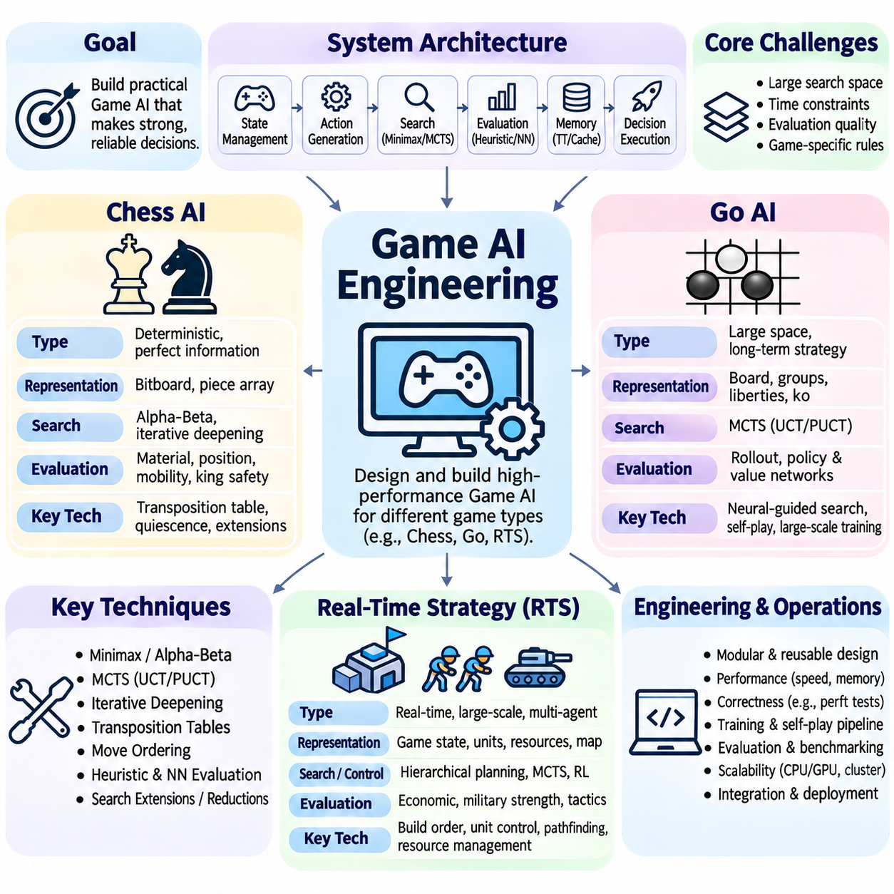{width="7.268055555555556in" height="7.268055555555556in"}

Game AI engineering transforms theoretical search algorithms into reliable systems capable of making strategic decisions under practical constraints. Chess, Go, and real-time strategy games represent different computational challenges involving branching factors, evaluation complexity, uncertainty, and response deadlines. Effective engineering requires integrating search methods, state representations, evaluation models, memory management, and execution infrastructure.

A production-oriented Game AI system typically separates game-state management, legal action generation, search control, evaluation, and decision execution. Each component must expose consistent interfaces to prevent invalid transitions and incorrect strategic calculations. Search algorithms should operate independently of rendering or user interaction. This modular architecture improves testability, reproducibility, performance optimization, and integration with learning-based components.

Chess AI is a classical example of deterministic, perfect-information adversarial search. Both players observe the complete board, and legal moves produce predictable state transitions. Nevertheless, the large search space prevents exhaustive exploration of realistic games. Chess engines therefore combine selective search, sophisticated evaluation functions, transposition tables, and carefully optimized move generation to identify strong moves within limited computational budgets.

Efficient chess engines represent board positions using bitboards, piece arrays, or hybrid structures. Bitboards encode piece locations as binary patterns, allowing fast occupancy checks, attack generation, and positional calculations. Incremental state updates avoid reconstructing the entire board after every move. Zobrist hashing provides compact position identifiers for transposition tables, repetition detection, and reuse of previously computed search information.

Chess move generation must correctly implement ordinary moves, captures, castling, en passant, promotions, and king-safety restrictions. Performance is often measured in nodes per second, but correctness is equally important. Perft testing counts legal move sequences at specified depths and compares them with known reference results. Make-and-unmake operations must restore every relevant state variable, including castling rights and en passant availability.

Alpha-Beta Pruning remains a foundational technique in classical chess engines because effective move ordering can dramatically reduce the number of explored positions. Iterative deepening repeatedly searches increasing depths while reusing information from earlier iterations. Principal variation moves, captures, killer moves, and history heuristics help prioritize promising continuations. Transposition tables further reduce duplicated work across equivalent positions.

Chess evaluation functions estimate positional quality when search cannot reach a terminal state. Traditional engines combine material balance, piece activity, pawn structure, king safety, mobility, and positional features. Quiescence search extends evaluation through tactically unstable positions to reduce horizon effects. Modern engines may replace or supplement handcrafted evaluation with efficiently updatable neural networks while retaining classical search infrastructure.

Search extensions and reductions improve chess engine efficiency by allocating computation unevenly. Check extensions investigate forcing situations, while late move reductions reduce search depth for moves considered less promising. Null-move pruning can detect positions where a player appears sufficiently strong without making an actual move. These techniques require careful safeguards because incorrect assumptions may overlook tactical resources or distort strategic evaluations.

Go AI presents a substantially different engineering problem because its branching factor and long-term positional dependencies make conventional exhaustive search difficult. The value of a move often depends on territory, influence, connectivity, and future interactions across distant board regions. Handcrafted evaluation alone struggles to capture these relationships. Monte Carlo Tree Search provides a flexible mechanism for allocating simulations toward promising strategic continuations.

Go board representations must support legal placement, connected groups, liberties, captures, ko restrictions, and the selected scoring rules. Efficient implementations maintain group connectivity and liberty information incrementally. Correct handling of repetition rules is essential because legality may depend on previous positions. The engine must also distinguish terminal conditions, passing decisions, and scoring conventions across different Go rule sets.

Traditional Monte Carlo Go engines estimated move quality through repeated simulated games. Selection policies balanced exploration and exploitation, while rollout policies generated plausible continuations. Although random simulations provided useful statistical evidence, they could misjudge strategically complex positions. Domain-specific rollout heuristics improved practical strength but introduced additional computation and potential biases into the evaluation process.

Neural-network-guided Go systems combine policy prediction, value estimation, and tree search. Policy networks estimate promising move probabilities, while value networks predict expected game outcomes. Search procedures such as PUCT integrate these predictions with visit statistics to prioritize computation. The resulting architecture reduces dependence on random rollouts and enables stronger strategic reasoning through the interaction of learned representations and explicit planning.

Training Go AI requires carefully managed datasets, self-play procedures, model evaluation, and computational resources. Supervised learning can initialize policy models from expert games, while reinforcement learning improves policies through generated experience. Self-play produces training examples containing board states, search-derived action distributions, and game outcomes. Model promotion should depend on statistically meaningful evaluation against previous versions.

Real-time strategy games introduce challenges beyond those found in turn-based board games. Players may control numerous units simultaneously while managing resources, construction, combat, exploration, and technological development. Actions occur under strict timing constraints, and observations may be incomplete because of fog of war. The resulting decision space combines continuous time, large action sets, uncertain information, and competing strategic objectives.

RTS AI commonly uses hierarchical decision-making to separate long-term strategy from tactical control. Strategic planners determine economic priorities, technology development, and expansion objectives. Tactical controllers manage engagements, positioning, and local resource allocation. Low-level unit controllers execute movement, targeting, and collision avoidance. Hierarchical decomposition reduces decision complexity while allowing different modules to operate at appropriate update frequencies.

State estimation is essential in RTS environments because enemy positions, resources, and intentions may be hidden. Agents maintain internal representations of observed units, inferred threats, and possible opponent strategies. Scouting actions improve information quality but consume time and resources. Effective systems combine belief tracking, opponent modeling, and uncertainty-aware planning to avoid making decisions based on outdated or incomplete observations.

RTS resource management requires coordinating production, worker allocation, supply limits, and technology prerequisites. Build-order planning schedules actions while respecting dependencies and resource availability. Optimization methods can estimate the economic consequences of alternative production sequences. However, rigid plans are vulnerable to enemy disruption, so execution systems must support replanning when resources, threats, or strategic priorities change.

Combat control introduces additional engineering requirements involving pathfinding, formation management, target selection, and coordinated movement. A\\\* search and navigation meshes can support movement planning, while influence maps estimate dangerous or strategically valuable regions. Tactical controllers must account for attack ranges, cooldowns, terrain constraints, and unit interactions. Efficient approximation is often necessary because large engagements create substantial computational workloads.

Real-time constraints require explicit scheduling and computational budgeting. Strategic decisions may update relatively slowly, while tactical responses and unit control require more frequent execution. Asynchronous processing can separate expensive planning from time-critical actions. Cached evaluations, incremental updates, and bounded search prevent computational overload. The system must maintain valid behavior even when advanced planning cannot finish before a deadline.

Hybrid Game AI architectures combine classical algorithms with machine learning to address different decision layers. Search methods provide explicit reasoning over actions, while neural models estimate values, predict opponent behavior, or identify promising strategies. Rule-based controllers can enforce legality and safety constraints. The best combination depends on observability, computational resources, decision frequency, and the reliability of available training data.

Engineering validation should separate functional correctness from strategic strength. Unit tests verify legal transitions, state restoration, scoring, and interface consistency. Profiling identifies bottlenecks in move generation, search, inference, and memory access. Competitive benchmarks measure performance against diverse opponents and previous engine versions. Repeated matches with controlled settings are necessary to distinguish genuine improvements from random variation.

System comparison should consider decision quality, latency, memory consumption, computational throughput, robustness, and scalability. Chess emphasizes efficient adversarial search and tactical accuracy, Go emphasizes statistical planning and learned evaluation, while RTS games emphasize hierarchical coordination and real-time adaptation. No single algorithm dominates every environment. Successful Game AI engineering selects and integrates methods according to the structural properties of each game.

Chess AI, Go AI, and real-time strategy systems demonstrate how classical search principles evolve into specialized decision architectures. Their engineering foundations include accurate state modeling, efficient action generation, uncertainty management, selective computation, and systematic evaluation. Integrating these capabilities with neural learning and scalable infrastructure enables increasingly sophisticated strategic agents while preserving the reliability required for practical deployment.

게임 인공지능 엔지니어링(Game AI Engineering)은 이론적인 탐색 알고리즘(Search Algorithm)을 실제 제약 조건(Practical Constraint) 아래에서 전략적 의사결정(Strategic Decision-Making)을 수행할 수 있는 신뢰성 높은 시스템으로 전환하는 과정이다. 체스(Chess), 바둑(Go), 실시간 전략 게임(Real-Time Strategy Game)은 분기 계수(Branching Factor), 평가 복잡성(Evaluation Complexity), 불확실성(Uncertainty), 응답 시간 제한(Response Deadline) 측면에서 서로 다른 계산 문제를 나타낸다. 효과적인 엔지니어링을 위해서는 탐색 방법, 상태 표현(State Representation), 평가 모델(Evaluation Model), 메모리 관리(Memory Management), 실행 인프라(Execution Infrastructure)의 통합이 필요하다.

실제 운영을 고려한 게임 인공지능 시스템(Production-Oriented Game AI System)은 일반적으로 게임 상태 관리(Game-State Management), 합법적 행동 생성(Legal Action Generation), 탐색 제어(Search Control), 평가(Evaluation), 의사결정 실행(Decision Execution)을 분리한다. 각 구성 요소는 잘못된 상태 전이(Invalid Transition)와 부정확한 전략 계산(Strategic Calculation)을 방지하기 위해 일관된 인터페이스(Consistent Interface)를 제공해야 한다. 탐색 알고리즘은 렌더링(Rendering)이나 사용자 상호작용(User Interaction)과 독립적으로 동작해야 한다. 이러한 모듈형 아키텍처(Modular Architecture)는 테스트 가능성(Testability), 재현성(Reproducibility), 성능 최적화(Performance Optimization), 학습 기반 구성 요소(Learning-Based Component)와의 통합을 개선한다.

체스 인공지능(Chess AI)은 결정론적 완전 정보 적대적 탐색(Deterministic Perfect-Information Adversarial Search)의 대표적인 사례이다. 두 플레이어 모두 전체 체스판(Board)을 관찰할 수 있으며, 합법적인 이동(Legal Move)은 예측 가능한 상태 전이(State Transition)를 생성한다. 그러나 방대한 탐색 공간(Search Space)으로 인해 실제 게임에서 완전 탐색(Exhaustive Exploration)은 불가능하다. 따라서 체스 엔진(Chess Engine)은 제한된 계산 예산(Computational Budget) 내에서 강력한 이동을 식별하기 위해 선택적 탐색(Selective Search), 정교한 평가 함수(Evaluation Function), 전치 테이블(Transposition Table), 최적화된 이동 생성(Move Generation)을 결합한다.

효율적인 체스 엔진(Chess Engine)은 비트보드(Bitboard), 기물 배열(Piece Array), 하이브리드 자료구조(Hybrid Data Structure)를 사용하여 체스판 위치(Board Position)를 표현한다. 비트보드는 기물 위치(Piece Location)를 이진 패턴(Binary Pattern)으로 인코딩하여 빠른 점유 상태 검사(Occupancy Check), 공격 생성(Attack Generation), 위치 계산(Positional Calculation)을 가능하게 한다. 점진적 상태 갱신(Incremental State Update)은 매 이동마다 전체 체스판을 재구성하는 작업을 방지한다. 조브리스트 해싱(Zobrist Hashing)은 전치 테이블, 반복 상태 감지(Repetition Detection), 이전 탐색 정보의 재사용을 위한 간결한 위치 식별자(Position Identifier)를 제공한다.

체스 이동 생성(Chess Move Generation)은 일반 이동(Ordinary Move), 기물 잡기(Capture), 캐슬링(Castling), 앙파상(En Passant), 프로모션(Promotion), 킹 안전 제약(King-Safety Restriction)을 정확하게 구현해야 한다. 성능은 일반적으로 초당 탐색 노드 수(Nodes per Second)로 측정하지만 정확성(Correctness)도 동일하게 중요하다. 퍼프트 테스트(Perft Testing)는 지정된 깊이에서 합법적인 이동 순서(Legal Move Sequence)의 수를 계산하고 알려진 기준 결과(Reference Result)와 비교한다. 이동 적용 및 복원(Make-and-Unmake Operation)은 캐슬링 권한(Castling Rights)과 앙파상 가능 여부(En Passant Availability)를 포함한 모든 관련 상태 변수를 정확하게 복원해야 한다.

알파-베타 가지치기(Alpha-Beta Pruning)는 효과적인 이동 순서화(Move Ordering)를 통해 탐색 위치의 수를 크게 줄일 수 있으므로 고전적 체스 엔진(Classical Chess Engine)의 핵심 기술로 유지되고 있다. 반복 심화 탐색(Iterative Deepening)은 이전 반복에서 얻은 정보를 재사용하면서 탐색 깊이를 점진적으로 증가시킨다. 주 변형 이동(Principal Variation Move), 기물 잡기(Capture), 킬러 이동(Killer Move), 이력 휴리스틱(History Heuristic)은 유망한 후속 진행을 우선하도록 지원한다. 전치 테이블(Transposition Table)은 동등한 위치에서 중복 계산을 추가로 줄인다.

체스 평가 함수(Chess Evaluation Function)는 탐색이 종료 상태(Terminal State)에 도달하지 못할 때 위치의 품질(Positional Quality)을 추정한다. 전통적인 엔진은 기물 가치 균형(Material Balance), 기물 활동성(Piece Activity), 폰 구조(Pawn Structure), 킹 안전성(King Safety), 이동성(Mobility), 위치적 특징(Positional Feature)을 결합한다. 정적 탐색(Quiescence Search)은 전술적으로 불안정한 위치(Tactically Unstable Position)에 대한 평가를 연장하여 수평선 효과(Horizon Effect)를 줄인다. 현대 엔진은 고전적인 탐색 인프라를 유지하면서 수작업 평가(Handcrafted Evaluation)를 효율적으로 갱신 가능한 신경망(Efficiently Updatable Neural Network)으로 대체하거나 보완할 수 있다.

탐색 확장(Search Extension)과 탐색 축소(Search Reduction)는 계산 자원을 불균등하게 배분하여 체스 엔진의 효율성을 개선한다. 체크 확장(Check Extension)은 강제적인 상황(Forcing Situation)을 더 깊이 조사하고, 후순위 이동 축소(Late Move Reduction)는 유망성이 낮다고 판단되는 이동의 탐색 깊이를 줄인다. 널 무브 가지치기(Null-Move Pruning)는 실제 이동을 수행하지 않고도 플레이어가 충분히 유리한 위치에 있는지 판단할 수 있다. 이러한 기술은 잘못된 가정이 전술적 대응(Tactical Resource)을 놓치거나 전략적 평가를 왜곡할 수 있으므로 신중한 보호 장치(Safeguard)가 필요하다.

바둑 인공지능(Go AI)은 높은 분기 계수(Branching Factor)와 장기적인 위치 의존성(Long-Term Positional Dependency)으로 인해 기존의 완전 탐색(Exhaustive Search)이 어려운 전혀 다른 엔지니어링 문제를 제시한다. 한 수의 가치는 종종 집(Territory), 세력(Influence), 연결성(Connectivity), 체스판의 멀리 떨어진 영역 사이에서 발생하는 미래 상호작용(Future Interaction)에 따라 달라진다. 수작업 평가(Handcrafted Evaluation)만으로는 이러한 관계를 포착하기 어렵다. 몬테카를로 트리 탐색(Monte Carlo Tree Search)은 유망한 전략적 후속 진행에 시뮬레이션을 배분하는 유연한 메커니즘을 제공한다.

바둑판 표현(Go Board Representation)은 합법적인 착수(Legal Placement), 연결된 돌 그룹(Connected Group), 활로(Liberty), 돌 잡기(Capture), 패 제약(Ko Restriction), 선택된 계가 규칙(Scoring Rule)을 지원해야 한다. 효율적인 구현은 그룹 연결성(Group Connectivity)과 활로 정보를 점진적으로 유지한다. 반복 규칙(Repetition Rule)의 정확한 처리는 이전 위치에 따라 착수의 합법성이 달라질 수 있으므로 필수적이다. 엔진은 서로 다른 바둑 규칙 체계(Go Rule Set)에 따른 종료 조건(Terminal Condition), 패스 결정(Passing Decision), 계가 방식(Scoring Convention)도 구분해야 한다.

전통적인 몬테카를로 바둑 엔진(Monte Carlo Go Engine)은 반복적인 모의 대국(Simulated Game)을 통해 착수의 품질(Move Quality)을 추정하였다. 선택 정책(Selection Policy)은 탐색(Exploration)과 활용(Exploitation)의 균형을 유지하고, 롤아웃 정책(Rollout Policy)은 그럴듯한 후속 진행(Plausible Continuation)을 생성하였다. 무작위 시뮬레이션(Random Simulation)은 유용한 통계적 증거(Statistical Evidence)를 제공했지만 전략적으로 복잡한 위치를 잘못 판단할 수 있었다. 도메인 특화 롤아웃 휴리스틱(Domain-Specific Rollout Heuristic)은 실용적인 성능을 개선했지만 추가 계산 비용과 잠재적 편향(Potential Bias)을 도입하였다.

신경망 유도 바둑 시스템(Neural-Network-Guided Go System)은 정책 예측(Policy Prediction), 가치 추정(Value Estimation), 트리 탐색(Tree Search)을 결합한다. 정책 네트워크(Policy Network)는 유망한 착수 확률(Move Probability)을 추정하고, 가치 네트워크(Value Network)는 예상 게임 결과(Expected Game Outcome)를 예측한다. PUCT와 같은 탐색 절차(Search Procedure)는 이러한 예측을 방문 통계(Visit Statistics)와 통합하여 계산 우선순위를 결정한다. 결과적인 아키텍처는 무작위 롤아웃에 대한 의존도를 줄이고 학습된 표현(Learned Representation)과 명시적 계획(Explicit Planning)의 상호작용을 통해 더 강력한 전략적 추론을 가능하게 한다.

바둑 인공지능(Go AI)의 학습에는 체계적으로 관리되는 데이터셋(Dataset), 자기 대국 절차(Self-Play Procedure), 모델 평가(Model Evaluation), 계산 자원(Computational Resource)이 필요하다. 지도학습(Supervised Learning)은 전문가 대국(Expert Game)을 활용하여 정책 모델(Policy Model)을 초기화할 수 있으며, 강화학습(Reinforcement Learning)은 생성된 경험(Generated Experience)을 통해 정책을 개선한다. 자기 대국(Self-Play)은 바둑판 상태(Board State), 탐색 기반 행동 분포(Search-Derived Action Distribution), 게임 결과(Game Outcome)를 포함하는 학습 예제를 생성한다. 모델 승격(Model Promotion)은 이전 버전과의 통계적으로 의미 있는 평가에 따라 결정되어야 한다.

실시간 전략 게임(Real-Time Strategy Game, RTS)은 턴 기반 보드게임(Turn-Based Board Game)에서 발견되는 문제를 넘어서는 도전 과제를 도입한다. 플레이어는 자원 관리(Resource Management), 건설(Construction), 전투(Combat), 탐색(Exploration), 기술 개발(Technology Development)을 수행하면서 다수의 유닛(Unit)을 동시에 제어할 수 있다. 행동은 엄격한 시간 제약(Timing Constraint) 아래에서 발생하며, 전장의 안개(Fog of War)로 인해 관찰이 불완전할 수 있다. 그 결과 의사결정 공간(Decision Space)은 연속 시간(Continuous Time), 대규모 행동 집합(Large Action Set), 불확실한 정보(Uncertain Information), 경쟁적인 전략 목표(Competing Strategic Objective)를 결합한다.

실시간 전략 게임 인공지능(RTS AI)은 일반적으로 장기 전략(Long-Term Strategy)과 전술적 제어(Tactical Control)를 분리하기 위해 계층적 의사결정(Hierarchical Decision-Making)을 사용한다. 전략 계획기(Strategic Planner)는 경제적 우선순위(Economic Priority), 기술 개발(Technology Development), 확장 목표(Expansion Objective)를 결정한다. 전술 제어기(Tactical Controller)는 교전(Engagement), 위치 선정(Positioning), 지역 자원 배분(Local Resource Allocation)을 관리한다. 저수준 유닛 제어기(Low-Level Unit Controller)는 이동(Movement), 목표 지정(Targeting), 충돌 회피(Collision Avoidance)를 실행한다. 계층적 분해(Hierarchical Decomposition)는 의사결정의 복잡성을 줄이면서 각 모듈이 적절한 갱신 주기(Update Frequency)로 동작하도록 한다.

상태 추정(State Estimation)은 적의 위치(Enemy Position), 자원(Resource), 의도(Intention)가 숨겨질 수 있으므로 실시간 전략 게임 환경에서 필수적이다. 에이전트(Agent)는 관찰된 유닛(Observed Unit), 추론된 위협(Inferred Threat), 가능한 상대방 전략(Possible Opponent Strategy)에 대한 내부 표현(Internal Representation)을 유지한다. 정찰 행동(Scouting Action)은 정보의 품질(Information Quality)을 개선하지만 시간과 자원을 소비한다. 효과적인 시스템은 오래되거나 불완전한 관찰을 기반으로 의사결정을 수행하지 않도록 믿음 추적(Belief Tracking), 상대방 모델링(Opponent Modeling), 불확실성 인식 계획(Uncertainty-Aware Planning)을 결합한다.

실시간 전략 게임의 자원 관리(Resource Management)는 생산(Production), 작업자 배분(Worker Allocation), 보급 한도(Supply Limit), 기술 선행 조건(Technology Prerequisite)을 조정해야 한다. 생산 순서 계획(Build-Order Planning)은 의존성(Dependency)과 자원 가용성(Resource Availability)을 고려하여 행동 일정을 구성한다. 최적화 방법(Optimization Method)은 대안적인 생산 순서(Production Sequence)의 경제적 결과(Economic Consequence)를 추정할 수 있다. 그러나 경직된 계획(Rigid Plan)은 적의 방해(Enemy Disruption)에 취약하므로 실행 시스템은 자원, 위협, 전략적 우선순위가 변경될 때 재계획(Replanning)을 지원해야 한다.

전투 제어(Combat Control)는 경로 탐색(Pathfinding), 대형 관리(Formation Management), 목표 선택(Target Selection), 협조 이동(Coordinated Movement)과 관련된 추가 엔지니어링 요구사항을 도입한다. A\\\* 탐색(A\\\* Search)과 내비게이션 메시(Navigation Mesh)는 이동 계획(Movement Planning)을 지원할 수 있으며, 영향도 지도(Influence Map)는 위험하거나 전략적으로 가치 있는 영역을 추정한다. 전술 제어기(Tactical Controller)는 공격 사거리(Attack Range), 재사용 대기시간(Cooldown), 지형 제약(Terrain Constraint), 유닛 상호작용(Unit Interaction)을 고려해야 한다. 대규모 교전(Large Engagement)은 상당한 계산 부하(Computational Workload)를 발생시키므로 효율적인 근사(Approximation)가 필요한 경우가 많다.

실시간 제약(Real-Time Constraint)은 명시적인 스케줄링(Scheduling)과 계산 예산 관리(Computational Budgeting)를 요구한다. 전략적 의사결정(Strategic Decision)은 상대적으로 느린 주기로 갱신할 수 있지만 전술적 대응(Tactical Response)과 유닛 제어(Unit Control)는 더 빈번한 실행이 필요하다. 비동기 처리(Asynchronous Processing)는 계산 비용이 높은 계획 작업을 시간에 민감한 행동(Time-Critical Action)과 분리할 수 있다. 캐시된 평가(Cached Evaluation), 점진적 갱신(Incremental Update), 제한된 탐색(Bounded Search)은 계산 과부하(Computational Overload)를 방지한다. 시스템은 고급 계획(Advanced Planning)이 마감 시간 이전에 완료되지 않더라도 유효한 동작을 유지해야 한다.

하이브리드 게임 인공지능 아키텍처(Hybrid Game AI Architecture)는 서로 다른 의사결정 계층(Decision Layer)을 처리하기 위해 고전적 알고리즘(Classical Algorithm)과 기계학습(Machine Learning)을 결합한다. 탐색 방법(Search Method)은 행동에 대한 명시적 추론(Explicit Reasoning)을 제공하고, 신경망 모델(Neural Model)은 가치 추정(Value Estimation), 상대방 행동 예측(Opponent Behavior Prediction), 유망한 전략 식별(Promising Strategy Identification)을 수행한다. 규칙 기반 제어기(Rule-Based Controller)는 합법성(Legality)과 안전 제약(Safety Constraint)을 강제할 수 있다. 최적의 조합은 관측 가능성(Observability), 계산 자원, 의사결정 빈도(Decision Frequency), 사용 가능한 학습 데이터(Training Data)의 신뢰성에 따라 달라진다.

엔지니어링 검증(Engineering Validation)은 기능적 정확성(Functional Correctness)과 전략적 성능(Strategic Strength)을 분리하여 수행해야 한다. 단위 테스트(Unit Test)는 합법적인 상태 전이(Legal Transition), 상태 복원(State Restoration), 점수 계산(Scoring), 인터페이스 일관성(Interface Consistency)을 검증한다. 프로파일링(Profiling)은 이동 생성(Move Generation), 탐색(Search), 추론(Inference), 메모리 접근(Memory Access)의 병목 현상(Bottleneck)을 식별한다. 경쟁 벤치마크(Competitive Benchmark)는 다양한 상대방과 이전 엔진 버전에 대한 성능을 측정한다. 실제 개선과 무작위 변동(Random Variation)을 구분하려면 통제된 설정(Controlled Setting)에서 반복 경기를 수행해야 한다.

시스템 비교(System Comparison)는 의사결정 품질(Decision Quality), 지연시간(Latency), 메모리 사용량(Memory Consumption), 계산 처리량(Computational Throughput), 강건성(Robustness), 확장성(Scalability)을 고려해야 한다. 체스는 효율적인 적대적 탐색(Adversarial Search)과 전술적 정확성(Tactical Accuracy)을 강조하고, 바둑은 통계적 계획(Statistical Planning)과 학습 기반 평가(Learned Evaluation)를 강조하며, 실시간 전략 게임은 계층적 조정(Hierarchical Coordination)과 실시간 적응(Real-Time Adaptation)을 강조한다. 모든 환경에서 우월한 단일 알고리즘은 존재하지 않는다. 성공적인 게임 인공지능 엔지니어링은 각 게임의 구조적 특성(Structural Property)에 따라 적절한 방법을 선택하고 통합한다.

체스 인공지능(Chess AI), 바둑 인공지능(Go AI), 실시간 전략 시스템(Real-Time Strategy System)은 고전적 탐색 원리(Classical Search Principle)가 전문화된 의사결정 아키텍처(Specialized Decision Architecture)로 발전하는 과정을 보여준다. 이들의 엔지니어링 기반에는 정확한 상태 모델링(State Modeling), 효율적인 행동 생성(Action Generation), 불확실성 관리(Uncertainty Management), 선택적 계산(Selective Computation), 체계적인 평가(Systematic Evaluation)가 포함된다. 이러한 기능을 신경망 학습(Neural Learning) 및 확장 가능한 인프라(Scalable Infrastructure)와 통합하면 실제 배포(Practical Deployment)에 필요한 신뢰성을 유지하면서 더욱 정교한 전략적 에이전트(Strategic Agent)를 구현할 수 있다.

## 02.12 Deep Learning vs Classical Game AI

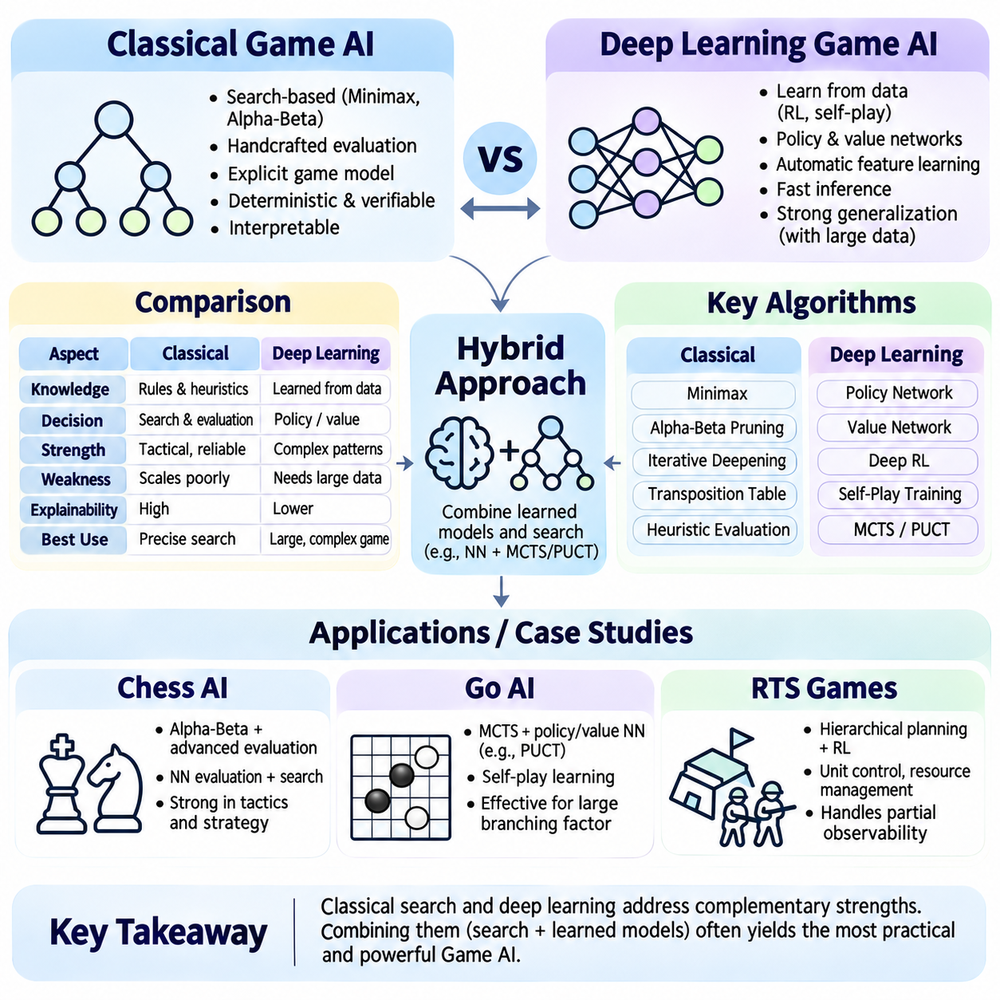{width="7.268055555555556in" height="7.268055555555556in"}

Classical Game AI and Deep Learning represent two complementary approaches to strategic decision-making. Classical methods rely on explicit search, handcrafted evaluation functions, and formal game models, while Deep Learning extracts useful representations and decision policies from data. Their differences involve computational structure, generalization, interpretability, and training requirements. Modern Game AI increasingly combines both approaches rather than treating them as mutually exclusive alternatives.

Classical Game AI emerged from symbolic reasoning and adversarial search techniques such as Minimax, Alpha-Beta Pruning, and heuristic evaluation. These methods explicitly represent game states, legal actions, and possible future outcomes. Decision quality depends on search depth, move ordering, and evaluation accuracy. Because the decision process follows defined algorithms, developers can often inspect search paths and identify why particular actions were selected.

Deep Learning approaches use neural networks to approximate policies, value functions, or internal representations of game environments. Instead of manually defining every strategic feature, models learn patterns through supervised learning, reinforcement learning, or self-play. Neural networks can capture complex positional relationships that are difficult to express through handcrafted rules. However, their predictions depend on training data, optimization procedures, and generalization to unfamiliar situations.

The fundamental difference lies in how strategic knowledge is acquired and applied. Classical systems encode domain knowledge through explicit rules and evaluation formulas, while learning-based systems estimate useful relationships from experience. Classical search computes consequences of candidate actions during decision-making. Deep Learning can provide rapid predictions after training, although producing reliable models may require substantial offline computation and carefully designed objectives.

Minimax search assumes adversarial players and evaluates actions according to possible responses from opponents. Alpha-Beta Pruning reduces unnecessary exploration without changing the exact result of a completed fixed-depth Minimax search when applied correctly. These techniques offer predictable computational behavior under controlled search limits. Their effectiveness decreases when branching factors become extremely large or evaluation functions fail to capture long-term strategic consequences.

Neural policy networks estimate action probabilities directly from game states. They can generate candidate moves without exhaustively evaluating every legal continuation. Value networks estimate expected outcomes or positional quality, providing learned alternatives to handcrafted evaluation functions. These predictions can substantially reduce decision latency, but their accuracy depends on the distribution of training examples and the model\'s ability to represent relevant strategic patterns.

Deep Reinforcement Learning allows agents to improve through interaction with an environment. Rewards guide the optimization of policies that maximize expected long-term returns. Self-play is particularly valuable in competitive games because agents generate increasingly challenging training experiences. Nevertheless, learning may be unstable, sample inefficient, or sensitive to reward design. Exploration strategies and opponent diversity strongly influence the quality of the resulting policy.

Classical search offers explicit tactical verification by examining concrete action sequences. In chess, deeper search can identify forced captures, checks, and defensive responses that static evaluations may overlook. Neural networks may recognize strong positional patterns but fail on rare tactical configurations outside their training distribution. Combining neural evaluation with selective search helps reduce these weaknesses while preserving the advantages of learned strategic representations.

Monte Carlo Tree Search provides an important bridge between classical planning and neural learning. MCTS estimates action values through selective simulations rather than exhaustive enumeration. Neural policy priors guide exploration toward promising moves, while value networks estimate outcomes without complete rollouts. PUCT-based selection integrates learned probabilities with search statistics, allowing the system to refine neural predictions through explicit planning.

Computer chess demonstrates the effectiveness of both classical and hybrid approaches. Traditional engines combine Alpha-Beta search, transposition tables, iterative deepening, and sophisticated evaluation. Neural-network evaluation can improve positional understanding while retaining efficient tactical search. Alternative architectures use neural-guided tree search. Their relative performance depends on hardware, time controls, model quality, and the efficiency of the search implementation.

Computer Go illustrates why learning-based evaluation became especially important. The enormous branching factor and complex spatial relationships made handcrafted evaluation and conventional exhaustive search difficult. Neural policy and value networks improved move selection and outcome estimation. Combined with MCTS, these models enabled stronger strategic planning. The resulting systems demonstrated that learned representations and statistical search can complement each other effectively.

Real-time strategy games require additional capabilities involving resource allocation, tactical control, opponent modeling, and partial observability. Classical planners provide explicit scheduling and hierarchical decision structures, while neural models support perception, prediction, and adaptive policies. Reinforcement learning can optimize combat behaviors or strategic choices. Hybrid architectures remain useful because real-time constraints and large action spaces make unrestricted search impractical.

Computational requirements differ significantly between the two approaches. Classical engines primarily consume resources during search and evaluation at decision time. Deep Learning systems may require extensive GPU computation during training but provide efficient inference after deployment. Neural-guided search introduces both inference and tree-search costs. Practical comparisons must account for training expense, inference latency, memory consumption, and total computational budgets.

Data requirements are another important distinction. Classical algorithms can operate using game rules and manually constructed evaluation functions without large training datasets. Deep Learning generally requires representative experience, expert demonstrations, simulated games, or self-play trajectories. Dataset quality influences model performance and robustness. Distribution shifts, rare tactical patterns, and biased training opponents can cause learned policies to behave unpredictably.

Interpretability and debugging also differ between classical and neural systems. Classical search can expose principal variations, evaluation terms, and pruning decisions. Neural models encode strategic relationships across many learned parameters, making individual predictions harder to explain. Attribution methods and diagnostic evaluations provide partial insight but do not guarantee faithful explanations. Hybrid systems benefit from combining explicit search traces with model-level analysis.

Robustness depends on how systems handle unfamiliar positions and adversarial behavior. Classical search can reason about legal continuations even when positions have never been encountered, although heuristic estimates may be inaccurate. Neural networks may generalize successfully across related patterns but can fail under distribution shifts. Search verification, uncertainty estimation, diversified training, and adversarial testing help improve reliability across both approaches.

Transfer learning provides an advantage when neural representations can be reused across related games or tasks. Shared architectures may learn spatial patterns, tactical relationships, or general decision features. However, differences in action spaces, rules, and reward structures can limit transfer effectiveness. Classical algorithms are often easier to reuse when games share formal search properties. Successful transfer therefore depends on both representation compatibility and domain structure.

Learning-based agents can adapt their behavior through continued training or online updates. Classical systems generally require changes to evaluation parameters, search heuristics, or encoded rules to achieve comparable adaptation. Online learning introduces risks of instability, catastrophic forgetting, and exploitation by changing opponents. Controlled evaluation and rollback mechanisms are important when updating deployed agents. Adaptation should improve performance without undermining previously reliable behavior.

Hybrid Game AI systems commonly separate learned estimation from explicit decision control. Neural networks provide action priors, value predictions, or opponent models, while search algorithms test consequences and enforce game rules. This division allows learning to capture complex patterns while symbolic components preserve legality and structured reasoning. The appropriate balance depends on branching factor, observation quality, available computation, and response deadlines.

Evaluation must compare systems under consistent rules, hardware constraints, and computational budgets. Relevant metrics include winning rate, Elo-style ratings, decision latency, search nodes, inference throughput, and memory usage. Learning-based methods also require reporting training cost and sample efficiency. Repeated matches against diverse opponents are necessary to assess statistical significance, robustness, and sensitivity to specific playing styles.

Ablation studies help identify which components contribute to performance improvements. Removing neural policy guidance, replacing learned value functions, or disabling search extensions can reveal their individual effects. Experiments should control random seeds, training data, search budgets, and opponent configurations. Such comparisons prevent improvements from being incorrectly attributed to model architecture when they actually result from additional computation or stronger search.

Engineering decisions should reflect the operational environment rather than favoring one methodology universally. Resource-constrained systems may prefer lightweight heuristics or compact neural models. Games with precise tactical requirements may benefit from deeper deterministic search, while large strategic spaces may favor learned evaluation and sampling-based planning. Reliable deployment requires balancing strategic strength, computational efficiency, maintainability, and reproducibility.

The future of Game AI increasingly involves integrated architectures that combine search, reinforcement learning, neural representation, and uncertainty-aware planning. Classical algorithms contribute explicit reasoning and structured control, while Deep Learning contributes adaptive representations and predictive capabilities. Neither approach eliminates the limitations of the other. Their integration provides a flexible foundation for building stronger, more scalable, and more general strategic agents.

고전적 게임 인공지능(Classical Game AI)과 딥러닝(Deep Learning)은 전략적 의사결정(Strategic Decision-Making)을 위한 상호 보완적인 두 가지 접근 방식이다. 고전적 방법은 명시적 탐색(Explicit Search), 수작업 평가 함수(Handcrafted Evaluation Function), 형식적 게임 모델(Formal Game Model)에 의존하는 반면, 딥러닝은 데이터로부터 유용한 표현(Representation)과 의사결정 정책(Decision Policy)을 학습한다. 두 접근 방식은 계산 구조(Computational Structure), 일반화(Generalization), 해석 가능성(Interpretability), 학습 요구사항(Training Requirement)에서 차이를 보인다. 현대 게임 인공지능은 두 방법을 상호 배타적인 대안으로 취급하기보다 점차 결합하는 방향으로 발전하고 있다.

고전적 게임 인공지능(Classical Game AI)은 미니맥스(Minimax), 알파-베타 가지치기(Alpha-Beta Pruning), 휴리스틱 평가(Heuristic Evaluation)와 같은 기호적 추론(Symbolic Reasoning) 및 적대적 탐색(Adversarial Search) 기술에서 발전하였다. 이러한 방법은 게임 상태(Game State), 합법적 행동(Legal Action), 가능한 미래 결과(Possible Future Outcome)를 명시적으로 표현한다. 의사결정 품질(Decision Quality)은 탐색 깊이(Search Depth), 이동 순서화(Move Ordering), 평가 정확도(Evaluation Accuracy)에 따라 달라진다. 의사결정 과정이 정의된 알고리즘을 따르기 때문에 개발자는 탐색 경로(Search Path)를 조사하고 특정 행동이 선택된 이유를 파악할 수 있다.

딥러닝(Deep Learning) 접근 방식은 신경망(Neural Network)을 사용하여 정책(Policy), 가치 함수(Value Function), 게임 환경의 내부 표현(Internal Representation)을 근사한다. 모든 전략적 특징(Strategic Feature)을 수작업으로 정의하는 대신 지도학습(Supervised Learning), 강화학습(Reinforcement Learning), 자기 대국(Self-Play)을 통해 패턴을 학습한다. 신경망은 수작업 규칙(Handcrafted Rule)으로 표현하기 어려운 복잡한 위치 관계(Positional Relationship)를 포착할 수 있다. 그러나 예측 결과는 학습 데이터(Training Data), 최적화 절차(Optimization Procedure), 익숙하지 않은 상황에 대한 일반화 능력(Generalization Ability)에 따라 달라진다.

근본적인 차이는 전략적 지식(Strategic Knowledge)을 획득하고 적용하는 방식에 있다. 고전적 시스템은 명시적인 규칙(Explicit Rule)과 평가 공식(Evaluation Formula)을 통해 도메인 지식(Domain Knowledge)을 인코딩하는 반면, 학습 기반 시스템(Learning-Based System)은 경험으로부터 유용한 관계를 추정한다. 고전적 탐색(Classical Search)은 의사결정 과정에서 후보 행동(Candidate Action)의 결과를 계산한다. 딥러닝은 학습 이후 빠른 예측(Fast Prediction)을 제공할 수 있지만, 신뢰성 높은 모델을 생성하려면 상당한 오프라인 계산(Offline Computation)과 신중하게 설계된 목표 함수(Objective Function)가 필요할 수 있다.

미니맥스 탐색(Minimax Search)은 적대적 플레이어(Adversarial Player)를 가정하고 상대방의 가능한 대응(Possible Response)에 따라 행동을 평가한다. 알파-베타 가지치기(Alpha-Beta Pruning)는 올바르게 적용될 경우 완료된 고정 깊이 미니맥스 탐색(Fixed-Depth Minimax Search)의 정확한 결과를 변경하지 않으면서 불필요한 탐색을 줄인다. 이러한 기술은 통제된 탐색 제한(Search Limit) 아래에서 예측 가능한 계산 동작(Computational Behavior)을 제공한다. 그러나 분기 계수(Branching Factor)가 매우 커지거나 평가 함수가 장기적인 전략적 결과(Long-Term Strategic Consequence)를 포착하지 못하면 효과가 감소한다.

신경망 정책 네트워크(Neural Policy Network)는 게임 상태(Game State)로부터 행동 확률(Action Probability)을 직접 추정한다. 모든 합법적인 후속 진행(Legal Continuation)을 완전히 평가하지 않고도 후보 이동(Candidate Move)을 생성할 수 있다. 가치 네트워크(Value Network)는 예상 결과(Expected Outcome) 또는 위치의 품질(Positional Quality)을 추정하여 수작업 평가 함수(Handcrafted Evaluation Function)를 대체할 수 있는 학습 기반 방법을 제공한다. 이러한 예측은 의사결정 지연시간(Decision Latency)을 크게 줄일 수 있지만 정확도는 학습 예제(Training Example)의 분포와 관련 전략 패턴을 표현하는 모델의 능력에 따라 달라진다.

심층 강화학습(Deep Reinforcement Learning)은 에이전트(Agent)가 환경(Environment)과 상호작용하면서 성능을 개선하도록 한다. 보상(Reward)은 장기 기대 수익(Expected Long-Term Return)을 최대화하는 정책의 최적화를 유도한다. 자기 대국(Self-Play)은 에이전트가 점점 더 도전적인 학습 경험(Training Experience)을 생성하므로 경쟁 게임에서 특히 유용하다. 그러나 학습은 불안정하거나 표본 효율성(Sample Efficiency)이 낮을 수 있으며 보상 설계(Reward Design)에 민감할 수 있다. 탐색 전략(Exploration Strategy)과 상대방 다양성(Opponent Diversity)은 최종 정책의 품질에 큰 영향을 미친다.

고전적 탐색(Classical Search)은 구체적인 행동 순서(Action Sequence)를 조사하여 명시적인 전술 검증(Tactical Verification)을 제공한다. 체스(Chess)에서는 깊은 탐색(Deeper Search)을 통해 정적 평가(Static Evaluation)가 놓칠 수 있는 강제적인 기물 잡기(Forced Capture), 체크(Check), 방어적 대응(Defensive Response)을 식별할 수 있다. 신경망은 강력한 위치 패턴(Positional Pattern)을 인식할 수 있지만 학습 분포(Training Distribution)를 벗어난 드문 전술적 구성(Rare Tactical Configuration)에서는 실패할 수 있다. 신경망 평가(Neural Evaluation)와 선택적 탐색(Selective Search)을 결합하면 학습된 전략적 표현(Learned Strategic Representation)의 장점을 유지하면서 이러한 약점을 줄일 수 있다.

몬테카를로 트리 탐색(Monte Carlo Tree Search, MCTS)은 고전적 계획(Classical Planning)과 신경망 학습(Neural Learning)을 연결하는 중요한 기술이다. MCTS는 완전한 열거(Exhaustive Enumeration) 대신 선택적 시뮬레이션(Selective Simulation)을 통해 행동 가치(Action Value)를 추정한다. 신경망 정책 사전 확률(Neural Policy Prior)은 유망한 이동으로 탐색을 유도하고, 가치 네트워크(Value Network)는 완전한 롤아웃(Complete Rollout) 없이 결과를 추정한다. PUCT 기반 선택(PUCT-Based Selection)은 학습된 확률(Learned Probability)과 탐색 통계(Search Statistics)를 통합하여 명시적 계획을 통해 신경망 예측을 정교하게 개선할 수 있도록 한다.

컴퓨터 체스(Computer Chess)는 고전적 접근 방식과 하이브리드 접근 방식(Hybrid Approach)의 효과를 모두 보여준다. 전통적인 엔진(Traditional Engine)은 알파-베타 탐색(Alpha-Beta Search), 전치 테이블(Transposition Table), 반복 심화 탐색(Iterative Deepening), 정교한 평가(Evaluation)를 결합한다. 신경망 평가(Neural-Network Evaluation)는 효율적인 전술 탐색(Tactical Search)을 유지하면서 위치 이해(Positional Understanding)를 개선할 수 있다. 다른 아키텍처는 신경망 유도 트리 탐색(Neural-Guided Tree Search)을 사용한다. 상대적 성능(Relative Performance)은 하드웨어(Hardware), 시간 제한(Time Control), 모델 품질(Model Quality), 탐색 구현 효율(Search Implementation Efficiency)에 따라 달라진다.

컴퓨터 바둑(Computer Go)은 학습 기반 평가(Learning-Based Evaluation)가 특히 중요해진 이유를 보여준다. 방대한 분기 계수(Branching Factor)와 복잡한 공간적 관계(Spatial Relationship)로 인해 수작업 평가(Handcrafted Evaluation)와 기존 완전 탐색(Conventional Exhaustive Search)은 어려움을 겪었다. 신경망 정책 및 가치 네트워크(Neural Policy and Value Network)는 착수 선택(Move Selection)과 결과 추정(Outcome Estimation)을 개선하였다. 이러한 모델을 MCTS와 결합함으로써 더욱 강력한 전략적 계획(Strategic Planning)이 가능해졌다. 결과적으로 학습된 표현(Learned Representation)과 통계적 탐색(Statistical Search)이 서로 효과적으로 보완할 수 있음을 입증하였다.

실시간 전략 게임(Real-Time Strategy Game)은 자원 배분(Resource Allocation), 전술 제어(Tactical Control), 상대방 모델링(Opponent Modeling), 부분 관측성(Partial Observability)과 관련된 추가 능력을 요구한다. 고전적 계획기(Classical Planner)는 명시적 스케줄링(Explicit Scheduling)과 계층적 의사결정 구조(Hierarchical Decision Structure)를 제공하고, 신경망 모델(Neural Model)은 인식(Perception), 예측(Prediction), 적응형 정책(Adaptive Policy)을 지원한다. 강화학습(Reinforcement Learning)은 전투 행동(Combat Behavior)이나 전략적 선택(Strategic Choice)을 최적화할 수 있다. 실시간 제약(Real-Time Constraint)과 대규모 행동 공간(Large Action Space)으로 인해 무제한 탐색(Unrestricted Search)이 비현실적이므로 하이브리드 아키텍처(Hybrid Architecture)가 유용하다.

계산 요구사항(Computational Requirement)은 두 접근 방식 사이에서 상당한 차이를 보인다. 고전적 엔진(Classical Engine)은 주로 의사결정 시점(Decision Time)의 탐색과 평가에 계산 자원을 사용한다. 딥러닝 시스템(Deep Learning System)은 학습 과정에서 광범위한 GPU 계산(GPU Computation)이 필요할 수 있지만 배포 이후에는 효율적인 추론(Inference)을 제공할 수 있다. 신경망 유도 탐색(Neural-Guided Search)은 추론 비용(Inference Cost)과 트리 탐색 비용(Tree-Search Cost)을 모두 발생시킨다. 실용적인 비교에서는 학습 비용(Training Expense), 추론 지연시간(Inference Latency), 메모리 사용량(Memory Consumption), 전체 계산 예산(Total Computational Budget)을 고려해야 한다.

데이터 요구사항(Data Requirement)도 중요한 차이점이다. 고전적 알고리즘(Classical Algorithm)은 대규모 학습 데이터셋(Training Dataset) 없이 게임 규칙(Game Rule)과 수작업 평가 함수(Handcrafted Evaluation Function)만으로 동작할 수 있다. 반면 딥러닝은 일반적으로 대표적인 경험(Representative Experience), 전문가 시연(Expert Demonstration), 시뮬레이션 게임(Simulated Game), 자기 대국 궤적(Self-Play Trajectory)이 필요하다. 데이터셋 품질(Dataset Quality)은 모델 성능(Model Performance)과 강건성(Robustness)에 영향을 미친다. 분포 변화(Distribution Shift), 드문 전술 패턴(Rare Tactical Pattern), 편향된 학습 상대방(Biased Training Opponent)은 학습된 정책이 예측하기 어려운 방식으로 동작하게 만들 수 있다.

해석 가능성(Interpretability)과 디버깅(Debugging) 역시 고전적 시스템과 신경망 시스템 사이에서 차이를 보인다. 고전적 탐색(Classical Search)은 주 변형(Principal Variation), 평가 항(Evaluation Term), 가지치기 결정(Pruning Decision)을 공개할 수 있다. 신경망 모델(Neural Model)은 수많은 학습 매개변수(Learned Parameter)에 전략적 관계를 인코딩하므로 개별 예측을 설명하기가 더 어렵다. 기여도 분석 방법(Attribution Method)과 진단 평가(Diagnostic Evaluation)는 부분적인 통찰을 제공하지만 충실한 설명(Faithful Explanation)을 보장하지는 않는다. 하이브리드 시스템(Hybrid System)은 명시적인 탐색 추적(Search Trace)과 모델 수준 분석(Model-Level Analysis)을 결합함으로써 이점을 얻는다.

강건성(Robustness)은 시스템이 익숙하지 않은 위치(Unfamiliar Position)와 적대적 행동(Adversarial Behavior)을 어떻게 처리하는지에 따라 달라진다. 고전적 탐색(Classical Search)은 이전에 경험하지 않은 위치에서도 합법적인 후속 진행(Legal Continuation)을 추론할 수 있지만 휴리스틱 추정(Heuristic Estimate)은 부정확할 수 있다. 신경망은 관련 패턴에 대해 성공적으로 일반화(Generalization)할 수 있지만 분포 변화(Distribution Shift)에서는 실패할 수 있다. 탐색 검증(Search Verification), 불확실성 추정(Uncertainty Estimation), 다양화된 학습(Diversified Training), 적대적 테스트(Adversarial Testing)는 두 접근 방식 모두의 신뢰성(Reliability)을 개선하는 데 도움이 된다.

전이학습(Transfer Learning)은 신경망 표현(Neural Representation)을 관련 게임이나 작업에서 재사용할 수 있을 때 장점을 제공한다. 공유 아키텍처(Shared Architecture)는 공간 패턴(Spatial Pattern), 전술적 관계(Tactical Relationship), 일반적인 의사결정 특징(Decision Feature)을 학습할 수 있다. 그러나 행동 공간(Action Space), 규칙(Rule), 보상 구조(Reward Structure)의 차이는 전이 효과(Transfer Effectiveness)를 제한할 수 있다. 고전적 알고리즘(Classical Algorithm)은 게임이 형식적 탐색 특성(Formal Search Property)을 공유할 때 재사용하기가 상대적으로 쉽다. 따라서 성공적인 전이는 표현 호환성(Representation Compatibility)과 도메인 구조(Domain Structure)에 모두 의존한다.

학습 기반 에이전트(Learning-Based Agent)는 지속적인 학습(Continued Training)이나 온라인 갱신(Online Update)을 통해 행동을 적응시킬 수 있다. 고전적 시스템(Classical System)은 일반적으로 유사한 적응을 달성하기 위해 평가 매개변수(Evaluation Parameter), 탐색 휴리스틱(Search Heuristic), 인코딩된 규칙(Encoded Rule)을 변경해야 한다. 온라인 학습(Online Learning)은 불안정성(Instability), 파국적 망각(Catastrophic Forgetting), 변화하는 상대방에 의한 악용(Exploitation)의 위험을 도입한다. 배포된 에이전트를 갱신할 때는 통제된 평가(Controlled Evaluation)와 롤백 메커니즘(Rollback Mechanism)이 중요하다. 적응은 이전에 신뢰할 수 있었던 행동을 훼손하지 않으면서 성능을 개선해야 한다.

하이브리드 게임 인공지능 시스템(Hybrid Game AI System)은 일반적으로 학습 기반 추정(Learned Estimation)과 명시적 의사결정 제어(Explicit Decision Control)를 분리한다. 신경망(Neural Network)은 행동 사전 확률(Action Prior), 가치 예측(Value Prediction), 상대방 모델(Opponent Model)을 제공하고, 탐색 알고리즘(Search Algorithm)은 결과를 검증하며 게임 규칙(Game Rule)을 강제한다. 이러한 분리는 학습을 통해 복잡한 패턴을 포착하면서 기호적 구성 요소(Symbolic Component)가 합법성(Legality)과 구조화된 추론(Structured Reasoning)을 유지하도록 한다. 적절한 균형은 분기 계수(Branching Factor), 관찰 품질(Observation Quality), 사용 가능한 계산 자원(Available Computation), 응답 시간 제한(Response Deadline)에 따라 달라진다.

평가(Evaluation)는 일관된 규칙(Rule), 하드웨어 제약(Hardware Constraint), 계산 예산(Computational Budget) 아래에서 시스템을 비교해야 한다. 관련 지표에는 승률(Winning Rate), 엘로 방식 평점(Elo-Style Rating), 의사결정 지연시간(Decision Latency), 탐색 노드 수(Search Node Count), 추론 처리량(Inference Throughput), 메모리 사용량(Memory Usage)이 포함된다. 학습 기반 방법(Learning-Based Method)은 학습 비용(Training Cost)과 표본 효율성(Sample Efficiency)도 보고해야 한다. 통계적 유의성(Statistical Significance), 강건성(Robustness), 특정 플레이 스타일(Playing Style)에 대한 민감도를 평가하려면 다양한 상대방을 대상으로 반복 경기를 수행해야 한다.

절제 연구(Ablation Study)는 어떤 구성 요소가 성능 개선에 기여하는지 식별하는 데 도움이 된다. 신경망 정책 유도(Neural Policy Guidance)를 제거하거나 학습된 가치 함수(Learned Value Function)를 대체하거나 탐색 확장(Search Extension)을 비활성화하면 각 구성 요소의 개별 효과를 확인할 수 있다. 실험에서는 난수 시드(Random Seed), 학습 데이터(Training Data), 탐색 예산(Search Budget), 상대방 구성(Opponent Configuration)을 통제해야 한다. 이러한 비교는 실제로 추가 계산량(Additional Computation)이나 더 강력한 탐색(Stronger Search)에서 발생한 개선을 모델 아키텍처(Model Architecture)의 효과로 잘못 귀속하는 것을 방지한다.

엔지니어링 의사결정(Engineering Decision)은 특정 방법론(Methodology)을 보편적으로 선호하기보다 운영 환경(Operational Environment)을 반영해야 한다. 자원 제약 시스템(Resource-Constrained System)은 경량 휴리스틱(Lightweight Heuristic)이나 소형 신경망 모델(Compact Neural Model)을 선호할 수 있다. 정밀한 전술적 판단(Tactical Requirement)이 필요한 게임은 더 깊은 결정론적 탐색(Deterministic Search)에서 이점을 얻을 수 있으며, 방대한 전략 공간(Strategic Space)은 학습 기반 평가(Learned Evaluation)와 샘플링 기반 계획(Sampling-Based Planning)에 적합할 수 있다. 신뢰성 높은 배포(Reliable Deployment)를 위해서는 전략적 성능(Strategic Strength), 계산 효율(Computational Efficiency), 유지보수성(Maintainability), 재현성(Reproducibility)의 균형이 필요하다.

게임 인공지능(Game AI)의 미래는 탐색(Search), 강화학습(Reinforcement Learning), 신경망 표현(Neural Representation), 불확실성 인식 계획(Uncertainty-Aware Planning)을 결합하는 통합 아키텍처(Integrated Architecture)로 점차 발전하고 있다. 고전적 알고리즘(Classical Algorithm)은 명시적 추론(Explicit Reasoning)과 구조화된 제어(Structured Control)를 제공하고, 딥러닝(Deep Learning)은 적응형 표현(Adaptive Representation)과 예측 능력(Predictive Capability)을 제공한다. 어느 한 접근 방식도 다른 접근 방식의 한계를 완전히 제거하지는 못한다. 두 방법의 통합은 더욱 강력하고 확장 가능하며 범용적인 전략적 에이전트(Strategic Agent)를 구축하기 위한 유연한 기반을 제공한다.

## 02.13 Case Studies

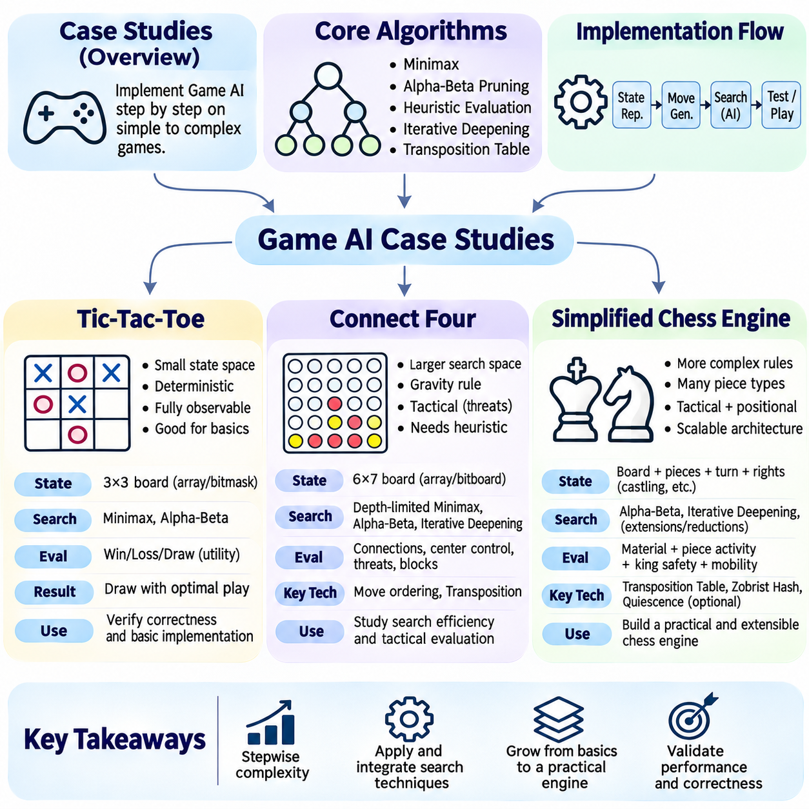{width="7.268055555555556in" height="7.268055555555556in"}

Case studies provide a practical foundation for understanding how Game AI algorithms behave across different levels of complexity. Tic-Tac-Toe, Connect Four, and simplified chess represent progressively larger search spaces and more demanding evaluation requirements. Implementing these games demonstrates how state representation, legal move generation, adversarial search, heuristic evaluation, and performance optimization interact within complete decision-making systems.

Tic-Tac-Toe is an ideal introductory environment because its rules are simple and its state space is small enough for exhaustive search. Two players alternately place marks on a three-by-three board, attempting to complete a horizontal, vertical, or diagonal line. The game is deterministic, turn-based, and fully observable. These properties allow developers to isolate search correctness without introducing uncertainty or complicated state transitions.

A Tic-Tac-Toe implementation can represent the board using a nine-element array, integer encoding, or compact bitmasks. Each state records occupied cells, the active player, and whether the game has terminated. Legal move generation identifies empty cells, while terminal detection checks winning lines and draws. Correct state representation is essential because search algorithms depend on accurate transitions and consistent interpretation of player turns.

Minimax provides an exact solution for Tic-Tac-Toe when the complete game tree is explored. Terminal positions receive utilities representing victory, defeat, or a draw. Maximizing and minimizing players recursively select actions according to these values. With optimal play from both sides, the initial position leads to a draw. This known result makes Tic-Tac-Toe useful for validating the correctness of adversarial search implementations.

Alpha-Beta Pruning can be introduced into Tic-Tac-Toe to demonstrate how unnecessary branches are eliminated without changing the optimal decision. Although the game is too small to require sophisticated optimization, node-count comparisons reveal the effect of move ordering. Prioritizing immediate wins, forced blocks, and strategically valuable squares can reduce explored positions. These experiments establish a foundation for understanding search efficiency.

Testing Tic-Tac-Toe should include every terminal outcome, illegal moves, forced victories, unavoidable defeats, and positions requiring defensive play. Automated matches between optimal agents should consistently produce draws from the initial state. Exhaustive state enumeration can identify unreachable positions and verify transition correctness. Such tests provide a controlled environment for detecting errors before implementing more complex games.

Connect Four introduces a substantially larger search space while retaining deterministic rules and complete information. Players alternately drop pieces into columns of a vertical grid, attempting to connect four pieces horizontally, vertically, or diagonally. Gravity restricts available placements, simplifying legal action generation but creating complex tactical dependencies. The game is particularly suitable for studying depth-limited adversarial search.

A standard Connect Four board contains six rows and seven columns. Each action selects a nonfull column, and the piece occupies the lowest available cell. Efficient representations may use arrays or bitboards to support rapid move application and victory detection. Incremental updates can reduce repeated calculations. Correct implementation must handle full columns, simultaneous threat patterns, terminal victories, and drawn positions.

Unlike Tic-Tac-Toe, Connect Four often requires heuristic evaluation because unrestricted search can exceed practical computational budgets. Evaluation functions may reward connected sequences, central-column control, open-ended threats, and immediate winning opportunities. Defensive features identify opponent threats requiring urgent responses. Feature weights must reflect tactical importance, since an attractive positional advantage cannot compensate for an unavoidable immediate loss.

Depth-limited Minimax and Alpha-Beta Pruning provide practical decision mechanisms for Connect Four. Iterative deepening allows the engine to return a valid move when computation is interrupted. Move ordering commonly prioritizes central columns and tactical opportunities. Transposition tables reuse evaluations of positions reached through different move sequences. These techniques demonstrate how classical search scales beyond small fully solvable examples.

Tactical evaluation is especially important because Connect Four contains forced wins, double threats, and sequences requiring precise defensive moves. Quiescence-like extensions can continue searching tactically unstable positions rather than applying static evaluation immediately. Threat-space search may identify forcing sequences more efficiently than general-purpose search. These techniques reduce horizon effects while increasing implementation complexity.

Connect Four experiments should compare search depth, node counts, pruning efficiency, evaluation quality, and decision latency. Matches against random, heuristic, and stronger search-based opponents reveal different weaknesses. Known tactical positions can verify immediate wins, forced blocks, and multi-move combinations. Repeated experiments under fixed computational budgets help distinguish genuine algorithmic improvements from variations in search configuration.

A simplified chess engine provides a more demanding case study involving diverse piece movements, king safety, tactical exchanges, and positional evaluation. The objective is not to reproduce every feature of a professional chess engine immediately, but to build a correct and extensible search architecture. Developers can progressively introduce legal move generation, state management, evaluation, search optimization, and advanced chess rules.

Chess board representation may use an eight-by-eight array, piece lists, or bitboards. Each state must record piece placement, side to move, and the additional information required by supported rules. Move generation handles movement patterns for pawns, knights, bishops, rooks, queens, and kings. Legal move filtering must reject actions that leave the active player\'s king under attack, ensuring consistent game-state transitions.

A staged implementation can begin with basic movement and captures before introducing castling, en passant, pawn promotion, and complete draw rules. However, incomplete rules must be documented explicitly, and resulting games should not be treated as fully standard chess. Terminal detection should distinguish checkmate, stalemate, and supported draw conditions. Incremental move application and restoration improve search efficiency while reducing unnecessary state copying.

Material-based evaluation provides a simple starting point for simplified chess. Piece values approximate the relative importance of pawns, knights, bishops, rooks, and queens. Positional features can incorporate mobility, center control, pawn advancement, and king safety. Evaluation should be consistent with the player perspective used by Minimax. More advanced features may improve strategic judgment but should be introduced only after baseline correctness is established.

Alpha-Beta Pruning, iterative deepening, and move ordering form the core search architecture of a simplified chess engine. Captures, checks, promotions, and previously successful moves may receive higher priority. Transposition tables reduce repeated evaluation of equivalent positions, while quiescence search limits unstable leaf evaluations. Search extensions and reductions can be introduced later, once their effects can be measured against a reliable baseline.

Chess engine testing requires particular attention to legal move generation and state restoration. Perft tests compare the number of legal move sequences at selected depths with reference results for the implemented rule set. Additional tests examine checks, pins, promotions, castling restrictions, and repetition handling. Search tests should verify forced mates, tactical captures, and defensive responses. Correctness must precede performance optimization.

Across the three case studies, increasing complexity changes the balance between exact search and heuristic approximation. Tic-Tac-Toe supports complete Minimax analysis, Connect Four benefits from depth-limited search and tactical evaluation, and simplified chess requires efficient move generation and extensive optimization. This progression demonstrates why algorithm selection depends on branching factor, state complexity, and available computation rather than game rules alone.

A common software architecture can support all three implementations through standardized interfaces for state initialization, legal actions, state transitions, terminal detection, and evaluation. Search algorithms can then operate independently of game-specific representations. This separation enables direct comparisons between Minimax, Alpha-Beta Pruning, and alternative search methods. Shared testing utilities and instrumentation improve reproducibility and reduce implementation errors.

Performance instrumentation should record visited nodes, search depth, pruning frequency, transposition-table effectiveness, memory consumption, and decision time. Correctness tests establish whether an engine follows the rules, while competitive evaluations measure strategic strength. Ablation experiments can isolate the contribution of move ordering, heuristic features, and caching. Consistent benchmarks are essential for interpreting improvements across different game environments.

These case studies also provide opportunities to introduce learning-based methods. Neural value functions can replace handcrafted evaluations, while policy networks can suggest promising actions. Self-play can generate training examples and improve decision policies. Comparing learned models with classical baselines reveals tradeoffs involving training cost, inference latency, generalization, and tactical reliability. Hybrid search architectures can then be evaluated systematically.

Tic-Tac-Toe, Connect Four, and simplified chess collectively establish a practical development pathway for Game AI engineering. They connect theoretical algorithms with implementation correctness, computational efficiency, and measurable strategic performance. By progressing from exhaustive search to heuristic evaluation and optimized adversarial planning, developers gain the foundations needed to construct more sophisticated game-playing agents and general decision-making systems.

사례 연구(Case Study)는 서로 다른 복잡성 수준에서 게임 인공지능(Game AI) 알고리즘이 어떻게 동작하는지 이해하기 위한 실용적인 기반을 제공한다. 틱택토(Tic-Tac-Toe), 커넥트 포(Connect Four), 단순화된 체스(Simplified Chess)는 점진적으로 증가하는 탐색 공간(Search Space)과 더욱 높은 평가 요구사항(Evaluation Requirement)을 나타낸다. 이러한 게임을 구현하면 상태 표현(State Representation), 합법적 이동 생성(Legal Move Generation), 적대적 탐색(Adversarial Search), 휴리스틱 평가(Heuristic Evaluation), 성능 최적화(Performance Optimization)가 완전한 의사결정 시스템(Decision-Making System) 내에서 어떻게 상호작용하는지 확인할 수 있다.

틱택토(Tic-Tac-Toe)는 규칙이 단순하고 상태 공간(State Space)이 완전 탐색(Exhaustive Search)을 수행할 수 있을 정도로 작기 때문에 입문용 환경(Introductory Environment)으로 이상적이다. 두 플레이어는 3×3 게임판(Board)에 번갈아 표시를 배치하며 가로, 세로 또는 대각선으로 한 줄을 완성하는 것을 목표로 한다. 이 게임은 결정론적(Deterministic)이고 턴 기반(Turn-Based)이며 완전 관측 가능(Fully Observable)하다. 이러한 특성은 불확실성(Uncertainty)이나 복잡한 상태 전이(State Transition)를 도입하지 않고 탐색 정확성(Search Correctness)을 독립적으로 검증할 수 있도록 한다.

틱택토 구현(Tic-Tac-Toe Implementation)은 9개 요소의 배열(Nine-Element Array), 정수 인코딩(Integer Encoding), 압축 비트마스크(Compact Bitmask)를 사용하여 게임판을 표현할 수 있다. 각 상태(State)는 점유된 칸(Occupied Cell), 현재 플레이어(Active Player), 게임 종료 여부(Termination Status)를 기록한다. 합법적 이동 생성(Legal Move Generation)은 빈 칸을 식별하고, 종료 상태 판정(Terminal Detection)은 승리 조건(Winning Line)과 무승부(Draw)를 확인한다. 탐색 알고리즘은 정확한 상태 전이와 일관된 플레이어 턴 해석(Player-Turn Interpretation)에 의존하므로 올바른 상태 표현이 필수적이다.

미니맥스(Minimax)는 전체 게임 트리(Game Tree)를 탐색할 경우 틱택토에 대한 정확한 해(Exact Solution)를 제공한다. 종료 위치(Terminal Position)에는 승리(Victory), 패배(Defeat), 무승부(Draw)를 나타내는 효용 값(Utility Value)이 부여된다. 최대화 플레이어(Maximizing Player)와 최소화 플레이어(Minimizing Player)는 이러한 값에 따라 재귀적으로 행동을 선택한다. 양쪽 모두 최적 플레이(Optimal Play)를 수행하면 초기 위치(Initial Position)에서 무승부가 발생한다. 이처럼 알려진 결과는 적대적 탐색 구현(Adversarial Search Implementation)의 정확성을 검증하는 데 유용하다.

알파-베타 가지치기(Alpha-Beta Pruning)는 최적의 의사결정(Optimal Decision)을 변경하지 않으면서 불필요한 분기(Unnecessary Branch)를 제거하는 방법을 보여주기 위해 틱택토에 도입할 수 있다. 이 게임은 정교한 최적화(Sophisticated Optimization)가 필요할 만큼 크지 않지만 노드 수 비교(Node-Count Comparison)를 통해 이동 순서화(Move Ordering)의 효과를 확인할 수 있다. 즉각적인 승리(Immediate Win), 강제 방어(Forced Block), 전략적으로 가치 있는 칸(Strategically Valuable Square)을 우선하면 탐색 위치의 수를 줄일 수 있다. 이러한 실험은 탐색 효율(Search Efficiency)을 이해하기 위한 기초를 확립한다.

틱택토 테스트(Tic-Tac-Toe Testing)는 모든 종료 결과(Terminal Outcome), 불법 이동(Illegal Move), 강제 승리(Forced Victory), 피할 수 없는 패배(Unavoidable Defeat), 방어적 플레이(Defensive Play)가 필요한 위치를 포함해야 한다. 최적 에이전트(Optimal Agent) 사이의 자동화된 경기(Automated Match)는 초기 상태에서 항상 무승부를 생성해야 한다. 전체 상태 열거(Exhaustive State Enumeration)는 도달할 수 없는 위치(Unreachable Position)를 식별하고 상태 전이 정확성(Transition Correctness)을 검증할 수 있다. 이러한 테스트는 더 복잡한 게임을 구현하기 전에 오류를 탐지하기 위한 통제된 환경(Controlled Environment)을 제공한다.

커넥트 포(Connect Four)는 결정론적 규칙(Deterministic Rule)과 완전 정보(Complete Information)를 유지하면서 훨씬 더 큰 탐색 공간(Search Space)을 도입한다. 플레이어는 수직 격자(Vertical Grid)의 열(Column)에 번갈아 말을 떨어뜨려 가로, 세로 또는 대각선으로 네 개를 연결하는 것을 목표로 한다. 중력(Gravity)은 가능한 배치(Available Placement)를 제한하여 합법적 행동 생성(Legal Action Generation)을 단순화하지만 복잡한 전술적 의존성(Tactical Dependency)을 발생시킨다. 이 게임은 깊이 제한 적대적 탐색(Depth-Limited Adversarial Search)을 연구하는 데 특히 적합하다.

표준 커넥트 포 게임판(Standard Connect Four Board)은 6개 행(Row)과 7개 열(Column)로 구성된다. 각 행동(Action)은 가득 차지 않은 열(Nonfull Column)을 선택하며 말은 해당 열의 가장 낮은 빈 칸(Lowest Available Cell)에 배치된다. 효율적인 표현(Efficient Representation)은 배열(Array)이나 비트보드(Bitboard)를 사용하여 빠른 이동 적용(Move Application)과 승리 판정(Victory Detection)을 지원할 수 있다. 점진적 갱신(Incremental Update)은 반복 계산을 줄인다. 올바른 구현은 가득 찬 열(Full Column), 동시 위협 패턴(Simultaneous Threat Pattern), 종료 승리(Terminal Victory), 무승부 위치(Drawn Position)를 처리해야 한다.

틱택토와 달리 커넥트 포는 제한 없는 탐색(Unrestricted Search)이 실제 계산 예산(Computational Budget)을 초과할 수 있으므로 휴리스틱 평가(Heuristic Evaluation)가 필요한 경우가 많다. 평가 함수(Evaluation Function)는 연결된 말의 배열(Connected Sequence), 중앙 열 제어(Central-Column Control), 열린 위협(Open-Ended Threat), 즉각적인 승리 기회(Immediate Winning Opportunity)에 보상을 부여할 수 있다. 방어적 특징(Defensive Feature)은 긴급한 대응이 필요한 상대방 위협(Opponent Threat)을 식별한다. 피할 수 없는 즉각적인 패배를 매력적인 위치적 우위(Positional Advantage)로 보상할 수는 없으므로 특징 가중치(Feature Weight)는 전술적 중요성(Tactical Importance)을 반영해야 한다.

깊이 제한 미니맥스(Depth-Limited Minimax)와 알파-베타 가지치기(Alpha-Beta Pruning)는 커넥트 포에서 실용적인 의사결정 메커니즘(Decision Mechanism)을 제공한다. 반복 심화 탐색(Iterative Deepening)은 계산이 중단되더라도 유효한 이동(Valid Move)을 반환할 수 있도록 한다. 이동 순서화(Move Ordering)는 일반적으로 중앙 열(Central Column)과 전술적 기회(Tactical Opportunity)를 우선한다. 전치 테이블(Transposition Table)은 서로 다른 이동 순서를 통해 도달한 위치의 평가 결과를 재사용한다. 이러한 기술은 고전적 탐색(Classical Search)이 완전히 해결 가능한 소규모 예제를 넘어 확장되는 방법을 보여준다.

전술적 평가(Tactical Evaluation)는 커넥트 포에 강제 승리(Forced Win), 이중 위협(Double Threat), 정밀한 방어 이동(Precise Defensive Move)이 필요한 순서가 존재하므로 특히 중요하다. 정적 탐색과 유사한 확장(Quiescence-Like Extension)은 정적 평가(Static Evaluation)를 즉시 적용하는 대신 전술적으로 불안정한 위치(Tactically Unstable Position)를 계속 탐색할 수 있다. 위협 공간 탐색(Threat-Space Search)은 일반 목적 탐색(General-Purpose Search)보다 강제적인 수순(Forcing Sequence)을 더 효율적으로 식별할 수 있다. 이러한 기술은 구현 복잡성(Implementation Complexity)을 증가시키지만 수평선 효과(Horizon Effect)를 줄인다.

커넥트 포 실험(Connect Four Experiment)은 탐색 깊이(Search Depth), 노드 수(Node Count), 가지치기 효율(Pruning Efficiency), 평가 품질(Evaluation Quality), 의사결정 지연시간(Decision Latency)을 비교해야 한다. 무작위 상대방(Random Opponent), 휴리스틱 상대방(Heuristic Opponent), 강력한 탐색 기반 상대방(Search-Based Opponent)과의 경기는 서로 다른 약점을 드러낸다. 알려진 전술적 위치(Known Tactical Position)는 즉각적인 승리, 강제 방어, 여러 이동에 걸친 조합(Multi-Move Combination)을 검증할 수 있다. 고정된 계산 예산(Fixed Computational Budget) 아래에서 반복 실험을 수행하면 실제 알고리즘 개선과 탐색 설정 변화(Search Configuration Variation)를 구분할 수 있다.

단순화된 체스 엔진(Simplified Chess Engine)은 다양한 기물 이동(Piece Movement), 킹 안전성(King Safety), 전술적 교환(Tactical Exchange), 위치 평가(Positional Evaluation)를 포함하는 더욱 복잡한 사례 연구(Case Study)를 제공한다. 목표는 전문 체스 엔진(Professional Chess Engine)의 모든 기능을 즉시 재현하는 것이 아니라 정확하고 확장 가능한 탐색 아키텍처(Extensible Search Architecture)를 구축하는 것이다. 개발자는 합법적 이동 생성(Legal Move Generation), 상태 관리(State Management), 평가(Evaluation), 탐색 최적화(Search Optimization), 고급 체스 규칙(Advanced Chess Rule)을 점진적으로 도입할 수 있다.

체스판 표현(Chess Board Representation)은 8×8 배열(Array), 기물 목록(Piece List), 비트보드(Bitboard)를 사용할 수 있다. 각 상태(State)는 기물 배치(Piece Placement), 이동할 차례(Side to Move), 지원하는 규칙에 필요한 추가 정보(Additional Information)를 기록해야 한다. 이동 생성(Move Generation)은 폰(Pawn), 나이트(Knight), 비숍(Bishop), 룩(Rook), 퀸(Queen), 킹(King)의 이동 패턴(Movement Pattern)을 처리한다. 합법적 이동 필터링(Legal Move Filtering)은 현재 플레이어의 킹을 공격받는 상태로 남겨두는 행동을 거부하여 일관된 게임 상태 전이(Game-State Transition)를 보장해야 한다.

단계적 구현(Staged Implementation)은 기본 이동(Basic Movement)과 기물 잡기(Capture)에서 시작하여 캐슬링(Castling), 앙파상(En Passant), 폰 프로모션(Pawn Promotion), 완전한 무승부 규칙(Draw Rule)을 도입할 수 있다. 그러나 불완전한 규칙(Incomplete Rule)은 명시적으로 문서화해야 하며 그 결과로 생성된 게임을 완전한 표준 체스(Standard Chess)로 취급해서는 안 된다. 종료 상태 판정(Terminal Detection)은 체크메이트(Checkmate), 스테일메이트(Stalemate), 지원되는 무승부 조건(Draw Condition)을 구분해야 한다. 점진적 이동 적용 및 복원(Incremental Move Application and Restoration)은 불필요한 상태 복사(State Copying)를 줄이면서 탐색 효율을 개선한다.

기물 가치 기반 평가(Material-Based Evaluation)는 단순화된 체스의 기본 출발점을 제공한다. 기물 가치(Piece Value)는 폰, 나이트, 비숍, 룩, 퀸의 상대적 중요성(Relative Importance)을 근사한다. 위치적 특징(Positional Feature)은 이동성(Mobility), 중앙 제어(Center Control), 폰 전진(Pawn Advancement), 킹 안전성(King Safety)을 포함할 수 있다. 평가는 미니맥스(Minimax)에서 사용하는 플레이어 관점(Player Perspective)과 일관되어야 한다. 고급 특징(Advanced Feature)은 전략적 판단(Strategic Judgment)을 개선할 수 있지만 기본 구현의 정확성(Baseline Correctness)이 확립된 이후에 도입해야 한다.

알파-베타 가지치기(Alpha-Beta Pruning), 반복 심화 탐색(Iterative Deepening), 이동 순서화(Move Ordering)는 단순화된 체스 엔진(Simplified Chess Engine)의 핵심 탐색 아키텍처(Core Search Architecture)를 구성한다. 기물 잡기(Capture), 체크(Check), 프로모션(Promotion), 이전에 성공한 이동(Previously Successful Move)에 높은 우선순위를 부여할 수 있다. 전치 테이블(Transposition Table)은 동등한 위치(Equivalent Position)에 대한 반복 평가를 줄이고, 정적 탐색(Quiescence Search)은 불안정한 리프 노드 평가(Unstable Leaf Evaluation)를 제한한다. 탐색 확장(Search Extension)과 탐색 축소(Search Reduction)는 신뢰할 수 있는 기준 구현(Reliable Baseline)과 효과를 비교할 수 있게 된 이후에 도입할 수 있다.

체스 엔진 테스트(Chess Engine Testing)는 합법적 이동 생성(Legal Move Generation)과 상태 복원(State Restoration)에 특별한 주의를 기울여야 한다. 퍼프트 테스트(Perft Test)는 선택된 깊이에서 합법적 이동 순서(Legal Move Sequence)의 수를 계산하고 구현된 규칙 체계(Rule Set)에 대한 기준 결과(Reference Result)와 비교한다. 추가 테스트에서는 체크(Check), 핀(Pin), 프로모션(Promotion), 캐슬링 제한(Castling Restriction), 반복 상태 처리(Repetition Handling)를 검사한다. 탐색 테스트(Search Test)는 강제 체크메이트(Forced Mate), 전술적 기물 잡기(Tactical Capture), 방어적 대응(Defensive Response)을 검증해야 한다. 성능 최적화(Performance Optimization)에 앞서 정확성(Correctness)이 확보되어야 한다.

세 가지 사례 연구에서 복잡성이 증가함에 따라 정확한 탐색(Exact Search)과 휴리스틱 근사(Heuristic Approximation) 사이의 균형이 변화한다. 틱택토는 완전한 미니맥스 분석(Complete Minimax Analysis)을 지원하고, 커넥트 포는 깊이 제한 탐색(Depth-Limited Search)과 전술적 평가(Tactical Evaluation)의 이점을 활용하며, 단순화된 체스는 효율적인 이동 생성(Efficient Move Generation)과 광범위한 최적화(Extensive Optimization)를 요구한다. 이러한 발전 과정은 알고리즘 선택(Algorithm Selection)이 게임 규칙만이 아니라 분기 계수(Branching Factor), 상태 복잡성(State Complexity), 사용 가능한 계산 자원(Available Computation)에 따라 결정되는 이유를 보여준다.

공통 소프트웨어 아키텍처(Common Software Architecture)는 상태 초기화(State Initialization), 합법적 행동(Legal Action), 상태 전이(State Transition), 종료 상태 판정(Terminal Detection), 평가(Evaluation)에 대한 표준화된 인터페이스(Standardized Interface)를 통해 세 가지 구현을 모두 지원할 수 있다. 이를 통해 탐색 알고리즘(Search Algorithm)은 게임별 표현(Game-Specific Representation)과 독립적으로 동작할 수 있다. 이러한 분리는 미니맥스(Minimax), 알파-베타 가지치기(Alpha-Beta Pruning), 대안적 탐색 방법(Alternative Search Method) 사이의 직접적인 비교를 가능하게 한다. 공유 테스트 유틸리티(Shared Testing Utility)와 계측 기능(Instrumentation)은 재현성(Reproducibility)을 개선하고 구현 오류(Implementation Error)를 줄인다.

성능 계측(Performance Instrumentation)은 방문 노드 수(Visited Node Count), 탐색 깊이(Search Depth), 가지치기 빈도(Pruning Frequency), 전치 테이블 효과(Transposition-Table Effectiveness), 메모리 사용량(Memory Consumption), 의사결정 시간(Decision Time)을 기록해야 한다. 정확성 테스트(Correctness Test)는 엔진이 규칙을 따르는지 확인하고, 경쟁 평가(Competitive Evaluation)는 전략적 성능(Strategic Strength)을 측정한다. 절제 실험(Ablation Experiment)은 이동 순서화(Move Ordering), 휴리스틱 특징(Heuristic Feature), 캐싱(Caching)의 기여도를 독립적으로 분석할 수 있다. 서로 다른 게임 환경에서 개선 효과를 해석하려면 일관된 벤치마크(Consistent Benchmark)가 필수적이다.

이러한 사례 연구는 학습 기반 방법(Learning-Based Method)을 도입할 기회도 제공한다. 신경망 가치 함수(Neural Value Function)는 수작업 평가(Handcrafted Evaluation)를 대체할 수 있으며, 정책 네트워크(Policy Network)는 유망한 행동(Promising Action)을 제안할 수 있다. 자기 대국(Self-Play)은 학습 예제(Training Example)를 생성하고 의사결정 정책(Decision Policy)을 개선할 수 있다. 학습된 모델(Learned Model)과 고전적 기준 모델(Classical Baseline)을 비교하면 학습 비용(Training Cost), 추론 지연시간(Inference Latency), 일반화(Generalization), 전술적 신뢰성(Tactical Reliability) 사이의 상충 관계를 확인할 수 있다. 이후 하이브리드 탐색 아키텍처(Hybrid Search Architecture)를 체계적으로 평가할 수 있다.

틱택토(Tic-Tac-Toe), 커넥트 포(Connect Four), 단순화된 체스(Simplified Chess)는 게임 인공지능 엔지니어링(Game AI Engineering)을 위한 실용적인 개발 경로(Development Pathway)를 함께 제공한다. 이들은 이론적 알고리즘(Theoretical Algorithm)을 구현 정확성(Implementation Correctness), 계산 효율(Computational Efficiency), 측정 가능한 전략적 성능(Measurable Strategic Performance)과 연결한다. 완전 탐색(Exhaustive Search)에서 휴리스틱 평가(Heuristic Evaluation)와 최적화된 적대적 계획(Optimized Adversarial Planning)으로 점진적으로 발전함으로써 개발자는 더욱 정교한 게임 플레이 에이전트(Game-Playing Agent)와 범용 의사결정 시스템(General Decision-Making System)을 구축하는 데 필요한 기초 역량을 확보할 수 있다.
