**Volume 01. Classical AI Search and Planning**

# 02. Game AI and Adversarial Search

## 02.01 Introduction to Game AI

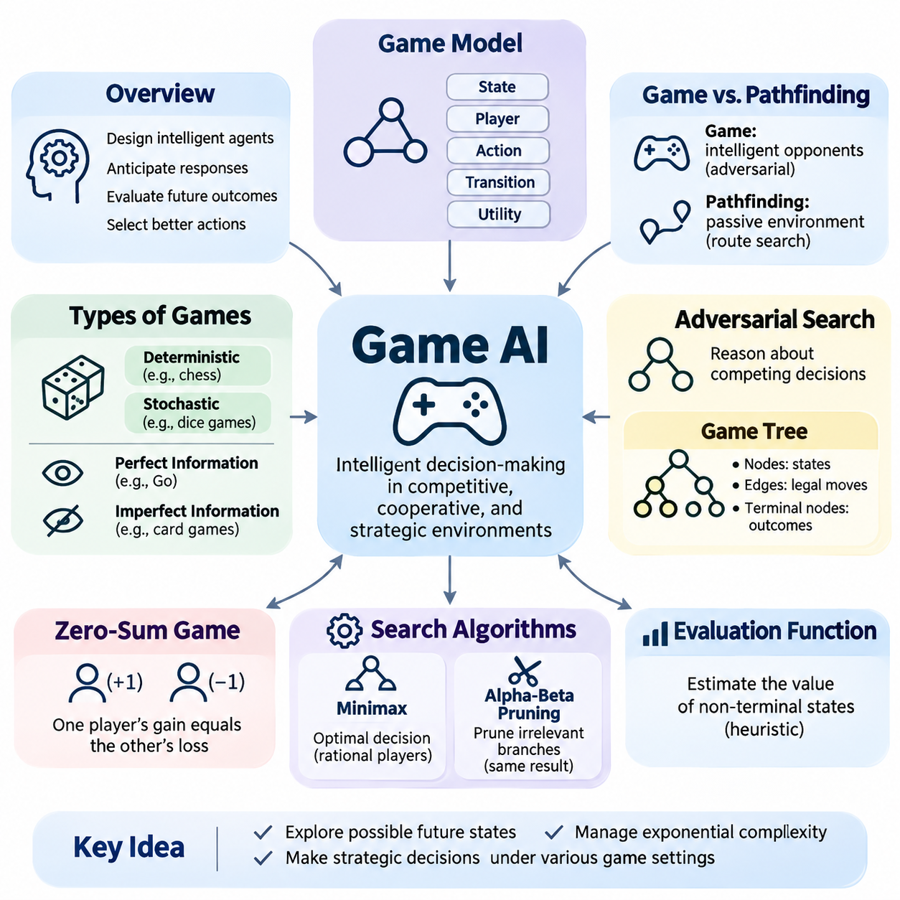{width="7.268055555555556in" height="7.268055555555556in"}

Game Artificial Intelligence (Game AI) is a fundamental branch of artificial intelligence concerned with designing agents that make intelligent decisions in competitive, cooperative, and strategic environments. Unlike conventional search problems, game environments often involve multiple decision-makers whose actions influence one another. An intelligent game agent must anticipate possible responses, evaluate future consequences, and select actions that improve its chances of achieving objectives.

The development of Game AI has played an important role in the history of artificial intelligence. Early research focused on mathematical games such as chess, checkers, and tic-tac-toe because their rules and outcomes could be represented precisely. These environments provided controlled settings for investigating logical reasoning, search algorithms, decision-making, and computational complexity. Many techniques developed for games later influenced planning, optimization, and autonomous systems.

A game can be represented mathematically through a collection of states, players, legal actions, transition rules, and outcome functions. A state describes the current configuration of the environment, while an action represents a decision available to a player. Transition rules determine how actions modify the state, and terminal conditions identify when the game ends. Utility functions assign numerical values to outcomes, allowing artificial agents to compare alternative strategies systematically.

Game AI differs from ordinary pathfinding because the environment may contain intelligent opponents rather than passive obstacles. In pathfinding, an agent searches for a route through a relatively predictable state space. In adversarial games, another player actively selects actions that may undermine the agent\'s objectives. Consequently, the quality of a decision depends not only on its immediate consequences but also on how opponents might respond during subsequent turns.

Adversarial search provides a computational framework for reasoning about competing decisions. Instead of examining only the actions available to one agent, adversarial search considers sequences of alternating actions involving multiple players. These sequences form a game tree in which nodes represent states and edges represent legal moves. By exploring possible future states, an agent estimates the strategic value of available actions and identifies promising decisions.

Game trees provide an intuitive representation of sequential decision-making. The root node corresponds to the current game state, while its children represent states reachable through legal actions. Additional levels describe possible responses and counterresponses. Terminal nodes represent completed games, and their utility values indicate wins, losses, draws, or other outcomes. The number of possible nodes generally grows exponentially with search depth, creating significant computational challenges.

The branching factor of a game describes the average number of legal actions available at each decision point. If the branching factor is b and the search depth is d, a complete game tree may contain a number of nodes proportional to b raised to the power d. This exponential growth explains why exhaustive search becomes impractical in complex games. Efficient Game AI therefore requires techniques that reduce unnecessary exploration while preserving useful strategic information.

One of the most important distinctions in Game AI concerns deterministic and stochastic environments. In deterministic games, the next state is completely determined by the current state and selected action. Chess and tic-tac-toe are common examples. Stochastic games introduce random events such as dice rolls or probabilistic outcomes. These environments require agents to evaluate expected consequences rather than assuming that every action produces a single predictable result.

Another important distinction concerns perfect and imperfect information. In perfect-information games, every player can observe the complete game state relevant to decision-making. Chess and Go belong to this category. Imperfect-information games contain hidden information, such as concealed cards or unknown opponent resources. Intelligent agents operating in these environments must maintain beliefs about possible states and make decisions under uncertainty.

Two-player zero-sum games provide a particularly useful foundation for studying adversarial reasoning. In these games, one player\'s gain corresponds directly to the other player\'s loss. The competing objectives can be represented using a single utility function with opposite signs for the two players. This structure simplifies mathematical analysis and supports algorithms that select actions by considering the strongest possible responses from an opponent.

The Minimax algorithm is a classical method for decision-making in deterministic, two-player, zero-sum games with perfect information. It assumes that both players act rationally according to their respective objectives. One player attempts to maximize utility, while the opponent attempts to minimize it. By recursively evaluating alternative moves and countermeasures, Minimax identifies an action that achieves the best guaranteed outcome under these assumptions.

Although Minimax provides a principled decision-making framework, its computational requirements increase rapidly with search depth. Alpha-beta pruning addresses this limitation by eliminating branches that cannot influence the final decision under the current search bounds. By maintaining estimates of achievable outcomes, the algorithm avoids exploring strategically irrelevant alternatives. Effective move ordering can substantially increase pruning efficiency without changing the Minimax result.

Evaluation functions allow game agents to estimate the quality of nonterminal states when exhaustive search is impossible. Rather than continuing until the game ends, an agent stops at a selected search depth and assigns heuristic scores to the resulting positions. These scores may incorporate material advantage, positional control, mobility, threats, and long-term strategic potential. Evaluation quality strongly influences decision accuracy when computational resources are limited.

Search depth and evaluation accuracy create an important engineering tradeoff. Deeper search can reveal tactical consequences that shallow analysis overlooks, but additional exploration requires greater computational resources. Strong evaluation functions can compensate for limited depth by providing informative estimates of future outcomes. Practical Game AI systems balance search complexity, evaluation quality, available memory, and decision deadlines to achieve reliable performance.

Iterative deepening improves practical search by repeatedly examining the game tree at increasing depth limits. An agent first completes a shallow search and then progressively explores deeper alternatives while computational time remains available. This approach provides a valid intermediate decision even when execution is interrupted. It also generates useful move-ordering information that can improve the efficiency of subsequent searches.

Transposition tables address another source of inefficiency in game-tree exploration. Different sequences of actions may lead to the same game state, causing conventional search algorithms to evaluate identical positions repeatedly. A transposition table stores previously computed information using a compact state identifier, often generated through hashing. Reusing these results can reduce redundant calculations and improve search performance, particularly in games with recurring positions.

Monte Carlo Tree Search offers an alternative approach to game decision-making through selective exploration and statistical estimation. Instead of expanding the entire game tree uniformly, it concentrates computational effort on actions that appear promising. The algorithm repeatedly performs selection, expansion, simulation or evaluation, and value backpropagation. Over successive iterations, statistical evidence helps the agent identify actions with favorable estimated outcomes.

The Upper Confidence Bound applied to Trees, commonly called UCT, provides a mechanism for balancing exploration and exploitation within Monte Carlo Tree Search. Exploration encourages examination of actions with limited information, while exploitation favors actions that have produced strong results. UCT combines estimated action values with uncertainty-related exploration bonuses. This balance helps prevent premature commitment to apparently favorable but insufficiently tested strategies.

Game AI also involves reasoning about opponents whose strategies may differ from ideal mathematical assumptions. Real opponents can make mistakes, follow recognizable patterns, or adapt their behavior over time. Opponent modeling attempts to estimate these tendencies from observed actions and historical information. Such models can support adaptive strategies, although exploiting a predicted weakness may introduce additional risk when the opponent behaves unexpectedly.

Real-time games introduce further complexity because decisions must be made continuously or under strict time constraints. Unlike turn-based games, real-time strategy environments may require simultaneous resource allocation, movement planning, tactical coordination, and opponent prediction. Agents must prioritize relevant information and respond before opportunities disappear. Hierarchical decision-making and selective search help manage these computational demands.

Modern Game AI increasingly combines classical search algorithms with machine learning techniques. Neural networks can estimate state values, predict promising actions, and learn useful representations from game experience. Search algorithms then use these predictions to guide exploration and improve decision quality. This combination demonstrates how symbolic reasoning and learned knowledge can complement one another rather than functioning as mutually exclusive approaches.

Chess and Go illustrate different computational characteristics of strategic games. Chess contains complex tactical interactions in which accurate evaluation and selective search are essential. Go presents an exceptionally large action space and requires understanding of long-range positional relationships. Both games have motivated important advances in search efficiency, evaluation methods, and learning-guided decision-making, providing valuable benchmarks for artificial intelligence research.

The engineering of a Game AI system requires more than selecting an algorithm. Developers must implement reliable state representations, legal-action generation, transition functions, terminal-state detection, and evaluation mechanisms. Search components must operate within defined time and memory limits. Testing should verify rule correctness, reproducibility, computational performance, and strategic behavior across diverse game situations rather than relying only on successful demonstrations.

Game AI performance can be evaluated through win rates, tournament results, decision latency, search depth, and computational efficiency. Controlled experiments should compare agents under consistent rules, hardware conditions, and time budgets. Repeated matches against different opponents help reveal strengths and weaknesses that individual games may conceal. Statistical analysis is necessary because observed outcomes can be influenced by randomness, opponent selection, and starting positions.

The principles of Game AI extend beyond entertainment and competitive board games. Adversarial reasoning can support cybersecurity defense, negotiation, resource competition, strategic planning, and multi-agent coordination. In autonomous robotics, similar reasoning can help agents anticipate the behavior of other decision-makers. These applications require careful adaptation because real-world environments often contain uncertainty, incomplete information, continuous actions, and objectives that are not strictly zero-sum.

Understanding Game AI establishes a foundation for studying Minimax, alpha-beta pruning, heuristic evaluation, iterative deepening, transposition tables, Monte Carlo Tree Search, and stochastic decision-making. These methods demonstrate how intelligent behavior emerges from structured representations, strategic anticipation, and efficient computation. Together, they provide a classical framework for developing agents capable of reasoning about competing objectives and making informed decisions in dynamic environments.

## 02.02 Two Player Zero Sum Games

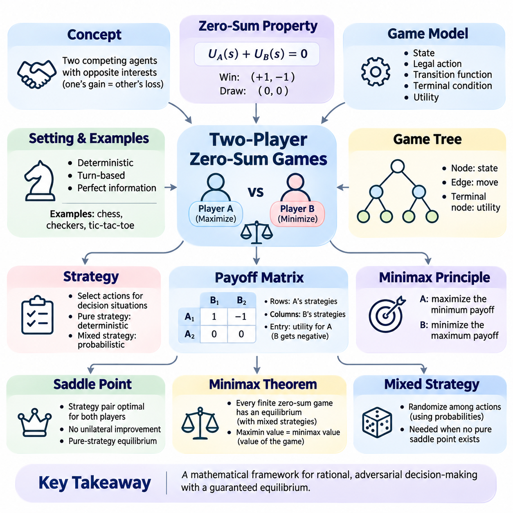{width="7.268055555555556in" height="7.268055555555556in"}

Two-player zero-sum games provide a fundamental mathematical framework for studying strategic decision-making in artificial intelligence. These games involve two competing agents whose interests are strictly opposed, meaning that one player\'s gain corresponds to an equal loss for the other. This relationship allows competitive interactions to be represented through a single utility function, making zero-sum games particularly suitable for adversarial search and formal analysis.

The zero-sum property describes a situation in which the combined utilities of both players remain constant at zero. If Player A receives a utility of positive one, Player B receives negative one. A draw may assign zero utility to both participants. More generally, the utility functions satisfy U_A(s) + U_B(s) = 0 for every relevant outcome s. This mathematical relationship captures the strictly competitive nature of the interaction.

A two-player game can be formally described using a set of states, legal actions, transition functions, terminal conditions, and utility values. Each state represents a particular configuration of the game, while legal actions determine the choices available to the active player. A transition function describes how the game evolves after an action. Terminal states identify completed games, and utility functions measure the desirability of their outcomes.

In deterministic, turn-based games with perfect information, both players observe the complete game state and alternate their decisions according to established rules. Chess, checkers, and tic-tac-toe provide familiar examples when their outcomes are modeled using opposing utilities. Because every legal action produces a predictable successor state, these games can be represented as explicit game trees suitable for systematic adversarial reasoning.

The game tree represents all possible sequences of actions beginning from an initial state. Each node corresponds to a game configuration, and each edge represents a legal move. Nodes alternate between the decisions of Player A and Player B, reflecting their opposing objectives. Terminal nodes contain utility values that determine the outcome of each complete sequence. This structure provides the foundation for recursive game-search algorithms.

The distinction between maximizing and minimizing players is central to zero-sum reasoning. The maximizing player attempts to select actions that produce the highest possible utility, while the minimizing player attempts to reduce that same utility. Since their objectives are directly opposed, evaluating an action requires considering the opponent\'s strongest response. This principle transforms ordinary state-space search into adversarial decision-making.

Rational decision-making in zero-sum games assumes that each player selects strategies consistent with maximizing their own utility. When both players understand the rules and available information, their decisions can be analyzed through strategic optimization. However, rationality does not necessarily imply perfect prediction or unlimited computational ability. Practical agents operate under restrictions involving search depth, processing time, and incomplete strategic knowledge.

A strategy specifies how a player selects actions across possible decision situations. In a sequential game, a complete strategy defines an action for every decision point that the player might encounter. A pure strategy selects actions deterministically, whereas a mixed strategy assigns probabilities to alternative choices. These representations provide different ways to model strategic behavior and analyze interactions between competing agents.

The payoff matrix offers a compact representation of finite strategic-form zero-sum games. Rows represent strategies available to Player A, while columns represent strategies available to Player B. Each matrix entry specifies the utility received by Player A for the corresponding strategy combination. Player B receives the negative of that value. This representation is particularly useful when analyzing simultaneous decisions and strategic equilibrium.

The minimax principle provides a mathematical foundation for selecting robust strategies against rational opponents. Player A seeks to maximize the minimum payoff that Player B can impose, while Player B seeks to minimize the maximum payoff available to Player A. This reasoning emphasizes guaranteed performance rather than optimistic predictions. It is especially important when the opponent\'s strategic choices cannot be controlled directly.

The maximin value represents the best guaranteed payoff that the maximizing player can secure by selecting an appropriate strategy. Conversely, the minimax value represents the smallest upper bound that the minimizing player can enforce. In finite zero-sum games, the maximin value cannot exceed the minimax value when considering pure strategies. Equality indicates the existence of a pure-strategy saddle point.

A saddle point occurs when a strategy combination is simultaneously optimal against the opponent\'s selected strategy for both players. Neither player can improve their outcome through a unilateral strategy change. Such an outcome forms a pure-strategy Nash equilibrium in a zero-sum game. However, not every zero-sum game possesses a saddle point in pure strategies, making randomized strategies important for general solutions.

The minimax theorem establishes that every finite two-player zero-sum game has an equilibrium when mixed strategies are permitted. Under this theorem, the maximum guaranteed expected payoff equals the minimum enforceable expected payoff. This common quantity is called the value of the game. The theorem provides a rigorous connection between competitive optimization, probability distributions, and equilibrium-based strategic reasoning.

Mixed strategies become necessary when deterministic choices can be exploited by an informed opponent. In games such as matching pennies, repeatedly selecting one fixed action allows the opponent to respond advantageously. Randomizing between available actions prevents predictable exploitation and can establish an optimal expected payoff. The resulting probabilities are not arbitrary but are determined by the strategic relationships among available choices.

Sequential zero-sum games can be analyzed using backward induction when the game tree is finite and sufficiently small. The procedure begins by evaluating terminal states and then propagates optimal values toward earlier decision points. At maximizing nodes, the highest child value is selected, while minimizing nodes select the lowest value. This recursive structure directly motivates the classical Minimax search algorithm.

Backward induction assumes that future decisions will be made optimally according to the players\' objectives. Consequently, the value assigned to a state reflects the outcome that can be guaranteed against an optimal opponent. This approach avoids relying on an opponent\'s mistakes or favorable behavior. Nevertheless, its computational requirements increase rapidly as the number of legal actions and possible decision sequences grows.

The branching factor determines how many successor states are typically generated from a game position. If each state offers approximately b legal actions and the search extends to depth d, exhaustive exploration may require computational effort proportional to b raised to the power d. This exponential complexity limits the practical depth of exact game-tree analysis and motivates selective exploration, pruning, and heuristic evaluation.

Zero-sum game models distinguish between the theoretical value of a position and the value estimated by a practical search algorithm. The theoretical value assumes optimal play throughout the remaining game. An estimated value may depend on limited search depth, heuristic evaluation, or statistical sampling. Understanding this distinction is essential because computationally constrained agents cannot always identify the mathematically optimal decision.

Evaluation functions approximate the strategic value of nonterminal states when complete backward induction is infeasible. These functions transform observable game features into numerical estimates of advantage or disadvantage. In chess, relevant features may include material balance, king safety, mobility, and positional control. Their purpose is to approximate the expected strategic consequences of a position without exploring every possible continuation.

Alpha-beta pruning improves minimax search by excluding branches that cannot change the final decision under the current bounds. The algorithm maintains information about the best alternatives already available to the maximizing and minimizing players. When a branch cannot improve the relevant decision, further exploration becomes unnecessary. This optimization preserves exact minimax results for the searched tree while reducing computational effort.

Not all competitive interactions can be accurately represented as zero-sum games. In many real-world situations, participants may benefit simultaneously, experience unequal losses, or pursue partially aligned objectives. Such interactions require general-sum game models rather than strictly opposing utility functions. Recognizing this limitation prevents inappropriate application of zero-sum assumptions to cooperative or mixed-motive environments.

Information availability also influences the appropriate solution method. Perfect-information games permit direct evaluation of observable states and legal continuations. Imperfect-information games introduce hidden states, private observations, and uncertainty about opponent knowledge. In these settings, strategies may depend on information sets and probability distributions rather than individual fully observed states, requiring more sophisticated equilibrium and search methods.

Stochastic zero-sum games incorporate random events into the transition process while preserving opposing utility objectives. An action may lead to several possible successor states with different probabilities. Strategic evaluation must therefore combine adversarial reasoning with expected utility calculations. These models connect classical game-tree search with probabilistic decision-making and provide foundations for reasoning in uncertain competitive environments.

Two-player zero-sum games have applications beyond traditional board games. Competitive cybersecurity, strategic resource allocation, adversarial planning, and certain pursuit-evasion problems can be modeled using opposing objectives. In autonomous systems, related methods help analyze interactions between agents with conflicting goals. Their usefulness depends on whether the chosen utility functions accurately represent the underlying competition.

The study of two-player zero-sum games establishes the theoretical foundation for Minimax, alpha-beta pruning, evaluation functions, and advanced adversarial search methods. By connecting utility theory, strategic optimization, equilibrium concepts, and computational search, these games provide a systematic framework for understanding competitive intelligence. They demonstrate how rational agents can select defensible actions while anticipating the strongest possible responses from their opponents.

## 02.03 Minimax Algorithm [w/Code]

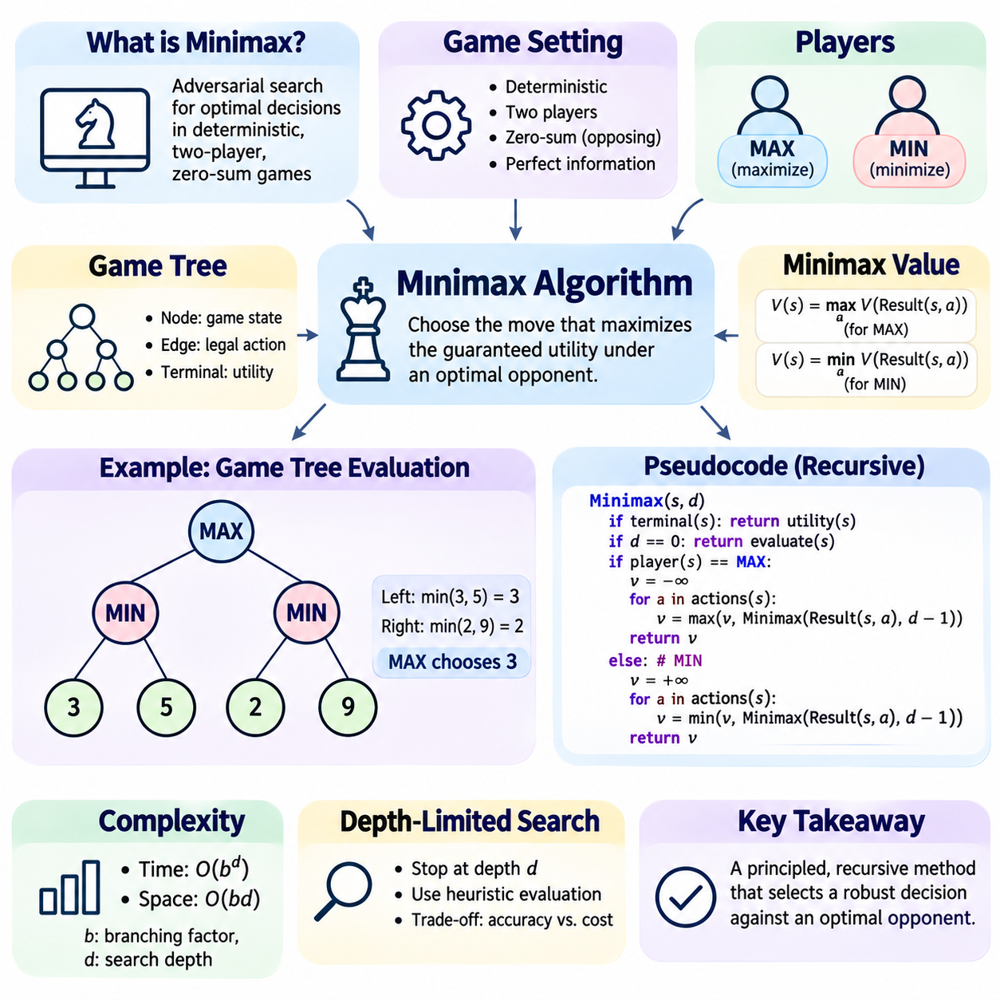{width="7.268055555555556in" height="7.268055555555556in"}

The Minimax algorithm is a foundational adversarial search method used to determine optimal decisions in deterministic, two-player, zero-sum games with perfect information. It evaluates possible sequences of actions by assuming that both players pursue opposing objectives and act optimally. The algorithm selects the move that maximizes the player\'s guaranteed utility against the strongest possible response from an opponent.

Minimax originates from game theory and provides a computational interpretation of rational strategic behavior. Its central principle is that a player should evaluate decisions according to the worst outcome an optimal opponent can enforce. Rather than selecting actions based on optimistic predictions, Minimax identifies strategies that remain defensible under adversarial conditions. This makes it particularly valuable in competitive decision-making.

A Minimax problem is represented using a game tree in which nodes correspond to game states and edges represent legal actions. The root node describes the current position, while successive levels represent alternating decisions by two players. Terminal nodes contain utility values associated with completed games. By propagating these values backward through the tree, the algorithm determines the strategic value of each available action.

The two players are conventionally called MAX and MIN. MAX attempts to maximize the utility function, while MIN attempts to minimize the same function. At a MAX node, the algorithm selects the highest value among successor states. At a MIN node, it selects the lowest value. This alternating optimization structure captures the essential relationship between competing agents in a zero-sum environment.

The recursive Minimax procedure begins by checking whether the current state is terminal. If the game has ended, the algorithm returns the corresponding utility value without further exploration. Otherwise, it generates legal actions and recursively evaluates their successor states. The returned values are combined using maximization or minimization according to the player whose turn it is.

For a MAX state s, the Minimax value can be expressed as V(s) = max V(Result(s,a)) over all legal actions a. For a MIN state, the corresponding expression uses the minimum operator instead of the maximum. At terminal states, V(s) equals the utility assigned to the completed game. These recursive equations define how strategic values propagate through alternating decisions.

Consider a simplified game in which MAX can select between two possible moves. The first move allows MIN to choose between terminal utilities of 3 and 5, while the second allows MIN to choose between 2 and 9. Because MIN selects the smaller outcome, the first move receives a value of 3 and the second receives 2. MAX therefore chooses the first move, guaranteeing utility 3 against optimal opposition.

This example illustrates why Minimax differs from greedy decision-making. A greedy agent might prefer the second move because it contains a possible utility of 9. However, that favorable result depends on the opponent selecting a disadvantageous response. Minimax instead considers the outcome the opponent can enforce and chooses the action with the strongest guaranteed value under optimal play.

Backward induction provides the mathematical foundation for Minimax evaluation. The algorithm first determines the values of terminal positions and then calculates the values of their parent nodes. Each parent selects the maximum or minimum value according to the active player. Repeating this process toward the root produces the optimal decision for the current position, assuming complete search and correct utility assignments.

The correctness of Minimax depends on several assumptions. The environment must follow known transition rules, players must have access to the relevant game state, and utilities must accurately represent their objectives. Standard Minimax also assumes deterministic transitions and opposing utility functions. Under these conditions, exhaustive search identifies an optimal strategy against an opponent who also plays optimally.

Minimax can be implemented using recursive depth-first search, which explores one sequence of actions before returning to evaluate alternatives. This approach avoids storing the entire game tree simultaneously. Instead, the algorithm maintains the current search path and necessary local information. Recursive implementation is conceptually simple and closely follows the mathematical definition of the algorithm.

The computational complexity of Minimax is primarily determined by the branching factor and search depth. If each position has approximately b legal moves and the tree is explored to depth d, the time complexity is O(b\^d). This exponential growth makes exhaustive search impractical for complex games. The space complexity of a depth-first implementation is typically O(bd) when successor states are stored at each recursive level.

Search depth represents the number of consecutive actions examined before evaluation stops. Increasing depth allows the algorithm to identify longer tactical sequences and anticipate more distant consequences. However, deeper exploration also increases computational requirements dramatically. Practical systems must therefore balance strategic accuracy against processing time, available memory, and the complexity of the game environment.

Depth-limited Minimax addresses the difficulty of exploring complete game trees by stopping recursion after a predetermined number of levels. When the depth limit is reached before a terminal state, the algorithm invokes a heuristic evaluation function. This function estimates the strategic quality of the current position and returns an approximate utility. The resulting decision depends on both search depth and evaluation accuracy.

Evaluation functions translate observable game characteristics into numerical estimates of advantage. In chess, these characteristics may include material balance, king safety, mobility, and positional control. In simpler games, evaluation may depend on potential winning lines, available moves, or immediate threats. A well-designed function should distinguish favorable positions from dangerous ones while remaining computationally efficient.

The horizon effect is a significant limitation of depth-limited Minimax. It occurs when an important event lies just beyond the search boundary, causing the algorithm to underestimate its consequences. For example, a position may appear favorable because an unavoidable material loss occurs one move beyond the evaluated depth. Extending selected tactical sequences through quiescence search can reduce this problem.

Move ordering influences the efficiency of optimized Minimax implementations. Although ordinary exhaustive Minimax evaluates all relevant branches regardless of their order, pruning methods benefit from examining promising actions first. Good ordering increases the likelihood that strong bounds become available early. Common ordering strategies prioritize captures, immediate threats, previously successful moves, and actions recommended by earlier searches.

Alpha-beta pruning is the most widely used optimization associated with Minimax. It maintains lower and upper bounds on achievable values and eliminates branches that cannot affect the final decision. The resulting algorithm produces the same value as ordinary Minimax when searching the same tree with identical terminal evaluations. Effective move ordering can substantially reduce the number of evaluated positions.

Iterative deepening further improves practical Minimax search by repeatedly exploring the game tree with increasing depth limits. The algorithm first completes a shallow search and then uses its results to guide deeper searches. This approach provides a valid intermediate decision when time expires unexpectedly. It also supports move ordering and integration with transposition tables, improving search efficiency under fixed time budgets.

Transposition tables store previously evaluated game positions to avoid redundant calculations. Different action sequences may lead to identical states, particularly in games with reversible moves or repeated configurations. By associating state hashes with search results, an engine can reuse relevant evaluations. Correct implementations must distinguish exact values from search bounds and account for search depth and game-state identity.

Minimax assumes optimal opponent behavior, which provides robustness but may not maximize practical performance against imperfect opponents. Human players and limited agents frequently make mistakes or follow predictable patterns. An agent designed exclusively around worst-case outcomes may ignore opportunities that depend on opponent weaknesses. Opponent modeling can supplement Minimax when exploiting such behavior is strategically appropriate.

The algorithm is most naturally suited to deterministic, turn-based, perfect-information games. Stochastic environments require additional reasoning about chance outcomes, often through Expectiminimax. Imperfect-information games require representations of hidden information and uncertainty. Simultaneous-action games may require mixed strategies and equilibrium analysis rather than straightforward alternating MAX and MIN nodes.

Testing a Minimax implementation requires verifying legal move generation, terminal-state recognition, utility calculations, and recursive value propagation. Small games such as tic-tac-toe provide useful environments because complete game trees can be explored and expected outcomes can be checked. Additional tests should examine forced wins, unavoidable losses, draws, depth limits, and situations where multiple actions have equal values.

Performance evaluation should measure decision quality alongside computational cost. Relevant metrics include nodes explored, search depth, execution time, memory consumption, and the percentage of optimal decisions on known test positions. Comparing ordinary Minimax with alpha-beta pruning and iterative deepening reveals how search optimizations affect efficiency. Controlled experiments should use consistent hardware, rules, and evaluation functions.

Minimax provides a conceptual bridge between classical search, game theory, and intelligent decision-making. Its recursive structure demonstrates how an agent can reason about competing objectives by anticipating future responses. Although exhaustive exploration becomes computationally expensive in complex environments, depth limits, heuristic evaluation, pruning, and caching make the approach practical. These principles remain fundamental to modern adversarial search systems.

## 02.04 Alpha Beta Pruning [w/Code]

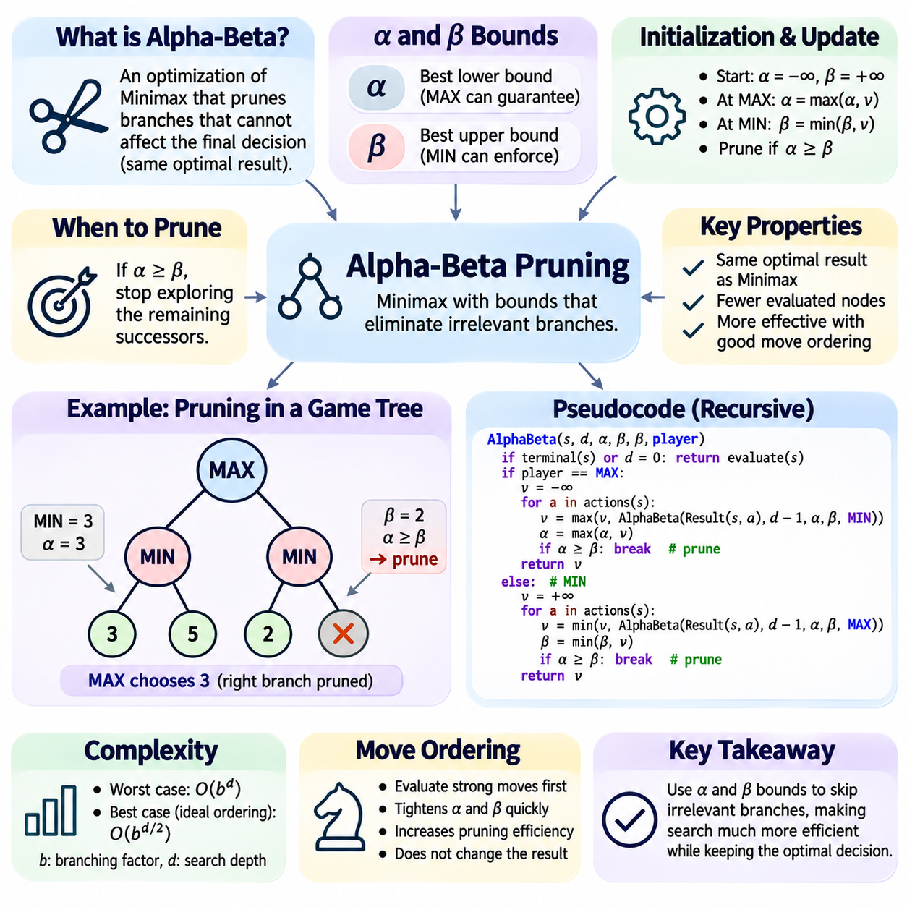{width="7.268055555555556in" height="7.268055555555556in"}

Alpha-beta pruning is a fundamental optimization technique for the Minimax algorithm in adversarial game-tree search. It reduces the number of states evaluated by eliminating branches that cannot influence the final decision. The algorithm preserves the optimal result of Minimax while avoiding unnecessary computation. This makes it particularly valuable in deterministic, two-player, zero-sum games where exhaustive exploration becomes expensive.

The central principle of alpha-beta pruning is that some game-tree branches can be ignored once sufficient information about competing alternatives has been obtained. If a player already possesses a better guaranteed option, exploring an inferior alternative cannot improve the decision. Alpha-beta pruning formalizes this reasoning through numerical bounds that track the best outcomes available to maximizing and minimizing players.

The algorithm introduces two parameters called alpha and beta. Alpha represents the best lower bound on the value that the maximizing player can guarantee along the current search path. Beta represents the best upper bound that the minimizing player can enforce. These bounds are updated as successor states are evaluated, allowing the search procedure to determine when further exploration cannot affect an ancestor\'s decision.

At the beginning of a search, alpha is initialized to negative infinity and beta to positive infinity. These values indicate that no meaningful bounds have yet been established. As the algorithm explores legal actions, alpha increases when MAX discovers stronger alternatives, while beta decreases when MIN identifies lower-valued responses. The narrowing interval provides information about which branches remain strategically relevant.

At a maximizing node, the algorithm evaluates successor states and maintains the highest value discovered so far. Whenever a new successor produces a better result, the node\'s current best value is updated. Alpha is also increased when this result improves the inherited lower bound. If alpha becomes greater than or equal to beta, the remaining successors can be pruned because the minimizing ancestor already has a preferable alternative.

At a minimizing node, the procedure follows the opposite logic. Each successor is evaluated, and the smallest discovered value becomes the current best result. Beta decreases whenever the node establishes a stronger upper bound. If beta becomes less than or equal to alpha, the remaining branches are discarded because a maximizing ancestor already possesses an alternative that makes further exploration unnecessary.

The pruning condition is commonly expressed as alpha greater than or equal to beta. This inequality indicates that the current search interval has closed and additional exploration cannot improve the relevant decision. Importantly, pruning does not imply that the unexplored branches have been evaluated or that their exact values are known. It only establishes that their values are unnecessary for determining the optimal choice.

Consider a MAX root with two MIN children. The first MIN subtree contains terminal utilities of 3 and 5, producing a value of 3 and establishing alpha equal to 3 at the root. In the second MIN subtree, the first examined terminal state has utility 2. Because MIN can enforce a result no greater than 2, the remaining successors can be pruned. MAX will prefer the first subtree regardless of their values.

This example illustrates how alpha-beta pruning uses previously explored alternatives to avoid redundant computation. The second subtree does not require complete evaluation because its minimizing player has already demonstrated a response worse for MAX than the available alternative. The final root decision remains unchanged. Consequently, pruning improves computational efficiency without sacrificing the exact Minimax result for the searched tree.

Alpha-beta pruning is typically implemented as a recursive depth-first search. Each recursive call receives the current state, remaining search depth, alpha bound, beta bound, and player role. Terminal states return exact utility values, while depth-limited states return heuristic estimates. Internal nodes recursively examine legal actions, update their best values and bounds, and terminate exploration when a cutoff condition occurs.

The correctness of alpha-beta pruning follows from the opposing objectives of MAX and MIN. A maximizing player never prefers a smaller value when a larger guaranteed value is available, while a minimizing player never prefers a larger value when a smaller one is available. Once an alternative is proven unable to influence an ancestor\'s selection, its remaining descendants become irrelevant to the final Minimax calculation.

Move ordering has a major influence on pruning efficiency. When strong moves are evaluated early, alpha and beta bounds tighten quickly, increasing the probability of subsequent cutoffs. Poor ordering delays useful bounds and forces the algorithm to examine more nodes. Although move ordering changes computational cost, it does not change the Minimax value returned by a correct exhaustive alpha-beta implementation.

In the worst case, alpha-beta pruning provides little improvement over ordinary Minimax, requiring time proportional to O(b\^d), where b is the branching factor and d is the search depth. With ideal move ordering and favorable tree structure, the effective complexity can approach O(b\^(d/2)). This improvement allows approximately twice the search depth under comparable computational budgets in suitable conditions.

The theoretical improvement of alpha-beta pruning becomes especially important in games with large branching factors. Chess engines may examine millions of positions while selecting a move, making reductions in explored nodes highly valuable. However, actual performance depends on the game structure, evaluation function, move ordering, and available computational resources. The ideal complexity reduction should not be interpreted as a universal guarantee.

Practical move ordering methods prioritize actions likely to produce strong evaluations or early cutoffs. Captures, immediate tactical threats, previously successful moves, and principal variation moves are common candidates. History heuristics and killer-move heuristics use information from earlier searches to rank actions. These techniques improve the probability that strategically important branches are examined before less promising alternatives.

Iterative deepening strengthens alpha-beta pruning by repeatedly searching the game tree with increasing depth limits. Results from shallower searches provide estimates of promising actions and help establish effective move ordering for deeper iterations. This approach also supports time-constrained decision-making because a completed shallower search provides a usable move when the available computation time expires.

Transposition tables complement alpha-beta pruning by storing information about previously evaluated positions. Different action sequences may reach identical game states, allowing cached results to reduce repeated exploration. Table entries can contain exact values, lower bounds, or upper bounds, depending on how the search terminated. Correct reuse requires checking search depth, state identity, and the type of stored bound.

A transposition-table entry produced by a cutoff may not represent the exact Minimax value of the position. Instead, it may establish only that the value is at least or at most a particular threshold. Treating such bounds as exact values can introduce incorrect decisions. Reliable implementations therefore distinguish exact evaluations from lower-bound and upper-bound results and apply them consistently during later searches.

Depth-limited alpha-beta search relies on heuristic evaluation functions when terminal states cannot be reached within the computational budget. These functions estimate the strategic quality of intermediate positions using relevant game features. Although alpha-beta pruning preserves the Minimax result for the explored search tree, the resulting decision may differ from optimal full-game play because heuristic estimates can be inaccurate.

The horizon effect remains a challenge in alpha-beta search because important tactical consequences may lie beyond the selected depth limit. Quiescence search addresses this problem by extending exploration through tactically unstable positions, such as sequences involving captures or immediate threats. By delaying evaluation until a relatively stable position is reached, the algorithm can reduce misleading assessments caused by abrupt search termination.

Aspiration windows provide another optimization by beginning a search with a narrow alpha-beta interval centered around an expected position value. When the true search result falls outside this interval, the algorithm must repeat the search using wider bounds. If the initial estimate is accurate, the narrow interval can produce more cutoffs and reduce computation. This technique is commonly combined with iterative deepening.

Principal variation search exploits the expectation that the first examined move is often the strongest candidate. After searching the leading move with a full window, subsequent moves may initially be tested using narrower windows. If a candidate appears capable of improving the current result, additional searching may be required. This method builds upon alpha-beta pruning and benefits from accurate move ordering.

Alpha-beta pruning also requires careful handling of terminal states, legal-action generation, and game-specific rules. Checkmate, stalemate, repetition, and other termination conditions must be evaluated consistently. Incorrect state transitions or inconsistent utility conventions can invalidate pruning assumptions. The search procedure must also ensure that the maximizing and minimizing roles correspond correctly to the active player.

Testing alpha-beta pruning should begin with small game trees whose exact Minimax values are known. The optimized algorithm must return the same root value as exhaustive Minimax while examining fewer nodes when pruning opportunities exist. Tests should include favorable and unfavorable move ordering, repeated values, terminal positions, and different search depths. Instrumentation can record node visits, cutoff counts, and evaluation calls.

Performance evaluation should compare alpha-beta pruning with ordinary Minimax under identical game rules, search depths, and evaluation functions. Useful metrics include execution time, expanded nodes, evaluated leaves, cutoff frequency, and memory consumption. Experiments should also examine how move ordering and transposition tables affect performance. Repeated trials help distinguish systematic improvements from variation caused by different game positions.

Alpha-beta pruning demonstrates how logical bounds can transform exhaustive adversarial search into a more efficient decision-making process. Its importance extends beyond reducing computation because it establishes a foundation for iterative deepening, transposition-table search, aspiration windows, and advanced game-engine optimization. By preserving Minimax decisions while eliminating irrelevant branches, it remains a central technique in classical Game AI.

## 02.05 Evaluation Functions

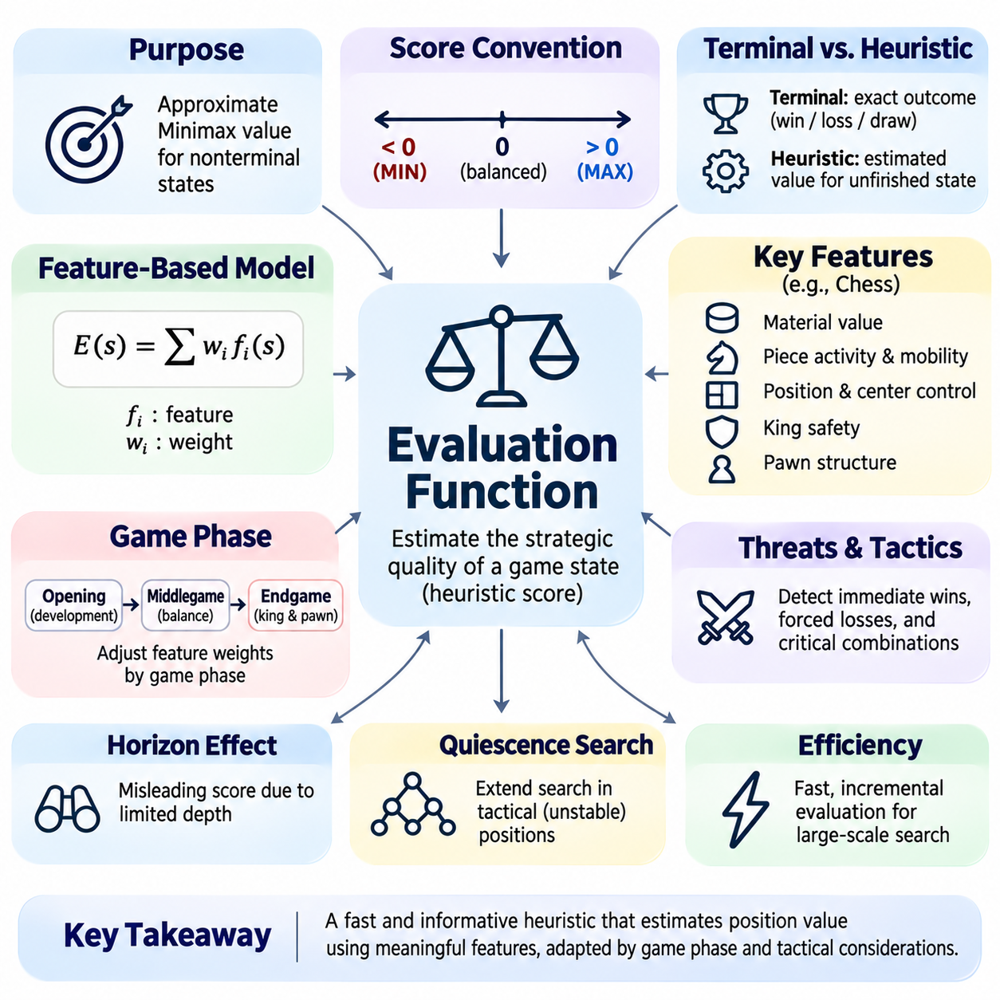{width="7.268055555555556in" height="7.268055555555556in"}

Evaluation functions are essential components of adversarial search systems that estimate the strategic quality of game states without exploring every possible continuation. In complex games, exhaustive Minimax search is computationally impractical because the game tree grows exponentially. Evaluation functions address this limitation by assigning numerical scores to nonterminal positions, enabling intelligent decisions within restricted computational budgets.

The primary objective of an evaluation function is to approximate the true Minimax value of a position. This value represents the outcome achievable when both players follow optimal strategies until the game ends. Since computing exact values often requires exploring enormous game trees, heuristic evaluation provides an efficient approximation. The quality of this approximation strongly influences the effectiveness of depth-limited adversarial search.

An evaluation function typically maps a game state to a numerical score representing advantage or disadvantage. Positive values may indicate favorable conditions for MAX, while negative values indicate favorable conditions for MIN. A score near zero often represents a balanced position. Maintaining a consistent scoring convention is essential because Minimax and alpha-beta pruning rely on meaningful comparisons between evaluated states.

Terminal-state utilities and heuristic evaluation scores serve different purposes. Terminal utilities represent actual outcomes such as victory, defeat, or draw, while heuristic scores estimate the potential value of unfinished positions. A robust implementation should preserve this distinction and ensure that terminal outcomes dominate ordinary positional advantages. Otherwise, the algorithm may prefer material gains over an available forced victory.

Feature-based evaluation functions combine measurable characteristics of a game position into an overall score. A common formulation is E(s) = w1f1(s) + w2f2(s) + \... + wnfn(s), where each feature describes a relevant property and each weight represents its importance. This weighted linear model is computationally efficient, interpretable, and suitable for classical game engines that require frequent position evaluations.

Feature selection determines which aspects of a game state contribute to its estimated strategic value. Useful features should reflect meaningful advantages, disadvantages, threats, and opportunities. They must also be inexpensive enough to calculate repeatedly during search. Poorly selected features may introduce misleading signals, while redundant features can distort evaluations if their contributions are counted multiple times.

In chess, material balance is one of the most familiar evaluation features. Different pieces receive approximate numerical values reflecting their relative strategic importance. A typical system assigns higher values to queens and rooks than to bishops, knights, or pawns. Material evaluation provides a useful baseline, but it cannot fully capture positional compensation, tactical threats, or long-term strategic opportunities.

Positional evaluation extends material scoring by considering how effectively pieces occupy and control the board. Relevant factors include central control, piece activity, mobility, pawn structure, and king safety. Piece-square tables can assign different values to the same piece depending on its location. These mechanisms allow evaluation functions to distinguish positions with identical material counts but different strategic potential.

Mobility measures the number or quality of legal actions available to a player. Greater mobility often indicates flexibility and the ability to respond to future threats. However, mobility is not universally beneficial, because some available moves may be strategically weak or dangerous. Effective evaluation functions therefore consider mobility together with positional context, tactical vulnerability, and game-specific objectives.

King safety illustrates how evaluation features may depend on interactions between multiple game elements. A king surrounded by protective pawns may be safer than one exposed to open attacking lines. Threats from opposing pieces, nearby weaknesses, and available escape squares can influence the safety estimate. Such relationships demonstrate why independent feature scores may be insufficient for accurately representing complex positions.

Evaluation functions must account for changing strategic priorities across different phases of a game. In chess, opening positions emphasize development and central control, while endgames often emphasize king activity and pawn promotion. A phase-dependent evaluation function adjusts feature weights according to the current position. This adaptive approach reduces errors caused by applying fixed strategic priorities throughout the entire game.

Threat detection is another important component of heuristic evaluation. Immediate winning opportunities, forced losses, captures, and tactical combinations may dominate ordinary positional considerations. An evaluation function that overlooks such threats can produce highly misleading scores. Incorporating tactical features or extending search through unstable positions helps align estimated values with the consequences of future actions.

The horizon effect occurs when a depth-limited search stops immediately before an important event. A position may appear favorable even though an unavoidable loss exists just beyond the search boundary. Evaluation functions alone cannot eliminate this problem because they operate on incomplete search information. Quiescence search reduces the effect by continuing selected tactical sequences until relatively stable positions are reached.

Computational efficiency is a fundamental design requirement for evaluation functions. During Minimax or alpha-beta search, the evaluation procedure may execute millions of times. Expensive calculations can reduce the number of positions examined within a fixed time budget. Therefore, evaluation quality must be balanced against execution cost, with emphasis on features that provide useful strategic information efficiently.

Incremental evaluation improves efficiency by updating previously calculated scores after each move instead of recomputing every feature from the beginning. For example, moving a piece changes its positional contribution, while capturing an opponent\'s piece changes material balance. Maintaining relevant intermediate values can substantially reduce repeated calculations. This technique is especially valuable in high-performance game engines.

Feature normalization helps combine measurements with different numerical ranges. Material scores, mobility counts, positional bonuses, and threat indicators may otherwise contribute disproportionately to the final result. Scaling features to comparable ranges makes weight selection more manageable. Nevertheless, normalization should preserve strategically meaningful differences rather than forcing every feature to have equal influence.

Weight tuning determines the relative importance of evaluation features. Initial weights may come from expert knowledge, empirical observations, or simplified game-theoretic reasoning. Subsequent optimization can use automated experiments and performance feedback. The objective is not necessarily to reproduce human judgments, but to improve the quality of decisions produced by the complete search system.

Machine learning provides an alternative to manually designed evaluation functions. Supervised learning can estimate position values from labeled game states, while reinforcement learning can improve evaluations through interaction and self-play. Neural networks can capture nonlinear relationships between features that weighted linear models may miss. However, learned evaluation functions require appropriate training data, validation, and computational resources.

The integration of neural evaluation with classical search creates hybrid Game AI systems. A neural network estimates the value of a position, while Minimax or alpha-beta pruning explores possible future actions. This combination separates approximate strategic assessment from explicit tactical reasoning. Its effectiveness depends on inference latency, model accuracy, search depth, and the consistency of the evaluation scale.

Evaluation uncertainty is an important consideration when interpreting heuristic scores. A numerical estimate does not necessarily represent a guaranteed outcome or a calibrated probability of winning. Two positions with similar scores may have different tactical risks or levels of uncertainty. Systems that distinguish estimated value from confidence can support more informed search allocation and decision analysis.

Evaluation functions must remain consistent with the game\'s rules and utility structure. In zero-sum games, a score favorable to one player should correspond to a disadvantage for the opponent under the chosen convention. Incorrect perspective handling can reverse strategic preferences and invalidate search results. Implementations must carefully distinguish fixed-player evaluation from side-to-move evaluation, particularly when using Negamax.

Testing evaluation functions requires examining positions with known strategic characteristics. Useful cases include forced wins, unavoidable losses, balanced positions, material imbalances, tactical threats, and phase transitions. Individual feature contributions should be inspected to detect unexpected behavior. Comparing heuristic rankings against deeper searches or trusted reference evaluations can reveal systematic weaknesses.

Performance assessment should evaluate both predictive quality and practical playing strength. Relevant measures include agreement with reference values, ranking accuracy, evaluation latency, search nodes per second, and results against benchmark opponents. Ablation experiments can determine whether particular features improve decisions. Reliable comparisons require consistent search settings, hardware conditions, and representative game positions.

Evaluation functions form the bridge between exhaustive strategic reasoning and practical computational constraints. Their design requires combining domain knowledge, mathematical modeling, efficient implementation, and empirical validation. Although no heuristic can guarantee perfect decisions in every complex position, carefully constructed evaluation functions substantially improve adversarial search. They remain central to classical and hybrid Game AI architectures.

## 02.06 Iterative Deepening in Games [w/Code]

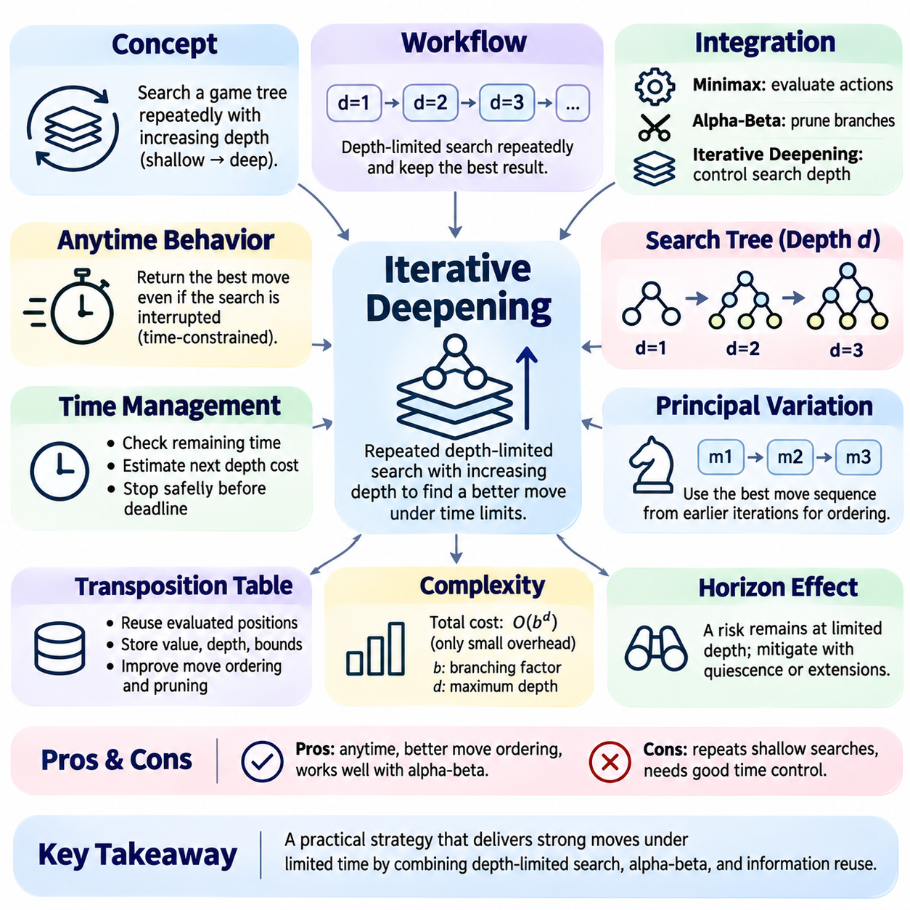{width="7.268055555555556in" height="7.268055555555556in"}

Iterative deepening is a search strategy that repeatedly explores a game tree with progressively increasing depth limits. It combines the decision quality of deeper adversarial search with the flexibility of shallow searches. Rather than committing immediately to a computationally expensive search, the algorithm completes several bounded searches and retains the best available decision. This approach is particularly useful in time-constrained Game AI systems.

The central principle of iterative deepening is to perform a sequence of depth-limited searches, beginning with a shallow depth and gradually extending the search horizon. A typical implementation searches depths one, two, three, and continues until a stopping condition is reached. Each completed iteration produces a candidate move and an estimated position value. The latest completed result remains available if a deeper iteration cannot finish.

Iterative deepening is commonly integrated with Minimax and alpha-beta pruning. Minimax determines the strategic value of alternative actions, while alpha-beta pruning eliminates branches that cannot influence the final decision. Iterative deepening controls how deeply these procedures explore the game tree. Together, these mechanisms provide a practical framework for adversarial reasoning under limited computational resources.

The algorithm begins by generating legal actions from the current game state and performing a depth-limited search. Once the first iteration finishes, the depth limit increases and the search begins again from the root. This process continues while sufficient time or computational resources remain. Although earlier levels are revisited, information collected during previous iterations can improve the efficiency of subsequent searches.

A major advantage of iterative deepening is its anytime behavior. An anytime algorithm can return a valid result even when computation is interrupted before the planned search finishes. In game-playing systems, this means the engine can use the best move from the most recently completed iteration. The property is especially important when decision deadlines are strict or available processing time varies unpredictably.

Time management is a critical component of practical iterative deepening. A game engine must determine whether sufficient time remains to begin another search iteration. Search duration can increase rapidly with depth, making exact completion-time predictions difficult. Engines therefore estimate future costs using previous iteration times, observed branching behavior, and remaining time budgets while preserving a margin for safe termination.

The computational cost of iterative deepening initially appears wasteful because shallow positions are evaluated repeatedly. However, in exponentially growing trees, the deepest iteration typically accounts for most of the search effort. If the branching factor is b and the maximum depth is d, the total work remains O(b\^d) for conventional exhaustive search. Thus, repeated shallow exploration usually introduces only a limited multiplicative overhead.

The effectiveness of iterative deepening increases substantially when combined with alpha-beta pruning. Earlier iterations identify promising moves that can be searched first during deeper iterations. Strong move ordering tightens alpha and beta bounds sooner, allowing more branches to be pruned. Consequently, the information gained from shallow searches may compensate for their additional computational cost and sometimes improve overall search efficiency.

The principal variation represents the sequence of moves considered strongest by the current search. After completing an iteration, the engine can retain this sequence and prioritize its first move in the next iteration. Following previously successful moves often improves move ordering throughout the tree. However, the principal variation may change as deeper searches reveal tactical consequences that were invisible at shallower depths.

Transposition tables provide another mechanism for reusing information across iterations. These tables store previously examined positions, their estimated values, search depths, and bound classifications. When a deeper search encounters a known position, the stored entry can guide move ordering or support valid bound-based cutoffs. Reusing cached information reduces redundant calculations and strengthens the interaction between iterative deepening and alpha-beta pruning.

Correct transposition-table integration requires careful handling of search depth and value reliability. A result obtained at a shallow depth cannot automatically replace an evaluation requiring deeper exploration. Nevertheless, its recommended move may remain useful for ordering actions. Exact values, lower bounds, and upper bounds must be distinguished to prevent invalid pruning decisions. These safeguards preserve the logical correctness of the search.

Iterative deepening also improves responsiveness in interactive applications. A game engine may display its current best move, estimated position score, and completed search depth while computation continues. Such intermediate results provide useful feedback without requiring the final iteration to finish. In competitive systems, however, the engine should commit to an action only according to its decision deadline and operational constraints.

Depth limits can be defined using conventional search plies, where one ply corresponds to a single player\'s action. Increasing the depth by one ply extends the search by one additional decision level. Some engines instead use selective extensions or reductions that produce nonuniform search depths. In these systems, iterative deepening still organizes successive searches, but the meaning of nominal depth requires careful interpretation.

The horizon effect remains relevant because each iteration evaluates positions at a finite search boundary. Important tactical events may lie just beyond the current depth limit, producing misleading evaluations. Deeper iterations can reveal some previously hidden consequences, but they cannot eliminate the problem entirely. Quiescence search and selective extensions help stabilize evaluations by exploring tactically important continuations beyond nominal depth limits.

Aspiration windows can further optimize iterative deepening by using the score from a completed iteration to predict the value of the next search. Instead of beginning with unrestricted alpha-beta bounds, the engine searches within a narrow interval around the expected score. Accurate predictions can increase pruning efficiency. If the actual value falls outside the interval, the engine must repeat the search with expanded bounds.

Search instability occurs when estimated position values or preferred moves change significantly between successive depths. Such changes may indicate tactical complexity, evaluation weaknesses, or important consequences beyond the previous horizon. Practical engines can monitor score fluctuations and principal variation changes to adjust time allocation. However, instability does not necessarily imply that the deeper result is incorrect.

Adaptive time allocation extends iterative deepening by assigning additional computation to difficult decisions. Positions containing forcing moves, tactical threats, or unstable evaluations may justify deeper exploration. Relatively simple positions may require less time. A time-management controller can combine remaining game time, iteration growth rates, and position complexity to decide whether another iteration is worthwhile.

The interaction between iterative deepening and evaluation functions is particularly important. Every completed depth-limited search depends on heuristic estimates for positions that have not reached terminal states. Increasing depth generally provides more tactical context, but it does not guarantee that every deeper estimate is more accurate. Evaluation quality, search selectivity, and tactical coverage jointly determine the reliability of the resulting move.

In deterministic two-player zero-sum games, iterative deepening does not alter the theoretical Minimax objective. It changes the computational schedule used to approximate or determine the optimal decision. When a complete game tree is eventually explored with correct utility values, the resulting decision agrees with exhaustive Minimax. Under practical depth and time restrictions, the engine instead relies on the strongest completed search available.

Implementation typically uses an outer loop that increases the depth limit and invokes an alpha-beta search routine. The routine returns a score, a preferred move, and optionally a principal variation. After successful completion, the engine updates its stored best result. If a deadline interrupts the next iteration, the engine retains the previous completed result rather than treating a partially explored root as fully evaluated.

Interruption handling requires particular care because a partially completed iteration may contain inconsistent comparisons between root moves. Some actions may have been searched deeply while others remain unexplored. Returning the temporary best move without accounting for incomplete coverage can introduce strategic errors. Reliable implementations track completion status explicitly and preserve the last fully validated root decision.

Testing iterative deepening should verify that each completed iteration produces the same result as an independent depth-limited search using equivalent settings. Additional tests should examine time expiration, interrupted recursion, legal move preservation, and transposition-table reuse. Small deterministic games provide useful reference environments. Instrumentation should record completed depth, explored nodes, elapsed time, and selected moves.

Performance evaluation should compare fixed-depth search with iterative deepening under identical time limits and hardware conditions. Relevant metrics include achieved search depth, nodes per second, decision quality, cutoff frequency, and deadline compliance. Experiments should also isolate the effects of move ordering, aspiration windows, and caching. These comparisons reveal whether repeated searches produce measurable improvements in practical playing strength.

Iterative deepening provides a foundation for reliable, time-aware adversarial search by combining progressive exploration with reusable intermediate results. Its value extends beyond controlling depth because it supports effective move ordering, transposition-table integration, adaptive time management, and robust interruption handling. Together with Minimax and alpha-beta pruning, it remains a central engineering technique in classical and hybrid Game AI systems.

## 02.07 Transposition Tables

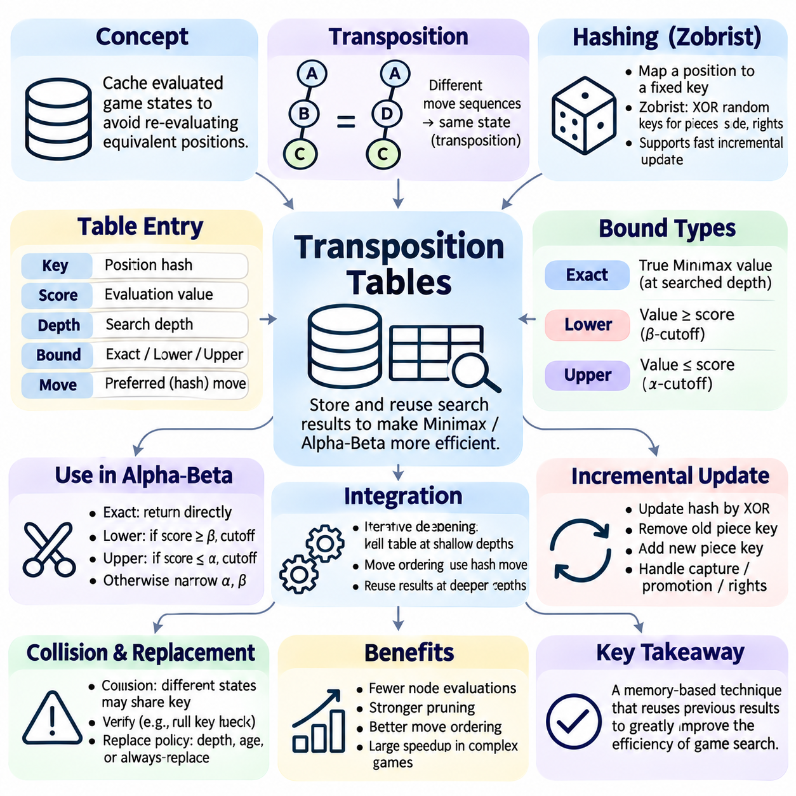{width="7.268055555555556in" height="7.268055555555556in"}

Transposition tables are caching structures used in adversarial game-tree search to avoid repeatedly evaluating identical positions. Different sequences of legal moves can lead to the same game state, creating redundant branches within the search tree. By storing previously computed results and retrieving them when equivalent positions reappear, transposition tables reduce computational effort and improve the efficiency of Minimax and alpha-beta search.

A transposition occurs when two or more distinct move sequences reach an equivalent game position. Although these sequences occupy different branches of the game tree, their resulting states may have identical strategic values under the same search conditions. Transposition tables exploit this property by treating repeated positions as reusable computational results. This transforms part of the search process from tree exploration into graph-based state reuse.

The fundamental operation of a transposition table is a lookup performed before expanding a game state. The search algorithm computes a compact identifier representing the position and checks whether a corresponding entry already exists. If the stored information is applicable, the algorithm can reuse its value or search bounds. Otherwise, normal exploration continues, and the resulting information may be stored for future searches.

Hashing provides the primary mechanism for identifying previously encountered positions. A hash function maps a complete game state to a fixed-size numerical key suitable for efficient lookup. Ideally, equivalent states produce identical keys, while different states produce different keys. Because finite hash values cannot guarantee uniqueness across all possible positions, implementations must account for potential collisions and verification requirements.

Zobrist hashing is widely used in board-game engines because it supports efficient incremental updates. Each relevant combination of piece type, player, and board location receives a pseudorandom bit pattern. The position hash is calculated by combining these patterns using bitwise XOR operations. Additional components represent side to move, special movement rights, and other state variables that influence legal actions.

Incremental hashing updates the position key after each move without recomputing the entire board representation. When a piece moves, its previous contribution is removed through XOR and its new contribution is added. Captures, promotions, and changes in special rights require corresponding updates. This approach makes hashing inexpensive enough to perform during large-scale recursive search, where millions of state transitions may occur.

A transposition-table entry typically contains a position key, evaluated score, search depth, bound classification, and preferred move. The key identifies the position, while the score represents information obtained from a previous search. Depth indicates how thoroughly the position was examined. Bound classification describes whether the score is exact or represents a limit, and the preferred move supports efficient ordering in later searches.

Exact values are stored when the search determines the Minimax value for the explored depth and evaluation conditions. Lower-bound entries indicate that the position value is at least the stored score, while upper-bound entries indicate that it is at most that score. These distinctions are essential because alpha-beta cutoffs often terminate exploration before an exact value is known. Incorrect interpretation can invalidate pruning decisions.

During alpha-beta search, a stored exact value can be returned directly when its depth and state conditions satisfy the current request. A lower bound may cause a cutoff if it reaches or exceeds beta, while an upper bound may cause a cutoff if it reaches or falls below alpha. Otherwise, the stored bounds may narrow the search window. Entries that are too shallow can still provide useful move-ordering information.

Search depth is a critical condition for reliable cache reuse. An evaluation obtained from a shallow search generally cannot substitute for a deeper search requiring additional tactical analysis. Implementations therefore compare the stored depth with the requested depth before accepting a cached result. However, the stored best move may remain valuable even when its score is insufficient for direct reuse, improving subsequent search efficiency.

Transposition tables interact closely with iterative deepening. Earlier search iterations populate the table with position evaluations and preferred moves. Later iterations revisit many of these positions at greater depths, allowing cached information to guide exploration. This improves move ordering and increases the effectiveness of alpha-beta pruning. The resulting performance benefit may exceed the computational savings obtained from avoiding repeated evaluations alone.

The preferred move stored in a transposition-table entry is often called the hash move. When the position is encountered again, the engine searches this move before other legal alternatives, provided it remains valid. Strong early moves establish useful alpha-beta bounds and increase pruning opportunities. Consequently, even entries whose scores cannot be reused directly may substantially improve search performance.

Hash collisions occur when different game states produce the same stored identifier or table location. A collision does not necessarily imply that the states are equivalent. Engines commonly retain a sufficiently large verification key and compare it before reusing an entry. If the key does not match, the stored information must not be treated as belonging to the current position. Collision handling is essential for search reliability.

Table capacity is limited by available memory, so practical implementations must decide which entries to retain when storage becomes full. Replacement policies may prioritize deeper searches, recently accessed positions, or entries from the current search generation. Depth-preferred replacement protects expensive evaluations, while aging mechanisms prevent obsolete entries from occupying the table indefinitely. These policies balance reuse potential against memory constraints.

A fixed-size transposition table is often implemented as an array indexed by selected bits of the position hash. This structure supports constant-time expected lookup and predictable memory usage. Some engines use multiple entries per index to reduce destructive replacement conflicts. The choice of table organization affects cache hit rates, memory locality, and synchronization requirements in parallel search systems.

State identity must include every variable that can influence legal actions, evaluation, or game termination. In chess, this includes piece placement, side to move, castling rights, and en passant availability where relevant. Repetition rules and move counters may also affect whether cached values remain valid. Omitting important state information can cause the engine to reuse results from positions that are superficially similar but strategically different.

Repetition detection requires special treatment because repeated positions may trigger draws or other game-specific outcomes. A position\'s value can depend on the history of states leading to it rather than its current board configuration alone. Consequently, repetition-dependent evaluations should not automatically be stored as history-independent exact values. Reliable engines separate position caching from history-sensitive termination logic.

Mate scores also require careful handling when stored in transposition tables. Search engines often encode faster victories and slower defeats using scores adjusted by distance to termination. Because the same position may be encountered at different search plies, stored mate scores may need normalization before storage and restoration during retrieval. Without this adjustment, cached values can incorrectly represent the preferred distance to victory or defeat.

Transposition tables can be combined with aspiration windows and principal variation search. Cached bounds help establish narrower search intervals, while stored preferred moves guide the examination of promising continuations. These interactions strengthen pruning efficiency but require consistent interpretation of exact scores and bounds. Incorrect cache integration can produce subtle errors that are difficult to detect through ordinary gameplay testing.

Parallel game-tree search introduces additional challenges because multiple workers may access and update the same table simultaneously. Shared tables improve information reuse but create risks involving concurrent writes, inconsistent entries, and replacement conflicts. Implementations may use atomic operations, carefully ordered writes, or thread-local structures. The appropriate design depends on hardware architecture and performance requirements.

Testing transposition tables requires verifying both correctness and computational benefit. A search using caching should produce decisions consistent with an equivalent uncached search under the same evaluation and depth settings. Tests should cover repeated positions, collisions, replacement behavior, bound reuse, and mate-score normalization. Deliberately small tables can expose replacement conflicts and help identify errors that rarely appear under normal conditions.

Performance measurement should include table hit rate, usable-hit rate, collision frequency, replacement count, explored nodes, and execution time. A high hit rate does not necessarily guarantee faster search because entries may be too shallow or provide limited pruning benefits. Experiments should compare different table sizes, replacement policies, and move-ordering configurations while maintaining consistent game positions and computational conditions.

Transposition tables demonstrate how memory-based reuse can improve classical adversarial search without changing its underlying strategic objective. By combining state hashing, cached evaluations, search bounds, and preferred moves, they reduce redundant exploration and strengthen alpha-beta pruning. Their effectiveness depends on correct state representation, disciplined cache management, and careful integration with iterative deepening and advanced search techniques.

## 02.08 Monte Carlo Tree Search [w/Code]

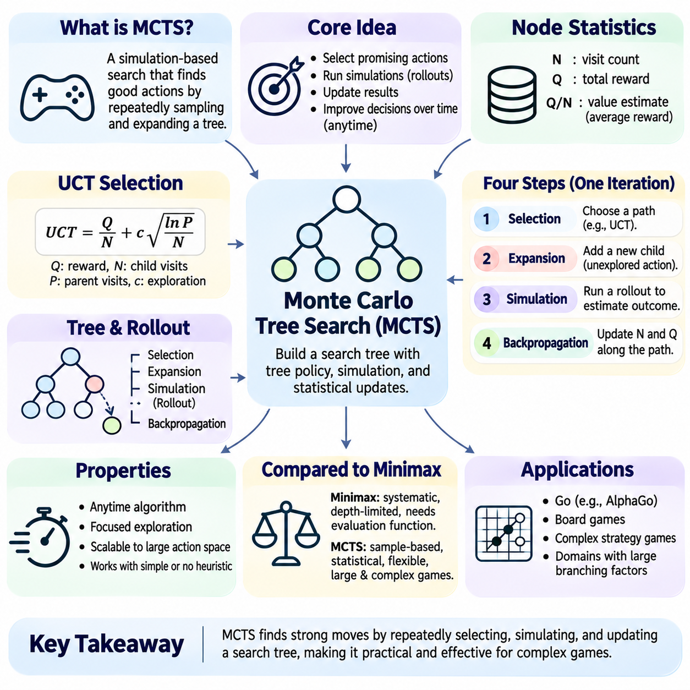{width="7.268055555555556in" height="7.268055555555556in"}

Monte Carlo Tree Search (MCTS) is a decision-making algorithm that combines selective tree exploration with statistical sampling to identify promising actions in complex games. Unlike exhaustive Minimax search, MCTS does not attempt to evaluate every possible continuation. Instead, it allocates computational resources toward actions that appear strategically valuable. This approach is particularly effective when branching factors are large and accurate heuristic evaluation functions are difficult to construct.

The fundamental principle of MCTS is to estimate action quality through repeated simulations and progressively improve these estimates as additional computational resources become available. Each simulation contributes information about potential outcomes, allowing the algorithm to refine its understanding of the search space. MCTS therefore operates as an anytime algorithm, producing increasingly informed decisions while maintaining a usable action recommendation.

MCTS organizes explored game states into a search tree whose nodes represent positions and whose edges represent available actions. Each node typically maintains a visit count and accumulated outcome statistics. These values summarize the evidence gathered through previous simulations. Rather than constructing the complete game tree, MCTS expands selected branches incrementally, concentrating attention on regions that offer favorable outcomes or remain insufficiently explored.

A standard MCTS iteration consists of four interconnected stages: selection, expansion, simulation, and backpropagation. Selection identifies a promising path through the existing tree, while expansion introduces a previously unexplored successor. Simulation estimates the potential outcome from the new state, and backpropagation updates statistics along the selected path. Repeating this process gradually improves action-value estimates and the distribution of search effort.

During selection, the algorithm begins at the root and repeatedly chooses child nodes according to a tree policy. The policy must balance exploiting actions with favorable estimated outcomes against exploring alternatives whose values remain uncertain. Pure exploitation risks overlooking strong but rarely visited actions, while excessive exploration wastes computational resources. Effective selection policies manage this tradeoff using statistical confidence estimates.

The Upper Confidence Bound applied to Trees (UCT) algorithm is a widely used selection strategy for MCTS. A common expression is UCT = Q/N + c√(ln(P)/N), where Q is accumulated reward, N is the child visit count, P is the parent visit count, and c controls exploration strength. The first term represents estimated action value, while the second encourages exploration of less frequently visited actions. Unvisited actions require explicit priority handling.

Expansion occurs when selection reaches a node with unexplored legal actions or another designated expansion condition. The algorithm generates a successor state and adds a corresponding child node to the search tree. Depending on the implementation, expansion may introduce one child per iteration or several children simultaneously. Incremental expansion limits memory consumption and allows the tree to grow according to the evidence collected during search.

The simulation stage, also called rollout, estimates the value of a newly expanded state by generating a sequence of actions until a terminal condition or predefined stopping point is reached. A simple rollout policy selects legal actions randomly, while more advanced policies incorporate domain knowledge. The resulting outcome provides a sample of the state\'s potential value rather than an exact prediction of optimal play.

Simulation quality strongly influences MCTS performance. Random rollouts are computationally inexpensive but may produce misleading estimates in games requiring precise tactical decisions. Heuristic rollout policies can improve realism by favoring strategically meaningful actions. However, more sophisticated simulations increase computational cost and may introduce systematic bias. Effective systems balance rollout accuracy, execution speed, and statistical diversity.

Backpropagation transfers the simulation result through the nodes visited during the current iteration. Each node updates its visit count and accumulated reward statistics. In two-player zero-sum games, reward interpretation must remain consistent with the player perspective used by the tree policy. Implementations may alternate reward signs or store values from a fixed player\'s viewpoint. Incorrect perspective handling can reverse strategic preferences.

After many iterations, the root contains statistical information about the available actions. The final move may be selected according to the highest visit count or the greatest estimated value, depending on the application. Visit-count selection often provides greater stability because it reflects accumulated search allocation. The chosen action is therefore based on sampled evidence rather than exhaustive enumeration of all possible game outcomes.

The computational behavior of MCTS differs fundamentally from depth-limited Minimax search. Minimax typically expands a structured portion of the game tree and applies heuristic evaluations at its boundaries. MCTS distributes exploration unevenly according to observed rewards and uncertainty. This flexibility makes MCTS attractive for games with large action spaces, although its effectiveness depends on how well sampled outcomes represent strategically important possibilities.

MCTS became especially influential in computer Go, where traditional evaluation functions and exhaustive tactical search faced substantial difficulties. The enormous number of possible board configurations makes uniform exploration impractical. MCTS concentrates simulations on promising continuations and estimates their relative quality through statistical outcomes. Its success in Go demonstrated the potential of sampling-based planning for complex strategic environments.

The exploration constant influences how aggressively MCTS investigates uncertain actions. A larger value encourages broader exploration, while a smaller value emphasizes actions with favorable existing estimates. No single setting is optimal for every game or computational budget. Parameter tuning should consider reward scale, branching factor, simulation quality, and the number of iterations available before a decision must be made.

MCTS can be improved through progressive widening, which limits the number of children considered at a node until sufficient visits have accumulated. This technique is useful when action spaces are extremely large or continuous. Rather than expanding every legal action immediately, the algorithm gradually introduces additional alternatives. Progressive widening concentrates computational resources while preserving opportunities to investigate new actions.

Transposition handling can also improve MCTS by recognizing states reached through different action sequences. A transposition table may associate equivalent positions with shared statistics or reusable information. However, merging nodes changes the statistical structure from a tree toward a directed graph and complicates backpropagation. Careful bookkeeping is required to avoid inconsistent visit counts, duplicated updates, or incorrect value attribution.

Parallel MCTS distributes simulations across multiple processing units to increase the number of samples collected within a fixed time budget. Independent workers may explore separate trees or cooperate through shared statistics. Shared-tree implementations require synchronization and mechanisms such as virtual loss to discourage excessive simultaneous exploration of identical branches. Parallel efficiency depends on contention, communication overhead, and workload distribution.

Neural networks can enhance MCTS by providing policy priors and value estimates. A policy network predicts promising actions, while a value network estimates the expected outcome of a position without requiring complete random rollouts. These predictions guide exploration and reduce dependence on handcrafted heuristics. The resulting architecture combines learned representations with explicit search, as demonstrated by modern neural game-playing systems.

Predictor-guided MCTS often uses a selection rule that combines estimated action value with an exploration bonus weighted by policy probabilities. This approach is commonly associated with Predictor Upper Confidence Trees (PUCT). Policy priors concentrate early exploration on plausible moves, while visit statistics gradually refine the search distribution. The effectiveness of this method depends on model calibration, exploration parameters, and sufficient search coverage.

MCTS is not guaranteed to discover critical tactical sequences within limited computation. Rare but decisive moves may receive insufficient attention when simulations or selection policies assign them low priority. This limitation is particularly important in games where a single overlooked action causes an immediate loss. Tactical verification, informed priors, and hybrid search mechanisms can reduce these weaknesses without eliminating sampling uncertainty.

Evaluation of MCTS should examine decision quality, simulation throughput, memory consumption, and sensitivity to computational budgets. Relevant measurements include simulations per second, root visit distributions, estimated action values, and performance against benchmark opponents. Experiments should vary exploration parameters, rollout policies, and iteration limits. Repeated trials are necessary because stochastic sampling introduces variability into search outcomes.

Implementation testing should verify legal action generation, node expansion, visit-count updates, reward propagation, and final move selection. Small games with known optimal strategies provide useful reference environments for checking convergence behavior. Additional tests should examine terminal states, unvisited children, interrupted simulations, and parallel synchronization. Reproducible random seeds help isolate implementation errors from ordinary statistical variation.

Monte Carlo Tree Search provides a flexible framework for decision-making under large search spaces and restricted computational resources. Its combination of selective expansion, statistical evaluation, and repeated simulation enables effective planning without requiring exhaustive game-tree exploration. Although sampling introduces uncertainty and tactical limitations, integration with heuristics, neural networks, and parallel computation makes MCTS a central technique in classical and modern Game AI.

## 02.09 UCT Upper Confidence Bound

{width="7.268055555555556in" height="7.268055555555556in"}

Upper Confidence Bound applied to Trees (UCT) is a statistical selection algorithm used in Monte Carlo Tree Search (MCTS) to balance exploration and exploitation. It determines which actions should receive additional simulations by combining estimated rewards with uncertainty-based exploration bonuses. UCT enables selective allocation of computational resources and provides a principled alternative to uniformly exploring every branch of a game tree.

UCT originates from the Upper Confidence Bound (UCB) family of algorithms developed for multi-armed bandit problems. In these problems, a decision-maker repeatedly chooses among actions with unknown reward distributions. The objective is to maximize accumulated reward while learning which actions perform best. UCT extends this principle to hierarchical game-tree search, where each node represents a decision involving multiple possible actions.

The exploration-exploitation tradeoff is the central challenge addressed by UCT. Exploitation prioritizes actions with high observed average rewards, while exploration investigates actions whose values remain uncertain because they have received fewer samples. Excessive exploitation may overlook stronger alternatives, whereas excessive exploration wastes computation on weak actions. UCT balances these competing objectives through an explicit confidence-based selection rule.

A common UCT selection formula is UCT(s,a) = Q(s,a)/N(s,a) + c√(ln N(s)/N(s,a)). Here, Q(s,a) represents accumulated reward for action a in state s, N(s,a) is the action visit count, and N(s) is the parent-state visit count. The exploration coefficient c determines the strength of the uncertainty bonus. This formula assumes consistent reward scaling and requires special handling when an action has never been visited.

The exploitation component Q(s,a)/N(s,a) estimates the average reward obtained from previous simulations of an action. Higher average rewards suggest that the action has produced favorable outcomes under the current simulation policy. However, these estimates are statistical observations rather than exact Minimax values. Their reliability depends on sample size, rollout quality, and the distribution of outcomes generated by subsequent decisions.

The exploration component c√(ln N(s)/N(s,a)) increases the priority of actions with relatively few visits. As an action receives more simulations, its exploration bonus decreases, reflecting reduced statistical uncertainty. Meanwhile, the logarithmic dependence on parent visits ensures that alternative actions continue receiving occasional attention. This mechanism discourages premature commitment to actions that initially appear superior.

The exploration coefficient c controls how strongly the algorithm favors uncertain actions over those with favorable observed values. Large coefficients promote broader exploration, while smaller coefficients emphasize exploitation. The appropriate value depends on reward normalization, branching factor, and computational budget. Poorly calibrated exploration can produce inefficient sampling or cause the search to overlook strategically important alternatives.

Unvisited actions require explicit initialization because their average reward and exploration terms are undefined when the visit count is zero. A common implementation assigns unvisited legal actions effectively infinite selection priority until each has been sampled. Alternative implementations use explicit expansion rules or prior estimates. Regardless of the method, the algorithm must ensure that legal actions receive an opportunity for exploration.

UCT operates recursively within the selection stage of MCTS. Beginning at the root node, the algorithm evaluates available child actions and selects the one with the highest UCT score. This procedure continues through existing nodes until an expandable position or terminal state is reached. The subsequent expansion, simulation, and backpropagation stages update statistics, allowing future UCT decisions to incorporate newly collected evidence.

Visit counts are essential because they determine both the reliability of reward estimates and the magnitude of exploration bonuses. Each completed simulation updates the statistics associated with the selected path. As visit counts increase, the search increasingly distinguishes actions supported by substantial evidence from those supported by limited observations. These updates gradually reshape the allocation of computational effort across the tree.

Reward representation must remain consistent with the objectives of the game. In two-player zero-sum games, a favorable outcome for one player represents an unfavorable outcome for the opponent. UCT implementations may store rewards from the perspective of the player making the decision at each node or use a fixed reference player with appropriate transformations. Incorrect perspective handling can cause the algorithm to prefer losing actions.

The statistical justification of UCT is related to confidence-bound methods that manage uncertainty in repeated decision-making. Under suitable assumptions, UCB-based selection balances sampling and reward maximization while limiting unnecessary exploration. However, theoretical guarantees for simple bandit problems do not transfer unchanged to every finite-budget game-tree search. Tree dependencies, rollout policies, and nonstationary estimates complicate analysis.

UCT differs from deterministic Minimax because it does not systematically enumerate every action sequence to a fixed depth. Instead, it allocates simulations according to estimated outcomes and statistical uncertainty. Minimax explicitly models optimal adversarial responses, while standard UCT estimates values through sampled continuations. Both approaches support strategic planning, but they differ in computational structure, evaluation requirements, and finite-budget behavior.

UCT is especially useful in games with large branching factors where exhaustive exploration is impractical. It concentrates simulations on promising actions while retaining mechanisms for investigating alternatives. This property contributed to the effectiveness of MCTS in computer Go and other complex planning environments. Nevertheless, high branching factors can also dilute sampling effort, making sufficient exploration difficult under tight time constraints.

Simulation policy quality strongly affects UCT because the exploitation term depends on sampled outcomes. Random rollouts may provide inexpensive estimates but can misrepresent positions requiring precise tactical play. Domain-informed policies may produce more meaningful outcomes while increasing computational cost. Consequently, UCT performance reflects both the selection rule and the quality of the simulations used to estimate action values.

UCT can exhibit slow discovery of rare but decisive actions. A critical defensive move may appear unattractive under noisy simulations, causing insufficient exploration before a deadline. Likewise, deceptive positions may produce favorable average rewards despite hidden tactical weaknesses. Tactical extensions, informed rollout policies, and complementary deterministic search can reduce these limitations without guaranteeing complete tactical coverage.

Progressive widening extends UCT to environments containing extremely large or continuous action spaces. Instead of considering every available action immediately, the algorithm limits the number of expanded children according to accumulated visits. Additional actions become eligible as the parent receives more simulations. This approach concentrates early computational effort while gradually increasing exploration diversity.

Neural-guided search modifies confidence-based selection by incorporating learned policy probabilities. Predictor Upper Confidence Trees (PUCT) commonly uses an exploration bonus weighted by a policy prior, directing early search toward actions predicted to be promising. Unlike standard UCT, which relies primarily on visit statistics and observed rewards, PUCT introduces learned action preferences. Both approaches require careful exploration calibration.

Parallel UCT enables multiple workers to perform simulations concurrently, increasing sampling throughput. Shared-tree implementations must coordinate access to visit counts and accumulated rewards. Virtual loss can temporarily discourage workers from selecting the same branch, improving exploration diversity. However, synchronization overhead and delayed statistical updates may affect selection behavior and reduce parallel efficiency.

Practical UCT implementations should maintain clear numerical conventions and stable update procedures. Reward values may be normalized to a bounded interval, while visit counts should use sufficiently large integer representations. Logarithms, square roots, and division operations must be handled safely. Efficient implementations may cache intermediate statistics or optimize selection calculations to reduce overhead during millions of iterations.

Testing UCT requires verifying action selection, exploration bonuses, visit-count updates, and reward consistency. Controlled multi-armed bandit experiments can demonstrate whether the algorithm explores uncertain alternatives and increasingly favors stronger actions. Small deterministic games provide additional validation of adversarial behavior. Fixed random seeds help distinguish implementation defects from expected statistical variation.

Performance evaluation should examine decision quality across different simulation budgets, exploration coefficients, and rollout policies. Relevant metrics include simulations per second, root visit distributions, action-value estimation error, and results against benchmark opponents. Repeated trials are necessary to quantify variance and confidence intervals. Comparisons should use consistent computational limits and representative game positions.

UCT provides a mathematical foundation for balancing exploration and exploitation within Monte Carlo Tree Search. By combining average sampled rewards with confidence-based exploration bonuses, it directs computation toward promising actions without permanently excluding uncertain alternatives. Its effectiveness depends on reward interpretation, simulation quality, parameter calibration, and computational resources. UCT remains a fundamental component of statistical Game AI and modern search-based planning systems.

## 02.10 Stochastic and Imperfect Information Games

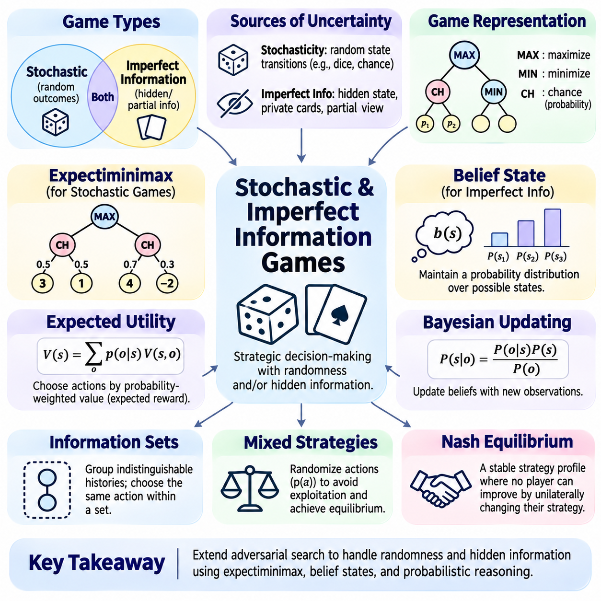{width="7.268055555555556in" height="7.268055555555556in"}

Stochastic and imperfect-information games extend classical adversarial search by introducing randomness, hidden information, or both. Unlike deterministic perfect-information games, players cannot always predict exact state transitions or observe every relevant variable. Effective decision-making therefore requires reasoning about probabilities, uncertainty, and opponent behavior. These games provide important models for strategic interaction under incomplete knowledge.

Stochastic games contain random events that influence how the game evolves. Dice rolls, shuffled cards, environmental disturbances, and probabilistic outcomes may alter the state after an action is selected. Even when every player observes the current state, future transitions may remain uncertain. Game AI must evaluate possible outcomes according to their probabilities rather than assuming that each action produces one deterministic successor.

Imperfect-information games restrict what players can observe about the true game state. Hidden cards, concealed actions, private objectives, and partially visible environments create uncertainty about relevant variables. Two distinct underlying states may appear identical to a player. Consequently, decision-making must operate on available observations and information histories rather than assuming complete access to the actual state.

Stochasticity and imperfect information represent different sources of uncertainty. Stochasticity concerns randomness in state transitions, while imperfect information concerns uncertainty about the current or past state. A game may contain either property independently or combine both. For example, a board game with visible dice outcomes may be stochastic but fully observable, whereas a hidden-card game may involve both random dealing and private information.

Expectiminimax extends Minimax to games containing probabilistic events. In addition to maximizing and minimizing decision nodes, the search tree includes chance nodes representing random outcomes. At a chance node, the algorithm computes a probability-weighted average of successor values. This mechanism allows strategic decisions to account for uncertain consequences while preserving adversarial reasoning at player-controlled nodes.

The value of a chance node can be expressed as V(s) = Σ p(o\|s)V(s,o), where p(o\|s) is the probability of outcome o and V(s,o) is the value of the resulting state. The probabilities must form a valid distribution over possible outcomes. Unlike a maximizing or minimizing node, a chance node does not select the best or worst successor. It combines outcomes according to the game\'s probabilistic transition model.

Expectiminimax can become computationally expensive because chance outcomes increase the effective branching factor. Every random event may introduce several additional successors, multiplying the number of positions requiring evaluation. Depth limits, outcome sampling, probability pruning, and approximate evaluation can reduce this burden. However, approximation methods must preserve sufficiently accurate estimates of strategically important risks.

Expected utility provides a common basis for choosing actions under uncertainty. An action is evaluated by combining the utility of each possible outcome with its probability. Maximizing expected utility is appropriate when the utility function correctly represents the decision-maker\'s preferences. Risk-sensitive objectives may instead penalize severe losses, reward robustness, or consider variance and worst-case outcomes alongside expected value.

Belief states provide a mathematical representation of uncertainty in imperfect-information games. A belief state assigns probabilities to possible underlying states consistent with the player\'s observations. As actions occur and new information becomes available, these probabilities are updated. Planning over belief states allows an agent to reason about hidden information without pretending that one uncertain state is known to be true.

Bayesian updating is a common mechanism for maintaining beliefs. Given a prior distribution and a new observation, the agent computes revised probabilities using the likelihood of that observation under each possible state. The resulting posterior distribution supports future decisions. Accurate updating requires appropriate models of observations, transitions, and opponent behavior, which may themselves be uncertain.

Information sets group decision histories that a player cannot distinguish using available information. A strategy in an imperfect-information game must prescribe the same action distribution for histories within the same information set. This prevents the agent from exploiting hidden information unavailable to the player. Information-set representations are central to extensive-form games and algorithms designed for strategic reasoning under partial observability.

Opponent modeling introduces additional complexity because another player\'s hidden intentions and strategy may influence observed actions. An agent can maintain hypotheses about opponent preferences, behavioral tendencies, or possible private information. Observations can update these hypotheses over time. However, assuming that opponents follow a fixed or perfectly rational strategy may produce fragile decisions when their behavior changes.

Mixed strategies allow players to randomize their actions according to probability distributions. In imperfect-information games, predictable deterministic behavior can be exploited by opponents who infer hidden intentions. Strategic randomization can reduce this vulnerability and is essential in many equilibrium solutions. The appropriate action probabilities depend on the game\'s payoff structure, available information, and interactions between competing strategies.

Nash equilibrium provides a fundamental solution concept for strategic games. At equilibrium, no player can improve their expected payoff through a unilateral strategy change while other strategies remain fixed. In two-player zero-sum games, equilibrium strategies are closely related to minimax-optimal behavior. Computing these strategies in large imperfect-information games is difficult because the number of information sets and possible strategies can be enormous.

Counterfactual Regret Minimization (CFR) is an influential approach for approximating equilibrium strategies in extensive-form imperfect-information games. It repeatedly updates strategies by measuring regret for alternative actions at information sets. Over repeated iterations, average strategies can approach equilibrium under suitable conditions. CFR and its variants have been particularly important in computational poker and other hidden-information environments.

Information Set Monte Carlo Tree Search (ISMCTS) adapts simulation-based planning to imperfect-information games. Rather than treating the hidden state as fully known, it samples possible states consistent with available information and organizes decisions around information sets. This reduces some problems associated with ordinary state-based search. Nevertheless, sampling quality and the representation of hidden information remain critical to performance.

Determinization is a practical technique that samples a complete hidden state and solves the resulting perfect-information game. Repeating this process across sampled states can provide approximate action evaluations. However, determinization may introduce strategy fusion, where the search assumes different actions can be chosen using hidden information unavailable to the player. It may also underestimate the strategic importance of gathering information.

Information-gathering actions can have value even when they provide little immediate reward. Revealing an opponent\'s card, observing an uncertain region, or testing a hidden condition may improve later decisions. This creates a distinction between immediate utility and the value of information. Effective planning must consider how current actions change future knowledge, available strategies, and the quality of subsequent decisions.

Partial observability also creates challenges involving memory and history. The current observation may not contain enough information to determine an appropriate action. Agents may need to retain previous observations, actions, and inferred events to construct a meaningful belief state. Recurrent models, Bayesian filters, and explicit history tracking can support this process, although memory requirements increase with game complexity.

Scalability remains a major engineering challenge because uncertainty expands both the physical state space and the space of possible beliefs. Exact belief-state planning may become infeasible in large games. Particle-based approximations, abstraction, sampled search, and learned value functions can reduce computational demands. These methods trade theoretical precision for practical decision quality under limited resources.

Evaluation should measure more than immediate winning rates. Relevant criteria include expected payoff, exploitability, robustness against different opponent strategies, belief calibration, and computational efficiency. Experiments should include hidden-state variations, stochastic outcomes, and opponents with diverse behaviors. Repeated trials and confidence intervals are necessary because randomness can obscure meaningful performance differences.

Implementation testing must verify probability normalization, legal information access, chance-node calculations, belief updates, and consistent strategy selection within information sets. Small games with analytically known solutions provide valuable reference cases. Tests should also detect accidental information leakage, incorrect opponent perspectives, and unstable sampling behavior. Reproducible experiments help distinguish algorithmic weaknesses from implementation errors.

Stochastic and imperfect-information games demonstrate that strategic intelligence requires more than searching visible action sequences. Effective systems must combine probabilistic reasoning, belief-state estimation, opponent modeling, and uncertainty-aware planning. Expectiminimax, CFR, and information-set search provide complementary approaches to these challenges. Together, they extend classical Game AI toward realistic decision-making under randomness and incomplete information.

## 02.11 Game AI Engineering

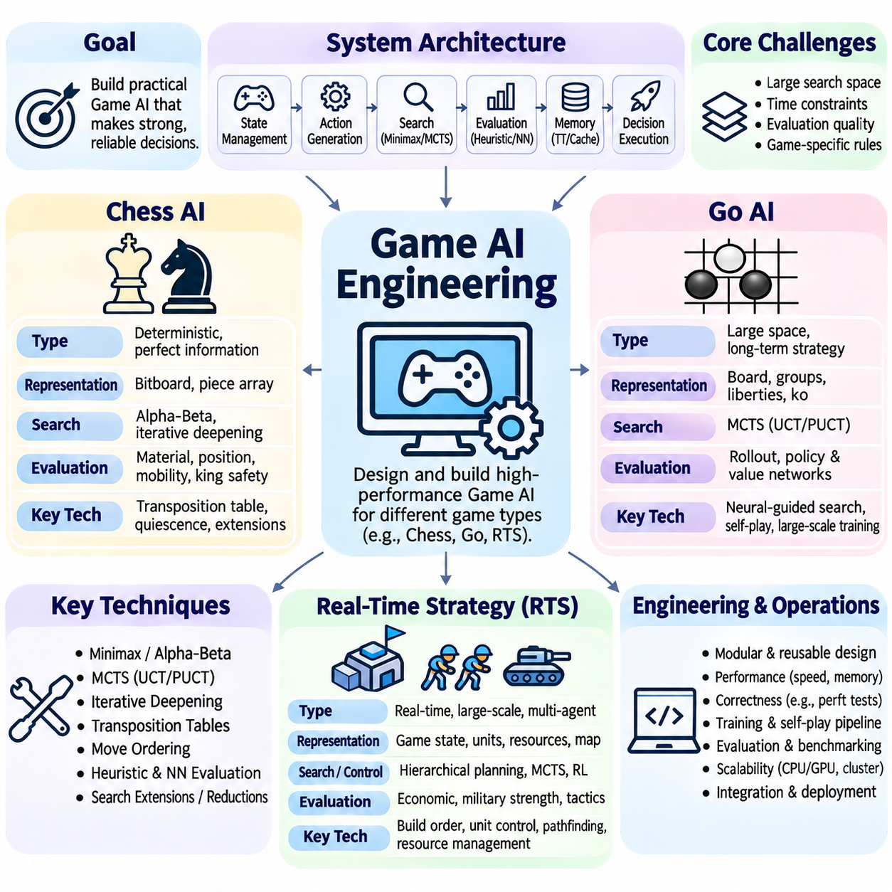{width="7.268055555555556in" height="7.268055555555556in"}

Game AI engineering transforms theoretical search algorithms into reliable systems capable of making strategic decisions under practical constraints. Chess, Go, and real-time strategy games represent different computational challenges involving branching factors, evaluation complexity, uncertainty, and response deadlines. Effective engineering requires integrating search methods, state representations, evaluation models, memory management, and execution infrastructure.

A production-oriented Game AI system typically separates game-state management, legal action generation, search control, evaluation, and decision execution. Each component must expose consistent interfaces to prevent invalid transitions and incorrect strategic calculations. Search algorithms should operate independently of rendering or user interaction. This modular architecture improves testability, reproducibility, performance optimization, and integration with learning-based components.

Chess AI is a classical example of deterministic, perfect-information adversarial search. Both players observe the complete board, and legal moves produce predictable state transitions. Nevertheless, the large search space prevents exhaustive exploration of realistic games. Chess engines therefore combine selective search, sophisticated evaluation functions, transposition tables, and carefully optimized move generation to identify strong moves within limited computational budgets.

Efficient chess engines represent board positions using bitboards, piece arrays, or hybrid structures. Bitboards encode piece locations as binary patterns, allowing fast occupancy checks, attack generation, and positional calculations. Incremental state updates avoid reconstructing the entire board after every move. Zobrist hashing provides compact position identifiers for transposition tables, repetition detection, and reuse of previously computed search information.

Chess move generation must correctly implement ordinary moves, captures, castling, en passant, promotions, and king-safety restrictions. Performance is often measured in nodes per second, but correctness is equally important. Perft testing counts legal move sequences at specified depths and compares them with known reference results. Make-and-unmake operations must restore every relevant state variable, including castling rights and en passant availability.

Alpha-Beta Pruning remains a foundational technique in classical chess engines because effective move ordering can dramatically reduce the number of explored positions. Iterative deepening repeatedly searches increasing depths while reusing information from earlier iterations. Principal variation moves, captures, killer moves, and history heuristics help prioritize promising continuations. Transposition tables further reduce duplicated work across equivalent positions.

Chess evaluation functions estimate positional quality when search cannot reach a terminal state. Traditional engines combine material balance, piece activity, pawn structure, king safety, mobility, and positional features. Quiescence search extends evaluation through tactically unstable positions to reduce horizon effects. Modern engines may replace or supplement handcrafted evaluation with efficiently updatable neural networks while retaining classical search infrastructure.

Search extensions and reductions improve chess engine efficiency by allocating computation unevenly. Check extensions investigate forcing situations, while late move reductions reduce search depth for moves considered less promising. Null-move pruning can detect positions where a player appears sufficiently strong without making an actual move. These techniques require careful safeguards because incorrect assumptions may overlook tactical resources or distort strategic evaluations.

Go AI presents a substantially different engineering problem because its branching factor and long-term positional dependencies make conventional exhaustive search difficult. The value of a move often depends on territory, influence, connectivity, and future interactions across distant board regions. Handcrafted evaluation alone struggles to capture these relationships. Monte Carlo Tree Search provides a flexible mechanism for allocating simulations toward promising strategic continuations.

Go board representations must support legal placement, connected groups, liberties, captures, ko restrictions, and the selected scoring rules. Efficient implementations maintain group connectivity and liberty information incrementally. Correct handling of repetition rules is essential because legality may depend on previous positions. The engine must also distinguish terminal conditions, passing decisions, and scoring conventions across different Go rule sets.

Traditional Monte Carlo Go engines estimated move quality through repeated simulated games. Selection policies balanced exploration and exploitation, while rollout policies generated plausible continuations. Although random simulations provided useful statistical evidence, they could misjudge strategically complex positions. Domain-specific rollout heuristics improved practical strength but introduced additional computation and potential biases into the evaluation process.

Neural-network-guided Go systems combine policy prediction, value estimation, and tree search. Policy networks estimate promising move probabilities, while value networks predict expected game outcomes. Search procedures such as PUCT integrate these predictions with visit statistics to prioritize computation. The resulting architecture reduces dependence on random rollouts and enables stronger strategic reasoning through the interaction of learned representations and explicit planning.

Training Go AI requires carefully managed datasets, self-play procedures, model evaluation, and computational resources. Supervised learning can initialize policy models from expert games, while reinforcement learning improves policies through generated experience. Self-play produces training examples containing board states, search-derived action distributions, and game outcomes. Model promotion should depend on statistically meaningful evaluation against previous versions.

Real-time strategy games introduce challenges beyond those found in turn-based board games. Players may control numerous units simultaneously while managing resources, construction, combat, exploration, and technological development. Actions occur under strict timing constraints, and observations may be incomplete because of fog of war. The resulting decision space combines continuous time, large action sets, uncertain information, and competing strategic objectives.

RTS AI commonly uses hierarchical decision-making to separate long-term strategy from tactical control. Strategic planners determine economic priorities, technology development, and expansion objectives. Tactical controllers manage engagements, positioning, and local resource allocation. Low-level unit controllers execute movement, targeting, and collision avoidance. Hierarchical decomposition reduces decision complexity while allowing different modules to operate at appropriate update frequencies.

State estimation is essential in RTS environments because enemy positions, resources, and intentions may be hidden. Agents maintain internal representations of observed units, inferred threats, and possible opponent strategies. Scouting actions improve information quality but consume time and resources. Effective systems combine belief tracking, opponent modeling, and uncertainty-aware planning to avoid making decisions based on outdated or incomplete observations.

RTS resource management requires coordinating production, worker allocation, supply limits, and technology prerequisites. Build-order planning schedules actions while respecting dependencies and resource availability. Optimization methods can estimate the economic consequences of alternative production sequences. However, rigid plans are vulnerable to enemy disruption, so execution systems must support replanning when resources, threats, or strategic priorities change.

Combat control introduces additional engineering requirements involving pathfinding, formation management, target selection, and coordinated movement. A\\\* search and navigation meshes can support movement planning, while influence maps estimate dangerous or strategically valuable regions. Tactical controllers must account for attack ranges, cooldowns, terrain constraints, and unit interactions. Efficient approximation is often necessary because large engagements create substantial computational workloads.

Real-time constraints require explicit scheduling and computational budgeting. Strategic decisions may update relatively slowly, while tactical responses and unit control require more frequent execution. Asynchronous processing can separate expensive planning from time-critical actions. Cached evaluations, incremental updates, and bounded search prevent computational overload. The system must maintain valid behavior even when advanced planning cannot finish before a deadline.

Hybrid Game AI architectures combine classical algorithms with machine learning to address different decision layers. Search methods provide explicit reasoning over actions, while neural models estimate values, predict opponent behavior, or identify promising strategies. Rule-based controllers can enforce legality and safety constraints. The best combination depends on observability, computational resources, decision frequency, and the reliability of available training data.

Engineering validation should separate functional correctness from strategic strength. Unit tests verify legal transitions, state restoration, scoring, and interface consistency. Profiling identifies bottlenecks in move generation, search, inference, and memory access. Competitive benchmarks measure performance against diverse opponents and previous engine versions. Repeated matches with controlled settings are necessary to distinguish genuine improvements from random variation.

System comparison should consider decision quality, latency, memory consumption, computational throughput, robustness, and scalability. Chess emphasizes efficient adversarial search and tactical accuracy, Go emphasizes statistical planning and learned evaluation, while RTS games emphasize hierarchical coordination and real-time adaptation. No single algorithm dominates every environment. Successful Game AI engineering selects and integrates methods according to the structural properties of each game.

Chess AI, Go AI, and real-time strategy systems demonstrate how classical search principles evolve into specialized decision architectures. Their engineering foundations include accurate state modeling, efficient action generation, uncertainty management, selective computation, and systematic evaluation. Integrating these capabilities with neural learning and scalable infrastructure enables increasingly sophisticated strategic agents while preserving the reliability required for practical deployment.

## 02.12 Deep Learning vs Classical Game AI

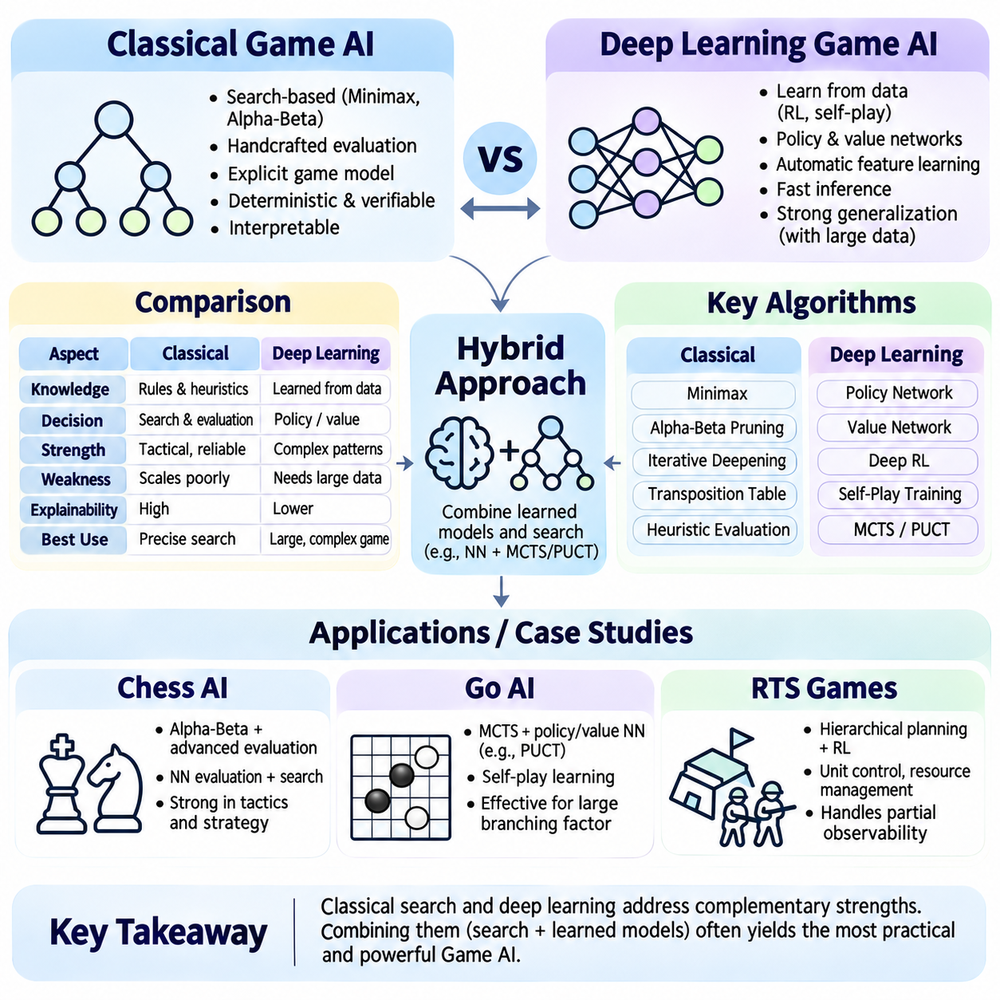{width="7.268055555555556in" height="7.268055555555556in"}

Classical Game AI and Deep Learning represent two complementary approaches to strategic decision-making. Classical methods rely on explicit search, handcrafted evaluation functions, and formal game models, while Deep Learning extracts useful representations and decision policies from data. Their differences involve computational structure, generalization, interpretability, and training requirements. Modern Game AI increasingly combines both approaches rather than treating them as mutually exclusive alternatives.

Classical Game AI emerged from symbolic reasoning and adversarial search techniques such as Minimax, Alpha-Beta Pruning, and heuristic evaluation. These methods explicitly represent game states, legal actions, and possible future outcomes. Decision quality depends on search depth, move ordering, and evaluation accuracy. Because the decision process follows defined algorithms, developers can often inspect search paths and identify why particular actions were selected.

Deep Learning approaches use neural networks to approximate policies, value functions, or internal representations of game environments. Instead of manually defining every strategic feature, models learn patterns through supervised learning, reinforcement learning, or self-play. Neural networks can capture complex positional relationships that are difficult to express through handcrafted rules. However, their predictions depend on training data, optimization procedures, and generalization to unfamiliar situations.

The fundamental difference lies in how strategic knowledge is acquired and applied. Classical systems encode domain knowledge through explicit rules and evaluation formulas, while learning-based systems estimate useful relationships from experience. Classical search computes consequences of candidate actions during decision-making. Deep Learning can provide rapid predictions after training, although producing reliable models may require substantial offline computation and carefully designed objectives.

Minimax search assumes adversarial players and evaluates actions according to possible responses from opponents. Alpha-Beta Pruning reduces unnecessary exploration without changing the exact result of a completed fixed-depth Minimax search when applied correctly. These techniques offer predictable computational behavior under controlled search limits. Their effectiveness decreases when branching factors become extremely large or evaluation functions fail to capture long-term strategic consequences.

Neural policy networks estimate action probabilities directly from game states. They can generate candidate moves without exhaustively evaluating every legal continuation. Value networks estimate expected outcomes or positional quality, providing learned alternatives to handcrafted evaluation functions. These predictions can substantially reduce decision latency, but their accuracy depends on the distribution of training examples and the model\'s ability to represent relevant strategic patterns.

Deep Reinforcement Learning allows agents to improve through interaction with an environment. Rewards guide the optimization of policies that maximize expected long-term returns. Self-play is particularly valuable in competitive games because agents generate increasingly challenging training experiences. Nevertheless, learning may be unstable, sample inefficient, or sensitive to reward design. Exploration strategies and opponent diversity strongly influence the quality of the resulting policy.

Classical search offers explicit tactical verification by examining concrete action sequences. In chess, deeper search can identify forced captures, checks, and defensive responses that static evaluations may overlook. Neural networks may recognize strong positional patterns but fail on rare tactical configurations outside their training distribution. Combining neural evaluation with selective search helps reduce these weaknesses while preserving the advantages of learned strategic representations.

Monte Carlo Tree Search provides an important bridge between classical planning and neural learning. MCTS estimates action values through selective simulations rather than exhaustive enumeration. Neural policy priors guide exploration toward promising moves, while value networks estimate outcomes without complete rollouts. PUCT-based selection integrates learned probabilities with search statistics, allowing the system to refine neural predictions through explicit planning.

Computer chess demonstrates the effectiveness of both classical and hybrid approaches. Traditional engines combine Alpha-Beta search, transposition tables, iterative deepening, and sophisticated evaluation. Neural-network evaluation can improve positional understanding while retaining efficient tactical search. Alternative architectures use neural-guided tree search. Their relative performance depends on hardware, time controls, model quality, and the efficiency of the search implementation.

Computer Go illustrates why learning-based evaluation became especially important. The enormous branching factor and complex spatial relationships made handcrafted evaluation and conventional exhaustive search difficult. Neural policy and value networks improved move selection and outcome estimation. Combined with MCTS, these models enabled stronger strategic planning. The resulting systems demonstrated that learned representations and statistical search can complement each other effectively.

Real-time strategy games require additional capabilities involving resource allocation, tactical control, opponent modeling, and partial observability. Classical planners provide explicit scheduling and hierarchical decision structures, while neural models support perception, prediction, and adaptive policies. Reinforcement learning can optimize combat behaviors or strategic choices. Hybrid architectures remain useful because real-time constraints and large action spaces make unrestricted search impractical.

Computational requirements differ significantly between the two approaches. Classical engines primarily consume resources during search and evaluation at decision time. Deep Learning systems may require extensive GPU computation during training but provide efficient inference after deployment. Neural-guided search introduces both inference and tree-search costs. Practical comparisons must account for training expense, inference latency, memory consumption, and total computational budgets.

Data requirements are another important distinction. Classical algorithms can operate using game rules and manually constructed evaluation functions without large training datasets. Deep Learning generally requires representative experience, expert demonstrations, simulated games, or self-play trajectories. Dataset quality influences model performance and robustness. Distribution shifts, rare tactical patterns, and biased training opponents can cause learned policies to behave unpredictably.

Interpretability and debugging also differ between classical and neural systems. Classical search can expose principal variations, evaluation terms, and pruning decisions. Neural models encode strategic relationships across many learned parameters, making individual predictions harder to explain. Attribution methods and diagnostic evaluations provide partial insight but do not guarantee faithful explanations. Hybrid systems benefit from combining explicit search traces with model-level analysis.

Robustness depends on how systems handle unfamiliar positions and adversarial behavior. Classical search can reason about legal continuations even when positions have never been encountered, although heuristic estimates may be inaccurate. Neural networks may generalize successfully across related patterns but can fail under distribution shifts. Search verification, uncertainty estimation, diversified training, and adversarial testing help improve reliability across both approaches.

Transfer learning provides an advantage when neural representations can be reused across related games or tasks. Shared architectures may learn spatial patterns, tactical relationships, or general decision features. However, differences in action spaces, rules, and reward structures can limit transfer effectiveness. Classical algorithms are often easier to reuse when games share formal search properties. Successful transfer therefore depends on both representation compatibility and domain structure.

Learning-based agents can adapt their behavior through continued training or online updates. Classical systems generally require changes to evaluation parameters, search heuristics, or encoded rules to achieve comparable adaptation. Online learning introduces risks of instability, catastrophic forgetting, and exploitation by changing opponents. Controlled evaluation and rollback mechanisms are important when updating deployed agents. Adaptation should improve performance without undermining previously reliable behavior.

Hybrid Game AI systems commonly separate learned estimation from explicit decision control. Neural networks provide action priors, value predictions, or opponent models, while search algorithms test consequences and enforce game rules. This division allows learning to capture complex patterns while symbolic components preserve legality and structured reasoning. The appropriate balance depends on branching factor, observation quality, available computation, and response deadlines.

Evaluation must compare systems under consistent rules, hardware constraints, and computational budgets. Relevant metrics include winning rate, Elo-style ratings, decision latency, search nodes, inference throughput, and memory usage. Learning-based methods also require reporting training cost and sample efficiency. Repeated matches against diverse opponents are necessary to assess statistical significance, robustness, and sensitivity to specific playing styles.

Ablation studies help identify which components contribute to performance improvements. Removing neural policy guidance, replacing learned value functions, or disabling search extensions can reveal their individual effects. Experiments should control random seeds, training data, search budgets, and opponent configurations. Such comparisons prevent improvements from being incorrectly attributed to model architecture when they actually result from additional computation or stronger search.

Engineering decisions should reflect the operational environment rather than favoring one methodology universally. Resource-constrained systems may prefer lightweight heuristics or compact neural models. Games with precise tactical requirements may benefit from deeper deterministic search, while large strategic spaces may favor learned evaluation and sampling-based planning. Reliable deployment requires balancing strategic strength, computational efficiency, maintainability, and reproducibility.

The future of Game AI increasingly involves integrated architectures that combine search, reinforcement learning, neural representation, and uncertainty-aware planning. Classical algorithms contribute explicit reasoning and structured control, while Deep Learning contributes adaptive representations and predictive capabilities. Neither approach eliminates the limitations of the other. Their integration provides a flexible foundation for building stronger, more scalable, and more general strategic agents.

## 02.13 Case Studies

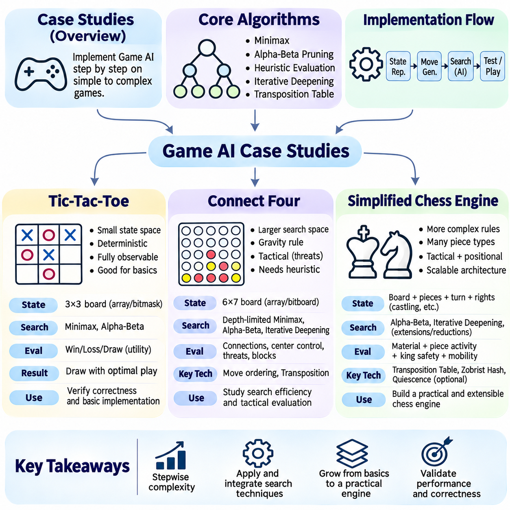{width="7.268055555555556in" height="7.268055555555556in"}

Case studies provide a practical foundation for understanding how Game AI algorithms behave across different levels of complexity. Tic-Tac-Toe, Connect Four, and simplified chess represent progressively larger search spaces and more demanding evaluation requirements. Implementing these games demonstrates how state representation, legal move generation, adversarial search, heuristic evaluation, and performance optimization interact within complete decision-making systems.

Tic-Tac-Toe is an ideal introductory environment because its rules are simple and its state space is small enough for exhaustive search. Two players alternately place marks on a three-by-three board, attempting to complete a horizontal, vertical, or diagonal line. The game is deterministic, turn-based, and fully observable. These properties allow developers to isolate search correctness without introducing uncertainty or complicated state transitions.

A Tic-Tac-Toe implementation can represent the board using a nine-element array, integer encoding, or compact bitmasks. Each state records occupied cells, the active player, and whether the game has terminated. Legal move generation identifies empty cells, while terminal detection checks winning lines and draws. Correct state representation is essential because search algorithms depend on accurate transitions and consistent interpretation of player turns.

Minimax provides an exact solution for Tic-Tac-Toe when the complete game tree is explored. Terminal positions receive utilities representing victory, defeat, or a draw. Maximizing and minimizing players recursively select actions according to these values. With optimal play from both sides, the initial position leads to a draw. This known result makes Tic-Tac-Toe useful for validating the correctness of adversarial search implementations.

Alpha-Beta Pruning can be introduced into Tic-Tac-Toe to demonstrate how unnecessary branches are eliminated without changing the optimal decision. Although the game is too small to require sophisticated optimization, node-count comparisons reveal the effect of move ordering. Prioritizing immediate wins, forced blocks, and strategically valuable squares can reduce explored positions. These experiments establish a foundation for understanding search efficiency.

Testing Tic-Tac-Toe should include every terminal outcome, illegal moves, forced victories, unavoidable defeats, and positions requiring defensive play. Automated matches between optimal agents should consistently produce draws from the initial state. Exhaustive state enumeration can identify unreachable positions and verify transition correctness. Such tests provide a controlled environment for detecting errors before implementing more complex games.

Connect Four introduces a substantially larger search space while retaining deterministic rules and complete information. Players alternately drop pieces into columns of a vertical grid, attempting to connect four pieces horizontally, vertically, or diagonally. Gravity restricts available placements, simplifying legal action generation but creating complex tactical dependencies. The game is particularly suitable for studying depth-limited adversarial search.

A standard Connect Four board contains six rows and seven columns. Each action selects a nonfull column, and the piece occupies the lowest available cell. Efficient representations may use arrays or bitboards to support rapid move application and victory detection. Incremental updates can reduce repeated calculations. Correct implementation must handle full columns, simultaneous threat patterns, terminal victories, and drawn positions.

Unlike Tic-Tac-Toe, Connect Four often requires heuristic evaluation because unrestricted search can exceed practical computational budgets. Evaluation functions may reward connected sequences, central-column control, open-ended threats, and immediate winning opportunities. Defensive features identify opponent threats requiring urgent responses. Feature weights must reflect tactical importance, since an attractive positional advantage cannot compensate for an unavoidable immediate loss.

Depth-limited Minimax and Alpha-Beta Pruning provide practical decision mechanisms for Connect Four. Iterative deepening allows the engine to return a valid move when computation is interrupted. Move ordering commonly prioritizes central columns and tactical opportunities. Transposition tables reuse evaluations of positions reached through different move sequences. These techniques demonstrate how classical search scales beyond small fully solvable examples.

Tactical evaluation is especially important because Connect Four contains forced wins, double threats, and sequences requiring precise defensive moves. Quiescence-like extensions can continue searching tactically unstable positions rather than applying static evaluation immediately. Threat-space search may identify forcing sequences more efficiently than general-purpose search. These techniques reduce horizon effects while increasing implementation complexity.

Connect Four experiments should compare search depth, node counts, pruning efficiency, evaluation quality, and decision latency. Matches against random, heuristic, and stronger search-based opponents reveal different weaknesses. Known tactical positions can verify immediate wins, forced blocks, and multi-move combinations. Repeated experiments under fixed computational budgets help distinguish genuine algorithmic improvements from variations in search configuration.

A simplified chess engine provides a more demanding case study involving diverse piece movements, king safety, tactical exchanges, and positional evaluation. The objective is not to reproduce every feature of a professional chess engine immediately, but to build a correct and extensible search architecture. Developers can progressively introduce legal move generation, state management, evaluation, search optimization, and advanced chess rules.

Chess board representation may use an eight-by-eight array, piece lists, or bitboards. Each state must record piece placement, side to move, and the additional information required by supported rules. Move generation handles movement patterns for pawns, knights, bishops, rooks, queens, and kings. Legal move filtering must reject actions that leave the active player\'s king under attack, ensuring consistent game-state transitions.

A staged implementation can begin with basic movement and captures before introducing castling, en passant, pawn promotion, and complete draw rules. However, incomplete rules must be documented explicitly, and resulting games should not be treated as fully standard chess. Terminal detection should distinguish checkmate, stalemate, and supported draw conditions. Incremental move application and restoration improve search efficiency while reducing unnecessary state copying.

Material-based evaluation provides a simple starting point for simplified chess. Piece values approximate the relative importance of pawns, knights, bishops, rooks, and queens. Positional features can incorporate mobility, center control, pawn advancement, and king safety. Evaluation should be consistent with the player perspective used by Minimax. More advanced features may improve strategic judgment but should be introduced only after baseline correctness is established.

Alpha-Beta Pruning, iterative deepening, and move ordering form the core search architecture of a simplified chess engine. Captures, checks, promotions, and previously successful moves may receive higher priority. Transposition tables reduce repeated evaluation of equivalent positions, while quiescence search limits unstable leaf evaluations. Search extensions and reductions can be introduced later, once their effects can be measured against a reliable baseline.

Chess engine testing requires particular attention to legal move generation and state restoration. Perft tests compare the number of legal move sequences at selected depths with reference results for the implemented rule set. Additional tests examine checks, pins, promotions, castling restrictions, and repetition handling. Search tests should verify forced mates, tactical captures, and defensive responses. Correctness must precede performance optimization.

Across the three case studies, increasing complexity changes the balance between exact search and heuristic approximation. Tic-Tac-Toe supports complete Minimax analysis, Connect Four benefits from depth-limited search and tactical evaluation, and simplified chess requires efficient move generation and extensive optimization. This progression demonstrates why algorithm selection depends on branching factor, state complexity, and available computation rather than game rules alone.

A common software architecture can support all three implementations through standardized interfaces for state initialization, legal actions, state transitions, terminal detection, and evaluation. Search algorithms can then operate independently of game-specific representations. This separation enables direct comparisons between Minimax, Alpha-Beta Pruning, and alternative search methods. Shared testing utilities and instrumentation improve reproducibility and reduce implementation errors.

Performance instrumentation should record visited nodes, search depth, pruning frequency, transposition-table effectiveness, memory consumption, and decision time. Correctness tests establish whether an engine follows the rules, while competitive evaluations measure strategic strength. Ablation experiments can isolate the contribution of move ordering, heuristic features, and caching. Consistent benchmarks are essential for interpreting improvements across different game environments.

These case studies also provide opportunities to introduce learning-based methods. Neural value functions can replace handcrafted evaluations, while policy networks can suggest promising actions. Self-play can generate training examples and improve decision policies. Comparing learned models with classical baselines reveals tradeoffs involving training cost, inference latency, generalization, and tactical reliability. Hybrid search architectures can then be evaluated systematically.

Tic-Tac-Toe, Connect Four, and simplified chess collectively establish a practical development pathway for Game AI engineering. They connect theoretical algorithms with implementation correctness, computational efficiency, and measurable strategic performance. By progressing from exhaustive search to heuristic evaluation and optimized adversarial planning, developers gain the foundations needed to construct more sophisticated game-playing agents and general decision-making systems.
