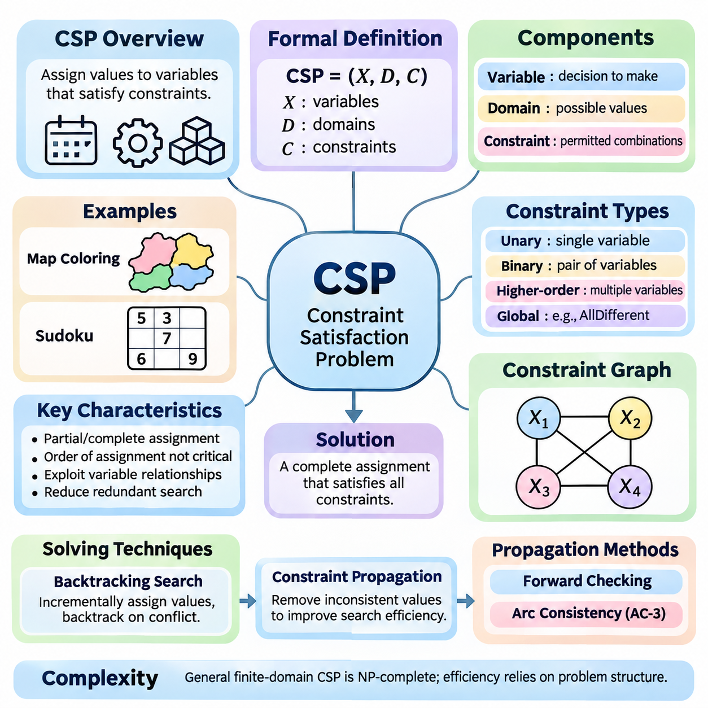
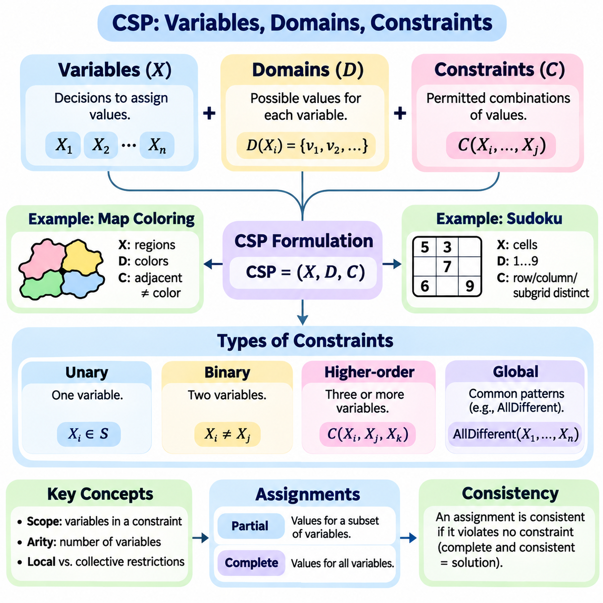
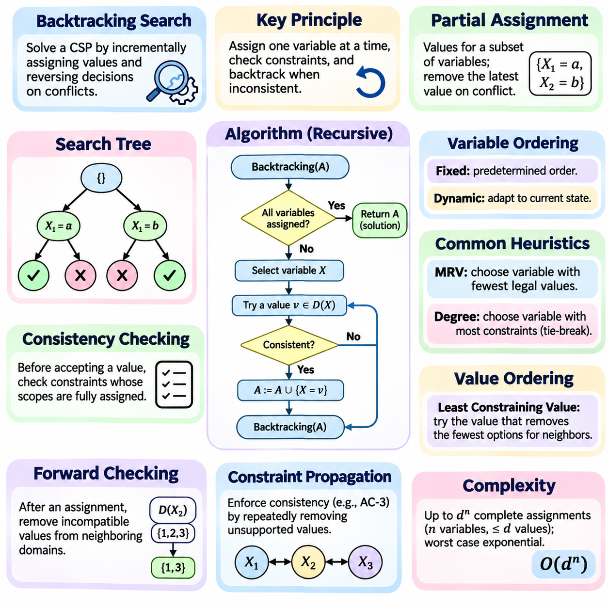
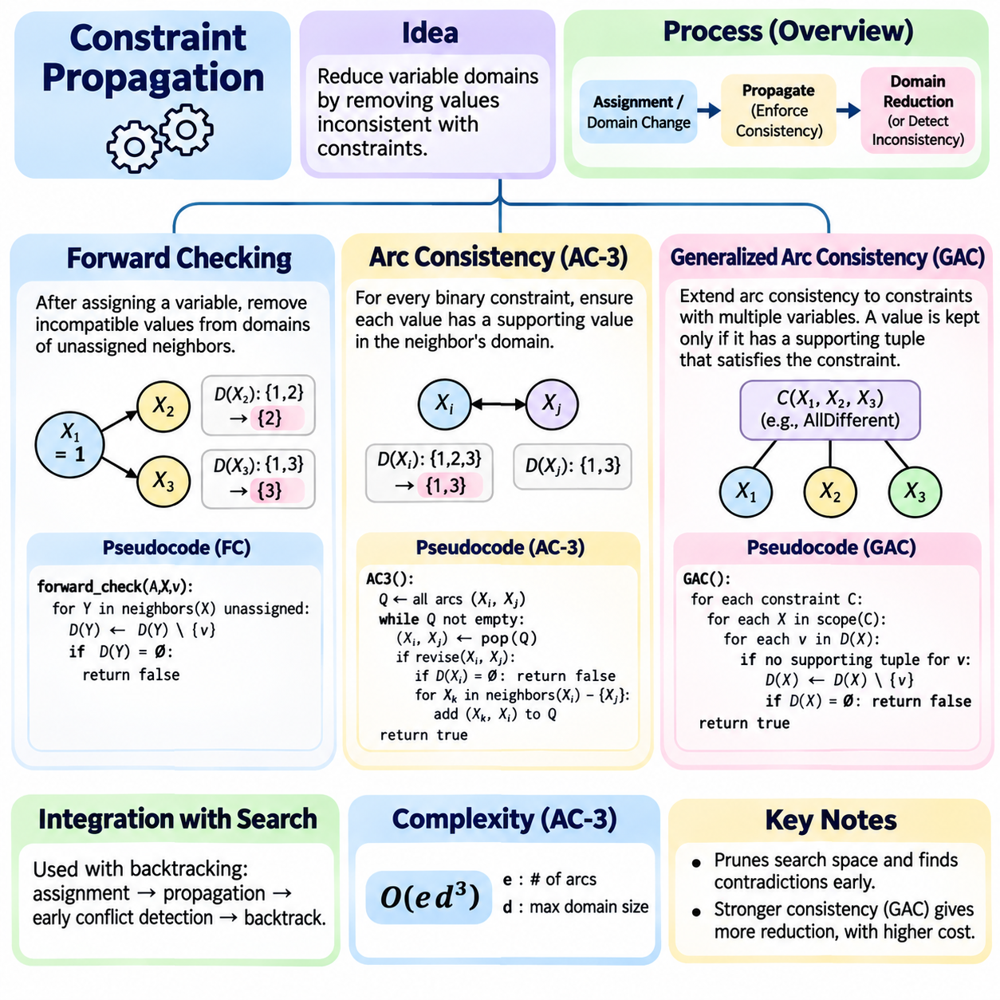
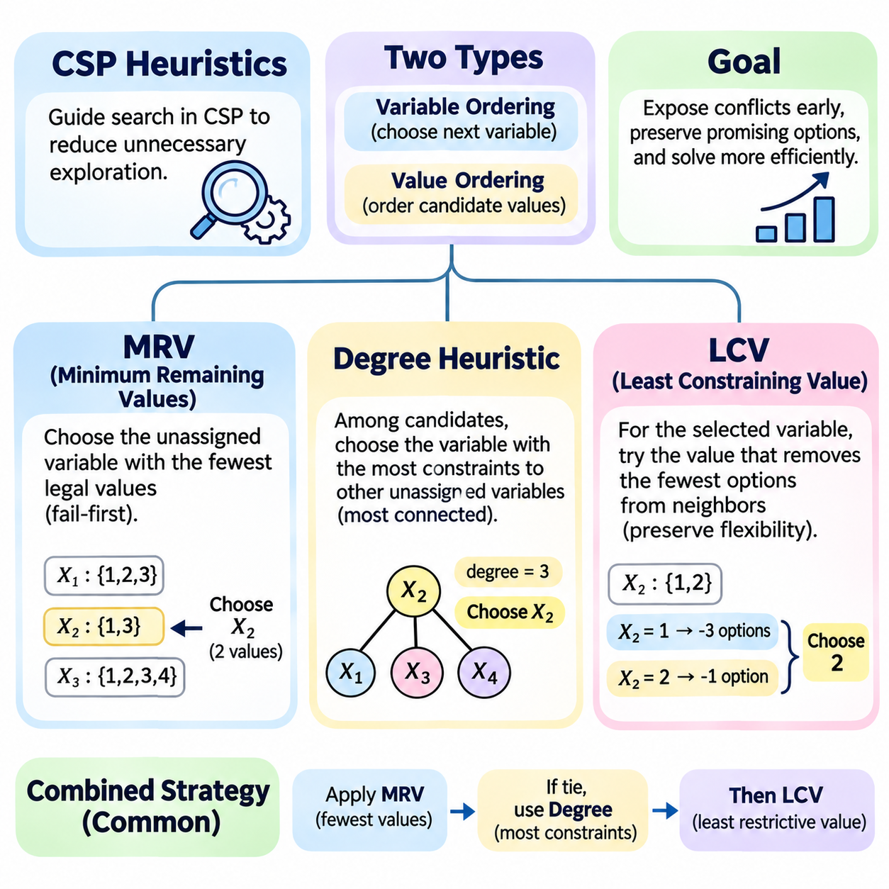
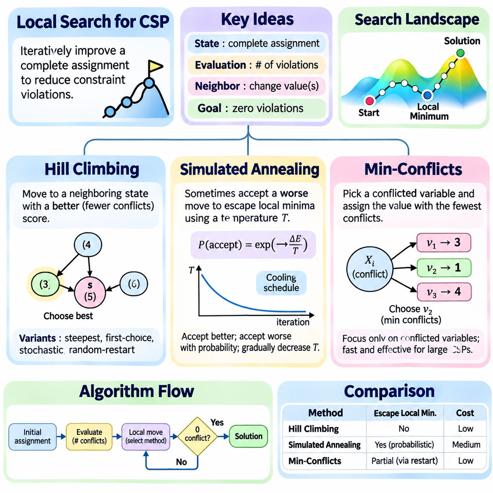
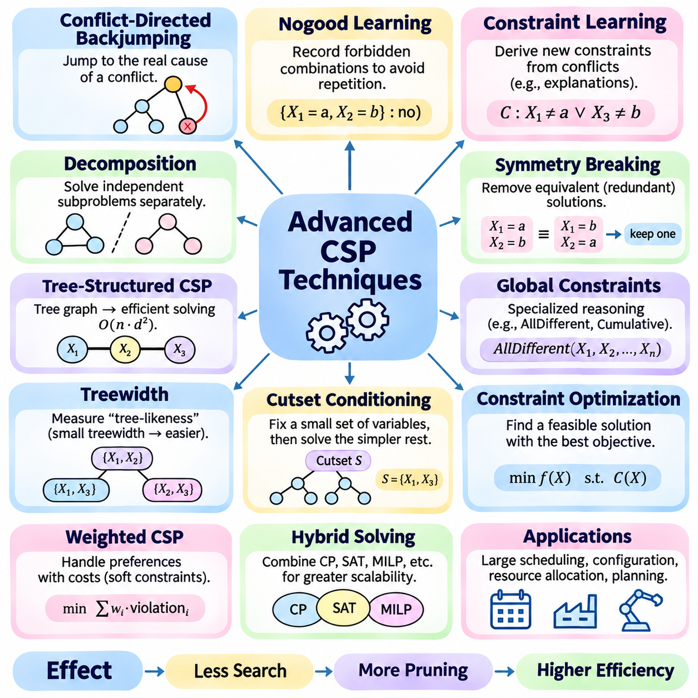
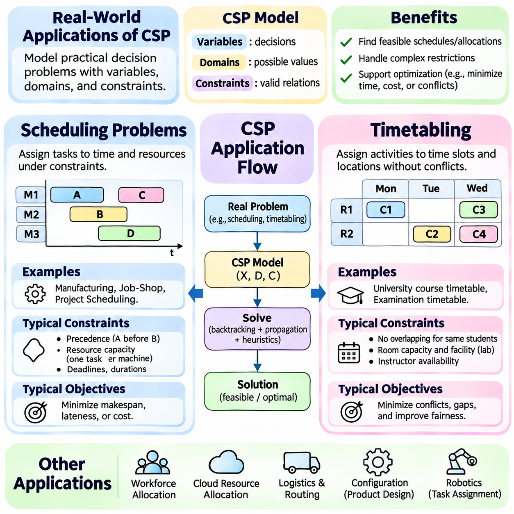
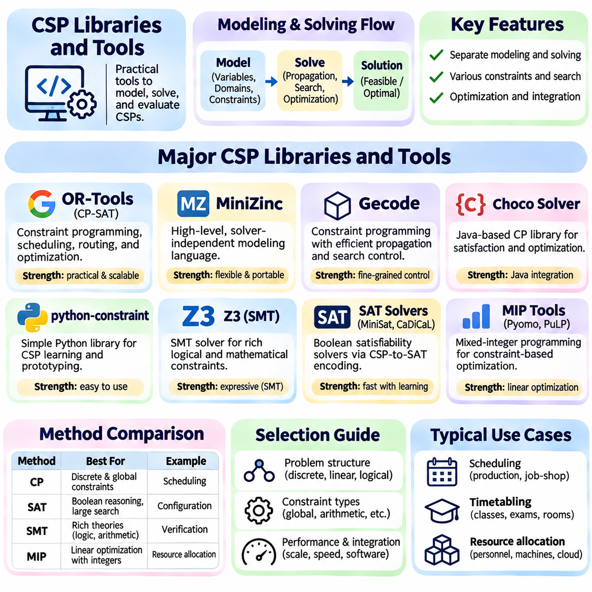

**Volume 01. Classical AI Search and Planning**


# 03. Constraint Satisfaction

## 03.01 Introduction to CSP

{width="7.268055555555556in" height="7.268055555555556in"}

Constraint Satisfaction Problems (CSPs) represent a fundamental approach to solving problems in artificial intelligence where decisions must satisfy a collection of predefined restrictions. Rather than exploring arbitrary sequences of actions, a CSP focuses on assigning values to variables while preserving consistency. This framework provides a systematic foundation for reasoning about scheduling, configuration, allocation, and combinatorial decision-making.

A CSP is formally defined by three essential components: variables, domains, and constraints. Variables represent the decisions that must be made, domains specify the possible values available to each variable, and constraints determine which combinations of values are acceptable. A solution consists of a complete assignment in which every variable receives a value from its domain and all specified constraints are satisfied simultaneously.

The mathematical formulation of a CSP is commonly expressed as a tuple consisting of a variable set, a domain collection, and a constraint set. Each constraint defines a relation over a subset of variables and identifies the combinations that are permitted. This representation separates the logical structure of a problem from the algorithm used to solve it, allowing different solving techniques to operate on the same underlying model.

Constraint satisfaction differs from conventional state-space search because its states are usually represented as partial or complete variable assignments rather than sequences of actions. The order in which variables receive values generally does not change the meaning of a completed solution. This property allows specialized algorithms to eliminate redundant exploration and exploit relationships among variables to reduce computational complexity.

A classic example of constraint satisfaction is map coloring, where neighboring regions must receive different colors. Each region becomes a variable, the available colors form its domain, and adjacency relationships define inequality constraints. The objective is to assign a valid color to every region without violating neighboring restrictions. This simple example illustrates how a large collection of decisions can be represented through local relationships.

Sudoku provides another familiar example in which each empty cell represents a variable with a domain containing digits from one through nine. Constraints require every row, column, and designated subgrid to contain distinct values. Although the rules are simple, their interactions create a complex search space. Constraint satisfaction techniques systematically exploit these interactions to identify valid assignments without enumerating every possible completed grid.

Constraints may involve one variable, two variables, or larger groups of variables. Unary constraints restrict individual domains, binary constraints establish relationships between pairs, and higher-order constraints govern combinations of several variables. Global constraints, such as AllDifferent, express common relationships across many variables and may support specialized propagation algorithms that achieve stronger pruning than simple decompositions.

The constraint graph provides a useful representation of relationships within a CSP. Variables appear as nodes, while edges connect variables participating in binary constraints. This structure reveals dependencies, connectivity, and potential opportunities for decomposition. Problems with sparse constraint graphs or favorable structural properties may be solved substantially more efficiently than densely connected problems containing comparable numbers of variables.

The computational difficulty of constraint satisfaction arises from the combinatorial growth of possible assignments. If a problem contains many variables with multiple candidate values, the number of complete assignments can increase exponentially. General finite-domain CSP solving is NP-complete, although particular constraint languages and graph structures admit polynomial-time algorithms. Effective solving therefore depends on exploiting structure rather than relying on exhaustive enumeration.

Backtracking search is one of the foundational techniques used to solve CSPs. The algorithm incrementally assigns values to variables and checks whether each assignment remains compatible with existing constraints. When a conflict occurs, the algorithm reverses earlier decisions and explores alternatives. This systematic process is complete for finite domains when all relevant alternatives are eventually considered, although its worst-case running time remains exponential.

Constraint propagation improves search efficiency by removing values that cannot participate in valid assignments under the current information. Instead of waiting until a complete assignment reveals a contradiction, propagation examines relationships among variables and reduces their domains. Repeated propagation may expose additional restrictions, creating a chain of deductions that substantially decreases the number of decisions required during subsequent search.

Forward checking is a basic propagation technique that examines variables directly affected by a newly assigned value. When a variable receives an assignment, incompatible values are removed from the domains of its unassigned neighbors. If any remaining domain becomes empty, the current branch cannot produce a solution. Forward checking detects certain conflicts early, although it does not necessarily discover inconsistencies involving only unassigned variables.

Arc consistency provides a stronger form of reasoning for binary constraints. A directed arc is consistent when every value in the source variable\'s domain has at least one compatible supporting value in the destination variable\'s domain. Algorithms such as AC-3 repeatedly revise domains until all relevant arcs become consistent or a contradiction is detected. Arc consistency reduces search effort but does not generally guarantee a complete solution.

Heuristics further improve CSP performance by determining which variables and values should be considered first. The Minimum Remaining Values heuristic prioritizes variables with the fewest legal alternatives, exposing difficult decisions early. The degree heuristic favors variables that constrain many others, while the Least Constraining Value heuristic prefers assignments that preserve flexibility for neighboring variables. These strategies often work effectively together.

Local search offers an alternative approach by operating on complete assignments that may initially violate constraints. Instead of constructing a solution incrementally, the algorithm modifies existing assignments to reduce conflicts. Hill climbing, simulated annealing, and min-conflicts methods illustrate different strategies for navigating this space. Local search can be effective for large problems, although it generally lacks the completeness guarantees of exhaustive backtracking.

Constraint satisfaction also provides a foundation for optimization problems in which satisfying restrictions is necessary but not sufficient. A Constraint Optimization Problem introduces an objective function that evaluates feasible assignments according to cost, quality, efficiency, or another criterion. The solver must identify an assignment satisfying all hard constraints while optimizing the objective. This extension connects CSP methods with operations research and mathematical optimization.

Real-world scheduling illustrates the practical importance of constraint satisfaction. Activities may require specific resources, occupy limited time intervals, and depend on precedence relationships. Constraints prevent resource conflicts, enforce availability, and preserve operational requirements. By expressing these conditions explicitly, a CSP-based system can generate feasible schedules and identify conflicts that would otherwise be difficult to manage manually.

Resource allocation and industrial configuration provide additional applications. Manufacturing systems must assign machines, personnel, and materials while respecting capacity and compatibility restrictions. Robotics systems may use constraint-based reasoning to coordinate tasks, allocate shared resources, and select feasible operational configurations. Such applications demonstrate how symbolic constraints can support structured decision-making within larger autonomous systems.

An important distinction exists between hard constraints and soft constraints. Hard constraints define conditions that must never be violated in a feasible solution, while soft constraints express preferences that may be relaxed at an associated penalty. Weighted constraints and related optimization formulations allow systems to balance competing objectives. This distinction is particularly useful when real-world requirements cannot all be satisfied simultaneously.

The quality of a CSP model strongly influences solving performance. Excessively large domains, unnecessary variables, and weak constraint formulations can increase computational effort even when the underlying problem remains unchanged. Conversely, carefully selected representations and expressive global constraints can expose useful structure. Effective modeling therefore requires both an accurate description of requirements and an understanding of algorithmic behavior.

Constraint satisfaction remains a central component of classical artificial intelligence because it transforms complex decision problems into explicit, verifiable mathematical relationships. Its combination of structured representation, systematic search, propagation, and heuristic reasoning supports reliable problem solving across diverse domains. Understanding these foundations prepares the development of advanced CSP solvers and their integration into planning, robotics, and intelligent decision systems.

제약 충족 문제(Constraint Satisfaction Problem, CSP)는 사전에 정의된 제약 조건(Constraints)을 충족하면서 의사결정을 수행해야 하는 문제를 해결하기 위한 인공지능(Artificial Intelligence)의 기본적인 접근 방식이다. 임의의 행동 순서(Action Sequence)를 탐색하는 대신, 제약 충족 문제는 변수(Variable)에 값을 할당하면서 일관성(Consistency)을 유지하는 데 중점을 둔다. 이러한 체계는 일정 계획(Scheduling), 구성(Configuration), 자원 할당(Resource Allocation), 조합적 의사결정(Combinatorial Decision-Making)을 위한 체계적인 기반을 제공한다.

제약 충족 문제(CSP)는 변수(Variables), 도메인(Domains), 제약 조건(Constraints)이라는 세 가지 핵심 구성 요소로 정의된다. 변수는 결정해야 하는 대상을 나타내고, 도메인은 각 변수에 할당할 수 있는 가능한 값들을 지정하며, 제약 조건은 허용 가능한 값의 조합을 결정한다. 해(Solution)는 모든 변수가 자신의 도메인에서 하나의 값을 할당받고, 지정된 모든 제약 조건을 동시에 만족하는 완전한 할당(Complete Assignment)으로 구성된다.

제약 충족 문제의 수학적 정식화(Mathematical Formulation)는 일반적으로 변수 집합(Variable Set), 도메인 모음(Domain Collection), 제약 조건 집합(Constraint Set)으로 이루어진 튜플(Tuple)로 표현된다. 각 제약 조건은 변수의 부분집합에 대한 관계(Relation)를 정의하고 허용되는 값의 조합을 식별한다. 이러한 표현은 문제의 논리적 구조(Logical Structure)와 문제 해결에 사용되는 알고리즘(Algorithm)을 분리하여, 동일한 기본 모델에 서로 다른 해결 기법을 적용할 수 있도록 한다.

제약 충족 문제는 상태(State)가 일반적으로 행동의 순서가 아니라 부분적 또는 완전한 변수 할당(Partial or Complete Variable Assignment)으로 표현된다는 점에서 기존의 상태 공간 탐색(State-Space Search)과 구별된다. 변수에 값을 할당하는 순서는 일반적으로 완성된 해의 의미를 변경하지 않는다. 이러한 특성으로 인해 특화된 알고리즘은 중복 탐색(Redundant Exploration)을 제거하고 변수 간 관계를 활용하여 계산 복잡도(Computational Complexity)를 줄일 수 있다.

제약 충족 문제의 대표적인 사례는 지도 색칠 문제(Map Coloring Problem)로, 서로 인접한 지역에는 서로 다른 색상을 할당해야 한다. 각 지역은 변수로 표현되고, 사용 가능한 색상은 도메인을 구성하며, 인접 관계(Adjacency Relationship)는 부등 제약 조건(Inequality Constraint)을 정의한다. 목표는 인접 지역 간 제약을 위반하지 않으면서 모든 지역에 유효한 색상을 할당하는 것이다. 이 사례는 다수의 의사결정이 국소적 관계(Local Relationship)를 통해 표현될 수 있음을 보여준다.

스도쿠(Sudoku)는 각 빈 칸이 1부터 9까지의 숫자를 도메인으로 갖는 변수로 표현되는 또 다른 대표적인 사례이다. 제약 조건은 각 행(Row), 열(Column), 지정된 부분 격자(Subgrid)에 서로 다른 숫자가 포함되도록 요구한다. 규칙 자체는 단순하지만, 규칙 사이의 상호작용으로 복잡한 탐색 공간(Search Space)이 형성된다. 제약 충족 기법은 이러한 상호작용을 체계적으로 활용하여 가능한 모든 완성 격자를 열거하지 않고도 유효한 할당을 찾아낸다.

제약 조건은 하나의 변수, 두 개의 변수 또는 더 큰 변수 집합에 적용될 수 있다. 단항 제약 조건(Unary Constraint)은 개별 도메인을 제한하고, 이항 제약 조건(Binary Constraint)은 변수 쌍 사이의 관계를 설정하며, 고차 제약 조건(Higher-Order Constraint)은 여러 변수의 조합을 제어한다. 모든 값이 서로 달라야 한다는 전역 제약 조건(Global Constraint)인 AllDifferent는 다수의 변수에 공통 관계를 표현하며, 단순한 제약 분해보다 강력한 가지치기(Pruning)를 수행하는 특화된 전파 알고리즘을 지원할 수 있다.

제약 그래프(Constraint Graph)는 제약 충족 문제 내부의 관계를 표현하는 유용한 방법이다. 변수는 노드(Node)로 표현되고, 이항 제약 조건에 함께 참여하는 변수들은 간선(Edge)으로 연결된다. 이러한 구조는 의존성(Dependency), 연결성(Connectivity), 문제 분해(Decomposition)의 가능성을 보여준다. 제약 그래프가 희소하거나 유리한 구조적 특성을 가진 문제는 비슷한 수의 변수를 포함하는 밀집된 문제보다 훨씬 효율적으로 해결될 수 있다.

제약 충족 문제의 계산상 어려움은 가능한 할당 조합의 수가 급격하게 증가하는 데서 발생한다. 여러 후보 값을 가진 변수가 많아지면 완전한 할당의 수는 지수적으로 증가할 수 있다. 일반적인 유한 도메인 제약 충족 문제(Finite-Domain CSP)의 해결은 NP-완전(NP-Complete)이지만, 특정 제약 언어(Constraint Language)와 그래프 구조에서는 다항 시간 알고리즘(Polynomial-Time Algorithm)이 가능하다. 따라서 효율적인 해결은 모든 조합을 열거하는 대신 문제의 구조를 활용하는 데 달려 있다.

역추적 탐색(Backtracking Search)은 제약 충족 문제를 해결하는 기본적인 기법 중 하나이다. 알고리즘은 변수에 값을 점진적으로 할당하면서 각 할당이 기존 제약 조건과 양립 가능한지 확인한다. 충돌(Conflict)이 발생하면 이전 결정을 되돌리고 다른 대안을 탐색한다. 이러한 체계적인 과정은 모든 관련 대안을 최종적으로 검토하는 경우 유한 도메인에 대해 완전성(Completeness)을 보장하지만, 최악의 경우 실행 시간(Worst-Case Running Time)은 여전히 지수적으로 증가한다.

제약 전파(Constraint Propagation)는 현재 정보에서 유효한 해에 포함될 수 없는 값을 제거하여 탐색 효율성을 향상시킨다. 완전한 할당이 이루어진 후 모순(Contradiction)이 발견될 때까지 기다리는 대신, 변수 사이의 관계를 분석하여 도메인을 축소한다. 반복적인 전파는 추가적인 제약을 드러내고 연쇄적인 추론(Deduction)을 발생시킬 수 있다. 이를 통해 이후 탐색 과정에서 필요한 의사결정의 수를 크게 줄일 수 있다.

전방 검사(Forward Checking)는 새롭게 할당된 값에 직접적인 영향을 받는 변수를 검사하는 기본적인 전파 기법이다. 변수에 값이 할당되면 아직 할당되지 않은 인접 변수(Unassigned Neighbor)의 도메인에서 호환되지 않는 값이 제거된다. 남아 있는 도메인 중 하나라도 비게 되면 현재 탐색 분기(Search Branch)는 해를 생성할 수 없다. 전방 검사는 일부 충돌을 조기에 발견하지만, 할당되지 않은 변수들 사이에서만 발생하는 불일치를 반드시 발견하는 것은 아니다.

호 일관성(Arc Consistency)은 이항 제약 조건에 대해 더욱 강력한 추론을 제공한다. 방향성 호(Directed Arc)는 출발 변수의 도메인에 있는 모든 값이 도착 변수의 도메인에서 적어도 하나의 호환 가능한 지원 값(Supporting Value)을 가질 때 일관성을 만족한다. AC-3와 같은 알고리즘은 관련된 모든 호가 일관성을 만족하거나 모순이 발견될 때까지 도메인을 반복적으로 수정한다. 호 일관성은 탐색 부담을 줄이지만 일반적으로 완전한 해를 보장하지는 않는다.

휴리스틱(Heuristics)은 어떤 변수와 값을 먼저 고려할지 결정하여 제약 충족 문제의 성능을 더욱 향상시킨다. 최소 잔여 값(Minimum Remaining Values, MRV) 휴리스틱은 합법적인 대안이 가장 적은 변수를 우선 선택하여 어려운 결정을 조기에 드러낸다. 차수 휴리스틱(Degree Heuristic)은 많은 다른 변수를 제약하는 변수를 선호하고, 최소 제약 값(Least Constraining Value) 휴리스틱은 인접 변수의 선택 가능성을 최대한 보존하는 값을 우선한다. 이러한 전략은 함께 사용할 때 효과적인 경우가 많다.

국소 탐색(Local Search)은 처음부터 제약 조건을 위반할 수 있는 완전한 할당을 대상으로 작동하는 대안적인 접근 방식이다. 해를 점진적으로 구성하는 대신 기존 할당을 수정하여 충돌을 줄인다. 언덕 오르기(Hill Climbing), 모의 담금질(Simulated Annealing), 최소 충돌(Min-Conflicts) 기법은 이러한 탐색 공간을 이동하는 서로 다른 전략을 보여준다. 국소 탐색은 대규모 문제에서 효과적일 수 있지만, 일반적으로 완전한 역추적 탐색이 제공하는 완전성 보장을 갖지 않는다.

제약 충족 문제는 제약 조건을 만족하는 것만으로 충분하지 않은 최적화 문제(Optimization Problem)의 기반도 제공한다. 제약 최적화 문제(Constraint Optimization Problem)는 비용(Cost), 품질(Quality), 효율성(Efficiency) 또는 다른 기준에 따라 실행 가능한 할당(Feasible Assignment)을 평가하는 목적 함수(Objective Function)를 도입한다. 해결기는 모든 필수 제약 조건을 만족하면서 목적 함수를 최적화하는 할당을 찾아야 한다. 이러한 확장은 제약 충족 기법을 운영 연구(Operations Research) 및 수학적 최적화(Mathematical Optimization)와 연결한다.

실제 일정 계획(Scheduling)은 제약 충족의 실용적 중요성을 보여주는 대표적인 사례이다. 활동(Activity)은 특정 자원을 필요로 하거나 제한된 시간 구간(Time Interval)을 점유하며, 선행 관계(Precedence Relationship)에 따라 수행되어야 할 수 있다. 제약 조건은 자원 충돌(Resource Conflict)을 방지하고 가용성(Availability)을 보장하며 운영 요구사항(Operational Requirements)을 유지한다. 이러한 조건을 명시적으로 표현하면 제약 충족 기반 시스템은 실행 가능한 일정을 생성하고 수작업으로 관리하기 어려운 충돌을 식별할 수 있다.

자원 할당(Resource Allocation)과 산업 구성(Industrial Configuration)도 중요한 응용 분야이다. 제조 시스템(Manufacturing System)은 용량(Capacity)과 호환성(Compatibility) 제약을 준수하면서 기계, 인력, 자재를 할당해야 한다. 로봇 시스템(Robotics System)은 제약 기반 추론(Constraint-Based Reasoning)을 활용하여 작업을 조정하고 공유 자원을 할당하며 실행 가능한 운영 구성을 선택할 수 있다. 이러한 응용은 기호적 제약(Symbolic Constraint)이 대규모 자율 시스템(Autonomous System)의 구조화된 의사결정을 지원할 수 있음을 보여준다.

필수 제약 조건(Hard Constraint)과 완화 가능 제약 조건(Soft Constraint)의 구분도 중요하다. 필수 제약 조건은 실행 가능한 해에서 절대로 위반해서는 안 되는 조건을 정의하며, 완화 가능 제약 조건은 일정한 불이익(Penalty)을 감수하고 완화할 수 있는 선호 사항을 나타낸다. 가중 제약 조건(Weighted Constraint)과 관련 최적화 정식화(Optimization Formulation)는 시스템이 상충하는 목표 사이에서 균형을 유지하도록 한다. 이러한 구분은 실제 요구사항을 모두 동시에 만족시킬 수 없는 상황에서 특히 유용하다.

제약 충족 문제 모델(CSP Model)의 품질은 해결 성능에 큰 영향을 미친다. 지나치게 큰 도메인, 불필요한 변수, 약한 제약 조건 정식화(Weak Constraint Formulation)는 기본 문제가 동일하더라도 계산 부담을 증가시킬 수 있다. 반대로 신중하게 선택된 표현(Representation)과 표현력이 높은 전역 제약 조건은 유용한 구조를 드러낼 수 있다. 따라서 효과적인 모델링(Modeling)은 요구사항을 정확하게 기술하는 능력과 알고리즘의 동작을 이해하는 능력을 모두 필요로 한다.

제약 충족(Constraint Satisfaction)은 복잡한 의사결정 문제를 명시적이고 검증 가능한 수학적 관계(Mathematical Relationship)로 변환하기 때문에 고전 인공지능(Classical Artificial Intelligence)의 핵심 구성 요소로 남아 있다. 구조화된 표현(Structured Representation), 체계적인 탐색(Systematic Search), 제약 전파, 휴리스틱 추론(Heuristic Reasoning)의 결합은 다양한 분야에서 신뢰성 있는 문제 해결을 지원한다. 이러한 기초에 대한 이해는 고급 제약 충족 해결기(Advanced CSP Solver)의 개발과 계획(Planning), 로봇공학(Robotics), 지능형 의사결정 시스템(Intelligent Decision System)으로의 통합을 준비하는 기반이 된다.

## 03.02 Variables Domains Constraints

{width="7.268055555555556in" height="7.268055555555556in"}

Variables, domains, and constraints form the fundamental building blocks of a Constraint Satisfaction Problem (CSP). These components provide a structured representation of decisions, available alternatives, and permissible relationships. By separating what must be decided from which values are possible and which combinations are valid, a CSP transforms complex reasoning tasks into a mathematical framework suitable for systematic search and logical inference.

A variable represents an unknown quantity or decision that must receive a value during problem solving. Variables may describe locations, time slots, resource assignments, machine configurations, or symbolic categories. In a scheduling problem, each variable might represent the starting time of an activity. In a robotics application, variables may represent task assignments, operational modes, or discrete configuration choices subject to physical and operational restrictions.

The collection of variables is commonly represented as X = , where each Xi corresponds to an individual decision. A variable should have a clearly defined meaning and an appropriate level of abstraction. Selecting variables that are too broad can make constraints difficult to express, while excessive decomposition can increase computational complexity. Effective variable design balances modeling accuracy with efficient reasoning.

A domain defines the set of values that a variable is permitted to take. For a variable Xi, its domain is denoted by D(Xi), containing all candidate values considered during solving. Domains may contain integers, Boolean values, categorical labels, or structured objects. In classical finite-domain CSPs, each domain contains a finite collection of alternatives, allowing algorithms to systematically examine assignments and eliminate inconsistent possibilities.

Domain selection directly influences the size of the search space. If a CSP contains n variables and each has d possible values, the number of complete assignments is d raised to the power n when all domains have equal size. Although constraints eliminate many combinations, unnecessarily large domains increase the initial search burden. Carefully restricting domains to meaningful values can therefore improve efficiency without excluding valid solutions.

Domains can be represented explicitly through enumerated values or implicitly through mathematical ranges and symbolic conditions. An explicit domain might contain the colors red, green, and blue, while an interval domain might represent integer time slots between specified limits. Different representations support different solving techniques. Compact domain representations become particularly important when variables involve large numerical ranges or complex resource configurations.

A constraint specifies a condition that must hold among one or more variables. Formally, a constraint consists of a scope identifying the variables involved and a relation describing permitted combinations of their values. Constraints distinguish feasible assignments from invalid ones. They may express equality, inequality, ordering, capacity limits, compatibility requirements, or logical dependencies, depending on the structure of the problem being modeled.

Unary constraints involve a single variable and restrict its allowable values. For example, a machine operating mode may be limited to a subset of available configurations, or a scheduled activity may be prohibited during a particular time interval. Unary constraints can often be incorporated directly into variable domains before search begins. This preprocessing reduces unnecessary alternatives and simplifies subsequent reasoning.

Binary constraints establish relationships between two variables. Common examples include inequality constraints requiring different values, precedence constraints imposing an ordering, and compatibility constraints restricting acceptable pairs. In map coloring, adjacent regions must receive different colors. In scheduling, two activities sharing an exclusive resource cannot overlap. Binary constraints are particularly important because they support graph-based representations and efficient propagation algorithms.

Higher-order constraints involve three or more variables simultaneously. A capacity constraint may limit the combined resource consumption of several tasks, while a collective scheduling requirement may restrict the number of activities assigned to a particular period. These constraints capture relationships that cannot always be represented naturally through independent binary conditions. Their treatment depends on the expressive capabilities of the selected CSP solver.

Global constraints represent recurring patterns involving collections of variables. The AllDifferent constraint requires every variable in its scope to receive a distinct value, making it useful for assignment problems, Sudoku, and resource allocation. Global constraints often provide specialized propagation mechanisms that exploit their mathematical structure. Such mechanisms can eliminate inconsistent values more effectively than decomposing the same relationship into simpler constraints.

The scope of a constraint determines which variables participate in its evaluation. Constraints with small scopes describe local relationships, while broader scopes capture collective restrictions. Constraint arity refers to the number of variables involved in a constraint. Understanding scope and arity helps determine the structure of the resulting constraint network and influences the selection of appropriate propagation and search techniques.

A complete assignment provides a value for every variable, while a partial assignment specifies values for only a subset. An assignment is consistent when it violates no constraint whose entire scope has been assigned. A complete assignment becomes a solution only when all constraints are satisfied. This distinction is essential because partial consistency does not guarantee that the remaining variables can be assigned successfully.

Constraint satisfaction can be interpreted as identifying a point within the Cartesian product of all variable domains that satisfies every constraint relation. Each complete assignment represents one candidate point, and the constraints collectively define the feasible region. This mathematical interpretation clarifies why solving a CSP requires finding an intersection of permitted combinations rather than optimizing an objective function in the basic satisfaction formulation.

A constraint network captures the dependencies created by shared variables. In a binary CSP, the network can be represented as a graph whose nodes correspond to variables and whose edges represent binary constraints. Sparse networks may permit decomposition into smaller subproblems, while densely connected networks can create stronger interactions. The topology of this network can significantly influence computational difficulty and algorithmic performance.

Modeling choices can change the complexity of a CSP without changing the underlying real-world problem. A poorly designed representation may introduce redundant variables, unnecessarily broad domains, or weak constraints. Conversely, a carefully constructed model can expose useful dependencies and enable stronger propagation. Choosing an appropriate representation is therefore as important as selecting an efficient search algorithm.

Constraints can also be classified as hard or soft requirements. Hard constraints must be satisfied for an assignment to be feasible, while soft constraints express preferences whose violations may incur penalties. Classical CSPs primarily focus on hard constraints, whereas weighted and optimization-oriented extensions incorporate soft requirements. This distinction enables constraint-based systems to represent both mandatory operational rules and desirable performance characteristics.

Real-world applications frequently combine variables of different meanings and constraints of different forms. A manufacturing scheduling system may include machine assignments, task start times, processing durations, and resource capacities. A robotic coordination system may combine task allocation, workspace occupancy, and execution precedence. Accurate modeling requires each variable and constraint to reflect the operational relationships that determine feasibility.

Consistency techniques exploit the interaction between domains and constraints to reduce the search space. When a value becomes incompatible with neighboring variables, it can be removed from the corresponding domain. Repeated domain reduction may reveal further inconsistencies and eventually establish that a branch cannot produce a solution. This process forms the foundation of forward checking, arc consistency, and generalized constraint propagation.

The relationship between variables, domains, and constraints determines both the expressive power and computational behavior of a CSP. Variables define the decisions, domains establish the available alternatives, and constraints encode the rules governing acceptable combinations. Together, these components provide a precise and reusable representation for combinatorial reasoning, enabling systematic search, propagation, optimization extensions, and practical intelligent decision-making systems.

변수(Variables), 도메인(Domains), 제약 조건(Constraints)은 제약 충족 문제(Constraint Satisfaction Problem, CSP)를 구성하는 기본 요소이다. 이러한 구성 요소는 의사결정(Decision), 사용 가능한 대안(Available Alternatives), 허용 가능한 관계(Permissible Relationships)를 구조적으로 표현한다. 결정해야 할 대상, 가능한 값, 유효한 조합을 분리함으로써 제약 충족 문제는 복잡한 추론 작업(Reasoning Task)을 체계적인 탐색(Systematic Search)과 논리적 추론(Logical Inference)에 적합한 수학적 체계(Mathematical Framework)로 변환한다.

변수(Variable)는 문제 해결 과정에서 값을 할당받아야 하는 미지의 수량(Unknown Quantity) 또는 의사결정 대상을 나타낸다. 변수는 위치(Location), 시간대(Time Slot), 자원 할당(Resource Assignment), 기계 구성(Machine Configuration), 기호적 범주(Symbolic Category) 등을 표현할 수 있다. 일정 계획(Scheduling) 문제에서 각 변수는 활동의 시작 시간을 나타낼 수 있으며, 로봇공학(Robotics) 응용에서는 물리적·운영상의 제약을 받는 작업 할당(Task Assignment), 운영 모드(Operational Mode), 이산적 구성 선택(Discrete Configuration Choice)을 나타낼 수 있다.

변수 집합(Variable Set)은 일반적으로 X = 으로 표현되며, 각 Xi는 개별적인 의사결정에 대응한다. 변수는 명확하게 정의된 의미와 적절한 추상화 수준(Abstraction Level)을 가져야 한다. 변수를 지나치게 포괄적으로 정의하면 제약 조건을 표현하기 어려워지고, 반대로 과도하게 세분화하면 계산 복잡도(Computational Complexity)가 증가할 수 있다. 효과적인 변수 설계(Variable Design)는 모델링 정확도(Modeling Accuracy)와 추론 효율성(Reasoning Efficiency) 사이의 균형을 유지해야 한다.

도메인(Domain)은 변수가 가질 수 있도록 허용된 값들의 집합을 정의한다. 변수 Xi의 도메인은 D(Xi)로 표시하며, 문제 해결 과정에서 고려되는 모든 후보 값(Candidate Value)을 포함한다. 도메인에는 정수(Integer), 불리언 값(Boolean Value), 범주형 레이블(Categorical Label), 구조화된 객체(Structured Object) 등이 포함될 수 있다. 고전적인 유한 도메인 제약 충족 문제(Finite-Domain CSP)에서는 각 도메인이 유한한 대안 집합을 포함하므로, 알고리즘은 할당을 체계적으로 검사하고 일관성이 없는 가능성을 제거할 수 있다.

도메인 선택(Domain Selection)은 탐색 공간(Search Space)의 크기에 직접적인 영향을 미친다. 제약 충족 문제가 n개의 변수를 포함하고 각 변수가 d개의 가능한 값을 가진다면, 모든 도메인의 크기가 동일할 때 완전한 할당(Complete Assignment)의 수는 d의 n제곱이 된다. 제약 조건이 많은 조합을 제거하더라도 불필요하게 큰 도메인은 초기 탐색 부담을 증가시킨다. 따라서 유효한 해(Valid Solution)를 제외하지 않는 범위에서 도메인을 의미 있는 값으로 제한하면 효율성을 향상시킬 수 있다.

도메인은 열거된 값(Enumerated Value)을 통해 명시적으로 표현하거나 수학적 범위(Mathematical Range)와 기호적 조건(Symbolic Condition)을 통해 암묵적으로 표현할 수 있다. 명시적 도메인(Explicit Domain)은 빨강, 초록, 파랑과 같은 색상을 포함할 수 있으며, 구간 도메인(Interval Domain)은 지정된 범위 안의 정수 시간대를 나타낼 수 있다. 서로 다른 표현 방식은 서로 다른 해결 기법(Solving Technique)을 지원한다. 특히 변수가 큰 수치 범위나 복잡한 자원 구성을 포함할 때는 간결한 도메인 표현(Compact Domain Representation)이 중요하다.

제약 조건(Constraint)은 하나 이상의 변수 사이에서 반드시 성립해야 하는 조건을 지정한다. 형식적으로 제약 조건은 관련 변수를 식별하는 범위(Scope)와 허용되는 값의 조합을 설명하는 관계(Relation)로 구성된다. 제약 조건은 실행 가능한 할당(Feasible Assignment)과 유효하지 않은 할당(Invalid Assignment)을 구분한다. 문제의 구조에 따라 동등 관계(Equality), 부등 관계(Inequality), 순서(Ordering), 용량 제한(Capacity Limit), 호환성 요구사항(Compatibility Requirement), 논리적 의존성(Logical Dependency) 등을 표현할 수 있다.

단항 제약 조건(Unary Constraint)은 하나의 변수에 적용되며 허용 가능한 값을 제한한다. 예를 들어 기계의 운영 모드(Machine Operating Mode)는 사용 가능한 구성 중 일부로 제한될 수 있으며, 일정에 배정된 활동은 특정 시간 구간에 수행되지 못하도록 제한될 수 있다. 단항 제약 조건은 탐색이 시작되기 전에 변수의 도메인에 직접 반영할 수 있는 경우가 많다. 이러한 전처리(Preprocessing)는 불필요한 대안을 줄이고 이후의 추론 과정을 단순화한다.

이항 제약 조건(Binary Constraint)은 두 변수 사이의 관계를 설정한다. 대표적인 사례로는 서로 다른 값을 요구하는 부등 제약 조건(Inequality Constraint), 순서를 지정하는 선행 제약 조건(Precedence Constraint), 허용 가능한 값의 쌍을 제한하는 호환성 제약 조건(Compatibility Constraint)이 있다. 지도 색칠 문제(Map Coloring Problem)에서는 인접 지역에 서로 다른 색상을 할당해야 하며, 일정 계획에서는 배타적인 자원을 공유하는 두 활동이 시간적으로 겹칠 수 없다. 이항 제약 조건은 그래프 기반 표현(Graph-Based Representation)과 효율적인 전파 알고리즘(Propagation Algorithm)을 지원한다는 점에서 중요하다.

고차 제약 조건(Higher-Order Constraint)은 세 개 이상의 변수에 동시에 적용된다. 용량 제약 조건(Capacity Constraint)은 여러 작업의 총자원 소비량을 제한할 수 있으며, 집합적 일정 요구사항(Collective Scheduling Requirement)은 특정 기간에 배정할 수 있는 활동 수를 제한할 수 있다. 이러한 제약 조건은 독립적인 이항 조건만으로 자연스럽게 표현하기 어려운 관계를 포착한다. 처리 방식은 선택한 제약 충족 해결기(CSP Solver)의 표현 능력(Expressive Capability)에 따라 달라진다.

전역 제약 조건(Global Constraint)은 변수 집합에 반복적으로 나타나는 공통 패턴을 표현한다. AllDifferent 제약 조건은 적용 범위에 포함된 모든 변수가 서로 다른 값을 갖도록 요구하므로 할당 문제(Assignment Problem), 스도쿠(Sudoku), 자원 할당(Resource Allocation)에 유용하다. 전역 제약 조건은 수학적 구조를 활용하는 특화된 제약 전파 메커니즘(Specialized Constraint Propagation Mechanism)을 제공하는 경우가 많다. 이러한 메커니즘은 동일한 관계를 단순한 제약 조건으로 분해하는 방식보다 일관성이 없는 값을 더욱 효과적으로 제거할 수 있다.

제약 조건의 범위(Constraint Scope)는 해당 제약 조건을 평가할 때 어떤 변수가 참여하는지를 결정한다. 작은 범위를 가진 제약 조건은 국소적 관계(Local Relationship)를 설명하고, 넓은 범위를 가진 제약 조건은 집합적인 제한(Collective Restriction)을 표현한다. 제약 조건의 차수(Constraint Arity)는 하나의 제약 조건에 포함된 변수의 수를 의미한다. 범위와 차수를 이해하면 제약 네트워크(Constraint Network)의 구조를 파악하고 적절한 전파 및 탐색 기법을 선택하는 데 도움이 된다.

완전한 할당(Complete Assignment)은 모든 변수에 값을 지정한 상태이며, 부분 할당(Partial Assignment)은 변수의 일부에만 값을 지정한 상태이다. 할당된 변수들이 해당 제약 조건의 전체 범위를 구성하는 경우, 그 제약 조건을 위반하지 않으면 해당 할당은 일관성(Consistency)을 가진다. 완전한 할당은 모든 제약 조건을 만족할 때만 해(Solution)가 된다. 부분적인 일관성이 남은 변수들에 대한 성공적인 할당을 보장하지는 않기 때문에 이러한 구분은 중요하다.

제약 충족 문제는 모든 변수 도메인의 데카르트 곱(Cartesian Product)에서 모든 제약 관계를 만족하는 하나의 점을 찾는 문제로 해석할 수 있다. 각 완전한 할당은 하나의 후보 점(Candidate Point)을 나타내며, 제약 조건들은 집합적으로 실행 가능 영역(Feasible Region)을 정의한다. 이러한 수학적 해석은 기본적인 제약 충족 정식화(Basic Satisfaction Formulation)가 목적 함수(Objective Function)를 최적화하는 것이 아니라 허용 가능한 조합들의 교집합(Intersection)을 찾는 과정임을 명확하게 보여준다.

제약 네트워크(Constraint Network)는 공유 변수를 통해 형성되는 의존성(Dependency)을 포착한다. 이항 제약 충족 문제(Binary CSP)에서는 변수를 노드(Node)로, 이항 제약 조건을 간선(Edge)으로 나타내는 그래프(Graph)로 네트워크를 표현할 수 있다. 희소 네트워크(Sparse Network)는 더 작은 하위 문제(Subproblem)로 분해할 수 있는 반면, 밀집 네트워크(Dense Network)는 더욱 강한 상호작용을 발생시킬 수 있다. 이러한 네트워크의 위상 구조(Network Topology)는 계산 난이도(Computational Difficulty)와 알고리즘 성능(Algorithmic Performance)에 상당한 영향을 미친다.

모델링 선택(Modeling Choice)은 실제 문제가 동일하더라도 제약 충족 문제의 복잡도를 변화시킬 수 있다. 잘못 설계된 표현은 중복 변수(Redundant Variable), 불필요하게 넓은 도메인, 약한 제약 조건(Weak Constraint)을 도입할 수 있다. 반대로 신중하게 구성된 모델은 유용한 의존성을 드러내고 더욱 강력한 제약 전파(Constraint Propagation)를 가능하게 한다. 따라서 적절한 표현 방식을 선택하는 것은 효율적인 탐색 알고리즘(Search Algorithm)을 선택하는 것만큼 중요하다.

제약 조건은 필수 제약 조건(Hard Constraint)과 완화 가능 제약 조건(Soft Constraint)으로도 분류할 수 있다. 필수 제약 조건은 할당이 실행 가능하려면 반드시 만족해야 하는 반면, 완화 가능 제약 조건은 위반할 경우 불이익(Penalty)이 발생할 수 있는 선호 사항을 표현한다. 고전적인 제약 충족 문제(Classical CSP)는 주로 필수 제약 조건에 초점을 맞추지만, 가중 제약 조건(Weighted Constraint)과 최적화 지향 확장(Optimization-Oriented Extension)은 완화 가능 요구사항을 포함한다. 이러한 구분을 통해 제약 기반 시스템은 필수 운영 규칙과 바람직한 성능 특성을 함께 표현할 수 있다.

실제 응용에서는 서로 다른 의미를 가진 변수와 다양한 형태의 제약 조건이 결합되는 경우가 많다. 제조 일정 계획 시스템(Manufacturing Scheduling System)은 기계 할당(Machine Assignment), 작업 시작 시간(Task Start Time), 처리 시간(Processing Duration), 자원 용량(Resource Capacity)을 포함할 수 있다. 로봇 협업 시스템(Robotic Coordination System)은 작업 할당(Task Allocation), 작업 공간 점유(Workspace Occupancy), 실행 선행 관계(Execution Precedence)를 결합할 수 있다. 정확한 모델링은 각 변수와 제약 조건이 실행 가능성을 결정하는 실제 운영 관계를 반영하도록 요구한다.

일관성 유지 기법(Consistency Technique)은 도메인과 제약 조건 사이의 상호작용을 활용하여 탐색 공간을 줄인다. 어떤 값이 인접 변수와 호환되지 않으면 해당 도메인에서 제거할 수 있다. 반복적인 도메인 축소(Domain Reduction)는 추가적인 불일치를 드러낼 수 있으며, 궁극적으로 특정 탐색 분기(Search Branch)가 해를 생성할 수 없음을 확인할 수 있다. 이러한 과정은 전방 검사(Forward Checking), 호 일관성(Arc Consistency), 일반화된 제약 전파(Generalized Constraint Propagation)의 기초를 형성한다.

변수(Variables), 도메인(Domains), 제약 조건(Constraints) 사이의 관계는 제약 충족 문제의 표현 능력(Expressive Power)과 계산적 동작(Computational Behavior)을 결정한다. 변수는 의사결정 대상을 정의하고, 도메인은 사용 가능한 대안을 설정하며, 제약 조건은 허용 가능한 조합을 결정하는 규칙을 부호화한다. 이러한 구성 요소들은 조합적 추론(Combinatorial Reasoning)을 위한 정확하고 재사용 가능한 표현을 제공하며, 체계적인 탐색(Systematic Search), 제약 전파(Constraint Propagation), 최적화 확장(Optimization Extension), 실용적인 지능형 의사결정 시스템(Intelligent Decision-Making System)을 가능하게 한다.

## 03.03 Backtracking Search [w/Code]

{width="7.268055555555556in" height="7.268055555555556in"}

Backtracking search is a fundamental algorithm for solving Constraint Satisfaction Problems (CSPs) by systematically constructing assignments and reversing decisions when conflicts occur. Instead of generating every possible complete assignment, the algorithm builds solutions incrementally and rejects inconsistent partial assignments. This approach combines depth-first exploration with constraint checking, providing a general foundation for solving combinatorial decision problems.

The central principle of backtracking is to assign values to variables one at a time while maintaining consistency with previously assigned variables. At each step, the algorithm selects an unassigned variable and examines candidate values from its domain. If an assignment satisfies all currently applicable constraints, the search continues recursively. Otherwise, the candidate is rejected, and another value is considered.

A partial assignment represents the current state of the search process. It contains values assigned to a subset of variables while leaving the remaining variables undecided. The algorithm maintains this assignment as it explores deeper levels of the search tree. When a conflict prevents further progress, the most recent assignment is removed, restoring the previous state and allowing alternative decisions to be explored.

Backtracking search follows the structure of depth-first search but differs from ordinary state-space exploration in its treatment of constraints. Each search node represents a partial assignment, and each branch corresponds to assigning a candidate value to another variable. Constraint checking prevents the expansion of branches that already violate known requirements. This early rejection substantially reduces unnecessary exploration compared with exhaustive enumeration.

The recursive formulation of backtracking provides a compact and intuitive implementation. A recursive procedure receives the current partial assignment, checks whether all variables have been assigned, and returns a solution when the assignment is complete and consistent. Otherwise, it selects another variable, tries permissible values, and recursively explores the resulting assignments. Failed recursive calls trigger the restoration of earlier decisions.

Consistency checking is essential to the correctness and efficiency of backtracking. Before accepting a candidate value, the solver evaluates constraints whose scopes are fully assigned by the proposed decision. If any applicable constraint is violated, the candidate is rejected immediately. This process ensures that every maintained partial assignment remains consistent, although consistency alone does not guarantee that a complete solution exists.

The search tree generated by backtracking depends on the number of variables, their domain sizes, and the order in which decisions are made. With n variables and at most d values per variable, the number of complete assignments can reach d raised to the power n. Although backtracking avoids exploring many inconsistent combinations, its worst-case time complexity remains exponential. Its practical performance therefore depends heavily on pruning and decision ordering.

Variable ordering determines which unassigned variable is selected at each recursive step. A fixed ordering follows a predetermined sequence, while dynamic ordering adapts to the current assignment and remaining domains. Choosing highly constrained variables early can expose contradictions before extensive exploration occurs. This strategy reduces wasted computation and improves the effectiveness of subsequent constraint propagation.

The Minimum Remaining Values heuristic selects the variable with the fewest currently legal values. This fail-first strategy prioritizes decisions most likely to reveal an inconsistency. If a variable has no remaining legal values, the current branch can be rejected immediately. By identifying difficult choices early, MRV often reduces the number of search nodes explored, particularly in tightly constrained problems.

The degree heuristic provides another method for selecting variables. It favors an unassigned variable that participates in the largest number of constraints involving other unassigned variables. This prioritizes decisions that may influence many remaining choices. Degree-based selection is commonly used to break ties between variables with equal MRV scores, combining immediate domain restrictions with broader structural influence.

Value ordering determines the sequence in which candidate values are attempted. The Least Constraining Value heuristic prefers assignments that eliminate the fewest alternatives from neighboring variables. This preserves flexibility for future decisions and can increase the likelihood of reaching a complete solution without backtracking. While value ordering does not change completeness, it can significantly influence the time required to discover a solution.

Forward checking strengthens backtracking by examining the consequences of each assignment before continuing deeper into the search tree. When a variable receives a value, incompatible values are removed from the domains of directly connected unassigned variables. If any domain becomes empty, the branch is rejected. Domain changes must be restored during backtracking to ensure that alternative assignments are evaluated correctly.

Constraint propagation can extend beyond forward checking by repeatedly enforcing consistency across related variables. Arc consistency algorithms, such as AC-3, remove values that lack compatible support in neighboring domains. Maintaining arc consistency during search can detect contradictions earlier than basic forward checking. However, stronger propagation requires additional computation, creating a tradeoff between pruning effectiveness and per-node processing cost.

Chronological backtracking returns to the most recent decision whenever a conflict occurs. Although simple and systematic, this strategy may repeatedly reconsider assignments unrelated to the actual cause of failure. More advanced methods analyze conflicts to identify responsible variables and determine more appropriate backtracking points. Such techniques can avoid redundant exploration and improve performance on problems containing complex dependency structures.

Backjumping is an advanced search technique that allows the solver to return directly to an earlier variable associated with a detected conflict. Instead of reversing decisions one level at a time, the algorithm uses dependency information to skip irrelevant assignments. Conflict-directed backjumping extends this idea by maintaining conflict sets that record which previous decisions contributed to failure.

Backtracking is complete for finite-domain CSPs when all candidate values are systematically considered and pruning removes only assignments that cannot lead to valid solutions. If a solution exists, exhaustive backtracking will eventually discover one. If no solution exists, the algorithm can establish unsatisfiability after exploring all relevant alternatives. This guarantee distinguishes systematic backtracking from incomplete local search methods.

The memory requirements of basic backtracking are generally modest because the algorithm stores the current assignment and information needed to restore earlier states rather than retaining the entire search tree. Recursive implementations maintain a stack of decisions whose depth is bounded by the number of variables. Additional memory may be required for domain restoration, propagation queues, conflict records, and heuristic data structures.

A practical implementation must carefully manage assignment updates and restoration. Each recursive decision should record modifications to variable domains and constraint-related state. When a branch fails, these modifications must be undone before another candidate is attempted. Incorrect restoration can eliminate valid solutions or introduce inconsistent states. Reliable solvers therefore use explicit restoration trails, reversible data structures, or controlled state copying.

Backtracking search is widely applied to scheduling, timetabling, configuration, and resource allocation. In robotics, it can support task assignment, discrete motion planning, and coordination among multiple agents. These applications frequently combine strict feasibility requirements with complex interactions among decisions. Backtracking provides a transparent framework for exploring alternatives while preserving logical consistency throughout the solving process.

The effectiveness of backtracking depends on the interaction between representation, variable ordering, value ordering, consistency checking, and propagation. A well-designed CSP model exposes useful constraints, while appropriate heuristics direct exploration toward promising assignments. Together, these techniques transform a basic recursive search procedure into a practical solving framework capable of handling many structured combinatorial problems.

Backtracking search remains a central method in classical artificial intelligence because it combines systematic exploration with explicit logical reasoning. Its recursive structure is straightforward, yet it supports sophisticated extensions involving propagation, conflict analysis, and adaptive heuristics. Understanding backtracking provides the foundation for developing complete CSP solvers and integrating constraint-based reasoning into planning and autonomous decision-making systems.

역추적 탐색(Backtracking Search)은 제약 충족 문제(Constraint Satisfaction Problem, CSP)를 해결하기 위해 변수 할당(Variable Assignment)을 체계적으로 구성하고, 충돌(Conflict)이 발생하면 이전 결정을 되돌리는 기본적인 알고리즘이다. 가능한 모든 완전한 할당(Complete Assignment)을 생성하는 대신, 해(Solution)를 점진적으로 구성하면서 일관성이 없는 부분 할당(Inconsistent Partial Assignment)을 제거한다. 이러한 접근 방식은 깊이 우선 탐색(Depth-First Search)과 제약 조건 검사(Constraint Checking)를 결합하여 조합적 의사결정 문제(Combinatorial Decision Problem)를 해결하기 위한 일반적인 기반을 제공한다.

역추적(Backtracking)의 핵심 원리는 이전에 할당된 변수들과의 일관성(Consistency)을 유지하면서 변수에 하나씩 값을 할당하는 것이다. 각 단계에서 알고리즘은 아직 할당되지 않은 변수(Unassigned Variable)를 선택하고 해당 도메인(Domain)의 후보 값(Candidate Value)을 검사한다. 할당이 현재 적용 가능한 모든 제약 조건(Constraint)을 만족하면 탐색은 재귀적으로(Recursively) 계속된다. 그렇지 않으면 해당 후보를 거부하고 다른 값을 검토한다.

부분 할당(Partial Assignment)은 탐색 과정의 현재 상태(Current State)를 나타낸다. 일부 변수에는 값이 할당되어 있고 나머지 변수는 아직 결정되지 않은 상태를 포함한다. 알고리즘은 탐색 트리(Search Tree)의 더 깊은 수준을 탐색하면서 이러한 할당 상태를 유지한다. 충돌로 인해 더 이상 진행할 수 없으면 가장 최근의 할당을 제거하고 이전 상태를 복원하여 다른 대안을 탐색할 수 있도록 한다.

역추적 탐색은 깊이 우선 탐색(Depth-First Search)의 구조를 따르지만, 제약 조건을 처리하는 방식에서 일반적인 상태 공간 탐색(State-Space Exploration)과 차이가 있다. 각 탐색 노드(Search Node)는 부분 할당을 나타내고, 각 분기(Branch)는 다른 변수에 후보 값을 할당하는 과정에 대응한다. 제약 조건 검사는 이미 알려진 요구사항을 위반하는 분기의 확장을 방지한다. 이러한 조기 제거(Early Rejection)는 모든 조합을 열거하는 완전 열거(Exhaustive Enumeration)에 비해 불필요한 탐색을 크게 줄인다.

역추적의 재귀적 정식화(Recursive Formulation)는 간결하고 직관적인 구현을 제공한다. 재귀 프로시저(Recursive Procedure)는 현재 부분 할당을 입력받아 모든 변수에 값이 할당되었는지 확인하고, 할당이 완전하고 일관성이 있으면 해를 반환한다. 그렇지 않으면 다른 변수를 선택하고 허용 가능한 값을 시도한 후 결과 할당을 재귀적으로 탐색한다. 재귀 호출(Recursive Call)이 실패하면 이전 결정을 복원하는 과정이 실행된다.

일관성 검사(Consistency Checking)는 역추적의 정확성(Correctness)과 효율성(Efficiency)을 보장하는 핵심 요소이다. 후보 값을 받아들이기 전에 해결기(Solver)는 해당 결정으로 인해 범위(Scope)에 속한 모든 변수에 값이 할당된 제약 조건을 평가한다. 적용 가능한 제약 조건 중 하나라도 위반되면 후보 값은 즉시 거부된다. 이 과정은 유지되는 모든 부분 할당이 일관성을 갖도록 보장하지만, 일관성만으로 완전한 해의 존재가 보장되는 것은 아니다.

역추적이 생성하는 탐색 트리(Search Tree)는 변수의 수, 도메인의 크기, 의사결정 순서(Decision Ordering)에 따라 달라진다. n개의 변수와 변수당 최대 d개의 값이 있는 경우 완전한 할당의 수는 d의 n제곱에 이를 수 있다. 역추적은 일관성이 없는 많은 조합을 탐색하지 않지만, 최악의 경우 시간 복잡도(Worst-Case Time Complexity)는 여전히 지수적(Exponential)이다. 따라서 실제 성능은 가지치기(Pruning)와 의사결정 순서에 크게 의존한다.

변수 순서 결정(Variable Ordering)은 각 재귀 단계에서 어떤 미할당 변수(Unassigned Variable)를 선택할지 결정한다. 고정 순서(Fixed Ordering)는 사전에 정해진 순서를 따르는 반면, 동적 순서(Dynamic Ordering)는 현재 할당 상태와 남아 있는 도메인에 따라 선택을 조정한다. 제약이 강한 변수(Highly Constrained Variable)를 먼저 선택하면 광범위한 탐색이 이루어지기 전에 모순을 발견할 수 있다. 이러한 전략은 불필요한 계산을 줄이고 이후 제약 전파(Constraint Propagation)의 효과를 향상시킨다.

최소 잔여 값(Minimum Remaining Values, MRV) 휴리스틱은 현재 합법적인 값(Legal Value)이 가장 적게 남아 있는 변수를 선택한다. 이러한 실패 우선 전략(Fail-First Strategy)은 불일치를 드러낼 가능성이 높은 결정을 우선 처리한다. 변수에 남아 있는 합법적인 값이 없으면 현재 분기를 즉시 제거할 수 있다. 어려운 선택을 조기에 식별함으로써 MRV는 특히 제약이 강한 문제(Tightly Constrained Problem)에서 탐색 노드의 수를 줄이는 데 효과적이다.

차수 휴리스틱(Degree Heuristic)은 변수를 선택하는 또 다른 방법을 제공한다. 이 방법은 아직 할당되지 않은 다른 변수들과 관련된 제약 조건에 가장 많이 참여하는 변수를 우선한다. 이를 통해 남아 있는 여러 선택에 영향을 미칠 수 있는 결정을 먼저 처리한다. 차수 기반 선택(Degree-Based Selection)은 일반적으로 MRV 점수가 동일한 변수들 사이에서 동률을 해소하는 데 사용되며, 즉각적인 도메인 제한과 더 넓은 구조적 영향력을 결합한다.

값 순서 결정(Value Ordering)은 후보 값을 시도하는 순서를 결정한다. 최소 제약 값(Least Constraining Value, LCV) 휴리스틱은 인접 변수(Neighboring Variable)에서 제거되는 대안의 수가 가장 적은 할당을 선호한다. 이를 통해 이후 의사결정의 유연성(Flexibility)을 유지하고 역추적 없이 완전한 해에 도달할 가능성을 높일 수 있다. 값 순서는 완전성(Completeness)을 변경하지 않지만, 해를 발견하는 데 필요한 시간에는 상당한 영향을 줄 수 있다.

전방 검사(Forward Checking)는 탐색 트리의 더 깊은 단계로 진행하기 전에 각 할당의 결과를 검사하여 역추적을 강화한다. 변수에 값이 할당되면 직접 연결된 미할당 변수의 도메인에서 호환되지 않는 값이 제거된다. 도메인 중 하나라도 비게 되면 해당 분기는 제거된다. 다른 할당을 올바르게 평가하려면 역추적 과정에서 도메인 변경 사항(Domain Changes)을 복원해야 한다.

제약 전파(Constraint Propagation)는 관련 변수들 사이의 일관성을 반복적으로 강제함으로써 전방 검사보다 더 확장된 추론을 수행할 수 있다. AC-3와 같은 호 일관성(Arc Consistency) 알고리즘은 인접 도메인에서 호환 가능한 지원 값(Supporting Value)이 없는 값을 제거한다. 탐색 중 호 일관성을 유지하면 기본적인 전방 검사보다 모순을 더 일찍 발견할 수 있다. 그러나 강력한 전파는 추가적인 계산을 요구하므로 가지치기 효과(Pruning Effectiveness)와 노드당 처리 비용(Per-Node Processing Cost) 사이의 절충(Tradeoff)이 발생한다.

시간순 역추적(Chronological Backtracking)은 충돌이 발생할 때마다 가장 최근의 결정으로 되돌아간다. 이 전략은 단순하고 체계적이지만, 실제 실패 원인과 관련이 없는 할당을 반복적으로 재검토할 수 있다. 보다 발전된 방법은 충돌을 분석하여 원인이 되는 변수(Responsible Variable)를 식별하고 적절한 역추적 지점(Backtracking Point)을 결정한다. 이러한 기법은 중복 탐색을 방지하고 복잡한 의존성 구조(Dependency Structure)를 가진 문제의 성능을 향상시킬 수 있다.

역점프(Backjumping)는 감지된 충돌과 관련된 이전 변수로 직접 되돌아갈 수 있도록 하는 고급 탐색 기법(Advanced Search Technique)이다. 결정을 한 단계씩 되돌리는 대신, 알고리즘은 의존성 정보(Dependency Information)를 사용하여 관련 없는 할당을 건너뛴다. 충돌 지향 역점프(Conflict-Directed Backjumping)는 실패에 기여한 이전 결정들을 기록하는 충돌 집합(Conflict Set)을 유지함으로써 이러한 개념을 확장한다.

역추적은 모든 후보 값을 체계적으로 고려하고 가지치기가 유효한 해로 이어질 수 없는 할당만 제거하는 경우, 유한 도메인 제약 충족 문제(Finite-Domain CSP)에 대해 완전성(Completeness)을 보장한다. 해가 존재하면 완전한 역추적 탐색(Exhaustive Backtracking)은 결국 해당 해를 발견한다. 해가 존재하지 않으면 관련된 모든 대안을 탐색한 후 충족 불가능성(Unsatisfiability)을 확인할 수 있다. 이러한 보장은 체계적인 역추적을 불완전한 국소 탐색(Incomplete Local Search) 기법과 구별한다.

기본적인 역추적의 메모리 요구량(Memory Requirement)은 일반적으로 크지 않다. 알고리즘은 전체 탐색 트리를 저장하는 대신 현재 할당과 이전 상태를 복원하는 데 필요한 정보를 저장하기 때문이다. 재귀적 구현(Recursive Implementation)은 변수 수를 최대 깊이로 하는 결정 스택(Decision Stack)을 유지한다. 도메인 복원(Domain Restoration), 전파 큐(Propagation Queue), 충돌 기록(Conflict Record), 휴리스틱 자료구조(Heuristic Data Structure)를 위해 추가 메모리가 필요할 수 있다.

실용적인 구현(Practical Implementation)에서는 할당 갱신(Assignment Update)과 상태 복원(State Restoration)을 신중하게 관리해야 한다. 각 재귀적 결정은 변수 도메인과 제약 관련 상태에 대한 변경 사항을 기록해야 한다. 분기가 실패하면 다른 후보를 시도하기 전에 이러한 변경 사항을 되돌려야 한다. 잘못된 복원은 유효한 해를 제거하거나 일관성이 없는 상태를 만들어낼 수 있다. 따라서 신뢰성 있는 해결기는 명시적인 복원 기록(Explicit Restoration Trail), 가역 자료구조(Reversible Data Structure), 제어된 상태 복사(Controlled State Copying)를 사용한다.

역추적 탐색은 일정 계획(Scheduling), 시간표 작성(Timetabling), 구성(Configuration), 자원 할당(Resource Allocation)에 널리 적용된다. 로봇공학(Robotics)에서는 작업 할당(Task Assignment), 이산적 동작 계획(Discrete Motion Planning), 다중 에이전트(Multi-Agent) 간 협업을 지원할 수 있다. 이러한 응용은 엄격한 실행 가능성 요구사항(Feasibility Requirement)과 의사결정 사이의 복잡한 상호작용을 결합하는 경우가 많다. 역추적은 문제 해결 과정 전반에서 논리적 일관성(Logical Consistency)을 유지하면서 대안을 탐색하는 명확한 체계를 제공한다.

역추적의 효과는 문제 표현(Representation), 변수 순서 결정(Variable Ordering), 값 순서 결정(Value Ordering), 일관성 검사(Consistency Checking), 제약 전파(Constraint Propagation) 사이의 상호작용에 따라 결정된다. 잘 설계된 제약 충족 문제 모델(CSP Model)은 유용한 제약 조건을 드러내고, 적절한 휴리스틱(Heuristic)은 탐색을 유망한 할당(Promising Assignment)으로 유도한다. 이러한 기법들은 기본적인 재귀 탐색 절차(Recursive Search Procedure)를 다양한 구조적 조합 문제(Structured Combinatorial Problem)를 처리할 수 있는 실용적인 해결 체계로 발전시킨다.

역추적 탐색(Backtracking Search)은 체계적인 탐색(Systematic Exploration)과 명시적인 논리적 추론(Explicit Logical Reasoning)을 결합하기 때문에 고전 인공지능(Classical Artificial Intelligence)의 핵심적인 방법으로 남아 있다. 재귀적 구조(Recursive Structure)는 비교적 단순하지만, 제약 전파, 충돌 분석(Conflict Analysis), 적응형 휴리스틱(Adaptive Heuristic)을 포함하는 정교한 확장을 지원한다. 역추적에 대한 이해는 완전한 제약 충족 해결기(Complete CSP Solver)를 개발하고 제약 기반 추론(Constraint-Based Reasoning)을 계획(Planning) 및 자율 의사결정 시스템(Autonomous Decision-Making System)에 통합하기 위한 기초를 제공한다.

## 03.04 Constraint Propagation

{width="7.268055555555556in" height="7.268055555555556in"}

Constraint propagation is a fundamental reasoning mechanism in Constraint Satisfaction Problems (CSPs) that reduces variable domains by eliminating values inconsistent with existing constraints. Rather than waiting for complete assignments to reveal conflicts, propagation examines relationships among variables and removes unsupported alternatives. This process improves search efficiency, detects contradictions earlier, and provides a foundation for intelligent constraint-solving algorithms.

The central objective of constraint propagation is to enforce a selected level of consistency across the constraint network. Each variable maintains a domain containing candidate values, while constraints define permissible combinations. When an assignment or domain reduction occurs, related constraints are reconsidered to determine whether additional values can be removed. This iterative reasoning continues until no further reductions are possible or an inconsistency is detected.

Constraint propagation is closely integrated with backtracking search, where every decision can trigger additional deductions. Assigning a value to one variable may restrict neighboring domains, which can subsequently restrict other variables. Such cascading effects reduce the number of branches explored during search. However, propagation must preserve every value that could participate in a valid solution, ensuring that pruning does not compromise correctness.

Forward checking is one of the simplest propagation techniques used in CSP solving. After assigning a value to a variable, the algorithm examines constraints connecting that variable to unassigned neighbors. Values incompatible with the new assignment are removed from neighboring domains. If any domain becomes empty, the current assignment cannot lead to a solution, allowing the solver to backtrack immediately rather than exploring an impossible branch.

The effectiveness of forward checking comes from its ability to identify direct consequences of assignments before additional decisions are made. In a scheduling problem, assigning a machine to one task may eliminate conflicting machine choices for other tasks. In map coloring, selecting a color for one region removes that color from adjacent regions. These reductions prevent obvious conflicts while maintaining relatively low computational overhead.

Forward checking has an important limitation because it generally does not enforce consistency among variables that remain unassigned. Two neighboring variables may retain domains that appear individually valid but contain no mutually compatible assignments. Such contradictions may remain undetected until another variable receives a value. Stronger propagation methods address this limitation by examining relationships throughout the constraint network.

Arc consistency provides a stronger consistency condition for binary constraints. A directed arc from variable Xi to variable Xj is consistent when every value in Xi\'s domain has at least one compatible supporting value in Xj\'s domain. If a value lacks such support, it cannot participate in any solution satisfying that binary constraint and may be removed. Enforcing this property across relevant arcs reduces domains without requiring complete assignments.

The AC-3 algorithm is a classical method for establishing arc consistency in binary CSPs. It maintains a queue of directed arcs requiring examination. When an arc is processed, unsupported values are removed from the source variable\'s domain. If the domain changes, neighboring arcs that may be affected are returned to the queue. The algorithm terminates when the queue becomes empty or a domain becomes empty, indicating inconsistency.

AC-3 repeatedly applies a revision operation that checks whether candidate values possess compatible support. For each value in the source domain, the algorithm searches the destination domain for at least one satisfying combination. Unsupported values are deleted, potentially triggering further revisions elsewhere. This repeated process reaches a fixed point where every remaining value has the required local support under the enforced binary constraints.

The computational cost of AC-3 depends on the number of variables, domain sizes, and constraint relationships. With e directed arcs and maximum domain size d, a common worst-case bound for a straightforward AC-3 implementation is O(e d³). More specialized algorithms can improve efficiency through support tracking and incremental updates. In practice, the benefits of early domain reduction often outweigh propagation overhead in tightly constrained problems.

Arc consistency does not guarantee that a CSP has a complete solution. Every remaining value may possess support in neighboring domains while the overall constraint network remains globally inconsistent. For example, three pairwise connected variables requiring different values cannot all be assigned using only two colors, even though their binary arcs may initially be consistent. This illustrates the distinction between local consistency and global satisfiability.

Generalized Arc Consistency (GAC) extends the concept of arc consistency beyond binary constraints to constraints involving multiple variables. A value is supported when there exists an assignment to the other variables within the constraint\'s scope that satisfies the entire constraint. If no such supporting tuple exists, the value is removed. GAC therefore provides a systematic consistency condition for higher-order and global constraints.

GAC is particularly important when modeling relationships involving several variables simultaneously. Scheduling constraints may restrict the combined resource consumption of multiple activities, while allocation constraints may require distinct assignments across a group of resources. Rather than decomposing these relationships into binary constraints, GAC can operate directly on their original structure and exploit specialized reasoning procedures.

The AllDifferent constraint illustrates the advantages of generalized propagation. It requires all variables in its scope to receive distinct values. Specialized GAC algorithms can analyze the relationship between variables and available values using matching-based reasoning. Such algorithms may eliminate values that ordinary pairwise inequality propagation cannot detect, resulting in stronger domain reduction and more efficient search.

The computational requirements of GAC depend strongly on the constraint representation and available propagation algorithms. For explicitly represented constraints, support checking may involve examining permitted tuples. For structured global constraints, specialized algorithms can exploit mathematical properties to achieve greater efficiency. Consequently, the practical strength of GAC depends on both the consistency definition and its implementation.

Forward checking, AC-3, and GAC represent different levels and scopes of propagation. Forward checking primarily evaluates immediate consequences of assignments, AC-3 enforces support relationships across binary constraints, and GAC extends support checking to constraints of arbitrary arity. Stronger propagation can eliminate more inconsistent values, but it may also require greater computational effort during each search step.

Maintaining consistency during search requires careful coordination between propagation and backtracking. When a decision causes domain reductions, the solver must record enough information to restore previous domains if that decision is reversed. Restoration trails, reversible data structures, and incremental propagation mechanisms help preserve correctness. Without accurate restoration, valid alternatives may be permanently removed or inconsistent states may persist.

Propagation scheduling determines which constraints should be reconsidered after domain changes. Event-driven solvers activate propagators only when relevant variables are modified, avoiding unnecessary repeated checks. Work queues organize pending propagation operations, while incremental algorithms reuse previously computed information. These engineering techniques are essential for scaling constraint propagation to large industrial scheduling and configuration problems.

In robotics and autonomous systems, constraint propagation can support task allocation, resource coordination, and operational feasibility checking. Assigning one robot to a mission may restrict available robots for other tasks, while timing and resource constraints may eliminate incompatible schedules. Propagation enables these consequences to be identified before full plans are constructed, improving the efficiency of higher-level planning and coordination.

Constraint propagation remains a central component of classical AI because it converts explicit relationships into useful deductions that simplify combinatorial search. Forward checking provides inexpensive local filtering, AC-3 establishes stronger binary consistency, and GAC supports expressive multi-variable constraints. Together, these methods form a progression of reasoning techniques that improve CSP solver efficiency, reliability, and scalability across practical decision-making applications.

제약 전파(Constraint Propagation)는 기존 제약 조건(Constraints)과 일치하지 않는 값을 제거하여 변수 도메인(Variable Domains)을 축소하는 제약 충족 문제(Constraint Satisfaction Problem, CSP)의 핵심 추론 메커니즘(Reasoning Mechanism)이다. 완전한 할당(Complete Assignment)이 이루어진 후 충돌이 드러날 때까지 기다리는 대신, 제약 전파는 변수 사이의 관계를 검사하고 지원되지 않는 대안(Unsupported Alternatives)을 제거한다. 이러한 과정은 탐색 효율성(Search Efficiency)을 향상시키고 모순(Contradiction)을 조기에 발견하며 지능형 제약 해결 알고리즘(Intelligent Constraint-Solving Algorithm)의 기반을 제공한다.

제약 전파의 핵심 목표는 제약 네트워크(Constraint Network) 전체에서 선택된 수준의 일관성(Consistency)을 강제하는 것이다. 각 변수는 후보 값(Candidate Values)을 포함하는 도메인(Domain)을 유지하며, 제약 조건은 허용 가능한 조합(Permissible Combinations)을 정의한다. 할당 또는 도메인 축소(Domain Reduction)가 발생하면 관련 제약 조건을 다시 검사하여 추가로 제거할 수 있는 값이 있는지 판단한다. 이러한 반복적 추론(Iterative Reasoning)은 더 이상 축소할 수 없거나 불일치(Inconsistency)가 발견될 때까지 계속된다.

제약 전파는 역추적 탐색(Backtracking Search)과 밀접하게 통합되며, 각 의사결정은 추가적인 추론(Deduction)을 유발할 수 있다. 하나의 변수에 값을 할당하면 인접 도메인(Neighboring Domains)이 제한되고, 이는 다시 다른 변수에 영향을 줄 수 있다. 이러한 연쇄 효과(Cascading Effects)는 탐색 과정에서 검토해야 하는 분기(Branch)의 수를 줄인다. 그러나 제약 전파는 유효한 해(Valid Solution)에 포함될 수 있는 모든 값을 보존해야 하며, 가지치기(Pruning)가 정확성(Correctness)을 훼손하지 않도록 해야 한다.

전방 검사(Forward Checking)는 제약 충족 문제를 해결하는 데 사용되는 가장 단순한 제약 전파 기법 중 하나이다. 변수에 값을 할당한 후 알고리즘은 해당 변수와 아직 할당되지 않은 인접 변수(Unassigned Neighbors)를 연결하는 제약 조건을 검사한다. 새로운 할당과 호환되지 않는 값은 인접 도메인에서 제거된다. 도메인 중 하나라도 비게 되면 현재 할당으로는 해를 생성할 수 없으므로, 해결기(Solver)는 불가능한 분기를 탐색하지 않고 즉시 역추적(Backtracking)을 수행할 수 있다.

전방 검사의 효과는 추가적인 의사결정이 이루어지기 전에 할당의 직접적인 결과(Direct Consequences)를 식별할 수 있다는 점에서 나타난다. 일정 계획(Scheduling) 문제에서 하나의 작업에 기계를 할당하면 다른 작업에서 충돌하는 기계 선택이 제거될 수 있다. 지도 색칠 문제(Map Coloring)에서는 한 지역에 색상을 선택하면 인접 지역의 도메인에서 해당 색상이 제거된다. 이러한 축소는 비교적 낮은 계산 부담(Computational Overhead)을 유지하면서 명백한 충돌을 방지한다.

전방 검사는 아직 할당되지 않은 변수들 사이의 일관성을 일반적으로 강제하지 않는다는 중요한 한계를 가진다. 서로 인접한 두 변수는 개별적으로 유효해 보이는 도메인을 유지하더라도 상호 호환 가능한 할당(Mutually Compatible Assignment)이 전혀 없을 수 있다. 이러한 모순은 다른 변수에 값이 할당될 때까지 발견되지 않을 수 있다. 보다 강력한 제약 전파 방법은 제약 네트워크 전체의 관계를 검사하여 이러한 한계를 해결한다.

호 일관성(Arc Consistency)은 이항 제약 조건(Binary Constraints)에 대해 더욱 강력한 일관성 조건을 제공한다. 변수 Xi에서 변수 Xj로 향하는 방향성 호(Directed Arc)는 Xi의 도메인에 있는 모든 값이 Xj의 도메인에서 적어도 하나의 호환 가능한 지원 값(Supporting Value)을 가질 때 일관성을 만족한다. 특정 값에 이러한 지원이 없다면 해당 이항 제약 조건을 만족하는 어떠한 해에도 포함될 수 없으므로 제거할 수 있다. 관련 호 전체에 이 성질을 강제하면 완전한 할당 없이도 도메인을 축소할 수 있다.

AC-3 알고리즘(AC-3 Algorithm)은 이항 제약 충족 문제(Binary CSP)에서 호 일관성을 확립하기 위한 고전적인 방법이다. 이 알고리즘은 검사가 필요한 방향성 호를 저장하는 큐(Queue)를 유지한다. 호를 처리할 때 출발 변수(Source Variable)의 도메인에서 지원되지 않는 값을 제거한다. 도메인이 변경되면 영향을 받을 수 있는 인접 호를 다시 큐에 추가한다. 알고리즘은 큐가 비거나 도메인 중 하나가 비어 불일치가 확인될 때 종료된다.

AC-3는 후보 값이 호환 가능한 지원을 갖는지 확인하는 수정 연산(Revision Operation)을 반복적으로 적용한다. 출발 도메인의 각 값에 대해 알고리즘은 도착 도메인(Destination Domain)에서 제약 조건을 만족하는 조합이 적어도 하나 존재하는지 탐색한다. 지원되지 않는 값은 삭제되며, 이로 인해 다른 위치에서 추가적인 수정이 발생할 수 있다. 이러한 반복 과정은 남아 있는 모든 값이 적용되는 이항 제약 조건에서 필요한 국소적 지원(Local Support)을 갖는 고정점(Fixed Point)에 도달한다.

AC-3의 계산 비용(Computational Cost)은 변수의 수, 도메인의 크기, 제약 관계(Constraint Relationships)에 따라 달라진다. 방향성 호의 수가 e이고 최대 도메인 크기가 d인 경우, 기본적인 AC-3 구현의 일반적인 최악 시간 복잡도(Worst-Case Time Complexity)는 O(e d³)이다. 더욱 특화된 알고리즘은 지원 값 추적(Support Tracking)과 증분 갱신(Incremental Updates)을 통해 효율성을 개선할 수 있다. 실제로 제약이 강한 문제에서는 조기 도메인 축소의 이점이 제약 전파의 추가 계산 부담보다 큰 경우가 많다.

호 일관성은 제약 충족 문제에 완전한 해가 존재함을 보장하지 않는다. 남아 있는 모든 값이 인접 도메인에서 지원을 가지더라도 전체 제약 네트워크는 전역적으로 불일치(Globally Inconsistent)할 수 있다. 예를 들어 서로 쌍으로 연결된 세 변수가 모두 다른 값을 가져야 하는데 사용할 수 있는 색상이 두 개뿐이라면, 초기 이항 호들이 일관성을 만족하더라도 세 변수 모두에 값을 할당할 수 없다. 이는 국소 일관성(Local Consistency)과 전역 충족 가능성(Global Satisfiability)의 차이를 보여준다.

일반화된 호 일관성(Generalized Arc Consistency, GAC)은 호 일관성의 개념을 이항 제약 조건에서 여러 변수를 포함하는 제약 조건으로 확장한다. 어떤 값은 제약 조건의 범위(Scope)에 포함된 나머지 변수들에 대한 할당이 존재하고, 그 할당이 전체 제약 조건을 만족할 때 지원되는 것으로 간주된다. 이러한 지원 튜플(Supporting Tuple)이 존재하지 않으면 해당 값은 제거된다. 따라서 GAC는 고차 제약 조건(Higher-Order Constraints)과 전역 제약 조건(Global Constraints)에 대한 체계적인 일관성 조건을 제공한다.

GAC는 여러 변수가 동시에 관련되는 관계를 모델링할 때 특히 중요하다. 일정 계획 제약 조건(Scheduling Constraints)은 여러 활동의 총자원 소비량(Combined Resource Consumption)을 제한할 수 있으며, 할당 제약 조건(Allocation Constraints)은 자원 집합 전체에 서로 다른 할당을 요구할 수 있다. 이러한 관계를 이항 제약 조건으로 분해하는 대신, GAC는 원래의 구조에 직접 작용하고 특화된 추론 절차(Specialized Reasoning Procedures)를 활용할 수 있다.

AllDifferent 제약 조건은 일반화된 제약 전파(Generalized Propagation)의 장점을 보여준다. 이 제약 조건은 적용 범위에 포함된 모든 변수가 서로 다른 값을 갖도록 요구한다. 특화된 GAC 알고리즘은 매칭 기반 추론(Matching-Based Reasoning)을 사용하여 변수와 사용 가능한 값 사이의 관계를 분석할 수 있다. 이러한 알고리즘은 일반적인 쌍별 부등 제약 전파(Pairwise Inequality Propagation)로는 발견하지 못하는 값을 제거하여 더욱 강력한 도메인 축소와 효율적인 탐색을 가능하게 한다.

GAC의 계산 요구사항(Computational Requirements)은 제약 조건의 표현 방식(Constraint Representation)과 사용 가능한 전파 알고리즘에 크게 의존한다. 명시적으로 표현된 제약 조건에서는 지원 검사(Support Checking)를 위해 허용된 튜플(Permitted Tuples)을 조사해야 할 수 있다. 구조화된 전역 제약 조건(Structured Global Constraints)에서는 특화된 알고리즘이 수학적 특성을 활용하여 더 높은 효율성을 달성할 수 있다. 따라서 GAC의 실제 성능과 전파 강도는 일관성 정의(Consistency Definition)와 구현 방식(Implementation)에 모두 영향을 받는다.

전방 검사(Forward Checking), AC-3, 일반화된 호 일관성(GAC)은 서로 다른 수준과 범위의 제약 전파를 나타낸다. 전방 검사는 주로 할당의 즉각적인 결과를 평가하고, AC-3는 이항 제약 조건 전체에서 지원 관계(Support Relationships)를 강제하며, GAC는 지원 검사를 임의의 차수(Arbitrary Arity)를 가진 제약 조건으로 확장한다. 더 강력한 전파는 일관성이 없는 값을 더 많이 제거할 수 있지만, 각 탐색 단계에서 더 많은 계산을 요구할 수도 있다.

탐색 중 일관성을 유지하려면 제약 전파와 역추적 사이의 신중한 조정(Coordination)이 필요하다. 의사결정으로 인해 도메인이 축소되면 해결기는 해당 결정을 되돌릴 때 이전 도메인을 복원할 수 있도록 충분한 정보를 기록해야 한다. 복원 기록(Restoration Trails), 가역 자료구조(Reversible Data Structures), 증분 제약 전파 메커니즘(Incremental Propagation Mechanisms)은 정확성을 유지하는 데 도움이 된다. 정확한 복원이 이루어지지 않으면 유효한 대안이 영구적으로 제거되거나 일관성이 없는 상태가 남을 수 있다.

전파 스케줄링(Propagation Scheduling)은 도메인 변경 후 어떤 제약 조건을 다시 검사할지 결정한다. 이벤트 기반 해결기(Event-Driven Solver)는 관련 변수가 변경될 때만 전파기(Propagator)를 활성화하여 불필요한 반복 검사를 방지한다. 작업 큐(Work Queue)는 대기 중인 전파 연산(Propagation Operations)을 관리하며, 증분 알고리즘(Incremental Algorithm)은 이전에 계산된 정보를 재사용한다. 이러한 엔지니어링 기법은 제약 전파를 대규모 산업 일정 계획(Industrial Scheduling)과 구성 문제(Configuration Problem)로 확장하는 데 필수적이다.

로봇공학(Robotics)과 자율 시스템(Autonomous Systems)에서 제약 전파는 작업 할당(Task Allocation), 자원 조정(Resource Coordination), 운영 실행 가능성 검사(Operational Feasibility Checking)를 지원할 수 있다. 하나의 로봇을 특정 임무(Mission)에 할당하면 다른 작업에 사용할 수 있는 로봇이 제한될 수 있으며, 시간 및 자원 제약 조건은 호환되지 않는 일정을 제거할 수 있다. 제약 전파는 완전한 계획(Complete Plan)을 구성하기 전에 이러한 결과를 식별하여 상위 수준 계획(Higher-Level Planning)과 협업 조정(Coordination)의 효율성을 향상시킨다.

제약 전파(Constraint Propagation)는 명시적인 관계를 조합적 탐색(Combinatorial Search)을 단순화하는 유용한 추론(Deduction)으로 변환하기 때문에 고전 인공지능(Classical Artificial Intelligence)의 핵심 구성 요소로 남아 있다. 전방 검사(Forward Checking)는 계산 부담이 낮은 국소 필터링(Local Filtering)을 제공하고, AC-3는 더욱 강력한 이항 일관성(Binary Consistency)을 확립하며, GAC는 표현력이 높은 다변수 제약 조건(Multi-Variable Constraints)을 지원한다. 이러한 방법들은 함께 제약 충족 해결기(CSP Solver)의 효율성(Efficiency), 신뢰성(Reliability), 확장성(Scalability)을 향상시키는 단계적인 추론 기법을 형성하며, 다양한 실용적 의사결정 응용 분야에 활용된다.

## 03.05 Heuristics for CSP

{width="7.268055555555556in" height="7.268055555555556in"}

Heuristics play a central role in solving Constraint Satisfaction Problems (CSPs) by guiding search toward decisions that reduce unnecessary exploration. Although backtracking search is complete for finite-domain problems, its performance can deteriorate rapidly as the number of variables and possible assignments increases. Heuristic strategies improve efficiency by selecting variables and ordering values according to information extracted from domains and constraint relationships.

CSP heuristics are commonly divided into variable-ordering and value-ordering strategies. Variable ordering determines which unassigned variable should be considered next, while value ordering determines which candidate value should be attempted first. These strategies do not change the underlying constraints or the set of valid solutions. Instead, they reorganize the search process to expose contradictions earlier or preserve promising alternatives.

The Minimum Remaining Values (MRV) heuristic selects the unassigned variable with the smallest number of currently legal values. It is based on the fail-first principle, which prioritizes decisions most likely to reveal a contradiction. Variables with restricted domains have fewer available alternatives and are therefore more vulnerable to conflicts. Selecting them early can prevent extensive exploration of assignments that cannot produce complete solutions.

MRV evaluates domain sizes after considering assignments and any constraint propagation already performed. If one variable has two remaining values while another has five, MRV prioritizes the variable with two alternatives. If a domain becomes empty, the current search branch is inconsistent and must be rejected. This dynamic behavior makes MRV particularly effective when domains change substantially during backtracking and propagation.

The effectiveness of MRV depends on how accurately the solver represents currently legal values. Some implementations calculate legal alternatives directly from assigned neighbors, while others maintain reduced domains through forward checking or arc consistency. Stronger propagation can provide more informative domain sizes. However, maintaining and updating this information introduces computational overhead that must be balanced against reductions in search effort.

MRV is especially useful in tightly constrained problems where a small number of variables determine overall feasibility. In scheduling, a task with only a few available time slots may be selected before more flexible activities. In resource allocation, a job compatible with only two machines may receive priority over jobs with many alternatives. Such decisions expose resource conflicts early and reduce the likelihood of expensive backtracking.

A limitation of MRV arises when several variables have equally small domains. In this situation, domain size alone cannot determine which variable should be selected. A secondary heuristic can evaluate how strongly each candidate variable interacts with the remaining problem. The degree heuristic provides this structural information by examining the number of constraints connecting a variable to other unassigned variables.

The degree heuristic selects the variable involved in the largest number of relevant constraints with other unassigned variables. Its purpose is to prioritize decisions that influence many remaining choices. In a binary constraint graph, degree can be measured by counting neighboring unassigned variables connected through constraints. For higher-order constraints, degree measures require careful definition to avoid misleading counts.

Degree-based selection follows the intuition that highly connected variables have greater potential to restrict the search space. Assigning such a variable may eliminate alternatives across several neighboring domains. This can strengthen subsequent constraint propagation and reveal contradictions sooner. Unlike MRV, which emphasizes immediate domain restrictions, the degree heuristic emphasizes the structural influence of a decision.

Static degree ordering calculates variable connectivity before search begins and uses the resulting priorities throughout execution. Dynamic degree ordering updates connectivity as variables become assigned or constraints become inactive. Dynamic approaches better reflect the remaining problem but require additional bookkeeping. The appropriate choice depends on the stability of the constraint network and the computational cost of updating structural information.

Combining MRV with the degree heuristic provides a widely used variable-selection strategy. MRV first identifies variables with the smallest remaining domains. When multiple variables share the minimum domain size, the degree heuristic selects the one constraining the greatest number of unassigned variables. This combination balances immediate failure detection with broader influence over future decisions and often improves search performance.

The Least Constraining Value (LCV) heuristic addresses a different question by determining which value should be attempted first for the selected variable. LCV prefers the candidate that eliminates the fewest legal alternatives from neighboring unassigned variables. Its guiding principle is to preserve flexibility for future assignments. By leaving more options available, the solver may reach a complete solution with fewer reversals.

LCV can be implemented by estimating the consequences of assigning each candidate value. The solver examines affected constraints and counts how many neighboring domain values would become inconsistent. Candidates are then ordered from least restrictive to most restrictive. More sophisticated implementations temporarily propagate each candidate and evaluate resulting domain reductions, although this increases the computational cost of value selection.

In map coloring, LCV favors a color that leaves neighboring regions with the greatest number of available colors. In scheduling, it may prefer a time slot that conflicts with the fewest remaining activities. In robotic task allocation, it can prioritize assigning a flexible robot to a task when that choice preserves specialized robots for tasks with fewer compatible resources. These examples illustrate how LCV protects future feasibility.

LCV differs conceptually from MRV and the degree heuristic because it favors flexibility rather than immediate restriction. MRV selects difficult variables early, while the degree heuristic prioritizes influential variables. LCV then attempts values that preserve the largest number of alternatives. These approaches are complementary because they operate at different stages of the decision process and address distinct sources of search inefficiency.

Value ordering does not affect the completeness of systematic backtracking when every candidate is eventually considered. However, it can strongly influence the time required to find the first solution. LCV is often beneficial when a problem has multiple feasible solutions and the objective is to discover one quickly. When proving unsatisfiability or enumerating every solution, its benefits may be smaller because all relevant alternatives must still be explored.

Heuristic evaluation introduces a tradeoff between decision quality and computational overhead. Calculating MRV requires domain information, dynamic degree selection requires updated connectivity, and LCV may require repeated constraint checks. If these calculations become too expensive, the overhead can outweigh the savings from reduced exploration. Efficient implementations therefore reuse propagation results, cache structural information, and avoid unnecessary recomputation.

Heuristics interact closely with constraint propagation techniques such as forward checking, AC-3, and generalized arc consistency. Propagation removes unsupported values, allowing MRV to identify newly restricted variables. Degree information helps prioritize influential decisions, while LCV estimates the remaining flexibility after candidate assignments. Together, these mechanisms create an adaptive search process that responds to changes in the constraint network.

In practical applications, heuristic effectiveness depends on problem structure, domain distributions, and constraint density. Scheduling systems may benefit from prioritizing activities with limited availability, while configuration problems may favor highly connected components. Robotics and autonomous coordination systems can combine these principles to allocate scarce resources and identify infeasible assignments early. No single heuristic guarantees superior performance across every CSP.

MRV, the degree heuristic, and LCV form a complementary foundation for intelligent CSP search. MRV identifies the most restricted variable, degree-based selection resolves ties by considering structural influence, and LCV orders candidate values to preserve future alternatives. Integrated with backtracking and constraint propagation, these strategies reduce unnecessary exploration while maintaining correctness and completeness, making them essential tools for scalable constraint-based reasoning.

휴리스틱(Heuristics)은 불필요한 탐색을 줄이는 의사결정으로 탐색 과정을 유도함으로써 제약 충족 문제(Constraint Satisfaction Problem, CSP)를 해결하는 데 핵심적인 역할을 한다. 역추적 탐색(Backtracking Search)은 유한 도메인 문제(Finite-Domain Problem)에 대해 완전성(Completeness)을 보장하지만, 변수와 가능한 할당의 수가 증가하면 성능이 급격히 저하될 수 있다. 휴리스틱 전략(Heuristic Strategy)은 도메인(Domain)과 제약 관계(Constraint Relationship)에서 추출한 정보를 바탕으로 변수를 선택하고 값의 순서를 결정하여 탐색 효율성(Search Efficiency)을 향상시킨다.

제약 충족 문제의 휴리스틱은 일반적으로 변수 순서 결정 전략(Variable-Ordering Strategy)과 값 순서 결정 전략(Value-Ordering Strategy)으로 구분된다. 변수 순서 결정은 아직 할당되지 않은 변수(Unassigned Variable) 중 어떤 변수를 다음에 선택할지 결정하며, 값 순서 결정은 어떤 후보 값(Candidate Value)을 먼저 시도할지 결정한다. 이러한 전략은 기본 제약 조건이나 유효한 해(Valid Solution)의 집합을 변경하지 않는다. 대신 탐색 과정을 재구성하여 모순을 조기에 발견하거나 유망한 대안(Promising Alternative)을 보존한다.

최소 잔여 값(Minimum Remaining Values, MRV) 휴리스틱은 현재 합법적인 값(Legal Value)이 가장 적게 남아 있는 미할당 변수를 선택한다. 이는 모순을 드러낼 가능성이 가장 높은 결정을 우선 처리하는 실패 우선 원칙(Fail-First Principle)에 기반한다. 도메인이 제한된 변수는 사용 가능한 대안이 적기 때문에 충돌(Conflict)에 더욱 취약하다. 이러한 변수를 먼저 선택하면 완전한 해를 생성할 수 없는 할당을 광범위하게 탐색하는 상황을 방지할 수 있다.

MRV는 이미 수행된 할당과 제약 전파(Constraint Propagation)를 고려하여 도메인 크기(Domain Size)를 평가한다. 한 변수에 두 개의 값이 남아 있고 다른 변수에 다섯 개의 값이 남아 있다면, MRV는 두 개의 대안을 가진 변수를 우선 선택한다. 도메인이 비게 되면 현재 탐색 분기(Search Branch)는 일관성이 없으므로 제거해야 한다. 이러한 동적 동작(Dynamic Behavior)은 역추적과 제약 전파 과정에서 도메인이 크게 변화하는 경우 MRV를 특히 효과적으로 만든다.

MRV의 효과는 해결기(Solver)가 현재 합법적인 값을 얼마나 정확하게 표현하는지에 따라 달라진다. 일부 구현에서는 이미 할당된 인접 변수(Assigned Neighbor)를 기준으로 합법적인 대안을 직접 계산하는 반면, 다른 구현에서는 전방 검사(Forward Checking) 또는 호 일관성(Arc Consistency)을 통해 축소된 도메인을 유지한다. 더욱 강력한 제약 전파는 정보성이 높은 도메인 크기를 제공할 수 있다. 그러나 이러한 정보를 유지하고 갱신하는 과정에는 계산 부담(Computational Overhead)이 발생하므로 탐색량 감소 효과와 균형을 이루어야 한다.

MRV는 소수의 변수가 전체 실행 가능성(Overall Feasibility)을 결정하는 제약이 강한 문제(Tightly Constrained Problem)에서 특히 유용하다. 일정 계획(Scheduling)에서는 사용 가능한 시간대(Time Slot)가 적은 작업을 유연성이 높은 활동보다 먼저 선택할 수 있다. 자원 할당(Resource Allocation)에서는 두 대의 기계에만 호환되는 작업이 여러 대안을 가진 작업보다 우선될 수 있다. 이러한 결정은 자원 충돌(Resource Conflict)을 조기에 드러내고 비용이 큰 역추적이 발생할 가능성을 줄인다.

MRV의 한계는 여러 변수가 동일하게 작은 도메인을 가지는 경우에 나타난다. 이러한 상황에서는 도메인 크기만으로 어떤 변수를 선택해야 하는지 결정할 수 없다. 보조 휴리스틱(Secondary Heuristic)은 각 후보 변수가 남아 있는 문제와 얼마나 강하게 상호작용하는지 평가할 수 있다. 차수 휴리스틱(Degree Heuristic)은 변수를 다른 미할당 변수와 연결하는 제약 조건의 수를 검사하여 이러한 구조적 정보(Structural Information)를 제공한다.

차수 휴리스틱은 다른 미할당 변수와 관련된 제약 조건에 가장 많이 참여하는 변수를 선택한다. 이 방법의 목적은 남아 있는 많은 선택에 영향을 미치는 결정을 우선 처리하는 것이다. 이항 제약 그래프(Binary Constraint Graph)에서는 제약 조건을 통해 연결된 미할당 인접 변수의 수를 계산하여 차수(Degree)를 측정할 수 있다. 고차 제약 조건(Higher-Order Constraint)에서는 잘못된 연결 수 계산을 방지하기 위해 차수 측정 방법을 신중하게 정의해야 한다.

차수 기반 선택(Degree-Based Selection)은 연결성이 높은 변수(Highly Connected Variable)가 탐색 공간(Search Space)을 제한할 가능성이 더 크다는 직관에 기반한다. 이러한 변수에 값을 할당하면 여러 인접 도메인에서 대안이 제거될 수 있다. 이는 이후의 제약 전파를 강화하고 모순을 더욱 빠르게 발견하도록 도울 수 있다. 즉각적인 도메인 제한에 초점을 맞추는 MRV와 달리, 차수 휴리스틱은 의사결정의 구조적 영향력(Structural Influence)을 강조한다.

정적 차수 순서(Static Degree Ordering)는 탐색이 시작되기 전에 변수의 연결성(Variable Connectivity)을 계산하고 실행 전반에서 해당 우선순위를 사용한다. 동적 차수 순서(Dynamic Degree Ordering)는 변수에 값이 할당되거나 제약 조건이 비활성화됨에 따라 연결성을 갱신한다. 동적 접근 방식은 남아 있는 문제의 구조를 더 정확하게 반영하지만 추가적인 상태 관리(Bookkeeping)가 필요하다. 적절한 방식은 제약 네트워크(Constraint Network)의 안정성과 구조적 정보 갱신에 필요한 계산 비용에 따라 달라진다.

MRV와 차수 휴리스틱을 결합하면 널리 사용되는 변수 선택 전략(Variable-Selection Strategy)을 구성할 수 있다. MRV는 먼저 남아 있는 도메인이 가장 작은 변수들을 식별한다. 여러 변수가 동일한 최소 도메인 크기를 가지면 차수 휴리스틱은 가장 많은 미할당 변수에 제약을 가하는 변수를 선택한다. 이러한 조합은 즉각적인 실패 감지(Immediate Failure Detection)와 향후 의사결정에 대한 폭넓은 영향력을 균형 있게 고려하여 탐색 성능을 향상시키는 경우가 많다.

최소 제약 값(Least Constraining Value, LCV) 휴리스틱은 선택된 변수에 대해 어떤 값을 먼저 시도해야 하는지를 결정하는 다른 문제를 다룬다. LCV는 인접한 미할당 변수에서 제거되는 합법적인 대안의 수가 가장 적은 후보를 선호한다. 이 방법의 기본 원리는 향후 할당을 위한 유연성(Flexibility)을 보존하는 것이다. 더 많은 선택지를 남겨둠으로써 해결기는 이전 결정을 되돌리는 횟수를 줄이면서 완전한 해(Complete Solution)에 도달할 수 있다.

LCV는 각 후보 값을 할당했을 때의 결과(Assignment Consequences)를 추정하는 방식으로 구현할 수 있다. 해결기는 영향을 받는 제약 조건을 검사하고 일관성을 잃게 되는 인접 도메인 값의 수를 계산한다. 이후 후보 값은 제한이 가장 적은 순서부터 가장 큰 순서로 정렬된다. 더욱 정교한 구현에서는 각 후보에 대해 일시적으로 제약 전파를 수행하고 그 결과 발생하는 도메인 축소(Domain Reduction)를 평가하지만, 이는 값 선택에 필요한 계산 비용을 증가시킨다.

지도 색칠 문제(Map Coloring)에서 LCV는 인접 지역에 가장 많은 색상 선택지를 남기는 색상을 선호한다. 일정 계획에서는 남아 있는 활동과 충돌이 가장 적은 시간대를 선택할 수 있다. 로봇 작업 할당(Robotic Task Allocation)에서는 유연하게 활용할 수 있는 로봇을 특정 작업에 배정하면서, 호환 가능한 자원이 적은 작업을 위해 특수 목적 로봇(Specialized Robot)을 보존하는 선택을 우선할 수 있다. 이러한 사례는 LCV가 향후 실행 가능성(Future Feasibility)을 보호하는 방식을 보여준다.

LCV는 즉각적인 제한보다 유연성 보존을 선호한다는 점에서 MRV 및 차수 휴리스틱과 개념적으로 다르다. MRV는 어려운 변수를 먼저 선택하고, 차수 휴리스틱은 영향력이 큰 변수를 우선한다. 이후 LCV는 가장 많은 대안을 보존하는 값을 먼저 시도한다. 이러한 접근 방식은 의사결정 과정(Decision Process)의 서로 다른 단계에서 작동하며 탐색 비효율성(Search Inefficiency)의 서로 다른 원인을 해결하기 때문에 상호 보완적이다.

모든 후보를 최종적으로 고려하는 체계적인 역추적(Systematic Backtracking)에서는 값 순서 결정이 완전성(Completeness)에 영향을 미치지 않는다. 그러나 첫 번째 해(First Solution)를 발견하는 데 필요한 시간에는 상당한 영향을 줄 수 있다. LCV는 실행 가능한 해(Feasible Solution)가 여러 개 존재하고 그중 하나를 빠르게 찾는 것이 목표일 때 유용한 경우가 많다. 충족 불가능성(Unsatisfiability)을 증명하거나 모든 해를 열거(Enumerating All Solutions)해야 하는 경우에는 관련된 모든 대안을 탐색해야 하므로 이점이 작아질 수 있다.

휴리스틱 평가(Heuristic Evaluation)는 의사결정 품질(Decision Quality)과 계산 부담(Computational Overhead) 사이의 절충 관계(Tradeoff)를 발생시킨다. MRV 계산에는 도메인 정보가 필요하고, 동적 차수 선택에는 갱신된 연결성 정보가 필요하며, LCV는 반복적인 제약 조건 검사를 요구할 수 있다. 이러한 계산 비용이 지나치게 커지면 탐색량 감소로 얻는 이점을 초과할 수 있다. 따라서 효율적인 구현에서는 제약 전파 결과를 재사용하고 구조적 정보를 캐싱(Caching)하며 불필요한 재계산(Recomputation)을 방지한다.

휴리스틱은 전방 검사(Forward Checking), AC-3, 일반화된 호 일관성(Generalized Arc Consistency)과 같은 제약 전파 기법과 밀접하게 상호작용한다. 제약 전파는 지원되지 않는 값을 제거하여 MRV가 새롭게 제한된 변수를 식별할 수 있도록 한다. 차수 정보(Degree Information)는 영향력이 큰 의사결정을 우선하는 데 도움이 되며, LCV는 후보 할당 이후 남아 있는 유연성을 추정한다. 이러한 메커니즘은 함께 제약 네트워크의 변화에 대응하는 적응형 탐색 과정(Adaptive Search Process)을 형성한다.

실제 응용에서 휴리스틱의 효과는 문제 구조(Problem Structure), 도메인 분포(Domain Distribution), 제약 밀도(Constraint Density)에 따라 달라진다. 일정 계획 시스템(Scheduling System)은 사용 가능한 시간이 제한된 활동을 우선 처리함으로써 이점을 얻을 수 있으며, 구성 문제(Configuration Problem)는 연결성이 높은 구성 요소를 선호할 수 있다. 로봇공학(Robotics)과 자율 협업 시스템(Autonomous Coordination System)은 이러한 원리를 결합하여 희소 자원(Scarce Resource)을 할당하고 실행 불가능한 할당(Infeasible Assignment)을 조기에 식별할 수 있다. 어떠한 단일 휴리스틱도 모든 제약 충족 문제에서 우수한 성능을 보장하지는 않는다.

최소 잔여 값(MRV), 차수 휴리스틱(Degree Heuristic), 최소 제약 값(LCV)은 지능형 제약 충족 탐색(Intelligent CSP Search)을 위한 상호 보완적인 기반을 형성한다. MRV는 가장 제한된 변수를 식별하고, 차수 기반 선택은 구조적 영향력을 고려하여 동률을 해결하며, LCV는 향후 대안을 보존하도록 후보 값의 순서를 결정한다. 이러한 전략을 역추적(Backtracking) 및 제약 전파(Constraint Propagation)와 통합하면 정확성(Correctness)과 완전성(Completeness)을 유지하면서 불필요한 탐색을 줄일 수 있으며, 확장 가능한 제약 기반 추론(Scalable Constraint-Based Reasoning)을 위한 핵심 도구로 활용할 수 있다.

## 03.06 Local Search for CSP

{width="7.268055555555556in" height="7.268055555555556in"}

Local search provides an alternative approach to solving Constraint Satisfaction Problems (CSPs) by iteratively improving candidate assignments rather than systematically constructing partial solutions. Unlike backtracking, local search typically operates on complete assignments that may violate constraints. The algorithm modifies variable values to reduce conflicts, making it particularly useful for large combinatorial problems where exhaustive exploration is computationally expensive.

The central principle of local search is to represent each candidate solution as a state within a search landscape. A state assigns values to all variables, while an evaluation function measures the number or severity of violated constraints. Neighboring states are generated by changing one or more variable assignments. The objective is to navigate this landscape toward a state with zero violations, indicating a feasible CSP solution.

Local search algorithms differ from systematic search methods because they generally do not guarantee completeness. They may become trapped in local optima, encounter plateaus, or fail to discover an existing solution within available computational resources. However, their memory requirements are often modest because they maintain only the current state and limited auxiliary information. This makes them attractive for large-scale scheduling, configuration, and allocation problems.

Hill climbing is a straightforward local search technique that repeatedly moves toward neighboring states with better evaluation scores. Starting from an initial complete assignment, the algorithm examines possible modifications and selects an improvement according to its neighborhood strategy. For CSPs, improvement commonly means reducing the number of violated constraints. The process continues until a valid solution is found or no improving move remains available.

Several variations of hill climbing provide different exploration behaviors. Steepest-ascent hill climbing evaluates available neighbors and selects the greatest improvement, while first-choice hill climbing accepts the first improving modification encountered. Stochastic hill climbing selects among improving moves probabilistically. These variations trade evaluation cost against exploration flexibility, but all remain vulnerable to difficult search landscapes.

A major limitation of hill climbing is its tendency to become trapped in local minima, where no neighboring state improves the conflict score even though the current assignment violates constraints. Plateaus contain neighboring states with equal evaluation values, while ridges may require coordinated changes that individual moves cannot achieve. These landscape features can prevent progress despite the existence of feasible solutions elsewhere.

Random-restart hill climbing addresses local trapping by repeatedly beginning the search from different initial assignments. Each restart explores another region of the search landscape, increasing the chance of reaching a feasible solution. The approach is particularly effective when successful regions occupy a meaningful portion of the state space. However, repeated restarts do not provide a general guarantee of finding a solution within a fixed computational budget.

Simulated annealing extends local search by occasionally accepting moves that worsen the evaluation score. Inspired by physical annealing processes, it uses a temperature parameter to control the probability of accepting unfavorable changes. At high temperatures, the algorithm explores broadly and can escape local minima. As the temperature decreases, it becomes increasingly selective and focuses on refining promising assignments.

For a minimization objective, simulated annealing typically accepts improving moves automatically and accepts worsening moves with probability exp(-ΔE/T), where ΔE represents the increase in evaluation cost and T is the current temperature. This probabilistic rule allows temporary deterioration to overcome local barriers. As T approaches zero, unfavorable moves become less likely, and the algorithm increasingly resembles greedy local improvement.

The cooling schedule determines how temperature changes during simulated annealing. A gradual schedule encourages extensive exploration but increases computation time, while rapid cooling reduces runtime at the risk of premature convergence. Common approaches include geometric cooling, where temperature is multiplied by a constant factor after each stage. Practical performance depends on initial temperature, cooling rate, neighborhood design, and termination conditions.

Simulated annealing is useful when the search landscape contains many local minima separated by unfavorable intermediate states. In scheduling, temporarily increasing conflicts may allow activities to move into a more favorable overall arrangement. In resource allocation, accepting a short-term capacity penalty may enable a later sequence of assignments that eliminates violations. This flexibility distinguishes annealing from strictly improving hill climbing.

Min-conflicts is a specialized local search heuristic designed for CSPs with complete assignments. At each iteration, the algorithm selects a variable involved in at least one violated constraint and changes its value to minimize the number of resulting conflicts. By concentrating modifications on conflicted variables, min-conflicts avoids spending effort on assignments that currently satisfy their associated constraints.

The min-conflicts procedure begins with an initial assignment, often generated randomly or through a greedy strategy. If all constraints are satisfied, the algorithm terminates successfully. Otherwise, it selects a conflicted variable and evaluates candidate values from its domain. The value producing the fewest conflicts is chosen, with ties commonly resolved randomly. Iterations continue until a solution is found or a predefined limit is reached.

Min-conflicts is particularly effective for certain large, loosely structured CSPs where local repairs can progressively eliminate violations. The N-Queens problem is a classical example, because moving a conflicting queen can reduce attacks without reconstructing the entire board. Scheduling and resource assignment problems may also benefit when small adjustments can resolve conflicts while preserving most existing decisions.

Although min-conflicts often performs well, it can stagnate when many candidate moves produce equivalent conflict scores. Random tie-breaking, sideways moves, occasional random assignments, and restart strategies can improve exploration. The effectiveness of these mechanisms depends on the structure of the constraint network and the distribution of conflicts. Consequently, parameter tuning and empirical evaluation remain important.

Hill climbing, simulated annealing, and min-conflicts differ primarily in how they select moves and escape unfavorable search regions. Hill climbing prioritizes immediate improvement, simulated annealing permits probabilistic worsening, and min-conflicts focuses on repairing violated constraints. These methods share a state-based representation but use different strategies to balance computational efficiency, exploration, and solution quality.

The evaluation function strongly influences the behavior of local search. Counting violated constraints provides a simple objective, but weighted penalties can distinguish violations according to operational importance. For hard-constraint CSPs, a feasible solution requires every mandatory constraint to be satisfied. When soft constraints are included, the search may additionally minimize preference violations, extending the formulation toward constraint optimization.

Neighborhood design determines which modifications are accessible from the current assignment. Single-variable reassignment is simple and computationally efficient, while swap operations or coordinated changes may better preserve structural requirements. Larger neighborhoods can overcome difficult local barriers but increase evaluation costs. Efficient implementations often update conflict counts incrementally rather than recomputing every constraint after each move.

In robotics and autonomous systems, local search can support task allocation, mission scheduling, resource coordination, and discrete configuration planning. When assignments change because of new tasks or resource availability, local repair methods may adjust existing plans without rebuilding them completely. However, safety-critical constraints must be validated explicitly, and an unsuccessful search cannot be interpreted as proof that no feasible solution exists.

Local search complements systematic CSP solving by emphasizing rapid improvement of complete assignments rather than exhaustive verification. Hill climbing offers simplicity, simulated annealing provides controlled exploration, and min-conflicts delivers targeted conflict repair. Their effectiveness depends on evaluation functions, neighborhood structures, initialization, and stopping criteria. Together, these methods provide practical tools for large-scale constraint reasoning when computational efficiency is a primary concern.

국소 탐색(Local Search)은 부분 해(Partial Solution)를 체계적으로 구성하는 대신 후보 할당(Candidate Assignment)을 반복적으로 개선하여 제약 충족 문제(Constraint Satisfaction Problem, CSP)를 해결하는 대안적인 접근 방식이다. 역추적 탐색(Backtracking Search)과 달리 국소 탐색은 일반적으로 제약 조건(Constraints)을 위반할 수 있는 완전한 할당(Complete Assignment)을 대상으로 작동한다. 알고리즘은 충돌(Conflict)을 줄이기 위해 변수 값을 변경하며, 모든 경우를 탐색하는 데 계산 비용이 많이 드는 대규모 조합 문제(Large Combinatorial Problem)에 특히 유용하다.

국소 탐색의 핵심 원리는 각 후보 해(Candidate Solution)를 탐색 지형(Search Landscape) 내의 상태(State)로 표현하는 것이다. 하나의 상태는 모든 변수에 값을 할당하며, 평가 함수(Evaluation Function)는 위반된 제약 조건의 수 또는 심각도(Severity)를 측정한다. 인접 상태(Neighboring State)는 하나 이상의 변수 할당을 변경하여 생성된다. 목표는 이러한 탐색 지형을 이동하면서 위반 횟수가 0인 상태에 도달하는 것이며, 이는 실행 가능한 제약 충족 해(Feasible CSP Solution)를 의미한다.

국소 탐색 알고리즘(Local Search Algorithm)은 일반적으로 완전성(Completeness)을 보장하지 않는다는 점에서 체계적 탐색 방법(Systematic Search Method)과 다르다. 국소 최적점(Local Optimum)에 갇히거나 평탄 구간(Plateau)을 만나거나 주어진 계산 자원(Computational Resources) 내에서 존재하는 해를 발견하지 못할 수 있다. 그러나 현재 상태와 제한된 보조 정보(Auxiliary Information)만 유지하므로 메모리 요구량(Memory Requirement)은 비교적 적은 경우가 많다. 이러한 특성은 대규모 일정 계획(Scheduling), 구성(Configuration), 자원 할당(Resource Allocation) 문제에 적합하다.

언덕 오르기 탐색(Hill Climbing)은 평가 점수(Evaluation Score)가 더 좋은 인접 상태로 반복적으로 이동하는 간단한 국소 탐색 기법이다. 초기 완전 할당(Initial Complete Assignment)에서 시작하여 가능한 수정 사항을 검사하고 이웃 탐색 전략(Neighborhood Strategy)에 따라 개선되는 이동을 선택한다. 제약 충족 문제에서 개선은 일반적으로 위반된 제약 조건의 수를 줄이는 것을 의미한다. 이 과정은 유효한 해(Valid Solution)를 발견하거나 더 이상 개선 가능한 이동이 없을 때까지 계속된다.

언덕 오르기 탐색에는 서로 다른 탐색 동작(Exploration Behavior)을 제공하는 여러 변형이 있다. 최대 개선 언덕 오르기(Steepest-Ascent Hill Climbing)는 사용 가능한 인접 상태를 평가하고 가장 큰 개선을 선택하며, 최초 선택 언덕 오르기(First-Choice Hill Climbing)는 처음 발견한 개선 이동을 수용한다. 확률적 언덕 오르기(Stochastic Hill Climbing)는 개선 가능한 이동 중 하나를 확률적으로 선택한다. 이러한 변형들은 평가 비용(Evaluation Cost)과 탐색 유연성(Exploration Flexibility) 사이에서 절충하지만, 모두 복잡한 탐색 지형에 취약하다.

언덕 오르기 탐색의 주요 한계는 현재 할당이 제약 조건을 위반하고 있음에도 어떤 인접 상태도 충돌 점수(Conflict Score)를 개선하지 못하는 국소 최솟값(Local Minimum)에 갇히기 쉽다는 것이다. 평탄 구간(Plateau)은 평가 값이 동일한 인접 상태들로 구성되며, 능선(Ridge)은 개별적인 이동만으로는 달성할 수 없는 조정된 변경(Coordinated Changes)을 요구할 수 있다. 이러한 탐색 지형의 특성은 다른 위치에 실행 가능한 해가 존재하더라도 탐색의 진행을 방해할 수 있다.

무작위 재시작 언덕 오르기(Random-Restart Hill Climbing)는 서로 다른 초기 할당에서 탐색을 반복적으로 시작하여 국소적인 정체 문제(Local Trapping)를 해결한다. 각 재시작(Restart)은 탐색 지형의 다른 영역을 탐색하므로 실행 가능한 해에 도달할 가능성이 높아진다. 이 접근 방식은 성공적인 해가 존재하는 영역이 상태 공간(State Space)의 의미 있는 부분을 차지할 때 특히 효과적이다. 그러나 반복적인 재시작도 고정된 계산 예산(Computational Budget) 내에서 해를 발견한다는 일반적인 보장을 제공하지는 않는다.

모의 담금질(Simulated Annealing)은 평가 점수를 악화시키는 이동도 때때로 허용함으로써 국소 탐색을 확장한다. 물리적 담금질 과정(Physical Annealing Process)에서 영감을 받은 이 방법은 온도 매개변수(Temperature Parameter)를 사용하여 불리한 변경을 수용할 확률을 제어한다. 높은 온도에서는 넓은 범위를 탐색하고 국소 최솟값에서 벗어날 수 있다. 온도가 감소하면 점차 선택적으로 동작하면서 유망한 할당(Promising Assignment)을 정교하게 개선하는 데 집중한다.

최소화 목적 함수(Minimization Objective)에 대해 모의 담금질은 일반적으로 개선되는 이동을 자동으로 수용하고, 악화되는 이동은 exp(-ΔE/T)의 확률로 수용한다. 여기서 ΔE는 평가 비용(Evaluation Cost)의 증가량을 나타내고 T는 현재 온도(Current Temperature)를 의미한다. 이러한 확률적 규칙(Probabilistic Rule)은 국소적인 장벽(Local Barrier)을 극복하기 위해 일시적인 성능 저하를 허용한다. T가 0에 가까워질수록 불리한 이동의 수용 가능성은 감소하고, 알고리즘은 점차 탐욕적 국소 개선(Greedy Local Improvement)과 유사하게 동작한다.

냉각 일정(Cooling Schedule)은 모의 담금질 과정에서 온도가 어떻게 변화하는지를 결정한다. 점진적인 냉각 일정(Gradual Cooling Schedule)은 광범위한 탐색을 장려하지만 계산 시간을 증가시키며, 빠른 냉각(Rapid Cooling)은 실행 시간을 줄이는 대신 조기 수렴(Premature Convergence)의 위험을 높인다. 일반적인 접근 방식에는 각 단계에서 온도에 일정한 계수를 곱하는 기하급수적 냉각(Geometric Cooling)이 포함된다. 실제 성능은 초기 온도(Initial Temperature), 냉각 속도(Cooling Rate), 이웃 구조(Neighborhood Design), 종료 조건(Termination Conditions)에 따라 달라진다.

모의 담금질은 불리한 중간 상태(Intermediate State)로 분리된 국소 최솟값이 많이 존재하는 탐색 지형에서 유용하다. 일정 계획(Scheduling)에서는 일시적으로 충돌을 증가시키는 것이 활동들을 전체적으로 더 유리한 배치로 이동시키는 데 도움이 될 수 있다. 자원 할당(Resource Allocation)에서는 단기적인 용량 위반 불이익(Capacity Penalty)을 수용함으로써 이후의 할당 변경을 통해 위반 사항을 제거할 수 있다. 이러한 유연성은 모의 담금질을 개선되는 이동만 허용하는 언덕 오르기 탐색과 구별한다.

최소 충돌(Min-Conflicts)은 완전한 할당을 사용하는 제약 충족 문제를 위해 설계된 특화된 국소 탐색 휴리스틱(Local Search Heuristic)이다. 각 반복 단계(Iteration)에서 알고리즘은 적어도 하나의 위반된 제약 조건에 관련된 변수를 선택하고, 결과적으로 발생하는 충돌의 수가 최소가 되도록 해당 변수의 값을 변경한다. 충돌이 발생한 변수(Conflicted Variable)에 수정을 집중함으로써 최소 충돌은 현재 관련 제약 조건을 만족하는 할당에 불필요한 계산을 수행하지 않는다.

최소 충돌 절차(Min-Conflicts Procedure)는 일반적으로 무작위(Random) 또는 탐욕적 전략(Greedy Strategy)으로 생성된 초기 할당에서 시작한다. 모든 제약 조건이 만족되면 알고리즘은 성공적으로 종료된다. 그렇지 않으면 충돌이 발생한 변수를 선택하고 해당 도메인의 후보 값을 평가한다. 충돌 수가 가장 적은 값을 선택하며, 동률(Tie)이 발생하면 일반적으로 무작위로 결정한다. 이러한 반복은 해를 발견하거나 미리 정의된 반복 한도(Iteration Limit)에 도달할 때까지 계속된다.

최소 충돌은 국소적인 수정(Local Repair)을 통해 위반 사항을 점진적으로 제거할 수 있는 특정 대규모의 느슨한 구조를 가진 제약 충족 문제(Loosely Structured CSP)에서 특히 효과적이다. N-퀸 문제(N-Queens Problem)는 대표적인 사례로, 충돌하는 퀸(Queen)을 이동시켜 전체 체스판을 다시 구성하지 않고도 공격 관계(Attack Relationship)를 줄일 수 있다. 일정 계획과 자원 할당 문제에서도 기존 결정의 대부분을 유지하면서 작은 조정으로 충돌을 해결할 수 있다면 이점을 얻을 수 있다.

최소 충돌은 우수한 성능을 보이는 경우가 많지만, 여러 후보 이동이 동일한 충돌 점수를 생성하면 정체(Stagnation)가 발생할 수 있다. 무작위 동률 해결(Random Tie-Breaking), 수평 이동(Sideways Move), 간헐적인 무작위 할당(Occasional Random Assignment), 재시작 전략(Restart Strategy)은 탐색 능력을 향상시킬 수 있다. 이러한 메커니즘의 효과는 제약 네트워크(Constraint Network)의 구조와 충돌 분포(Conflict Distribution)에 따라 달라진다. 따라서 매개변수 조정(Parameter Tuning)과 실험적 평가(Empirical Evaluation)는 여전히 중요하다.

언덕 오르기 탐색(Hill Climbing), 모의 담금질(Simulated Annealing), 최소 충돌(Min-Conflicts)은 주로 이동을 선택하고 불리한 탐색 영역에서 벗어나는 방식에서 차이가 있다. 언덕 오르기 탐색은 즉각적인 개선(Immediate Improvement)을 우선하고, 모의 담금질은 확률적인 악화 이동(Probabilistic Worsening Move)을 허용하며, 최소 충돌은 위반된 제약 조건을 수정하는 데 집중한다. 이러한 방법들은 상태 기반 표현(State-Based Representation)을 공유하지만 계산 효율성(Computational Efficiency), 탐색 범위(Exploration), 해의 품질(Solution Quality) 사이의 균형을 유지하기 위해 서로 다른 전략을 사용한다.

평가 함수(Evaluation Function)는 국소 탐색의 동작에 큰 영향을 미친다. 위반된 제약 조건의 수를 계산하는 방식은 단순한 목적 함수(Objective Function)를 제공하지만, 가중 불이익(Weighted Penalty)을 사용하면 운영상 중요도(Operational Importance)에 따라 위반 사항을 구분할 수 있다. 필수 제약 조건(Hard Constraint)을 가진 제약 충족 문제에서는 모든 필수 조건이 만족되어야 실행 가능한 해가 된다. 완화 가능 제약 조건(Soft Constraint)이 포함되면 탐색은 선호 조건 위반(Preference Violation)을 추가로 최소화할 수 있으며, 문제의 정식화(Formulation)는 제약 최적화(Constraint Optimization)로 확장된다.

이웃 구조 설계(Neighborhood Design)는 현재 할당에서 어떤 수정이 가능한지를 결정한다. 단일 변수 재할당(Single-Variable Reassignment)은 단순하고 계산 효율성이 높지만, 교환 연산(Swap Operation)이나 조정된 변경(Coordinated Change)은 구조적 요구사항(Structural Requirement)을 더 잘 보존할 수 있다. 더 큰 이웃 구조(Larger Neighborhood)는 복잡한 국소 장벽을 극복할 수 있지만 평가 비용을 증가시킨다. 효율적인 구현에서는 각 이동 후 모든 제약 조건을 다시 계산하는 대신 충돌 수(Conflict Count)를 증분 방식(Incrementally)으로 갱신하는 경우가 많다.

로봇공학(Robotics)과 자율 시스템(Autonomous Systems)에서 국소 탐색은 작업 할당(Task Allocation), 임무 일정 계획(Mission Scheduling), 자원 조정(Resource Coordination), 이산적 구성 계획(Discrete Configuration Planning)을 지원할 수 있다. 새로운 작업이나 자원 가용성(Resource Availability)의 변화로 인해 할당이 변경되는 경우, 국소 수정 방법(Local Repair Method)은 기존 계획을 완전히 재구성하지 않고도 조정할 수 있다. 그러나 안전 필수 제약 조건(Safety-Critical Constraint)은 명시적으로 검증해야 하며, 탐색 실패를 실행 가능한 해가 존재하지 않는다는 증거로 해석해서는 안 된다.

국소 탐색(Local Search)은 모든 경우를 검증하는 완전 탐색(Exhaustive Verification)보다 완전한 할당의 신속한 개선(Rapid Improvement)에 초점을 맞춤으로써 체계적인 제약 충족 문제 해결(Systematic CSP Solving)을 보완한다. 언덕 오르기 탐색은 단순성(Simplicity)을 제공하고, 모의 담금질은 제어된 탐색(Controlled Exploration)을 지원하며, 최소 충돌은 충돌을 집중적으로 수정하는 기능(Targeted Conflict Repair)을 제공한다. 이러한 방법들의 효과는 평가 함수, 이웃 구조, 초기화(Initialization), 종료 기준(Stopping Criteria)에 따라 달라진다. 이들은 함께 계산 효율성이 중요한 대규모 제약 기반 추론(Large-Scale Constraint Reasoning)을 위한 실용적인 도구를 제공한다.

## 03.07 Advanced CSP Techniques

{width="7.268055555555556in" height="7.268055555555556in"}

Advanced Constraint Satisfaction Problem (CSP) techniques extend classical backtracking and constraint propagation to address complex problems involving large search spaces, dense dependencies, and difficult feasibility conditions. These methods improve solving efficiency through conflict analysis, structural decomposition, intelligent learning, and specialized reasoning. Their objective is to reduce redundant computation while preserving the correctness and completeness required by systematic constraint solving.

Conflict-directed backjumping improves conventional backtracking by identifying which earlier decisions caused a failure. Instead of returning only to the immediately preceding variable, the solver analyzes conflicting assignments and jumps directly to a relevant decision point. This approach avoids reconsidering unrelated variables and reduces repeated exploration. Its effectiveness depends on accurately maintaining dependency information and identifying the variables responsible for contradictions.

Nogood learning records combinations of assignments that cannot participate in any valid solution. When a conflict is discovered, the solver derives a nogood describing the responsible decisions and stores it for future use. If another search branch encounters the same forbidden combination, the solver can reject it without repeating the original reasoning. This technique converts previous failures into reusable knowledge and can substantially reduce redundant search.

Constraint learning generalizes conflict recording by deriving additional restrictions implied by existing constraints. Learned constraints eliminate combinations already proven infeasible while preserving every valid solution. Modern solvers may use explanation-based propagation to identify why domain values were removed and which decisions caused conflicts. These explanations support stronger backjumping, efficient learning, and more informative search guidance.

Constraint graph decomposition exploits the structural organization of variables and their dependencies. A CSP can be represented as a graph or hypergraph in which connections describe shared constraints. When the network separates into independent components, each component can be solved individually. This decomposition reduces computational complexity by replacing one large problem with smaller subproblems, provided their independence is established correctly.

Tree-structured CSPs offer an important example of structural efficiency. When the binary constraint graph forms a tree, specialized algorithms can establish directional consistency and construct a solution without general exponential backtracking. With suitable assumptions and bounded domain sizes, solving can be performed in time proportional to the number of variables multiplied by the square of the maximum domain size. This illustrates the computational value of exploiting graph structure.

Treewidth measures how closely a constraint graph resembles a tree and provides insight into the difficulty of structural decomposition. Problems with small treewidth can often be solved using dynamic programming over tree decompositions. Computational requirements generally grow exponentially with treewidth rather than directly with the total number of variables. However, finding an optimal decomposition can itself be computationally difficult.

Cutset conditioning provides another method for exploiting structural properties. The solver identifies a set of variables whose removal transforms the remaining constraint graph into a simpler structure, such as a tree. By enumerating assignments to the cutset variables, the solver creates easier residual problems. This approach trades additional enumeration over selected variables for substantially simpler reasoning over the remaining network.

Symmetry breaking addresses redundant solutions created by interchangeable variables or values. For example, identical machines in a scheduling problem may produce equivalent assignments under different machine labels. Without symmetry handling, a solver may repeatedly explore configurations representing the same operational outcome. Symmetry-breaking constraints restrict the search to representative assignments while preserving at least one solution from each relevant equivalence class.

Global constraints provide specialized reasoning for recurring combinatorial structures. AllDifferent, cumulative scheduling, and cardinality constraints capture relationships among collections of variables. Dedicated propagation algorithms can exploit matching, capacity reasoning, or counting properties to eliminate unsupported values more effectively than simple constraint decomposition. Their use improves modeling clarity and can significantly strengthen domain reduction.

Constraint optimization extends satisfaction problems by introducing objective functions that distinguish feasible solutions according to cost, quality, or preference. A Constraint Optimization Problem seeks an assignment satisfying mandatory constraints while minimizing or maximizing an objective. Branch-and-bound methods maintain the best solution found and eliminate branches whose bounds cannot improve it. This combines feasibility reasoning with systematic optimization.

Weighted CSPs represent preferences by assigning costs to constraint violations or value combinations. Instead of requiring every relationship to be satisfied absolutely, the solver seeks assignments minimizing accumulated penalties while respecting any mandatory restrictions. This formulation is useful when practical systems contain competing objectives or unavoidable compromises. Specialized consistency techniques can propagate cost information and improve optimization efficiency.

Hybrid solving combines constraint programming with other mathematical and computational frameworks. SAT-based approaches encode decisions as Boolean formulas, while SMT solvers integrate logical reasoning with theories such as arithmetic. Mixed-integer programming supports linear constraints and optimization, and constraint programming provides expressive global constraints. Hybrid methods select or combine these capabilities according to the structure of the application.

Lazy clause generation integrates constraint propagation with clause learning techniques commonly associated with SAT solving. Specialized propagators identify domain reductions and conflicts, while explanations are translated into logical clauses that support learning and nonchronological backtracking. This architecture combines expressive constraint models with reusable conflict knowledge. Its effectiveness depends on the quality of explanations and the efficiency of propagation.

Incremental CSP solving addresses problems that change over time through new constraints, modified domains, or updated assignments. Instead of rebuilding the entire solution process, an incremental solver reuses applicable information from earlier computations. Previously established assignments, learned constraints, and propagation results may remain useful when their assumptions are still valid. This capability is important for dynamic scheduling and autonomous coordination.

Distributed constraint satisfaction extends CSP reasoning across multiple agents that control different variables or constraints. Agents exchange information to coordinate assignments while preserving local decision authority. Distributed backtracking and asynchronous coordination algorithms can address problems where centralized modeling is impractical. However, communication delays, privacy requirements, inconsistent information, and synchronization introduce additional computational challenges.

Parallel CSP solving explores multiple search branches or propagates independent constraints concurrently. Modern multicore and distributed computing environments can accelerate difficult problems by dividing work among processing resources. Effective parallelization requires workload balancing, coordination of shared information, and management of communication overhead. The resulting speedup depends on problem structure and cannot be assumed to increase linearly with processor count.

Adaptive search strategies modify heuristic decisions according to observed solving behavior. A solver may update variable priorities based on conflict frequency, constraint activity, or repeated failures. Restart policies can abandon unproductive search regions while retaining useful learned information. These mechanisms enable search to respond to difficult problem structures rather than relying exclusively on fixed variable and value ordering rules.

In robotics and autonomous systems, advanced CSP techniques support mission allocation, fleet coordination, resource scheduling, and discrete planning under operational restrictions. Conflict learning can prevent repeated infeasible assignments, decomposition can separate loosely connected subsystems, and incremental solving can respond to changing mission requirements. Safety-critical applications additionally require explicit constraint validation and predictable failure handling.

Advanced CSP techniques demonstrate how structural reasoning, learning, optimization, and distributed computation extend the capabilities of classical constraint solving. Conflict-directed methods reduce repeated failures, decomposition exploits problem structure, global constraints strengthen propagation, and hybrid solvers expand modeling flexibility. Together, these approaches provide a foundation for scalable, reliable, and adaptable decision-making in complex intelligent systems.

고급 제약 충족 문제(Advanced Constraint Satisfaction Problem, CSP) 기법은 고전적인 역추적(Backtracking)과 제약 전파(Constraint Propagation)를 확장하여 대규모 탐색 공간(Large Search Space), 밀집된 의존 관계(Dense Dependencies), 복잡한 실행 가능성 조건(Feasibility Conditions)을 포함하는 문제를 해결한다. 이러한 방법은 충돌 분석(Conflict Analysis), 구조적 분해(Structural Decomposition), 지능형 학습(Intelligent Learning), 특화된 추론(Specialized Reasoning)을 통해 문제 해결 효율성(Solving Efficiency)을 향상시킨다. 핵심 목표는 체계적인 제약 해결(Systematic Constraint Solving)에 필요한 정확성(Correctness)과 완전성(Completeness)을 유지하면서 중복 계산(Redundant Computation)을 줄이는 것이다.

충돌 지향 역점프(Conflict-Directed Backjumping)는 어떤 이전 결정이 실패를 유발했는지 식별하여 기존 역추적(Conventional Backtracking)을 개선한다. 해결기(Solver)는 바로 앞의 변수로만 되돌아가는 대신 충돌하는 할당(Conflicting Assignments)을 분석하고 관련된 의사결정 지점(Decision Point)으로 직접 이동한다. 이러한 접근 방식은 관련 없는 변수를 반복적으로 검토하지 않도록 하며 중복 탐색을 줄인다. 효과적인 동작을 위해서는 의존성 정보(Dependency Information)를 정확하게 유지하고 모순을 발생시킨 변수를 식별해야 한다.

금지 조합 학습(Nogood Learning)은 어떠한 유효한 해(Valid Solution)에도 포함될 수 없는 할당 조합(Assignment Combination)을 기록한다. 충돌이 발견되면 해결기는 원인이 된 결정들을 설명하는 금지 조합(Nogood)을 도출하고 이후 사용을 위해 저장한다. 다른 탐색 분기(Search Branch)에서 동일한 금지 조합이 나타나면 기존 추론을 반복하지 않고 해당 분기를 제거할 수 있다. 이 기법은 이전 실패를 재사용 가능한 지식(Reusable Knowledge)으로 변환하여 중복 탐색을 크게 줄일 수 있다.

제약 학습(Constraint Learning)은 기존 제약 조건(Constraints)으로부터 논리적으로 도출되는 추가적인 제한을 생성함으로써 충돌 기록을 일반화한다. 학습된 제약 조건(Learned Constraints)은 이미 실행 불가능하다고 증명된 조합을 제거하면서 모든 유효한 해를 보존한다. 현대적인 해결기는 설명 기반 전파(Explanation-Based Propagation)를 사용하여 도메인 값(Domain Values)이 제거된 이유와 충돌을 발생시킨 결정을 식별할 수 있다. 이러한 설명은 더욱 강력한 역점프(Backjumping), 효율적인 학습, 정보성이 높은 탐색 지침(Search Guidance)을 지원한다.

제약 그래프 분해(Constraint Graph Decomposition)는 변수와 의존 관계의 구조적 구성을 활용한다. 제약 충족 문제는 공유된 제약 조건을 연결 관계로 표현하는 그래프(Graph) 또는 하이퍼그래프(Hypergraph)로 나타낼 수 있다. 네트워크가 독립적인 구성 요소(Independent Components)로 분리되면 각 구성 요소를 개별적으로 해결할 수 있다. 이러한 분해는 독립성이 올바르게 확인된 경우 하나의 큰 문제를 여러 개의 작은 하위 문제(Subproblems)로 대체하여 계산 복잡도(Computational Complexity)를 줄인다.

트리 구조 제약 충족 문제(Tree-Structured CSP)는 구조적 효율성(Structural Efficiency)을 보여주는 중요한 사례이다. 이항 제약 그래프(Binary Constraint Graph)가 트리(Tree)를 형성하면 특화된 알고리즘은 방향성 일관성(Directional Consistency)을 확립하고 일반적인 지수적 역추적(Exponential Backtracking) 없이 해를 구성할 수 있다. 적절한 가정과 제한된 도메인 크기(Bounded Domain Size) 아래에서는 변수 수에 최대 도메인 크기의 제곱을 곱한 값에 비례하는 시간으로 해결할 수 있다. 이는 그래프 구조를 활용하는 것이 계산 효율성에 얼마나 중요한지를 보여준다.

트리폭(Treewidth)은 제약 그래프(Constraint Graph)가 트리와 얼마나 유사한지를 측정하며 구조적 분해의 난이도를 이해하는 데 도움을 준다. 트리폭이 작은 문제는 트리 분해(Tree Decomposition)에 기반한 동적 계획법(Dynamic Programming)을 사용하여 효율적으로 해결할 수 있는 경우가 많다. 계산 요구량(Computational Requirements)은 일반적으로 전체 변수 수보다 트리폭에 대해 지수적으로 증가한다. 그러나 최적의 분해(Optimal Decomposition)를 찾는 작업 자체도 계산적으로 어려울 수 있다.

절단 집합 조건화(Cutset Conditioning)는 구조적 특성을 활용하는 또 다른 방법이다. 해결기는 특정 변수 집합을 제거했을 때 남은 제약 그래프가 트리와 같은 단순한 구조로 변환되도록 하는 절단 집합(Cutset)을 식별한다. 절단 집합 변수에 대한 할당을 열거(Enumeration)하면 더 쉽게 해결할 수 있는 잔여 문제(Residual Problems)가 생성된다. 이러한 접근 방식은 선택된 변수에 대한 추가적인 열거 비용을 감수하는 대신 남은 네트워크의 추론을 크게 단순화한다.

대칭성 제거(Symmetry Breaking)는 서로 교환 가능한 변수(Interchangeable Variables) 또는 값으로 인해 발생하는 중복 해(Redundant Solutions)를 처리한다. 예를 들어 일정 계획 문제에서 동일한 기계(Identical Machines)는 기계 레이블(Machine Labels)이 달라도 동등한 할당을 생성할 수 있다. 대칭성을 처리하지 않으면 해결기는 동일한 운영 결과를 나타내는 구성을 반복적으로 탐색할 수 있다. 대칭성 제거 제약 조건(Symmetry-Breaking Constraints)은 관련된 각 동치류(Equivalence Class)에서 적어도 하나의 해를 보존하면서 탐색을 대표 할당(Representative Assignments)으로 제한한다.

전역 제약 조건(Global Constraints)은 반복적으로 나타나는 조합적 구조(Combinatorial Structures)에 대해 특화된 추론을 제공한다. AllDifferent, 누적 일정 계획 제약 조건(Cumulative Scheduling Constraint), 기수 제약 조건(Cardinality Constraint)은 변수 집합 사이의 관계를 표현한다. 전용 전파 알고리즘(Dedicated Propagation Algorithms)은 매칭(Matching), 용량 추론(Capacity Reasoning), 계수 특성(Counting Properties)을 활용하여 단순한 제약 조건 분해보다 지원되지 않는 값을 효과적으로 제거할 수 있다. 이러한 제약 조건은 모델링의 명확성을 높이고 도메인 축소(Domain Reduction)를 크게 강화할 수 있다.

제약 최적화(Constraint Optimization)는 실행 가능한 해(Feasible Solutions)를 비용(Cost), 품질(Quality), 선호도(Preference)에 따라 구분하는 목적 함수(Objective Function)를 도입하여 제약 충족 문제를 확장한다. 제약 최적화 문제(Constraint Optimization Problem)는 필수 제약 조건(Mandatory Constraints)을 만족하면서 목적 함수를 최소화하거나 최대화하는 할당을 찾는다. 분기 한정법(Branch-and-Bound)은 현재까지 발견한 최상의 해를 유지하고 해당 해보다 개선될 가능성이 없는 분기를 제거한다. 이를 통해 실행 가능성 추론(Feasibility Reasoning)과 체계적인 최적화(Systematic Optimization)를 결합한다.

가중 제약 충족 문제(Weighted CSP)는 제약 조건 위반(Constraint Violation) 또는 값의 조합(Value Combination)에 비용을 부여하여 선호 사항을 표현한다. 모든 관계를 절대적으로 만족하도록 요구하는 대신 해결기는 필수 제한을 준수하면서 누적 불이익(Accumulated Penalties)을 최소화하는 할당을 탐색한다. 이러한 정식화(Formulation)는 실제 시스템에 상충하는 목표(Competing Objectives)나 피할 수 없는 절충(Compromises)이 존재할 때 유용하다. 특화된 일관성 기법(Consistency Techniques)은 비용 정보를 전파하여 최적화 효율성을 향상시킬 수 있다.

하이브리드 해결(Hybrid Solving)은 제약 프로그래밍(Constraint Programming)을 다른 수학적·계산적 체계와 결합한다. SAT 기반 접근 방식(SAT-Based Approach)은 의사결정을 불리언 논리식(Boolean Formula)으로 부호화하며, SMT 해결기(SMT Solver)는 논리적 추론을 산술(Arithmetic)과 같은 이론과 통합한다. 혼합 정수 계획법(Mixed-Integer Programming)은 선형 제약 조건(Linear Constraints)과 최적화를 지원하며, 제약 프로그래밍은 표현력이 높은 전역 제약 조건을 제공한다. 하이브리드 방법은 응용 문제의 구조에 따라 이러한 기능을 선택하거나 결합한다.

지연 절 학습(Lazy Clause Generation)은 제약 전파를 SAT 해결에서 일반적으로 사용되는 절 학습(Clause Learning) 기법과 통합한다. 특화된 전파기(Propagators)는 도메인 축소와 충돌을 식별하고, 그에 대한 설명(Explanations)은 학습과 비시간순 역추적(Nonchronological Backtracking)을 지원하는 논리 절(Logical Clauses)로 변환된다. 이러한 아키텍처(Architecture)는 표현력이 높은 제약 모델과 재사용 가능한 충돌 지식(Reusable Conflict Knowledge)을 결합한다. 효과적인 동작은 설명의 품질과 제약 전파의 효율성에 따라 달라진다.

증분 제약 충족 문제 해결(Incremental CSP Solving)은 새로운 제약 조건, 변경된 도메인, 갱신된 할당으로 인해 시간이 지남에 따라 변화하는 문제를 처리한다. 증분 해결기(Incremental Solver)는 전체 해결 과정을 다시 구성하는 대신 이전 계산에서 활용 가능한 정보를 재사용한다. 기존에 확립된 할당, 학습된 제약 조건, 전파 결과는 그 전제가 여전히 유효하다면 계속 활용할 수 있다. 이러한 기능은 동적 일정 계획(Dynamic Scheduling)과 자율 협업(Autonomous Coordination)에서 중요하다.

분산 제약 충족(Distributed Constraint Satisfaction)은 서로 다른 변수나 제약 조건을 관리하는 여러 에이전트(Multiple Agents)로 제약 충족 추론을 확장한다. 에이전트들은 로컬 의사결정 권한(Local Decision Authority)을 유지하면서 할당을 조정하기 위해 정보를 교환한다. 분산 역추적(Distributed Backtracking)과 비동기 협업 알고리즘(Asynchronous Coordination Algorithms)은 중앙 집중식 모델링(Centralized Modeling)이 비현실적인 문제를 처리할 수 있다. 그러나 통신 지연(Communication Delays), 개인정보 보호 요구사항(Privacy Requirements), 정보 불일치(Inconsistent Information), 동기화(Synchronization)는 추가적인 계산적 과제를 발생시킨다.

병렬 제약 충족 문제 해결(Parallel CSP Solving)은 여러 탐색 분기를 동시에 탐색하거나 독립적인 제약 조건을 병렬로 전파한다. 현대적인 다중 코어(Multicore) 및 분산 컴퓨팅 환경(Distributed Computing Environment)은 작업을 여러 처리 자원(Processing Resources)에 분배하여 어려운 문제의 해결 속도를 높일 수 있다. 효과적인 병렬화(Parallelization)를 위해서는 작업 부하 균형(Workload Balancing), 공유 정보 조정(Shared Information Coordination), 통신 부담(Communication Overhead) 관리가 필요하다. 실제 속도 향상(Speedup)은 문제 구조에 따라 달라지며 처리기 수에 선형적으로 비례한다고 가정할 수 없다.

적응형 탐색 전략(Adaptive Search Strategies)은 관찰된 문제 해결 동작(Solving Behavior)에 따라 휴리스틱 결정(Heuristic Decisions)을 수정한다. 해결기는 충돌 빈도(Conflict Frequency), 제약 활성도(Constraint Activity), 반복적인 실패(Repeated Failures)를 바탕으로 변수 우선순위(Variable Priorities)를 갱신할 수 있다. 재시작 정책(Restart Policies)은 유용한 학습 정보를 유지하면서 생산성이 낮은 탐색 영역을 포기할 수 있다. 이러한 메커니즘은 고정된 변수 및 값 순서 규칙에만 의존하지 않고 복잡한 문제 구조에 탐색 과정을 적응시킨다.

로봇공학(Robotics)과 자율 시스템(Autonomous Systems)에서 고급 제약 충족 기법은 임무 할당(Mission Allocation), 로봇 군집 조정(Fleet Coordination), 자원 일정 계획(Resource Scheduling), 운영 제한 조건(Operational Restrictions)에 따른 이산적 계획(Discrete Planning)을 지원한다. 충돌 학습(Conflict Learning)은 반복적인 실행 불가능 할당(Infeasible Assignments)을 방지하고, 문제 분해(Decomposition)는 연결성이 낮은 하위 시스템(Loosely Connected Subsystems)을 분리하며, 증분 해결(Incremental Solving)은 변화하는 임무 요구사항에 대응할 수 있다. 안전 필수 응용(Safety-Critical Applications)에서는 명시적인 제약 조건 검증(Explicit Constraint Validation)과 예측 가능한 실패 처리(Predictable Failure Handling)가 추가로 요구된다.

고급 제약 충족 기법(Advanced CSP Techniques)은 구조적 추론(Structural Reasoning), 학습(Learning), 최적화(Optimization), 분산 계산(Distributed Computation)이 고전적인 제약 해결(Classical Constraint Solving)의 능력을 어떻게 확장하는지 보여준다. 충돌 지향 기법(Conflict-Directed Methods)은 반복적인 실패를 줄이고, 문제 분해는 구조적 특성을 활용하며, 전역 제약 조건은 제약 전파를 강화하고, 하이브리드 해결기는 모델링 유연성(Modeling Flexibility)을 확장한다. 이러한 접근 방식은 복잡한 지능형 시스템(Intelligent Systems)에서 확장성(Scalability), 신뢰성(Reliability), 적응성(Adaptability)을 갖춘 의사결정(Decision-Making)을 위한 기반을 제공한다.

## 03.08 Real World Applications

{width="7.268055555555556in" height="7.268055555555556in"}

Real-world applications of Constraint Satisfaction Problems (CSPs) transform complex operational decisions into structured models involving variables, domains, and constraints. Scheduling, timetabling, and resource allocation are representative applications because they require coordinated decisions under limited time, capacity, and availability. CSP techniques provide systematic methods for identifying feasible assignments while supporting efficiency, reliability, and operational consistency.

Scheduling problems determine when activities should begin, how long they should execute, and which resources should perform them. Variables may represent start times, completion times, machine assignments, or execution sequences. Domains describe available time intervals and eligible resources, while constraints enforce precedence, deadlines, and capacity restrictions. A feasible schedule satisfies these requirements without creating prohibited conflicts.

Manufacturing scheduling illustrates the interaction between temporal and resource constraints. Production tasks may require specific machines, processing durations, and ordered operations. Two tasks cannot occupy the same exclusive machine simultaneously, and dependent operations must follow established sequences. CSP models represent these relationships explicitly, allowing solvers to identify feasible production plans and detect bottlenecks before execution.

Job-shop scheduling is a classical example in which each job consists of operations that must follow a specified order. Every operation requires a particular machine for a defined processing duration. The solver must determine operation start times while respecting machine availability and precedence relationships. Constraint propagation can eliminate impossible time intervals, while search heuristics prioritize operations with limited scheduling flexibility.

Scheduling systems frequently incorporate optimization objectives beyond basic feasibility. Minimizing makespan, reducing lateness, balancing machine utilization, and limiting operational costs are common goals. Constraint Optimization Problems extend CSP formulations by combining mandatory constraints with objective functions. Branch-and-bound and specialized scheduling propagators can eliminate decisions that cannot improve the best solution found.

Temporal constraints may describe fixed deadlines, minimum separation intervals, maximum delays, or synchronization requirements. Some applications use interval variables to represent activities with start times, durations, and completion times. Specialized constraints can prevent overlapping operations or enforce cumulative resource limits. These representations improve modeling clarity and support efficient propagation across complex temporal dependencies.

Timetabling focuses on assigning activities to predefined time slots and locations while satisfying participant and facility restrictions. Educational institutions use timetabling to allocate classes, instructors, rooms, and examination sessions. Variables represent activity assignments, while domains contain available periods and suitable locations. Constraints prevent conflicting assignments and ensure that mandatory institutional requirements are respected.

University course timetabling must coordinate student enrollment, instructor availability, room capacities, and specialized facility requirements. Courses sharing students cannot be scheduled simultaneously, and laboratory classes may require designated equipment. Hard constraints guarantee essential feasibility, while soft constraints express preferences such as minimizing gaps between classes or distributing teaching workloads evenly.

Examination timetabling introduces additional constraints because students may participate in several examinations. Assigning overlapping examination periods to courses sharing students creates direct conflicts. Institutions may also require minimum intervals between demanding examinations or limits on daily examination loads. Constraint-based models distinguish mandatory conflict prevention from desirable spacing and fairness objectives.

Timetabling problems often contain substantial symmetry and highly interconnected constraints. Equivalent rooms or interchangeable time slots can create redundant search alternatives, while shared participants connect otherwise separate activities. Symmetry-breaking constraints reduce equivalent assignments, and variable-ordering heuristics prioritize difficult scheduling decisions. Global constraints can strengthen propagation across room occupancy and participant availability.

Resource allocation assigns limited resources to competing activities while respecting compatibility, capacity, and operational requirements. Resources may include personnel, machines, vehicles, computing devices, energy supplies, or communication channels. Variables describe allocation decisions, domains identify eligible resources, and constraints enforce exclusivity, availability, and workload limits. The objective is to produce assignments that remain feasible under shared resource restrictions.

Workforce allocation requires matching personnel qualifications with task requirements and available working periods. A worker may possess multiple skills but cannot perform conflicting assignments simultaneously. Additional constraints may regulate maximum working hours, rest intervals, and minimum staffing levels. CSP models provide a unified representation of these conditions, enabling consistent allocation across departments and operational shifts.

Cloud computing and distributed infrastructure provide another resource allocation domain. Applications require processing capacity, memory, storage, and network bandwidth, while computing nodes have finite capabilities. Allocation constraints prevent overcommitment and enforce placement restrictions. Constraint optimization can additionally consider energy consumption, communication latency, workload balance, and service-level requirements.

In robotics, resource allocation determines which robots should execute missions according to payload capacity, mobility capabilities, battery state, and sensor availability. A task requiring specialized equipment must be assigned to a compatible robot, while simultaneous missions must respect shared operational resources. CSP techniques can coordinate these decisions and identify infeasible mission assignments before execution.

Multi-robot scheduling combines temporal planning with resource allocation. Robots may share charging stations, narrow passages, workspaces, or communication infrastructure. Constraints prevent incompatible occupancy and coordinate task execution sequences. When a robot becomes unavailable or a mission changes, incremental constraint solving can revise affected assignments while preserving compatible portions of the existing plan.

Scheduling, timetabling, and resource allocation share a common mathematical foundation but differ in their dominant constraint structures. Scheduling emphasizes temporal relationships and execution order, timetabling emphasizes discrete slots and participant conflicts, and resource allocation emphasizes capacity and compatibility. Many industrial systems combine all three, requiring integrated models that represent time, resources, and operational dependencies simultaneously.

The effectiveness of CSP applications depends strongly on model quality and solver configuration. Variables must represent meaningful decisions, domains should exclude impossible alternatives, and constraints must accurately reflect operational requirements. Forward checking, arc consistency, global propagation, and search heuristics reduce unnecessary exploration. Poorly designed models may produce excessive computational costs even when the underlying problem is relatively manageable.

Real-world constraint systems must also handle uncertainty, changing requirements, and incomplete information. Equipment failures, delayed tasks, unavailable personnel, and unexpected demand can invalidate existing assignments. Incremental solving and local repair methods can update affected decisions without reconstructing every assignment. Robust implementations additionally monitor constraint violations and distinguish temporary infeasibility from permanent operational limitations.

Practical deployment requires integration between CSP solvers and operational information systems. Scheduling engines may receive production orders from enterprise software, while robotic coordinators obtain mission requests and resource status from fleet management platforms. Solver outputs must be validated before execution and translated into actionable commands. Monitoring and feedback mechanisms support continuous adjustment as operational conditions evolve.

Constraint satisfaction provides a powerful foundation for scheduling, timetabling, and resource allocation because it separates operational decisions from the rules governing feasibility. Through structured modeling, constraint propagation, intelligent search, and optimization extensions, CSP systems can coordinate complex activities under limited resources. These capabilities support reliable planning and adaptive decision-making across manufacturing, education, computing infrastructure, and autonomous robotic systems.

제약 충족 문제(Constraint Satisfaction Problem, CSP)의 실제 응용(Real-World Applications)은 복잡한 운영 의사결정(Operational Decisions)을 변수(Variables), 도메인(Domains), 제약 조건(Constraints)으로 구성된 구조화된 모델(Structured Model)로 변환한다. 일정 계획(Scheduling), 시간표 편성(Timetabling), 자원 할당(Resource Allocation)은 제한된 시간, 용량, 가용성(Availability) 아래에서 조정된 의사결정이 필요하므로 대표적인 응용 분야에 해당한다. CSP 기법은 효율성(Efficiency), 신뢰성(Reliability), 운영 일관성(Operational Consistency)을 지원하면서 실행 가능한 할당(Feasible Assignment)을 체계적으로 식별하는 방법을 제공한다.

일정 계획 문제(Scheduling Problem)는 활동을 언제 시작해야 하는지, 얼마나 오래 실행해야 하는지, 어떤 자원이 이를 수행해야 하는지를 결정한다. 변수는 시작 시간(Start Time), 완료 시간(Completion Time), 기계 할당(Machine Assignment), 실행 순서(Execution Sequence)를 나타낼 수 있다. 도메인은 사용 가능한 시간 구간(Time Interval)과 적합한 자원(Eligible Resource)을 설명하며, 제약 조건은 선행 관계(Precedence), 마감 기한(Deadline), 용량 제한(Capacity Restriction)을 강제한다. 실행 가능한 일정(Feasible Schedule)은 금지된 충돌을 발생시키지 않으면서 이러한 요구사항을 만족한다.

제조 일정 계획(Manufacturing Scheduling)은 시간적 제약 조건(Temporal Constraints)과 자원 제약 조건(Resource Constraints) 사이의 상호작용을 보여준다. 생산 작업(Production Task)은 특정 기계, 처리 시간(Processing Duration), 정해진 작업 순서(Ordered Operations)를 요구할 수 있다. 두 작업은 동일한 전용 기계(Exclusive Machine)를 동시에 점유할 수 없으며, 종속 작업(Dependent Operations)은 정해진 순서를 따라야 한다. CSP 모델은 이러한 관계를 명시적으로 표현하여 해결기(Solver)가 실행 가능한 생산 계획(Production Plan)을 식별하고 실행 전에 병목 현상(Bottleneck)을 발견할 수 있도록 한다.

작업장 일정 계획(Job-Shop Scheduling)은 각 작업(Job)이 지정된 순서를 따라 수행해야 하는 여러 공정(Operation)으로 구성되는 고전적인 사례이다. 모든 공정은 정해진 처리 시간 동안 특정 기계를 사용해야 한다. 해결기는 기계 가용성(Machine Availability)과 선행 관계(Precedence Relationships)를 준수하면서 공정 시작 시간을 결정해야 한다. 제약 전파(Constraint Propagation)는 불가능한 시간 구간을 제거할 수 있으며, 탐색 휴리스틱(Search Heuristics)은 일정 배정의 유연성(Scheduling Flexibility)이 제한된 공정을 우선 처리한다.

일정 계획 시스템(Scheduling System)은 기본적인 실행 가능성(Feasibility)을 넘어 최적화 목표(Optimization Objectives)를 포함하는 경우가 많다. 총완료시간(Makespan) 최소화, 지연(Lateness) 감소, 기계 활용률(Machine Utilization) 균형 유지, 운영 비용(Operational Cost) 제한 등이 일반적인 목표이다. 제약 최적화 문제(Constraint Optimization Problem)는 필수 제약 조건(Mandatory Constraints)과 목적 함수(Objective Function)를 결합하여 CSP 정식화(Formulation)를 확장한다. 분기 한정법(Branch-and-Bound)과 특화된 일정 계획 전파기(Specialized Scheduling Propagator)는 현재까지 발견한 최상의 해를 개선할 수 없는 결정을 제거할 수 있다.

시간적 제약 조건(Temporal Constraints)은 고정된 마감 기한(Fixed Deadline), 최소 분리 간격(Minimum Separation Interval), 최대 지연(Maximum Delay), 동기화 요구사항(Synchronization Requirement)을 표현할 수 있다. 일부 응용에서는 시작 시간, 지속 시간(Duration), 완료 시간을 가진 활동을 나타내기 위해 구간 변수(Interval Variable)를 사용한다. 특화된 제약 조건은 작업의 시간적 중첩(Overlapping Operations)을 방지하거나 누적 자원 제한(Cumulative Resource Limit)을 강제할 수 있다. 이러한 표현은 모델링의 명확성(Modeling Clarity)을 높이고 복잡한 시간적 의존 관계(Temporal Dependencies)에 대한 효율적인 제약 전파를 지원한다.

시간표 편성(Timetabling)은 참여자(Participants)와 시설(Facilities)의 제한 조건을 만족하면서 활동을 미리 정의된 시간대(Time Slots)와 장소(Locations)에 배정하는 데 초점을 맞춘다. 교육기관(Educational Institution)은 시간표 편성을 통해 수업(Classes), 강사(Instructors), 강의실(Rooms), 시험 일정(Examination Sessions)을 할당한다. 변수는 활동 할당(Activity Assignment)을 나타내며, 도메인은 사용 가능한 시간과 적합한 장소를 포함한다. 제약 조건은 충돌하는 할당을 방지하고 필수적인 기관 운영 요구사항(Institutional Requirements)이 준수되도록 보장한다.

대학 강의 시간표 편성(University Course Timetabling)은 학생 수강 신청(Student Enrollment), 교수자 가용성(Instructor Availability), 강의실 수용 인원(Room Capacity), 특수 시설 요구사항(Specialized Facility Requirements)을 조정해야 한다. 동일한 학생이 수강하는 강의는 동시에 배정할 수 없으며, 실험실 수업(Laboratory Class)은 지정된 장비를 필요로 할 수 있다. 필수 제약 조건(Hard Constraints)은 기본적인 실행 가능성을 보장하며, 완화 가능 제약 조건(Soft Constraints)은 수업 사이의 공백 최소화나 교수 업무량(Teaching Workload)의 균등한 분배와 같은 선호 사항을 표현한다.

시험 시간표 편성(Examination Timetabling)은 학생들이 여러 시험에 응시할 수 있기 때문에 추가적인 제약 조건을 포함한다. 동일한 학생이 응시하는 과목들의 시험 시간을 겹치게 배정하면 직접적인 충돌(Direct Conflict)이 발생한다. 교육기관은 부담이 큰 시험 사이의 최소 간격(Minimum Interval)이나 하루 시험 횟수 제한(Daily Examination Load Limit)을 요구할 수도 있다. 제약 기반 모델(Constraint-Based Model)은 필수적인 충돌 방지(Mandatory Conflict Prevention)와 바람직한 시험 간격 및 공정성 목표(Fairness Objectives)를 구분한다.

시간표 편성 문제는 상당한 대칭성(Symmetry)과 높은 상호 연결성을 가진 제약 조건(Highly Interconnected Constraints)을 포함하는 경우가 많다. 동등한 강의실(Equivalent Rooms)이나 교환 가능한 시간대(Interchangeable Time Slots)는 중복 탐색 대안(Redundant Search Alternatives)을 생성할 수 있으며, 공통 참여자(Shared Participants)는 원래 분리된 활동들을 연결한다. 대칭성 제거 제약 조건(Symmetry-Breaking Constraints)은 동등한 할당을 줄이고, 변수 순서 결정 휴리스틱(Variable-Ordering Heuristics)은 어려운 일정 결정을 우선 처리한다. 전역 제약 조건(Global Constraints)은 강의실 점유(Room Occupancy)와 참여자 가용성(Participant Availability)에 대한 제약 전파를 강화할 수 있다.

자원 할당(Resource Allocation)은 호환성(Compatibility), 용량(Capacity), 운영 요구사항(Operational Requirements)을 준수하면서 제한된 자원을 경쟁하는 활동에 배분한다. 자원에는 인력(Personnel), 기계(Machines), 차량(Vehicles), 컴퓨팅 장치(Computing Devices), 에너지 공급원(Energy Supplies), 통신 채널(Communication Channels) 등이 포함될 수 있다. 변수는 할당 결정을 나타내고, 도메인은 적합한 자원을 식별하며, 제약 조건은 배타성(Exclusivity), 가용성(Availability), 작업 부하 제한(Workload Limits)을 강제한다. 목표는 공유 자원 제한(Shared Resource Restrictions) 아래에서도 실행 가능한 할당을 생성하는 것이다.

인력 할당(Workforce Allocation)은 인력의 자격과 기술(Personnel Qualifications)을 작업 요구사항(Task Requirements) 및 근무 가능 시간(Available Working Periods)에 맞추어 배정해야 한다. 작업자는 여러 기술을 보유할 수 있지만 충돌하는 업무를 동시에 수행할 수는 없다. 추가적인 제약 조건은 최대 근무 시간(Maximum Working Hours), 휴식 간격(Rest Intervals), 최소 인력 배치 수준(Minimum Staffing Levels)을 규정할 수 있다. CSP 모델은 이러한 조건을 통합적으로 표현하여 부서(Departments)와 근무 교대조(Operational Shifts) 전반에서 일관된 인력 할당을 가능하게 한다.

클라우드 컴퓨팅(Cloud Computing)과 분산 인프라(Distributed Infrastructure)는 자원 할당의 또 다른 응용 분야이다. 응용 프로그램(Applications)은 처리 용량(Processing Capacity), 메모리(Memory), 저장 공간(Storage), 네트워크 대역폭(Network Bandwidth)을 필요로 하지만 컴퓨팅 노드(Computing Nodes)의 성능에는 한계가 있다. 할당 제약 조건(Allocation Constraints)은 자원 초과 할당(Overcommitment)을 방지하고 배치 제한(Placement Restrictions)을 강제한다. 제약 최적화(Constraint Optimization)는 에너지 소비(Energy Consumption), 통신 지연(Communication Latency), 작업 부하 균형(Workload Balance), 서비스 수준 요구사항(Service-Level Requirements)을 추가로 고려할 수 있다.

로봇공학(Robotics)에서 자원 할당은 적재 용량(Payload Capacity), 이동 능력(Mobility Capabilities), 배터리 상태(Battery State), 센서 가용성(Sensor Availability)에 따라 어떤 로봇이 임무(Mission)를 수행해야 하는지 결정한다. 특수 장비(Specialized Equipment)가 필요한 작업은 호환 가능한 로봇에 할당해야 하며, 동시 수행 임무(Simultaneous Missions)는 공유 운영 자원(Shared Operational Resources)의 제한을 준수해야 한다. CSP 기법은 이러한 결정을 조정하고 실행 전에 수행 불가능한 임무 할당(Infeasible Mission Assignment)을 식별할 수 있다.

다중 로봇 일정 계획(Multi-Robot Scheduling)은 시간적 계획(Temporal Planning)과 자원 할당을 결합한다. 로봇들은 충전소(Charging Stations), 좁은 통로(Narrow Passages), 작업 공간(Workspaces), 통신 인프라(Communication Infrastructure)를 공유할 수 있다. 제약 조건은 양립할 수 없는 공간 점유(Incompatible Occupancy)를 방지하고 작업 실행 순서(Task Execution Sequence)를 조정한다. 로봇을 사용할 수 없게 되거나 임무가 변경되면 증분 제약 해결(Incremental Constraint Solving)을 통해 기존 계획에서 호환 가능한 부분을 유지하면서 영향을 받는 할당을 수정할 수 있다.

일정 계획(Scheduling), 시간표 편성(Timetabling), 자원 할당(Resource Allocation)은 공통된 수학적 기반(Mathematical Foundation)을 공유하지만 주요 제약 구조(Dominant Constraint Structures)는 서로 다르다. 일정 계획은 시간적 관계(Temporal Relationships)와 실행 순서(Execution Order)를 강조하고, 시간표 편성은 이산적 시간대(Discrete Slots)와 참여자 충돌(Participant Conflicts)을 강조하며, 자원 할당은 용량과 호환성을 강조한다. 많은 산업 시스템(Industrial Systems)은 이 세 가지를 모두 결합하므로 시간, 자원, 운영 의존 관계(Operational Dependencies)를 동시에 표현하는 통합 모델(Integrated Model)이 필요하다.

CSP 응용의 효과는 모델 품질(Model Quality)과 해결기 구성(Solver Configuration)에 크게 의존한다. 변수는 의미 있는 의사결정을 표현해야 하고, 도메인은 불가능한 대안을 제외해야 하며, 제약 조건은 운영 요구사항을 정확하게 반영해야 한다. 전방 검사(Forward Checking), 호 일관성(Arc Consistency), 전역 제약 전파(Global Propagation), 탐색 휴리스틱(Search Heuristics)은 불필요한 탐색을 줄인다. 잘못 설계된 모델은 기본 문제가 비교적 관리 가능한 수준이더라도 과도한 계산 비용(Computational Cost)을 발생시킬 수 있다.

실제 제약 기반 시스템(Real-World Constraint Systems)은 불확실성(Uncertainty), 변화하는 요구사항(Changing Requirements), 불완전한 정보(Incomplete Information)도 처리해야 한다. 장비 고장(Equipment Failures), 작업 지연(Delayed Tasks), 인력 부재(Unavailable Personnel), 예상하지 못한 수요(Unexpected Demand)는 기존 할당을 무효화할 수 있다. 증분 해결(Incremental Solving)과 국소 수정 방법(Local Repair Methods)은 모든 할당을 다시 구성하지 않고 영향을 받는 결정만 갱신할 수 있다. 견고한 구현(Robust Implementation)은 제약 조건 위반을 지속적으로 감시하고 일시적인 실행 불가능성(Temporary Infeasibility)과 영구적인 운영 제한(Permanent Operational Limitations)을 구분한다.

실제 배포(Practical Deployment)를 위해서는 CSP 해결기와 운영 정보 시스템(Operational Information Systems) 사이의 통합이 필요하다. 일정 계획 엔진(Scheduling Engine)은 기업용 소프트웨어(Enterprise Software)에서 생산 주문(Production Orders)을 수신할 수 있으며, 로봇 조정 시스템(Robotic Coordinator)은 군집 관리 플랫폼(Fleet Management Platform)에서 임무 요청(Mission Requests)과 자원 상태(Resource Status)를 수신할 수 있다. 해결기의 출력(Solver Outputs)은 실행 전에 검증되어야 하며 실제 수행 가능한 명령(Actionable Commands)으로 변환되어야 한다. 모니터링(Monitoring)과 피드백 메커니즘(Feedback Mechanisms)은 운영 조건이 변화함에 따라 지속적인 조정을 지원한다.

제약 충족(Constraint Satisfaction)은 운영 의사결정과 실행 가능성을 결정하는 규칙을 분리하기 때문에 일정 계획, 시간표 편성, 자원 할당을 위한 강력한 기반을 제공한다. 구조화된 모델링(Structured Modeling), 제약 전파(Constraint Propagation), 지능형 탐색(Intelligent Search), 최적화 확장(Optimization Extensions)을 통해 CSP 시스템은 제한된 자원 아래에서 복잡한 활동을 조정할 수 있다. 이러한 기능은 제조업(Manufacturing), 교육(Education), 컴퓨팅 인프라(Computing Infrastructure), 자율 로봇 시스템(Autonomous Robotic Systems) 전반에서 신뢰성 높은 계획(Reliable Planning)과 적응형 의사결정(Adaptive Decision-Making)을 지원한다.

## 03.09 CSP Libraries and Tools

{width="7.268055555555556in" height="7.268055555555556in"}

CSP libraries and tools provide practical environments for modeling, solving, and evaluating Constraint Satisfaction Problems without implementing every search algorithm from scratch. They translate variables, domains, and constraints into executable representations and provide mechanisms for propagation, branching, and optimization. Selecting an appropriate tool depends on problem structure, constraint expressiveness, performance requirements, and integration with existing software systems.

Constraint programming libraries typically separate problem modeling from solving strategies. Developers declare decision variables, allowable domains, and relationships among variables, while the solver determines how to explore feasible assignments. This separation improves maintainability and allows different search techniques to operate on the same model. Advanced libraries also expose optimization objectives, search parameters, and diagnostic information.

Google OR-Tools is a widely used optimization toolkit supporting constraint programming, routing, scheduling, and mathematical optimization. Its CP-SAT solver combines constraint programming concepts with Boolean satisfiability and integer optimization techniques. Developers can represent integer variables, logical conditions, precedence relationships, and resource restrictions. CP-SAT is particularly useful for discrete scheduling and allocation problems with complex operational constraints.

OR-Tools provides interval variables and scheduling constraints for modeling activities with start times, durations, and completion times. NoOverlap constraints prevent incompatible activities from occupying the same resource simultaneously, while Cumulative constraints enforce shared capacity limits. Optional intervals support activities that may or may not be selected. These modeling capabilities simplify complex production scheduling, workforce planning, and equipment allocation.

MiniZinc is a high-level constraint modeling language designed to express combinatorial problems independently of a particular solving engine. Models describe decision variables, constraints, and optimization objectives using a compact declarative syntax. MiniZinc translates models into an intermediate representation suitable for supported solvers. This architecture allows researchers and engineers to compare solving technologies without completely rewriting their mathematical formulations.

MiniZinc supports arrays, sets, logical expressions, global constraints, and parameterized models. Problem data can be separated from the model, allowing the same formulation to be evaluated under different scenarios. Its ecosystem includes interfaces to constraint programming, SAT-based, and mathematical optimization solvers. This flexibility makes MiniZinc valuable for education, benchmarking, and experimentation with alternative constraint formulations.

Gecode is a constraint programming system emphasizing efficient propagation and search over finite-domain variables. It supports integer, Boolean, and set constraints together with configurable branching strategies. Developers can construct specialized models and control aspects of search behavior through its programming interface. Gecode is useful when detailed control over constraint propagation and search architecture is important.

Choco Solver is a Java-based constraint programming library designed for combinatorial satisfaction and optimization. It provides finite-domain variables, global constraints, search strategies, and propagation mechanisms. Applications can model scheduling, configuration, assignment, and resource management problems directly within Java software. Its integration capabilities make it suitable for enterprise applications requiring embedded constraint reasoning.

Python-based tools provide accessible environments for learning and prototyping CSP algorithms. The python-constraint library allows developers to define variables, domains, and custom constraints using a relatively simple interface. It is suitable for small and moderate educational examples, including map coloring and assignment problems. However, its capabilities and performance should not be assumed equivalent to specialized industrial constraint programming engines.

Z3 is an SMT solver that supports logical reasoning over Boolean expressions, integers, real arithmetic, bit-vectors, arrays, and other theories. Unlike conventional finite-domain CSP engines, Z3 can express constraints involving richer logical and mathematical structures. It is widely applicable to software verification, symbolic reasoning, and configuration problems. Its optimization capabilities also support selected objective-driven formulations.

SAT solvers such as MiniSat and CaDiCaL operate on Boolean satisfiability problems expressed through logical clauses. General CSPs can sometimes be transformed into SAT encodings by representing variable assignments with Boolean variables. Constraint relationships are translated into clauses that eliminate invalid combinations. This approach benefits from powerful clause learning and conflict analysis, although encoding size and structure influence performance.

Mixed-integer programming tools provide another approach to constraint-based optimization. Libraries such as Pyomo and PuLP allow mathematical models containing integer variables, linear constraints, and objective functions to be constructed in Python. These modeling tools connect to compatible optimization engines rather than solving every model independently. They are particularly appropriate when allocation and scheduling requirements admit effective linear formulations.

Selecting between CP, SAT, SMT, and mixed-integer programming requires understanding the mathematical characteristics of the problem. Constraint programming is often effective for discrete combinatorial structures and global scheduling constraints. SAT excels at Boolean reasoning, SMT supports richer logical theories, and mixed-integer programming exploits linear optimization structure. Hybrid approaches may combine techniques when no single representation captures every requirement efficiently.

Solver configuration has a substantial influence on practical performance. Parameters may control search branching, randomization, propagation strength, parallel execution, and termination conditions. Some solvers support user-defined decision strategies, while others rely heavily on automatic heuristics. Engineers should distinguish parameters that change performance from modeling decisions that affect correctness, and document configurations to ensure reproducible experiments.

Performance evaluation should consider more than execution time alone. Relevant measurements include solution feasibility, objective quality, optimality guarantees, memory consumption, and scalability as problem size increases. For optimization, the best feasible objective and the solver\'s bound help characterize remaining uncertainty. Benchmarks should use consistent hardware, solver versions, input instances, and time limits to support meaningful comparisons.

Model validation is essential because a solver can correctly solve an incorrectly formulated problem. Developers should verify domain boundaries, mandatory constraints, resource capacities, and objective definitions against operational requirements. Small test instances with known solutions can expose modeling errors before large-scale deployment. Infeasibility analysis, constraint inspection, and independent solution checking improve confidence in solver outputs.

Integration with operational systems requires translating real-world information into solver-compatible inputs and converting solutions into executable decisions. Scheduling applications may receive orders from enterprise systems, while robotic platforms obtain task requests and equipment status from orchestration software. Interfaces must handle invalid data, unavailable resources, and changing conditions. Solver results should be validated before commands are issued to physical equipment.

Dynamic applications benefit from repeated optimization and incremental modeling strategies. When constraints or resource availability change, a system may reuse previous assignments as candidate solutions or introduce penalties for unnecessary changes. Some solvers support assumptions, solution hints, or persistent modeling interfaces. The extent of reusable internal search information depends on the particular solver, so incremental behavior must be evaluated explicitly.

In autonomous robotics, CSP tools can support mission assignment, charging schedules, shared-resource coordination, and discrete task planning. OR-Tools may be suitable for scheduling and allocation, while SMT tools can express complex logical requirements. Constraint models can operate within larger planning architectures that include perception, navigation, and execution monitoring. Safety-critical decisions require independent validation and appropriate runtime safeguards.

CSP libraries and tools transform abstract constraint reasoning into deployable computational capabilities. OR-Tools, MiniZinc, Gecode, Choco Solver, python-constraint, Z3, and related optimization frameworks offer different combinations of modeling flexibility, propagation, search, and integration. Effective engineering depends on matching solver capabilities to problem structure, validating models, measuring performance, and maintaining reliable interfaces with operational systems.

제약 충족 문제 라이브러리 및 도구(CSP Libraries and Tools)는 모든 탐색 알고리즘(Search Algorithm)을 처음부터 구현하지 않고도 제약 충족 문제(Constraint Satisfaction Problem, CSP)를 모델링(Modeling), 해결(Solving), 평가(Evaluation)할 수 있는 실용적인 환경을 제공한다. 이러한 도구는 변수(Variables), 도메인(Domains), 제약 조건(Constraints)을 실행 가능한 표현(Executable Representation)으로 변환하고, 제약 전파(Constraint Propagation), 분기 탐색(Branching), 최적화(Optimization)를 위한 메커니즘을 제공한다. 적절한 도구의 선택은 문제 구조(Problem Structure), 제약 조건의 표현력(Constraint Expressiveness), 성능 요구사항(Performance Requirements), 기존 소프트웨어 시스템과의 통합 가능성(Integration)에 따라 달라진다.

제약 프로그래밍 라이브러리(Constraint Programming Libraries)는 일반적으로 문제 모델링(Problem Modeling)과 해결 전략(Solving Strategies)을 분리한다. 개발자는 결정 변수(Decision Variables), 허용 가능한 도메인(Allowable Domains), 변수 사이의 관계(Relationships)를 선언하고, 해결기(Solver)는 실행 가능한 할당(Feasible Assignments)을 탐색하는 방법을 결정한다. 이러한 분리는 유지보수성(Maintainability)을 향상시키고 동일한 모델에 서로 다른 탐색 기법을 적용할 수 있도록 한다. 고급 라이브러리는 최적화 목적 함수(Optimization Objectives), 탐색 매개변수(Search Parameters), 진단 정보(Diagnostic Information)도 제공한다.

구글 OR-Tools(Google OR-Tools)는 제약 프로그래밍(Constraint Programming), 경로 계획(Routing), 일정 계획(Scheduling), 수학적 최적화(Mathematical Optimization)를 지원하는 널리 사용되는 최적화 도구 모음(Optimization Toolkit)이다. CP-SAT 해결기(CP-SAT Solver)는 제약 프로그래밍 개념을 불리언 만족 가능성(Boolean Satisfiability) 및 정수 최적화(Integer Optimization) 기법과 결합한다. 개발자는 정수 변수(Integer Variables), 논리 조건(Logical Conditions), 선행 관계(Precedence Relationships), 자원 제한(Resource Restrictions)을 표현할 수 있다. CP-SAT는 복잡한 운영 제약 조건을 포함하는 이산적 일정 계획(Discrete Scheduling)과 자원 할당 문제에 특히 유용하다.

OR-Tools는 시작 시간(Start Time), 지속 시간(Duration), 완료 시간(Completion Time)을 가진 활동을 모델링하기 위한 구간 변수(Interval Variables)와 일정 계획 제약 조건(Scheduling Constraints)을 제공한다. 중첩 금지 제약 조건(NoOverlap Constraints)은 양립할 수 없는 활동이 동일한 자원을 동시에 점유하지 못하도록 하며, 누적 제약 조건(Cumulative Constraints)은 공유 용량 제한(Shared Capacity Limits)을 강제한다. 선택적 구간(Optional Intervals)은 선택될 수도 있고 선택되지 않을 수도 있는 활동을 지원한다. 이러한 모델링 기능은 복잡한 생산 일정 계획(Production Scheduling), 인력 계획(Workforce Planning), 장비 할당(Equipment Allocation)을 단순화한다.

미니징크(MiniZinc)는 특정 해결 엔진(Solving Engine)에 종속되지 않고 조합 문제(Combinatorial Problems)를 표현하도록 설계된 고수준 제약 모델링 언어(High-Level Constraint Modeling Language)이다. 모델은 간결한 선언적 구문(Declarative Syntax)을 사용하여 결정 변수, 제약 조건, 최적화 목적 함수를 기술한다. MiniZinc는 모델을 지원되는 해결기에 적합한 중간 표현(Intermediate Representation)으로 변환한다. 이러한 아키텍처(Architecture)를 통해 연구자와 엔지니어는 수학적 정식화(Mathematical Formulation)를 완전히 다시 작성하지 않고도 서로 다른 해결 기술(Solving Technologies)을 비교할 수 있다.

MiniZinc는 배열(Arrays), 집합(Sets), 논리 표현식(Logical Expressions), 전역 제약 조건(Global Constraints), 매개변수화된 모델(Parameterized Models)을 지원한다. 문제 데이터(Problem Data)를 모델과 분리할 수 있으므로 동일한 정식화를 서로 다른 시나리오(Scenarios)에서 평가할 수 있다. MiniZinc 생태계(Ecosystem)는 제약 프로그래밍, SAT 기반, 수학적 최적화 해결기와의 인터페이스를 포함한다. 이러한 유연성(Flexibility)은 교육(Education), 벤치마킹(Benchmarking), 대안적인 제약 정식화(Alternative Constraint Formulations)에 대한 실험에서 MiniZinc의 가치를 높인다.

게코드(Gecode)는 유한 도메인 변수(Finite-Domain Variables)에 대한 효율적인 제약 전파(Propagation)와 탐색(Search)을 강조하는 제약 프로그래밍 시스템이다. 정수(Integer), 불리언(Boolean), 집합(Set) 제약 조건과 함께 설정 가능한 분기 전략(Configurable Branching Strategies)을 지원한다. 개발자는 프로그래밍 인터페이스(Programming Interface)를 통해 특화된 모델을 구성하고 탐색 동작(Search Behavior)의 일부를 제어할 수 있다. Gecode는 제약 전파와 탐색 아키텍처(Search Architecture)에 대한 세밀한 제어가 중요한 경우에 유용하다.

초코 솔버(Choco Solver)는 조합적 제약 충족(Combinatorial Satisfaction)과 최적화(Optimization)를 위해 설계된 자바 기반(Java-Based) 제약 프로그래밍 라이브러리이다. 유한 도메인 변수(Finite-Domain Variables), 전역 제약 조건(Global Constraints), 탐색 전략(Search Strategies), 제약 전파 메커니즘(Propagation Mechanisms)을 제공한다. 응용 프로그램은 자바 소프트웨어(Java Software) 내부에서 일정 계획, 구성(Configuration), 할당(Assignment), 자원 관리(Resource Management) 문제를 직접 모델링할 수 있다. 이러한 통합 기능(Integration Capabilities)은 내장형 제약 추론(Embedded Constraint Reasoning)이 필요한 기업용 응용 프로그램(Enterprise Applications)에 적합하다.

파이썬 기반 도구(Python-Based Tools)는 CSP 알고리즘을 학습하고 시제품을 개발하기 위한 접근성이 높은 환경을 제공한다. 파이썬 컨스트레인트 라이브러리(python-constraint Library)는 비교적 간단한 인터페이스를 통해 변수, 도메인, 사용자 정의 제약 조건(Custom Constraints)을 정의할 수 있도록 한다. 지도 색칠 문제(Map Coloring)와 할당 문제(Assignment Problems)를 포함한 소규모 및 중간 규모의 교육용 예제에 적합하다. 그러나 기능과 성능이 전문적인 산업용 제약 프로그래밍 엔진(Industrial Constraint Programming Engines)과 동등하다고 가정해서는 안 된다.

Z3는 불리언 표현식(Boolean Expressions), 정수(Integers), 실수 산술(Real Arithmetic), 비트 벡터(Bit-Vectors), 배열(Arrays), 기타 이론(Theories)에 대한 논리적 추론(Logical Reasoning)을 지원하는 만족 가능성 모듈로 이론 해결기(Satisfiability Modulo Theories Solver, SMT Solver)이다. 기존의 유한 도메인 CSP 엔진과 달리 Z3는 더욱 풍부한 논리적·수학적 구조(Logical and Mathematical Structures)를 포함하는 제약 조건을 표현할 수 있다. 소프트웨어 검증(Software Verification), 기호적 추론(Symbolic Reasoning), 구성 문제(Configuration Problems)에 폭넓게 적용할 수 있으며, 최적화 기능(Optimization Capabilities)을 통해 일부 목적 함수 기반 정식화(Objective-Driven Formulations)도 지원한다.

미니샛(MiniSat)과 카디칼(CaDiCaL) 같은 SAT 해결기(SAT Solvers)는 논리 절(Logical Clauses)로 표현된 불리언 만족 가능성 문제(Boolean Satisfiability Problems)를 처리한다. 일반적인 CSP는 변수 할당을 불리언 변수(Boolean Variables)로 표현하여 SAT 부호화(SAT Encoding)로 변환할 수 있다. 제약 관계(Constraint Relationships)는 유효하지 않은 조합을 제거하는 논리 절로 변환된다. 이러한 접근 방식은 강력한 절 학습(Clause Learning)과 충돌 분석(Conflict Analysis)의 이점을 활용하지만, 부호화 크기(Encoding Size)와 구조가 성능에 영향을 미친다.

혼합 정수 계획법 도구(Mixed-Integer Programming Tools)는 제약 기반 최적화(Constraint-Based Optimization)를 위한 또 다른 접근 방식을 제공한다. 파이오모(Pyomo)와 펄프(PuLP) 같은 라이브러리를 사용하면 파이썬에서 정수 변수(Integer Variables), 선형 제약 조건(Linear Constraints), 목적 함수(Objective Functions)를 포함하는 수학적 모델(Mathematical Models)을 구성할 수 있다. 이러한 모델링 도구는 모든 모델을 독립적으로 해결하는 대신 호환 가능한 최적화 엔진(Optimization Engines)에 연결된다. 특히 자원 할당과 일정 계획 요구사항을 효과적인 선형 정식화(Linear Formulation)로 표현할 수 있을 때 적합하다.

제약 프로그래밍(CP), 불리언 만족 가능성(SAT), 만족 가능성 모듈로 이론(SMT), 혼합 정수 계획법(Mixed-Integer Programming) 중에서 적절한 방법을 선택하려면 문제의 수학적 특성(Mathematical Characteristics)을 이해해야 한다. 제약 프로그래밍은 이산적 조합 구조(Discrete Combinatorial Structures)와 전역 일정 계획 제약 조건(Global Scheduling Constraints)에 효과적인 경우가 많다. SAT는 불리언 추론(Boolean Reasoning)에 강점이 있고, SMT는 더욱 풍부한 논리 이론(Logical Theories)을 지원하며, 혼합 정수 계획법은 선형 최적화 구조(Linear Optimization Structure)를 활용한다. 단일 표현 방식으로 모든 요구사항을 효율적으로 처리하기 어려운 경우에는 하이브리드 접근 방식(Hybrid Approaches)을 통해 여러 기법을 결합할 수 있다.

해결기 설정(Solver Configuration)은 실제 성능(Practical Performance)에 상당한 영향을 미친다. 매개변수(Parameters)는 탐색 분기(Search Branching), 무작위화(Randomization), 제약 전파 강도(Propagation Strength), 병렬 실행(Parallel Execution), 종료 조건(Termination Conditions)을 제어할 수 있다. 일부 해결기는 사용자 정의 결정 전략(User-Defined Decision Strategies)을 지원하지만, 다른 해결기는 자동 휴리스틱(Automatic Heuristics)에 크게 의존한다. 엔지니어는 성능을 변화시키는 매개변수와 정확성(Correctness)에 영향을 미치는 모델링 결정을 구분해야 하며, 재현 가능한 실험(Reproducible Experiments)을 보장하기 위해 설정을 문서화해야 한다.

성능 평가(Performance Evaluation)는 실행 시간(Execution Time)만을 고려해서는 안 된다. 관련 평가 지표에는 해의 실행 가능성(Solution Feasibility), 목적 함수 품질(Objective Quality), 최적성 보장(Optimality Guarantees), 메모리 사용량(Memory Consumption), 문제 규모 증가에 따른 확장성(Scalability)이 포함된다. 최적화 문제에서는 현재까지 발견한 최상의 실행 가능한 목적 함수 값(Best Feasible Objective)과 해결기의 경계값(Solver Bound)을 통해 남아 있는 불확실성을 파악할 수 있다. 의미 있는 비교를 위해 벤치마크(Benchmarks)는 동일한 하드웨어(Hardware), 해결기 버전(Solver Versions), 입력 문제 사례(Input Instances), 시간 제한(Time Limits)을 사용해야 한다.

모델 검증(Model Validation)은 해결기가 잘못 정식화된 문제를 정확하게 해결할 수도 있기 때문에 필수적이다. 개발자는 도메인 경계(Domain Boundaries), 필수 제약 조건(Mandatory Constraints), 자원 용량(Resource Capacities), 목적 함수 정의(Objective Definitions)가 운영 요구사항(Operational Requirements)과 일치하는지 확인해야 한다. 정답이 알려진 소규모 시험 사례(Small Test Instances)를 사용하면 대규모 배포 전에 모델링 오류(Modeling Errors)를 발견할 수 있다. 실행 불가능성 분석(Infeasibility Analysis), 제약 조건 검사(Constraint Inspection), 독립적인 해 검증(Independent Solution Checking)은 해결기 출력(Solver Outputs)에 대한 신뢰도를 높인다.

운영 시스템(Operational Systems)과의 통합을 위해서는 실제 환경의 정보를 해결기와 호환되는 입력(Solver-Compatible Inputs)으로 변환하고, 해를 실행 가능한 의사결정(Executable Decisions)으로 변환해야 한다. 일정 계획 응용 프로그램은 기업용 시스템(Enterprise Systems)에서 주문 정보를 수신할 수 있으며, 로봇 플랫폼(Robotic Platforms)은 오케스트레이션 소프트웨어(Orchestration Software)에서 작업 요청(Task Requests)과 장비 상태(Equipment Status)를 수신할 수 있다. 인터페이스(Interfaces)는 잘못된 데이터(Invalid Data), 사용 불가능한 자원(Unavailable Resources), 변화하는 조건(Changing Conditions)을 처리해야 한다. 해결기 결과는 물리적 장비(Physical Equipment)에 명령을 전달하기 전에 검증되어야 한다.

동적 응용 프로그램(Dynamic Applications)은 반복적인 최적화(Repeated Optimization)와 증분 모델링 전략(Incremental Modeling Strategies)의 이점을 얻을 수 있다. 제약 조건이나 자원 가용성(Resource Availability)이 변경되면 시스템은 이전 할당(Previous Assignments)을 후보 해(Candidate Solutions)로 재사용하거나 불필요한 변경(Unnecessary Changes)에 대한 불이익(Penalties)을 도입할 수 있다. 일부 해결기는 가정(Assumptions), 해 힌트(Solution Hints), 지속형 모델링 인터페이스(Persistent Modeling Interfaces)를 지원한다. 재사용 가능한 내부 탐색 정보(Internal Search Information)의 범위는 해결기마다 다르므로 증분 동작(Incremental Behavior)을 명시적으로 평가해야 한다.

자율 로봇공학(Autonomous Robotics)에서 CSP 도구는 임무 할당(Mission Assignment), 충전 일정(Charging Schedules), 공유 자원 조정(Shared-Resource Coordination), 이산적 작업 계획(Discrete Task Planning)을 지원할 수 있다. OR-Tools는 일정 계획과 자원 할당에 적합할 수 있으며, SMT 도구는 복잡한 논리적 요구사항(Complex Logical Requirements)을 표현할 수 있다. 제약 모델(Constraint Models)은 인식(Perception), 내비게이션(Navigation), 실행 모니터링(Execution Monitoring)을 포함하는 더 큰 계획 아키텍처(Planning Architectures) 내에서 동작할 수 있다. 안전 필수 의사결정(Safety-Critical Decisions)에는 독립적인 검증(Independent Validation)과 적절한 실행 시점 안전 보호 장치(Runtime Safeguards)가 필요하다.

제약 충족 문제 라이브러리 및 도구(CSP Libraries and Tools)는 추상적인 제약 추론(Abstract Constraint Reasoning)을 실제 배포 가능한 계산 기능(Deployable Computational Capabilities)으로 변환한다. OR-Tools, MiniZinc, Gecode, Choco Solver, python-constraint, Z3 및 관련 최적화 프레임워크(Optimization Frameworks)는 모델링 유연성(Modeling Flexibility), 제약 전파(Propagation), 탐색(Search), 통합(Integration) 측면에서 서로 다른 기능 조합을 제공한다. 효과적인 엔지니어링(Effective Engineering)을 위해서는 해결기 기능(Solver Capabilities)을 문제 구조(Problem Structure)에 맞게 선택하고, 모델을 검증하며, 성능을 측정하고, 운영 시스템과의 신뢰성 높은 인터페이스(Reliable Interfaces)를 유지해야 한다.
