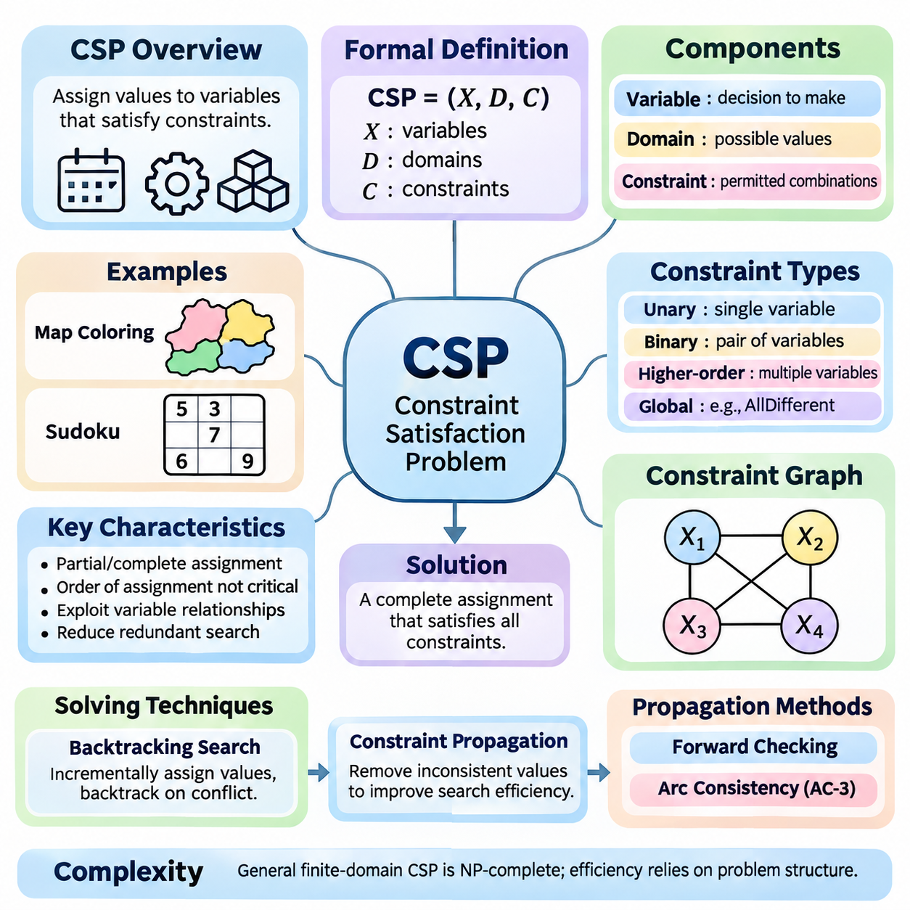
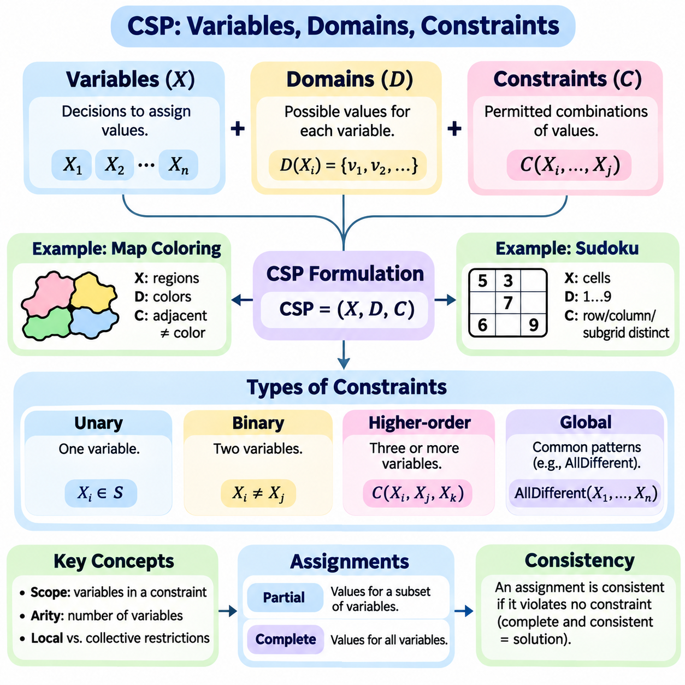
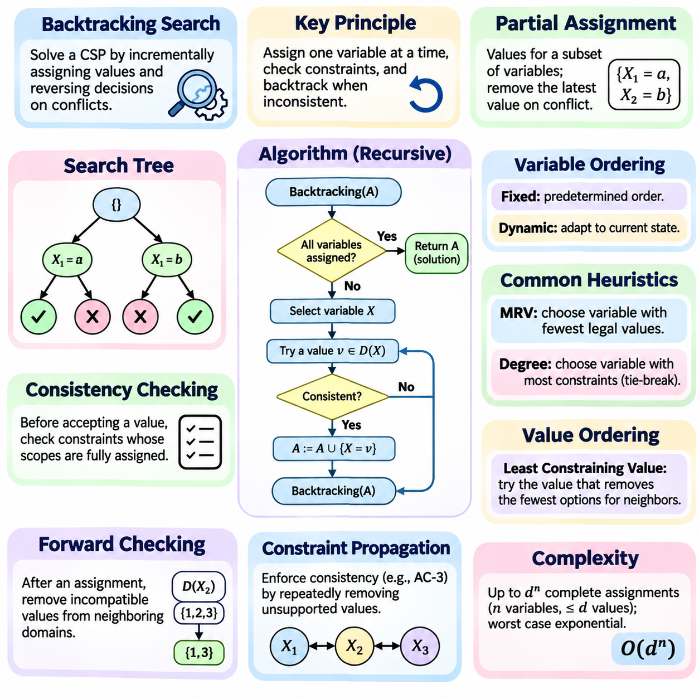
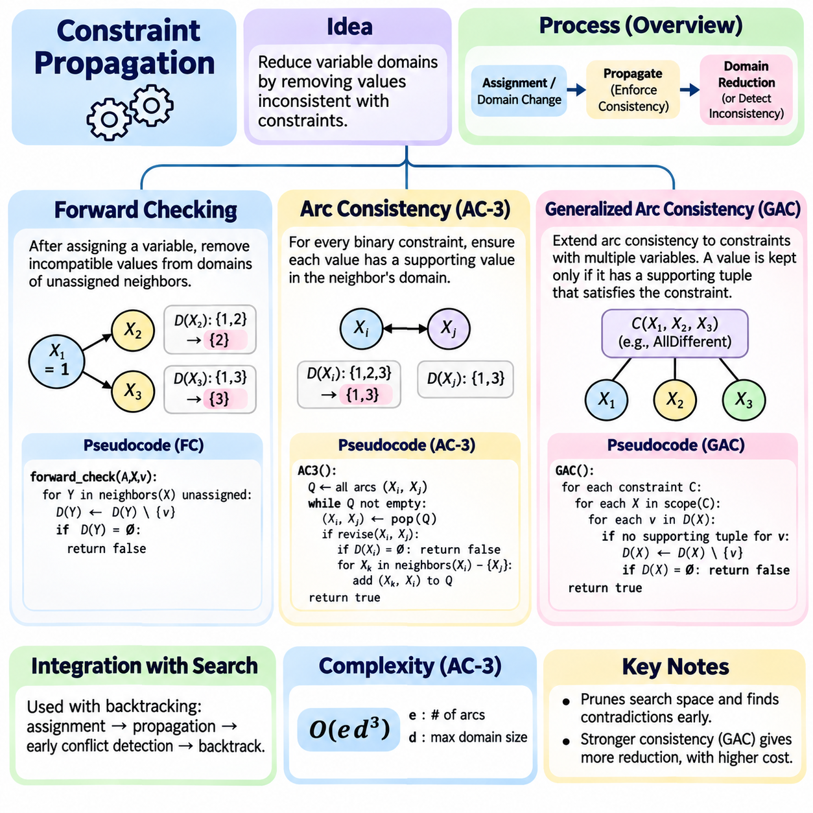
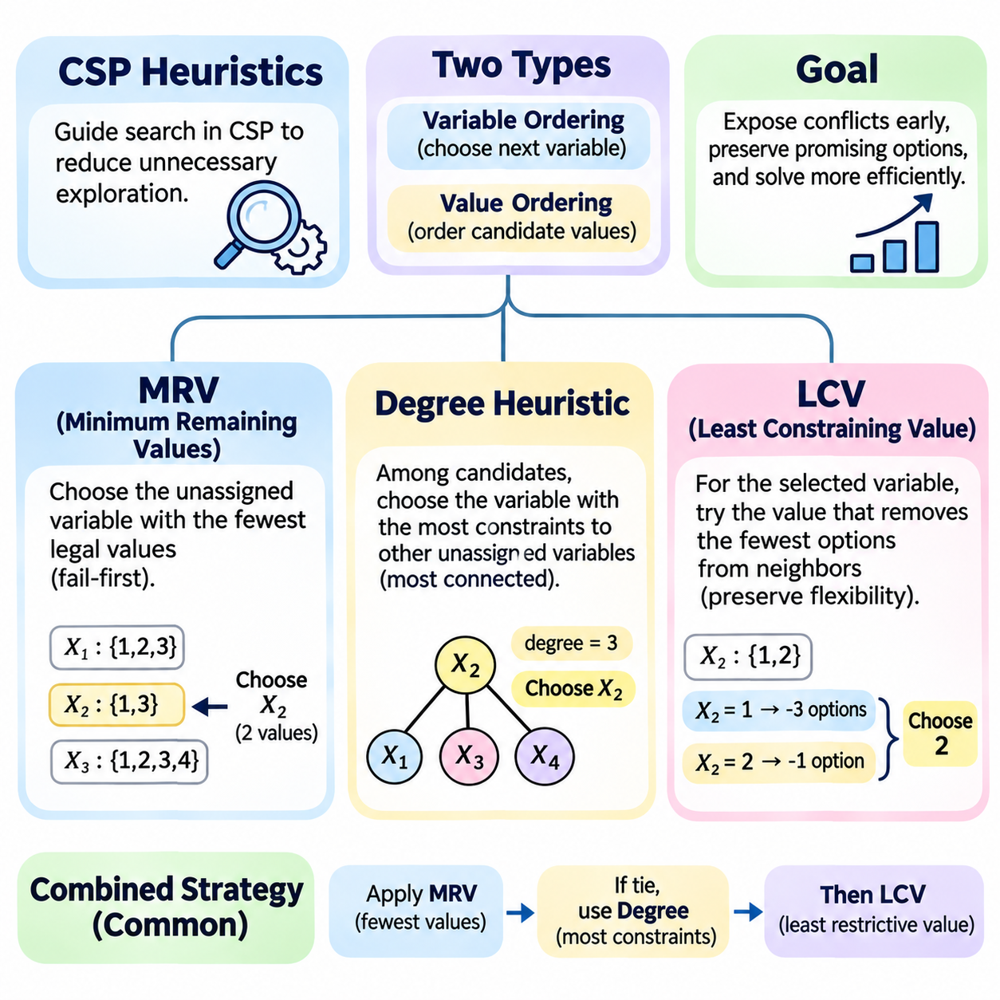
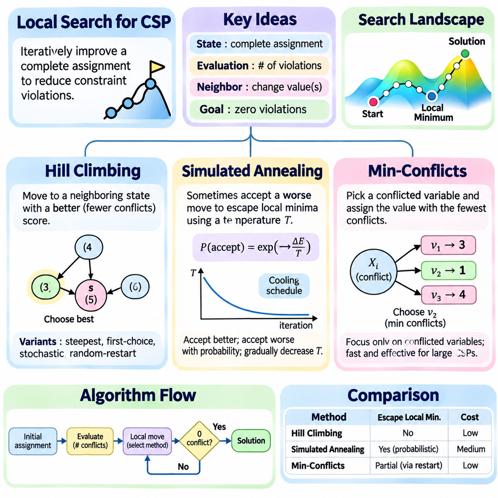
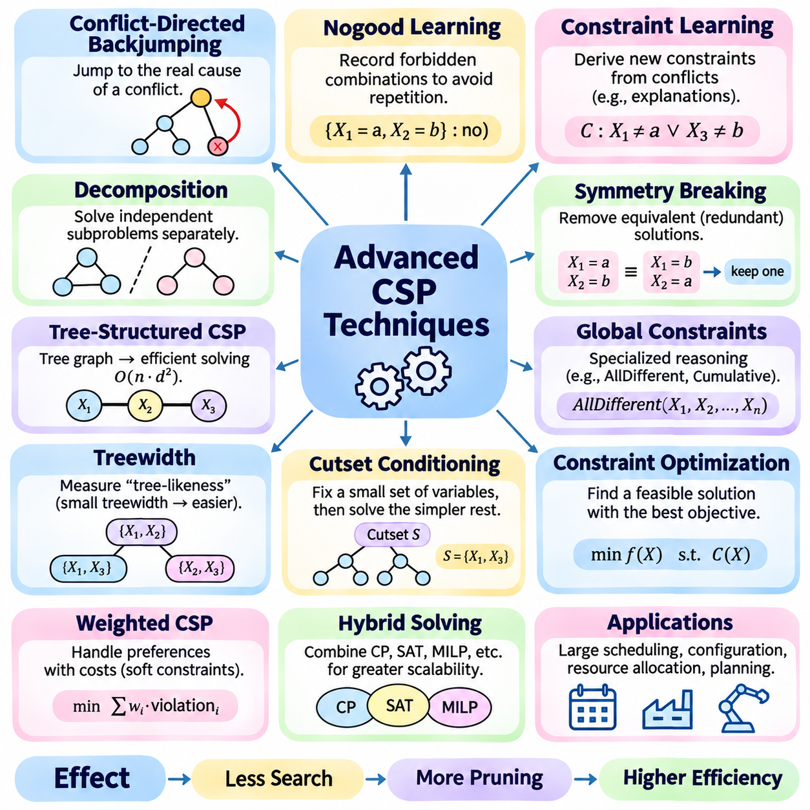
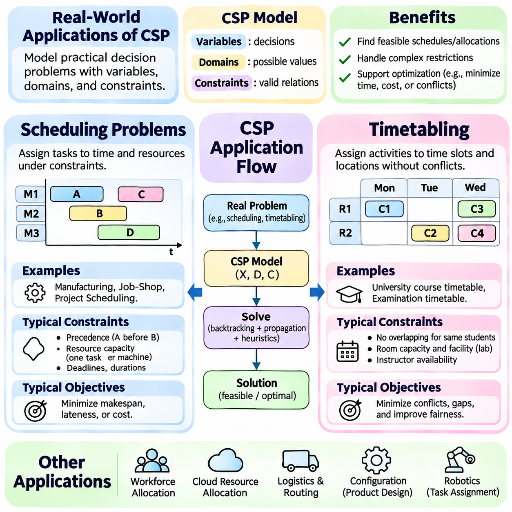

**Volume 01. Classical AI Search and Planning**

# 03. Constraint Satisfaction

## 03.01 Introduction to CSP

{width="7.268055555555556in" height="7.268055555555556in"}

Constraint Satisfaction Problems (CSPs) represent a fundamental approach to solving problems in artificial intelligence where decisions must satisfy a collection of predefined restrictions. Rather than exploring arbitrary sequences of actions, a CSP focuses on assigning values to variables while preserving consistency. This framework provides a systematic foundation for reasoning about scheduling, configuration, allocation, and combinatorial decision-making.

A CSP is formally defined by three essential components: variables, domains, and constraints. Variables represent the decisions that must be made, domains specify the possible values available to each variable, and constraints determine which combinations of values are acceptable. A solution consists of a complete assignment in which every variable receives a value from its domain and all specified constraints are satisfied simultaneously.

The mathematical formulation of a CSP is commonly expressed as a tuple consisting of a variable set, a domain collection, and a constraint set. Each constraint defines a relation over a subset of variables and identifies the combinations that are permitted. This representation separates the logical structure of a problem from the algorithm used to solve it, allowing different solving techniques to operate on the same underlying model.

Constraint satisfaction differs from conventional state-space search because its states are usually represented as partial or complete variable assignments rather than sequences of actions. The order in which variables receive values generally does not change the meaning of a completed solution. This property allows specialized algorithms to eliminate redundant exploration and exploit relationships among variables to reduce computational complexity.

A classic example of constraint satisfaction is map coloring, where neighboring regions must receive different colors. Each region becomes a variable, the available colors form its domain, and adjacency relationships define inequality constraints. The objective is to assign a valid color to every region without violating neighboring restrictions. This simple example illustrates how a large collection of decisions can be represented through local relationships.

Sudoku provides another familiar example in which each empty cell represents a variable with a domain containing digits from one through nine. Constraints require every row, column, and designated subgrid to contain distinct values. Although the rules are simple, their interactions create a complex search space. Constraint satisfaction techniques systematically exploit these interactions to identify valid assignments without enumerating every possible completed grid.

Constraints may involve one variable, two variables, or larger groups of variables. Unary constraints restrict individual domains, binary constraints establish relationships between pairs, and higher-order constraints govern combinations of several variables. Global constraints, such as AllDifferent, express common relationships across many variables and may support specialized propagation algorithms that achieve stronger pruning than simple decompositions.

The constraint graph provides a useful representation of relationships within a CSP. Variables appear as nodes, while edges connect variables participating in binary constraints. This structure reveals dependencies, connectivity, and potential opportunities for decomposition. Problems with sparse constraint graphs or favorable structural properties may be solved substantially more efficiently than densely connected problems containing comparable numbers of variables.

The computational difficulty of constraint satisfaction arises from the combinatorial growth of possible assignments. If a problem contains many variables with multiple candidate values, the number of complete assignments can increase exponentially. General finite-domain CSP solving is NP-complete, although particular constraint languages and graph structures admit polynomial-time algorithms. Effective solving therefore depends on exploiting structure rather than relying on exhaustive enumeration.

Backtracking search is one of the foundational techniques used to solve CSPs. The algorithm incrementally assigns values to variables and checks whether each assignment remains compatible with existing constraints. When a conflict occurs, the algorithm reverses earlier decisions and explores alternatives. This systematic process is complete for finite domains when all relevant alternatives are eventually considered, although its worst-case running time remains exponential.

Constraint propagation improves search efficiency by removing values that cannot participate in valid assignments under the current information. Instead of waiting until a complete assignment reveals a contradiction, propagation examines relationships among variables and reduces their domains. Repeated propagation may expose additional restrictions, creating a chain of deductions that substantially decreases the number of decisions required during subsequent search.

Forward checking is a basic propagation technique that examines variables directly affected by a newly assigned value. When a variable receives an assignment, incompatible values are removed from the domains of its unassigned neighbors. If any remaining domain becomes empty, the current branch cannot produce a solution. Forward checking detects certain conflicts early, although it does not necessarily discover inconsistencies involving only unassigned variables.

Arc consistency provides a stronger form of reasoning for binary constraints. A directed arc is consistent when every value in the source variable\'s domain has at least one compatible supporting value in the destination variable\'s domain. Algorithms such as AC-3 repeatedly revise domains until all relevant arcs become consistent or a contradiction is detected. Arc consistency reduces search effort but does not generally guarantee a complete solution.

Heuristics further improve CSP performance by determining which variables and values should be considered first. The Minimum Remaining Values heuristic prioritizes variables with the fewest legal alternatives, exposing difficult decisions early. The degree heuristic favors variables that constrain many others, while the Least Constraining Value heuristic prefers assignments that preserve flexibility for neighboring variables. These strategies often work effectively together.

Local search offers an alternative approach by operating on complete assignments that may initially violate constraints. Instead of constructing a solution incrementally, the algorithm modifies existing assignments to reduce conflicts. Hill climbing, simulated annealing, and min-conflicts methods illustrate different strategies for navigating this space. Local search can be effective for large problems, although it generally lacks the completeness guarantees of exhaustive backtracking.

Constraint satisfaction also provides a foundation for optimization problems in which satisfying restrictions is necessary but not sufficient. A Constraint Optimization Problem introduces an objective function that evaluates feasible assignments according to cost, quality, efficiency, or another criterion. The solver must identify an assignment satisfying all hard constraints while optimizing the objective. This extension connects CSP methods with operations research and mathematical optimization.

Real-world scheduling illustrates the practical importance of constraint satisfaction. Activities may require specific resources, occupy limited time intervals, and depend on precedence relationships. Constraints prevent resource conflicts, enforce availability, and preserve operational requirements. By expressing these conditions explicitly, a CSP-based system can generate feasible schedules and identify conflicts that would otherwise be difficult to manage manually.

Resource allocation and industrial configuration provide additional applications. Manufacturing systems must assign machines, personnel, and materials while respecting capacity and compatibility restrictions. Robotics systems may use constraint-based reasoning to coordinate tasks, allocate shared resources, and select feasible operational configurations. Such applications demonstrate how symbolic constraints can support structured decision-making within larger autonomous systems.

An important distinction exists between hard constraints and soft constraints. Hard constraints define conditions that must never be violated in a feasible solution, while soft constraints express preferences that may be relaxed at an associated penalty. Weighted constraints and related optimization formulations allow systems to balance competing objectives. This distinction is particularly useful when real-world requirements cannot all be satisfied simultaneously.

The quality of a CSP model strongly influences solving performance. Excessively large domains, unnecessary variables, and weak constraint formulations can increase computational effort even when the underlying problem remains unchanged. Conversely, carefully selected representations and expressive global constraints can expose useful structure. Effective modeling therefore requires both an accurate description of requirements and an understanding of algorithmic behavior.

Constraint satisfaction remains a central component of classical artificial intelligence because it transforms complex decision problems into explicit, verifiable mathematical relationships. Its combination of structured representation, systematic search, propagation, and heuristic reasoning supports reliable problem solving across diverse domains. Understanding these foundations prepares the development of advanced CSP solvers and their integration into planning, robotics, and intelligent decision systems.

## 03.02 Variables Domains Constraints

{width="7.268055555555556in" height="7.268055555555556in"}

Variables, domains, and constraints form the fundamental building blocks of a Constraint Satisfaction Problem (CSP). These components provide a structured representation of decisions, available alternatives, and permissible relationships. By separating what must be decided from which values are possible and which combinations are valid, a CSP transforms complex reasoning tasks into a mathematical framework suitable for systematic search and logical inference.

A variable represents an unknown quantity or decision that must receive a value during problem solving. Variables may describe locations, time slots, resource assignments, machine configurations, or symbolic categories. In a scheduling problem, each variable might represent the starting time of an activity. In a robotics application, variables may represent task assignments, operational modes, or discrete configuration choices subject to physical and operational restrictions.

The collection of variables is commonly represented as X = , where each Xi corresponds to an individual decision. A variable should have a clearly defined meaning and an appropriate level of abstraction. Selecting variables that are too broad can make constraints difficult to express, while excessive decomposition can increase computational complexity. Effective variable design balances modeling accuracy with efficient reasoning.

A domain defines the set of values that a variable is permitted to take. For a variable Xi, its domain is denoted by D(Xi), containing all candidate values considered during solving. Domains may contain integers, Boolean values, categorical labels, or structured objects. In classical finite-domain CSPs, each domain contains a finite collection of alternatives, allowing algorithms to systematically examine assignments and eliminate inconsistent possibilities.

Domain selection directly influences the size of the search space. If a CSP contains n variables and each has d possible values, the number of complete assignments is d raised to the power n when all domains have equal size. Although constraints eliminate many combinations, unnecessarily large domains increase the initial search burden. Carefully restricting domains to meaningful values can therefore improve efficiency without excluding valid solutions.

Domains can be represented explicitly through enumerated values or implicitly through mathematical ranges and symbolic conditions. An explicit domain might contain the colors red, green, and blue, while an interval domain might represent integer time slots between specified limits. Different representations support different solving techniques. Compact domain representations become particularly important when variables involve large numerical ranges or complex resource configurations.

A constraint specifies a condition that must hold among one or more variables. Formally, a constraint consists of a scope identifying the variables involved and a relation describing permitted combinations of their values. Constraints distinguish feasible assignments from invalid ones. They may express equality, inequality, ordering, capacity limits, compatibility requirements, or logical dependencies, depending on the structure of the problem being modeled.

Unary constraints involve a single variable and restrict its allowable values. For example, a machine operating mode may be limited to a subset of available configurations, or a scheduled activity may be prohibited during a particular time interval. Unary constraints can often be incorporated directly into variable domains before search begins. This preprocessing reduces unnecessary alternatives and simplifies subsequent reasoning.

Binary constraints establish relationships between two variables. Common examples include inequality constraints requiring different values, precedence constraints imposing an ordering, and compatibility constraints restricting acceptable pairs. In map coloring, adjacent regions must receive different colors. In scheduling, two activities sharing an exclusive resource cannot overlap. Binary constraints are particularly important because they support graph-based representations and efficient propagation algorithms.

Higher-order constraints involve three or more variables simultaneously. A capacity constraint may limit the combined resource consumption of several tasks, while a collective scheduling requirement may restrict the number of activities assigned to a particular period. These constraints capture relationships that cannot always be represented naturally through independent binary conditions. Their treatment depends on the expressive capabilities of the selected CSP solver.

Global constraints represent recurring patterns involving collections of variables. The AllDifferent constraint requires every variable in its scope to receive a distinct value, making it useful for assignment problems, Sudoku, and resource allocation. Global constraints often provide specialized propagation mechanisms that exploit their mathematical structure. Such mechanisms can eliminate inconsistent values more effectively than decomposing the same relationship into simpler constraints.

The scope of a constraint determines which variables participate in its evaluation. Constraints with small scopes describe local relationships, while broader scopes capture collective restrictions. Constraint arity refers to the number of variables involved in a constraint. Understanding scope and arity helps determine the structure of the resulting constraint network and influences the selection of appropriate propagation and search techniques.

A complete assignment provides a value for every variable, while a partial assignment specifies values for only a subset. An assignment is consistent when it violates no constraint whose entire scope has been assigned. A complete assignment becomes a solution only when all constraints are satisfied. This distinction is essential because partial consistency does not guarantee that the remaining variables can be assigned successfully.

Constraint satisfaction can be interpreted as identifying a point within the Cartesian product of all variable domains that satisfies every constraint relation. Each complete assignment represents one candidate point, and the constraints collectively define the feasible region. This mathematical interpretation clarifies why solving a CSP requires finding an intersection of permitted combinations rather than optimizing an objective function in the basic satisfaction formulation.

A constraint network captures the dependencies created by shared variables. In a binary CSP, the network can be represented as a graph whose nodes correspond to variables and whose edges represent binary constraints. Sparse networks may permit decomposition into smaller subproblems, while densely connected networks can create stronger interactions. The topology of this network can significantly influence computational difficulty and algorithmic performance.

Modeling choices can change the complexity of a CSP without changing the underlying real-world problem. A poorly designed representation may introduce redundant variables, unnecessarily broad domains, or weak constraints. Conversely, a carefully constructed model can expose useful dependencies and enable stronger propagation. Choosing an appropriate representation is therefore as important as selecting an efficient search algorithm.

Constraints can also be classified as hard or soft requirements. Hard constraints must be satisfied for an assignment to be feasible, while soft constraints express preferences whose violations may incur penalties. Classical CSPs primarily focus on hard constraints, whereas weighted and optimization-oriented extensions incorporate soft requirements. This distinction enables constraint-based systems to represent both mandatory operational rules and desirable performance characteristics.

Real-world applications frequently combine variables of different meanings and constraints of different forms. A manufacturing scheduling system may include machine assignments, task start times, processing durations, and resource capacities. A robotic coordination system may combine task allocation, workspace occupancy, and execution precedence. Accurate modeling requires each variable and constraint to reflect the operational relationships that determine feasibility.

Consistency techniques exploit the interaction between domains and constraints to reduce the search space. When a value becomes incompatible with neighboring variables, it can be removed from the corresponding domain. Repeated domain reduction may reveal further inconsistencies and eventually establish that a branch cannot produce a solution. This process forms the foundation of forward checking, arc consistency, and generalized constraint propagation.

The relationship between variables, domains, and constraints determines both the expressive power and computational behavior of a CSP. Variables define the decisions, domains establish the available alternatives, and constraints encode the rules governing acceptable combinations. Together, these components provide a precise and reusable representation for combinatorial reasoning, enabling systematic search, propagation, optimization extensions, and practical intelligent decision-making systems.

## 03.03 Backtracking Search [w/Code]

{width="7.268055555555556in" height="7.268055555555556in"}

Backtracking search is a fundamental algorithm for solving Constraint Satisfaction Problems (CSPs) by systematically constructing assignments and reversing decisions when conflicts occur. Instead of generating every possible complete assignment, the algorithm builds solutions incrementally and rejects inconsistent partial assignments. This approach combines depth-first exploration with constraint checking, providing a general foundation for solving combinatorial decision problems.

The central principle of backtracking is to assign values to variables one at a time while maintaining consistency with previously assigned variables. At each step, the algorithm selects an unassigned variable and examines candidate values from its domain. If an assignment satisfies all currently applicable constraints, the search continues recursively. Otherwise, the candidate is rejected, and another value is considered.

A partial assignment represents the current state of the search process. It contains values assigned to a subset of variables while leaving the remaining variables undecided. The algorithm maintains this assignment as it explores deeper levels of the search tree. When a conflict prevents further progress, the most recent assignment is removed, restoring the previous state and allowing alternative decisions to be explored.

Backtracking search follows the structure of depth-first search but differs from ordinary state-space exploration in its treatment of constraints. Each search node represents a partial assignment, and each branch corresponds to assigning a candidate value to another variable. Constraint checking prevents the expansion of branches that already violate known requirements. This early rejection substantially reduces unnecessary exploration compared with exhaustive enumeration.

The recursive formulation of backtracking provides a compact and intuitive implementation. A recursive procedure receives the current partial assignment, checks whether all variables have been assigned, and returns a solution when the assignment is complete and consistent. Otherwise, it selects another variable, tries permissible values, and recursively explores the resulting assignments. Failed recursive calls trigger the restoration of earlier decisions.

Consistency checking is essential to the correctness and efficiency of backtracking. Before accepting a candidate value, the solver evaluates constraints whose scopes are fully assigned by the proposed decision. If any applicable constraint is violated, the candidate is rejected immediately. This process ensures that every maintained partial assignment remains consistent, although consistency alone does not guarantee that a complete solution exists.

The search tree generated by backtracking depends on the number of variables, their domain sizes, and the order in which decisions are made. With n variables and at most d values per variable, the number of complete assignments can reach d raised to the power n. Although backtracking avoids exploring many inconsistent combinations, its worst-case time complexity remains exponential. Its practical performance therefore depends heavily on pruning and decision ordering.

Variable ordering determines which unassigned variable is selected at each recursive step. A fixed ordering follows a predetermined sequence, while dynamic ordering adapts to the current assignment and remaining domains. Choosing highly constrained variables early can expose contradictions before extensive exploration occurs. This strategy reduces wasted computation and improves the effectiveness of subsequent constraint propagation.

The Minimum Remaining Values heuristic selects the variable with the fewest currently legal values. This fail-first strategy prioritizes decisions most likely to reveal an inconsistency. If a variable has no remaining legal values, the current branch can be rejected immediately. By identifying difficult choices early, MRV often reduces the number of search nodes explored, particularly in tightly constrained problems.

The degree heuristic provides another method for selecting variables. It favors an unassigned variable that participates in the largest number of constraints involving other unassigned variables. This prioritizes decisions that may influence many remaining choices. Degree-based selection is commonly used to break ties between variables with equal MRV scores, combining immediate domain restrictions with broader structural influence.

Value ordering determines the sequence in which candidate values are attempted. The Least Constraining Value heuristic prefers assignments that eliminate the fewest alternatives from neighboring variables. This preserves flexibility for future decisions and can increase the likelihood of reaching a complete solution without backtracking. While value ordering does not change completeness, it can significantly influence the time required to discover a solution.

Forward checking strengthens backtracking by examining the consequences of each assignment before continuing deeper into the search tree. When a variable receives a value, incompatible values are removed from the domains of directly connected unassigned variables. If any domain becomes empty, the branch is rejected. Domain changes must be restored during backtracking to ensure that alternative assignments are evaluated correctly.

Constraint propagation can extend beyond forward checking by repeatedly enforcing consistency across related variables. Arc consistency algorithms, such as AC-3, remove values that lack compatible support in neighboring domains. Maintaining arc consistency during search can detect contradictions earlier than basic forward checking. However, stronger propagation requires additional computation, creating a tradeoff between pruning effectiveness and per-node processing cost.

Chronological backtracking returns to the most recent decision whenever a conflict occurs. Although simple and systematic, this strategy may repeatedly reconsider assignments unrelated to the actual cause of failure. More advanced methods analyze conflicts to identify responsible variables and determine more appropriate backtracking points. Such techniques can avoid redundant exploration and improve performance on problems containing complex dependency structures.

Backjumping is an advanced search technique that allows the solver to return directly to an earlier variable associated with a detected conflict. Instead of reversing decisions one level at a time, the algorithm uses dependency information to skip irrelevant assignments. Conflict-directed backjumping extends this idea by maintaining conflict sets that record which previous decisions contributed to failure.

Backtracking is complete for finite-domain CSPs when all candidate values are systematically considered and pruning removes only assignments that cannot lead to valid solutions. If a solution exists, exhaustive backtracking will eventually discover one. If no solution exists, the algorithm can establish unsatisfiability after exploring all relevant alternatives. This guarantee distinguishes systematic backtracking from incomplete local search methods.

The memory requirements of basic backtracking are generally modest because the algorithm stores the current assignment and information needed to restore earlier states rather than retaining the entire search tree. Recursive implementations maintain a stack of decisions whose depth is bounded by the number of variables. Additional memory may be required for domain restoration, propagation queues, conflict records, and heuristic data structures.

A practical implementation must carefully manage assignment updates and restoration. Each recursive decision should record modifications to variable domains and constraint-related state. When a branch fails, these modifications must be undone before another candidate is attempted. Incorrect restoration can eliminate valid solutions or introduce inconsistent states. Reliable solvers therefore use explicit restoration trails, reversible data structures, or controlled state copying.

Backtracking search is widely applied to scheduling, timetabling, configuration, and resource allocation. In robotics, it can support task assignment, discrete motion planning, and coordination among multiple agents. These applications frequently combine strict feasibility requirements with complex interactions among decisions. Backtracking provides a transparent framework for exploring alternatives while preserving logical consistency throughout the solving process.

The effectiveness of backtracking depends on the interaction between representation, variable ordering, value ordering, consistency checking, and propagation. A well-designed CSP model exposes useful constraints, while appropriate heuristics direct exploration toward promising assignments. Together, these techniques transform a basic recursive search procedure into a practical solving framework capable of handling many structured combinatorial problems.

Backtracking search remains a central method in classical artificial intelligence because it combines systematic exploration with explicit logical reasoning. Its recursive structure is straightforward, yet it supports sophisticated extensions involving propagation, conflict analysis, and adaptive heuristics. Understanding backtracking provides the foundation for developing complete CSP solvers and integrating constraint-based reasoning into planning and autonomous decision-making systems.

## 03.04 Constraint Propagation

{width="7.268055555555556in" height="7.268055555555556in"}

Constraint propagation is a fundamental reasoning mechanism in Constraint Satisfaction Problems (CSPs) that reduces variable domains by eliminating values inconsistent with existing constraints. Rather than waiting for complete assignments to reveal conflicts, propagation examines relationships among variables and removes unsupported alternatives. This process improves search efficiency, detects contradictions earlier, and provides a foundation for intelligent constraint-solving algorithms.

The central objective of constraint propagation is to enforce a selected level of consistency across the constraint network. Each variable maintains a domain containing candidate values, while constraints define permissible combinations. When an assignment or domain reduction occurs, related constraints are reconsidered to determine whether additional values can be removed. This iterative reasoning continues until no further reductions are possible or an inconsistency is detected.

Constraint propagation is closely integrated with backtracking search, where every decision can trigger additional deductions. Assigning a value to one variable may restrict neighboring domains, which can subsequently restrict other variables. Such cascading effects reduce the number of branches explored during search. However, propagation must preserve every value that could participate in a valid solution, ensuring that pruning does not compromise correctness.

Forward checking is one of the simplest propagation techniques used in CSP solving. After assigning a value to a variable, the algorithm examines constraints connecting that variable to unassigned neighbors. Values incompatible with the new assignment are removed from neighboring domains. If any domain becomes empty, the current assignment cannot lead to a solution, allowing the solver to backtrack immediately rather than exploring an impossible branch.

The effectiveness of forward checking comes from its ability to identify direct consequences of assignments before additional decisions are made. In a scheduling problem, assigning a machine to one task may eliminate conflicting machine choices for other tasks. In map coloring, selecting a color for one region removes that color from adjacent regions. These reductions prevent obvious conflicts while maintaining relatively low computational overhead.

Forward checking has an important limitation because it generally does not enforce consistency among variables that remain unassigned. Two neighboring variables may retain domains that appear individually valid but contain no mutually compatible assignments. Such contradictions may remain undetected until another variable receives a value. Stronger propagation methods address this limitation by examining relationships throughout the constraint network.

Arc consistency provides a stronger consistency condition for binary constraints. A directed arc from variable Xi to variable Xj is consistent when every value in Xi\'s domain has at least one compatible supporting value in Xj\'s domain. If a value lacks such support, it cannot participate in any solution satisfying that binary constraint and may be removed. Enforcing this property across relevant arcs reduces domains without requiring complete assignments.

The AC-3 algorithm is a classical method for establishing arc consistency in binary CSPs. It maintains a queue of directed arcs requiring examination. When an arc is processed, unsupported values are removed from the source variable\'s domain. If the domain changes, neighboring arcs that may be affected are returned to the queue. The algorithm terminates when the queue becomes empty or a domain becomes empty, indicating inconsistency.

AC-3 repeatedly applies a revision operation that checks whether candidate values possess compatible support. For each value in the source domain, the algorithm searches the destination domain for at least one satisfying combination. Unsupported values are deleted, potentially triggering further revisions elsewhere. This repeated process reaches a fixed point where every remaining value has the required local support under the enforced binary constraints.

The computational cost of AC-3 depends on the number of variables, domain sizes, and constraint relationships. With e directed arcs and maximum domain size d, a common worst-case bound for a straightforward AC-3 implementation is O(e d³). More specialized algorithms can improve efficiency through support tracking and incremental updates. In practice, the benefits of early domain reduction often outweigh propagation overhead in tightly constrained problems.

Arc consistency does not guarantee that a CSP has a complete solution. Every remaining value may possess support in neighboring domains while the overall constraint network remains globally inconsistent. For example, three pairwise connected variables requiring different values cannot all be assigned using only two colors, even though their binary arcs may initially be consistent. This illustrates the distinction between local consistency and global satisfiability.

Generalized Arc Consistency (GAC) extends the concept of arc consistency beyond binary constraints to constraints involving multiple variables. A value is supported when there exists an assignment to the other variables within the constraint\'s scope that satisfies the entire constraint. If no such supporting tuple exists, the value is removed. GAC therefore provides a systematic consistency condition for higher-order and global constraints.

GAC is particularly important when modeling relationships involving several variables simultaneously. Scheduling constraints may restrict the combined resource consumption of multiple activities, while allocation constraints may require distinct assignments across a group of resources. Rather than decomposing these relationships into binary constraints, GAC can operate directly on their original structure and exploit specialized reasoning procedures.

The AllDifferent constraint illustrates the advantages of generalized propagation. It requires all variables in its scope to receive distinct values. Specialized GAC algorithms can analyze the relationship between variables and available values using matching-based reasoning. Such algorithms may eliminate values that ordinary pairwise inequality propagation cannot detect, resulting in stronger domain reduction and more efficient search.

The computational requirements of GAC depend strongly on the constraint representation and available propagation algorithms. For explicitly represented constraints, support checking may involve examining permitted tuples. For structured global constraints, specialized algorithms can exploit mathematical properties to achieve greater efficiency. Consequently, the practical strength of GAC depends on both the consistency definition and its implementation.

Forward checking, AC-3, and GAC represent different levels and scopes of propagation. Forward checking primarily evaluates immediate consequences of assignments, AC-3 enforces support relationships across binary constraints, and GAC extends support checking to constraints of arbitrary arity. Stronger propagation can eliminate more inconsistent values, but it may also require greater computational effort during each search step.

Maintaining consistency during search requires careful coordination between propagation and backtracking. When a decision causes domain reductions, the solver must record enough information to restore previous domains if that decision is reversed. Restoration trails, reversible data structures, and incremental propagation mechanisms help preserve correctness. Without accurate restoration, valid alternatives may be permanently removed or inconsistent states may persist.

Propagation scheduling determines which constraints should be reconsidered after domain changes. Event-driven solvers activate propagators only when relevant variables are modified, avoiding unnecessary repeated checks. Work queues organize pending propagation operations, while incremental algorithms reuse previously computed information. These engineering techniques are essential for scaling constraint propagation to large industrial scheduling and configuration problems.

In robotics and autonomous systems, constraint propagation can support task allocation, resource coordination, and operational feasibility checking. Assigning one robot to a mission may restrict available robots for other tasks, while timing and resource constraints may eliminate incompatible schedules. Propagation enables these consequences to be identified before full plans are constructed, improving the efficiency of higher-level planning and coordination.

Constraint propagation remains a central component of classical AI because it converts explicit relationships into useful deductions that simplify combinatorial search. Forward checking provides inexpensive local filtering, AC-3 establishes stronger binary consistency, and GAC supports expressive multi-variable constraints. Together, these methods form a progression of reasoning techniques that improve CSP solver efficiency, reliability, and scalability across practical decision-making applications.

## 03.05 Heuristics for CSP

{width="7.268055555555556in" height="7.268055555555556in"}

Heuristics play a central role in solving Constraint Satisfaction Problems (CSPs) by guiding search toward decisions that reduce unnecessary exploration. Although backtracking search is complete for finite-domain problems, its performance can deteriorate rapidly as the number of variables and possible assignments increases. Heuristic strategies improve efficiency by selecting variables and ordering values according to information extracted from domains and constraint relationships.

CSP heuristics are commonly divided into variable-ordering and value-ordering strategies. Variable ordering determines which unassigned variable should be considered next, while value ordering determines which candidate value should be attempted first. These strategies do not change the underlying constraints or the set of valid solutions. Instead, they reorganize the search process to expose contradictions earlier or preserve promising alternatives.

The Minimum Remaining Values (MRV) heuristic selects the unassigned variable with the smallest number of currently legal values. It is based on the fail-first principle, which prioritizes decisions most likely to reveal a contradiction. Variables with restricted domains have fewer available alternatives and are therefore more vulnerable to conflicts. Selecting them early can prevent extensive exploration of assignments that cannot produce complete solutions.

MRV evaluates domain sizes after considering assignments and any constraint propagation already performed. If one variable has two remaining values while another has five, MRV prioritizes the variable with two alternatives. If a domain becomes empty, the current search branch is inconsistent and must be rejected. This dynamic behavior makes MRV particularly effective when domains change substantially during backtracking and propagation.

The effectiveness of MRV depends on how accurately the solver represents currently legal values. Some implementations calculate legal alternatives directly from assigned neighbors, while others maintain reduced domains through forward checking or arc consistency. Stronger propagation can provide more informative domain sizes. However, maintaining and updating this information introduces computational overhead that must be balanced against reductions in search effort.

MRV is especially useful in tightly constrained problems where a small number of variables determine overall feasibility. In scheduling, a task with only a few available time slots may be selected before more flexible activities. In resource allocation, a job compatible with only two machines may receive priority over jobs with many alternatives. Such decisions expose resource conflicts early and reduce the likelihood of expensive backtracking.

A limitation of MRV arises when several variables have equally small domains. In this situation, domain size alone cannot determine which variable should be selected. A secondary heuristic can evaluate how strongly each candidate variable interacts with the remaining problem. The degree heuristic provides this structural information by examining the number of constraints connecting a variable to other unassigned variables.

The degree heuristic selects the variable involved in the largest number of relevant constraints with other unassigned variables. Its purpose is to prioritize decisions that influence many remaining choices. In a binary constraint graph, degree can be measured by counting neighboring unassigned variables connected through constraints. For higher-order constraints, degree measures require careful definition to avoid misleading counts.

Degree-based selection follows the intuition that highly connected variables have greater potential to restrict the search space. Assigning such a variable may eliminate alternatives across several neighboring domains. This can strengthen subsequent constraint propagation and reveal contradictions sooner. Unlike MRV, which emphasizes immediate domain restrictions, the degree heuristic emphasizes the structural influence of a decision.

Static degree ordering calculates variable connectivity before search begins and uses the resulting priorities throughout execution. Dynamic degree ordering updates connectivity as variables become assigned or constraints become inactive. Dynamic approaches better reflect the remaining problem but require additional bookkeeping. The appropriate choice depends on the stability of the constraint network and the computational cost of updating structural information.

Combining MRV with the degree heuristic provides a widely used variable-selection strategy. MRV first identifies variables with the smallest remaining domains. When multiple variables share the minimum domain size, the degree heuristic selects the one constraining the greatest number of unassigned variables. This combination balances immediate failure detection with broader influence over future decisions and often improves search performance.

The Least Constraining Value (LCV) heuristic addresses a different question by determining which value should be attempted first for the selected variable. LCV prefers the candidate that eliminates the fewest legal alternatives from neighboring unassigned variables. Its guiding principle is to preserve flexibility for future assignments. By leaving more options available, the solver may reach a complete solution with fewer reversals.

LCV can be implemented by estimating the consequences of assigning each candidate value. The solver examines affected constraints and counts how many neighboring domain values would become inconsistent. Candidates are then ordered from least restrictive to most restrictive. More sophisticated implementations temporarily propagate each candidate and evaluate resulting domain reductions, although this increases the computational cost of value selection.

In map coloring, LCV favors a color that leaves neighboring regions with the greatest number of available colors. In scheduling, it may prefer a time slot that conflicts with the fewest remaining activities. In robotic task allocation, it can prioritize assigning a flexible robot to a task when that choice preserves specialized robots for tasks with fewer compatible resources. These examples illustrate how LCV protects future feasibility.

LCV differs conceptually from MRV and the degree heuristic because it favors flexibility rather than immediate restriction. MRV selects difficult variables early, while the degree heuristic prioritizes influential variables. LCV then attempts values that preserve the largest number of alternatives. These approaches are complementary because they operate at different stages of the decision process and address distinct sources of search inefficiency.

Value ordering does not affect the completeness of systematic backtracking when every candidate is eventually considered. However, it can strongly influence the time required to find the first solution. LCV is often beneficial when a problem has multiple feasible solutions and the objective is to discover one quickly. When proving unsatisfiability or enumerating every solution, its benefits may be smaller because all relevant alternatives must still be explored.

Heuristic evaluation introduces a tradeoff between decision quality and computational overhead. Calculating MRV requires domain information, dynamic degree selection requires updated connectivity, and LCV may require repeated constraint checks. If these calculations become too expensive, the overhead can outweigh the savings from reduced exploration. Efficient implementations therefore reuse propagation results, cache structural information, and avoid unnecessary recomputation.

Heuristics interact closely with constraint propagation techniques such as forward checking, AC-3, and generalized arc consistency. Propagation removes unsupported values, allowing MRV to identify newly restricted variables. Degree information helps prioritize influential decisions, while LCV estimates the remaining flexibility after candidate assignments. Together, these mechanisms create an adaptive search process that responds to changes in the constraint network.

In practical applications, heuristic effectiveness depends on problem structure, domain distributions, and constraint density. Scheduling systems may benefit from prioritizing activities with limited availability, while configuration problems may favor highly connected components. Robotics and autonomous coordination systems can combine these principles to allocate scarce resources and identify infeasible assignments early. No single heuristic guarantees superior performance across every CSP.

MRV, the degree heuristic, and LCV form a complementary foundation for intelligent CSP search. MRV identifies the most restricted variable, degree-based selection resolves ties by considering structural influence, and LCV orders candidate values to preserve future alternatives. Integrated with backtracking and constraint propagation, these strategies reduce unnecessary exploration while maintaining correctness and completeness, making them essential tools for scalable constraint-based reasoning.

## 03.06 Local Search for CSP

{width="7.268055555555556in" height="7.268055555555556in"}

Local search provides an alternative approach to solving Constraint Satisfaction Problems (CSPs) by iteratively improving candidate assignments rather than systematically constructing partial solutions. Unlike backtracking, local search typically operates on complete assignments that may violate constraints. The algorithm modifies variable values to reduce conflicts, making it particularly useful for large combinatorial problems where exhaustive exploration is computationally expensive.

The central principle of local search is to represent each candidate solution as a state within a search landscape. A state assigns values to all variables, while an evaluation function measures the number or severity of violated constraints. Neighboring states are generated by changing one or more variable assignments. The objective is to navigate this landscape toward a state with zero violations, indicating a feasible CSP solution.

Local search algorithms differ from systematic search methods because they generally do not guarantee completeness. They may become trapped in local optima, encounter plateaus, or fail to discover an existing solution within available computational resources. However, their memory requirements are often modest because they maintain only the current state and limited auxiliary information. This makes them attractive for large-scale scheduling, configuration, and allocation problems.

Hill climbing is a straightforward local search technique that repeatedly moves toward neighboring states with better evaluation scores. Starting from an initial complete assignment, the algorithm examines possible modifications and selects an improvement according to its neighborhood strategy. For CSPs, improvement commonly means reducing the number of violated constraints. The process continues until a valid solution is found or no improving move remains available.

Several variations of hill climbing provide different exploration behaviors. Steepest-ascent hill climbing evaluates available neighbors and selects the greatest improvement, while first-choice hill climbing accepts the first improving modification encountered. Stochastic hill climbing selects among improving moves probabilistically. These variations trade evaluation cost against exploration flexibility, but all remain vulnerable to difficult search landscapes.

A major limitation of hill climbing is its tendency to become trapped in local minima, where no neighboring state improves the conflict score even though the current assignment violates constraints. Plateaus contain neighboring states with equal evaluation values, while ridges may require coordinated changes that individual moves cannot achieve. These landscape features can prevent progress despite the existence of feasible solutions elsewhere.

Random-restart hill climbing addresses local trapping by repeatedly beginning the search from different initial assignments. Each restart explores another region of the search landscape, increasing the chance of reaching a feasible solution. The approach is particularly effective when successful regions occupy a meaningful portion of the state space. However, repeated restarts do not provide a general guarantee of finding a solution within a fixed computational budget.

Simulated annealing extends local search by occasionally accepting moves that worsen the evaluation score. Inspired by physical annealing processes, it uses a temperature parameter to control the probability of accepting unfavorable changes. At high temperatures, the algorithm explores broadly and can escape local minima. As the temperature decreases, it becomes increasingly selective and focuses on refining promising assignments.

For a minimization objective, simulated annealing typically accepts improving moves automatically and accepts worsening moves with probability exp(-ΔE/T), where ΔE represents the increase in evaluation cost and T is the current temperature. This probabilistic rule allows temporary deterioration to overcome local barriers. As T approaches zero, unfavorable moves become less likely, and the algorithm increasingly resembles greedy local improvement.

The cooling schedule determines how temperature changes during simulated annealing. A gradual schedule encourages extensive exploration but increases computation time, while rapid cooling reduces runtime at the risk of premature convergence. Common approaches include geometric cooling, where temperature is multiplied by a constant factor after each stage. Practical performance depends on initial temperature, cooling rate, neighborhood design, and termination conditions.

Simulated annealing is useful when the search landscape contains many local minima separated by unfavorable intermediate states. In scheduling, temporarily increasing conflicts may allow activities to move into a more favorable overall arrangement. In resource allocation, accepting a short-term capacity penalty may enable a later sequence of assignments that eliminates violations. This flexibility distinguishes annealing from strictly improving hill climbing.

Min-conflicts is a specialized local search heuristic designed for CSPs with complete assignments. At each iteration, the algorithm selects a variable involved in at least one violated constraint and changes its value to minimize the number of resulting conflicts. By concentrating modifications on conflicted variables, min-conflicts avoids spending effort on assignments that currently satisfy their associated constraints.

The min-conflicts procedure begins with an initial assignment, often generated randomly or through a greedy strategy. If all constraints are satisfied, the algorithm terminates successfully. Otherwise, it selects a conflicted variable and evaluates candidate values from its domain. The value producing the fewest conflicts is chosen, with ties commonly resolved randomly. Iterations continue until a solution is found or a predefined limit is reached.

Min-conflicts is particularly effective for certain large, loosely structured CSPs where local repairs can progressively eliminate violations. The N-Queens problem is a classical example, because moving a conflicting queen can reduce attacks without reconstructing the entire board. Scheduling and resource assignment problems may also benefit when small adjustments can resolve conflicts while preserving most existing decisions.

Although min-conflicts often performs well, it can stagnate when many candidate moves produce equivalent conflict scores. Random tie-breaking, sideways moves, occasional random assignments, and restart strategies can improve exploration. The effectiveness of these mechanisms depends on the structure of the constraint network and the distribution of conflicts. Consequently, parameter tuning and empirical evaluation remain important.

Hill climbing, simulated annealing, and min-conflicts differ primarily in how they select moves and escape unfavorable search regions. Hill climbing prioritizes immediate improvement, simulated annealing permits probabilistic worsening, and min-conflicts focuses on repairing violated constraints. These methods share a state-based representation but use different strategies to balance computational efficiency, exploration, and solution quality.

The evaluation function strongly influences the behavior of local search. Counting violated constraints provides a simple objective, but weighted penalties can distinguish violations according to operational importance. For hard-constraint CSPs, a feasible solution requires every mandatory constraint to be satisfied. When soft constraints are included, the search may additionally minimize preference violations, extending the formulation toward constraint optimization.

Neighborhood design determines which modifications are accessible from the current assignment. Single-variable reassignment is simple and computationally efficient, while swap operations or coordinated changes may better preserve structural requirements. Larger neighborhoods can overcome difficult local barriers but increase evaluation costs. Efficient implementations often update conflict counts incrementally rather than recomputing every constraint after each move.

In robotics and autonomous systems, local search can support task allocation, mission scheduling, resource coordination, and discrete configuration planning. When assignments change because of new tasks or resource availability, local repair methods may adjust existing plans without rebuilding them completely. However, safety-critical constraints must be validated explicitly, and an unsuccessful search cannot be interpreted as proof that no feasible solution exists.

Local search complements systematic CSP solving by emphasizing rapid improvement of complete assignments rather than exhaustive verification. Hill climbing offers simplicity, simulated annealing provides controlled exploration, and min-conflicts delivers targeted conflict repair. Their effectiveness depends on evaluation functions, neighborhood structures, initialization, and stopping criteria. Together, these methods provide practical tools for large-scale constraint reasoning when computational efficiency is a primary concern.

## 03.07 Advanced CSP Techniques

{width="7.268055555555556in" height="7.268055555555556in"}

Advanced Constraint Satisfaction Problem (CSP) techniques extend classical backtracking and constraint propagation to address complex problems involving large search spaces, dense dependencies, and difficult feasibility conditions. These methods improve solving efficiency through conflict analysis, structural decomposition, intelligent learning, and specialized reasoning. Their objective is to reduce redundant computation while preserving the correctness and completeness required by systematic constraint solving.

Conflict-directed backjumping improves conventional backtracking by identifying which earlier decisions caused a failure. Instead of returning only to the immediately preceding variable, the solver analyzes conflicting assignments and jumps directly to a relevant decision point. This approach avoids reconsidering unrelated variables and reduces repeated exploration. Its effectiveness depends on accurately maintaining dependency information and identifying the variables responsible for contradictions.

Nogood learning records combinations of assignments that cannot participate in any valid solution. When a conflict is discovered, the solver derives a nogood describing the responsible decisions and stores it for future use. If another search branch encounters the same forbidden combination, the solver can reject it without repeating the original reasoning. This technique converts previous failures into reusable knowledge and can substantially reduce redundant search.

Constraint learning generalizes conflict recording by deriving additional restrictions implied by existing constraints. Learned constraints eliminate combinations already proven infeasible while preserving every valid solution. Modern solvers may use explanation-based propagation to identify why domain values were removed and which decisions caused conflicts. These explanations support stronger backjumping, efficient learning, and more informative search guidance.

Constraint graph decomposition exploits the structural organization of variables and their dependencies. A CSP can be represented as a graph or hypergraph in which connections describe shared constraints. When the network separates into independent components, each component can be solved individually. This decomposition reduces computational complexity by replacing one large problem with smaller subproblems, provided their independence is established correctly.

Tree-structured CSPs offer an important example of structural efficiency. When the binary constraint graph forms a tree, specialized algorithms can establish directional consistency and construct a solution without general exponential backtracking. With suitable assumptions and bounded domain sizes, solving can be performed in time proportional to the number of variables multiplied by the square of the maximum domain size. This illustrates the computational value of exploiting graph structure.

Treewidth measures how closely a constraint graph resembles a tree and provides insight into the difficulty of structural decomposition. Problems with small treewidth can often be solved using dynamic programming over tree decompositions. Computational requirements generally grow exponentially with treewidth rather than directly with the total number of variables. However, finding an optimal decomposition can itself be computationally difficult.

Cutset conditioning provides another method for exploiting structural properties. The solver identifies a set of variables whose removal transforms the remaining constraint graph into a simpler structure, such as a tree. By enumerating assignments to the cutset variables, the solver creates easier residual problems. This approach trades additional enumeration over selected variables for substantially simpler reasoning over the remaining network.

Symmetry breaking addresses redundant solutions created by interchangeable variables or values. For example, identical machines in a scheduling problem may produce equivalent assignments under different machine labels. Without symmetry handling, a solver may repeatedly explore configurations representing the same operational outcome. Symmetry-breaking constraints restrict the search to representative assignments while preserving at least one solution from each relevant equivalence class.

Global constraints provide specialized reasoning for recurring combinatorial structures. AllDifferent, cumulative scheduling, and cardinality constraints capture relationships among collections of variables. Dedicated propagation algorithms can exploit matching, capacity reasoning, or counting properties to eliminate unsupported values more effectively than simple constraint decomposition. Their use improves modeling clarity and can significantly strengthen domain reduction.

Constraint optimization extends satisfaction problems by introducing objective functions that distinguish feasible solutions according to cost, quality, or preference. A Constraint Optimization Problem seeks an assignment satisfying mandatory constraints while minimizing or maximizing an objective. Branch-and-bound methods maintain the best solution found and eliminate branches whose bounds cannot improve it. This combines feasibility reasoning with systematic optimization.

Weighted CSPs represent preferences by assigning costs to constraint violations or value combinations. Instead of requiring every relationship to be satisfied absolutely, the solver seeks assignments minimizing accumulated penalties while respecting any mandatory restrictions. This formulation is useful when practical systems contain competing objectives or unavoidable compromises. Specialized consistency techniques can propagate cost information and improve optimization efficiency.

Hybrid solving combines constraint programming with other mathematical and computational frameworks. SAT-based approaches encode decisions as Boolean formulas, while SMT solvers integrate logical reasoning with theories such as arithmetic. Mixed-integer programming supports linear constraints and optimization, and constraint programming provides expressive global constraints. Hybrid methods select or combine these capabilities according to the structure of the application.

Lazy clause generation integrates constraint propagation with clause learning techniques commonly associated with SAT solving. Specialized propagators identify domain reductions and conflicts, while explanations are translated into logical clauses that support learning and nonchronological backtracking. This architecture combines expressive constraint models with reusable conflict knowledge. Its effectiveness depends on the quality of explanations and the efficiency of propagation.

Incremental CSP solving addresses problems that change over time through new constraints, modified domains, or updated assignments. Instead of rebuilding the entire solution process, an incremental solver reuses applicable information from earlier computations. Previously established assignments, learned constraints, and propagation results may remain useful when their assumptions are still valid. This capability is important for dynamic scheduling and autonomous coordination.

Distributed constraint satisfaction extends CSP reasoning across multiple agents that control different variables or constraints. Agents exchange information to coordinate assignments while preserving local decision authority. Distributed backtracking and asynchronous coordination algorithms can address problems where centralized modeling is impractical. However, communication delays, privacy requirements, inconsistent information, and synchronization introduce additional computational challenges.

Parallel CSP solving explores multiple search branches or propagates independent constraints concurrently. Modern multicore and distributed computing environments can accelerate difficult problems by dividing work among processing resources. Effective parallelization requires workload balancing, coordination of shared information, and management of communication overhead. The resulting speedup depends on problem structure and cannot be assumed to increase linearly with processor count.

Adaptive search strategies modify heuristic decisions according to observed solving behavior. A solver may update variable priorities based on conflict frequency, constraint activity, or repeated failures. Restart policies can abandon unproductive search regions while retaining useful learned information. These mechanisms enable search to respond to difficult problem structures rather than relying exclusively on fixed variable and value ordering rules.

In robotics and autonomous systems, advanced CSP techniques support mission allocation, fleet coordination, resource scheduling, and discrete planning under operational restrictions. Conflict learning can prevent repeated infeasible assignments, decomposition can separate loosely connected subsystems, and incremental solving can respond to changing mission requirements. Safety-critical applications additionally require explicit constraint validation and predictable failure handling.

Advanced CSP techniques demonstrate how structural reasoning, learning, optimization, and distributed computation extend the capabilities of classical constraint solving. Conflict-directed methods reduce repeated failures, decomposition exploits problem structure, global constraints strengthen propagation, and hybrid solvers expand modeling flexibility. Together, these approaches provide a foundation for scalable, reliable, and adaptable decision-making in complex intelligent systems.

## 03.08 Real World Applications

{width="7.268055555555556in" height="7.268055555555556in"}

Real-world applications of Constraint Satisfaction Problems (CSPs) transform complex operational decisions into structured models involving variables, domains, and constraints. Scheduling, timetabling, and resource allocation are representative applications because they require coordinated decisions under limited time, capacity, and availability. CSP techniques provide systematic methods for identifying feasible assignments while supporting efficiency, reliability, and operational consistency.

Scheduling problems determine when activities should begin, how long they should execute, and which resources should perform them. Variables may represent start times, completion times, machine assignments, or execution sequences. Domains describe available time intervals and eligible resources, while constraints enforce precedence, deadlines, and capacity restrictions. A feasible schedule satisfies these requirements without creating prohibited conflicts.

Manufacturing scheduling illustrates the interaction between temporal and resource constraints. Production tasks may require specific machines, processing durations, and ordered operations. Two tasks cannot occupy the same exclusive machine simultaneously, and dependent operations must follow established sequences. CSP models represent these relationships explicitly, allowing solvers to identify feasible production plans and detect bottlenecks before execution.

Job-shop scheduling is a classical example in which each job consists of operations that must follow a specified order. Every operation requires a particular machine for a defined processing duration. The solver must determine operation start times while respecting machine availability and precedence relationships. Constraint propagation can eliminate impossible time intervals, while search heuristics prioritize operations with limited scheduling flexibility.

Scheduling systems frequently incorporate optimization objectives beyond basic feasibility. Minimizing makespan, reducing lateness, balancing machine utilization, and limiting operational costs are common goals. Constraint Optimization Problems extend CSP formulations by combining mandatory constraints with objective functions. Branch-and-bound and specialized scheduling propagators can eliminate decisions that cannot improve the best solution found.

Temporal constraints may describe fixed deadlines, minimum separation intervals, maximum delays, or synchronization requirements. Some applications use interval variables to represent activities with start times, durations, and completion times. Specialized constraints can prevent overlapping operations or enforce cumulative resource limits. These representations improve modeling clarity and support efficient propagation across complex temporal dependencies.

Timetabling focuses on assigning activities to predefined time slots and locations while satisfying participant and facility restrictions. Educational institutions use timetabling to allocate classes, instructors, rooms, and examination sessions. Variables represent activity assignments, while domains contain available periods and suitable locations. Constraints prevent conflicting assignments and ensure that mandatory institutional requirements are respected.

University course timetabling must coordinate student enrollment, instructor availability, room capacities, and specialized facility requirements. Courses sharing students cannot be scheduled simultaneously, and laboratory classes may require designated equipment. Hard constraints guarantee essential feasibility, while soft constraints express preferences such as minimizing gaps between classes or distributing teaching workloads evenly.

Examination timetabling introduces additional constraints because students may participate in several examinations. Assigning overlapping examination periods to courses sharing students creates direct conflicts. Institutions may also require minimum intervals between demanding examinations or limits on daily examination loads. Constraint-based models distinguish mandatory conflict prevention from desirable spacing and fairness objectives.

Timetabling problems often contain substantial symmetry and highly interconnected constraints. Equivalent rooms or interchangeable time slots can create redundant search alternatives, while shared participants connect otherwise separate activities. Symmetry-breaking constraints reduce equivalent assignments, and variable-ordering heuristics prioritize difficult scheduling decisions. Global constraints can strengthen propagation across room occupancy and participant availability.

Resource allocation assigns limited resources to competing activities while respecting compatibility, capacity, and operational requirements. Resources may include personnel, machines, vehicles, computing devices, energy supplies, or communication channels. Variables describe allocation decisions, domains identify eligible resources, and constraints enforce exclusivity, availability, and workload limits. The objective is to produce assignments that remain feasible under shared resource restrictions.

Workforce allocation requires matching personnel qualifications with task requirements and available working periods. A worker may possess multiple skills but cannot perform conflicting assignments simultaneously. Additional constraints may regulate maximum working hours, rest intervals, and minimum staffing levels. CSP models provide a unified representation of these conditions, enabling consistent allocation across departments and operational shifts.

Cloud computing and distributed infrastructure provide another resource allocation domain. Applications require processing capacity, memory, storage, and network bandwidth, while computing nodes have finite capabilities. Allocation constraints prevent overcommitment and enforce placement restrictions. Constraint optimization can additionally consider energy consumption, communication latency, workload balance, and service-level requirements.

In robotics, resource allocation determines which robots should execute missions according to payload capacity, mobility capabilities, battery state, and sensor availability. A task requiring specialized equipment must be assigned to a compatible robot, while simultaneous missions must respect shared operational resources. CSP techniques can coordinate these decisions and identify infeasible mission assignments before execution.

Multi-robot scheduling combines temporal planning with resource allocation. Robots may share charging stations, narrow passages, workspaces, or communication infrastructure. Constraints prevent incompatible occupancy and coordinate task execution sequences. When a robot becomes unavailable or a mission changes, incremental constraint solving can revise affected assignments while preserving compatible portions of the existing plan.

Scheduling, timetabling, and resource allocation share a common mathematical foundation but differ in their dominant constraint structures. Scheduling emphasizes temporal relationships and execution order, timetabling emphasizes discrete slots and participant conflicts, and resource allocation emphasizes capacity and compatibility. Many industrial systems combine all three, requiring integrated models that represent time, resources, and operational dependencies simultaneously.

The effectiveness of CSP applications depends strongly on model quality and solver configuration. Variables must represent meaningful decisions, domains should exclude impossible alternatives, and constraints must accurately reflect operational requirements. Forward checking, arc consistency, global propagation, and search heuristics reduce unnecessary exploration. Poorly designed models may produce excessive computational costs even when the underlying problem is relatively manageable.

Real-world constraint systems must also handle uncertainty, changing requirements, and incomplete information. Equipment failures, delayed tasks, unavailable personnel, and unexpected demand can invalidate existing assignments. Incremental solving and local repair methods can update affected decisions without reconstructing every assignment. Robust implementations additionally monitor constraint violations and distinguish temporary infeasibility from permanent operational limitations.

Practical deployment requires integration between CSP solvers and operational information systems. Scheduling engines may receive production orders from enterprise software, while robotic coordinators obtain mission requests and resource status from fleet management platforms. Solver outputs must be validated before execution and translated into actionable commands. Monitoring and feedback mechanisms support continuous adjustment as operational conditions evolve.

Constraint satisfaction provides a powerful foundation for scheduling, timetabling, and resource allocation because it separates operational decisions from the rules governing feasibility. Through structured modeling, constraint propagation, intelligent search, and optimization extensions, CSP systems can coordinate complex activities under limited resources. These capabilities support reliable planning and adaptive decision-making across manufacturing, education, computing infrastructure, and autonomous robotic systems.

## 03.09 CSP Libraries and Tools

{width="7.268055555555556in" height="7.268055555555556in"}

CSP libraries and tools provide practical environments for modeling, solving, and evaluating Constraint Satisfaction Problems without implementing every search algorithm from scratch. They translate variables, domains, and constraints into executable representations and provide mechanisms for propagation, branching, and optimization. Selecting an appropriate tool depends on problem structure, constraint expressiveness, performance requirements, and integration with existing software systems.

Constraint programming libraries typically separate problem modeling from solving strategies. Developers declare decision variables, allowable domains, and relationships among variables, while the solver determines how to explore feasible assignments. This separation improves maintainability and allows different search techniques to operate on the same model. Advanced libraries also expose optimization objectives, search parameters, and diagnostic information.

Google OR-Tools is a widely used optimization toolkit supporting constraint programming, routing, scheduling, and mathematical optimization. Its CP-SAT solver combines constraint programming concepts with Boolean satisfiability and integer optimization techniques. Developers can represent integer variables, logical conditions, precedence relationships, and resource restrictions. CP-SAT is particularly useful for discrete scheduling and allocation problems with complex operational constraints.

OR-Tools provides interval variables and scheduling constraints for modeling activities with start times, durations, and completion times. NoOverlap constraints prevent incompatible activities from occupying the same resource simultaneously, while Cumulative constraints enforce shared capacity limits. Optional intervals support activities that may or may not be selected. These modeling capabilities simplify complex production scheduling, workforce planning, and equipment allocation.

MiniZinc is a high-level constraint modeling language designed to express combinatorial problems independently of a particular solving engine. Models describe decision variables, constraints, and optimization objectives using a compact declarative syntax. MiniZinc translates models into an intermediate representation suitable for supported solvers. This architecture allows researchers and engineers to compare solving technologies without completely rewriting their mathematical formulations.

MiniZinc supports arrays, sets, logical expressions, global constraints, and parameterized models. Problem data can be separated from the model, allowing the same formulation to be evaluated under different scenarios. Its ecosystem includes interfaces to constraint programming, SAT-based, and mathematical optimization solvers. This flexibility makes MiniZinc valuable for education, benchmarking, and experimentation with alternative constraint formulations.

Gecode is a constraint programming system emphasizing efficient propagation and search over finite-domain variables. It supports integer, Boolean, and set constraints together with configurable branching strategies. Developers can construct specialized models and control aspects of search behavior through its programming interface. Gecode is useful when detailed control over constraint propagation and search architecture is important.

Choco Solver is a Java-based constraint programming library designed for combinatorial satisfaction and optimization. It provides finite-domain variables, global constraints, search strategies, and propagation mechanisms. Applications can model scheduling, configuration, assignment, and resource management problems directly within Java software. Its integration capabilities make it suitable for enterprise applications requiring embedded constraint reasoning.

Python-based tools provide accessible environments for learning and prototyping CSP algorithms. The python-constraint library allows developers to define variables, domains, and custom constraints using a relatively simple interface. It is suitable for small and moderate educational examples, including map coloring and assignment problems. However, its capabilities and performance should not be assumed equivalent to specialized industrial constraint programming engines.

Z3 is an SMT solver that supports logical reasoning over Boolean expressions, integers, real arithmetic, bit-vectors, arrays, and other theories. Unlike conventional finite-domain CSP engines, Z3 can express constraints involving richer logical and mathematical structures. It is widely applicable to software verification, symbolic reasoning, and configuration problems. Its optimization capabilities also support selected objective-driven formulations.

SAT solvers such as MiniSat and CaDiCaL operate on Boolean satisfiability problems expressed through logical clauses. General CSPs can sometimes be transformed into SAT encodings by representing variable assignments with Boolean variables. Constraint relationships are translated into clauses that eliminate invalid combinations. This approach benefits from powerful clause learning and conflict analysis, although encoding size and structure influence performance.

Mixed-integer programming tools provide another approach to constraint-based optimization. Libraries such as Pyomo and PuLP allow mathematical models containing integer variables, linear constraints, and objective functions to be constructed in Python. These modeling tools connect to compatible optimization engines rather than solving every model independently. They are particularly appropriate when allocation and scheduling requirements admit effective linear formulations.

Selecting between CP, SAT, SMT, and mixed-integer programming requires understanding the mathematical characteristics of the problem. Constraint programming is often effective for discrete combinatorial structures and global scheduling constraints. SAT excels at Boolean reasoning, SMT supports richer logical theories, and mixed-integer programming exploits linear optimization structure. Hybrid approaches may combine techniques when no single representation captures every requirement efficiently.

Solver configuration has a substantial influence on practical performance. Parameters may control search branching, randomization, propagation strength, parallel execution, and termination conditions. Some solvers support user-defined decision strategies, while others rely heavily on automatic heuristics. Engineers should distinguish parameters that change performance from modeling decisions that affect correctness, and document configurations to ensure reproducible experiments.

Performance evaluation should consider more than execution time alone. Relevant measurements include solution feasibility, objective quality, optimality guarantees, memory consumption, and scalability as problem size increases. For optimization, the best feasible objective and the solver\'s bound help characterize remaining uncertainty. Benchmarks should use consistent hardware, solver versions, input instances, and time limits to support meaningful comparisons.

Model validation is essential because a solver can correctly solve an incorrectly formulated problem. Developers should verify domain boundaries, mandatory constraints, resource capacities, and objective definitions against operational requirements. Small test instances with known solutions can expose modeling errors before large-scale deployment. Infeasibility analysis, constraint inspection, and independent solution checking improve confidence in solver outputs.

Integration with operational systems requires translating real-world information into solver-compatible inputs and converting solutions into executable decisions. Scheduling applications may receive orders from enterprise systems, while robotic platforms obtain task requests and equipment status from orchestration software. Interfaces must handle invalid data, unavailable resources, and changing conditions. Solver results should be validated before commands are issued to physical equipment.

Dynamic applications benefit from repeated optimization and incremental modeling strategies. When constraints or resource availability change, a system may reuse previous assignments as candidate solutions or introduce penalties for unnecessary changes. Some solvers support assumptions, solution hints, or persistent modeling interfaces. The extent of reusable internal search information depends on the particular solver, so incremental behavior must be evaluated explicitly.

In autonomous robotics, CSP tools can support mission assignment, charging schedules, shared-resource coordination, and discrete task planning. OR-Tools may be suitable for scheduling and allocation, while SMT tools can express complex logical requirements. Constraint models can operate within larger planning architectures that include perception, navigation, and execution monitoring. Safety-critical decisions require independent validation and appropriate runtime safeguards.

CSP libraries and tools transform abstract constraint reasoning into deployable computational capabilities. OR-Tools, MiniZinc, Gecode, Choco Solver, python-constraint, Z3, and related optimization frameworks offer different combinations of modeling flexibility, propagation, search, and integration. Effective engineering depends on matching solver capabilities to problem structure, validating models, measuring performance, and maintaining reliable interfaces with operational systems.
