**Volume 01. Classical AI Search and Planning**


# 04. Planning Systems

## 04.01 Introduction to Planning

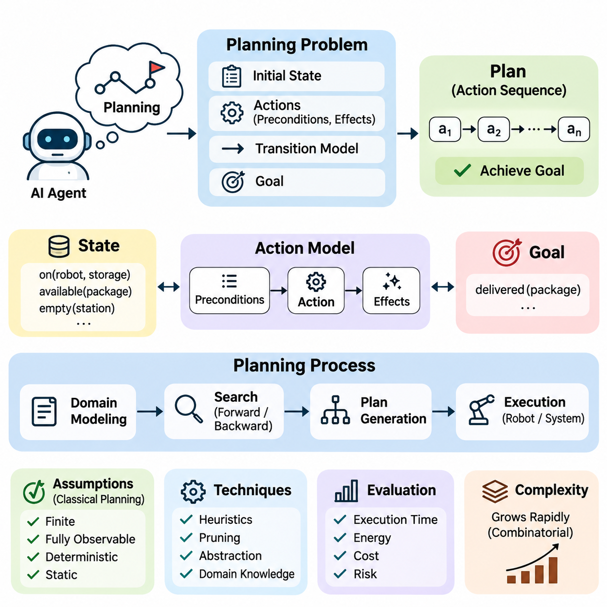{width="7.268055555555556in" height="7.268055555555556in"}

Planning is a fundamental capability of artificial intelligence that enables an intelligent agent to determine a sequence of actions required to achieve a desired objective. Unlike reactive systems that respond only to immediate inputs, planning systems reason about future states, action consequences, and goal conditions. This capability allows AI systems to coordinate decisions over multiple steps while considering dependencies and environmental constraints.

The central purpose of planning is to transform an initial state into a goal state through a logically valid sequence of actions. A planning problem typically consists of an initial state, a collection of available actions, a transition model, and a goal specification. The planner examines possible action sequences and identifies those that satisfy the goal conditions. Depending on the problem, it may also minimize execution cost, time, or resource consumption.

Planning differs from ordinary search because actions often possess explicit preconditions and effects that describe how the world changes. Search algorithms explore possible states, while planning systems exploit structured knowledge about actions and their relationships. This distinction becomes important when actions depend on previous achievements, modify multiple properties, or interfere with other activities. Planning therefore combines state-space exploration with symbolic reasoning.

A planning state represents the relevant properties of an environment at a particular moment. In symbolic planning, states are commonly described using logical predicates that express relationships between objects. For example, a warehouse robot may be located in a storage area, a package may be available for collection, and a delivery station may be unoccupied. These facts provide the information required to determine which actions are currently applicable.

Actions define the mechanisms through which an intelligent agent changes its environment. Each action normally includes preconditions that must hold before execution and effects that describe the resulting state modifications. A robot cannot pick up an object unless it is within reach and its gripper is available. Once the pickup action succeeds, the object becomes attached to the robot, and the corresponding environmental state must be updated.

Goals specify the conditions that a successful plan must establish. A goal may involve a single desired condition or a conjunction of several conditions that must hold simultaneously. In logistics planning, the objective might require multiple packages to reach different destinations. The planner must identify an action sequence that achieves every required condition without violating operational constraints or producing conflicting outcomes.

Classical planning traditionally assumes a finite, fully observable, deterministic, and static environment, with actions represented as discrete transitions. Under these assumptions, the planner can predict the exact result of each applicable action. Such simplifications make planning problems mathematically manageable and support systematic algorithm development. However, real environments frequently violate these assumptions, requiring more advanced planning methods.

A deterministic transition model maps a state and an applicable action to a unique successor state. This relationship allows a planner to simulate possible futures before executing any physical operation. By repeatedly applying the transition model, the planner constructs candidate trajectories through the state space. A valid solution is obtained when the resulting sequence reaches a state satisfying the specified goal conditions.

The planning process generally begins by constructing an abstract model of the problem domain. Objects, predicates, actions, and constraints are represented in a form suitable for automated reasoning. The planner then evaluates possible action combinations and searches for a feasible solution. Once a plan is generated, an execution component translates symbolic actions into commands that can be performed by software services, robots, or industrial equipment.

Forward planning begins with the initial state and explores the consequences of available actions until a goal state is reached. Backward planning instead reasons from desired goal conditions toward actions capable of establishing them. Both approaches rely on the same underlying planning model but differ in how they organize the search. Their relative efficiency depends on branching factors, action dependencies, and the structure of the goal.

Planning complexity grows rapidly as the number of objects, actions, and possible states increases. Even relatively simple domains can produce enormous combinations of action sequences. Exhaustively examining every possibility is often computationally impractical. Consequently, effective planning systems use heuristics, pruning strategies, abstraction, and domain knowledge to reduce unnecessary exploration while preserving the ability to identify useful solutions.

Heuristic planning estimates the remaining effort required to achieve a goal from a particular state. These estimates guide the search toward promising alternatives rather than treating every candidate equally. Heuristics may be derived from relaxed planning problems, planning graphs, or structural properties of the domain. Their effectiveness strongly influences planning speed, solution quality, and scalability in complex environments.

A plan is not necessarily optimal simply because it achieves the goal. Different valid plans may require different execution times, energy consumption, financial costs, or operational risks. Cost-sensitive planning assigns numerical values to actions and searches for solutions that optimize a selected objective. In practical applications, several objectives may need to be balanced, making planning a constrained optimization problem as well as a reasoning problem.

Planning also requires careful treatment of action ordering and dependencies. Some actions must occur before others, while independent actions may be executed in different orders or concurrently. Partial-order planning represents only the ordering relationships necessary for correctness. This approach avoids committing prematurely to a complete sequence and can expose opportunities for parallel execution when the domain permits simultaneous activities.

Hierarchical planning addresses complexity by decomposing high-level objectives into smaller tasks. A general instruction such as delivering an item may be divided into locating the item, navigating to its position, collecting it, traveling to the destination, and releasing it. Each task can be refined into increasingly detailed operations. This decomposition supports modular reasoning and allows reusable procedures to organize complicated activities.

Temporal planning extends conventional action sequencing by representing durations, deadlines, and temporal relationships. Actions may occupy intervals rather than occur instantaneously, and multiple activities may overlap when their resource requirements are compatible. Industrial production, transportation, and robotic operations frequently require this capability. A useful temporal plan must satisfy both logical conditions and scheduling constraints throughout execution.

Uncertainty introduces additional challenges because actions may produce unpredictable outcomes and observations may provide incomplete information. Probabilistic planning represents alternative outcomes and their likelihoods, allowing decisions to account for uncertainty. In partially observable environments, an agent may maintain a belief about possible states rather than knowing the exact state. Planning then involves selecting actions that manage uncertainty while advancing toward the objective.

Planning and execution must remain connected in dynamic environments. A plan constructed from an initial model may become invalid when obstacles appear, resources become unavailable, or actions fail. Execution monitoring compares observed outcomes with expected results and identifies deviations. When necessary, the system updates its representation of the environment and generates a revised plan, establishing a feedback loop between reasoning and action.

Robotic planning illustrates the relationship between symbolic decisions and physical constraints. Task planning determines what operations should occur, while motion planning determines how the robot can move safely between configurations. A mobile manipulator may need to navigate toward an object, position its arm, grasp the object, and transport it. Successful execution requires coordination between discrete task decisions and continuous geometric motion.

Planning systems are also widely applicable to logistics, manufacturing, autonomous vehicles, workflow automation, and intelligent software agents. In logistics, planning coordinates transportation and delivery operations. In manufacturing, it determines production sequences and resource assignments. Software agents use planning to organize tool calls and dependent tasks. Although these applications differ substantially, they share the need to reason about actions, consequences, and objectives.

The architecture of a practical planning system typically separates domain modeling, problem formulation, planning algorithms, execution control, and monitoring. This separation allows planning strategies to evolve without requiring complete redesign of the application. A planner may generate symbolic actions, while specialized controllers handle low-level execution. Clearly defined interfaces between these components improve maintainability, interoperability, and operational reliability.

Planning quality can be evaluated through several complementary criteria, including goal achievement, solution cost, computation time, memory consumption, and robustness. Completeness describes whether a method can find a solution when one exists under its assumptions, while optimality concerns the quality of the selected solution. Practical evaluation must also consider how reliably plans execute when the real environment differs from the internal model.

The relationship between planning, search, constraint satisfaction, and reasoning is particularly important in classical artificial intelligence. Search provides algorithms for exploring alternatives, constraint satisfaction manages compatibility among decisions, and logical reasoning supports the interpretation of action conditions. Planning integrates these capabilities into a framework for purposeful behavior, transforming declarative knowledge about the world into executable sequences of decisions.

Modern intelligent systems increasingly combine classical planning with learning-based perception, prediction, and control. Machine learning can estimate environmental properties, predict action outcomes, or construct useful heuristics, while symbolic planning maintains explicit representations of goals and dependencies. Such hybrid architectures are valuable when systems must operate in complex environments while preserving interpretable decision structures and verifiable operational constraints.

Ultimately, planning provides the foundation for goal-directed intelligence by connecting knowledge, reasoning, decision-making, and action. Its central challenge is not merely finding a sequence of operations, but selecting actions that remain feasible, efficient, and appropriate under the assumptions of the environment. Understanding these principles establishes the conceptual foundation for classical planning formulations, STRIPS, PDDL, heuristic planning, hierarchical methods, and autonomous robotic planning systems.

계획 수립(Planning)은 지능형 에이전트(Intelligent Agent)가 원하는 목표(Objective)를 달성하기 위해 필요한 행동의 순서를 결정할 수 있도록 하는 인공지능(Artificial Intelligence)의 핵심 능력이다. 즉각적인 입력에만 반응하는 반응형 시스템(Reactive System)과 달리, 계획 시스템(Planning System)은 미래 상태(Future State), 행동의 결과(Action Consequence), 목표 조건(Goal Condition)을 추론한다. 이러한 능력을 통해 인공지능 시스템은 의존 관계와 환경적 제약조건을 고려하면서 여러 단계에 걸친 의사결정을 조정할 수 있다.

계획 수립의 핵심 목적은 논리적으로 유효한 행동 순서(Action Sequence)를 통해 초기 상태(Initial State)를 목표 상태(Goal State)로 변환하는 것이다. 계획 문제(Planning Problem)는 일반적으로 초기 상태, 사용 가능한 행동 집합, 상태 전이 모델(Transition Model), 목표 명세(Goal Specification)로 구성된다. 계획기(Planner)는 가능한 행동 순서를 검토하고 목표 조건을 만족하는 순서를 식별한다. 문제의 특성에 따라 실행 비용(Execution Cost), 시간 또는 자원 소비(Resource Consumption)를 최소화할 수도 있다.

계획 수립은 행동이 실행 전제조건(Precondition)과 효과(Effect)를 명시적으로 포함하여 세계가 어떻게 변화하는지를 설명한다는 점에서 일반적인 탐색(Search)과 구별된다. 탐색 알고리즘(Search Algorithm)은 가능한 상태를 탐색하는 반면, 계획 시스템은 행동과 행동 사이의 관계에 관한 구조화된 지식(Structured Knowledge)을 활용한다. 이러한 차이는 행동이 이전 성과에 의존하거나 여러 속성을 변경하거나 다른 활동과 충돌하는 경우 특히 중요하다. 따라서 계획 수립은 상태 공간 탐색(State-Space Search)과 기호적 추론(Symbolic Reasoning)을 결합한다.

계획 상태(Planning State)는 특정 시점에서 환경의 관련 속성을 표현한다. 기호적 계획(Symbolic Planning)에서는 일반적으로 객체 사이의 관계를 나타내는 논리적 술어(Logical Predicate)를 사용하여 상태를 기술한다. 예를 들어 창고 로봇(Warehouse Robot)이 보관 구역에 위치하고, 물품이 수거 가능한 상태이며, 배송 장소가 비어 있을 수 있다. 이러한 사실은 현재 어떤 행동을 적용할 수 있는지 판단하는 데 필요한 정보를 제공한다.

행동(Action)은 지능형 에이전트가 환경을 변화시키는 메커니즘을 정의한다. 각 행동에는 일반적으로 실행 전에 충족되어야 하는 전제조건과 실행 후 발생하는 상태 변화를 설명하는 효과가 포함된다. 로봇은 객체가 도달 가능한 범위에 있고 그리퍼(Gripper)를 사용할 수 있어야 객체를 집을 수 있다. 집기 동작(Pickup Action)이 성공하면 객체는 로봇에 부착된 상태가 되며, 이에 따라 환경 상태가 갱신되어야 한다.

목표(Goal)는 성공적인 계획이 반드시 성립시켜야 하는 조건을 지정한다. 목표는 하나의 조건으로 구성될 수도 있고, 여러 조건을 동시에 만족해야 하는 논리곱(Conjunction)으로 표현될 수도 있다. 물류 계획(Logistics Planning)에서는 여러 물품을 서로 다른 목적지로 배송해야 할 수 있다. 계획기는 운영 제약조건(Operational Constraint)을 위반하거나 상충하는 결과를 발생시키지 않으면서 모든 요구 조건을 달성하는 행동 순서를 찾아야 한다.

고전적 계획(Classical Planning)은 전통적으로 유한하고 완전 관측 가능(Fully Observable)하며 결정론적(Deterministic)이고 정적인 환경(Static Environment)을 가정하고, 행동을 이산적인 상태 전이(Discrete State Transition)로 표현한다. 이러한 가정에서는 계획기가 적용 가능한 각 행동의 결과를 정확하게 예측할 수 있다. 이와 같은 단순화는 계획 문제를 수학적으로 다루기 쉽게 만들고 체계적인 알고리즘 개발을 지원한다. 그러나 실제 환경은 이러한 가정을 위반하는 경우가 많으므로 더욱 발전된 계획 방법이 필요하다.

결정론적 상태 전이 모델(Deterministic Transition Model)은 하나의 상태와 적용 가능한 행동을 고유한 후속 상태(Successor State)에 대응시킨다. 이러한 관계를 통해 계획기는 물리적 작업을 실행하기 전에 가능한 미래를 시뮬레이션할 수 있다. 상태 전이 모델을 반복적으로 적용하면서 계획기는 상태 공간(State Space)에서 후보 경로를 구성한다. 최종적으로 도달한 상태가 지정된 목표 조건을 만족하면 유효한 해결책(Valid Solution)을 얻는다.

계획 수립 과정(Planning Process)은 일반적으로 문제 영역(Domain)의 추상 모델(Abstract Model)을 구성하는 것으로 시작한다. 객체, 술어, 행동, 제약조건을 자동 추론(Automated Reasoning)에 적합한 형태로 표현한다. 이후 계획기는 가능한 행동 조합을 평가하고 실행 가능한 해결책(Feasible Solution)을 탐색한다. 계획이 생성되면 실행 구성요소(Execution Component)가 기호적 행동(Symbolic Action)을 소프트웨어 서비스, 로봇 또는 산업 장비에서 수행할 수 있는 명령으로 변환한다.

전방 계획(Forward Planning)은 초기 상태에서 시작하여 목표 상태에 도달할 때까지 사용 가능한 행동의 결과를 탐색한다. 반면 후방 계획(Backward Planning)은 원하는 목표 조건에서 출발하여 해당 조건을 성립시킬 수 있는 행동을 역방향으로 추론한다. 두 접근법은 동일한 기본 계획 모델을 사용하지만 탐색을 구성하는 방식이 다르다. 상대적인 효율성은 분기 계수(Branching Factor), 행동 의존성(Action Dependency), 목표 구조(Goal Structure)에 따라 달라진다.

계획 문제의 복잡도(Planning Complexity)는 객체, 행동, 가능한 상태의 수가 증가함에 따라 빠르게 커진다. 비교적 단순한 문제 영역에서도 매우 많은 행동 순서의 조합이 발생할 수 있다. 모든 가능성을 완전 탐색(Exhaustive Search)하는 것은 계산적으로 비현실적인 경우가 많다. 따라서 효율적인 계획 시스템은 휴리스틱(Heuristic), 가지치기 전략(Pruning Strategy), 추상화(Abstraction), 영역 지식(Domain Knowledge)을 활용하여 불필요한 탐색을 줄이면서 유용한 해결책을 찾는 능력을 유지한다.

휴리스틱 계획(Heuristic Planning)은 특정 상태에서 목표를 달성하기 위해 필요한 나머지 노력이나 비용을 추정한다. 이러한 추정값은 모든 후보를 동일하게 취급하는 대신 유망한 대안으로 탐색을 유도한다. 휴리스틱은 완화된 계획 문제(Relaxed Planning Problem), 계획 그래프(Planning Graph), 문제 영역의 구조적 특성에서 도출될 수 있다. 휴리스틱의 효과는 복잡한 환경에서 계획 속도, 해결책의 품질(Solution Quality), 확장성(Scalability)에 큰 영향을 미친다.

계획이 목표를 달성한다고 해서 반드시 최적(Optimal)인 것은 아니다. 서로 다른 유효한 계획은 실행 시간, 에너지 소비, 재정적 비용 또는 운영 위험(Operational Risk)에서 차이를 보일 수 있다. 비용 민감형 계획(Cost-Sensitive Planning)은 행동에 수치적 비용을 부여하고 선택된 목적함수(Objective Function)를 최적화하는 해결책을 탐색한다. 실제 응용에서는 여러 목적을 균형 있게 고려해야 하므로 계획 수립은 추론 문제인 동시에 제약 최적화 문제(Constrained Optimization Problem)가 된다.

계획 수립에서는 행동 순서(Action Ordering)와 의존 관계(Dependency)를 신중하게 처리해야 한다. 일부 행동은 반드시 다른 행동보다 먼저 수행되어야 하지만, 독립적인 행동은 서로 다른 순서로 실행하거나 동시에 수행할 수 있다. 부분 순서 계획(Partial-Order Planning)은 계획의 정확성을 보장하는 데 필요한 순서 관계만 표현한다. 이러한 접근법은 전체 실행 순서를 지나치게 일찍 확정하지 않도록 하며, 문제 영역에서 동시 실행이 허용되는 경우 병렬 실행(Parallel Execution)의 기회를 발견할 수 있게 한다.

계층적 계획(Hierarchical Planning)은 상위 수준의 목표를 더 작은 작업으로 분해하여 복잡성을 해결한다. 물품 배송이라는 일반적인 지시는 물품 위치 확인, 해당 위치로 이동, 물품 수거, 목적지로 이동, 물품 내려놓기 등의 작업으로 나눌 수 있다. 각 작업은 점점 더 상세한 작업으로 세분화될 수 있다. 이러한 분해(Decomposition)는 모듈식 추론(Modular Reasoning)을 지원하고 재사용 가능한 절차를 통해 복잡한 활동을 체계적으로 구성할 수 있게 한다.

시간적 계획(Temporal Planning)은 행동의 지속시간(Duration), 마감시간(Deadline), 시간적 관계(Temporal Relationship)를 표현하여 기존의 행동 순서 계획을 확장한다. 행동은 순간적으로 발생하는 대신 일정한 시간 구간을 차지할 수 있으며, 자원 요구사항이 양립할 경우 여러 활동이 중첩될 수 있다. 산업 생산, 운송, 로봇 운영에서는 이러한 기능이 자주 요구된다. 유용한 시간적 계획은 실행 전반에 걸쳐 논리적 조건과 일정 제약조건(Scheduling Constraint)을 모두 만족해야 한다.

불확실성(Uncertainty)은 행동이 예측하기 어려운 결과를 발생시키거나 관측 정보가 불완전할 수 있기 때문에 추가적인 문제를 만든다. 확률적 계획(Probabilistic Planning)은 대안적인 결과와 발생 가능성을 표현하여 불확실성을 고려한 의사결정을 가능하게 한다. 부분 관측 환경(Partially Observable Environment)에서는 에이전트가 정확한 상태를 아는 대신 가능한 상태에 대한 신념 상태(Belief State)를 유지할 수 있다. 이 경우 계획 수립은 목표를 향해 진행하면서 불확실성을 관리하는 행동을 선택하는 과정이 된다.

동적 환경(Dynamic Environment)에서는 계획 수립과 실행이 지속적으로 연결되어야 한다. 초기 모델을 기반으로 구성한 계획은 장애물이 나타나거나 자원을 사용할 수 없게 되거나 행동이 실패하면 유효하지 않을 수 있다. 실행 감시(Execution Monitoring)는 관측된 결과와 예상 결과를 비교하여 편차를 식별한다. 필요한 경우 시스템은 환경 표현을 갱신하고 수정된 계획을 생성하며, 이를 통해 추론과 행동 사이에 피드백 루프(Feedback Loop)를 형성한다.

로봇 계획(Robotic Planning)은 기호적 의사결정(Symbolic Decision-Making)과 물리적 제약조건(Physical Constraint)의 관계를 잘 보여준다. 작업 계획(Task Planning)은 어떤 작업을 수행해야 하는지 결정하고, 동작 계획(Motion Planning)은 로봇이 서로 다른 구성 상태(Configuration) 사이를 어떻게 안전하게 이동할 수 있는지 결정한다. 이동형 매니퓰레이터(Mobile Manipulator)는 객체로 이동하고, 로봇 팔의 위치를 조정하고, 객체를 파지한 후 운반해야 할 수 있다. 성공적인 실행을 위해서는 이산적인 작업 결정과 연속적인 기하학적 움직임(Continuous Geometric Motion)을 조정해야 한다.

계획 시스템은 물류(Logistics), 제조(Manufacturing), 자율주행 차량(Autonomous Vehicle), 업무흐름 자동화(Workflow Automation), 지능형 소프트웨어 에이전트(Intelligent Software Agent)에도 폭넓게 적용된다. 물류에서는 운송과 배송 작업을 조정하고, 제조에서는 생산 순서와 자원 할당(Resource Allocation)을 결정한다. 소프트웨어 에이전트는 도구 호출(Tool Call)과 상호 의존적인 작업을 구성하기 위해 계획 수립을 사용한다. 이러한 응용 분야는 상당히 다르지만 행동, 결과, 목표를 추론해야 한다는 공통점을 가진다.

실용적인 계획 시스템의 아키텍처(Planning System Architecture)는 일반적으로 영역 모델링(Domain Modeling), 문제 정식화(Problem Formulation), 계획 알고리즘(Planning Algorithm), 실행 제어(Execution Control), 감시(Monitoring)를 분리한다. 이러한 분리는 응용 시스템 전체를 다시 설계하지 않고도 계획 전략을 발전시킬 수 있게 한다. 계획기는 기호적 행동을 생성하고 전문화된 제어기(Controller)는 저수준 실행(Low-Level Execution)을 담당할 수 있다. 구성요소 사이에 명확한 인터페이스(Interface)를 정의하면 유지보수성(Maintainability), 상호운용성(Interoperability), 운영 신뢰성(Operational Reliability)이 향상된다.

계획 품질(Planning Quality)은 목표 달성 여부, 해결책 비용, 계산 시간, 메모리 사용량, 강건성(Robustness) 등 상호 보완적인 기준으로 평가할 수 있다. 완전성(Completeness)은 주어진 가정 아래 해결책이 존재할 때 알고리즘이 이를 찾아낼 수 있는지를 나타내며, 최적성(Optimality)은 선택된 해결책의 품질과 관련된다. 실제 평가에서는 현실 환경이 내부 모델(Internal Model)과 다를 때 계획이 얼마나 안정적으로 실행되는지도 고려해야 한다.

계획 수립, 탐색(Search), 제약 충족(Constraint Satisfaction), 추론(Reasoning)의 관계는 고전적 인공지능(Classical Artificial Intelligence)에서 특히 중요하다. 탐색은 대안을 탐색하는 알고리즘을 제공하고, 제약 충족은 의사결정 사이의 양립 가능성을 관리하며, 논리적 추론(Logical Reasoning)은 행동 조건을 해석하도록 지원한다. 계획 수립은 이러한 기능을 목적 지향적 행동(Goal-Directed Behavior)을 위한 프레임워크(Framework)로 통합하고, 세계에 관한 선언적 지식(Declarative Knowledge)을 실행 가능한 의사결정 순서로 변환한다.

현대 지능형 시스템(Modern Intelligent System)은 고전적 계획과 학습 기반 인식(Learning-Based Perception), 예측(Prediction), 제어(Control)를 점점 더 긴밀하게 결합하고 있다. 기계학습(Machine Learning)은 환경 속성을 추정하고 행동 결과를 예측하거나 유용한 휴리스틱을 구성할 수 있으며, 기호적 계획은 목표와 의존 관계에 대한 명시적인 표현을 유지한다. 이러한 하이브리드 아키텍처(Hybrid Architecture)는 복잡한 환경에서 작동하면서도 해석 가능한 의사결정 구조(Interpretable Decision Structure)와 검증 가능한 운영 제약조건을 유지해야 하는 시스템에서 유용하다.

궁극적으로 계획 수립은 지식(Knowledge), 추론(Reasoning), 의사결정(Decision-Making), 행동(Action)을 연결함으로써 목표 지향적 지능(Goal-Directed Intelligence)의 기반을 제공한다. 핵심 과제는 단순히 작업 순서를 찾는 것이 아니라 환경에 대한 가정 아래에서 실행 가능하고 효율적이며 적절한 행동을 선택하는 것이다. 이러한 원리를 이해하는 것은 고전적 계획 정식화(Classical Planning Formulation), STRIPS, 계획 영역 정의 언어(PDDL), 휴리스틱 계획(Heuristic Planning), 계층적 계획 방법(Hierarchical Planning Method), 자율 로봇 계획 시스템(Autonomous Robotic Planning System)을 학습하기 위한 개념적 토대를 마련한다.

## 04.02 Classical Planning Formulation

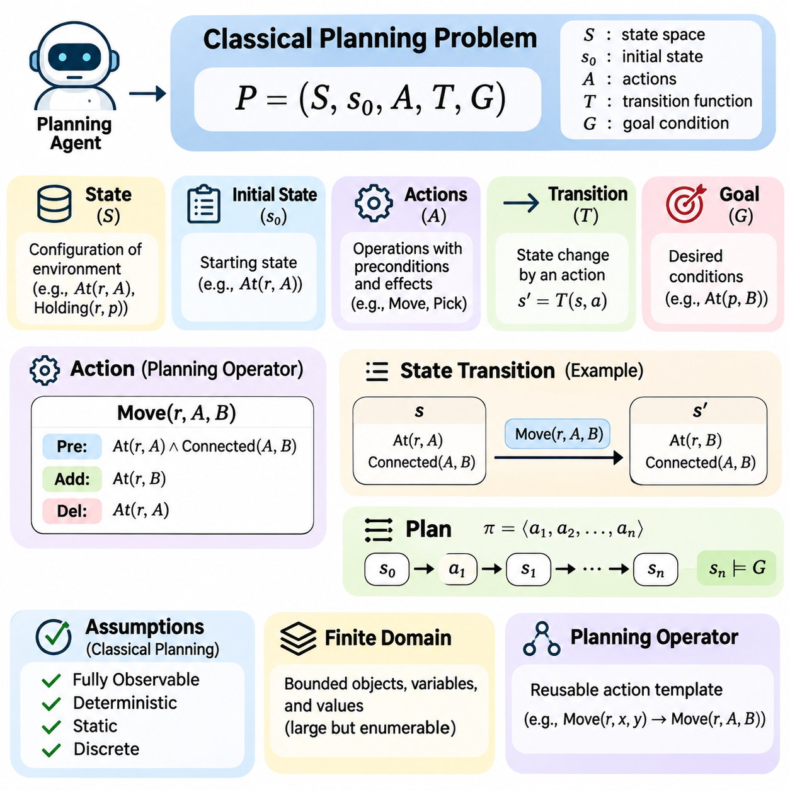{width="7.268055555555556in" height="7.268055555555556in"}

Classical planning formulation provides a mathematical framework for representing how an intelligent agent can transform an initial environment into a desired goal state through a sequence of actions. It establishes precise definitions for states, actions, transitions, and goals, allowing planning problems to be analyzed systematically. This formal representation serves as the foundation for symbolic planning algorithms and automated reasoning systems.

A classical planning problem is commonly represented as a tuple consisting of a set of states, an initial state, a collection of actions, a transition function, and a goal condition. Each component describes a distinct aspect of the planning environment. Together, they define which actions are possible, how the environment changes after execution, and what conditions must hold for a plan to be considered successful.

The state space contains all configurations of the environment that can be represented within the planning model. Each state describes relevant facts about objects, locations, resources, and relationships. For example, a warehouse environment may represent the location of robots, the positions of packages, and the availability of storage areas. The planner uses these facts to distinguish alternative situations and determine applicable actions.

Symbolic state representation commonly uses logical predicates to describe properties and relationships. A predicate such as At(Robot1, LocationA) indicates that a particular robot occupies a specified location. Another predicate, Holding(Robot1, Package1), represents possession of an object. A complete state can be modeled as a set of true ground predicates, while predicates not included are normally considered false under the closed-world assumption.

The initial state specifies the environment configuration before planning begins. It provides the starting point from which all candidate action sequences are evaluated. Accurate initial-state representation is essential because planning algorithms derive future states from the facts initially provided. Missing or incorrect information may produce plans that appear logically valid but cannot be executed successfully in the actual environment.

The goal condition defines the desired properties of the final state rather than necessarily specifying a unique complete state. Goals are often expressed as conjunctions of logical predicates that must simultaneously hold. For example, a delivery task may require Package1 to be at DestinationA and Package2 to be at DestinationB. Any reachable state satisfying both conditions represents a successful outcome.

Actions describe the available operations through which the environment can change. Each action is typically defined by a name, parameters, preconditions, and effects. Parameters identify the objects involved, while preconditions determine whether the action can be executed in a particular state. Effects specify which facts become true or false after execution, enabling the planner to predict the consequences of each operation.

An action is applicable only when its preconditions are satisfied by the current state. For example, a robot can execute Move(LocationA, LocationB) only when it is located at LocationA and a valid connection exists between the two locations. Preconditions prevent logically impossible transitions and restrict the planner to meaningful operations. Their accurate definition is essential for maintaining consistency throughout the planning process.

Action effects are commonly separated into positive effects and negative effects. Positive effects introduce facts that become true after execution, while negative effects remove facts that are no longer valid. When a robot moves from LocationA to LocationB, its presence at LocationB becomes true, and its presence at LocationA becomes false. This representation supports deterministic state updates using explicit logical operations.

The transition function defines how an applicable action transforms one state into another. In classical planning, this function is deterministic, meaning that the same action executed in the same state always produces the same successor state. The resulting state is constructed by removing negative effects and adding positive effects. This predictable transition mechanism enables systematic exploration of possible action sequences.

A plan is a finite sequence of actions that transforms the initial state into a state satisfying the goal condition. Every action must be applicable in the state produced by its preceding actions. Consequently, plan validity depends on the entire sequence rather than the individual actions considered independently. A plan is correct when its execution respects all preconditions and ultimately establishes the required goals.

Classical planning typically assumes complete observability, deterministic actions, a static environment, and discrete state transitions. Complete observability means that the planner has access to the relevant state information. A static environment does not change independently while planning actions are considered. These assumptions simplify the reasoning process by eliminating uncertainty about action outcomes and unexpected environmental changes.

The finite-domain assumption allows planning problems to be represented using a bounded collection of objects, variables, and possible values. Although the resulting state space may be extremely large, it remains conceptually enumerable. This property supports graph-search techniques and formal analysis. Nevertheless, the number of possible states can grow exponentially with the number of independent variables or predicates.

Planning operators provide reusable action templates that can be instantiated with specific objects. For example, a general Move(robot, source, destination) operator can represent movement between many different locations. Grounding replaces the operator parameters with concrete objects from the problem domain. This process generates executable action instances and allows a compact domain description to represent numerous possible operations.

State invariants express properties that must remain true throughout valid planning states. A robot may be required to occupy only one location at a time, while a package cannot simultaneously be carried by two different robots. Such invariants help identify inconsistent representations and impossible states. They may be enforced through action definitions, domain constraints, or additional validation mechanisms.

The distinction between domain models and problem instances is fundamental to reusable planning systems. A domain model defines general object types, predicates, and action schemas applicable across related tasks. A problem instance specifies the particular objects, initial conditions, and goals for one planning scenario. Separating these elements allows the same planning domain to support many different objectives without redefining its underlying operational rules.

Classical planning can be interpreted as a directed graph in which states correspond to vertices and applicable actions correspond to transitions between vertices. The initial state identifies the starting vertex, while goal-satisfying states define acceptable destinations. Planning then becomes a search problem over this implicitly represented graph. However, the symbolic structure of actions provides additional information that specialized planners can exploit.

Forward state-space planning begins with the initial state and repeatedly applies applicable actions to generate successor states. The search continues until a state satisfies the goal condition or the available search space is exhausted. This approach is conceptually straightforward and can incorporate breadth-first search, uniform-cost search, or heuristic search. Its performance depends strongly on branching factors and the effectiveness of state evaluation.

Backward planning begins with the goal conditions and identifies actions capable of establishing them. The planner then determines which conditions must hold before those actions can execute. This process continues toward the initial state through regression of goal requirements. Backward reasoning can reduce unnecessary exploration when the goals constrain relevant actions, although interactions between conditions must be handled carefully.

Plan cost introduces an optimization criterion beyond simple goal satisfaction. Each action may be assigned a numerical cost representing time, distance, energy consumption, or another resource. The total cost of a sequential plan is commonly calculated by summing the costs of its actions. An optimal planner seeks a valid plan with minimum total cost, whereas a satisficing planner prioritizes finding an acceptable solution efficiently.

The distinction between feasibility and optimality is important in planning formulation. A feasible plan satisfies the action constraints and reaches the required goal, but it may not be the least expensive or shortest solution. Optimality requires an explicitly defined objective function and an algorithm capable of establishing the best solution under that objective. Practical systems often balance computational effort against solution quality.

Planning formulations must also account for unreachable goals and dead-end states. A goal is unreachable when no valid sequence of available actions can establish the required conditions from the initial state. A dead-end state is a reachable state from which the goal cannot subsequently be achieved. Detecting such situations helps prevent wasted computation and provides useful information about limitations in the planning model.

Model correctness is essential because planning algorithms reason only about the environment described by their formal representation. If an action omits an important precondition or incorrectly specifies an effect, the planner may generate an invalid real-world procedure. Domain validation therefore examines logical consistency, action applicability, state invariants, and expected transitions. Carefully designed test problems help identify modeling errors before deployment.

Classical planning formulation provides the conceptual foundation for STRIPS representations, Planning Domain Definition Language, state-space planning, planning graphs, and heuristic planners. These methods differ in their search strategies and implementation details but rely on the same fundamental relationship between states, actions, transitions, and goals. A rigorous formulation enables reliable algorithm comparison, reusable domain modeling, and systematic planning-system development.

In practical artificial intelligence, classical planning serves as a structured reasoning layer between high-level objectives and executable operations. Robotics, logistics, manufacturing, and automated workflows can represent tasks through symbolic actions and explicit goal conditions. Although real environments often require extensions for uncertainty, time, and continuous dynamics, classical formulation remains a fundamental starting point for constructing interpretable and goal-directed intelligent systems.

고전적 계획 정식화(Classical Planning Formulation)는 지능형 에이전트(Intelligent Agent)가 일련의 행동(Action)을 통해 초기 환경(Initial Environment)을 원하는 목표 상태(Goal State)로 변환하는 방법을 표현하기 위한 수학적 프레임워크(Mathematical Framework)를 제공한다. 이는 상태(State), 행동(Action), 전이(Transition), 목표(Goal)에 대한 정확한 정의를 수립하여 계획 문제(Planning Problem)를 체계적으로 분석할 수 있도록 한다. 이러한 형식적 표현(Formal Representation)은 기호적 계획 알고리즘(Symbolic Planning Algorithm)과 자동 추론 시스템(Automated Reasoning System)의 기반이 된다.

고전적 계획 문제(Classical Planning Problem)는 일반적으로 상태 집합(State Set), 초기 상태(Initial State), 행동 집합(Action Set), 전이 함수(Transition Function), 목표 조건(Goal Condition)으로 구성된 튜플(Tuple)로 표현된다. 각 구성요소는 계획 환경(Planning Environment)의 서로 다른 측면을 설명한다. 이들은 함께 어떤 행동이 가능한지, 행동 실행 후 환경이 어떻게 변화하는지, 계획이 성공한 것으로 판단되기 위해 어떤 조건을 만족해야 하는지를 정의한다.

상태 공간(State Space)은 계획 모델(Planning Model) 내에서 표현할 수 있는 환경의 모든 구성 상태(Configuration)를 포함한다. 각 상태는 객체(Object), 위치(Location), 자원(Resource), 관계(Relationship)에 관한 관련 사실을 설명한다. 예를 들어 창고 환경에서는 로봇의 위치, 물품의 배치, 보관 구역의 사용 가능 여부를 표현할 수 있다. 계획기(Planner)는 이러한 사실을 활용하여 서로 다른 상황을 구별하고 적용 가능한 행동(Applicable Action)을 결정한다.

기호적 상태 표현(Symbolic State Representation)은 일반적으로 논리적 술어(Logical Predicate)를 사용하여 속성과 관계를 설명한다. At(Robot1, LocationA)와 같은 술어는 특정 로봇이 지정된 위치에 있음을 나타낸다. 또 다른 술어인 Holding(Robot1, Package1)은 객체를 보유하고 있음을 표현한다. 완전한 상태는 참인 기초 술어(Ground Predicate)의 집합으로 모델링할 수 있으며, 포함되지 않은 술어는 일반적으로 폐쇄 세계 가정(Closed-World Assumption)에 따라 거짓으로 간주된다.

초기 상태(Initial State)는 계획 수립이 시작되기 전의 환경 구성을 지정한다. 이는 모든 후보 행동 순서(Candidate Action Sequence)를 평가하는 출발점을 제공한다. 계획 알고리즘(Planning Algorithm)은 처음 제공된 사실을 기반으로 미래 상태를 도출하므로 정확한 초기 상태 표현이 필수적이다. 정보가 누락되거나 잘못되면 논리적으로는 유효해 보이지만 실제 환경에서는 성공적으로 실행할 수 없는 계획이 생성될 수 있다.

목표 조건(Goal Condition)은 반드시 하나의 고유한 완전 상태를 지정하는 것이 아니라 최종 상태(Final State)가 갖추어야 할 속성을 정의한다. 목표는 일반적으로 동시에 만족해야 하는 논리적 술어들의 논리곱(Conjunction)으로 표현된다. 예를 들어 배송 작업(Delivery Task)에서는 Package1이 DestinationA에 있고 Package2가 DestinationB에 있어야 할 수 있다. 두 조건을 모두 만족하는 도달 가능한 상태(Reachable State)는 성공적인 결과를 나타낸다.

행동(Action)은 환경을 변화시킬 수 있는 작업을 설명한다. 각 행동은 일반적으로 이름(Name), 매개변수(Parameter), 전제조건(Precondition), 효과(Effect)로 정의된다. 매개변수는 관련 객체를 식별하고, 전제조건은 특정 상태에서 행동을 실행할 수 있는지를 결정한다. 효과는 실행 후 어떤 사실이 참 또는 거짓이 되는지를 지정하여 계획기가 각 작업의 결과를 예측할 수 있도록 한다.

행동은 현재 상태(Current State)가 전제조건을 만족할 때만 적용할 수 있다. 예를 들어 로봇은 LocationA에 위치하고 두 위치 사이에 유효한 연결이 존재할 때만 Move(LocationA, LocationB)를 실행할 수 있다. 전제조건은 논리적으로 불가능한 상태 전이(State Transition)를 방지하고 계획기가 의미 있는 작업만 수행하도록 제한한다. 전제조건을 정확하게 정의하는 것은 계획 수립 과정 전체에서 일관성(Consistency)을 유지하는 데 필수적이다.

행동 효과(Action Effect)는 일반적으로 긍정적 효과(Positive Effect)와 부정적 효과(Negative Effect)로 구분된다. 긍정적 효과는 실행 후 참이 되는 사실을 추가하고, 부정적 효과는 더 이상 유효하지 않은 사실을 제거한다. 로봇이 LocationA에서 LocationB로 이동하면 LocationB에 존재한다는 사실은 참이 되고 LocationA에 존재한다는 사실은 거짓이 된다. 이러한 표현은 명시적인 논리 연산(Logical Operation)을 사용하여 결정론적 상태 갱신(Deterministic State Update)을 지원한다.

전이 함수(Transition Function)는 적용 가능한 행동이 하나의 상태를 다른 상태로 변환하는 방법을 정의한다. 고전적 계획에서는 이 함수가 결정론적(Deterministic)이므로 동일한 상태에서 동일한 행동을 실행하면 항상 동일한 후속 상태(Successor State)가 생성된다. 결과 상태는 부정적 효과를 제거하고 긍정적 효과를 추가하여 구성된다. 이러한 예측 가능한 전이 메커니즘(Transition Mechanism)은 가능한 행동 순서를 체계적으로 탐색할 수 있도록 한다.

계획(Plan)은 초기 상태를 목표 조건을 만족하는 상태로 변환하는 유한한 행동 순서(Finite Action Sequence)이다. 각 행동은 이전 행동들이 생성한 상태에서 적용 가능해야 한다. 따라서 계획의 유효성(Plan Validity)은 개별 행동을 독립적으로 고려하는 것이 아니라 전체 행동 순서에 따라 결정된다. 계획은 실행 과정에서 모든 전제조건을 준수하고 최종적으로 요구된 목표를 성립시킬 때 올바른 것으로 판단된다.

고전적 계획은 일반적으로 완전 관측 가능성(Complete Observability), 결정론적 행동(Deterministic Action), 정적 환경(Static Environment), 이산적 상태 전이(Discrete State Transition)를 가정한다. 완전 관측 가능성은 계획기가 관련 상태 정보에 접근할 수 있음을 의미한다. 정적 환경은 계획에서 고려하는 행동과 무관하게 환경이 스스로 변화하지 않는다는 의미이다. 이러한 가정은 행동 결과에 대한 불확실성과 예상하지 못한 환경 변화를 제거하여 추론 과정을 단순화한다.

유한 영역 가정(Finite-Domain Assumption)은 제한된 객체, 변수(Variable), 가능한 값(Value)의 집합을 사용하여 계획 문제를 표현할 수 있도록 한다. 결과적으로 생성되는 상태 공간이 매우 클 수 있지만 개념적으로는 모든 상태를 열거할 수 있다. 이러한 특성은 그래프 탐색 기법(Graph-Search Technique)과 형식적 분석(Formal Analysis)을 지원한다. 그러나 가능한 상태의 수는 독립적인 변수나 술어의 수가 증가함에 따라 지수적으로 증가할 수 있다.

계획 연산자(Planning Operator)는 특정 객체를 사용하여 구체화할 수 있는 재사용 가능한 행동 템플릿(Action Template)을 제공한다. 예를 들어 일반적인 Move(robot, source, destination) 연산자는 여러 위치 사이의 이동을 표현할 수 있다. 구체화(Grounding)는 연산자의 매개변수를 문제 영역의 구체적인 객체로 대체한다. 이 과정은 실행 가능한 행동 인스턴스(Action Instance)를 생성하고 간결한 영역 설명(Domain Description)으로 수많은 가능한 작업을 표현할 수 있도록 한다.

상태 불변조건(State Invariant)은 유효한 계획 상태에서 항상 참으로 유지되어야 하는 속성을 표현한다. 로봇은 한 번에 하나의 위치에만 존재해야 할 수 있으며, 물품은 동시에 서로 다른 두 로봇에 의해 운반될 수 없다. 이러한 불변조건은 일관성이 없는 표현과 불가능한 상태를 식별하는 데 도움이 된다. 불변조건은 행동 정의(Action Definition), 영역 제약조건(Domain Constraint), 추가적인 검증 메커니즘(Validation Mechanism)을 통해 강제할 수 있다.

영역 모델(Domain Model)과 문제 인스턴스(Problem Instance)의 구분은 재사용 가능한 계획 시스템에서 기본적으로 중요하다. 영역 모델은 관련 작업 전반에 적용할 수 있는 일반적인 객체 유형(Object Type), 술어(Predicate), 행동 스키마(Action Schema)를 정의한다. 문제 인스턴스는 특정 계획 시나리오(Planning Scenario)에 필요한 객체, 초기 조건(Initial Condition), 목표를 지정한다. 이러한 요소를 분리하면 기본 운영 규칙을 다시 정의하지 않고도 동일한 계획 영역을 여러 목표에 활용할 수 있다.

고전적 계획은 상태를 정점(Vertex)으로, 적용 가능한 행동을 정점 사이의 전이(Transition)로 표현하는 방향 그래프(Directed Graph)로 해석할 수 있다. 초기 상태는 시작 정점(Starting Vertex)을 식별하고, 목표를 만족하는 상태는 허용 가능한 목적지(Acceptable Destination)를 정의한다. 따라서 계획 수립은 암묵적으로 표현된 그래프(Implicitly Represented Graph)에 대한 탐색 문제가 된다. 그러나 행동의 기호적 구조는 전문화된 계획기가 활용할 수 있는 추가 정보를 제공한다.

전방 상태 공간 계획(Forward State-Space Planning)은 초기 상태에서 시작하여 적용 가능한 행동을 반복적으로 실행함으로써 후속 상태를 생성한다. 탐색은 목표 조건을 만족하는 상태에 도달하거나 사용 가능한 탐색 공간이 소진될 때까지 계속된다. 이 접근법은 개념적으로 이해하기 쉬우며 너비 우선 탐색(Breadth-First Search), 균일 비용 탐색(Uniform-Cost Search), 휴리스틱 탐색(Heuristic Search)을 적용할 수 있다. 성능은 분기 계수(Branching Factor)와 상태 평가(State Evaluation)의 효율성에 크게 의존한다.

후방 계획(Backward Planning)은 목표 조건에서 시작하여 이를 성립시킬 수 있는 행동을 식별한다. 이후 계획기는 해당 행동을 실행하기 전에 어떤 조건이 충족되어야 하는지 결정한다. 이러한 과정은 목표 요구사항의 회귀(Regression)를 통해 초기 상태 방향으로 계속 진행된다. 후방 추론(Backward Reasoning)은 목표가 관련 행동을 제한하는 경우 불필요한 탐색을 줄일 수 있지만, 조건 사이의 상호작용(Interaction)을 신중하게 처리해야 한다.

계획 비용(Plan Cost)은 단순한 목표 만족을 넘어서는 최적화 기준(Optimization Criterion)을 도입한다. 각 행동에는 시간, 거리, 에너지 소비 또는 기타 자원을 나타내는 수치적 비용(Numerical Cost)을 부여할 수 있다. 순차적 계획(Sequential Plan)의 총비용은 일반적으로 개별 행동 비용의 합으로 계산된다. 최적 계획기(Optimal Planner)는 총비용이 최소인 유효한 계획을 탐색하는 반면, 만족화 계획기(Satisficing Planner)는 허용 가능한 해결책을 효율적으로 찾는 데 우선순위를 둔다.

실행 가능성(Feasibility)과 최적성(Optimality)의 구분은 계획 정식화에서 중요하다. 실행 가능한 계획(Feasible Plan)은 행동 제약조건을 만족하고 요구된 목표에 도달하지만, 반드시 비용이 가장 낮거나 길이가 가장 짧은 해결책은 아니다. 최적성을 판단하려면 명시적으로 정의된 목적함수(Objective Function)와 해당 목적에 따라 최상의 해결책을 확립할 수 있는 알고리즘이 필요하다. 실제 시스템에서는 계산 노력(Computational Effort)과 해결책 품질(Solution Quality) 사이의 균형을 고려하는 경우가 많다.

계획 정식화에서는 도달 불가능한 목표(Unreachable Goal)와 막다른 상태(Dead-End State)도 고려해야 한다. 목표가 도달 불가능하다는 것은 초기 상태에서 사용 가능한 행동의 유효한 순서를 통해 요구 조건을 성립시킬 수 없다는 의미이다. 막다른 상태는 도달할 수는 있지만 이후 목표를 달성할 수 없는 상태를 의미한다. 이러한 상황을 감지하면 불필요한 계산을 방지하고 계획 모델의 한계에 관한 유용한 정보를 제공할 수 있다.

모델 정확성(Model Correctness)은 계획 알고리즘이 형식적 표현(Formal Representation)에 기술된 환경만을 대상으로 추론하기 때문에 필수적이다. 행동에서 중요한 전제조건이 누락되거나 효과가 잘못 지정되면 계획기는 실제 환경에서 유효하지 않은 절차를 생성할 수 있다. 따라서 영역 검증(Domain Validation)은 논리적 일관성(Logical Consistency), 행동 적용 가능성(Action Applicability), 상태 불변조건(State Invariant), 예상 상태 전이(Expected State Transition)를 검사한다. 신중하게 설계된 시험 문제(Test Problem)는 배포(Deployment) 전에 모델링 오류(Modeling Error)를 식별하는 데 도움이 된다.

고전적 계획 정식화는 STRIPS 표현(STRIPS Representation), 계획 영역 정의 언어(Planning Domain Definition Language, PDDL), 상태 공간 계획(State-Space Planning), 계획 그래프(Planning Graph), 휴리스틱 계획기(Heuristic Planner)의 개념적 기반을 제공한다. 이러한 방법은 탐색 전략(Search Strategy)과 구현 세부사항(Implementation Detail)에서 차이가 있지만 상태, 행동, 전이, 목표 사이의 동일한 기본 관계에 의존한다. 엄밀한 정식화(Rigorous Formulation)는 신뢰할 수 있는 알고리즘 비교, 재사용 가능한 영역 모델링, 체계적인 계획 시스템 개발을 가능하게 한다.

실제 인공지능(Artificial Intelligence)에서 고전적 계획은 상위 수준 목표(High-Level Objective)와 실행 가능한 작업(Executable Operation) 사이에 위치하는 구조화된 추론 계층(Structured Reasoning Layer)의 역할을 한다. 로봇공학(Robotics), 물류(Logistics), 제조(Manufacturing), 자동화된 업무흐름(Automated Workflow)은 기호적 행동(Symbolic Action)과 명시적인 목표 조건을 통해 작업을 표현할 수 있다. 실제 환경에서는 불확실성(Uncertainty), 시간(Time), 연속 동역학(Continuous Dynamics)을 처리하기 위한 확장이 필요한 경우가 많지만, 고전적 계획 정식화는 해석 가능하고 목표 지향적인 지능형 시스템(Interpretable and Goal-Directed Intelligent System)을 구축하기 위한 기본적인 출발점으로 남아 있다.

## 04.03 STRIPS Representation

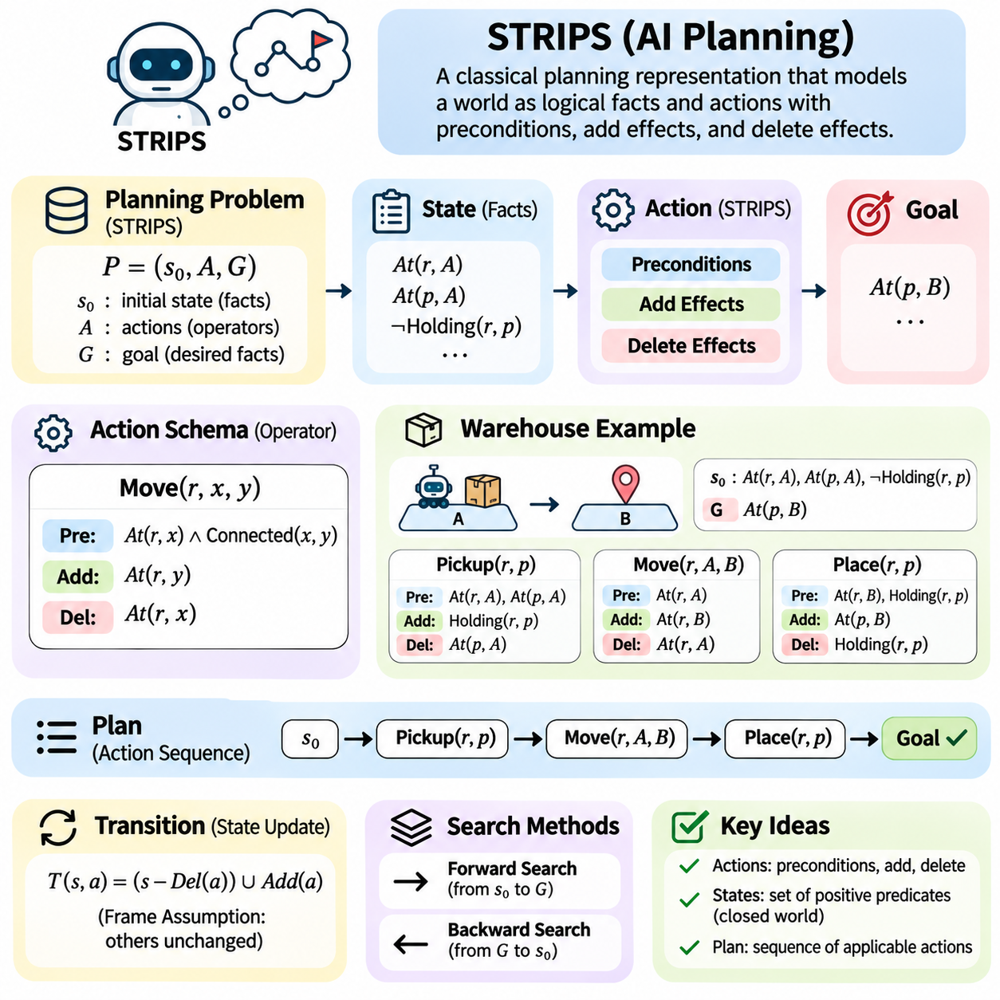{width="7.268055555555556in" height="7.268055555555556in"}

STRIPS, or Stanford Research Institute Problem Solver, is a foundational representation framework in classical artificial intelligence planning. It describes how an intelligent agent can achieve goals by applying actions that modify a symbolic representation of the environment. Developed for early robotic planning research, STRIPS introduced a structured method for expressing action preconditions and effects, establishing principles that remain central to automated planning systems.

The central idea of STRIPS is to represent the world as a collection of logical facts and describe actions as transformations of those facts. Rather than modeling every physical detail, STRIPS focuses on properties relevant to planning decisions. This abstraction allows a planner to reason about possible action sequences without simulating the complete environment. Its simplicity makes it suitable for studying the fundamental relationship between states, actions, and goals.

A STRIPS planning problem consists of an initial state, a set of available actions, and a goal specification. The initial state describes the facts known to be true before planning begins. Actions determine which state transformations are permitted, while the goal specifies the conditions that must eventually hold. A valid plan is a sequence of applicable actions that transforms the initial state into one satisfying every required goal condition.

States in STRIPS are commonly represented as sets of positive ground predicates. A predicate describes a property or relationship involving specific objects, such as At(Robot1, RoomA) or Holding(Robot1, Box1). Under the closed-world assumption, any ground predicate not explicitly included in the state is considered false. This representation provides a compact and logically precise description of the planning environment.

STRIPS actions are defined using three primary components: preconditions, add effects, and delete effects. Preconditions specify the facts that must hold before an action can execute. Add effects identify facts that become true afterward, while delete effects identify facts that become false. These components define the logical behavior of an action and provide the mechanism through which the planner constructs successor states.

An action is applicable when all its preconditions are satisfied in the current state. For example, a robot can move from RoomA to RoomB only when it is located in RoomA and the rooms are connected. If either condition is absent, the movement action cannot be applied. This rule ensures that the planner explores only transitions consistent with the action definitions and the current symbolic representation.

The add list specifies facts introduced by an action. When a robot moves into RoomB, the predicate At(Robot1, RoomB) is added to the resulting state. The delete list removes facts invalidated by the same action, such as At(Robot1, RoomA). Together, these operations represent state changes without requiring a complete reconstruction of the environment after every action.

The STRIPS transition mechanism applies an action by removing its delete effects from the current state and then inserting its add effects. Facts unaffected by either list remain unchanged. This behavior reflects the frame assumption, which states that properties persist unless explicitly modified. By representing only changes, STRIPS avoids repeatedly describing every property that remains constant after an operation.

Action schemas provide reusable descriptions of operations involving variable objects. A movement schema might be written conceptually as Move(robot, source, destination), with parameters identifying the robot and locations. Specific action instances are created by substituting concrete objects for these parameters. This grounding process enables one general operator to represent many possible actions within a planning domain.

Consider a simple warehouse environment containing a robot, several storage locations, and movable packages. The initial state may indicate that Robot1 is at LocationA, Package1 is at LocationA, and the robot is not carrying anything. The objective is to transport Package1 to LocationB. STRIPS represents this task through movement, pickup, and placement actions, each with explicitly defined preconditions and effects.

A pickup action may require the robot and package to occupy the same location while the robot\'s gripper is empty. Its add effects establish that the robot is holding the package, while its delete effects remove the package\'s previous location and the gripper\'s empty status. A placement action reverses the relevant relationships. These definitions allow the planner to construct a logically consistent transportation sequence.

The goal specification in STRIPS is typically expressed as a conjunction of positive predicates. A delivery goal might require At(Package1, LocationB) and At(Package2, LocationC) to become true simultaneously. The planner does not necessarily need to establish every possible environmental fact. It only needs to reach a state containing the required goal predicates while respecting all action preconditions.

STRIPS planning can be performed through forward state-space search, beginning with the initial state and applying applicable actions to generate successors. Each resulting state becomes a candidate for further exploration. The process continues until a state satisfies the goal specification. Standard search algorithms, including breadth-first search and heuristic search, can operate on this representation to identify valid action sequences.

Backward planning provides another approach by reasoning from the goal toward the initial state. The planner selects actions whose effects can establish required goal predicates and determines the conditions needed before those actions execute. This process, known as goal regression, can focus reasoning on actions relevant to the objective. However, selected actions must not destroy other required conditions.

The interaction between actions creates important planning challenges. An action may establish one goal while deleting a fact needed for another goal. Such interference requires the planner to consider ordering constraints and dependencies. For example, moving a robot away from a pickup location before collecting a package may invalidate the pickup preconditions. STRIPS makes these conflicts explicit through its precondition and effect lists.

The expressive power of basic STRIPS is intentionally limited. Traditional formulations primarily use positive conjunctive preconditions, positive goals, and deterministic add-delete effects. They do not directly represent arbitrary logical formulas, numeric resources, action durations, or probabilistic outcomes. These restrictions simplify planning algorithms but limit the representation of complex environments without additional modeling techniques.

The closed-world assumption is especially important when interpreting STRIPS states. A fact absent from the current state is treated as false rather than unknown. This simplifies logical evaluation but assumes the planning model contains sufficient information about relevant environmental properties. In partially observable environments, this assumption may be inappropriate because missing information does not necessarily imply that a condition is false.

STRIPS also assumes that action effects are deterministic and that the environment changes according to the modeled operations. Executing an applicable action produces a predictable successor state. Real robotic environments may contain sensor errors, unexpected obstacles, and execution failures that violate these assumptions. Such situations require execution monitoring, state estimation, or extensions to classical planning representations.

The compactness of STRIPS is one of its major advantages. Action schemas describe only the conditions necessary for execution and the facts modified afterward. Unchanged properties are preserved automatically, reducing representational redundancy. This structure supports systematic search, formal reasoning, and reusable planning-domain definitions, making STRIPS a valuable foundation for both educational examples and automated planning research.

Despite its compact representation, STRIPS planning can become computationally difficult as the number of objects and actions increases. Grounding parameterized operators may generate many action instances, while combinations of predicates produce large state spaces. Efficient planners therefore employ reachability analysis, heuristic estimation, pruning, and other optimization methods to reduce unnecessary exploration.

STRIPS provides a conceptual foundation for the Planning Domain Definition Language, commonly known as PDDL. PDDL generalizes classical action descriptions and supports standardized representations of planning domains and problems. Basic PDDL action schemas retain the central STRIPS concepts of parameters, preconditions, and effects. More expressive PDDL features extend these foundations to accommodate additional planning requirements.

In robotics, STRIPS-style representations can describe task-level operations such as navigating, grasping, transporting, and releasing objects. A symbolic planner determines the required sequence, while lower-level motion planners and controllers execute the corresponding physical actions. This separation connects high-level logical reasoning with practical robotic behavior, although geometric feasibility and execution uncertainty must be addressed by additional components.

The correctness of a STRIPS domain depends on accurate action modeling. Missing delete effects may allow contradictory facts to remain true, while incomplete preconditions may permit impossible operations. Domain validation should therefore examine action consistency, reachable states, goal satisfaction, and expected state transitions. Carefully designed test scenarios help identify modeling errors before the representation is integrated into a larger planning system.

STRIPS remains significant because it demonstrates how complex goal-directed behavior can emerge from simple symbolic rules. By defining states as logical facts and actions as explicit modifications, it transforms planning into a structured search over possible futures. Understanding STRIPS provides a foundation for studying PDDL, state-space planning, heuristic planning, planning graphs, and more advanced architectures that integrate symbolic reasoning with autonomous intelligent systems.

STRIPS(Stanford Research Institute Problem Solver)는 고전적 인공지능 계획(Classical Artificial Intelligence Planning)에서 기초가 되는 표현 프레임워크(Representation Framework)이다. 이는 지능형 에이전트(Intelligent Agent)가 환경의 기호적 표현(Symbolic Representation)을 변경하는 행동(Action)을 적용하여 목표를 달성하는 방법을 설명한다. 초기 로봇 계획 연구(Robotic Planning Research)를 위해 개발된 STRIPS는 행동의 전제조건(Precondition)과 효과(Effect)를 표현하는 구조화된 방법을 도입했으며, 자동 계획 시스템(Automated Planning System)의 핵심 원칙을 확립하였다.

STRIPS의 핵심 개념은 세계(World)를 논리적 사실(Logical Fact)의 집합으로 표현하고, 행동을 이러한 사실의 변환(Transformation)으로 기술하는 것이다. STRIPS는 모든 물리적 세부사항을 모델링하는 대신 계획 의사결정(Planning Decision)에 관련된 속성에 집중한다. 이러한 추상화(Abstraction)를 통해 계획기(Planner)는 전체 환경을 완전히 시뮬레이션하지 않고도 가능한 행동 순서를 추론할 수 있다. 이러한 단순성은 상태(State), 행동(Action), 목표(Goal) 사이의 기본 관계를 연구하는 데 적합하다.

STRIPS 계획 문제(STRIPS Planning Problem)는 초기 상태(Initial State), 사용 가능한 행동 집합(Action Set), 목표 명세(Goal Specification)로 구성된다. 초기 상태는 계획 수립이 시작되기 전에 참으로 알려진 사실을 설명한다. 행동은 어떤 상태 변환(State Transformation)이 허용되는지를 결정하며, 목표는 최종적으로 충족되어야 하는 조건을 지정한다. 유효한 계획(Valid Plan)은 초기 상태를 모든 요구 목표 조건을 만족하는 상태로 변환하는 적용 가능한 행동의 순서이다.

STRIPS의 상태는 일반적으로 긍정적인 기초 술어(Positive Ground Predicate)의 집합으로 표현된다. 술어(Predicate)는 At(Robot1, RoomA) 또는 Holding(Robot1, Box1)과 같이 특정 객체와 관련된 속성이나 관계를 설명한다. 폐쇄 세계 가정(Closed-World Assumption)에 따라 상태에 명시적으로 포함되지 않은 기초 술어는 거짓으로 간주된다. 이러한 표현은 계획 환경(Planning Environment)을 간결하면서도 논리적으로 정확하게 설명할 수 있도록 한다.

STRIPS 행동은 전제조건(Precondition), 추가 효과(Add Effect), 삭제 효과(Delete Effect)라는 세 가지 주요 구성요소로 정의된다. 전제조건은 행동을 실행하기 전에 충족되어야 하는 사실을 지정한다. 추가 효과는 실행 후 참이 되는 사실을 식별하며, 삭제 효과는 거짓이 되는 사실을 식별한다. 이러한 구성요소는 행동의 논리적 동작(Logical Behavior)을 정의하고 계획기가 후속 상태(Successor State)를 구성하는 메커니즘을 제공한다.

행동은 현재 상태(Current State)에서 모든 전제조건이 충족될 때 적용 가능하다. 예를 들어 로봇은 RoomA에 위치하고 RoomA와 RoomB가 연결되어 있을 때만 RoomA에서 RoomB로 이동할 수 있다. 두 조건 중 하나라도 충족되지 않으면 이동 행동(Movement Action)을 적용할 수 없다. 이러한 규칙은 계획기가 행동 정의(Action Definition)와 현재의 기호적 표현에 일치하는 상태 전이(State Transition)만 탐색하도록 보장한다.

추가 목록(Add List)은 행동에 의해 새롭게 도입되는 사실을 지정한다. 로봇이 RoomB로 이동하면 At(Robot1, RoomB)라는 술어가 결과 상태(Resulting State)에 추가된다. 삭제 목록(Delete List)은 동일한 행동으로 인해 더 이상 유효하지 않은 사실을 제거하며, At(Robot1, RoomA)가 이에 해당한다. 이러한 연산을 함께 사용하면 매번 전체 환경을 다시 구성하지 않고도 상태 변화를 표현할 수 있다.

STRIPS 상태 전이 메커니즘(STRIPS Transition Mechanism)은 현재 상태에서 행동의 삭제 효과를 제거한 다음 추가 효과를 삽입하는 방식으로 행동을 적용한다. 두 목록의 영향을 받지 않는 사실은 변경되지 않고 유지된다. 이러한 동작은 명시적으로 변경되지 않는 속성은 지속된다는 프레임 가정(Frame Assumption)을 반영한다. STRIPS는 변화만 표현함으로써 각 작업 이후에도 일정하게 유지되는 모든 속성을 반복해서 기술할 필요가 없도록 한다.

행동 스키마(Action Schema)는 가변적인 객체를 포함하는 작업에 대해 재사용 가능한 설명을 제공한다. 이동 스키마(Movement Schema)는 개념적으로 Move(robot, source, destination)와 같이 작성할 수 있으며, 매개변수(Parameter)는 로봇과 위치를 식별한다. 구체적인 행동 인스턴스(Action Instance)는 이러한 매개변수를 실제 객체로 대체하여 생성된다. 이러한 구체화 과정(Grounding Process)을 통해 하나의 일반적인 연산자(Operator)가 계획 영역(Planning Domain) 내의 다양한 행동을 표현할 수 있다.

로봇, 여러 보관 위치, 이동 가능한 물품으로 구성된 간단한 창고 환경(Warehouse Environment)을 생각할 수 있다. 초기 상태는 Robot1이 LocationA에 있고, Package1도 LocationA에 있으며, 로봇이 아무것도 운반하지 않는 상태임을 나타낼 수 있다. 목표는 Package1을 LocationB로 운반하는 것이다. STRIPS는 이동(Movement), 집기(Pickup), 내려놓기(Placement) 행동을 통해 이러한 작업을 표현하며, 각 행동에는 명시적으로 정의된 전제조건과 효과가 포함된다.

집기 행동(Pickup Action)은 로봇과 물품이 동일한 위치에 있고 로봇의 그리퍼(Gripper)가 비어 있어야 한다는 조건을 요구할 수 있다. 추가 효과는 로봇이 물품을 보유하고 있음을 나타내며, 삭제 효과는 물품의 이전 위치 정보와 그리퍼가 비어 있다는 상태를 제거한다. 내려놓기 행동(Placement Action)은 관련 관계를 반대로 변경한다. 이러한 정의를 통해 계획기는 논리적으로 일관된 운송 순서(Transportation Sequence)를 구성할 수 있다.

STRIPS의 목표 명세(Goal Specification)는 일반적으로 긍정적인 술어들의 논리곱(Conjunction)으로 표현된다. 배송 목표(Delivery Goal)는 At(Package1, LocationB)와 At(Package2, LocationC)가 동시에 참이 되도록 요구할 수 있다. 계획기가 반드시 모든 가능한 환경적 사실을 성립시킬 필요는 없다. 모든 행동의 전제조건을 준수하면서 요구된 목표 술어(Goal Predicate)를 포함하는 상태에 도달하면 된다.

STRIPS 계획은 초기 상태에서 시작하여 적용 가능한 행동을 실행하고 후속 상태를 생성하는 전방 상태 공간 탐색(Forward State-Space Search)을 통해 수행할 수 있다. 생성된 각 상태는 추가 탐색을 위한 후보가 된다. 이러한 과정은 목표 명세를 만족하는 상태에 도달할 때까지 계속된다. 너비 우선 탐색(Breadth-First Search)과 휴리스틱 탐색(Heuristic Search)을 포함한 표준 탐색 알고리즘(Search Algorithm)을 이러한 표현에 적용하여 유효한 행동 순서를 식별할 수 있다.

후방 계획(Backward Planning)은 목표에서 초기 상태 방향으로 추론하는 또 다른 접근법이다. 계획기는 필요한 목표 술어를 성립시킬 수 있는 행동을 선택하고, 해당 행동을 실행하기 전에 필요한 조건을 결정한다. 목표 회귀(Goal Regression)라고 하는 이러한 과정은 목표와 관련된 행동에 추론을 집중시킬 수 있다. 그러나 선택된 행동이 다른 필수 조건을 파괴하지 않도록 해야 한다.

행동 사이의 상호작용(Action Interaction)은 중요한 계획 문제를 발생시킨다. 하나의 행동이 특정 목표를 달성하면서 다른 목표에 필요한 사실을 삭제할 수 있다. 이러한 간섭(Interference) 때문에 계획기는 순서 제약조건(Ordering Constraint)과 의존 관계(Dependency)를 고려해야 한다. 예를 들어 물품을 수거하기 전에 로봇이 수거 위치를 떠나면 집기 행동의 전제조건이 충족되지 않을 수 있다. STRIPS는 전제조건과 효과 목록을 통해 이러한 충돌(Conflict)을 명시적으로 표현한다.

기본 STRIPS의 표현 능력(Expressive Power)은 의도적으로 제한되어 있다. 전통적인 정식화(Traditional Formulation)는 주로 긍정적인 논리곱 전제조건(Positive Conjunctive Precondition), 긍정적인 목표(Positive Goal), 결정론적인 추가 및 삭제 효과(Deterministic Add-Delete Effect)를 사용한다. 임의의 논리식(Arbitrary Logical Formula), 수치적 자원(Numeric Resource), 행동 지속시간(Action Duration), 확률적 결과(Probabilistic Outcome)를 직접 표현하지는 않는다. 이러한 제한은 계획 알고리즘을 단순화하지만 추가적인 모델링 기법 없이 복잡한 환경을 표현하는 데 한계를 만든다.

폐쇄 세계 가정(Closed-World Assumption)은 STRIPS 상태를 해석할 때 특히 중요하다. 현재 상태에 포함되지 않은 사실은 알려지지 않은 상태(Unknown)가 아니라 거짓(False)으로 처리된다. 이는 논리적 평가(Logical Evaluation)를 단순화하지만 계획 모델이 관련 환경 속성에 대해 충분한 정보를 포함하고 있다고 가정한다. 부분 관측 환경(Partially Observable Environment)에서는 정보가 없다는 것이 반드시 조건이 거짓임을 의미하지 않으므로 이러한 가정이 적절하지 않을 수 있다.

STRIPS는 또한 행동 효과가 결정론적(Deterministic)이며 환경이 모델링된 작업에 따라 변화한다고 가정한다. 적용 가능한 행동을 실행하면 예측 가능한 후속 상태가 생성된다. 실제 로봇 환경에서는 센서 오류(Sensor Error), 예상하지 못한 장애물(Unexpected Obstacle), 실행 실패(Execution Failure)가 발생하여 이러한 가정을 위반할 수 있다. 이러한 상황에서는 실행 감시(Execution Monitoring), 상태 추정(State Estimation), 고전적 계획 표현의 확장(Extension)이 필요하다.

STRIPS의 간결성(Compactness)은 주요 장점 중 하나이다. 행동 스키마는 실행에 필요한 조건과 실행 후 변경되는 사실만 설명한다. 변경되지 않는 속성은 자동으로 유지되므로 표현의 중복성(Representational Redundancy)이 감소한다. 이러한 구조는 체계적인 탐색(Systematic Search), 형식적 추론(Formal Reasoning), 재사용 가능한 계획 영역 정의(Reusable Planning-Domain Definition)를 지원하며, STRIPS를 교육용 예제와 자동 계획 연구 모두에서 유용한 기반으로 만든다.

간결한 표현에도 불구하고 객체와 행동의 수가 증가하면 STRIPS 계획은 계산적으로 어려워질 수 있다. 매개변수화된 연산자(Parameterized Operator)를 구체화하면 많은 행동 인스턴스가 생성될 수 있으며, 술어의 조합은 거대한 상태 공간을 형성한다. 따라서 효율적인 계획기는 도달 가능성 분석(Reachability Analysis), 휴리스틱 추정(Heuristic Estimation), 가지치기(Pruning), 기타 최적화 방법(Optimization Method)을 활용하여 불필요한 탐색을 줄인다.

STRIPS는 일반적으로 PDDL로 알려진 계획 영역 정의 언어(Planning Domain Definition Language)의 개념적 기반을 제공한다. PDDL은 고전적 행동 설명(Classical Action Description)을 일반화하고 계획 영역과 문제를 표준화된 형태로 표현할 수 있도록 지원한다. 기본 PDDL 행동 스키마는 매개변수, 전제조건, 효과라는 STRIPS의 핵심 개념을 유지한다. 더욱 풍부한 PDDL 기능은 이러한 기반을 확장하여 추가적인 계획 요구사항을 수용한다.

로봇공학(Robotics)에서 STRIPS 방식의 표현(STRIPS-Style Representation)은 이동(Navigation), 파지(Grasping), 운반(Transportation), 물체 놓기(Releasing Object)와 같은 작업 수준의 동작(Task-Level Operation)을 설명할 수 있다. 기호적 계획기(Symbolic Planner)는 필요한 행동 순서를 결정하고, 저수준 동작 계획기(Motion Planner)와 제어기(Controller)는 해당 물리적 행동을 실행한다. 이러한 분리는 상위 수준의 논리적 추론을 실제 로봇 동작과 연결하지만, 기하학적 실행 가능성(Geometric Feasibility)과 실행 불확실성(Execution Uncertainty)은 추가 구성요소에서 처리해야 한다.

STRIPS 영역(Domain)의 정확성(Correctness)은 행동 모델링(Action Modeling)의 정확도에 따라 결정된다. 삭제 효과가 누락되면 서로 모순되는 사실이 참으로 남아 있을 수 있으며, 전제조건이 불완전하면 불가능한 작업이 허용될 수 있다. 따라서 영역 검증(Domain Validation)에서는 행동 일관성(Action Consistency), 도달 가능한 상태(Reachable State), 목표 만족(Goal Satisfaction), 예상 상태 전이(Expected State Transition)를 검사해야 한다. 신중하게 설계된 시험 시나리오(Test Scenario)는 표현을 더 큰 계획 시스템에 통합하기 전에 모델링 오류를 식별하는 데 도움이 된다.

STRIPS가 중요한 이유는 단순한 기호적 규칙(Symbolic Rule)으로부터 복잡한 목표 지향적 행동(Goal-Directed Behavior)이 어떻게 나타날 수 있는지를 보여주기 때문이다. 상태를 논리적 사실로 정의하고 행동을 명시적인 변경으로 표현함으로써 계획 수립을 가능한 미래에 대한 구조화된 탐색(Structured Search)으로 변환한다. STRIPS에 대한 이해는 PDDL, 상태 공간 계획(State-Space Planning), 휴리스틱 계획(Heuristic Planning), 계획 그래프(Planning Graph), 기호적 추론(Symbolic Reasoning)을 자율 지능형 시스템(Autonomous Intelligent System)과 통합하는 고급 아키텍처(Advanced Architecture)를 학습하기 위한 기반을 제공한다.

## 04.04 PDDL Planning Language [w/Code]

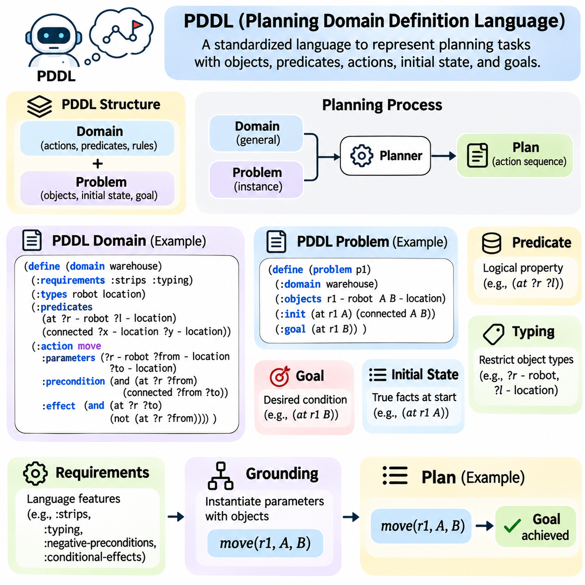{width="7.268055555555556in" height="7.268055555555556in"}

Planning Domain Definition Language, commonly known as PDDL, is a standardized language for representing automated planning problems in artificial intelligence. It provides a formal syntax for describing objects, predicates, actions, initial conditions, and goals. By separating domain knowledge from individual problem instances, PDDL enables planning algorithms to operate on reusable models and supports systematic comparison between different planning approaches.

PDDL was introduced to establish a common representation for automated planning research and benchmarking. Earlier planning systems often relied on specialized domain descriptions that were difficult to exchange between implementations. PDDL addressed this limitation by defining a shared language for expressing planning tasks. Its adoption has supported the development of general-purpose planners and standardized experimental evaluation.

The fundamental organization of PDDL separates a planning task into a domain definition and a problem definition. The domain describes general rules governing possible actions and relationships between objects. The problem specifies the particular objects, initial state, and desired goals for one scenario. This separation allows the same domain model to support numerous planning problems without repeatedly redefining the underlying action logic.

A PDDL domain definition typically begins with a domain name and declarations describing supported language features. These declarations identify requirements such as STRIPS-style actions, typed objects, or additional logical expressions. The domain then defines predicates and action schemas that describe possible operations. This structure enables planning software to interpret the available capabilities and construct valid state transitions.

Predicates represent logical properties and relationships within the planning environment. A predicate such as at(?robot, ?location) expresses the location of a robot, while connected(?from, ?to) describes a relationship between locations. Variables are conventionally identified using a question-mark prefix. Predicates provide the symbolic vocabulary through which initial states, action preconditions, effects, and goals are expressed.

PDDL supports typed parameters that restrict which objects can be substituted into action schemas. A movement action may require one parameter of type robot and two parameters of type location. These restrictions prevent inappropriate combinations, such as using a package where a location is required. Type declarations also help planners organize objects and reduce the number of irrelevant grounded action instances.

Actions in PDDL are represented through named schemas containing parameters, preconditions, and effects. Parameters identify the participating objects, while preconditions describe the conditions required for execution. Effects specify how the symbolic state changes after the action occurs. This structure extends the central principles of STRIPS and provides a consistent mechanism for defining reusable operations across planning domains.

Consider a movement action that transfers a robot between two connected locations. Its preconditions require the robot to occupy the source location and a connection to exist between source and destination. Its effects establish the robot\'s presence at the destination and remove its previous location. This description allows a planner to generate valid movement sequences without explicitly listing every possible route.

PDDL uses a parenthesized syntax inspired by Lisp to represent logical expressions and planning constructs. Expressions such as (at robot1 roomA) identify ground facts, while (and \...) combines multiple conditions. Negation is represented through the not operator when supported by the relevant language feature. This syntax provides a structured format that can be parsed and interpreted consistently by automated planning tools.

A PDDL problem definition identifies the domain to which the problem belongs and declares the objects participating in the scenario. It also specifies the initial state and goal expression. For example, a warehouse problem may include robots, packages, storage locations, and delivery destinations. The initial state describes their starting relationships, while the goal identifies the required final arrangement.

The initial state in classical PDDL generally lists the ground facts that are true before planning begins. Under the closed-world assumption, facts not included are treated as false. This representation allows the planner to construct a complete logical state from a compact set of assertions. Accurate initialization is important because all subsequent state transitions depend on the correctness of the starting conditions.

Goal expressions define the conditions that a successful plan must satisfy. In basic STRIPS-style PDDL, goals are commonly represented as conjunctions of positive predicates. More expressive language requirements allow additional logical constructs. The planner searches for an action sequence whose execution produces a state satisfying the goal formula, regardless of other environmental properties not constrained by that formula.

PDDL requirements declarations identify which language features a domain uses. Common requirements include :strips, :typing, :negative-preconditions, and :conditional-effects. These declarations help determine whether a particular planner supports the domain. Because planning engines implement different subsets of PDDL, compatibility must be verified rather than assumed from the presence of a syntactically valid domain file.

Grounding is the process of replacing action parameters with concrete objects defined in the problem. A general movement schema can generate many specific actions involving different robots and locations. The resulting grounded actions form the operational choices available during planning. Although grounding simplifies subsequent search, the number of generated instances may become large in domains containing many objects.

PDDL extends basic STRIPS representations through features that support more expressive planning models. Depending on the language version and declared requirements, domains may include negative preconditions, disjunctions, quantified expressions, and conditional effects. These constructs allow more sophisticated logical relationships to be represented. However, increased expressiveness can also introduce additional computational complexity.

Conditional effects allow an action to produce different logical changes depending on conditions satisfied during execution. For example, a delivery operation might update a completion predicate only when a package has reached its assigned destination. Such effects provide flexibility beyond unconditional add and delete lists. Their use requires planner support for the corresponding PDDL feature and careful interpretation of effect conditions.

Numeric fluents extend planning representations by associating numerical values with properties such as fuel, energy, capacity, or accumulated cost. Actions may increase, decrease, or assign these values according to their effects. A transportation planner can therefore model fuel consumption or resource availability. Numeric planning expands the applicability of PDDL beyond purely Boolean state descriptions.

Temporal extensions introduce durative actions that occupy intervals rather than occur instantaneously. A durative action may specify conditions that must hold at its beginning, throughout its execution, or at its completion. Effects may also occur at different temporal points. These capabilities enable planning systems to represent overlapping activities, operational deadlines, and scheduling constraints in more realistic environments.

Plan optimization can be expressed through metric declarations that specify quantities to minimize or maximize. A planning problem may seek to minimize total action cost, travel distance, or elapsed execution time. The planner evaluates candidate solutions according to the declared objective when it supports the relevant metric features. This separates logical goal satisfaction from the additional requirement of obtaining a high-quality plan.

PDDL plays an important role in heuristic planning because its structured action descriptions can be analyzed to estimate goal distance. Planners may construct relaxed planning problems, identify relevant actions, or calculate heuristic values from preconditions and effects. These estimates guide state-space search toward promising solutions. The standardized representation allows different heuristic methods to be evaluated on comparable planning tasks.

Practical PDDL development requires careful coordination between domain modeling and problem formulation. Incorrect predicates, incomplete action effects, or inconsistent object types can produce invalid plans or unsolvable problems. Syntax validation alone cannot guarantee semantic correctness. Developers should therefore test action applicability, inspect generated plans, and verify that the modeled transitions reflect the intended operational behavior.

PDDL is widely used in planning benchmarks, research environments, and educational implementations. Standardized domain and problem files allow planners to be compared using measures such as solution coverage, computation time, memory consumption, and plan quality. Benchmark collections also expose differences in planner capabilities across logical, numeric, and temporal domains. Such comparisons support reproducible research and algorithm development.

In robotics, PDDL can represent high-level tasks such as navigation, object pickup, transportation, and assembly. A task planner generates symbolic action sequences, while motion planners and controllers determine how those actions are physically executed. This layered architecture connects logical planning with real-world operations. Execution monitoring and replanning remain necessary when environmental conditions differ from the symbolic model.

The principal advantage of PDDL is its ability to express planning knowledge in a reusable, interpretable, and implementation-independent format. Its limitations arise from the difficulty of accurately modeling complex environments and from differences in feature support among planning engines. Nevertheless, PDDL remains a central foundation for automated planning, connecting classical STRIPS concepts with heuristic search, temporal reasoning, resource management, and intelligent robotic systems.

계획 영역 정의 언어(Planning Domain Definition Language, PDDL)는 인공지능(Artificial Intelligence)에서 자동 계획 문제(Automated Planning Problem)를 표현하기 위한 표준화된 언어(Standardized Language)이다. PDDL은 객체(Object), 술어(Predicate), 행동(Action), 초기 조건(Initial Condition), 목표(Goal)를 기술하기 위한 형식적 구문(Formal Syntax)을 제공한다. 영역 지식(Domain Knowledge)을 개별 문제 인스턴스(Problem Instance)와 분리함으로써 계획 알고리즘(Planning Algorithm)이 재사용 가능한 모델에서 작동하도록 하며, 서로 다른 계획 접근법을 체계적으로 비교할 수 있도록 지원한다.

PDDL은 자동 계획 연구(Automated Planning Research)와 벤치마킹(Benchmarking)을 위한 공통 표현(Common Representation)을 확립하기 위해 도입되었다. 이전의 계획 시스템(Planning System)은 구현 간에 교환하기 어려운 특수한 영역 설명(Domain Description)에 의존하는 경우가 많았다. PDDL은 계획 작업(Planning Task)을 표현하기 위한 공유 언어(Shared Language)를 정의하여 이러한 한계를 해결하였다. PDDL의 도입은 범용 계획기(General-Purpose Planner)의 개발과 표준화된 실험 평가(Standardized Experimental Evaluation)를 지원하였다.

PDDL의 기본 구조는 계획 작업을 영역 정의(Domain Definition)와 문제 정의(Problem Definition)로 분리한다. 영역은 가능한 행동과 객체 사이의 관계를 지배하는 일반적인 규칙을 설명한다. 문제는 특정 시나리오에 해당하는 객체, 초기 상태(Initial State), 원하는 목표를 지정한다. 이러한 분리를 통해 동일한 영역 모델(Domain Model)이 기본 행동 논리(Action Logic)를 반복해서 정의하지 않고도 다양한 계획 문제를 지원할 수 있다.

PDDL 영역 정의는 일반적으로 영역 이름(Domain Name)과 지원되는 언어 기능(Language Feature)을 설명하는 선언(Declaration)으로 시작한다. 이러한 선언은 STRIPS 방식의 행동(STRIPS-Style Action), 유형이 지정된 객체(Typed Object), 추가적인 논리식(Logical Expression) 등의 요구사항을 식별한다. 이후 영역은 가능한 작업을 설명하는 술어와 행동 스키마(Action Schema)를 정의한다. 이러한 구조를 통해 계획 소프트웨어(Planning Software)는 사용 가능한 기능을 해석하고 유효한 상태 전이(State Transition)를 구성할 수 있다.

술어(Predicate)는 계획 환경(Planning Environment) 내의 논리적 속성(Logical Property)과 관계(Relationship)를 표현한다. at(?robot, ?location)과 같은 술어는 로봇의 위치를 나타내며, connected(?from, ?to)는 위치 사이의 연결 관계를 설명한다. 변수(Variable)는 관례적으로 물음표 접두사(Question-Mark Prefix)를 사용하여 식별한다. 술어는 초기 상태, 행동 전제조건(Action Precondition), 효과(Effect), 목표를 표현하기 위한 기호적 어휘(Symbolic Vocabulary)를 제공한다.

PDDL은 행동 스키마에 대입할 수 있는 객체를 제한하는 유형 지정 매개변수(Typed Parameter)를 지원한다. 이동 행동(Movement Action)은 로봇 유형(Robot Type)의 매개변수 하나와 위치 유형(Location Type)의 매개변수 두 개를 요구할 수 있다. 이러한 제한은 위치가 필요한 곳에 물품을 사용하는 것과 같은 부적절한 조합을 방지한다. 유형 선언(Type Declaration)은 계획기가 객체를 체계적으로 구성하고 관련성이 없는 구체화된 행동 인스턴스(Grounded Action Instance)의 수를 줄이는 데도 도움이 된다.

PDDL의 행동은 매개변수(Parameter), 전제조건(Precondition), 효과(Effect)를 포함하는 이름이 지정된 스키마(Named Schema)로 표현된다. 매개변수는 행동에 참여하는 객체를 식별하고, 전제조건은 실행에 필요한 조건을 설명한다. 효과는 행동이 발생한 후 기호적 상태(Symbolic State)가 어떻게 변화하는지를 지정한다. 이러한 구조는 STRIPS의 핵심 원칙을 확장하며, 계획 영역 전반에서 재사용 가능한 작업을 정의하기 위한 일관된 메커니즘을 제공한다.

연결된 두 위치 사이에서 로봇을 이동시키는 행동을 생각할 수 있다. 이 행동의 전제조건은 로봇이 출발 위치(Source Location)에 있고 출발 위치와 목적지(Destination) 사이에 연결이 존재해야 한다는 것이다. 효과는 목적지에 로봇이 존재한다는 사실을 성립시키고 이전 위치에 존재한다는 사실을 제거한다. 이러한 설명을 통해 계획기는 가능한 모든 경로를 명시적으로 나열하지 않고도 유효한 이동 순서(Movement Sequence)를 생성할 수 있다.

PDDL은 논리식(Logical Expression)과 계획 구성요소(Planning Construct)를 표현하기 위해 리스프(Lisp)에서 영향을 받은 괄호 기반 구문(Parenthesized Syntax)을 사용한다. (at robot1 roomA)와 같은 표현은 구체화된 사실(Ground Fact)을 식별하며, (and \...)는 여러 조건을 결합한다. 부정(Negation)은 관련 언어 기능이 지원되는 경우 not 연산자(Not Operator)를 통해 표현된다. 이러한 구문은 자동 계획 도구(Automated Planning Tool)가 일관되게 구문 분석(Parsing)하고 해석할 수 있는 구조화된 형식을 제공한다.

PDDL 문제 정의는 해당 문제가 속하는 영역을 식별하고 시나리오에 참여하는 객체를 선언한다. 또한 초기 상태와 목표 표현식(Goal Expression)을 지정한다. 예를 들어 창고 문제(Warehouse Problem)에는 로봇, 물품, 보관 위치, 배송 목적지가 포함될 수 있다. 초기 상태는 이러한 객체의 시작 관계를 설명하고, 목표는 요구되는 최종 배치(Final Arrangement)를 식별한다.

고전적 PDDL(Classical PDDL)의 초기 상태는 일반적으로 계획 수립이 시작되기 전에 참인 구체화된 사실(Ground Fact)을 나열한다. 폐쇄 세계 가정(Closed-World Assumption)에 따라 포함되지 않은 사실은 거짓으로 처리된다. 이러한 표현을 통해 계획기는 간결한 단언(Assertion) 집합으로부터 완전한 논리적 상태(Logical State)를 구성할 수 있다. 이후의 모든 상태 전이는 시작 조건의 정확성에 의존하므로 초기화(Initialization)의 정확성이 중요하다.

목표 표현식(Goal Expression)은 성공적인 계획이 만족해야 하는 조건을 정의한다. 기본 STRIPS 방식의 PDDL에서는 목표를 일반적으로 긍정적인 술어(Positive Predicate)의 논리곱(Conjunction)으로 표현한다. 더욱 표현력이 높은 언어 요구사항(Language Requirement)은 추가적인 논리 구성요소(Logical Construct)를 허용한다. 계획기는 해당 표현식에서 제약하지 않은 다른 환경 속성과 관계없이 실행 결과가 목표 논리식(Goal Formula)을 만족하는 행동 순서를 탐색한다.

PDDL 요구사항 선언(Requirements Declaration)은 영역에서 사용하는 언어 기능을 식별한다. 일반적인 요구사항에는 :strips, :typing, :negative-preconditions, :conditional-effects가 포함된다. 이러한 선언은 특정 계획기가 해당 영역을 지원하는지 판단하는 데 도움이 된다. 계획 엔진(Planning Engine)마다 구현하는 PDDL 기능의 범위가 다르므로 구문적으로 유효한 영역 파일(Domain File)이라는 이유만으로 호환성(Compatibility)을 가정해서는 안 된다.

구체화(Grounding)는 행동 매개변수(Action Parameter)를 문제에 정의된 구체적인 객체로 대체하는 과정이다. 일반적인 이동 스키마(Movement Schema)는 서로 다른 로봇과 위치를 포함하는 다양한 구체적 행동을 생성할 수 있다. 이렇게 생성된 구체화된 행동(Grounded Action)은 계획 수립 중 선택할 수 있는 작업 후보(Operational Choice)를 형성한다. 구체화는 이후의 탐색을 단순화하지만, 객체가 많은 영역에서는 생성되는 인스턴스의 수가 매우 커질 수 있다.

PDDL은 더욱 표현력이 높은 계획 모델(Planning Model)을 지원하는 기능을 통해 기본 STRIPS 표현을 확장한다. 언어 버전(Language Version)과 선언된 요구사항에 따라 영역에는 부정 전제조건(Negative Precondition), 논리합(Disjunction), 양화 표현식(Quantified Expression), 조건부 효과(Conditional Effect)가 포함될 수 있다. 이러한 구성요소는 더욱 복잡한 논리적 관계(Logical Relationship)를 표현할 수 있도록 한다. 그러나 표현력이 증가하면 추가적인 계산 복잡도(Computational Complexity)가 발생할 수 있다.

조건부 효과(Conditional Effect)는 실행 중 충족되는 조건에 따라 하나의 행동이 서로 다른 논리적 변화를 발생시키도록 한다. 예를 들어 배송 작업(Delivery Operation)은 물품이 지정된 목적지에 도착했을 때만 완료 술어(Completion Predicate)를 갱신할 수 있다. 이러한 효과는 무조건적인 추가 및 삭제 목록(Unconditional Add and Delete List)보다 높은 유연성을 제공한다. 이를 사용하려면 해당 PDDL 기능을 지원하는 계획기가 필요하며, 효과 조건(Effect Condition)을 신중하게 해석해야 한다.

수치적 유동 변수(Numeric Fluent)는 연료(Fuel), 에너지(Energy), 용량(Capacity), 누적 비용(Accumulated Cost)과 같은 속성에 수치 값을 연결하여 계획 표현을 확장한다. 행동은 효과에 따라 이러한 값을 증가, 감소 또는 할당할 수 있다. 따라서 운송 계획기(Transportation Planner)는 연료 소비(Fuel Consumption)나 자원 가용성(Resource Availability)을 모델링할 수 있다. 수치적 계획(Numeric Planning)은 PDDL의 적용 범위를 순수한 불리언 상태 표현(Boolean State Representation) 이상으로 확장한다.

시간적 확장(Temporal Extension)은 순간적으로 발생하는 대신 일정한 시간 구간을 차지하는 지속시간 행동(Durative Action)을 도입한다. 지속시간 행동은 시작 시점(Beginning), 실행 전체 구간(Execution Interval), 완료 시점(Completion)에 충족되어야 하는 조건을 지정할 수 있다. 효과 역시 서로 다른 시간적 시점(Temporal Point)에 발생할 수 있다. 이러한 기능을 통해 계획 시스템은 중첩 활동(Overlapping Activity), 운영 마감시간(Operational Deadline), 일정 제약조건(Scheduling Constraint)을 더욱 현실적인 환경에서 표현할 수 있다.

계획 최적화(Plan Optimization)는 최소화하거나 최대화할 수량을 지정하는 척도 선언(Metric Declaration)을 통해 표현할 수 있다. 계획 문제는 총 행동 비용(Total Action Cost), 이동 거리(Travel Distance), 경과 실행 시간(Elapsed Execution Time)을 최소화하도록 설정할 수 있다. 계획기는 관련 척도 기능을 지원하는 경우 선언된 목적(Objective)에 따라 후보 해결책(Candidate Solution)을 평가한다. 이를 통해 논리적 목표 만족(Goal Satisfaction)과 높은 품질의 계획을 얻기 위한 추가 요구사항을 분리할 수 있다.

PDDL은 구조화된 행동 설명(Structured Action Description)을 분석하여 목표까지의 거리(Goal Distance)를 추정할 수 있으므로 휴리스틱 계획(Heuristic Planning)에서 중요한 역할을 한다. 계획기는 완화된 계획 문제(Relaxed Planning Problem)를 구성하거나 관련 행동을 식별하거나 전제조건과 효과로부터 휴리스틱 값(Heuristic Value)을 계산할 수 있다. 이러한 추정값은 상태 공간 탐색(State-Space Search)을 유망한 해결책으로 유도한다. 표준화된 표현을 통해 서로 다른 휴리스틱 방법을 비교 가능한 계획 작업에서 평가할 수 있다.

실용적인 PDDL 개발에는 영역 모델링(Domain Modeling)과 문제 정식화(Problem Formulation) 사이의 신중한 조정이 필요하다. 잘못된 술어, 불완전한 행동 효과, 일관성이 없는 객체 유형(Object Type)은 유효하지 않은 계획이나 해결할 수 없는 문제를 발생시킬 수 있다. 구문 검증(Syntax Validation)만으로는 의미적 정확성(Semantic Correctness)을 보장할 수 없다. 따라서 개발자는 행동 적용 가능성(Action Applicability)을 시험하고, 생성된 계획을 검토하며, 모델링된 상태 전이가 의도한 운영 동작을 반영하는지 확인해야 한다.

PDDL은 계획 벤치마크(Planning Benchmark), 연구 환경(Research Environment), 교육용 구현(Educational Implementation)에서 널리 사용된다. 표준화된 영역 및 문제 파일을 사용하면 해결 범위(Solution Coverage), 계산 시간(Computation Time), 메모리 사용량(Memory Consumption), 계획 품질(Plan Quality)과 같은 척도로 계획기를 비교할 수 있다. 벤치마크 모음(Benchmark Collection)은 논리적 영역(Logical Domain), 수치적 영역(Numeric Domain), 시간적 영역(Temporal Domain)에서 계획기 기능의 차이도 드러낸다. 이러한 비교는 재현 가능한 연구(Reproducible Research)와 알고리즘 개발을 지원한다.

로봇공학(Robotics)에서 PDDL은 이동(Navigation), 객체 집기(Object Pickup), 운반(Transportation), 조립(Assembly)과 같은 상위 수준 작업(High-Level Task)을 표현할 수 있다. 작업 계획기(Task Planner)는 기호적 행동 순서(Symbolic Action Sequence)를 생성하고, 동작 계획기(Motion Planner)와 제어기(Controller)는 해당 행동을 물리적으로 실행하는 방법을 결정한다. 이러한 계층형 아키텍처(Layered Architecture)는 논리적 계획(Logical Planning)을 실제 작업(Real-World Operation)과 연결한다. 환경 조건이 기호적 모델(Symbolic Model)과 다를 때는 실행 감시(Execution Monitoring)와 재계획(Replanning)이 여전히 필요하다.

PDDL의 주요 장점은 계획 지식(Planning Knowledge)을 재사용 가능하고 해석 가능하며 구현에 독립적인 형식(Implementation-Independent Format)으로 표현할 수 있다는 점이다. 한계는 복잡한 환경을 정확하게 모델링하기 어렵다는 점과 계획 엔진 사이의 기능 지원 차이에서 발생한다. 그럼에도 PDDL은 고전적 STRIPS 개념을 휴리스틱 탐색(Heuristic Search), 시간적 추론(Temporal Reasoning), 자원 관리(Resource Management), 지능형 로봇 시스템(Intelligent Robotic System)과 연결하는 자동 계획(Automated Planning)의 핵심 기반으로 남아 있다.

## 04.05 State Space Planning [w/Code]

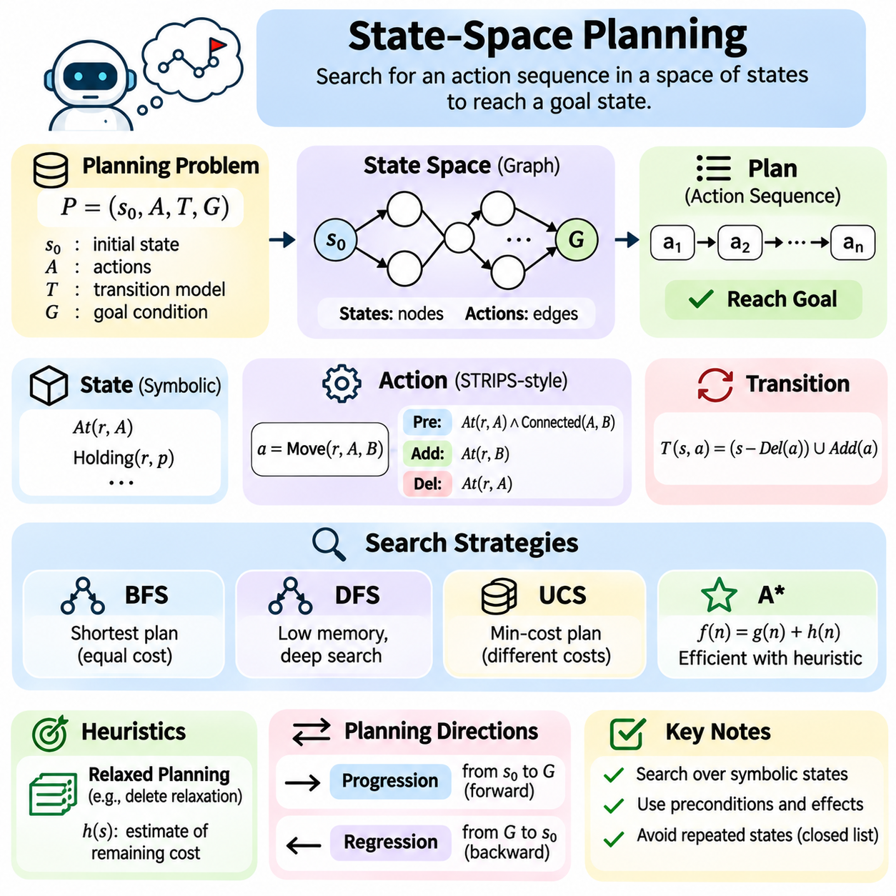{width="7.268055555555556in" height="7.268055555555556in"}

State-space planning is a fundamental approach in classical artificial intelligence that formulates planning as a search through possible configurations of an environment. Each state represents relevant facts about the world, while actions define transitions between states. The objective is to discover a sequence of applicable actions that transforms an initial state into one satisfying the specified goal conditions.

A state-space planning problem consists of an initial state, a set of actions, a transition model, and a goal specification. The initial state identifies the starting configuration, while the goal describes the conditions required for success. The transition model determines how actions modify states. Together, these components establish an implicit graph in which states are nodes and applicable actions define directed edges.

States are commonly represented using sets of logical predicates that describe objects, properties, and relationships. For example, At(Robot1, RoomA) indicates a robot\'s location, while Holding(Robot1, Box1) describes possession of an object. A state contains the facts considered true under the planning model. This symbolic representation allows the planner to compare states and evaluate action applicability systematically.

Actions define the available operations and specify their preconditions and effects. Preconditions determine whether an action can execute in a particular state, while effects describe the resulting modifications. In STRIPS-style planning, effects are divided into add and delete lists. Applying an action removes its delete effects and introduces its add effects, producing a successor state while preserving unrelated facts.

Forward state-space planning begins with the initial state and explores the consequences of applicable actions. Each action generates a successor state that may be examined for goal satisfaction or expanded further. The planner continues until it discovers a goal state or exhausts the reachable search space. This approach is often called progression planning because reasoning advances in the same direction as execution.

Backward state-space planning begins with the goal conditions and reasons toward the initial state. Rather than generating complete successor states, it regresses goal descriptions through actions capable of achieving them. Each regression step identifies the conditions that must hold before an selected action. This method can concentrate exploration on goal-relevant actions, although interactions between conditions require careful handling.

Goal regression requires an action to contribute to the current goal without destroying conditions that must remain satisfied. The planner removes goals established by the selected action and introduces the action\'s preconditions. The resulting regressed goal describes an earlier requirement. Repeating this process produces a sequence of subgoal descriptions that may eventually be satisfied by the initial state.

The distinction between progression and regression affects search efficiency. Forward planning explores reachable states from the initial configuration, potentially generating actions unrelated to the final objective. Backward planning focuses on conditions relevant to the goal but may generate inconsistent subgoal combinations. The preferable direction depends on the branching structure, goal specificity, and available domain knowledge.

Breadth-first search provides a straightforward strategy for exploring state spaces when every action has equal cost. It expands states according to their depth, ensuring that the first discovered goal has the minimum number of actions under standard assumptions. However, the number of stored frontier states may increase exponentially. Consequently, breadth-first planning becomes expensive in domains with large branching factors.

Depth-first search explores one sequence of actions deeply before considering alternatives. Its memory requirements are generally smaller than those of breadth-first search, but it may spend considerable effort following unproductive paths. Without appropriate restrictions, cycles can prevent termination. Depth limits, repeated-state detection, and systematic backtracking help control these problems in practical planning implementations.

Uniform-cost search extends state-space planning to actions with different numerical costs. Instead of prioritizing the shallowest state, it expands the frontier state with the lowest accumulated path cost. With nonnegative action costs and suitable assumptions, this strategy can identify minimum-cost solutions. Its effectiveness is limited by the number of states that must be examined before the optimal goal is reached.

Heuristic search improves planning efficiency by estimating the remaining cost of reaching the goal. A heuristic function assigns a value to each state, guiding exploration toward promising alternatives. Algorithms such as A\\\* combine accumulated cost with estimated remaining cost. When the heuristic is admissible and the search assumptions are satisfied, A\\\* can preserve optimality while reducing unnecessary exploration.

Planning heuristics can be derived from relaxed versions of the original problem. Delete relaxation ignores negative action effects, allowing facts to remain true once established. This simplification produces a problem that is often easier to analyze. Estimates derived from relaxed planning can guide search effectively, although ignoring destructive interactions may underestimate the difficulty of achieving the actual goal.

Repeated-state detection is essential because different action sequences may lead to identical configurations. Without duplicate detection, the planner may repeatedly explore equivalent states and waste computational resources. A visited-state set or closed list records previously examined configurations. State hashing and canonical representations can make duplicate detection efficient, particularly when the state space contains many recurring patterns.

Dead-end states represent configurations from which the goal cannot be achieved. Some dead ends arise because required resources have been consumed or necessary actions have become impossible. Identifying these states early prevents wasted exploration. Dead-end detection may use logical invariants, reachability analysis, heuristic estimates, or domain-specific constraints to recognize situations that cannot lead to successful plans.

The branching factor determines how many applicable actions can be generated from a typical state. A large branching factor increases the number of candidate paths and can make exhaustive search impractical. Grounded action filtering, relevance analysis, and pruning techniques help reduce unnecessary expansion. Effective planning systems balance search completeness against computational efficiency and available memory.

State-space planning must also consider the relationship between plan feasibility and plan optimality. A feasible plan reaches the goal while satisfying every action precondition. An optimal plan minimizes a selected objective, such as action count, execution cost, or energy consumption. Some planning algorithms guarantee optimality under defined assumptions, while satisficing planners prioritize finding useful solutions within practical time limits.

The correctness of state-space search depends on accurate transition modeling. Missing preconditions may permit impossible actions, while incorrect effects can create inconsistent successor states. State invariants provide additional checks on valid configurations. Domain validation should therefore examine action applicability, transition consistency, goal evaluation, and the preservation of required environmental constraints.

Search-space abstraction can reduce complexity by ignoring details that are not essential to high-level decisions. For example, a warehouse planner may initially reason about storage zones rather than exact robot coordinates. Once a symbolic route is selected, lower-level planning can determine precise movements. This hierarchical separation improves scalability but requires consistency between abstract decisions and executable actions.

State-space planning is closely connected to PDDL because standardized domain descriptions provide the action schemas and predicates required for search. A PDDL parser constructs an internal representation of the domain and problem, while a grounding component generates applicable action instances. The search engine then evaluates states and transitions. This separation supports reusable planning algorithms across different application domains.

In robotics, state-space planning can organize navigation, object manipulation, and task execution. A mobile robot may need to move toward a package, pick it up, travel to another location, and release it. Symbolic state-space search determines the task sequence, while motion planning and control systems handle continuous physical execution. This combination connects discrete reasoning with real-world robotic operations.

Dynamic environments introduce challenges because the state observed during execution may differ from the state predicted during planning. Obstacles, equipment failures, or unexpected resource changes can invalidate previously generated actions. Execution monitoring detects these deviations and updates the current state. Replanning then searches for a new sequence from the revised configuration toward the remaining goals.

The performance of state-space planners is commonly evaluated using solution coverage, planning time, memory consumption, expanded states, and plan quality. Completeness indicates whether a method can find a solution when one exists under its assumptions. Optimality concerns whether the selected plan minimizes the defined cost. These criteria provide a systematic basis for comparing search strategies and heuristic methods.

State-space planning establishes a direct connection between classical search algorithms and goal-directed reasoning. By representing actions as state transitions, it transforms planning into a structured exploration of possible futures. Its principles support forward and backward planning, heuristic search, PDDL-based systems, and robotic task planning. Understanding these mechanisms provides a foundation for more advanced planning methods and autonomous intelligent systems.

상태 공간 계획(State-Space Planning)은 환경의 가능한 구성 상태(Configuration)를 탐색하는 문제로 계획 수립을 정식화하는 고전적 인공지능(Classical Artificial Intelligence)의 기본적인 접근법이다. 각 상태(State)는 세계에 관한 관련 사실을 표현하며, 행동(Action)은 상태 사이의 전이(Transition)를 정의한다. 목표는 초기 상태(Initial State)를 지정된 목표 조건(Goal Condition)을 만족하는 상태로 변환하는 적용 가능한 행동(Applicable Action)의 순서를 발견하는 것이다.

상태 공간 계획 문제(State-Space Planning Problem)는 초기 상태, 행동 집합(Action Set), 전이 모델(Transition Model), 목표 명세(Goal Specification)로 구성된다. 초기 상태는 시작 구성을 식별하고, 목표는 성공에 필요한 조건을 설명한다. 전이 모델은 행동이 상태를 어떻게 변경하는지 결정한다. 이러한 구성요소는 상태를 노드(Node)로 표현하고 적용 가능한 행동을 방향 간선(Directed Edge)으로 정의하는 암묵적 그래프(Implicit Graph)를 형성한다.

상태는 일반적으로 객체(Object), 속성(Property), 관계(Relationship)를 설명하는 논리적 술어(Logical Predicate)의 집합으로 표현된다. 예를 들어 At(Robot1, RoomA)는 로봇의 위치를 나타내고, Holding(Robot1, Box1)은 객체를 보유하고 있음을 설명한다. 상태는 계획 모델(Planning Model)에서 참으로 간주되는 사실을 포함한다. 이러한 기호적 표현(Symbolic Representation)을 통해 계획기(Planner)는 상태를 비교하고 행동의 적용 가능성(Action Applicability)을 체계적으로 평가할 수 있다.

행동은 사용 가능한 작업을 정의하고 전제조건(Precondition)과 효과(Effect)를 지정한다. 전제조건은 특정 상태에서 행동을 실행할 수 있는지를 결정하고, 효과는 실행 결과 발생하는 변화를 설명한다. STRIPS 방식의 계획(STRIPS-Style Planning)에서는 효과를 추가 목록(Add List)과 삭제 목록(Delete List)으로 구분한다. 행동을 적용하면 삭제 효과를 제거하고 추가 효과를 삽입하여 관련 없는 사실은 유지하면서 후속 상태(Successor State)를 생성한다.

전방 상태 공간 계획(Forward State-Space Planning)은 초기 상태에서 시작하여 적용 가능한 행동의 결과를 탐색한다. 각 행동은 목표 만족(Goal Satisfaction) 여부를 검사하거나 추가로 확장할 수 있는 후속 상태를 생성한다. 계획기는 목표 상태(Goal State)를 발견하거나 도달 가능한 탐색 공간(Reachable Search Space)을 모두 탐색할 때까지 이 과정을 계속한다. 이러한 접근법은 추론이 실제 실행과 동일한 방향으로 진행되므로 진행 계획(Progression Planning)이라고도 한다.

후방 상태 공간 계획(Backward State-Space Planning)은 목표 조건에서 시작하여 초기 상태 방향으로 추론한다. 완전한 후속 상태를 생성하는 대신 목표를 달성할 수 있는 행동을 통해 목표 기술(Goal Description)을 역방향으로 회귀시킨다. 각 회귀 단계(Regression Step)는 선택된 행동을 실행하기 전에 충족되어야 하는 조건을 식별한다. 이러한 방법은 목표와 관련된 행동에 탐색을 집중할 수 있지만 조건 사이의 상호작용(Interaction)을 신중하게 처리해야 한다.

목표 회귀(Goal Regression)에서는 선택된 행동이 현재 목표에 기여하면서 유지되어야 하는 조건을 파괴하지 않아야 한다. 계획기는 선택된 행동이 성립시키는 목표를 제거하고 해당 행동의 전제조건을 추가한다. 이렇게 생성된 회귀 목표(Regressed Goal)는 이전 시점에서 충족되어야 할 요구사항을 설명한다. 이 과정을 반복하면 최종적으로 초기 상태에서 만족할 수 있는 하위 목표(Subgoal)의 순서가 생성될 수 있다.

진행 계획(Progression Planning)과 회귀 계획(Regression Planning)의 차이는 탐색 효율성(Search Efficiency)에 영향을 미친다. 전방 계획은 초기 구성에서 도달 가능한 상태를 탐색하므로 최종 목표와 관련 없는 행동까지 생성할 수 있다. 후방 계획은 목표와 관련된 조건에 집중하지만 서로 모순되는 하위 목표 조합(Inconsistent Subgoal Combination)을 생성할 수 있다. 적절한 탐색 방향은 분기 구조(Branching Structure), 목표의 구체성(Goal Specificity), 사용 가능한 영역 지식(Domain Knowledge)에 따라 달라진다.

너비 우선 탐색(Breadth-First Search)은 모든 행동의 비용이 동일할 때 상태 공간을 탐색하는 간단한 전략을 제공한다. 이 방법은 상태의 깊이(Depth)에 따라 확장하므로 일반적인 가정 아래 처음 발견한 목표가 최소 행동 수(Minimum Number of Actions)를 갖도록 보장한다. 그러나 저장해야 하는 탐색 경계 상태(Frontier State)의 수는 지수적으로 증가할 수 있다. 따라서 분기 계수(Branching Factor)가 큰 영역에서는 너비 우선 계획(Breadth-First Planning)의 계산 비용이 높아진다.

깊이 우선 탐색(Depth-First Search)은 대안을 고려하기 전에 하나의 행동 순서를 깊이 탐색한다. 일반적으로 너비 우선 탐색보다 메모리 요구량(Memory Requirement)이 적지만 생산적이지 않은 경로를 따라 상당한 계산을 수행할 수 있다. 적절한 제한이 없으면 순환(Cycle)으로 인해 탐색이 종료되지 않을 수 있다. 깊이 제한(Depth Limit), 반복 상태 감지(Repeated-State Detection), 체계적인 역추적(Systematic Backtracking)은 실제 계획 구현에서 이러한 문제를 제어하는 데 도움이 된다.

균일 비용 탐색(Uniform-Cost Search)은 서로 다른 수치적 비용(Numerical Cost)을 갖는 행동으로 상태 공간 계획을 확장한다. 가장 얕은 상태를 우선하는 대신 누적 경로 비용(Accumulated Path Cost)이 가장 낮은 탐색 경계 상태를 확장한다. 음수가 아닌 행동 비용(Nonnegative Action Cost)과 적절한 가정 아래 이 전략은 최소 비용 해결책(Minimum-Cost Solution)을 식별할 수 있다. 그러나 최적 목표에 도달하기 전에 검사해야 하는 상태의 수가 많으면 효율성이 제한된다.

휴리스틱 탐색(Heuristic Search)은 목표에 도달하기 위해 남은 비용(Remaining Cost)을 추정하여 계획 효율성을 향상시킨다. 휴리스틱 함수(Heuristic Function)는 각 상태에 값을 부여하여 유망한 대안으로 탐색을 유도한다. A\\\*와 같은 알고리즘은 누적 비용과 추정 잔여 비용(Estimated Remaining Cost)을 결합한다. 휴리스틱이 허용적(Admissible)이고 탐색 가정이 충족되면 A\\\*는 불필요한 탐색을 줄이면서 최적성(Optimality)을 유지할 수 있다.

계획 휴리스틱(Planning Heuristic)은 원래 문제를 완화한 형태(Relaxed Problem)에서 도출할 수 있다. 삭제 완화(Delete Relaxation)는 행동의 부정적 효과(Negative Effect)를 무시하여 한 번 성립된 사실이 계속 참으로 유지되도록 한다. 이러한 단순화는 분석하기 쉬운 문제를 생성한다. 완화된 계획(Relaxed Planning)에서 얻은 추정값은 탐색을 효과적으로 유도할 수 있지만, 사실을 파괴하는 행동 간 상호작용(Destructive Interaction)을 무시하므로 실제 목표 달성의 어려움을 과소평가할 수 있다.

반복 상태 감지(Repeated-State Detection)는 서로 다른 행동 순서가 동일한 구성 상태에 도달할 수 있기 때문에 필수적이다. 중복 감지(Duplicate Detection)가 없으면 계획기는 동등한 상태를 반복해서 탐색하여 계산 자원을 낭비할 수 있다. 방문 상태 집합(Visited-State Set) 또는 닫힌 목록(Closed List)은 이전에 검사한 구성을 기록한다. 상태 해싱(State Hashing)과 정규 표현(Canonical Representation)은 특히 반복적인 패턴이 많은 상태 공간에서 중복 감지를 효율적으로 수행할 수 있도록 한다.

막다른 상태(Dead-End State)는 더 이상 목표를 달성할 수 없는 구성 상태를 의미한다. 일부 막다른 상태는 필요한 자원이 소모되거나 필수 행동을 수행할 수 없게 되면서 발생한다. 이러한 상태를 조기에 식별하면 불필요한 탐색을 방지할 수 있다. 막다른 상태 감지(Dead-End Detection)는 논리적 불변조건(Logical Invariant), 도달 가능성 분석(Reachability Analysis), 휴리스틱 추정(Heuristic Estimation), 영역별 제약조건(Domain-Specific Constraint)을 활용하여 성공적인 계획으로 이어질 수 없는 상황을 인식한다.

분기 계수(Branching Factor)는 일반적인 상태에서 생성할 수 있는 적용 가능한 행동의 수를 결정한다. 분기 계수가 크면 후보 경로(Candidate Path)의 수가 증가하여 완전 탐색(Exhaustive Search)이 비현실적일 수 있다. 구체화된 행동 필터링(Grounded Action Filtering), 관련성 분석(Relevance Analysis), 가지치기 기법(Pruning Technique)은 불필요한 확장을 줄이는 데 도움이 된다. 효율적인 계획 시스템은 탐색 완전성(Search Completeness), 계산 효율성(Computational Efficiency), 사용 가능한 메모리 사이의 균형을 고려한다.

상태 공간 계획에서는 계획 실행 가능성(Plan Feasibility)과 계획 최적성(Plan Optimality)의 관계도 고려해야 한다. 실행 가능한 계획(Feasible Plan)은 모든 행동의 전제조건을 만족하면서 목표에 도달한다. 최적 계획(Optimal Plan)은 행동 수(Action Count), 실행 비용(Execution Cost), 에너지 소비(Energy Consumption)와 같은 선택된 목적을 최소화한다. 일부 계획 알고리즘은 정의된 가정 아래 최적성을 보장하지만, 만족화 계획기(Satisficing Planner)는 실용적인 시간 제한 내에서 유용한 해결책을 찾는 데 우선순위를 둔다.

상태 공간 탐색(State-Space Search)의 정확성(Correctness)은 정확한 전이 모델링(Transition Modeling)에 의존한다. 전제조건이 누락되면 불가능한 행동이 허용될 수 있고, 효과가 잘못 정의되면 일관성이 없는 후속 상태가 생성될 수 있다. 상태 불변조건(State Invariant)은 유효한 구성에 대한 추가적인 검사를 제공한다. 따라서 영역 검증(Domain Validation)은 행동 적용 가능성, 전이 일관성(Transition Consistency), 목표 평가(Goal Evaluation), 필요한 환경 제약조건(Environmental Constraint)의 유지를 검사해야 한다.

탐색 공간 추상화(Search-Space Abstraction)는 상위 수준 의사결정(High-Level Decision)에 필수적이지 않은 세부사항을 무시하여 복잡성을 줄일 수 있다. 예를 들어 창고 계획기는 처음부터 정확한 로봇 좌표(Robot Coordinate)를 사용하는 대신 보관 구역(Storage Zone)을 기준으로 추론할 수 있다. 기호적 경로(Symbolic Route)가 선택되면 저수준 계획(Low-Level Planning)이 정확한 이동을 결정한다. 이러한 계층적 분리(Hierarchical Separation)는 확장성(Scalability)을 향상시키지만 추상적 결정과 실행 가능한 행동 사이의 일관성이 필요하다.

상태 공간 계획은 표준화된 영역 설명(Standardized Domain Description)이 탐색에 필요한 행동 스키마(Action Schema)와 술어(Predicate)를 제공한다는 점에서 PDDL과 밀접하게 연결된다. PDDL 구문 분석기(PDDL Parser)는 영역과 문제의 내부 표현(Internal Representation)을 구성하고, 구체화 구성요소(Grounding Component)는 구체적인 행동 인스턴스(Action Instance)를 생성한다. 이후 탐색 엔진(Search Engine)은 상태와 전이를 평가한다. 이러한 분리는 서로 다른 응용 영역에서 재사용 가능한 계획 알고리즘을 지원한다.

로봇공학(Robotics)에서 상태 공간 계획은 이동(Navigation), 객체 조작(Object Manipulation), 작업 실행(Task Execution)을 체계적으로 구성할 수 있다. 이동 로봇(Mobile Robot)은 물품이 있는 위치로 이동하고, 물품을 집고, 다른 위치로 운반한 다음 내려놓아야 할 수 있다. 기호적 상태 공간 탐색(Symbolic State-Space Search)은 작업 순서를 결정하고, 동작 계획(Motion Planning)과 제어 시스템(Control System)은 연속적인 물리적 실행(Continuous Physical Execution)을 처리한다. 이러한 결합은 이산적 추론(Discrete Reasoning)을 실제 로봇 작업과 연결한다.

동적 환경(Dynamic Environment)에서는 실행 중 관측된 상태가 계획 수립 중 예측한 상태와 다를 수 있으므로 추가적인 문제가 발생한다. 장애물(Obstacle), 장비 고장(Equipment Failure), 예상하지 못한 자원 변화(Resource Change)는 이전에 생성된 행동을 무효화할 수 있다. 실행 감시(Execution Monitoring)는 이러한 편차(Deviation)를 감지하고 현재 상태를 갱신한다. 이후 재계획(Replanning)은 수정된 구성에서 남아 있는 목표를 향한 새로운 행동 순서를 탐색한다.

상태 공간 계획기의 성능은 일반적으로 해결 범위(Solution Coverage), 계획 시간(Planning Time), 메모리 소비(Memory Consumption), 확장된 상태 수(Expanded States), 계획 품질(Plan Quality)을 사용하여 평가한다. 완전성(Completeness)은 주어진 가정 아래 해결책이 존재할 때 해당 방법이 이를 찾을 수 있는지를 나타낸다. 최적성(Optimality)은 선택된 계획이 정의된 비용을 최소화하는지와 관련된다. 이러한 기준은 탐색 전략(Search Strategy)과 휴리스틱 방법(Heuristic Method)을 체계적으로 비교하기 위한 기반을 제공한다.

상태 공간 계획은 고전적 탐색 알고리즘(Classical Search Algorithm)과 목표 지향적 추론(Goal-Directed Reasoning)을 직접적으로 연결한다. 행동을 상태 전이로 표현함으로써 계획 수립을 가능한 미래에 대한 구조화된 탐색(Structured Exploration)으로 변환한다. 이러한 원리는 전방 및 후방 계획(Forward and Backward Planning), 휴리스틱 탐색(Heuristic Search), PDDL 기반 시스템(PDDL-Based System), 로봇 작업 계획(Robotic Task Planning)을 지원한다. 이러한 메커니즘을 이해하는 것은 더욱 발전된 계획 방법(Advanced Planning Method)과 자율 지능형 시스템(Autonomous Intelligent System)을 학습하기 위한 기반을 제공한다.

## 04.06 Plan Space Planning

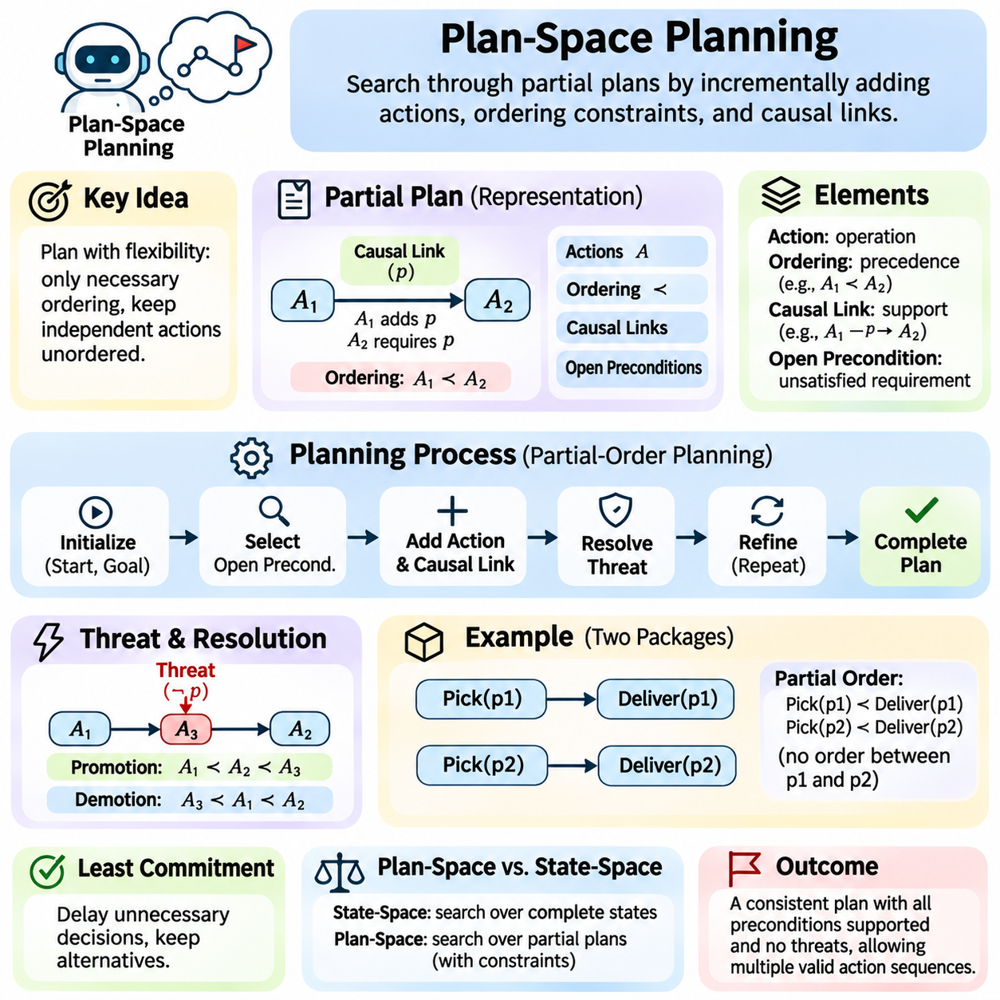{width="7.268055555555556in" height="7.268055555555556in"}

Plan-space planning is a classical artificial intelligence approach that searches through partially specified plans rather than complete environmental states. Instead of constructing a fixed action sequence immediately, it incrementally introduces actions, ordering constraints, and dependencies. This approach preserves flexibility during planning and allows independent actions to remain unordered until their relative execution order becomes necessary.

The central principle of plan-space planning is that a plan can represent multiple valid action sequences simultaneously. A partial plan specifies only the relationships required to achieve its goals. Actions without direct dependencies may be executed in different orders, provided all constraints remain satisfied. This representation reduces premature commitments and distinguishes plan-space reasoning from conventional state-space search.

A partial plan typically contains a set of actions, ordering constraints, causal links, and unresolved preconditions. Actions represent operations that may occur during execution, while ordering constraints specify required precedence relationships. Causal links explain how one action establishes a condition needed by another. Unresolved preconditions identify requirements that the planner must still satisfy before the plan becomes complete.

Plan-space planning often begins with two special actions representing the beginning and end of execution. The initial action establishes the facts available in the starting state, while the goal action requires the desired final conditions. The planner gradually inserts additional actions between these boundaries. Planning succeeds when all required conditions are supported and every potential interference has been resolved.

Partial-order planning is the most widely recognized form of plan-space planning. It avoids imposing a total order on actions unless logical dependencies require one. For example, two robots may independently collect packages from separate locations. If neither operation depends on the other, the plan does not need to specify which collection occurs first. This flexibility can support alternative execution schedules.

Causal links are fundamental structures used to represent dependencies between actions. A causal link indicates that one action establishes a proposition required by another action and that the proposition must remain true between them. For example, a pickup action may establish Holding(Robot1, Package1), which a delivery action requires. The link records the logical support connecting these operations.

Open preconditions are conditions required by planned actions that have not yet been established by any supporting action. The planner selects an open precondition and identifies an action capable of satisfying it. This supporting action may already exist in the partial plan or may need to be introduced. The planner then creates a causal link and adds any necessary ordering constraints to preserve the relationship.

Plan refinement is the process of transforming an incomplete partial plan into a more constrained and executable representation. Each refinement resolves an outstanding planning flaw, such as an unsupported precondition or an interference threat. Refinement may introduce actions, establish causal links, or impose additional ordering requirements. The process continues until the plan satisfies all correctness conditions.

Threat detection is essential because an action may invalidate a condition protected by a causal link. Suppose one action establishes that a robot holds a package and another action requires that condition. An intervening action that releases the package threatens the link. The planner must ensure that the threatening action cannot occur between the producer and consumer of the protected condition.

Threat resolution commonly uses promotion and demotion. Promotion orders a threatening action after the action that consumes the protected condition. Demotion places the threatening action before the action that establishes the condition. Both strategies prevent interference without unnecessarily ordering unrelated operations. If neither ordering is consistent with existing constraints, the planner must explore another refinement.

Ordering constraints define a partial precedence relation among actions. They must remain consistent and cannot introduce cycles that require an action to precede itself. A valid partial order admits at least one total ordering of its actions. Such a total ordering is called a linearization. Different linearizations may correspond to different executable sequences while preserving the same causal dependencies.

Consider a warehouse task requiring two packages to reach separate destinations. A plan-space planner may introduce pickup and delivery actions for both packages without fixing their complete execution order. Each delivery depends on its corresponding pickup, but independent operations may remain unordered. Additional constraints are introduced only when shared robots, locations, or resources create dependencies.

Least commitment is a defining principle of plan-space planning. The planner delays decisions that are not required to establish correctness. By avoiding unnecessary action ordering, it preserves alternative solutions and may reduce backtracking caused by premature choices. However, maintaining flexible partial plans introduces additional reasoning requirements for causal support, interference detection, and constraint consistency.

Plan-space search differs from state-space search in the objects it explores. State-space search expands complete states generated by applying actions, while plan-space search expands partial plans through refinement operations. A search node therefore represents a set of possible action sequences rather than one environmental configuration. The planner seeks a complete, consistent partial plan instead of a particular goal state.

Search strategies can guide the selection of unresolved flaws and possible refinements. A planner may prioritize preconditions with few supporting actions or threats with limited resolution options. Such choices can reduce branching and identify contradictions earlier. Heuristic evaluation may estimate remaining refinement effort, unresolved dependencies, or the difficulty of satisfying outstanding conditions.

Plan-space planning can exploit concurrency because independent actions need not be totally ordered. However, the absence of an ordering constraint does not automatically guarantee safe simultaneous execution. Resource conflicts, temporal constraints, and physical interactions may impose additional restrictions. Practical systems must distinguish logical independence from actual concurrency feasibility when generating executable schedules.

The computational complexity of plan-space planning arises from alternative supporting actions, ordering choices, and threat-resolution possibilities. A single open precondition may have several candidate achievers, while multiple threats can create branching refinements. Search efficiency depends on effective flaw selection, constraint propagation, and early detection of inconsistent partial plans.

Constraint propagation helps maintain consistency as the plan develops. When new ordering relationships are introduced, their implications may restrict other possible refinements. Detecting cycles or incompatible dependencies early prevents exploration of impossible plans. Additional constraints may represent object bindings, resource availability, or temporal relationships, depending on the planning formalism.

Plan correctness requires every action precondition to be supported by an appropriate causal relationship and every causal threat to be resolved. Ordering constraints must remain consistent, and the plan must connect the initial conditions to the required goals. When these conditions hold under the classical planning assumptions, a valid linearization can provide an executable action sequence satisfying the goal specification.

Plan-space planning has important connections to hierarchical planning and workflow coordination. High-level activities can be decomposed into subtasks while preserving partial ordering relationships. Manufacturing processes, logistics workflows, and distributed operations often contain tasks that are dependent in some respects but independent in others. Partial plans provide a natural representation for these structures.

In robotic systems, plan-space planning can coordinate navigation, manipulation, inspection, and delivery activities. A robot may need to acquire an object before transporting it, while unrelated inspection tasks can remain unordered. Multiple robots may perform independent operations, provided shared resources and safety constraints are respected. This approach supports flexible task organization above low-level motion planning.

Plan-space planning also has limitations. Maintaining causal links and resolving threats can become expensive in domains with many interacting actions. Numeric resources, continuous motion, uncertain outcomes, and action durations require extensions beyond basic classical formulations. Consequently, practical applications often combine partial-order reasoning with scheduling, constraint solving, execution monitoring, and replanning.

Evaluation of plan-space planners considers solution coverage, search effort, memory consumption, plan quality, and flexibility. The number of refinement steps and unresolved flaws provides additional insight into search behavior. A partial-order plan may represent several valid execution sequences, making flexibility an important property beyond action count. Comparisons should also account for the computational cost of obtaining executable linearizations.

Ultimately, plan-space planning demonstrates that intelligent planning need not determine every action position in advance. By reasoning about causal dependencies, unresolved requirements, and interference threats, it constructs plans through incremental refinement. Its principles establish a foundation for partial-order planning, flexible workflow execution, hierarchical task organization, and autonomous systems that must coordinate interdependent activities.

계획 공간 계획(Plan-Space Planning)은 완전한 환경 상태(Complete Environmental State) 대신 부분적으로 명세된 계획(Partially Specified Plan)을 탐색하는 고전적 인공지능(Classical Artificial Intelligence)의 접근법이다. 이 방법은 처음부터 고정된 행동 순서(Action Sequence)를 구성하는 대신 행동(Action), 순서 제약조건(Ordering Constraint), 의존 관계(Dependency)를 점진적으로 도입한다. 이러한 접근법은 계획 수립 과정에서 유연성(Flexibility)을 유지하고, 독립적인 행동 사이의 상대적 실행 순서가 필요해질 때까지 순서를 확정하지 않도록 한다.

계획 공간 계획의 핵심 원리는 하나의 계획이 여러 유효한 행동 순서(Valid Action Sequence)를 동시에 표현할 수 있다는 것이다. 부분 계획(Partial Plan)은 목표 달성에 필요한 관계만 지정한다. 직접적인 의존 관계가 없는 행동은 모든 제약조건이 충족되는 한 서로 다른 순서로 실행될 수 있다. 이러한 표현은 성급한 결정(Premature Commitment)을 줄이며, 계획 공간 추론(Plan-Space Reasoning)을 기존의 상태 공간 탐색(State-Space Search)과 구별한다.

부분 계획은 일반적으로 행동 집합(Action Set), 순서 제약조건(Ordering Constraint), 인과 연결(Causal Link), 미해결 전제조건(Unresolved Precondition)으로 구성된다. 행동은 실행 중 발생할 수 있는 작업을 나타내고, 순서 제약조건은 필요한 선후 관계(Precedence Relationship)를 지정한다. 인과 연결은 하나의 행동이 다른 행동에 필요한 조건을 어떻게 성립시키는지 설명한다. 미해결 전제조건은 계획이 완성되기 전에 계획기(Planner)가 반드시 충족해야 하는 요구사항을 식별한다.

계획 공간 계획은 실행의 시작과 끝을 나타내는 두 개의 특수 행동(Special Action)으로 시작하는 경우가 많다. 초기 행동(Initial Action)은 시작 상태(Initial State)에서 사용 가능한 사실을 성립시키고, 목표 행동(Goal Action)은 원하는 최종 조건(Final Condition)을 요구한다. 계획기는 이러한 경계 사이에 추가적인 행동을 점진적으로 삽입한다. 모든 필수 조건이 지원되고 잠재적인 간섭(Interference)이 해결되면 계획 수립이 성공한다.

부분 순서 계획(Partial-Order Planning)은 계획 공간 계획의 가장 대표적인 형태이다. 이 방법은 논리적 의존 관계(Logical Dependency)가 요구하지 않는 한 행동에 전체 순서(Total Order)를 부여하지 않는다. 예를 들어 두 로봇이 서로 다른 위치에서 물품을 독립적으로 수거할 수 있다. 어느 작업도 다른 작업에 의존하지 않는다면 계획에서 어떤 수거 작업이 먼저 수행되어야 하는지 지정할 필요가 없다. 이러한 유연성은 다양한 실행 일정(Execution Schedule)을 지원할 수 있다.

인과 연결(Causal Link)은 행동 사이의 의존 관계를 표현하는 핵심 구조이다. 인과 연결은 하나의 행동이 다른 행동에 필요한 명제(Proposition)를 성립시키며, 해당 명제가 두 행동 사이에서 계속 참으로 유지되어야 함을 나타낸다. 예를 들어 물품 집기 행동(Pickup Action)은 Holding(Robot1, Package1)을 성립시키고, 배송 행동(Delivery Action)은 이 조건을 요구할 수 있다. 인과 연결은 이러한 작업을 연결하는 논리적 지원 관계(Logical Support Relationship)를 기록한다.

열린 전제조건(Open Precondition)은 계획에 포함된 행동이 요구하지만 아직 어떤 지원 행동(Supporting Action)에 의해서도 성립되지 않은 조건이다. 계획기는 열린 전제조건을 선택하고 이를 만족시킬 수 있는 행동을 식별한다. 지원 행동은 이미 부분 계획에 존재할 수도 있고 새롭게 도입해야 할 수도 있다. 이후 계획기는 인과 연결을 생성하고 해당 관계를 유지하기 위해 필요한 순서 제약조건을 추가한다.

계획 정제(Plan Refinement)는 불완전한 부분 계획(Incomplete Partial Plan)을 더욱 구체적이고 실행 가능한 표현으로 변환하는 과정이다. 각 정제 단계(Refinement Step)는 지원되지 않은 전제조건(Unsupported Precondition)이나 간섭 위협(Interference Threat)과 같은 미해결 계획 결함(Planning Flaw)을 해결한다. 정제 과정에서는 행동을 추가하거나 인과 연결을 설정하거나 추가적인 순서 요구사항을 부과할 수 있다. 이 과정은 계획이 모든 정확성 조건(Correctness Condition)을 만족할 때까지 계속된다.

위협 감지(Threat Detection)는 하나의 행동이 인과 연결에 의해 보호되는 조건을 무효화할 수 있기 때문에 필수적이다. 어떤 행동이 로봇이 물품을 보유하고 있다는 사실을 성립시키고 다른 행동이 해당 조건을 요구한다고 가정할 수 있다. 그 사이에서 물품을 내려놓는 행동은 인과 연결을 위협한다. 계획기는 위협 행동(Threatening Action)이 보호 조건을 생성하는 행동과 사용하는 행동 사이에서 실행되지 않도록 보장해야 한다.

위협 해결(Threat Resolution)에는 일반적으로 승격(Promotion)과 강등(Demotion)이 사용된다. 승격은 위협 행동을 보호 조건을 사용하는 행동 이후에 배치한다. 강등은 위협 행동을 해당 조건을 성립시키는 행동 이전에 배치한다. 두 전략 모두 관련 없는 작업에 불필요한 순서를 부여하지 않으면서 간섭을 방지한다. 어느 순서도 기존 제약조건과 일치하지 않는다면 계획기는 다른 정제 방법(Refinement)을 탐색해야 한다.

순서 제약조건(Ordering Constraint)은 행동 사이의 부분적인 선후 관계(Partial Precedence Relation)를 정의한다. 이러한 제약조건은 일관성을 유지해야 하며, 어떤 행동이 자기 자신보다 먼저 수행되어야 하는 순환(Cycle)을 발생시켜서는 안 된다. 유효한 부분 순서(Valid Partial Order)는 행동에 대해 적어도 하나의 전체 순서(Total Ordering)를 허용한다. 이러한 전체 순서를 선형화(Linearization)라고 한다. 서로 다른 선형화는 동일한 인과 의존 관계를 유지하면서도 서로 다른 실행 가능한 행동 순서에 대응할 수 있다.

두 개의 물품을 서로 다른 목적지로 배송해야 하는 창고 작업(Warehouse Task)을 생각할 수 있다. 계획 공간 계획기는 두 물품에 대한 집기 행동(Pickup Action)과 배송 행동(Delivery Action)을 도입하면서도 전체 실행 순서를 확정하지 않을 수 있다. 각 배송은 해당 물품의 집기 작업에 의존하지만, 독립적인 작업은 순서를 지정하지 않은 상태로 유지할 수 있다. 공유 로봇(Shared Robot), 위치(Location), 자원(Resource)이 의존 관계를 발생시키는 경우에만 추가 제약조건을 도입한다.

최소 확정 원칙(Least Commitment)은 계획 공간 계획을 정의하는 핵심 원칙이다. 계획기는 정확성을 확보하는 데 필요하지 않은 결정을 가능한 한 늦춘다. 불필요한 행동 순서 결정을 피함으로써 대안적인 해결책(Alternative Solution)을 유지하고 성급한 선택으로 발생하는 역추적(Backtracking)을 줄일 수 있다. 그러나 유연한 부분 계획을 유지하려면 인과적 지원(Causal Support), 간섭 감지(Interference Detection), 제약조건 일관성(Constraint Consistency)에 관한 추가적인 추론이 필요하다.

계획 공간 탐색(Plan-Space Search)은 탐색 대상에서 상태 공간 탐색(State-Space Search)과 차이가 있다. 상태 공간 탐색은 행동을 적용하여 생성된 완전한 상태(Complete State)를 확장하지만, 계획 공간 탐색은 정제 연산(Refinement Operation)을 통해 부분 계획을 확장한다. 따라서 탐색 노드(Search Node)는 하나의 환경 구성이 아니라 가능한 행동 순서의 집합을 나타낸다. 계획기는 특정 목표 상태를 찾는 대신 완전하고 일관된 부분 계획(Complete and Consistent Partial Plan)을 탐색한다.

탐색 전략(Search Strategy)은 미해결 결함(Unresolved Flaw)과 가능한 정제 방법을 선택하는 과정을 안내할 수 있다. 계획기는 지원 가능한 행동이 적은 전제조건이나 해결 방법이 제한된 위협에 우선순위를 부여할 수 있다. 이러한 선택은 분기(Branching)를 줄이고 모순(Contradiction)을 조기에 식별할 수 있도록 한다. 휴리스틱 평가(Heuristic Evaluation)는 남은 정제 노력(Remaining Refinement Effort), 미해결 의존 관계(Unresolved Dependency), 아직 충족되지 않은 조건의 달성 난이도를 추정할 수 있다.

계획 공간 계획은 독립적인 행동을 반드시 전체 순서로 배열할 필요가 없기 때문에 동시성(Concurrency)을 활용할 수 있다. 그러나 순서 제약조건이 없다는 사실만으로 안전한 동시 실행(Simultaneous Execution)이 자동으로 보장되는 것은 아니다. 자원 충돌(Resource Conflict), 시간적 제약조건(Temporal Constraint), 물리적 상호작용(Physical Interaction)은 추가적인 제한을 부과할 수 있다. 실제 시스템에서는 실행 가능한 일정(Executable Schedule)을 생성할 때 논리적 독립성(Logical Independence)과 실제 동시 실행 가능성(Concurrency Feasibility)을 구별해야 한다.

계획 공간 계획의 계산 복잡도(Computational Complexity)는 대안적인 지원 행동(Alternative Supporting Action), 순서 선택(Ordering Choice), 위협 해결 가능성(Threat-Resolution Possibility)에서 발생한다. 하나의 열린 전제조건에 여러 후보 달성 행동(Candidate Achiever)이 존재할 수 있으며, 여러 위협은 분기하는 정제 과정(Branching Refinement)을 발생시킬 수 있다. 탐색 효율성(Search Efficiency)은 효과적인 결함 선택(Flaw Selection), 제약조건 전파(Constraint Propagation), 일관성이 없는 부분 계획의 조기 감지에 따라 달라진다.

제약조건 전파(Constraint Propagation)는 계획이 발전하는 동안 일관성을 유지하는 데 도움이 된다. 새로운 순서 관계(Ordering Relationship)가 도입되면 그 결과가 다른 가능한 정제 방법을 제한할 수 있다. 순환이나 양립할 수 없는 의존 관계(Incompatible Dependency)를 조기에 감지하면 불가능한 계획을 탐색하는 것을 방지할 수 있다. 계획 형식화 방법(Planning Formalism)에 따라 추가 제약조건은 객체 바인딩(Object Binding), 자원 가용성(Resource Availability), 시간적 관계(Temporal Relationship)를 표현할 수도 있다.

계획 정확성(Plan Correctness)을 확보하려면 모든 행동의 전제조건이 적절한 인과 관계(Causal Relationship)에 의해 지원되고 모든 인과적 위협(Causal Threat)이 해결되어야 한다. 순서 제약조건은 일관성을 유지해야 하며, 계획은 초기 조건(Initial Condition)을 요구된 목표와 연결해야 한다. 고전적 계획 가정(Classical Planning Assumption) 아래 이러한 조건이 충족되면 유효한 선형화(Valid Linearization)를 통해 목표 명세(Goal Specification)를 만족하는 실행 가능한 행동 순서를 얻을 수 있다.

계획 공간 계획은 계층적 계획(Hierarchical Planning) 및 업무흐름 조정(Workflow Coordination)과 중요한 연관성을 가진다. 상위 수준 활동(High-Level Activity)은 부분 순서 관계(Partial Ordering Relationship)를 유지하면서 하위 작업(Subtask)으로 분해될 수 있다. 제조 공정(Manufacturing Process), 물류 업무흐름(Logistics Workflow), 분산 운영(Distributed Operation)은 일부 측면에서는 서로 의존하지만 다른 측면에서는 독립적인 작업을 포함하는 경우가 많다. 부분 계획은 이러한 구조를 자연스럽게 표현할 수 있다.

로봇 시스템(Robotic System)에서 계획 공간 계획은 이동(Navigation), 조작(Manipulation), 검사(Inspection), 배송(Delivery) 활동을 조정할 수 있다. 로봇은 객체를 운반하기 전에 먼저 확보해야 하지만, 관련 없는 검사 작업은 순서를 확정하지 않은 상태로 유지할 수 있다. 여러 로봇은 공유 자원과 안전 제약조건(Safety Constraint)을 준수하는 한 독립적인 작업을 수행할 수 있다. 이러한 접근법은 저수준 동작 계획(Low-Level Motion Planning)보다 상위 계층에서 유연한 작업 구성(Flexible Task Organization)을 지원한다.

계획 공간 계획에도 한계가 존재한다. 인과 연결을 유지하고 위협을 해결하는 과정은 상호작용하는 행동이 많은 영역에서 계산 비용이 높아질 수 있다. 수치적 자원(Numeric Resource), 연속 운동(Continuous Motion), 불확실한 결과(Uncertain Outcome), 행동 지속시간(Action Duration)을 표현하려면 기본 고전적 정식화(Classical Formulation)를 넘어서는 확장이 필요하다. 따라서 실제 응용에서는 부분 순서 추론(Partial-Order Reasoning)을 일정 계획(Scheduling), 제약조건 해결(Constraint Solving), 실행 감시(Execution Monitoring), 재계획(Replanning)과 결합하는 경우가 많다.

계획 공간 계획기의 평가(Evaluation)는 해결 범위(Solution Coverage), 탐색 노력(Search Effort), 메모리 소비(Memory Consumption), 계획 품질(Plan Quality), 유연성(Flexibility)을 고려한다. 정제 단계(Refinement Step)의 수와 미해결 결함(Unresolved Flaw)의 수는 탐색 동작(Search Behavior)을 이해하는 추가적인 정보를 제공한다. 부분 순서 계획(Partial-Order Plan)은 여러 유효한 실행 순서를 표현할 수 있으므로 유연성은 행동 수(Action Count) 이외의 중요한 특성이 된다. 비교 평가에서는 실행 가능한 선형화(Executable Linearization)를 얻는 데 필요한 계산 비용도 고려해야 한다.

궁극적으로 계획 공간 계획은 지능형 계획(Intelligent Planning)이 모든 행동의 위치를 사전에 결정할 필요가 없다는 사실을 보여준다. 인과 의존 관계(Causal Dependency), 미해결 요구사항(Unresolved Requirement), 간섭 위협(Interference Threat)을 추론함으로써 점진적인 정제(Incremental Refinement)를 통해 계획을 구성한다. 이러한 원리는 부분 순서 계획(Partial-Order Planning), 유연한 업무흐름 실행(Flexible Workflow Execution), 계층적 작업 구성(Hierarchical Task Organization), 상호 의존적인 활동을 조정해야 하는 자율 시스템(Autonomous System)의 기반을 제공한다.

## 04.07 Heuristic Planning

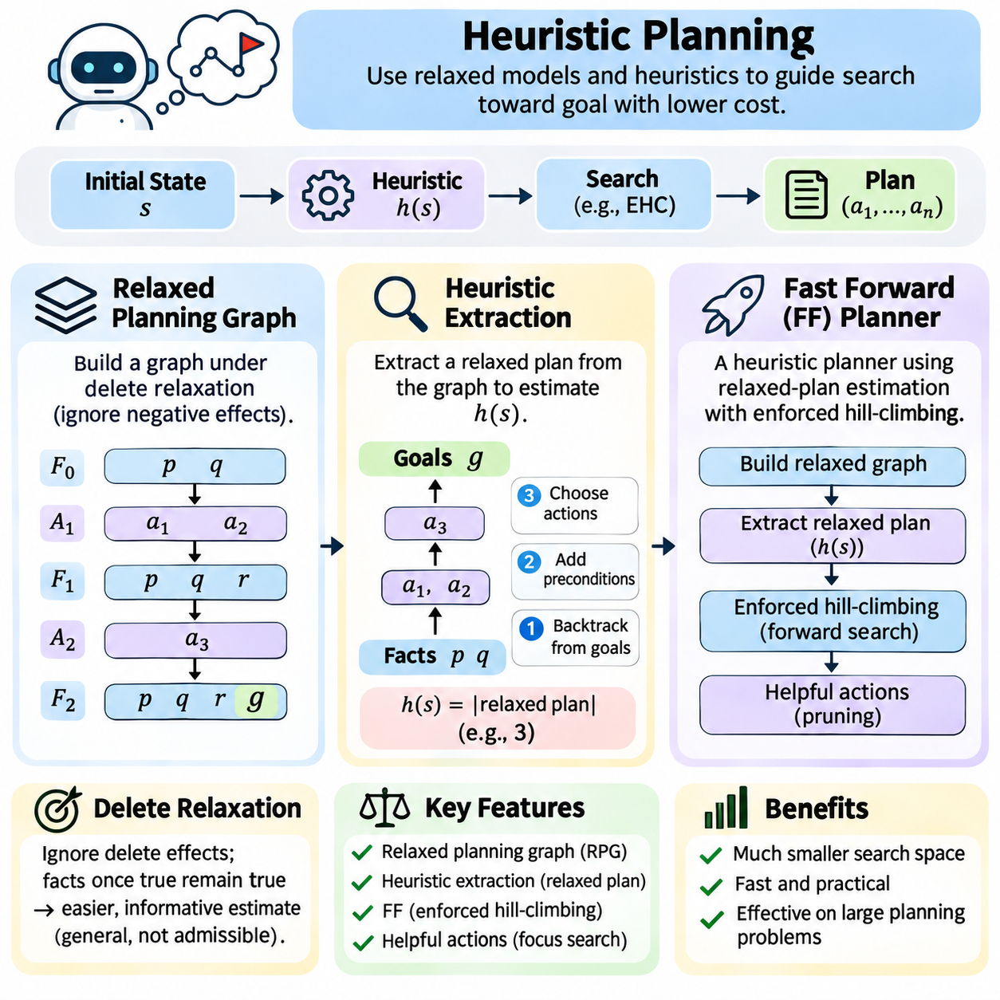{width="7.268055555555556in" height="7.268055555555556in"}

Heuristic planning is an approach to automated planning that uses informed estimates to guide the search for action sequences capable of achieving specified goals. Classical planning problems often contain enormous state spaces, making exhaustive exploration computationally impractical. Heuristics estimate the remaining effort required to reach a goal, allowing planners to prioritize promising states and reduce unnecessary search.

The effectiveness of heuristic planning depends on constructing estimates that reflect the structure of the planning problem. A heuristic function assigns a numerical value to a state, representing its estimated distance or cost to the goal. Lower values generally indicate more promising states. These estimates need not be exact, but their accuracy and computational cost strongly influence planning efficiency, scalability, and solution quality.

Many planning heuristics are derived from relaxed versions of the original problem. Relaxation removes selected constraints to create a simpler problem whose solution provides information about the original task. A widely used technique is delete relaxation, which ignores the negative effects of actions. Once a proposition becomes true in the relaxed problem, it remains true, simplifying the analysis of goal reachability.

Delete relaxation transforms a planning problem into one where actions accumulate facts without removing previously established conditions. This eliminates destructive interactions between actions and often makes goal achievement easier to estimate. However, the relaxed problem may permit combinations that are impossible in reality. Consequently, relaxed estimates provide useful guidance but may underestimate the actual difficulty of achieving goals.

A relaxed planning graph represents the propagation of reachable facts and applicable actions under delete relaxation. It is organized into alternating fact layers and action layers. The initial fact layer contains propositions true in the current state. Each subsequent action layer includes actions whose preconditions are available, while the next fact layer accumulates their positive effects and previously established facts.

Graph expansion continues until all required goal propositions appear in a fact layer or no additional facts can be generated. If the graph reaches a fixed point without satisfying the goals, the relaxed problem is unsolvable from the current state. Because delete effects are ignored, this also implies that the original classical planning problem has no solution. Otherwise, the graph provides information for estimating goal distance.

The depth at which goals first become reachable provides a simple heuristic estimate. A level-based heuristic may use the first fact layer containing every goal proposition. This estimate reflects a relaxed parallel planning horizon rather than the exact number of sequential actions. Although inexpensive, it may fail to capture the total effort required when many actions contribute to different goals.

More informative heuristics can be obtained by extracting a relaxed plan from the planning graph. Relaxed-plan extraction begins at a goal-containing layer and works backward to identify actions supporting the required propositions. The preconditions of selected actions become new subgoals at earlier layers. Repeating this process produces a collection of actions that achieves the goals within the delete-relaxed model.

Heuristic extraction must consider shared dependencies between goals. A single action may establish several required propositions, allowing the extracted relaxed plan to reuse that action. Conversely, different goals may require separate supporting actions. The number of selected actions provides an estimate of planning effort. Because delete effects are ignored, this estimate is informative but does not generally guarantee admissibility.

The Fast Forward planner, commonly called FF, is a landmark heuristic planning system built around relaxed-plan estimation. It uses a STRIPS-style representation and constructs a relaxed planning graph to estimate the effort needed to achieve goals. Rather than relying solely on simple goal counts or graph depth, FF extracts a relaxed plan and uses its action count as a heuristic value.

FF employs enforced hill-climbing as its principal search strategy. From the current state, it searches for a reachable state with a strictly better heuristic value and then continues from that state. Breadth-first exploration can be used within each improvement search. This approach often makes rapid progress toward goals, although heuristic plateaus and dead ends can create difficulties.

Enforced hill-climbing differs from ordinary hill-climbing because it can explore several transitions before finding an improved state. It does not require every immediate successor to have a lower heuristic value. However, the method is not complete in general planning domains and may fail when progress requires entering regions from which no better heuristic state is reachable. FF therefore includes a fallback best-first search strategy.

Helpful actions provide another important optimization in FF. They are selected from actions applicable in the current state that appear relevant to the first step of the extracted relaxed plan. Prioritizing these actions reduces the effective branching factor and concentrates search on operations likely to support goal achievement. Nevertheless, helpful-action pruning may exclude actions required by a valid solution.

The FF heuristic estimates the number of actions in an extracted relaxed plan rather than the true optimal cost. This distinction is important because relaxed plans ignore negative interactions and may select actions differently from an optimal real plan. The heuristic is therefore generally inadmissible. FF emphasizes efficient discovery of satisfactory plans rather than guaranteeing minimum-cost solutions.

Relaxed planning graphs and FF heuristics are closely related but serve different roles. The graph provides a layered representation of relaxed reachability, while extraction selects supporting actions from that representation. The resulting action count becomes a heuristic used by the search algorithm. This separation allows graph construction, support selection, and state exploration to be analyzed independently.

Heuristic extraction quality depends on how supporting actions are selected. When several actions can establish the same proposition, a planner may prefer those with lower estimated costs or greater relevance to other subgoals. Greedy selection can produce compact relaxed plans quickly, but it may overlook better combinations. Consequently, different extraction policies can generate different heuristic values for the same state.

Goal interactions remain a central limitation of delete-relaxed heuristics. Two actions may individually support different goals while interfering with each other in the original problem. Since the relaxed graph ignores deletions, it may incorrectly treat both achievements as permanently available. This can create optimistic estimates and mislead search in domains involving exclusive resources, reversible actions, or tightly coupled constraints.

Heuristic computation also introduces a tradeoff between informativeness and processing cost. A detailed relaxed-plan extraction may provide stronger guidance than a simple goal-count heuristic, but it requires additional computation for every evaluated state. Planning performance depends on whether the reduction in expanded states compensates for this overhead. Efficient implementations reuse data structures and avoid unnecessary graph expansion.

In practical planning systems, heuristic estimates may be combined with action costs, state novelty, preferred operators, or alternative search strategies. Cost-sensitive variants estimate the resources required to reach the goal rather than merely counting actions. However, changing the objective requires corresponding adjustments to relaxed-plan extraction and search evaluation. The chosen heuristic must reflect the intended planning criterion.

Heuristic planning is particularly useful in logistics, manufacturing, workflow automation, and robotic task planning. A warehouse robot may need to collect several packages and deliver them to different locations. Relaxed planning identifies actions that appear necessary for these goals, while heuristic search explores feasible execution sequences. Actual plans must still respect movement constraints, object availability, and action dependencies.

In robotics, heuristic planning can operate as a symbolic task-planning layer above motion planning and control. The heuristic estimates progress toward task-level goals, while geometric planners evaluate whether movements and manipulations are physically feasible. This separation supports efficient high-level reasoning, but symbolic estimates cannot replace collision checking, resource validation, or execution monitoring in real environments.

The performance of heuristic planners is commonly evaluated using planning time, expanded states, solution coverage, memory consumption, and plan quality. Comparisons should also measure heuristic computation overhead and sensitivity to domain structure. A heuristic that performs well in logistics may behave differently in manipulation or scheduling tasks. Benchmarking across diverse planning domains helps identify these strengths and limitations.

Relaxed planning graphs, heuristic extraction, and the FF planner demonstrate how structural knowledge can transform classical planning search. Instead of treating all reachable states equally, the planner estimates which states are closer to satisfying the goals. These techniques provide a foundation for modern heuristic planning, combining symbolic action models, relaxed reasoning, and informed search to solve complex goal-directed problems.

휴리스틱 계획(Heuristic Planning)은 지정된 목표를 달성할 수 있는 행동 순서(Action Sequence)를 탐색할 때 정보에 기반한 추정값(Informed Estimate)을 활용하는 자동 계획(Automated Planning) 접근법이다. 고전적 계획 문제(Classical Planning Problem)는 매우 방대한 상태 공간(State Space)을 포함하는 경우가 많아 완전 탐색(Exhaustive Search)이 계산적으로 비현실적일 수 있다. 휴리스틱(Heuristic)은 목표에 도달하기 위해 필요한 잔여 노력(Remaining Effort)을 추정하여 계획기(Planner)가 유망한 상태를 우선적으로 탐색하고 불필요한 탐색을 줄일 수 있도록 한다.

휴리스틱 계획의 효과는 계획 문제(Planning Problem)의 구조를 반영하는 추정값을 구성하는 데 달려 있다. 휴리스틱 함수(Heuristic Function)는 각 상태(State)에 목표까지의 추정 거리(Estimated Distance) 또는 비용(Cost)을 나타내는 수치 값을 부여한다. 일반적으로 값이 낮을수록 더 유망한 상태를 의미한다. 이러한 추정값이 반드시 정확할 필요는 없지만, 정확도(Accuracy)와 계산 비용(Computational Cost)은 계획 효율성(Planning Efficiency), 확장성(Scalability), 해결책 품질(Solution Quality)에 큰 영향을 미친다.

많은 계획 휴리스틱(Planning Heuristic)은 원래 문제를 완화한 형태(Relaxed Version)에서 도출된다. 완화(Relaxation)는 선택된 제약조건(Constraint)을 제거하여 더 단순한 문제를 만들고, 그 해결책으로부터 원래 작업에 관한 정보를 얻는 방법이다. 널리 사용되는 기법은 행동의 부정적 효과(Negative Effect)를 무시하는 삭제 완화(Delete Relaxation)이다. 완화된 문제에서 하나의 명제(Proposition)가 참이 되면 계속 참으로 유지되므로 목표 도달 가능성(Goal Reachability)을 분석하기 쉬워진다.

삭제 완화(Delete Relaxation)는 행동이 이전에 성립된 조건을 제거하지 않고 사실(Fact)을 누적하는 형태로 계획 문제를 변환한다. 이를 통해 행동 사이의 파괴적 상호작용(Destructive Interaction)이 제거되고 목표 달성의 난이도를 추정하기 쉬워진다. 그러나 완화된 문제(Relaxed Problem)에서는 실제 환경에서 불가능한 조합이 허용될 수 있다. 따라서 완화 기반 추정값(Relaxed Estimate)은 유용한 탐색 지침을 제공하지만 실제 목표 달성의 어려움을 과소평가할 수 있다.

완화 계획 그래프(Relaxed Planning Graph)는 삭제 완화 조건에서 도달 가능한 사실과 적용 가능한 행동(Applicable Action)이 전파되는 과정을 표현한다. 이 그래프는 사실 계층(Fact Layer)과 행동 계층(Action Layer)이 번갈아 나타나는 구조로 구성된다. 초기 사실 계층(Initial Fact Layer)은 현재 상태에서 참인 명제를 포함한다. 이후 행동 계층에는 전제조건(Precondition)이 충족된 행동이 포함되고, 다음 사실 계층에는 해당 행동의 긍정적 효과(Positive Effect)와 이전에 성립된 사실이 누적된다.

그래프 확장(Graph Expansion)은 모든 목표 명제(Goal Proposition)가 하나의 사실 계층에 나타나거나 더 이상 새로운 사실을 생성할 수 없을 때까지 계속된다. 그래프가 목표를 만족하지 못한 상태에서 고정점(Fixed Point)에 도달하면 현재 상태에서 완화된 문제를 해결할 수 없다는 의미이다. 삭제 효과(Delete Effect)를 무시한 상황에서도 목표에 도달할 수 없으므로 원래의 고전적 계획 문제 역시 해결할 수 없다. 반대로 목표가 나타나면 그래프는 목표 거리(Goal Distance)를 추정하기 위한 정보를 제공한다.

목표에 처음 도달할 수 있는 깊이(Depth)는 간단한 휴리스틱 추정값(Heuristic Estimate)을 제공한다. 계층 기반 휴리스틱(Level-Based Heuristic)은 모든 목표 명제가 처음 포함되는 사실 계층을 사용할 수 있다. 이러한 추정값은 순차적 행동(Sequential Action)의 정확한 수보다는 완화된 병렬 계획 범위(Relaxed Parallel Planning Horizon)를 반영한다. 계산 비용은 낮지만 여러 행동이 서로 다른 목표에 기여하는 경우 전체 노력(Total Effort)을 정확하게 반영하지 못할 수 있다.

계획 그래프(Planning Graph)에서 완화 계획(Relaxed Plan)을 추출하면 더 많은 정보를 제공하는 휴리스틱을 얻을 수 있다. 완화 계획 추출(Relaxed-Plan Extraction)은 목표가 포함된 계층에서 시작하여 필요한 명제를 지원하는 행동을 식별하기 위해 역방향으로 진행한다. 선택된 행동의 전제조건은 이전 계층에서 새로운 하위 목표(Subgoal)가 된다. 이러한 과정을 반복하면 삭제 완화 모델(Delete-Relaxed Model)에서 목표를 달성하는 행동 집합을 구성할 수 있다.

휴리스틱 추출(Heuristic Extraction)에서는 목표 사이의 공유 의존 관계(Shared Dependency)를 고려해야 한다. 하나의 행동이 여러 필수 명제를 성립시킬 수 있으므로 추출된 완화 계획에서 해당 행동을 재사용할 수 있다. 반대로 서로 다른 목표가 별도의 지원 행동(Supporting Action)을 요구할 수도 있다. 선택된 행동의 수는 계획 노력(Planning Effort)의 추정값을 제공한다. 그러나 삭제 효과를 무시하기 때문에 이러한 추정값은 유용한 정보를 제공하더라도 일반적으로 허용성(Admissibility)을 보장하지 않는다.

고속 전방 계획기(Fast Forward Planner, FF)는 완화 계획 추정(Relaxed-Plan Estimation)을 중심으로 설계된 대표적인 휴리스틱 계획 시스템(Heuristic Planning System)이다. FF는 STRIPS 방식의 표현(STRIPS-Style Representation)을 사용하며, 목표 달성에 필요한 노력을 추정하기 위해 완화 계획 그래프를 구성한다. 단순한 목표 개수(Goal Count)나 그래프 깊이(Graph Depth)에만 의존하지 않고 완화 계획을 추출한 다음 해당 계획의 행동 수(Action Count)를 휴리스틱 값(Heuristic Value)으로 사용한다.

FF는 주요 탐색 전략(Search Strategy)으로 강제 언덕 오르기 탐색(Enforced Hill-Climbing)을 사용한다. 현재 상태(Current State)에서 시작하여 휴리스틱 값이 엄격하게 개선되는 도달 가능한 상태를 탐색하고, 발견된 상태에서 탐색을 계속한다. 각 개선 상태를 찾는 과정에서는 너비 우선 탐색(Breadth-First Search)을 사용할 수 있다. 이러한 접근법은 목표를 향해 빠르게 진행하는 경우가 많지만, 휴리스틱 평탄 구간(Heuristic Plateau)과 막다른 상태(Dead End)는 어려움을 발생시킬 수 있다.

강제 언덕 오르기 탐색(Enforced Hill-Climbing)은 개선된 상태를 찾기 전에 여러 상태 전이(State Transition)를 탐색할 수 있다는 점에서 일반적인 언덕 오르기 탐색(Hill-Climbing)과 다르다. 모든 직접 후속 상태(Immediate Successor State)의 휴리스틱 값이 낮아야 하는 것은 아니다. 그러나 이 방법은 일반적인 계획 영역(Planning Domain)에서 완전성(Completeness)을 보장하지 않으며, 더 나은 휴리스틱 상태에 도달할 수 없는 영역으로 진입해야 하는 경우 실패할 수 있다. 따라서 FF는 대체 전략으로 최선 우선 탐색(Best-First Search)을 포함한다.

유용한 행동(Helpful Action)은 FF의 또 다른 중요한 최적화(Optimization) 기법이다. 이러한 행동은 현재 상태에서 적용 가능하면서 추출된 완화 계획의 첫 단계와 관련성이 있는 행동 중에서 선택된다. 유용한 행동에 우선순위를 부여하면 유효 분기 계수(Effective Branching Factor)를 줄이고 목표 달성에 기여할 가능성이 높은 작업에 탐색을 집중할 수 있다. 그러나 유용한 행동 기반 가지치기(Helpful-Action Pruning)는 유효한 해결책에 필요한 행동을 제외할 수도 있다.

FF 휴리스틱(FF Heuristic)은 실제 최적 비용(True Optimal Cost)이 아니라 추출된 완화 계획에 포함된 행동의 수를 추정한다. 이러한 차이는 완화 계획이 부정적 상호작용(Negative Interaction)을 무시하고 실제 최적 계획(Optimal Real Plan)과 다른 행동을 선택할 수 있기 때문에 중요하다. 따라서 FF 휴리스틱은 일반적으로 비허용적(Inadmissible)이다. FF는 최소 비용 해결책(Minimum-Cost Solution)을 보장하기보다는 만족스러운 계획(Satisfactory Plan)을 효율적으로 발견하는 데 중점을 둔다.

완화 계획 그래프(Relaxed Planning Graph)와 FF 휴리스틱(FF Heuristic)은 밀접하게 관련되어 있지만 서로 다른 역할을 수행한다. 그래프는 완화된 도달 가능성(Relaxed Reachability)을 계층적으로 표현하고, 추출 과정(Extraction)은 해당 표현에서 지원 행동을 선택한다. 이렇게 얻은 행동 수는 탐색 알고리즘(Search Algorithm)이 사용하는 휴리스틱 값이 된다. 이러한 분리를 통해 그래프 구성(Graph Construction), 지원 행동 선택(Support Selection), 상태 탐색(State Exploration)을 독립적으로 분석할 수 있다.

휴리스틱 추출 품질(Heuristic Extraction Quality)은 지원 행동을 선택하는 방법에 따라 달라진다. 여러 행동이 동일한 명제를 성립시킬 수 있다면 계획기는 추정 비용(Estimated Cost)이 낮거나 다른 하위 목표와 관련성이 높은 행동을 선호할 수 있다. 탐욕적 선택(Greedy Selection)은 간결한 완화 계획을 빠르게 생성할 수 있지만 더 나은 행동 조합을 놓칠 수 있다. 따라서 서로 다른 추출 정책(Extraction Policy)은 동일한 상태에 대해서도 서로 다른 휴리스틱 값을 생성할 수 있다.

목표 상호작용(Goal Interaction)은 삭제 완화 휴리스틱(Delete-Relaxed Heuristic)의 핵심적인 한계로 남아 있다. 두 행동이 원래 문제에서는 서로 간섭하면서도 각각 다른 목표를 지원할 수 있다. 완화 그래프(Relaxed Graph)는 삭제 효과를 무시하므로 두 목표가 달성된 상태를 영구적으로 유지할 수 있다고 잘못 판단할 수 있다. 이로 인해 낙관적인 추정값(Optimistic Estimate)이 생성되고, 배타적 자원(Exclusive Resource), 가역적 행동(Reversible Action), 밀접하게 결합된 제약조건(Tightly Coupled Constraint)이 포함된 영역에서 탐색을 잘못 유도할 수 있다.

휴리스틱 계산(Heuristic Computation)에는 정보의 유용성(Informativeness)과 처리 비용(Processing Cost) 사이의 절충 관계(Tradeoff)도 존재한다. 상세한 완화 계획 추출은 단순한 목표 개수 휴리스틱(Goal-Count Heuristic)보다 강력한 탐색 지침을 제공할 수 있지만, 평가하는 모든 상태에 대해 추가 계산이 필요하다. 계획 성능(Planning Performance)은 확장 상태 수(Expanded States)의 감소가 이러한 추가 비용을 상쇄하는지에 따라 달라진다. 효율적인 구현은 자료구조(Data Structure)를 재사용하고 불필요한 그래프 확장을 방지한다.

실제 계획 시스템(Practical Planning System)에서는 휴리스틱 추정값을 행동 비용(Action Cost), 상태 신규성(State Novelty), 선호 연산자(Preferred Operator), 대안적인 탐색 전략(Alternative Search Strategy)과 결합할 수 있다. 비용 민감형 변형(Cost-Sensitive Variant)은 단순히 행동 수를 계산하는 대신 목표에 도달하는 데 필요한 자원을 추정한다. 그러나 목적 함수(Objective)를 변경하려면 완화 계획 추출과 탐색 평가(Search Evaluation)도 이에 맞게 조정해야 한다. 선택된 휴리스틱은 의도한 계획 평가 기준(Planning Criterion)을 반영해야 한다.

휴리스틱 계획은 물류(Logistics), 제조(Manufacturing), 업무흐름 자동화(Workflow Automation), 로봇 작업 계획(Robotic Task Planning)에서 특히 유용하다. 창고 로봇(Warehouse Robot)은 여러 물품을 수거하여 서로 다른 위치로 배송해야 할 수 있다. 완화 계획은 이러한 목표에 필요할 것으로 보이는 행동을 식별하고, 휴리스틱 탐색은 실행 가능한 행동 순서를 탐색한다. 실제 계획에서는 이동 제약조건(Movement Constraint), 객체 가용성(Object Availability), 행동 의존 관계(Action Dependency)를 반드시 준수해야 한다.

로봇공학(Robotics)에서 휴리스틱 계획은 동작 계획(Motion Planning)과 제어(Control)보다 상위에 위치하는 기호적 작업 계획 계층(Symbolic Task-Planning Layer)으로 작동할 수 있다. 휴리스틱은 작업 수준 목표(Task-Level Goal)에 대한 진행 정도를 추정하고, 기하학적 계획기(Geometric Planner)는 이동과 조작이 물리적으로 실행 가능한지를 평가한다. 이러한 분리는 효율적인 상위 수준 추론(High-Level Reasoning)을 지원하지만, 실제 환경에서 기호적 추정값(Symbolic Estimate)이 충돌 검사(Collision Checking), 자원 검증(Resource Validation), 실행 감시(Execution Monitoring)를 대체할 수는 없다.

휴리스틱 계획기의 성능은 일반적으로 계획 시간(Planning Time), 확장된 상태 수(Expanded States), 해결 범위(Solution Coverage), 메모리 소비(Memory Consumption), 계획 품질(Plan Quality)을 사용하여 평가한다. 비교 평가에서는 휴리스틱 계산 오버헤드(Heuristic Computation Overhead)와 영역 구조(Domain Structure)에 대한 민감도도 측정해야 한다. 물류 영역에서 우수한 성능을 보이는 휴리스틱이 조작(Manipulation)이나 일정 계획(Scheduling)에서는 다르게 작동할 수 있다. 다양한 계획 영역에 대한 벤치마킹(Benchmarking)은 이러한 강점과 한계를 식별하는 데 도움이 된다.

완화 계획 그래프(Relaxed Planning Graph), 휴리스틱 추출(Heuristic Extraction), FF 계획기(FF Planner)는 구조적 지식(Structural Knowledge)이 고전적 계획 탐색(Classical Planning Search)을 어떻게 변화시킬 수 있는지를 보여준다. 모든 도달 가능한 상태를 동일하게 취급하는 대신 계획기는 어떤 상태가 목표 만족(Goal Satisfaction)에 더 가까운지를 추정한다. 이러한 기법은 기호적 행동 모델(Symbolic Action Model), 완화 추론(Relaxed Reasoning), 정보 기반 탐색(Informed Search)을 결합하여 복잡한 목표 지향적 문제(Goal-Directed Problem)를 해결하는 현대적 휴리스틱 계획(Modern Heuristic Planning)의 기반을 제공한다.

## 04.08 GraphPlan Algorithm [w/Code]

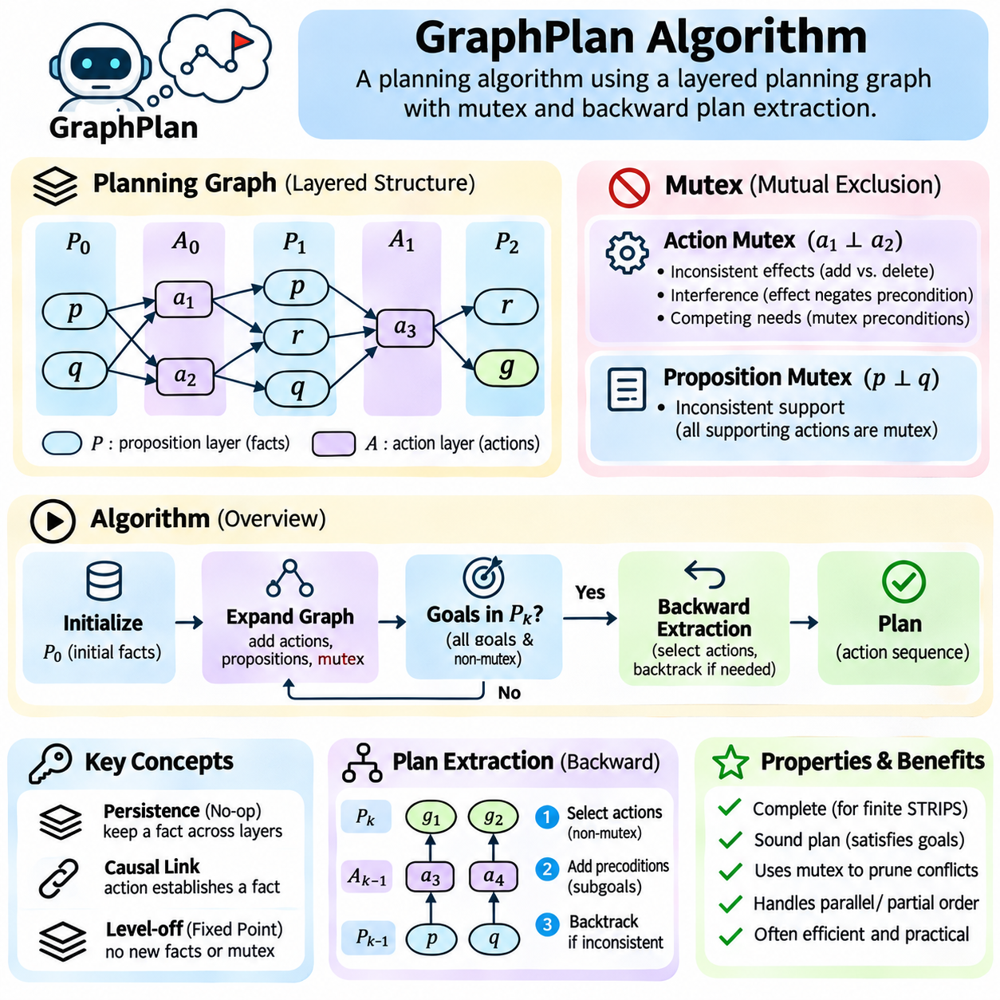{width="7.268055555555556in" height="7.268055555555556in"}

GraphPlan is a classical artificial intelligence planning algorithm that combines a layered planning graph with backward solution extraction. It was designed to solve deterministic planning problems efficiently by representing reachable propositions, applicable actions, and conflicts between them. Rather than exploring complete state sequences directly, GraphPlan organizes planning information into successive levels and searches for a consistent set of actions achieving the goals.

The planning graph consists of alternating proposition layers and action layers. A proposition layer represents facts that may hold at a particular planning level, while an action layer contains operations whose preconditions are available at the preceding level. Directed connections represent preconditions and effects. This layered structure compactly describes many possible action combinations without explicitly enumerating every reachable world state.

Graph construction begins with the initial proposition layer, containing facts true in the initial state. The algorithm identifies actions whose preconditions appear in this layer and places them in the next action layer. Their positive and negative effects determine the following proposition layer. Repeating this expansion creates an increasingly detailed representation of possible future conditions and the actions capable of producing them.

GraphPlan introduces persistence actions, commonly called no-op actions, to represent facts remaining true between successive layers. A persistence action requires a proposition and reproduces that proposition at the next level. These actions allow facts to survive even when no ordinary action explicitly establishes them again. Persistence is essential for representing conditions that must remain available across multiple planning steps.

Mutual exclusion, abbreviated as mutex, is a defining feature of GraphPlan. Mutex relationships identify actions or propositions that cannot coexist within the same planning level. These restrictions prevent the graph from treating incompatible combinations as valid. By recording conflicts explicitly, GraphPlan provides stronger reachability information than a relaxed planning graph that ignores destructive interactions.

Action mutex relationships arise from several forms of interference. Two actions are mutually exclusive when their effects conflict, when one action negates another action\'s precondition, or when their preconditions are mutually exclusive. These cases are commonly described as inconsistent effects, interference, and competing needs. Identifying them prevents incompatible operations from being selected together during plan extraction.

Proposition mutex relationships indicate that two facts cannot simultaneously hold at a given level. In GraphPlan, this commonly occurs when every pair of actions capable of supporting the two propositions is mutually exclusive. This condition is called inconsistent support. Proposition mutex relationships are recalculated as the graph expands, allowing previously incompatible facts to become jointly achievable at later levels.

The planning graph represents a sequence of progressively broader reachability approximations. Proposition layers accumulate potentially achievable facts, while mutex relationships generally become less restrictive as additional levels are introduced. A proposition appearing in a layer does not guarantee that it can participate in a complete valid plan. GraphPlan therefore combines graph-based reachability analysis with explicit solution extraction.

Goal testing begins by examining whether every required goal proposition appears in the current proposition layer. The algorithm also verifies that no pair of goal propositions is mutually exclusive. If either condition fails, the graph must be expanded further. If both conditions hold, backward plan extraction can begin, although the presence of nonmutex goals does not itself guarantee a valid solution.

Backward extraction starts from the goal propositions at the final graph level. The algorithm selects a set of actions from the preceding action layer whose effects collectively establish those goals. Selected actions must not be mutually exclusive. Their preconditions become the subgoals for the previous proposition layer, producing a recursive search through the planning graph toward the initial state.

During extraction, several alternative action sets may support the same goals. GraphPlan explores these alternatives through systematic backtracking when a candidate set produces inconsistent subgoals. If no valid supporting combination exists at the current level, extraction fails for that level. The graph can then be expanded and extraction attempted again using the additional reachability information.

GraphPlan employs memoization to avoid repeatedly solving identical failed subgoal combinations. When extraction determines that a particular goal set cannot be supported at a specific level, the failure is recorded. Subsequent searches encountering the same combination can terminate that branch immediately. This technique reduces redundant reasoning and improves performance in planning problems with overlapping dependencies.

The planning graph eventually reaches a fixed point, or levels off, when proposition sets and mutex relationships stop changing between successive levels. At this stage, further expansion introduces no new reachability information. However, extraction may still benefit from additional time levels in some cases. GraphPlan uses stabilization and recorded extraction failures to determine when continued expansion cannot produce a solution.

Under finite classical STRIPS-style assumptions, GraphPlan is complete and can determine whether a solution exists. When it returns a plan, the plan satisfies the specified action and goal constraints. Its level-by-level extraction finds a solution with the minimum number of parallel action layers. This does not necessarily minimize the total number of actions, execution cost, or resource consumption.

Parallel action representation is an important characteristic of GraphPlan. Actions selected within the same layer are compatible according to the algorithm\'s mutex rules. Consequently, a solution can be expressed as a sequence of action sets rather than a strictly sequential list. Compatible actions may be linearized into a valid sequential plan, although actual simultaneous execution requires additional resource and timing analysis.

Consider a logistics problem involving packages, vehicles, and destinations. The initial proposition layer describes package locations and vehicle availability. Action layers may contain loading, unloading, and movement operations. Mutex relationships prevent incompatible combinations, such as a vehicle simultaneously occupying conflicting locations. Backward extraction identifies compatible actions that deliver the required packages.

GraphPlan differs from ordinary forward state-space planning because it does not generate every complete successor state. Instead, its graph combines information from many possible trajectories into shared proposition and action layers. This representation can reduce redundant reachability calculations. However, the backward extraction phase may still encounter combinatorial complexity when many alternative action combinations satisfy intermediate goals.

The relationship between GraphPlan and heuristic planning is especially important. Planning graphs provide structural information that can guide state-space search even when GraphPlan\'s original extraction procedure is not used. Goal-level estimates, mutex-based measures, and relaxed planning graphs derive useful information from layered reachability. These ideas influenced later heuristic planners, including systems based on delete relaxation.

A relaxed planning graph differs from the original GraphPlan graph primarily in its treatment of negative effects and mutex relationships. Delete-relaxed methods ignore action deletions and typically omit mutex constraints, making graph construction and relaxed-plan extraction simpler. Original GraphPlan retains interference information and searches for an executable plan. The distinction separates approximate heuristic estimation from exact planning.

The computational cost of GraphPlan depends on the number of grounded propositions, applicable actions, mutex relationships, and extraction alternatives. Large domains can produce substantial graph structures even without explicit state enumeration. Efficient implementations use compact representations, incremental mutex computation, and memoized failures. Grounding and preprocessing are also important for limiting unnecessary actions.

GraphPlan is particularly suitable for explaining the relationship between logical planning and constraint satisfaction. Each extraction level requires selecting supporting actions while respecting mutex restrictions and predecessor requirements. This resembles a constraint satisfaction problem in which action choices must satisfy compatibility and support constraints. The planning graph supplies the structure needed to organize these decisions.

In robotics, GraphPlan can support symbolic task planning for navigation, manipulation, and coordinated operations. A robot may need to approach an object, grasp it, move to a destination, and release it. The planning graph represents possible action dependencies and conflicts. However, continuous motion, uncertain perception, resource limits, and real-time safety constraints require additional planning and control mechanisms.

GraphPlan performance can be evaluated through planning time, graph size, number of expanded levels, mutex computation overhead, extraction backtracking, and solution quality. The minimum parallel-plan horizon is a useful metric, but it should not be confused with minimum execution time under realistic action durations. Benchmark comparisons should distinguish graph construction cost from the computational effort required for solution extraction.

GraphPlan established an influential connection between layered reachability, mutual exclusion reasoning, and backward search. Its planning graph provides a compact representation of possible actions and facts, while extraction converts this information into a consistent plan. These principles remain important in classical planning, heuristic development, constraint-based reasoning, and the design of intelligent systems requiring structured goal-directed behavior.

그래프플랜(GraphPlan)은 계층적 계획 그래프(Layered Planning Graph)와 역방향 해결책 추출(Backward Solution Extraction)을 결합한 고전적 인공지능(Classical Artificial Intelligence) 계획 알고리즘이다. 이 알고리즘은 도달 가능한 명제(Reachable Proposition), 적용 가능한 행동(Applicable Action), 그리고 이들 사이의 충돌(Conflict)을 표현하여 결정론적 계획 문제(Deterministic Planning Problem)를 효율적으로 해결하도록 설계되었다. 완전한 상태 순서(State Sequence)를 직접 탐색하는 대신 계획 정보를 연속적인 계층(Level)으로 구성하고 목표를 달성할 수 있는 일관된 행동 집합(Consistent Action Set)을 탐색한다.

계획 그래프(Planning Graph)는 명제 계층(Proposition Layer)과 행동 계층(Action Layer)이 번갈아 나타나는 구조로 구성된다. 명제 계층은 특정 계획 단계에서 참일 수 있는 사실(Fact)을 나타내며, 행동 계층은 이전 계층에서 전제조건(Precondition)이 충족되는 작업을 포함한다. 방향 연결(Directed Connection)은 전제조건과 효과(Effect)를 표현한다. 이러한 계층 구조는 도달 가능한 모든 세계 상태(World State)를 명시적으로 열거하지 않고도 다양한 행동 조합(Action Combination)을 압축하여 설명한다.

그래프 구성(Graph Construction)은 초기 상태(Initial State)에서 참인 사실을 포함하는 초기 명제 계층(Initial Proposition Layer)에서 시작한다. 알고리즘은 이 계층에 전제조건이 나타나는 행동을 식별하고 다음 행동 계층에 배치한다. 해당 행동의 긍정적 효과(Positive Effect)와 부정적 효과(Negative Effect)는 이후 명제 계층을 결정한다. 이러한 확장을 반복하면 가능한 미래 조건(Future Condition)과 이를 생성할 수 있는 행동에 관한 표현이 점진적으로 구체화된다.

그래프플랜은 연속적인 계층 사이에서 사실이 참으로 유지되는 상황을 표현하기 위해 지속 행동(Persistence Action)을 도입하며, 이를 일반적으로 무연산 행동(No-Op Action)이라고 한다. 지속 행동은 하나의 명제를 전제조건으로 요구하고 다음 계층에서 동일한 명제를 다시 생성한다. 이러한 행동을 통해 일반적인 행동이 해당 사실을 명시적으로 다시 성립시키지 않더라도 사실이 유지될 수 있다. 지속성(Persistence)은 여러 계획 단계에 걸쳐 계속 사용 가능해야 하는 조건을 표현하는 데 필수적이다.

상호 배제(Mutual Exclusion, Mutex)는 그래프플랜의 핵심적인 특징이다. 상호 배제 관계(Mutex Relationship)는 동일한 계획 계층에서 공존할 수 없는 행동이나 명제를 식별한다. 이러한 제한은 그래프가 양립할 수 없는 조합(Incompatible Combination)을 유효한 것으로 취급하지 않도록 한다. 충돌을 명시적으로 기록함으로써 그래프플랜은 파괴적 상호작용(Destructive Interaction)을 무시하는 완화 계획 그래프(Relaxed Planning Graph)보다 강력한 도달 가능성 정보(Reachability Information)를 제공한다.

행동 상호 배제(Action Mutex) 관계는 여러 형태의 간섭(Interference)에서 발생한다. 두 행동의 효과가 서로 충돌하거나, 하나의 행동이 다른 행동의 전제조건을 부정하거나, 두 행동의 전제조건이 서로 상호 배제되는 경우 해당 행동들은 동시에 선택될 수 없다. 이러한 경우는 일반적으로 비일관적 효과(Inconsistent Effects), 간섭(Interference), 경쟁적 요구조건(Competing Needs)으로 구분된다. 이를 식별하면 계획 추출(Plan Extraction) 과정에서 양립할 수 없는 작업이 함께 선택되는 것을 방지할 수 있다.

명제 상호 배제(Proposition Mutex) 관계는 두 사실이 특정 계층에서 동시에 참이 될 수 없음을 나타낸다. 그래프플랜에서는 일반적으로 두 명제를 각각 지원할 수 있는 모든 행동 쌍(Action Pair)이 상호 배제될 때 이러한 관계가 발생한다. 이 조건을 비일관적 지원(Inconsistent Support)이라고 한다. 명제 상호 배제 관계는 그래프가 확장될 때마다 다시 계산되므로, 이전 계층에서는 양립할 수 없었던 사실들이 이후 계층에서는 함께 달성 가능해질 수 있다.

계획 그래프는 도달 가능성 근사(Reachability Approximation)가 점진적으로 확장되는 순서를 표현한다. 명제 계층에는 잠재적으로 달성 가능한 사실이 누적되고, 추가 계층이 도입되면서 상호 배제 관계는 일반적으로 완화된다. 그러나 어떤 명제가 특정 계층에 나타난다는 사실만으로 완전하고 유효한 계획(Complete Valid Plan)에 포함될 수 있다는 것이 보장되지는 않는다. 따라서 그래프플랜은 그래프 기반 도달 가능성 분석(Graph-Based Reachability Analysis)과 명시적 해결책 추출(Explicit Solution Extraction)을 결합한다.

목표 검사(Goal Testing)는 현재 명제 계층에 필요한 모든 목표 명제(Goal Proposition)가 나타나는지 확인하는 것으로 시작한다. 알고리즘은 목표 명제의 어떤 쌍도 상호 배제되지 않는지 추가로 검사한다. 두 조건 중 하나라도 충족되지 않으면 그래프를 더 확장해야 한다. 두 조건이 모두 충족되면 역방향 계획 추출(Backward Plan Extraction)을 시작할 수 있지만, 상호 배제되지 않는 목표가 존재한다는 사실만으로 유효한 해결책이 보장되지는 않는다.

역방향 추출(Backward Extraction)은 최종 그래프 계층(Final Graph Level)의 목표 명제에서 시작한다. 알고리즘은 이전 행동 계층에서 해당 목표를 collectively 성립시키는 행동 집합(Action Set)을 선택한다. 선택된 행동들은 서로 상호 배제되어서는 안 된다. 이 행동들의 전제조건은 이전 명제 계층의 하위 목표(Subgoal)가 되며, 이를 통해 초기 상태 방향으로 계획 그래프를 거슬러 올라가는 재귀적 탐색(Recursive Search)이 수행된다.

추출 과정에서는 여러 대안적인 행동 집합(Alternative Action Set)이 동일한 목표를 지원할 수 있다. 그래프플랜은 후보 행동 집합이 일관성이 없는 하위 목표(Inconsistent Subgoal)를 생성하면 체계적인 역추적(Systematic Backtracking)을 통해 다른 대안을 탐색한다. 현재 계층에서 유효한 지원 조합(Valid Supporting Combination)을 찾을 수 없으면 해당 계층의 추출은 실패한다. 이후 그래프를 확장하고 추가된 도달 가능성 정보를 사용하여 추출을 다시 시도할 수 있다.

그래프플랜은 동일한 실패 하위 목표 조합(Failed Subgoal Combination)을 반복해서 해결하지 않도록 메모이제이션(Memoization)을 사용한다. 특정 계층에서 어떤 목표 집합(Goal Set)을 지원할 수 없다고 판단되면 해당 실패 결과를 기록한다. 이후 탐색에서 동일한 조합이 나타나면 해당 분기(Branch)를 즉시 종료할 수 있다. 이러한 기법은 중복 추론(Redundant Reasoning)을 줄이고 의존 관계가 중첩되는 계획 문제에서 성능을 향상시킨다.

계획 그래프는 연속된 계층 사이에서 명제 집합(Proposition Set)과 상호 배제 관계가 더 이상 변하지 않을 때 최종적으로 고정점(Fixed Point)에 도달하며, 이를 계층 안정화(Leveling Off)라고 한다. 이 단계에서는 추가 확장이 새로운 도달 가능성 정보를 생성하지 않는다. 그러나 일부 경우에는 추가적인 시간 계층(Time Level)이 계획 추출에 여전히 도움이 될 수 있다. 그래프플랜은 안정화 상태(Stabilization)와 기록된 추출 실패(Recorded Extraction Failure)를 활용하여 계속 확장해도 해결책을 생성할 수 없는 시점을 판단한다.

유한한 고전적 STRIPS 방식 가정(Finite Classical STRIPS-Style Assumption) 아래 그래프플랜은 완전성(Completeness)을 가지며 해결책의 존재 여부를 판별할 수 있다. 계획을 반환하는 경우 해당 계획은 지정된 행동 및 목표 제약조건(Action and Goal Constraint)을 만족한다. 계층별 추출(Level-by-Level Extraction)은 병렬 행동 계층(Parallel Action Layer)의 수가 최소인 해결책을 찾는다. 그러나 이것이 반드시 전체 행동 수(Total Number of Actions), 실행 비용(Execution Cost), 자원 소비(Resource Consumption)를 최소화한다는 의미는 아니다.

병렬 행동 표현(Parallel Action Representation)은 그래프플랜의 중요한 특징이다. 동일한 계층에서 선택된 행동들은 알고리즘의 상호 배제 규칙(Mutex Rule)에 따라 서로 양립 가능하다. 따라서 해결책은 엄격한 순차적 목록(Sequential List)이 아니라 행동 집합의 순서(Sequence of Action Sets)로 표현될 수 있다. 양립 가능한 행동은 유효한 순차 계획(Sequential Plan)으로 선형화(Linearization)할 수 있지만, 실제 동시 실행(Simultaneous Execution)에는 추가적인 자원 및 시간 분석(Resource and Timing Analysis)이 필요하다.

물품(Package), 차량(Vehicle), 목적지(Destination)가 포함된 물류 문제(Logistics Problem)를 생각할 수 있다. 초기 명제 계층은 물품 위치(Package Location)와 차량 가용성(Vehicle Availability)을 설명한다. 행동 계층에는 적재(Loading), 하역(Unloading), 이동(Movement) 작업이 포함될 수 있다. 상호 배제 관계는 차량이 동시에 서로 충돌하는 위치에 존재하는 것과 같은 양립할 수 없는 조합을 방지한다. 역방향 추출은 필요한 물품을 배송할 수 있는 양립 가능한 행동을 식별한다.

그래프플랜은 모든 완전한 후속 상태(Complete Successor State)를 생성하지 않는다는 점에서 일반적인 전방 상태 공간 계획(Forward State-Space Planning)과 다르다. 대신 계획 그래프는 여러 가능한 경로(Trajectory)의 정보를 공유된 명제 계층과 행동 계층에 결합한다. 이러한 표현은 중복된 도달 가능성 계산(Redundant Reachability Calculation)을 줄일 수 있다. 그러나 중간 목표(Intermediate Goal)를 만족하는 대안적인 행동 조합이 많으면 역방향 추출 단계에서 여전히 조합적 복잡도(Combinatorial Complexity)가 발생할 수 있다.

그래프플랜과 휴리스틱 계획(Heuristic Planning)의 관계는 특히 중요하다. 계획 그래프는 그래프플랜의 원래 추출 절차(Original Extraction Procedure)를 사용하지 않더라도 상태 공간 탐색(State-Space Search)을 안내하는 구조적 정보(Structural Information)를 제공한다. 목표 계층 추정(Goal-Level Estimate), 상호 배제 기반 척도(Mutex-Based Measure), 완화 계획 그래프(Relaxed Planning Graph)는 계층적 도달 가능성(Layered Reachability)에서 유용한 정보를 도출한다. 이러한 개념은 삭제 완화(Delete Relaxation)를 기반으로 하는 시스템을 포함하여 이후의 휴리스틱 계획기에 영향을 미쳤다.

완화 계획 그래프(Relaxed Planning Graph)는 주로 부정적 효과(Negative Effect)와 상호 배제 관계(Mutex Relationship)를 처리하는 방식에서 원래 그래프플랜 그래프와 차이가 있다. 삭제 완화 방식(Delete-Relaxed Method)은 행동의 삭제 효과(Action Deletion)를 무시하고 일반적으로 상호 배제 제약조건을 생략하므로 그래프 구성과 완화 계획 추출(Relaxed-Plan Extraction)이 더 단순해진다. 반면 원래 그래프플랜은 간섭 정보(Interference Information)를 유지하면서 실행 가능한 계획(Executable Plan)을 탐색한다. 이러한 차이는 근사적 휴리스틱 추정(Approximate Heuristic Estimation)과 정확한 계획 수립(Exact Planning)을 구분한다.

그래프플랜의 계산 비용(Computational Cost)은 구체화된 명제(Grounded Proposition), 적용 가능한 행동(Applicable Action), 상호 배제 관계, 추출 대안(Extraction Alternative)의 수에 따라 달라진다. 규모가 큰 영역에서는 상태를 명시적으로 열거하지 않더라도 상당한 크기의 그래프 구조(Graph Structure)가 생성될 수 있다. 효율적인 구현에서는 압축된 표현(Compact Representation), 점진적 상호 배제 계산(Incremental Mutex Computation), 실패 결과 메모이제이션(Memoized Failure)을 사용한다. 구체화(Grounding)와 전처리(Preprocessing) 역시 불필요한 행동을 제한하는 데 중요하다.

그래프플랜은 논리적 계획(Logical Planning)과 제약 충족(Constraint Satisfaction)의 관계를 설명하는 데 특히 적합하다. 각 추출 계층에서는 상호 배제 제한과 선행 조건(Predecessor Requirement)을 준수하면서 지원 행동(Supporting Action)을 선택해야 한다. 이는 행동 선택(Action Choice)이 양립 가능성 제약조건(Compatibility Constraint)과 지원 제약조건(Support Constraint)을 만족해야 하는 제약 충족 문제(Constraint Satisfaction Problem)와 유사하다. 계획 그래프는 이러한 결정을 체계적으로 구성하는 데 필요한 구조를 제공한다.

로봇공학(Robotics)에서 그래프플랜은 이동(Navigation), 조작(Manipulation), 협력 작업(Coordinated Operation)을 위한 기호적 작업 계획(Symbolic Task Planning)을 지원할 수 있다. 로봇은 객체에 접근하고, 파지(Grasp)하고, 목적지로 이동한 다음 객체를 내려놓아야 할 수 있다. 계획 그래프는 가능한 행동 의존 관계(Action Dependency)와 충돌(Conflict)을 표현한다. 그러나 연속 운동(Continuous Motion), 불확실한 인식(Uncertain Perception), 자원 제한(Resource Limit), 실시간 안전 제약조건(Real-Time Safety Constraint)을 처리하려면 추가적인 계획 및 제어 메커니즘이 필요하다.

그래프플랜의 성능은 계획 시간(Planning Time), 그래프 크기(Graph Size), 확장된 계층 수(Number of Expanded Levels), 상호 배제 계산 오버헤드(Mutex Computation Overhead), 추출 역추적(Extraction Backtracking), 해결책 품질(Solution Quality)을 통해 평가할 수 있다. 최소 병렬 계획 범위(Minimum Parallel-Plan Horizon)는 유용한 평가 지표이지만, 실제 행동 지속시간(Action Duration)을 고려한 최소 실행 시간(Minimum Execution Time)과 혼동해서는 안 된다. 벤치마크 비교(Benchmark Comparison)에서는 그래프 구성 비용과 해결책 추출에 필요한 계산 노력을 구분해야 한다.

그래프플랜은 계층적 도달 가능성(Layered Reachability), 상호 배제 추론(Mutual Exclusion Reasoning), 역방향 탐색(Backward Search) 사이에 중요한 연결 관계를 확립하였다. 계획 그래프는 가능한 행동과 사실을 압축하여 표현하고, 추출 과정은 이러한 정보를 일관된 계획(Consistent Plan)으로 변환한다. 이러한 원리는 고전적 계획(Classical Planning), 휴리스틱 개발(Heuristic Development), 제약 기반 추론(Constraint-Based Reasoning), 구조화된 목표 지향적 행동(Structured Goal-Directed Behavior)이 필요한 지능형 시스템(Intelligent System)의 설계에서 여전히 중요한 역할을 한다.

## 04.09 Hierarchical Task Networks HTN

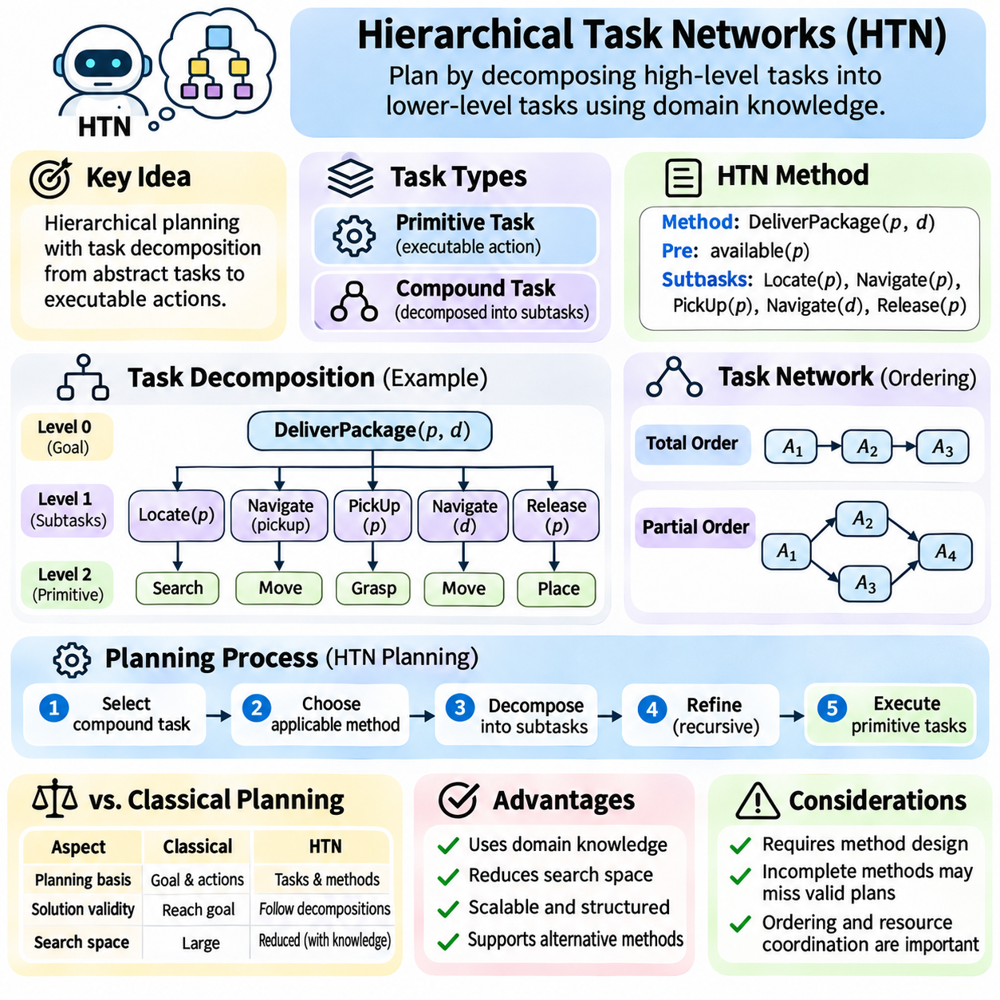{width="7.268055555555556in" height="7.268055555555556in"}

Hierarchical Task Network planning is a structured approach to automated planning that organizes complex activities into progressively smaller tasks. Unlike classical planning methods that primarily search for action sequences satisfying logical goals, HTN planning uses domain-specific decomposition knowledge to describe how tasks should be performed. This hierarchical structure connects high-level objectives with executable operations.

The fundamental distinction in HTN planning is between primitive and compound tasks. Primitive tasks correspond to executable actions whose preconditions and effects can be evaluated against the current state. Compound tasks represent higher-level activities that require further decomposition. A planning problem begins with an initial state and a task network describing activities to accomplish, possibly including ordering and other constraints.

Task decomposition is the central reasoning mechanism of HTN planning. A compound task is replaced by a network of subtasks according to an applicable decomposition method. Each method specifies the circumstances under which a particular refinement is valid and the activities required to complete it. Repeated decomposition eventually produces primitive tasks that can be executed in an order consistent with the network constraints.

An HTN method typically contains a task specification, applicability conditions, and a subtask network. The task specification identifies the compound activity being refined, while applicability conditions determine when the method can be selected. The subtask network defines the resulting activities and their relationships. Multiple methods may describe alternative ways to accomplish the same compound task under different circumstances.

Consider a warehouse delivery task involving a package and destination. A compound task such as DeliverPackage may be decomposed into LocatePackage, NavigateToPickup, PickUpPackage, NavigateToDestination, and ReleasePackage. Some subtasks may themselves require further decomposition. The resulting hierarchy captures operational knowledge that would otherwise need to be discovered through extensive low-level search.

Task networks represent more than simple lists of activities. They may include ordering constraints, variable bindings, and relationships between subtasks. A totally ordered task network requires tasks to follow a fixed sequence, while a partially ordered network permits alternative valid arrangements. These distinctions affect both planning complexity and the flexibility available during execution.

Primitive operators define the executable foundation of an HTN domain. Similar to STRIPS actions, they may specify preconditions and effects that determine state transitions. During planning, an operator can be applied only when its preconditions hold in the relevant state. Its effects update the symbolic representation, allowing subsequent tasks to be evaluated against the resulting conditions.

HTN planning commonly performs recursive refinement until every compound task has been replaced by primitive operations. The planner selects an eligible compound task, chooses an applicable method, and inserts its subtasks into the network. If a decomposition creates an inconsistency or an impossible execution path, the planner may backtrack and try another method. This process combines hierarchical reasoning with systematic search.

Total-order HTN planning is comparatively straightforward because tasks are processed in a prescribed order. The planner can simulate primitive actions sequentially and update the current state after each operation. Partial-order HTN planning is more complex because several task orderings may remain possible. The planner must ensure that selected refinements preserve ordering constraints and allow a feasible execution sequence.

HTN planning differs from goal-based classical planning in its treatment of solution validity. Classical planning primarily requires a sequence of applicable actions that achieves a goal condition. HTN planning additionally requires the primitive action sequence to be obtainable through permitted task decompositions. Consequently, a physically feasible sequence may still be rejected if it does not conform to the specified hierarchical methods.

Domain knowledge is both the primary strength and an important limitation of HTN planning. Well-designed decomposition methods can guide the planner toward operationally meaningful solutions and eliminate large portions of irrelevant search. However, incomplete methods may prevent the discovery of otherwise feasible plans. Incorrect or overly restrictive decompositions can also introduce unnecessary dependencies and reduce flexibility.

Hierarchical abstraction improves planning scalability by separating strategic decisions from operational details. A high-level transportation task may first determine whether a package should travel by truck or autonomous robot. Lower-level methods then refine the selected transportation strategy into loading, navigation, and unloading operations. This structure allows planning decisions to reflect domain expertise at multiple levels.

Method selection can depend on environmental conditions, available resources, and operational policies. For example, a delivery task may use an indoor robot when the destination is inside a facility and a different method when outdoor transportation is required. Preconditions on decomposition methods help encode these alternatives. The planner selects a method whose applicability conditions are satisfied in the relevant planning context.

Task ordering and resource coordination are especially important when multiple activities share equipment or personnel. Two tasks may be logically independent but compete for the same robot, workstation, or charging station. Basic HTN models may require additional resource constraints or scheduling mechanisms to represent such conflicts. Integrated approaches combine hierarchical decomposition with resource-aware planning and temporal reasoning.

Hierarchical decomposition also supports reusable planning knowledge. A method for inspecting equipment can be applied to many inspection missions with different objects and locations. Parameters allow the same abstract procedure to operate on multiple task instances. Reusable methods reduce duplicated planning logic and simplify maintenance when operational procedures change across a family of related applications.

HTN planning systems may use depth-first search, backtracking, heuristic guidance, or constraint propagation to explore alternative decompositions. Search performance depends on the number of available methods, decomposition depth, and interactions among subtasks. Heuristics can prioritize promising methods or estimate the remaining primitive effort. Effective control strategies are particularly valuable in domains with many hierarchical alternatives.

Formal HTN planning languages provide structured representations of tasks, methods, operators, and initial task networks. HDDL, the Hierarchical Domain Definition Language, extends PDDL-style modeling concepts to hierarchical planning. Such languages help separate domain descriptions from planning engines and support reproducible experiments. Their expressiveness depends on the specific language features and planner implementation.

HTN planning is closely related to workflow modeling because both describe how complex activities are organized into dependent operations. Business processes, manufacturing procedures, and maintenance workflows often contain reusable task structures and conditional alternatives. Hierarchical methods can encode these procedures while permitting the planner to select appropriate refinements according to the current operating conditions.

In robotics, HTN planning provides a natural bridge between mission-level objectives and executable robot behaviors. A mission such as InspectBuilding may be decomposed into NavigateToArea, AcquireSensorData, AnalyzeResults, and ReportFindings. Each activity can be refined into robot-specific operations. Motion planning and control systems then handle geometric feasibility and continuous physical execution beneath the symbolic task hierarchy.

Multi-robot systems can use hierarchical task networks to organize cooperative missions. A high-level task may be decomposed into transportation, inspection, and communication activities assigned to different robots. Ordering constraints express dependencies, while additional allocation and scheduling mechanisms handle shared resources. Partial-order structures can preserve opportunities for parallel execution when tasks are independent.

Dynamic environments require HTN plans to adapt when assumptions become invalid. Unexpected obstacles, equipment failures, or changing mission priorities may make a selected method unsuitable. Execution monitoring can detect such changes and trigger replanning or alternative task decomposition. Practical systems must determine whether to repair the affected subtask, reconsider its parent method, or reconstruct a larger portion of the plan.

HTN planning does not automatically guarantee optimal solutions. A valid hierarchical decomposition may produce an executable plan without minimizing action count, execution time, or resource consumption. Optimality depends on the search strategy, cost model, and completeness of explored alternatives. Restricting search to domain-approved methods may improve practical relevance while excluding globally optimal plans available outside the hierarchy.

The performance of HTN planners can be evaluated through solution coverage, planning time, decomposition depth, expanded search nodes, and plan quality. Method reuse, execution feasibility, and adaptation to changing conditions provide additional practical criteria. Benchmarking should distinguish the quality of hierarchical domain knowledge from the efficiency of the planning algorithm because both strongly influence results.

Hierarchical Task Network planning demonstrates how procedural knowledge and symbolic reasoning can be combined to solve complex planning problems. By refining compound tasks into executable operations, HTN systems preserve meaningful relationships between strategic objectives and operational actions. Their principles support scalable task organization, reusable domain models, robotic mission planning, and intelligent systems requiring structured execution.

계층적 작업 네트워크 계획(Hierarchical Task Network Planning, HTN Planning)은 복잡한 활동을 점진적으로 더 작은 작업으로 구성하는 구조화된 자동 계획(Automated Planning) 접근법이다. 논리적 목표(Logical Goal)를 만족하는 행동 순서(Action Sequence)를 주로 탐색하는 고전적 계획 방법(Classical Planning Method)과 달리, HTN 계획은 작업을 수행하는 방법을 설명하는 영역별 분해 지식(Domain-Specific Decomposition Knowledge)을 활용한다. 이러한 계층 구조(Hierarchical Structure)는 상위 수준 목표(High-Level Objective)와 실행 가능한 작업(Executable Operation)을 연결한다.

HTN 계획의 근본적인 구분은 기본 작업(Primitive Task)과 복합 작업(Compound Task) 사이에 존재한다. 기본 작업은 현재 상태(Current State)를 기준으로 전제조건(Precondition)과 효과(Effect)를 평가할 수 있는 실행 가능한 행동(Executable Action)에 해당한다. 복합 작업은 추가적인 분해(Decomposition)가 필요한 상위 수준 활동을 나타낸다. 계획 문제(Planning Problem)는 초기 상태(Initial State)와 수행해야 할 활동을 설명하는 작업 네트워크(Task Network)에서 시작하며, 여기에는 순서 및 기타 제약조건(Constraint)이 포함될 수 있다.

작업 분해(Task Decomposition)는 HTN 계획의 핵심적인 추론 메커니즘(Reasoning Mechanism)이다. 복합 작업은 적용 가능한 분해 방법(Decomposition Method)에 따라 하위 작업 네트워크(Subtask Network)로 대체된다. 각 방법은 특정 정제(Refinement)가 유효한 조건과 해당 작업을 완료하는 데 필요한 활동을 지정한다. 이러한 분해를 반복하면 최종적으로 네트워크 제약조건(Network Constraint)에 부합하는 순서로 실행할 수 있는 기본 작업이 생성된다.

HTN 방법(HTN Method)은 일반적으로 작업 명세(Task Specification), 적용 가능 조건(Applicability Condition), 하위 작업 네트워크(Subtask Network)로 구성된다. 작업 명세는 정제할 복합 활동(Compound Activity)을 식별하고, 적용 가능 조건은 해당 방법을 선택할 수 있는 상황을 결정한다. 하위 작업 네트워크는 분해 결과로 생성되는 활동과 그 관계를 정의한다. 여러 방법은 서로 다른 상황에서 동일한 복합 작업을 수행하는 대안적인 절차(Alternative Procedure)를 설명할 수 있다.

물품(Package)과 목적지(Destination)가 포함된 창고 배송 작업(Warehouse Delivery Task)을 생각할 수 있다. DeliverPackage와 같은 복합 작업은 LocatePackage, NavigateToPickup, PickUpPackage, NavigateToDestination, ReleasePackage로 분해될 수 있다. 일부 하위 작업은 다시 추가적인 분해가 필요할 수 있다. 이렇게 생성된 계층 구조는 광범위한 저수준 탐색(Low-Level Search)을 통해 발견해야 할 운영 지식(Operational Knowledge)을 명시적으로 표현한다.

작업 네트워크(Task Network)는 단순한 활동 목록 이상의 정보를 표현한다. 여기에는 순서 제약조건(Ordering Constraint), 변수 바인딩(Variable Binding), 하위 작업 사이의 관계(Relationship)가 포함될 수 있다. 전체 순서 작업 네트워크(Totally Ordered Task Network)는 작업이 고정된 순서를 따르도록 요구하지만, 부분 순서 작업 네트워크(Partially Ordered Task Network)는 여러 유효한 배열(Valid Arrangement)을 허용한다. 이러한 차이는 계획 복잡도(Planning Complexity)와 실행 과정에서 활용할 수 있는 유연성(Flexibility)에 모두 영향을 미친다.

기본 연산자(Primitive Operator)는 HTN 영역(Domain)의 실행 가능한 기반을 정의한다. STRIPS 행동(STRIPS Action)과 유사하게 기본 연산자는 상태 전이(State Transition)를 결정하는 전제조건과 효과를 지정할 수 있다. 계획 수립 중 연산자는 관련 상태에서 전제조건이 충족될 때만 적용할 수 있다. 연산자의 효과는 기호적 표현(Symbolic Representation)을 갱신하므로 후속 작업(Subsequent Task)을 변경된 조건에 따라 평가할 수 있다.

HTN 계획은 일반적으로 모든 복합 작업이 기본 작업으로 대체될 때까지 재귀적 정제(Recursive Refinement)를 수행한다. 계획기(Planner)는 분해 가능한 복합 작업을 선택하고 적용 가능한 방법을 결정한 다음 하위 작업을 네트워크에 삽입한다. 분해 결과가 불일치(Inconsistency)를 발생시키거나 실행 불가능한 경로(Impossible Execution Path)를 생성하면 계획기는 역추적(Backtracking)을 수행하여 다른 방법을 시도할 수 있다. 이 과정은 계층적 추론(Hierarchical Reasoning)과 체계적인 탐색(Systematic Search)을 결합한다.

전체 순서 HTN 계획(Total-Order HTN Planning)은 작업이 지정된 순서로 처리되기 때문에 비교적 단순하다. 계획기는 기본 행동을 순차적으로 모의 실행(Simulation)하고 각 작업 이후 현재 상태를 갱신할 수 있다. 부분 순서 HTN 계획(Partial-Order HTN Planning)은 여러 작업 순서가 여전히 가능하므로 더 복잡하다. 계획기는 선택된 정제가 순서 제약조건을 유지하면서 실행 가능한 행동 순서(Feasible Execution Sequence)를 허용하는지 확인해야 한다.

HTN 계획은 해결책의 유효성(Solution Validity)을 판단하는 방식에서 목표 기반 고전적 계획(Goal-Based Classical Planning)과 차이가 있다. 고전적 계획은 주로 적용 가능한 행동 순서가 목표 조건(Goal Condition)을 달성하는지를 요구한다. HTN 계획은 여기에 더해 기본 행동 순서가 허용된 작업 분해(Permitted Task Decomposition)를 통해 생성될 수 있어야 한다. 따라서 물리적으로 실행 가능한 행동 순서라도 지정된 계층적 방법(Hierarchical Method)을 따르지 않으면 거부될 수 있다.

영역 지식(Domain Knowledge)은 HTN 계획의 가장 큰 강점이면서 중요한 한계이기도 하다. 잘 설계된 분해 방법은 계획기가 운영상 의미 있는 해결책(Operationally Meaningful Solution)을 찾도록 안내하고 관련성이 낮은 탐색 영역을 크게 줄일 수 있다. 그러나 불완전한 방법(Incomplete Method)은 원래 실행 가능한 계획을 발견하지 못하게 할 수 있다. 잘못되거나 지나치게 제한적인 분해는 불필요한 의존 관계(Unnecessary Dependency)를 도입하고 유연성을 감소시킬 수도 있다.

계층적 추상화(Hierarchical Abstraction)는 전략적 의사결정(Strategic Decision)과 운영 세부사항(Operational Detail)을 분리하여 계획의 확장성(Scalability)을 향상시킨다. 상위 수준 운송 작업(High-Level Transportation Task)은 먼저 물품을 트럭으로 운송할지 자율 로봇(Autonomous Robot)으로 운송할지 결정할 수 있다. 이후 저수준 방법(Lower-Level Method)은 선택된 운송 전략(Transportation Strategy)을 적재(Loading), 이동(Navigation), 하역(Unloading) 작업으로 정제한다. 이러한 구조는 여러 계층에서 영역 전문 지식(Domain Expertise)을 계획 결정에 반영할 수 있도록 한다.

방법 선택(Method Selection)은 환경 조건(Environmental Condition), 사용 가능한 자원(Available Resource), 운영 정책(Operational Policy)에 따라 달라질 수 있다. 예를 들어 목적지가 시설 내부에 있으면 실내 로봇(Indoor Robot)을 사용하는 배송 방법을 선택하고, 실외 운송(Outdoor Transportation)이 필요한 경우에는 다른 방법을 사용할 수 있다. 분해 방법의 전제조건은 이러한 대안을 표현하는 데 도움이 된다. 계획기는 관련 계획 문맥(Planning Context)에서 적용 가능 조건이 충족되는 방법을 선택한다.

작업 순서(Task Ordering)와 자원 조정(Resource Coordination)은 여러 활동이 장비나 인력을 공유할 때 특히 중요하다. 두 작업은 논리적으로 독립적일 수 있지만 동일한 로봇, 작업대(Workstation), 충전소(Charging Station)를 사용하기 위해 경쟁할 수 있다. 기본 HTN 모델에서는 이러한 충돌을 표현하기 위해 추가적인 자원 제약조건(Resource Constraint)이나 일정 계획 메커니즘(Scheduling Mechanism)이 필요할 수 있다. 통합 접근법(Integrated Approach)은 계층적 분해를 자원 인식 계획(Resource-Aware Planning) 및 시간적 추론(Temporal Reasoning)과 결합한다.

계층적 분해는 재사용 가능한 계획 지식(Reusable Planning Knowledge)도 지원한다. 장비 검사(Equipment Inspection)를 위한 하나의 방법은 서로 다른 객체와 위치를 가진 다양한 검사 임무(Inspection Mission)에 적용할 수 있다. 매개변수(Parameter)를 사용하면 동일한 추상 절차(Abstract Procedure)를 여러 작업 인스턴스(Task Instance)에 적용할 수 있다. 재사용 가능한 방법은 중복된 계획 논리(Duplicated Planning Logic)를 줄이고 관련 응용 분야의 운영 절차(Operational Procedure)가 변경될 때 유지보수(Maintenance)를 단순화한다.

HTN 계획 시스템은 대안적인 분해(Alternative Decomposition)를 탐색하기 위해 깊이 우선 탐색(Depth-First Search), 역추적(Backtracking), 휴리스틱 안내(Heuristic Guidance), 제약조건 전파(Constraint Propagation)를 사용할 수 있다. 탐색 성능(Search Performance)은 사용 가능한 방법의 수, 분해 깊이(Decomposition Depth), 하위 작업 사이의 상호작용(Interaction)에 따라 달라진다. 휴리스틱은 유망한 방법에 우선순위를 부여하거나 남은 기본 작업의 노력(Remaining Primitive Effort)을 추정할 수 있다. 효과적인 탐색 제어 전략(Search Control Strategy)은 계층적 대안이 많은 영역에서 특히 중요하다.

형식적 HTN 계획 언어(Formal HTN Planning Language)는 작업, 방법, 연산자, 초기 작업 네트워크(Initial Task Network)를 구조화하여 표현한다. 계층적 영역 정의 언어(Hierarchical Domain Definition Language, HDDL)는 PDDL 방식의 모델링 개념(PDDL-Style Modeling Concept)을 계층적 계획으로 확장한다. 이러한 언어는 영역 설명(Domain Description)과 계획 엔진(Planning Engine)을 분리하고 재현 가능한 실험(Reproducible Experiment)을 지원한다. 표현력(Expressiveness)은 구체적인 언어 기능(Language Feature)과 계획기 구현(Planner Implementation)에 따라 달라진다.

HTN 계획은 복잡한 활동이 상호 의존적인 작업으로 구성되는 방식을 설명한다는 점에서 업무흐름 모델링(Workflow Modeling)과 밀접하게 관련된다. 비즈니스 프로세스(Business Process), 제조 절차(Manufacturing Procedure), 유지보수 업무흐름(Maintenance Workflow)은 재사용 가능한 작업 구조(Reusable Task Structure)와 조건부 대안(Conditional Alternative)을 포함하는 경우가 많다. 계층적 방법은 이러한 절차를 표현하면서 현재 운영 조건(Current Operating Condition)에 따라 적절한 정제를 선택할 수 있도록 한다.

로봇공학(Robotics)에서 HTN 계획은 임무 수준 목표(Mission-Level Objective)와 실행 가능한 로봇 행동(Executable Robot Behavior)을 연결하는 자연스러운 수단을 제공한다. InspectBuilding과 같은 임무는 NavigateToArea, AcquireSensorData, AnalyzeResults, ReportFindings로 분해될 수 있다. 각 활동은 로봇별 작업(Robot-Specific Operation)으로 추가 정제할 수 있다. 이후 동작 계획(Motion Planning)과 제어 시스템(Control System)이 기호적 작업 계층(Symbolic Task Hierarchy) 아래에서 기하학적 실행 가능성(Geometric Feasibility)과 연속적인 물리적 실행(Continuous Physical Execution)을 처리한다.

다중 로봇 시스템(Multi-Robot System)은 계층적 작업 네트워크를 활용하여 협력 임무(Cooperative Mission)를 구성할 수 있다. 상위 수준 작업은 서로 다른 로봇에 할당되는 운송(Transportation), 검사(Inspection), 통신(Communication) 활동으로 분해될 수 있다. 순서 제약조건은 의존 관계를 표현하고, 추가적인 할당(Allocation) 및 일정 계획 메커니즘은 공유 자원을 처리한다. 부분 순서 구조(Partial-Order Structure)는 작업이 독립적일 때 병렬 실행(Parallel Execution)의 가능성을 유지할 수 있다.

동적 환경(Dynamic Environment)에서는 기존 가정(Assumption)이 더 이상 유효하지 않을 때 HTN 계획을 적응시켜야 한다. 예상하지 못한 장애물(Unexpected Obstacle), 장비 고장(Equipment Failure), 임무 우선순위 변경(Changing Mission Priority)은 선택된 방법을 부적합하게 만들 수 있다. 실행 감시(Execution Monitoring)는 이러한 변화를 감지하고 재계획(Replanning) 또는 대안적인 작업 분해(Alternative Task Decomposition)를 시작할 수 있다. 실제 시스템은 영향을 받은 하위 작업을 복구할지, 상위 방법(Parent Method)을 재검토할지, 더 큰 범위의 계획을 재구성할지 결정해야 한다.

HTN 계획은 최적 해결책(Optimal Solution)을 자동으로 보장하지 않는다. 유효한 계층적 분해(Valid Hierarchical Decomposition)는 행동 수(Action Count), 실행 시간(Execution Time), 자원 소비(Resource Consumption)를 최소화하지 않더라도 실행 가능한 계획을 생성할 수 있다. 최적성(Optimality)은 탐색 전략(Search Strategy), 비용 모델(Cost Model), 탐색한 대안의 완전성(Completeness)에 따라 달라진다. 영역에서 승인된 방법(Domain-Approved Method)으로 탐색을 제한하면 실용적 적합성(Practical Relevance)은 높아질 수 있지만 계층 구조 외부에 존재하는 전역 최적 계획(Globally Optimal Plan)은 제외될 수 있다.

HTN 계획기의 성능은 해결 범위(Solution Coverage), 계획 시간(Planning Time), 분해 깊이(Decomposition Depth), 확장된 탐색 노드(Expanded Search Node), 계획 품질(Plan Quality)을 통해 평가할 수 있다. 방법 재사용(Method Reuse), 실행 가능성(Execution Feasibility), 변화하는 조건에 대한 적응성(Adaptation)도 추가적인 실용적 평가 기준을 제공한다. 벤치마킹(Benchmarking)에서는 계층적 영역 지식(Hierarchical Domain Knowledge)의 품질과 계획 알고리즘(Planning Algorithm)의 효율성을 구분해야 한다. 두 요소 모두 결과에 큰 영향을 미치기 때문이다.

계층적 작업 네트워크 계획(Hierarchical Task Network Planning)은 절차적 지식(Procedural Knowledge)과 기호적 추론(Symbolic Reasoning)을 결합하여 복잡한 계획 문제를 해결하는 방법을 보여준다. 복합 작업을 실행 가능한 작업으로 정제함으로써 HTN 시스템은 전략적 목표(Strategic Objective)와 운영 행동(Operational Action) 사이의 의미 있는 관계를 유지한다. 이러한 원리는 확장 가능한 작업 구성(Scalable Task Organization), 재사용 가능한 영역 모델(Reusable Domain Model), 로봇 임무 계획(Robotic Mission Planning), 구조화된 실행(Structured Execution)이 필요한 지능형 시스템(Intelligent System)을 지원한다.

## 04.10 Temporal Planning

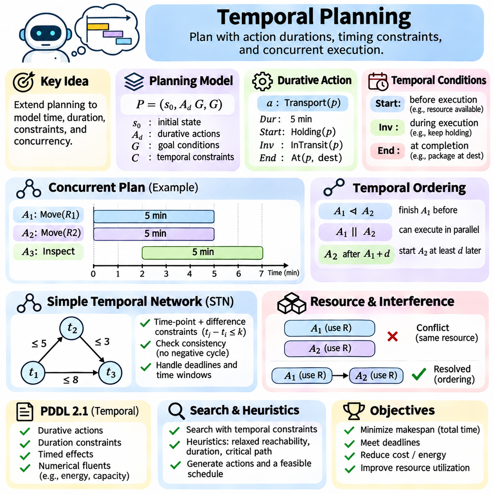{width="7.268055555555556in" height="7.268055555555556in"}

Temporal planning extends classical artificial intelligence planning by explicitly representing action durations, timing constraints, and concurrent execution. Traditional planning often treats actions as instantaneous transitions between states, while temporal planning models activities that occupy intervals of time. This distinction is essential when tasks overlap, resources are shared, or goals must be achieved within specified deadlines.

A temporal planning problem includes an initial state, a collection of actions, goal conditions, and temporal constraints. Actions may have fixed or variable durations, while constraints specify when activities can begin or end. The planner must identify both a valid set of actions and a feasible schedule. Success requires satisfying logical preconditions, temporal relationships, and any additional operational restrictions.

Durative actions are fundamental elements of temporal planning. Unlike instantaneous actions, a durative action has a start time, an end time, and a duration. Its conditions and effects may occur at different points during execution. For example, a robot transportation action may require possession of a package at departure and establish the package\'s new location only after transportation finishes.

Temporal conditions are commonly divided into conditions required at the start, conditions maintained throughout execution, and conditions required at the end. Start conditions determine whether an activity can begin, while invariant conditions must remain satisfied during its duration. End conditions govern successful completion. This distinction allows planners to represent operations whose requirements change over time.

Temporal effects describe changes occurring at action boundaries or, in more expressive models, continuously during execution. A robot may reserve a loading station when an operation begins and release it when the operation ends. Battery energy may decrease throughout movement. Representing these effects accurately prevents a planner from assuming that resources or conditions remain unchanged during extended activities.

Concurrency allows multiple actions to execute during overlapping time intervals. Two robots may independently transport packages while another system performs inspection. Temporal planning determines whether these operations can coexist without violating logical or resource constraints. Parallel execution can reduce overall completion time, but overlapping activities must be checked for interference and compatibility.

Temporal ordering constraints express relationships between action start and end events. One task may need to finish before another begins, while two activities may be permitted to overlap. Some operations require synchronization at particular milestones. These relationships are more expressive than simple sequential ordering because they describe dependencies among temporal events rather than only among actions.

Simple Temporal Networks, commonly abbreviated STNs, provide a mathematical representation for temporal constraints. An STN uses time-point variables and difference constraints to specify allowable relationships between events. Constraints can express minimum delays, maximum separations, and deadlines. Consistency checking determines whether values can be assigned to all time points without violating these relationships.

An STN constraint can be written as a bound on the difference between two time points. For example, a transportation operation may require its completion time to occur between five and eight minutes after departure. Such constraints can be transformed into a weighted directed graph. Shortest-path algorithms and negative-cycle detection provide mechanisms for testing temporal consistency.

Temporal planning also requires reasoning about action interference. Two activities may individually be valid but incompatible when executed simultaneously. For example, one action may require a loading platform to remain available while another attempts to occupy it. Temporal planners must preserve required conditions throughout relevant intervals and prevent conflicting effects from invalidating concurrent operations.

Resource constraints introduce additional complexity because activities may compete for limited equipment, energy, personnel, or workspace. A robot charging station may serve only one vehicle at a time, while a computing system may support several tasks within a fixed capacity. Resource-aware temporal planning combines scheduling decisions with logical action selection to ensure feasible allocation.

Temporal planning objectives frequently involve minimizing makespan, the elapsed time between plan initiation and completion. Other objectives include reducing energy consumption, meeting deadlines, or balancing resource utilization. A plan with fewer actions is not necessarily faster because action durations and opportunities for concurrency determine total execution time. Optimization therefore requires explicit temporal reasoning.

Temporal Planning Domain Definition Language extensions, particularly PDDL 2.1, support durative actions and numerical fluents. Durative action descriptions can specify duration constraints, start conditions, invariant conditions, end conditions, and timed effects. Numerical expressions can represent quantities such as energy or capacity. These features allow temporal planning problems to be described using standardized symbolic models.

Search-based temporal planners explore combinations of action choices and timing decisions. Some systems generate partially ordered actions and subsequently verify temporal feasibility, while others integrate scheduling constraints directly into search. Heuristic estimates may consider relaxed reachability, action durations, or critical-path information. The effectiveness of these methods depends on how tightly logical and temporal reasoning interact.

Critical-path reasoning identifies chains of dependent activities that constrain the earliest possible completion time. Even when many actions can execute concurrently, a sequence of mandatory dependencies may determine the minimum achievable makespan. Estimating this path provides useful guidance for scheduling and heuristic search. However, resource conflicts can increase completion time beyond dependency-based lower bounds.

시간적 계획(Temporal Planning)은 행동 지속시간(Action Duration), 시간 제약조건(Timing Constraint), 동시 실행(Concurrent Execution)을 명시적으로 표현함으로써 고전적 인공지능 계획(Classical Artificial Intelligence Planning)을 확장한다. 전통적인 계획(Traditional Planning)은 행동을 상태 사이의 순간적인 전이(Instantaneous Transition)로 취급하는 경우가 많지만, 시간적 계획은 일정한 시간 구간(Time Interval)을 차지하는 활동을 모델링한다. 이러한 차이는 작업이 중첩되거나 자원을 공유하거나 지정된 마감시간(Deadline) 내에 목표를 달성해야 하는 경우에 필수적이다.

시간적 계획 문제(Temporal Planning Problem)는 초기 상태(Initial State), 행동 집합(Action Collection), 목표 조건(Goal Condition), 시간적 제약조건(Temporal Constraint)으로 구성된다. 행동은 고정 지속시간(Fixed Duration) 또는 가변 지속시간(Variable Duration)을 가질 수 있으며, 제약조건은 활동이 언제 시작하거나 종료할 수 있는지를 지정한다. 계획기(Planner)는 유효한 행동 집합과 실행 가능한 일정(Feasible Schedule)을 모두 식별해야 한다. 성공적인 계획은 논리적 전제조건(Logical Precondition), 시간적 관계(Temporal Relationship), 추가적인 운영 제한(Operational Restriction)을 모두 만족해야 한다.

지속시간 행동(Durative Action)은 시간적 계획의 기본 구성요소이다. 순간적 행동(Instantaneous Action)과 달리 지속시간 행동은 시작 시간(Start Time), 종료 시간(End Time), 지속시간(Duration)을 가진다. 행동의 조건과 효과(Condition and Effect)는 실행 중 서로 다른 시점에 발생할 수 있다. 예를 들어 로봇 운송 행동(Robot Transportation Action)은 출발 시 물품을 보유하고 있어야 하며, 운송이 완료된 후에야 물품의 새로운 위치(New Location)가 성립될 수 있다.

시간적 조건(Temporal Condition)은 일반적으로 시작 시점에 필요한 조건, 실행 전체에 걸쳐 유지해야 하는 조건, 종료 시점에 필요한 조건으로 구분된다. 시작 조건(Start Condition)은 활동을 시작할 수 있는지를 결정하고, 불변 조건(Invariant Condition)은 행동 지속시간 동안 계속 충족되어야 한다. 종료 조건(End Condition)은 성공적인 완료를 규정한다. 이러한 구분을 통해 계획기는 시간에 따라 요구사항이 변화하는 작업을 표현할 수 있다.

시간적 효과(Temporal Effect)는 행동의 시작과 종료 시점 또는 더 표현력이 높은 모델에서는 실행 중 연속적으로 발생하는 변화를 설명한다. 로봇은 작업을 시작할 때 적재 시설(Loading Station)을 예약하고 작업이 끝날 때 이를 해제할 수 있다. 배터리 에너지(Battery Energy)는 이동하는 동안 지속적으로 감소할 수 있다. 이러한 효과를 정확하게 표현하면 계획기가 장시간 수행되는 활동 중 자원이나 조건이 변하지 않는다고 잘못 가정하는 것을 방지할 수 있다.

동시성(Concurrency)은 여러 행동이 서로 중첩되는 시간 구간(Overlapping Time Interval)에서 실행될 수 있도록 한다. 두 로봇이 독립적으로 물품을 운송하는 동안 다른 시스템이 검사(Inspection)를 수행할 수 있다. 시간적 계획은 이러한 작업들이 논리적 제약조건(Logical Constraint)이나 자원 제약조건(Resource Constraint)을 위반하지 않고 공존할 수 있는지를 결정한다. 병렬 실행(Parallel Execution)은 전체 완료 시간(Overall Completion Time)을 단축할 수 있지만, 중첩되는 활동 사이의 간섭(Interference)과 양립 가능성(Compatibility)을 검사해야 한다.

시간적 순서 제약조건(Temporal Ordering Constraint)은 행동의 시작 및 종료 사건(Start and End Event) 사이의 관계를 표현한다. 하나의 작업은 다른 작업이 시작되기 전에 완료되어야 할 수 있으며, 두 활동은 서로 중첩되어 실행될 수도 있다. 일부 작업은 특정 이정표(Milestone)에서 동기화(Synchronization)를 요구한다. 이러한 관계는 단순한 순차적 순서(Sequential Ordering)보다 표현력이 높으며, 행동 자체의 순서뿐 아니라 시간적 사건(Temporal Event) 사이의 의존 관계(Dependency)를 설명한다.

단순 시간 네트워크(Simple Temporal Network, STN)는 시간적 제약조건을 수학적으로 표현하는 방법을 제공한다. STN은 시점 변수(Time-Point Variable)와 차이 제약조건(Difference Constraint)을 사용하여 사건 사이에 허용되는 관계를 지정한다. 제약조건은 최소 지연시간(Minimum Delay), 최대 시간 간격(Maximum Separation), 마감시간(Deadline)을 표현할 수 있다. 일관성 검사(Consistency Checking)는 이러한 관계를 위반하지 않으면서 모든 시점에 값을 할당할 수 있는지를 결정한다.

STN 제약조건(STN Constraint)은 두 시점 사이의 차이에 대한 경계값(Bound)으로 표현할 수 있다. 예를 들어 운송 작업(Transportation Operation)은 출발 후 5분에서 8분 사이에 완료되어야 할 수 있다. 이러한 제약조건은 가중 방향 그래프(Weighted Directed Graph)로 변환할 수 있다. 최단 경로 알고리즘(Shortest-Path Algorithm)과 음수 순환 감지(Negative-Cycle Detection)는 시간적 일관성(Temporal Consistency)을 검사하는 메커니즘을 제공한다.

시간적 계획에서는 행동 간섭(Action Interference)에 관한 추론도 필요하다. 두 활동은 개별적으로는 유효하지만 동시에 실행하면 서로 양립할 수 없을 수 있다. 예를 들어 하나의 행동은 적재 플랫폼(Loading Platform)이 계속 사용 가능한 상태로 유지되어야 하지만, 다른 행동은 해당 플랫폼을 점유하려고 시도할 수 있다. 시간적 계획기는 관련 시간 구간 동안 필요한 조건을 유지하고 충돌하는 효과(Conflicting Effect)가 동시 작업을 무효화하지 않도록 해야 한다.

자원 제약조건(Resource Constraint)은 활동들이 제한된 장비(Equipment), 에너지(Energy), 인력(Personnel), 작업 공간(Workspace)을 두고 경쟁할 수 있기 때문에 추가적인 복잡성을 발생시킨다. 로봇 충전소(Robot Charging Station)는 한 번에 한 대의 차량만 지원할 수 있지만, 컴퓨팅 시스템(Computing System)은 고정된 처리 용량(Capacity) 내에서 여러 작업을 지원할 수 있다. 자원 인식 시간적 계획(Resource-Aware Temporal Planning)은 실행 가능한 자원 할당(Feasible Allocation)을 보장하기 위해 일정 계획 결정(Scheduling Decision)과 논리적 행동 선택(Logical Action Selection)을 결합한다.

시간적 계획의 목적(Objective)은 흔히 계획 시작부터 완료까지의 경과 시간인 전체 완료 시간(Makespan)을 최소화하는 것이다. 다른 목적에는 에너지 소비(Energy Consumption) 감소, 마감시간 준수(Deadline Satisfaction), 자원 활용률(Resource Utilization)의 균형 유지가 포함된다. 행동 수가 적은 계획이 반드시 더 빠른 것은 아니며, 행동 지속시간과 동시 실행 기회(Opportunity for Concurrency)가 전체 실행 시간(Total Execution Time)을 결정한다. 따라서 최적화(Optimization)에는 명시적인 시간적 추론(Temporal Reasoning)이 필요하다.

시간적 계획 영역 정의 언어(Temporal Planning Domain Definition Language)의 확장, 특히 PDDL 2.1은 지속시간 행동(Durative Action)과 수치 유창성 변수(Numerical Fluent)를 지원한다. 지속시간 행동의 기술(Action Description)에는 지속시간 제약조건(Duration Constraint), 시작 조건(Start Condition), 불변 조건(Invariant Condition), 종료 조건(End Condition), 시간 지정 효과(Timed Effect)를 명시할 수 있다. 수치 표현식(Numerical Expression)은 에너지나 용량과 같은 수량(Quantity)을 표현할 수 있다. 이러한 기능을 통해 시간적 계획 문제를 표준화된 기호 모델(Standardized Symbolic Model)로 기술할 수 있다.

탐색 기반 시간적 계획기(Search-Based Temporal Planner)는 행동 선택(Action Choice)과 시간 결정(Timing Decision)의 조합을 탐색한다. 일부 시스템은 부분적으로 순서가 지정된 행동(Partially Ordered Action)을 생성한 다음 시간적 실행 가능성(Temporal Feasibility)을 검증하지만, 다른 시스템은 일정 제약조건(Scheduling Constraint)을 탐색 과정에 직접 통합한다. 휴리스틱 추정(Heuristic Estimate)은 완화된 도달 가능성(Relaxed Reachability), 행동 지속시간(Action Duration), 임계 경로 정보(Critical-Path Information)를 고려할 수 있다. 이러한 방법의 효과는 논리적 추론(Logical Reasoning)과 시간적 추론이 얼마나 긴밀하게 상호작용하는지에 따라 달라진다.

임계 경로 추론(Critical-Path Reasoning)은 가능한 가장 빠른 완료 시간(Earliest Possible Completion Time)을 제한하는 의존적 활동(Dependent Activity)의 연쇄를 식별한다. 많은 행동을 동시에 실행할 수 있더라도 필수 의존 관계(Mandatory Dependency)의 순서가 달성 가능한 최소 전체 완료 시간(Minimum Achievable Makespan)을 결정할 수 있다. 이러한 경로를 추정하면 일정 계획(Scheduling)과 휴리스틱 탐색(Heuristic Search)에 유용한 지침을 제공한다. 그러나 자원 충돌(Resource Conflict)은 의존 관계만을 기준으로 계산한 하한값(Lower Bound)보다 완료 시간을 증가시킬 수 있다.

## 04.11 Probabilistic Planning

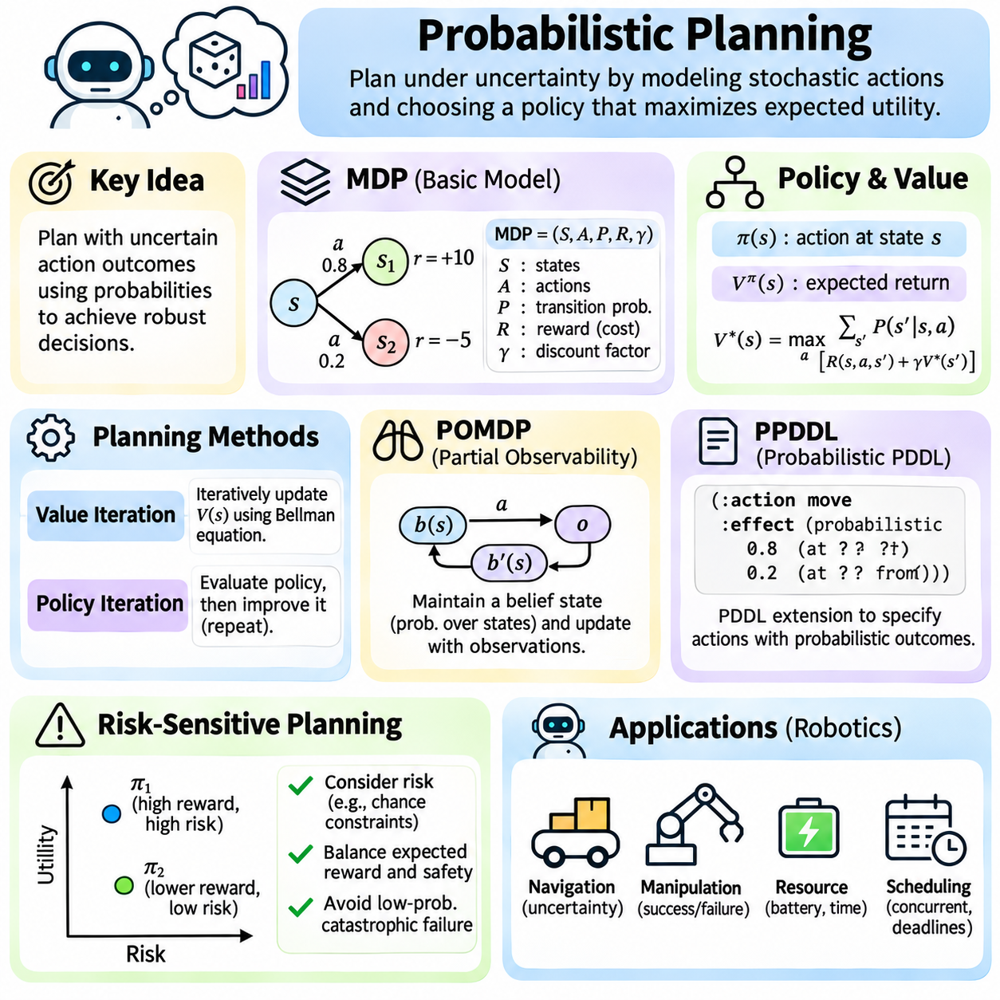{width="7.268055555555556in" height="7.268055555555556in"}

Probabilistic planning extends classical artificial intelligence planning by explicitly representing uncertainty in action outcomes, environmental changes, and system behavior. Traditional deterministic planning assumes that each action produces a predictable result, while probabilistic planning considers multiple possible outcomes with associated probabilities. This approach is essential for intelligent agents operating in dynamic and uncertain environments.

A probabilistic planning problem consists of states, actions, transition probabilities, rewards or costs, and objectives. Instead of defining a single successor state for each action, the transition model specifies a probability distribution over possible next states. The planner evaluates how alternative actions influence future conditions and selects decisions that maximize expected utility or satisfy probabilistic performance requirements.

Uncertainty may originate from imperfect actuators, environmental disturbances, incomplete observations, or unpredictable external events. A mobile robot may attempt to move forward but experience wheel slip, localization errors, or unexpected obstacles. A manipulation system may successfully grasp an object or fail because of uncertain contact conditions. Probabilistic models represent these variations rather than assuming flawless execution.

Markov Decision Processes, commonly called MDPs, provide a fundamental mathematical framework for probabilistic planning. An MDP contains a state space, an action space, transition probabilities, a reward function, and a decision horizon or discount factor. The Markov property assumes that the current state contains sufficient information to predict future transitions given the selected action, without requiring the complete historical trajectory.

A policy is a decision rule that determines which action an agent should select in each state. Unlike a fixed action sequence, a policy can adapt to different outcomes encountered during execution. This distinction is important because probabilistic actions may lead to several possible successor states. A robust planning system therefore computes conditional behavior rather than relying exclusively on a predetermined sequence.

The value function expresses the expected cumulative reward obtainable from a state under a particular policy or optimal decision strategy. It combines immediate rewards with the expected value of future states. Bellman equations establish recursive relationships between current decisions and future outcomes. These relationships provide the mathematical foundation for evaluating policies and computing optimal behavior in Markov decision processes.

Value iteration is a dynamic programming algorithm that repeatedly updates state values using the Bellman optimality equation. Each update evaluates available actions by combining immediate rewards with probability-weighted future values. Under standard discounted finite-state assumptions, the estimates converge toward the optimal value function. An optimal policy can then be derived by selecting actions with the highest expected return.

Policy iteration provides an alternative approach by alternating between policy evaluation and policy improvement. Policy evaluation estimates the expected return obtained by following the current policy. Policy improvement selects better actions using these estimates. Repeating the process eventually produces an optimal policy under appropriate finite-state assumptions, although computational efficiency depends on the structure and size of the problem.

Planning horizons determine how far into the future the decision process evaluates consequences. Finite-horizon planning considers a limited number of decisions and may produce policies that depend on the remaining time. Infinite-horizon planning evaluates continuing operation, commonly using discounted rewards to ensure bounded returns. The horizon influences both computational complexity and the balance between immediate and long-term objectives.

Probabilistic planning can also represent uncertain action effects through probabilistic extensions of symbolic planning languages. PPDDL extends PDDL-style descriptions with probabilistic outcomes, allowing actions to produce alternative effects according to specified distributions. Such representations connect classical action models with stochastic state transitions and support benchmark problems involving uncertain execution.

Partially Observable Markov Decision Processes, or POMDPs, extend probabilistic planning to situations where the true system state cannot be observed directly. Instead of maintaining a single known state, the agent maintains a belief state representing a probability distribution over possible states. Observations update this belief through Bayesian inference, allowing decisions to account for uncertainty in both the environment and perception.

Belief-state planning introduces additional computational complexity because the planner reasons over probability distributions rather than individual states. An action may change the physical environment while also influencing the information available to the agent. Active sensing and information-gathering actions become valuable when reducing uncertainty improves subsequent decisions. Practical algorithms often rely on approximation to manage large belief spaces.

Risk-sensitive probabilistic planning considers more than expected reward. Two policies may have similar expected performance but very different probabilities of catastrophic failure. Risk measures, chance constraints, and conditional value at risk can express preferences for safer outcomes. These techniques are important in autonomous systems where low-probability failures may have severe consequences.

Probabilistic planning is especially relevant to robotics because sensing, movement, manipulation, and interaction with physical environments are inherently uncertain. A robot navigating an unfamiliar area may select routes according to estimated obstacle probabilities and traversal risks. Manipulation planning may evaluate grasp success probabilities. The planner can adapt its decisions as new observations update the estimated state.

The computational demands of probabilistic planning increase with the number of states, actions, possible outcomes, and planning horizon. Exact dynamic programming becomes difficult in large environments because of the curse of dimensionality. Approximate methods, sampling-based planning, Monte Carlo Tree Search, and factored representations can reduce computational requirements while sacrificing some guarantees of optimality.

확률적 계획(Probabilistic Planning)은 행동 결과(Action Outcome), 환경 변화(Environmental Change), 시스템 동작(System Behavior)의 불확실성(Uncertainty)을 명시적으로 표현함으로써 고전적 인공지능 계획(Classical Artificial Intelligence Planning)을 확장한다. 전통적인 결정론적 계획(Deterministic Planning)은 각 행동이 예측 가능한 결과를 생성한다고 가정하지만, 확률적 계획은 관련 확률(Associated Probability)을 가진 여러 가능한 결과를 고려한다. 이러한 접근법은 동적이고 불확실한 환경(Dynamic and Uncertain Environment)에서 작동하는 지능형 에이전트(Intelligent Agent)에 필수적이다.

확률적 계획 문제(Probabilistic Planning Problem)는 상태(State), 행동(Action), 전이 확률(Transition Probability), 보상(Reward) 또는 비용(Cost), 목표(Objective)로 구성된다. 각 행동에 대해 단일 후속 상태(Successor State)를 정의하는 대신 전이 모델(Transition Model)은 가능한 다음 상태에 대한 확률 분포(Probability Distribution)를 지정한다. 계획기(Planner)는 대안적인 행동이 미래 조건(Future Condition)에 미치는 영향을 평가하고 기대 효용(Expected Utility)을 최대화하거나 확률적 성능 요구사항(Probabilistic Performance Requirement)을 만족하는 결정을 선택한다.

불확실성(Uncertainty)은 불완전한 액추에이터(Imperfect Actuator), 환경 교란(Environmental Disturbance), 불완전한 관측(Incomplete Observation), 예측 불가능한 외부 사건(Unpredictable External Event)에서 발생할 수 있다. 이동 로봇(Mobile Robot)은 전진을 시도하더라도 바퀴 미끄러짐(Wheel Slip), 위치 추정 오차(Localization Error), 예상하지 못한 장애물(Unexpected Obstacle)을 경험할 수 있다. 조작 시스템(Manipulation System)은 객체 파지(Grasp)에 성공할 수도 있고 불확실한 접촉 조건(Uncertain Contact Condition) 때문에 실패할 수도 있다. 확률 모델(Probabilistic Model)은 완벽한 실행을 가정하는 대신 이러한 변동을 표현한다.

마르코프 의사결정 과정(Markov Decision Process, MDP)은 확률적 계획을 위한 기본적인 수학적 프레임워크(Mathematical Framework)를 제공한다. MDP는 상태 공간(State Space), 행동 공간(Action Space), 전이 확률(Transition Probability), 보상 함수(Reward Function), 의사결정 범위(Decision Horizon) 또는 할인 인자(Discount Factor)로 구성된다. 마르코프 속성(Markov Property)은 선택된 행동이 주어졌을 때 현재 상태가 전체 과거 궤적(Historical Trajectory) 없이도 미래 전이(Future Transition)를 예측하기에 충분한 정보를 포함한다고 가정한다.

정책(Policy)은 에이전트가 각 상태에서 어떤 행동을 선택해야 하는지 결정하는 의사결정 규칙(Decision Rule)이다. 고정된 행동 순서(Fixed Action Sequence)와 달리 정책은 실행 중 발생하는 다양한 결과에 적응할 수 있다. 이러한 차이는 확률적 행동(Probabilistic Action)이 여러 가능한 후속 상태(Successor State)로 이어질 수 있기 때문에 중요하다. 따라서 강건한 계획 시스템(Robust Planning System)은 미리 결정된 행동 순서에만 의존하지 않고 조건부 행동(Conditional Behavior)을 계산한다.

가치 함수(Value Function)는 특정 정책 또는 최적 의사결정 전략(Optimal Decision Strategy)에 따라 어떤 상태에서 얻을 수 있는 기대 누적 보상(Expected Cumulative Reward)을 표현한다. 가치 함수는 즉각적인 보상(Immediate Reward)과 미래 상태의 기대 가치(Expected Future Value)를 결합한다. 벨만 방정식(Bellman Equation)은 현재 결정(Current Decision)과 미래 결과(Future Outcome) 사이의 재귀적 관계(Recursive Relationship)를 확립한다. 이러한 관계는 마르코프 의사결정 과정에서 정책을 평가하고 최적 행동(Optimal Behavior)을 계산하는 수학적 기반을 제공한다.

가치 반복(Value Iteration)은 벨만 최적 방정식(Bellman Optimality Equation)을 사용하여 상태 가치(State Value)를 반복적으로 갱신하는 동적 프로그래밍 알고리즘(Dynamic Programming Algorithm)이다. 각 갱신 과정에서는 즉각적인 보상과 확률 가중 미래 가치(Probability-Weighted Future Value)를 결합하여 사용 가능한 행동을 평가한다. 표준적인 할인 유한 상태 가정(Discounted Finite-State Assumption) 아래에서 추정값은 최적 가치 함수(Optimal Value Function)로 수렴한다. 이후 가장 높은 기대 수익(Expected Return)을 제공하는 행동을 선택하여 최적 정책(Optimal Policy)을 도출할 수 있다.

정책 반복(Policy Iteration)은 정책 평가(Policy Evaluation)와 정책 개선(Policy Improvement)을 번갈아 수행하는 대안적인 접근법이다. 정책 평가는 현재 정책을 따를 때 얻을 수 있는 기대 수익(Expected Return)을 추정한다. 정책 개선은 이러한 추정값을 사용하여 더 나은 행동을 선택한다. 이 과정을 반복하면 적절한 유한 상태 가정(Finite-State Assumption) 아래에서 최적 정책을 생성할 수 있지만, 계산 효율성(Computational Efficiency)은 문제의 구조와 크기에 따라 달라진다.

계획 범위(Planning Horizon)는 의사결정 과정(Decision Process)이 미래 결과를 얼마나 멀리까지 평가하는지를 결정한다. 유한 범위 계획(Finite-Horizon Planning)은 제한된 수의 의사결정을 고려하며 남은 시간에 따라 달라지는 정책을 생성할 수 있다. 무한 범위 계획(Infinite-Horizon Planning)은 지속적인 운영을 평가하며, 일반적으로 누적 수익(Cumulative Return)이 유한한 값을 유지하도록 할인 보상(Discounted Reward)을 사용한다. 계획 범위는 계산 복잡도(Computational Complexity)와 단기 목표(Immediate Objective) 및 장기 목표(Long-Term Objective) 사이의 균형에 모두 영향을 미친다.

확률적 계획은 기호적 계획 언어(Symbolic Planning Language)의 확률적 확장(Probabilistic Extension)을 통해 불확실한 행동 효과(Uncertain Action Effect)를 표현할 수도 있다. 확률적 계획 영역 정의 언어(Probabilistic Planning Domain Definition Language, PPDDL)는 PDDL 방식의 기술(PDDL-Style Description)을 확률적 결과(Probabilistic Outcome)로 확장하여 행동이 지정된 확률 분포에 따라 대안적인 효과(Alternative Effect)를 생성할 수 있도록 한다. 이러한 표현은 고전적 행동 모델(Classical Action Model)과 확률적 상태 전이(Stochastic State Transition)를 연결하며 불확실한 실행을 포함하는 벤치마크 문제(Benchmark Problem)를 지원한다.

부분 관측 마르코프 의사결정 과정(Partially Observable Markov Decision Process, POMDP)은 실제 시스템 상태(True System State)를 직접 관측할 수 없는 상황으로 확률적 계획을 확장한다. 에이전트는 하나의 알려진 상태(Known State)를 유지하는 대신 가능한 상태에 대한 확률 분포를 나타내는 믿음 상태(Belief State)를 유지한다. 관측(Observation)은 베이지안 추론(Bayesian Inference)을 통해 이러한 믿음 상태를 갱신하므로 환경과 인식(Perception)의 불확실성을 모두 고려한 의사결정이 가능해진다.

믿음 상태 계획(Belief-State Planning)은 개별 상태(Individual State)가 아니라 확률 분포(Probability Distribution)를 대상으로 추론하기 때문에 추가적인 계산 복잡도를 발생시킨다. 하나의 행동은 물리적 환경(Physical Environment)을 변화시키는 동시에 에이전트가 이용할 수 있는 정보에도 영향을 미칠 수 있다. 능동적 감지(Active Sensing)와 정보 수집 행동(Information-Gathering Action)은 불확실성을 줄이는 것이 후속 의사결정(Subsequent Decision)을 개선할 때 가치가 높아진다. 실제 알고리즘은 대규모 믿음 공간(Belief Space)을 관리하기 위해 근사 기법(Approximation Technique)에 의존하는 경우가 많다.

위험 민감 확률적 계획(Risk-Sensitive Probabilistic Planning)은 기대 보상(Expected Reward) 이상의 요소를 고려한다. 두 정책은 비슷한 기대 성능(Expected Performance)을 가지더라도 치명적인 실패(Catastrophic Failure)가 발생할 확률은 크게 다를 수 있다. 위험 척도(Risk Measure), 확률 제약조건(Chance Constraint), 조건부 위험 가치(Conditional Value at Risk, CVaR)는 더 안전한 결과에 대한 선호를 표현할 수 있다. 이러한 기법은 발생 확률이 낮은 실패(Low-Probability Failure)라도 심각한 결과를 초래할 수 있는 자율 시스템(Autonomous System)에서 중요하다.

확률적 계획은 감지(Sensing), 이동(Movement), 조작(Manipulation), 물리적 환경과의 상호작용(Physical Environment Interaction)이 본질적으로 불확실하기 때문에 로봇공학(Robotics)에서 특히 중요하다. 익숙하지 않은 지역을 이동하는 로봇은 추정된 장애물 확률(Estimated Obstacle Probability)과 주행 위험(Traversal Risk)에 따라 경로를 선택할 수 있다. 조작 계획(Manipulation Planning)은 파지 성공 확률(Grasp Success Probability)을 평가할 수 있다. 계획기는 새로운 관측이 추정 상태(Estimated State)를 갱신함에 따라 의사결정을 적응시킬 수 있다.

확률적 계획의 계산 요구량(Computational Demand)은 상태(State), 행동(Action), 가능한 결과(Possible Outcome), 계획 범위(Planning Horizon)의 수가 증가함에 따라 커진다. 정확한 동적 프로그래밍(Exact Dynamic Programming)은 차원의 저주(Curse of Dimensionality)로 인해 대규모 환경에서 적용하기 어려워진다. 근사 방법(Approximate Method), 샘플링 기반 계획(Sampling-Based Planning), 몬테카를로 트리 탐색(Monte Carlo Tree Search), 인수분해 표현(Factored Representation)은 최적성 보장(Optimality Guarantee)의 일부를 희생하는 대신 계산 요구량을 줄일 수 있다.

## 04.12 Planning in Robotics

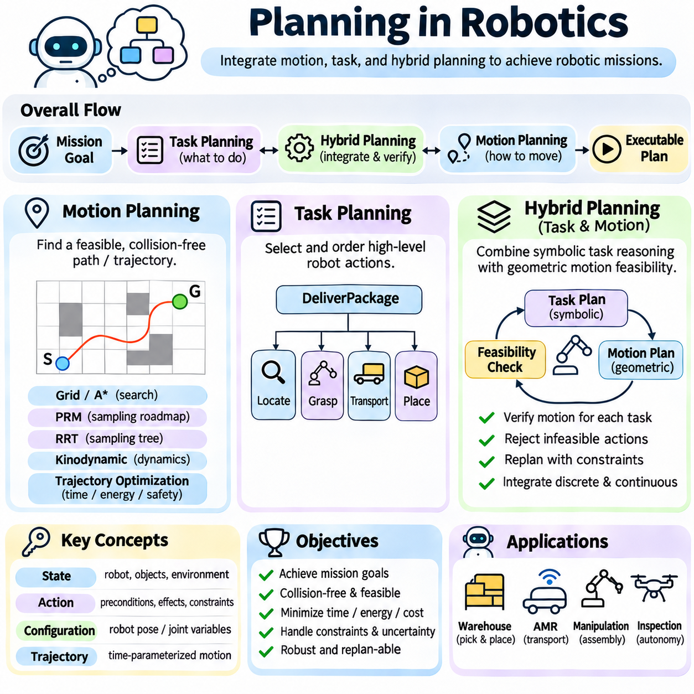{width="7.268055555555556in" height="7.268055555555556in"}

Planning in robotics connects high-level mission objectives with physical actions performed in dynamic environments. Unlike purely symbolic planning, robotic planning must account for geometry, motion constraints, sensing uncertainty, and actuator limitations. A complete robotic planning system determines what actions should be performed, how the robot can execute them, and how execution should adapt when environmental conditions change.

Robotic planning is commonly organized into motion planning, task planning, and hybrid planning. Motion planning determines feasible movements through physical space, while task planning selects and orders meaningful operations. Hybrid planning integrates discrete decisions with continuous physical behavior. These components operate at different abstraction levels but must exchange information to produce executable and reliable robotic missions.

Motion planning searches for collision-free paths or trajectories connecting an initial configuration to a desired configuration. The configuration space represents the robot\'s possible positions and orientations, including joint variables for articulated mechanisms. Obstacles define forbidden regions within this space. A valid solution must satisfy geometric constraints and, when required, additional kinematic or dynamic restrictions.

Configuration-space reasoning transforms geometric collision problems into mathematical search problems. A mobile robot may be represented by its planar position and heading, while a robotic manipulator requires multiple joint coordinates. The dimensionality of the configuration space influences planning complexity. High-dimensional robots often require sampling-based methods because exhaustive discretization becomes computationally expensive.

Classical motion planning algorithms include graph search, potential fields, and geometric decomposition methods. Grid-based approaches represent free space using discrete cells and apply algorithms such as A\\\* to identify feasible routes. These techniques are effective when environmental maps are available and motion constraints are manageable. However, discretization resolution affects accuracy, memory consumption, and computational requirements.

Sampling-based motion planners address complex configuration spaces by exploring selected configurations rather than constructing complete geometric representations. Probabilistic Roadmaps build reusable connectivity graphs, while Rapidly-exploring Random Trees incrementally explore reachable regions. These methods are particularly useful for articulated robots and cluttered environments. Their performance depends on sampling strategies and collision-checking efficiency.

Kinodynamic planning extends geometric path planning by considering velocity, acceleration, steering, and other motion constraints. A geometrically valid path may be impossible for a vehicle with limited turning radius or acceleration capability. Kinodynamic planners search for trajectories that satisfy system dynamics. This distinction is essential for autonomous vehicles, mobile manipulators, and robots operating at significant speeds.

Trajectory optimization improves candidate motions by minimizing objectives such as travel distance, energy consumption, execution time, or collision risk. Optimization methods adjust trajectories while enforcing physical constraints. Model Predictive Control can repeatedly optimize short-horizon trajectories using updated state estimates. Such methods connect motion planning with feedback control and support adaptation during execution.

Task planning operates at a higher abstraction level by selecting actions required to achieve mission objectives. A warehouse robot may need to locate an item, approach a shelf, grasp a package, transport it, and deliver it. Symbolic representations describe action preconditions, effects, and dependencies. Classical planning algorithms, hierarchical task networks, and temporal planners can organize these operations into valid task sequences.

Task planning depends on meaningful symbolic descriptions of the environment. Objects, locations, robot capabilities, and operational states are represented through predicates and action models. For example, a PickObject action may require the robot to be near the object and its gripper to be available. Successful execution changes symbolic facts describing object possession and gripper occupancy, enabling subsequent planning decisions.

Hierarchical task planning is especially useful for complex robotic missions because abstract objectives can be decomposed into reusable procedures. An inspection mission may contain navigation, sensing, data processing, and reporting activities. Each activity can be refined into robot-specific operations. This structure separates mission-level reasoning from implementation details and supports coordination across heterogeneous robotic platforms.

Task and motion planning are strongly interdependent. A symbolic plan may specify that a robot should grasp an object, but the action is executable only if a collision-free approach and feasible grasp configuration exist. Conversely, motion planning requires target configurations derived from task decisions. Task and Motion Planning integrates these levels by evaluating symbolic choices against geometric and physical feasibility.

Integrated Task and Motion Planning systems often alternate between discrete search and continuous feasibility checking. A symbolic planner proposes an action sequence, and geometric planners verify navigation, manipulation, and placement requirements. When a motion constraint invalidates an action, the system can reject the candidate and explore alternatives. Constraint feedback prevents repeated selection of physically impossible task combinations.

Hybrid planning combines discrete operational modes with continuous state evolution. A mobile robot may switch among navigation, docking, charging, and manipulation modes while its position, velocity, and energy change continuously. Hybrid system models describe these modes, their transition conditions, and associated dynamics. Planning must ensure that both discrete transitions and continuous trajectories satisfy operational requirements.

Uncertainty complicates robotic planning because maps, object poses, actuator responses, and environmental behavior may be imperfectly known. Probabilistic state estimation provides beliefs about the current environment, while robust or belief-space planning accounts for uncertain outcomes. Replanning incorporates new observations during execution. These mechanisms are essential when robots interact with changing environments rather than fixed laboratory conditions.

로봇공학에서의 계획(Planning in Robotics)은 상위 수준 임무 목표(High-Level Mission Objective)와 동적 환경(Dynamic Environment)에서 수행되는 물리적 행동(Physical Action)을 연결한다. 순수한 기호적 계획(Symbolic Planning)과 달리 로봇 계획(Robotic Planning)은 기하학적 구조(Geometry), 운동 제약조건(Motion Constraint), 감지 불확실성(Sensing Uncertainty), 액추에이터 한계(Actuator Limitation)를 고려해야 한다. 완전한 로봇 계획 시스템(Complete Robotic Planning System)은 어떤 행동을 수행해야 하는지, 로봇이 이를 어떻게 실행할 수 있는지, 환경 조건이 변화할 때 실행을 어떻게 적응시켜야 하는지를 결정한다.

로봇 계획은 일반적으로 동작 계획(Motion Planning), 작업 계획(Task Planning), 하이브리드 계획(Hybrid Planning)으로 구성된다. 동작 계획은 물리적 공간(Physical Space)에서 실행 가능한 움직임을 결정하고, 작업 계획은 의미 있는 작업을 선택하고 순서를 정한다. 하이브리드 계획은 이산적 의사결정(Discrete Decision)과 연속적인 물리적 동작(Continuous Physical Behavior)을 통합한다. 이러한 구성요소는 서로 다른 추상화 수준(Abstraction Level)에서 작동하지만, 실행 가능하고 신뢰할 수 있는 로봇 임무(Robotic Mission)를 생성하기 위해 정보를 교환해야 한다.

동작 계획(Motion Planning)은 초기 구성(Initial Configuration)과 목표 구성(Desired Configuration)을 연결하는 충돌 없는 경로(Collision-Free Path) 또는 궤적(Trajectory)을 탐색한다. 구성 공간(Configuration Space)은 관절형 기구(Articulated Mechanism)의 관절 변수(Joint Variable)를 포함하여 로봇의 가능한 위치와 방향을 표현한다. 장애물(Obstacle)은 이 공간에서 진입할 수 없는 영역(Forbidden Region)을 정의한다. 유효한 해결책(Valid Solution)은 기하학적 제약조건(Geometric Constraint)과 필요한 경우 추가적인 운동학적 제약조건(Kinematic Constraint) 또는 동역학적 제약조건(Dynamic Constraint)을 만족해야 한다.

구성 공간 추론(Configuration-Space Reasoning)은 기하학적 충돌 문제(Geometric Collision Problem)를 수학적 탐색 문제(Mathematical Search Problem)로 변환한다. 이동 로봇(Mobile Robot)은 평면 위치(Planar Position)와 방향(Heading)으로 표현할 수 있지만, 로봇 매니퓰레이터(Robotic Manipulator)는 여러 관절 좌표(Joint Coordinate)가 필요하다. 구성 공간의 차원(Dimensionality)은 계획 복잡도(Planning Complexity)에 영향을 미친다. 고차원 로봇(High-Dimensional Robot)은 전체 공간을 이산화(Discretization)하는 데 많은 계산 비용이 발생하므로 샘플링 기반 방법(Sampling-Based Method)을 사용하는 경우가 많다.

고전적 동작 계획 알고리즘(Classical Motion Planning Algorithm)에는 그래프 탐색(Graph Search), 포텐셜 필드(Potential Field), 기하학적 분해 방법(Geometric Decomposition Method)이 포함된다. 격자 기반 접근법(Grid-Based Approach)은 자유 공간(Free Space)을 이산 셀(Discrete Cell)로 표현하고 A\\\*와 같은 알고리즘을 적용하여 실행 가능한 경로를 식별한다. 이러한 기법은 환경 지도(Environmental Map)가 제공되고 운동 제약조건을 관리할 수 있을 때 효과적이다. 그러나 이산화 해상도(Discretization Resolution)는 정확도(Accuracy), 메모리 소비(Memory Consumption), 계산 요구량(Computational Requirement)에 영향을 미친다.

샘플링 기반 동작 계획기(Sampling-Based Motion Planner)는 완전한 기하학적 표현(Complete Geometric Representation)을 구성하는 대신 선택된 구성(Configuration)을 탐색하여 복잡한 구성 공간을 처리한다. 확률적 로드맵(Probabilistic Roadmap, PRM)은 재사용 가능한 연결 그래프(Connectivity Graph)를 구축하고, 급속 탐색 랜덤 트리(Rapidly-exploring Random Tree, RRT)는 도달 가능한 영역(Reachable Region)을 점진적으로 탐색한다. 이러한 방법은 관절형 로봇(Articulated Robot)과 장애물이 밀집한 환경(Cluttered Environment)에서 특히 유용하다. 성능은 샘플링 전략(Sampling Strategy)과 충돌 검사 효율성(Collision-Checking Efficiency)에 따라 달라진다.

운동동역학적 계획(Kinodynamic Planning)은 속도(Velocity), 가속도(Acceleration), 조향(Steering), 기타 운동 제약조건을 고려하여 기하학적 경로 계획(Geometric Path Planning)을 확장한다. 기하학적으로 유효한 경로라도 회전반경(Turning Radius)이나 가속 능력(Acceleration Capability)에 제한이 있는 차량에서는 실행할 수 없을 수 있다. 운동동역학적 계획기는 시스템 동역학(System Dynamics)을 만족하는 궤적을 탐색한다. 이러한 구분은 자율주행 차량(Autonomous Vehicle), 이동형 매니퓰레이터(Mobile Manipulator), 고속으로 작동하는 로봇에서 필수적이다.

궤적 최적화(Trajectory Optimization)는 이동 거리(Travel Distance), 에너지 소비(Energy Consumption), 실행 시간(Execution Time), 충돌 위험(Collision Risk)과 같은 목적함수(Objective Function)를 최소화하여 후보 움직임(Candidate Motion)을 개선한다. 최적화 방법(Optimization Method)은 물리적 제약조건(Physical Constraint)을 준수하면서 궤적을 조정한다. 모델 예측 제어(Model Predictive Control, MPC)는 갱신된 상태 추정(State Estimate)을 사용하여 단기 예측 범위(Short Horizon)의 궤적을 반복적으로 최적화할 수 있다. 이러한 방법은 동작 계획과 피드백 제어(Feedback Control)를 연결하고 실행 중 적응을 지원한다.

작업 계획(Task Planning)은 임무 목표(Mission Objective)를 달성하는 데 필요한 행동을 선택함으로써 더 높은 추상화 수준에서 작동한다. 창고 로봇(Warehouse Robot)은 물품을 찾고, 선반에 접근하고, 물품을 파지(Grasp)하고, 운송한 다음 배송해야 할 수 있다. 기호적 표현(Symbolic Representation)은 행동의 전제조건(Precondition), 효과(Effect), 의존 관계(Dependency)를 설명한다. 고전적 계획 알고리즘(Classical Planning Algorithm), 계층적 작업 네트워크(Hierarchical Task Network, HTN), 시간적 계획기(Temporal Planner)는 이러한 작업을 유효한 작업 순서(Valid Task Sequence)로 구성할 수 있다.

작업 계획은 환경에 대한 의미 있는 기호적 설명(Symbolic Description)에 의존한다. 객체(Object), 위치(Location), 로봇 기능(Robot Capability), 운영 상태(Operational State)는 술어(Predicate)와 행동 모델(Action Model)을 통해 표현된다. 예를 들어 PickObject 행동은 로봇이 객체 가까이에 있어야 하고 그리퍼(Gripper)를 사용할 수 있어야 한다는 조건을 요구할 수 있다. 성공적인 실행은 객체 보유(Object Possession)와 그리퍼 점유(Gripper Occupancy)를 설명하는 기호적 사실(Symbolic Fact)을 변경하여 후속 계획 결정(Subsequent Planning Decision)을 가능하게 한다.

계층적 작업 계획(Hierarchical Task Planning)은 추상적 목표(Abstract Objective)를 재사용 가능한 절차(Reusable Procedure)로 분해할 수 있기 때문에 복잡한 로봇 임무에 특히 유용하다. 검사 임무(Inspection Mission)는 이동(Navigation), 감지(Sensing), 데이터 처리(Data Processing), 보고(Reporting) 활동을 포함할 수 있다. 각 활동은 로봇별 작업(Robot-Specific Operation)으로 정제할 수 있다. 이러한 구조는 임무 수준 추론(Mission-Level Reasoning)을 구현 세부사항(Implementation Detail)과 분리하고 이기종 로봇 플랫폼(Heterogeneous Robotic Platform) 간의 협력을 지원한다.

작업 계획과 동작 계획은 강하게 상호 의존적(Interdependent)이다. 기호적 계획은 로봇이 객체를 파지해야 한다고 지정할 수 있지만, 충돌 없는 접근(Collision-Free Approach)과 실행 가능한 파지 구성(Feasible Grasp Configuration)이 존재해야만 해당 행동을 실행할 수 있다. 반대로 동작 계획에는 작업 결정에서 도출된 목표 구성(Target Configuration)이 필요하다. 작업 및 동작 통합 계획(Task and Motion Planning, TAMP)은 기호적 선택(Symbolic Choice)을 기하학적 실행 가능성(Geometric Feasibility)과 물리적 실행 가능성(Physical Feasibility)에 따라 평가함으로써 두 수준을 통합한다.

통합 작업 및 동작 계획 시스템(Integrated Task and Motion Planning System)은 이산 탐색(Discrete Search)과 연속적 실행 가능성 검사(Continuous Feasibility Checking)를 번갈아 수행하는 경우가 많다. 기호적 계획기(Symbolic Planner)는 행동 순서(Action Sequence)를 제안하고, 기하학적 계획기(Geometric Planner)는 이동, 조작, 배치(Placement) 요구사항을 검증한다. 운동 제약조건(Motion Constraint)이 행동을 무효화하면 시스템은 해당 후보를 거부하고 대안을 탐색할 수 있다. 제약조건 피드백(Constraint Feedback)은 물리적으로 실행 불가능한 작업 조합(Physically Impossible Task Combination)이 반복적으로 선택되는 것을 방지한다.

하이브리드 계획(Hybrid Planning)은 이산적 운영 모드(Discrete Operational Mode)와 연속적인 상태 변화(Continuous State Evolution)를 결합한다. 이동 로봇은 위치(Position), 속도(Velocity), 에너지(Energy)가 연속적으로 변화하는 동안 이동(Navigation), 도킹(Docking), 충전(Charging), 조작(Manipulation) 모드 사이를 전환할 수 있다. 하이브리드 시스템 모델(Hybrid System Model)은 이러한 모드, 전이 조건(Transition Condition), 관련 동역학(Associated Dynamics)을 설명한다. 계획은 이산적 전이(Discrete Transition)와 연속 궤적(Continuous Trajectory)이 모두 운영 요구사항(Operational Requirement)을 만족하도록 보장해야 한다.

불확실성(Uncertainty)은 지도(Map), 객체 자세(Object Pose), 액추에이터 응답(Actuator Response), 환경 동작(Environmental Behavior)을 완벽하게 알 수 없기 때문에 로봇 계획을 복잡하게 만든다. 확률적 상태 추정(Probabilistic State Estimation)은 현재 환경에 대한 믿음 상태(Belief State)를 제공하고, 강건 계획(Robust Planning) 또는 믿음 공간 계획(Belief-Space Planning)은 불확실한 결과(Uncertain Outcome)를 고려한다. 재계획(Replanning)은 실행 중 새로운 관측(New Observation)을 반영한다. 이러한 메커니즘은 고정된 실험실 환경(Fixed Laboratory Condition)이 아니라 변화하는 환경(Changing Environment)과 상호작용하는 로봇에 필수적이다.

## 04.13 Planning Systems Architecture

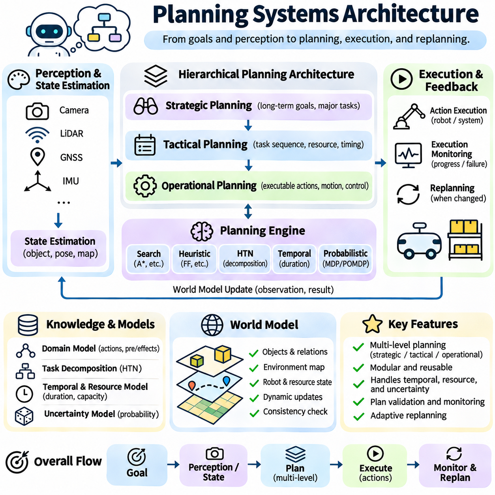{width="7.268055555555556in" height="7.268055555555556in"}

Planning systems architecture defines how an intelligent agent transforms goals, environmental information, and operational constraints into executable plans. A complete architecture integrates knowledge representation, state estimation, planning algorithms, execution management, and feedback mechanisms. Rather than treating planning as an isolated search problem, system architecture establishes how reasoning components interact with perception, control, and external services.

The architecture commonly separates strategic planning, tactical planning, and operational execution. Strategic planning identifies long-term objectives and major task dependencies, while tactical planning determines concrete action sequences and resource assignments. Operational execution converts selected actions into commands for physical or software systems. This separation supports modular development and allows different planning methods to operate at appropriate abstraction levels.

A planning system begins with a representation of the current world state and desired goals. The state model describes relevant objects, properties, relationships, and available resources. Goals specify conditions that should become true or performance criteria that should be optimized. A well-defined planning interface separates these descriptions from the internal search algorithm, allowing multiple planning engines to operate on compatible problem representations.

Knowledge representation provides the semantic foundation of planning architecture. Symbolic models may use predicates, objects, actions, preconditions, and effects to describe the environment. More expressive systems incorporate numerical variables, temporal constraints, uncertainty, and hierarchical task structures. The representation must balance expressive power with computational efficiency because complex models can substantially increase planning difficulty.

The world model maintains information about the environment and the agent\'s operational context. It may combine static knowledge, such as facility layouts and equipment capabilities, with dynamic information about object locations, robot positions, and resource availability. Updates from perception and external databases modify this representation. Consistency mechanisms are required to prevent planning decisions from relying on outdated or contradictory facts.

State estimation connects sensory observations with the symbolic and numerical models used by the planner. Cameras, LiDAR, positioning systems, and other sensors produce measurements that may contain uncertainty. Estimation modules transform these observations into object states, occupancy information, and confidence estimates. Planning components then use this information to evaluate action feasibility and determine whether existing plans remain valid.

The planning engine is responsible for selecting actions that satisfy goals and operational constraints. Depending on the problem, it may employ state-space search, heuristic planning, hierarchical task networks, temporal planning, or probabilistic decision processes. Different engines offer distinct capabilities and computational tradeoffs. A modular architecture can select or combine planners according to task complexity, uncertainty, and available resources.

A planning domain model defines the actions available to the system and the conditions governing their execution. Each action typically specifies parameters, applicability conditions, expected effects, and relevant costs. Temporal systems may also include durations and resource requirements. Separating domain models from planning algorithms improves reuse, supports independent validation, and simplifies adaptation to different applications.

Task decomposition enables complex missions to be organized into manageable activities. Hierarchical planning modules refine abstract objectives into subtasks, while lower-level planners determine executable operations. For example, a warehouse delivery mission may be decomposed into item identification, navigation, loading, transportation, and unloading. The architecture must preserve dependencies and exchange feasibility information between planning levels.

Plan validation checks whether generated plans satisfy logical, temporal, resource, and safety constraints before execution. A symbolic action sequence may be logically correct but physically impossible because of geometric obstacles or insufficient battery capacity. Validation modules can reject such plans or request revisions. Independent validation is especially important when planning algorithms use approximations or incomplete environmental models.

The execution manager translates approved plans into commands for controllers, robots, applications, or external services. It maintains the execution state, dispatches actions, and tracks completion or failure. Preconditions may be checked immediately before action execution because the environment can change after planning. Execution management therefore provides a controlled interface between abstract reasoning and real-world operations.

Execution monitoring compares observed system behavior with expected plan outcomes. Sensors and operational feedback indicate whether actions have started, completed, failed, or produced unexpected effects. Monitoring modules update the world model and identify deviations from planned conditions. These observations enable the architecture to detect problems early and determine whether execution can continue safely.

Replanning allows the system to adapt when environmental changes invalidate the current plan. A robot may encounter a blocked corridor, unavailable charging station, or failed manipulation attempt. The planner can generate an alternative sequence using the updated state. Incremental repair methods may preserve unaffected plan segments, reducing computation and avoiding unnecessary disruption to ongoing operations.

Resource management coordinates shared assets such as robots, processors, batteries, workstations, and communication channels. Planning decisions must account for availability, capacity, and competing demands. Scheduling components allocate resources across tasks and enforce timing constraints. In multi-agent systems, centralized or distributed coordination mechanisms may be required to prevent conflicts and maintain operational efficiency.

Safety architecture establishes constraints that planning and execution must respect. Collision avoidance, restricted operating regions, emergency conditions, and equipment limitations may be represented as planning restrictions. However, safety-critical protections should not depend exclusively on the planner. Independent monitoring and control mechanisms must enforce essential limits even when planning software fails or produces an unsafe command.

계획 시스템 아키텍처(Planning Systems Architecture)는 지능형 에이전트(Intelligent Agent)가 목표(Goal), 환경 정보(Environmental Information), 운영 제약조건(Operational Constraint)을 실행 가능한 계획(Executable Plan)으로 변환하는 방식을 정의한다. 완전한 아키텍처(Complete Architecture)는 지식 표현(Knowledge Representation), 상태 추정(State Estimation), 계획 알고리즘(Planning Algorithm), 실행 관리(Execution Management), 피드백 메커니즘(Feedback Mechanism)을 통합한다. 계획을 독립적인 탐색 문제(Search Problem)로 취급하는 대신 시스템 아키텍처는 추론 구성요소(Reasoning Component)가 인식(Perception), 제어(Control), 외부 서비스(External Service)와 상호작용하는 방식을 확립한다.

아키텍처는 일반적으로 전략적 계획(Strategic Planning), 전술적 계획(Tactical Planning), 운영 실행(Operational Execution)을 분리한다. 전략적 계획은 장기 목표(Long-Term Objective)와 주요 작업 의존 관계(Major Task Dependency)를 식별하고, 전술적 계획은 구체적인 행동 순서(Action Sequence)와 자원 할당(Resource Assignment)을 결정한다. 운영 실행은 선택된 행동을 물리적 시스템(Physical System) 또는 소프트웨어 시스템(Software System)의 명령으로 변환한다. 이러한 분리는 모듈식 개발(Modular Development)을 지원하고 서로 다른 계획 방법(Planning Method)이 적절한 추상화 수준(Abstraction Level)에서 작동할 수 있도록 한다.

계획 시스템(Planning System)은 현재 세계 상태(Current World State)와 원하는 목표(Desired Goal)에 대한 표현에서 시작한다. 상태 모델(State Model)은 관련 객체(Object), 속성(Property), 관계(Relationship), 사용 가능한 자원(Available Resource)을 설명한다. 목표는 참이 되어야 하는 조건이나 최적화해야 하는 성능 기준(Performance Criterion)을 지정한다. 잘 정의된 계획 인터페이스(Planning Interface)는 이러한 설명을 내부 탐색 알고리즘(Internal Search Algorithm)과 분리하여 여러 계획 엔진(Planning Engine)이 호환 가능한 문제 표현(Compatible Problem Representation)을 사용할 수 있도록 한다.

지식 표현(Knowledge Representation)은 계획 아키텍처의 의미론적 기반(Semantic Foundation)을 제공한다. 기호적 모델(Symbolic Model)은 술어(Predicate), 객체(Object), 행동(Action), 전제조건(Precondition), 효과(Effect)를 사용하여 환경을 설명할 수 있다. 표현력이 더 높은 시스템은 수치 변수(Numerical Variable), 시간적 제약조건(Temporal Constraint), 불확실성(Uncertainty), 계층적 작업 구조(Hierarchical Task Structure)를 포함한다. 복잡한 모델은 계획의 난이도를 크게 증가시킬 수 있으므로 표현 방식은 표현력(Expressive Power)과 계산 효율성(Computational Efficiency) 사이의 균형을 유지해야 한다.

세계 모델(World Model)은 환경과 에이전트의 운영 문맥(Operational Context)에 관한 정보를 유지한다. 시설 배치(Facility Layout)와 장비 기능(Equipment Capability) 같은 정적 지식(Static Knowledge)을 객체 위치(Object Location), 로봇 위치(Robot Position), 자원 가용성(Resource Availability)에 관한 동적 정보(Dynamic Information)와 결합할 수 있다. 인식 시스템과 외부 데이터베이스(External Database)에서 전달되는 갱신 정보는 이러한 표현을 수정한다. 계획 결정이 오래되거나 모순된 사실에 의존하지 않도록 일관성 유지 메커니즘(Consistency Mechanism)이 필요하다.

상태 추정(State Estimation)은 센서 관측(Sensory Observation)을 계획기가 사용하는 기호적 모델(Symbolic Model) 및 수치 모델(Numerical Model)과 연결한다. 카메라(Camera), 라이다(LiDAR), 위치 측정 시스템(Positioning System), 기타 센서(Sensor)는 불확실성을 포함할 수 있는 측정값(Measurement)을 생성한다. 추정 모듈(Estimation Module)은 이러한 관측을 객체 상태(Object State), 점유 정보(Occupancy Information), 신뢰도 추정(Confidence Estimate)으로 변환한다. 이후 계획 구성요소는 이러한 정보를 사용하여 행동의 실행 가능성(Action Feasibility)을 평가하고 기존 계획이 여전히 유효한지 판단한다.

계획 엔진(Planning Engine)은 목표와 운영 제약조건을 만족하는 행동을 선택하는 역할을 담당한다. 문제에 따라 상태 공간 탐색(State-Space Search), 휴리스틱 계획(Heuristic Planning), 계층적 작업 네트워크(Hierarchical Task Network), 시간적 계획(Temporal Planning), 확률적 의사결정 과정(Probabilistic Decision Process)을 사용할 수 있다. 서로 다른 엔진은 고유한 기능과 계산상의 절충 관계(Computational Tradeoff)를 제공한다. 모듈식 아키텍처(Modular Architecture)는 작업 복잡도(Task Complexity), 불확실성(Uncertainty), 사용 가능한 자원에 따라 계획기를 선택하거나 결합할 수 있다.

계획 영역 모델(Planning Domain Model)은 시스템에서 사용할 수 있는 행동과 해당 행동의 실행을 지배하는 조건을 정의한다. 각 행동은 일반적으로 매개변수(Parameter), 적용 가능 조건(Applicability Condition), 예상 효과(Expected Effect), 관련 비용(Relevant Cost)을 지정한다. 시간적 시스템(Temporal System)은 지속시간(Duration)과 자원 요구사항(Resource Requirement)을 추가로 포함할 수 있다. 영역 모델을 계획 알고리즘과 분리하면 재사용성(Reusability)이 향상되고 독립적인 검증(Independent Validation)을 지원하며 다양한 응용 분야(Application)에 대한 적응을 단순화할 수 있다.

작업 분해(Task Decomposition)는 복잡한 임무(Complex Mission)를 관리 가능한 활동(Manageable Activity)으로 구성할 수 있도록 한다. 계층적 계획 모듈(Hierarchical Planning Module)은 추상적 목표(Abstract Objective)를 하위 작업(Subtask)으로 정제하고, 저수준 계획기(Lower-Level Planner)는 실행 가능한 작업(Executable Operation)을 결정한다. 예를 들어 창고 배송 임무(Warehouse Delivery Mission)는 물품 식별(Item Identification), 이동(Navigation), 적재(Loading), 운송(Transportation), 하역(Unloading)으로 분해될 수 있다. 아키텍처는 계획 계층 사이에서 의존 관계를 유지하고 실행 가능성 정보(Feasibility Information)를 교환해야 한다.

계획 검증(Plan Validation)은 생성된 계획이 실행 전에 논리적 제약조건(Logical Constraint), 시간적 제약조건(Temporal Constraint), 자원 제약조건(Resource Constraint), 안전 제약조건(Safety Constraint)을 만족하는지 확인한다. 기호적 행동 순서(Symbolic Action Sequence)는 논리적으로 올바르더라도 기하학적 장애물(Geometric Obstacle)이나 부족한 배터리 용량(Insufficient Battery Capacity) 때문에 물리적으로 실행 불가능할 수 있다. 검증 모듈(Validation Module)은 이러한 계획을 거부하거나 수정을 요청할 수 있다. 독립적인 검증은 계획 알고리즘이 근사 기법(Approximation Technique)이나 불완전한 환경 모델(Incomplete Environmental Model)을 사용할 때 특히 중요하다.

실행 관리자(Execution Manager)는 승인된 계획(Approved Plan)을 제어기(Controller), 로봇(Robot), 애플리케이션(Application), 외부 서비스(External Service)에 대한 명령으로 변환한다. 실행 상태(Execution State)를 유지하고 행동을 전달하며 완료 또는 실패 여부를 추적한다. 계획 수립 이후 환경이 변화할 수 있으므로 행동 실행 직전에 전제조건을 다시 검사할 수 있다. 따라서 실행 관리(Execution Management)는 추상적 추론(Abstract Reasoning)과 실제 운영(Real-World Operation) 사이에 제어된 인터페이스(Controlled Interface)를 제공한다.

실행 감시(Execution Monitoring)는 관측된 시스템 동작(Observed System Behavior)을 예상된 계획 결과(Expected Plan Outcome)와 비교한다. 센서와 운영 피드백(Operational Feedback)은 행동이 시작되었는지, 완료되었는지, 실패했는지, 예상하지 못한 효과(Unexpected Effect)를 생성했는지를 나타낸다. 감시 모듈(Monitoring Module)은 세계 모델을 갱신하고 계획된 조건에서 발생한 편차(Deviation)를 식별한다. 이러한 관측을 통해 아키텍처는 문제를 조기에 감지하고 실행을 안전하게 계속할 수 있는지 판단할 수 있다.

재계획(Replanning)은 환경 변화(Environmental Change)로 인해 현재 계획(Current Plan)이 무효화될 때 시스템이 적응할 수 있도록 한다. 로봇은 차단된 복도(Blocked Corridor), 사용할 수 없는 충전소(Unavailable Charging Station), 실패한 조작 시도(Failed Manipulation Attempt)를 경험할 수 있다. 계획기는 갱신된 상태(Updated State)를 사용하여 대안적인 행동 순서(Alternative Action Sequence)를 생성할 수 있다. 점진적 복구 방법(Incremental Repair Method)은 영향을 받지 않은 계획 구간(Unaffected Plan Segment)을 유지하여 계산량을 줄이고 진행 중인 작업에 불필요한 중단이 발생하는 것을 방지할 수 있다.

자원 관리(Resource Management)는 로봇(Robot), 프로세서(Processor), 배터리(Battery), 작업대(Workstation), 통신 채널(Communication Channel)과 같은 공유 자산(Shared Asset)을 조정한다. 계획 결정은 자원의 가용성(Availability), 용량(Capacity), 경쟁적인 수요(Competing Demand)를 고려해야 한다. 일정 계획 구성요소(Scheduling Component)는 작업 사이에 자원을 할당하고 시간 제약조건(Timing Constraint)을 적용한다. 다중 에이전트 시스템(Multi-Agent System)에서는 충돌을 방지하고 운영 효율성(Operational Efficiency)을 유지하기 위해 중앙집중식 조정(Centralized Coordination) 또는 분산형 조정(Distributed Coordination) 메커니즘이 필요할 수 있다.

안전 아키텍처(Safety Architecture)는 계획과 실행이 준수해야 하는 제약조건을 확립한다. 충돌 회피(Collision Avoidance), 제한된 운영 구역(Restricted Operating Region), 비상 상황(Emergency Condition), 장비 한계(Equipment Limitation)는 계획 제약조건(Planning Restriction)으로 표현할 수 있다. 그러나 안전 필수 보호 기능(Safety-Critical Protection)은 계획기에만 의존해서는 안 된다. 독립적인 감시 및 제어 메커니즘(Independent Monitoring and Control Mechanism)은 계획 소프트웨어(Planning Software)가 실패하거나 안전하지 않은 명령(Unsafe Command)을 생성하더라도 필수적인 안전 한계(Essential Safety Limit)를 강제해야 한다.

## 04.14 Case Studies

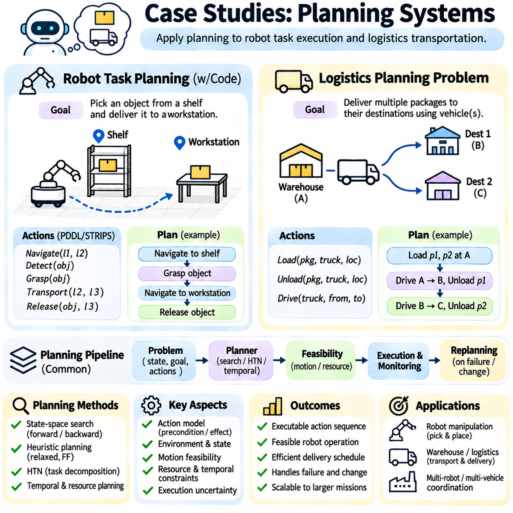{width="7.268055555555556in" height="7.268055555555556in"}

Case studies in planning systems demonstrate how abstract planning principles are applied to practical problems involving robots, transportation, and resource coordination. Robot task planning focuses on selecting and executing actions in physical environments, while logistics planning addresses the movement of goods between locations. Both applications illustrate how symbolic states, action models, goal conditions, and search algorithms support structured decision-making.

A robot task planning problem begins with a description of the robot\'s capabilities, the current environment, and the desired mission outcome. The planning system represents relevant objects, locations, operational states, and available actions. For example, a mobile manipulator may need to retrieve an object from a storage shelf and deliver it to a workstation. The planner must determine an action sequence that satisfies all required preconditions.

The initial state may specify that the robot is located at a charging station, its gripper is empty, and the target object is stored on a shelf. The goal state requires the object to be delivered to a designated workstation. Actions such as Navigate, DetectObject, GraspObject, TransportObject, and ReleaseObject describe possible operations. Each action includes conditions that determine when it can execute and effects that update the state.

A Navigate action requires a valid destination and a feasible route, while a GraspObject action requires the robot to reach an appropriate manipulation position. The grasp operation changes the symbolic state from an empty gripper to an occupied gripper. ReleaseObject reverses this relationship and establishes the object\'s destination. These state transitions allow the planner to reason about dependencies between navigation and manipulation.

Classical planning algorithms can solve the symbolic portion of this problem by searching for an action sequence that achieves the delivery goal. Forward state-space search explores applicable actions from the initial state, while backward reasoning identifies actions capable of satisfying the goal. Heuristic planning can estimate remaining effort using relaxed action models. The selected algorithm influences planning time and search efficiency.

Hierarchical Task Network planning provides an alternative by decomposing the delivery mission into reusable subtasks. A DeliverObject task may be refined into LocateObject, ApproachObject, PickObject, NavigateToDestination, and PlaceObject. Each subtask can be decomposed further when necessary. This structure captures operational procedures and reduces the need to discover every action dependency through unrestricted search.

Symbolic task planning alone cannot guarantee physical feasibility. A robot may select a valid PickObject action even when the object is unreachable or obstructed. Motion planning must verify collision-free navigation, manipulator reachability, and valid grasp configurations. Integrated Task and Motion Planning connects symbolic decisions with geometric feasibility checks, allowing physically impossible action choices to be rejected.

Robot execution introduces uncertainty because localization, object detection, grasping, and movement may fail. Execution monitoring compares expected action outcomes with sensor observations. If the robot cannot grasp an object, the system may retry with another grasp configuration or select an alternative task sequence. Replanning uses the updated state to recover from failures without necessarily restarting the entire mission.

The logistics planning problem generalizes transportation tasks across multiple packages, vehicles, and destinations. A logistics domain typically defines locations, transportation connections, vehicle capacities, and package assignments. The objective is to move packages from their initial locations to specified destinations. The planner must select loading, transportation, and unloading actions while preserving operational constraints.

A simplified logistics problem may contain two packages, one truck, and several connected locations. Initially, both packages are stored at a warehouse, while their destinations differ. The truck can carry packages between locations but must be present at the loading or unloading site. The planner must determine which packages to load, where to drive, and when to unload them to satisfy the delivery goals.

Symbolic logistics actions commonly include Load, Unload, and Drive. Load requires the package and vehicle to occupy the same location and sufficient capacity to be available. Unload requires the package to be inside the vehicle at the destination. Drive changes the vehicle\'s location according to permitted transportation connections. These preconditions and effects define the state transitions available to the planner.

The logistics problem becomes more complex when several vehicles, transportation modes, and delivery deadlines are introduced. Trucks may operate within cities, while aircraft transport packages between airports. A package may require multiple transfers before reaching its destination. Planning must coordinate these operations while respecting connectivity, vehicle availability, and location-specific restrictions.

Temporal planning extends logistics models by assigning durations to loading, driving, unloading, and transfer operations. Vehicles may perform independent deliveries concurrently, while shared loading equipment creates scheduling conflicts. Resource-aware planning considers vehicle capacities, fuel or battery levels, and facility availability. The resulting solution must satisfy both logical delivery goals and temporal feasibility requirements.

Heuristic search can improve logistics planning efficiency by estimating the remaining transportation effort. Distance-based estimates, relaxed planning graphs, and landmark reasoning can guide the selection of promising actions. However, simplified heuristics may underestimate costs when capacity restrictions, transfers, or resource conflicts are ignored. Accurate evaluation requires balancing heuristic quality against computational overhead.

Both case studies highlight the importance of connecting planning algorithms with execution architecture. Robot task planning emphasizes perception, physical feasibility, and recovery from uncertain actions, while logistics planning emphasizes transportation dependencies, resource allocation, and scheduling. Their shared principles demonstrate how classical planning methods can be extended into practical intelligent systems that coordinate actions toward explicit operational goals.

계획 시스템의 사례 연구(Case Studies in Planning Systems)는 추상적인 계획 원리(Abstract Planning Principle)가 로봇(Robot), 운송(Transportation), 자원 조정(Resource Coordination)과 관련된 실제 문제에 어떻게 적용되는지를 보여준다. 로봇 작업 계획(Robot Task Planning)은 물리적 환경(Physical Environment)에서 행동을 선택하고 실행하는 데 중점을 두며, 물류 계획(Logistics Planning)은 위치 간 물품 이동(Movement of Goods)을 다룬다. 두 응용 분야 모두 기호적 상태(Symbolic State), 행동 모델(Action Model), 목표 조건(Goal Condition), 탐색 알고리즘(Search Algorithm)이 구조화된 의사결정(Structured Decision-Making)을 지원하는 방식을 보여준다.

로봇 작업 계획 문제(Robot Task Planning Problem)는 로봇의 기능(Robot Capability), 현재 환경(Current Environment), 원하는 임무 결과(Desired Mission Outcome)에 대한 설명에서 시작한다. 계획 시스템(Planning System)은 관련 객체(Object), 위치(Location), 운영 상태(Operational State), 사용 가능한 행동(Available Action)을 표현한다. 예를 들어 이동형 매니퓰레이터(Mobile Manipulator)는 보관 선반(Storage Shelf)에서 물체를 가져와 작업대(Workstation)로 전달해야 할 수 있다. 계획기(Planner)는 필요한 모든 전제조건(Precondition)을 만족하는 행동 순서(Action Sequence)를 결정해야 한다.

초기 상태(Initial State)는 로봇이 충전소(Charging Station)에 위치하고, 그리퍼(Gripper)가 비어 있으며, 목표 물체(Target Object)가 선반에 보관되어 있음을 지정할 수 있다. 목표 상태(Goal State)는 물체가 지정된 작업대로 전달되는 것을 요구한다. 이동(Navigate), 객체 감지(DetectObject), 객체 파지(GraspObject), 객체 운송(TransportObject), 객체 놓기(ReleaseObject)와 같은 행동은 가능한 작업을 설명한다. 각 행동에는 실행 가능 시점을 결정하는 조건(Condition)과 상태를 갱신하는 효과(Effect)가 포함된다.

이동 행동(Navigate Action)은 유효한 목적지(Valid Destination)와 실행 가능한 경로(Feasible Route)를 요구하며, 객체 파지 행동(GraspObject Action)은 로봇이 적절한 조작 위치(Manipulation Position)에 도달해야 한다. 파지 작업(Grasp Operation)은 기호적 상태(Symbolic State)를 그리퍼가 비어 있는 상태(Empty Gripper)에서 점유된 상태(Occupied Gripper)로 변경한다. 객체 놓기 행동(ReleaseObject)은 이러한 관계를 반대로 변경하고 물체의 목적지(Object Destination)를 확정한다. 이러한 상태 전이(State Transition)를 통해 계획기는 이동과 조작(Manipulation) 사이의 의존 관계(Dependency)를 추론할 수 있다.

고전적 계획 알고리즘(Classical Planning Algorithm)은 배송 목표(Delivery Goal)를 달성하는 행동 순서를 탐색하여 이 문제의 기호적 부분(Symbolic Portion)을 해결할 수 있다. 전방 상태 공간 탐색(Forward State-Space Search)은 초기 상태에서 적용 가능한 행동(Applicable Action)을 탐색하고, 후방 추론(Backward Reasoning)은 목표를 만족시킬 수 있는 행동을 식별한다. 휴리스틱 계획(Heuristic Planning)은 완화된 행동 모델(Relaxed Action Model)을 사용하여 남은 작업량(Remaining Effort)을 추정할 수 있다. 선택한 알고리즘은 계획 시간(Planning Time)과 탐색 효율성(Search Efficiency)에 영향을 미친다.

계층적 작업 네트워크 계획(Hierarchical Task Network Planning, HTN Planning)은 배송 임무(Delivery Mission)를 재사용 가능한 하위 작업(Reusable Subtask)으로 분해하는 대안적인 방법을 제공한다. 객체 배송 작업(DeliverObject Task)은 객체 찾기(LocateObject), 객체 접근(ApproachObject), 객체 집기(PickObject), 목적지 이동(NavigateToDestination), 객체 배치(PlaceObject)로 세분화할 수 있다. 필요한 경우 각 하위 작업을 추가로 분해할 수 있다. 이러한 구조는 운영 절차(Operational Procedure)를 표현하고 제한 없는 탐색(Unrestricted Search)을 통해 모든 행동 의존 관계를 발견해야 하는 필요성을 줄인다.

기호적 작업 계획(Symbolic Task Planning)만으로는 물리적 실행 가능성(Physical Feasibility)을 보장할 수 없다. 로봇은 물체에 도달할 수 없거나 장애물에 가려져 있더라도 유효한 객체 파지 행동(PickObject Action)을 선택할 수 있다. 동작 계획(Motion Planning)은 충돌 없는 이동(Collision-Free Navigation), 매니퓰레이터 도달 가능성(Manipulator Reachability), 유효한 파지 구성(Valid Grasp Configuration)을 검증해야 한다. 통합 작업 및 동작 계획(Integrated Task and Motion Planning, TAMP)은 기호적 결정(Symbolic Decision)과 기하학적 실행 가능성 검사(Geometric Feasibility Check)를 연결하여 물리적으로 실행 불가능한 행동 선택을 거부할 수 있도록 한다.

로봇 실행(Robot Execution)에는 위치 추정(Localization), 객체 감지(Object Detection), 파지(Grasping), 이동(Movement)이 실패할 수 있기 때문에 불확실성(Uncertainty)이 존재한다. 실행 감시(Execution Monitoring)는 예상된 행동 결과(Expected Action Outcome)를 센서 관측(Sensor Observation)과 비교한다. 로봇이 물체를 파지하지 못하면 시스템은 다른 파지 구성(Grasp Configuration)으로 재시도하거나 대체 작업 순서(Alternative Task Sequence)를 선택할 수 있다. 재계획(Replanning)은 갱신된 상태(Updated State)를 사용하여 전체 임무를 반드시 처음부터 다시 시작하지 않고도 실패에서 복구할 수 있도록 한다.

물류 계획 문제(Logistics Planning Problem)는 운송 작업(Transportation Task)을 여러 화물(Package), 차량(Vehicle), 목적지(Destination)로 일반화한다. 물류 영역(Logistics Domain)은 일반적으로 위치(Location), 운송 연결(Transportation Connection), 차량 적재 용량(Vehicle Capacity), 화물 할당(Package Assignment)을 정의한다. 목표는 화물을 초기 위치(Initial Location)에서 지정된 목적지(Specified Destination)로 이동시키는 것이다. 계획기는 운영 제약조건(Operational Constraint)을 유지하면서 적재(Loading), 운송(Transportation), 하역(Unloading) 행동을 선택해야 한다.

단순화된 물류 문제(Simplified Logistics Problem)는 두 개의 화물(Two Packages), 한 대의 트럭(One Truck), 여러 연결된 위치(Connected Locations)로 구성될 수 있다. 초기에는 두 화물이 모두 창고(Warehouse)에 보관되어 있지만 목적지는 서로 다르다. 트럭은 위치 사이에서 화물을 운송할 수 있지만 적재 또는 하역 장소(Loading or Unloading Site)에 있어야 한다. 계획기는 배송 목표(Delivery Goal)를 만족하기 위해 어떤 화물을 적재하고, 어디로 운전하며, 언제 하역할지를 결정해야 한다.

기호적 물류 행동(Symbolic Logistics Action)에는 일반적으로 적재(Load), 하역(Unload), 운전(Drive)이 포함된다. 적재 행동(Load Action)은 화물과 차량이 동일한 위치에 있고 충분한 적재 용량(Sufficient Capacity)을 사용할 수 있어야 한다. 하역 행동(Unload Action)은 목적지에서 화물이 차량 내부에 있어야 한다. 운전 행동(Drive Action)은 허용된 운송 연결(Permitted Transportation Connection)에 따라 차량의 위치를 변경한다. 이러한 전제조건(Precondition)과 효과(Effect)는 계획기가 사용할 수 있는 상태 전이(State Transition)를 정의한다.

여러 차량(Multiple Vehicles), 운송 수단(Transportation Mode), 배송 기한(Delivery Deadline)이 도입되면 물류 문제는 더욱 복잡해진다. 트럭(Truck)은 도시 내부에서 운행할 수 있고, 항공기(Aircraft)는 공항 사이에서 화물을 운송할 수 있다. 화물은 목적지에 도달하기 전에 여러 차례 환적(Transfer)이 필요할 수 있다. 계획은 운송망 연결성(Connectivity), 차량 가용성(Vehicle Availability), 위치별 제한조건(Location-Specific Restriction)을 준수하면서 이러한 작업을 조정해야 한다.

시간적 계획(Temporal Planning)은 적재, 운전, 하역, 환적 작업에 지속시간(Duration)을 할당하여 물류 모델(Logistics Model)을 확장한다. 차량은 독립적인 배송(Independent Delivery)을 동시에 수행할 수 있지만 공유 적재 장비(Shared Loading Equipment)는 일정 충돌(Scheduling Conflict)을 발생시킬 수 있다. 자원 인식 계획(Resource-Aware Planning)은 차량 적재 용량(Vehicle Capacity), 연료 또는 배터리 잔량(Fuel or Battery Level), 시설 가용성(Facility Availability)을 고려한다. 결과적으로 생성된 해결책(Solution)은 논리적 배송 목표(Logical Delivery Goal)와 시간적 실행 가능성 요구사항(Temporal Feasibility Requirement)을 모두 만족해야 한다.

휴리스틱 탐색(Heuristic Search)은 남은 운송 작업량(Remaining Transportation Effort)을 추정하여 물류 계획의 효율성을 향상시킬 수 있다. 거리 기반 추정(Distance-Based Estimate), 완화된 계획 그래프(Relaxed Planning Graph), 랜드마크 추론(Landmark Reasoning)은 유망한 행동(Promising Action)의 선택을 안내할 수 있다. 그러나 단순화된 휴리스틱(Simplified Heuristic)은 적재 용량 제한(Capacity Restriction), 환적(Transfer), 자원 충돌(Resource Conflict)을 무시하면 비용을 과소평가할 수 있다. 정확한 평가(Accurate Evaluation)를 위해서는 휴리스틱 품질(Heuristic Quality)과 계산 오버헤드(Computational Overhead) 사이의 균형을 유지해야 한다.

두 사례 연구(Case Study)는 모두 계획 알고리즘(Planning Algorithm)을 실행 아키텍처(Execution Architecture)와 연결하는 중요성을 강조한다. 로봇 작업 계획(Robot Task Planning)은 인식(Perception), 물리적 실행 가능성(Physical Feasibility), 불확실한 행동으로부터의 복구(Recovery from Uncertain Actions)를 강조하는 반면, 물류 계획(Logistics Planning)은 운송 의존 관계(Transportation Dependency), 자원 할당(Resource Allocation), 일정 계획(Scheduling)을 강조한다. 두 분야의 공통 원리(Shared Principle)는 고전적 계획 방법(Classical Planning Method)이 명시적인 운영 목표(Explicit Operational Goal)를 향해 행동을 조정하는 실용적인 지능형 시스템(Practical Intelligent System)으로 확장될 수 있음을 보여준다.
