**Volume 01. Classical AI Search and Planning**

# 04. Planning Systems

## 04.01 Introduction to Planning

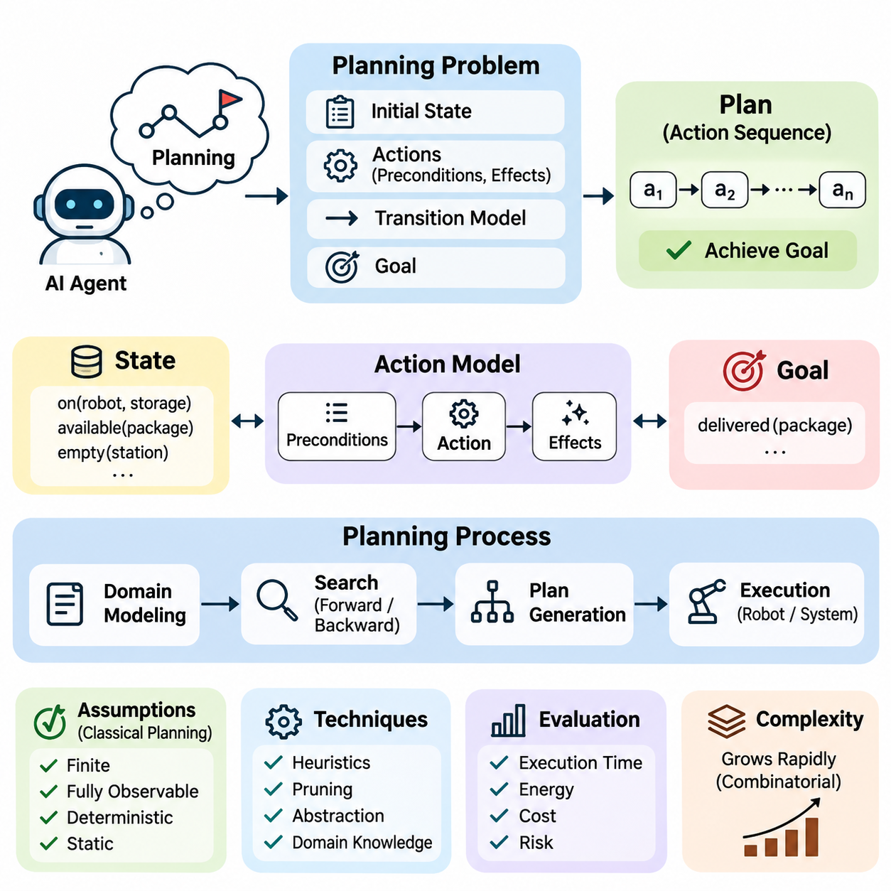{width="7.268055555555556in" height="7.268055555555556in"}

Planning is a fundamental capability of artificial intelligence that enables an intelligent agent to determine a sequence of actions required to achieve a desired objective. Unlike reactive systems that respond only to immediate inputs, planning systems reason about future states, action consequences, and goal conditions. This capability allows AI systems to coordinate decisions over multiple steps while considering dependencies and environmental constraints.

The central purpose of planning is to transform an initial state into a goal state through a logically valid sequence of actions. A planning problem typically consists of an initial state, a collection of available actions, a transition model, and a goal specification. The planner examines possible action sequences and identifies those that satisfy the goal conditions. Depending on the problem, it may also minimize execution cost, time, or resource consumption.

Planning differs from ordinary search because actions often possess explicit preconditions and effects that describe how the world changes. Search algorithms explore possible states, while planning systems exploit structured knowledge about actions and their relationships. This distinction becomes important when actions depend on previous achievements, modify multiple properties, or interfere with other activities. Planning therefore combines state-space exploration with symbolic reasoning.

A planning state represents the relevant properties of an environment at a particular moment. In symbolic planning, states are commonly described using logical predicates that express relationships between objects. For example, a warehouse robot may be located in a storage area, a package may be available for collection, and a delivery station may be unoccupied. These facts provide the information required to determine which actions are currently applicable.

Actions define the mechanisms through which an intelligent agent changes its environment. Each action normally includes preconditions that must hold before execution and effects that describe the resulting state modifications. A robot cannot pick up an object unless it is within reach and its gripper is available. Once the pickup action succeeds, the object becomes attached to the robot, and the corresponding environmental state must be updated.

Goals specify the conditions that a successful plan must establish. A goal may involve a single desired condition or a conjunction of several conditions that must hold simultaneously. In logistics planning, the objective might require multiple packages to reach different destinations. The planner must identify an action sequence that achieves every required condition without violating operational constraints or producing conflicting outcomes.

Classical planning traditionally assumes a finite, fully observable, deterministic, and static environment, with actions represented as discrete transitions. Under these assumptions, the planner can predict the exact result of each applicable action. Such simplifications make planning problems mathematically manageable and support systematic algorithm development. However, real environments frequently violate these assumptions, requiring more advanced planning methods.

A deterministic transition model maps a state and an applicable action to a unique successor state. This relationship allows a planner to simulate possible futures before executing any physical operation. By repeatedly applying the transition model, the planner constructs candidate trajectories through the state space. A valid solution is obtained when the resulting sequence reaches a state satisfying the specified goal conditions.

The planning process generally begins by constructing an abstract model of the problem domain. Objects, predicates, actions, and constraints are represented in a form suitable for automated reasoning. The planner then evaluates possible action combinations and searches for a feasible solution. Once a plan is generated, an execution component translates symbolic actions into commands that can be performed by software services, robots, or industrial equipment.

Forward planning begins with the initial state and explores the consequences of available actions until a goal state is reached. Backward planning instead reasons from desired goal conditions toward actions capable of establishing them. Both approaches rely on the same underlying planning model but differ in how they organize the search. Their relative efficiency depends on branching factors, action dependencies, and the structure of the goal.

Planning complexity grows rapidly as the number of objects, actions, and possible states increases. Even relatively simple domains can produce enormous combinations of action sequences. Exhaustively examining every possibility is often computationally impractical. Consequently, effective planning systems use heuristics, pruning strategies, abstraction, and domain knowledge to reduce unnecessary exploration while preserving the ability to identify useful solutions.

Heuristic planning estimates the remaining effort required to achieve a goal from a particular state. These estimates guide the search toward promising alternatives rather than treating every candidate equally. Heuristics may be derived from relaxed planning problems, planning graphs, or structural properties of the domain. Their effectiveness strongly influences planning speed, solution quality, and scalability in complex environments.

A plan is not necessarily optimal simply because it achieves the goal. Different valid plans may require different execution times, energy consumption, financial costs, or operational risks. Cost-sensitive planning assigns numerical values to actions and searches for solutions that optimize a selected objective. In practical applications, several objectives may need to be balanced, making planning a constrained optimization problem as well as a reasoning problem.

Planning also requires careful treatment of action ordering and dependencies. Some actions must occur before others, while independent actions may be executed in different orders or concurrently. Partial-order planning represents only the ordering relationships necessary for correctness. This approach avoids committing prematurely to a complete sequence and can expose opportunities for parallel execution when the domain permits simultaneous activities.

Hierarchical planning addresses complexity by decomposing high-level objectives into smaller tasks. A general instruction such as delivering an item may be divided into locating the item, navigating to its position, collecting it, traveling to the destination, and releasing it. Each task can be refined into increasingly detailed operations. This decomposition supports modular reasoning and allows reusable procedures to organize complicated activities.

Temporal planning extends conventional action sequencing by representing durations, deadlines, and temporal relationships. Actions may occupy intervals rather than occur instantaneously, and multiple activities may overlap when their resource requirements are compatible. Industrial production, transportation, and robotic operations frequently require this capability. A useful temporal plan must satisfy both logical conditions and scheduling constraints throughout execution.

Uncertainty introduces additional challenges because actions may produce unpredictable outcomes and observations may provide incomplete information. Probabilistic planning represents alternative outcomes and their likelihoods, allowing decisions to account for uncertainty. In partially observable environments, an agent may maintain a belief about possible states rather than knowing the exact state. Planning then involves selecting actions that manage uncertainty while advancing toward the objective.

Planning and execution must remain connected in dynamic environments. A plan constructed from an initial model may become invalid when obstacles appear, resources become unavailable, or actions fail. Execution monitoring compares observed outcomes with expected results and identifies deviations. When necessary, the system updates its representation of the environment and generates a revised plan, establishing a feedback loop between reasoning and action.

Robotic planning illustrates the relationship between symbolic decisions and physical constraints. Task planning determines what operations should occur, while motion planning determines how the robot can move safely between configurations. A mobile manipulator may need to navigate toward an object, position its arm, grasp the object, and transport it. Successful execution requires coordination between discrete task decisions and continuous geometric motion.

Planning systems are also widely applicable to logistics, manufacturing, autonomous vehicles, workflow automation, and intelligent software agents. In logistics, planning coordinates transportation and delivery operations. In manufacturing, it determines production sequences and resource assignments. Software agents use planning to organize tool calls and dependent tasks. Although these applications differ substantially, they share the need to reason about actions, consequences, and objectives.

The architecture of a practical planning system typically separates domain modeling, problem formulation, planning algorithms, execution control, and monitoring. This separation allows planning strategies to evolve without requiring complete redesign of the application. A planner may generate symbolic actions, while specialized controllers handle low-level execution. Clearly defined interfaces between these components improve maintainability, interoperability, and operational reliability.

Planning quality can be evaluated through several complementary criteria, including goal achievement, solution cost, computation time, memory consumption, and robustness. Completeness describes whether a method can find a solution when one exists under its assumptions, while optimality concerns the quality of the selected solution. Practical evaluation must also consider how reliably plans execute when the real environment differs from the internal model.

The relationship between planning, search, constraint satisfaction, and reasoning is particularly important in classical artificial intelligence. Search provides algorithms for exploring alternatives, constraint satisfaction manages compatibility among decisions, and logical reasoning supports the interpretation of action conditions. Planning integrates these capabilities into a framework for purposeful behavior, transforming declarative knowledge about the world into executable sequences of decisions.

Modern intelligent systems increasingly combine classical planning with learning-based perception, prediction, and control. Machine learning can estimate environmental properties, predict action outcomes, or construct useful heuristics, while symbolic planning maintains explicit representations of goals and dependencies. Such hybrid architectures are valuable when systems must operate in complex environments while preserving interpretable decision structures and verifiable operational constraints.

Ultimately, planning provides the foundation for goal-directed intelligence by connecting knowledge, reasoning, decision-making, and action. Its central challenge is not merely finding a sequence of operations, but selecting actions that remain feasible, efficient, and appropriate under the assumptions of the environment. Understanding these principles establishes the conceptual foundation for classical planning formulations, STRIPS, PDDL, heuristic planning, hierarchical methods, and autonomous robotic planning systems.

## 04.02 Classical Planning Formulation

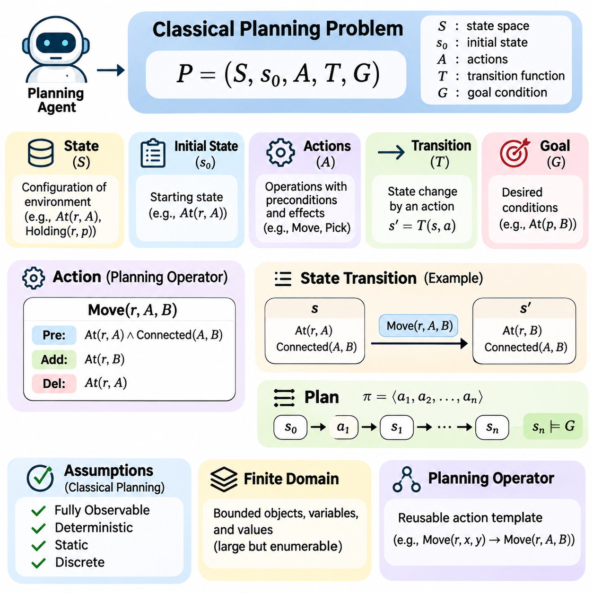{width="7.268055555555556in" height="7.268055555555556in"}

Classical planning formulation provides a mathematical framework for representing how an intelligent agent can transform an initial environment into a desired goal state through a sequence of actions. It establishes precise definitions for states, actions, transitions, and goals, allowing planning problems to be analyzed systematically. This formal representation serves as the foundation for symbolic planning algorithms and automated reasoning systems.

A classical planning problem is commonly represented as a tuple consisting of a set of states, an initial state, a collection of actions, a transition function, and a goal condition. Each component describes a distinct aspect of the planning environment. Together, they define which actions are possible, how the environment changes after execution, and what conditions must hold for a plan to be considered successful.

The state space contains all configurations of the environment that can be represented within the planning model. Each state describes relevant facts about objects, locations, resources, and relationships. For example, a warehouse environment may represent the location of robots, the positions of packages, and the availability of storage areas. The planner uses these facts to distinguish alternative situations and determine applicable actions.

Symbolic state representation commonly uses logical predicates to describe properties and relationships. A predicate such as At(Robot1, LocationA) indicates that a particular robot occupies a specified location. Another predicate, Holding(Robot1, Package1), represents possession of an object. A complete state can be modeled as a set of true ground predicates, while predicates not included are normally considered false under the closed-world assumption.

The initial state specifies the environment configuration before planning begins. It provides the starting point from which all candidate action sequences are evaluated. Accurate initial-state representation is essential because planning algorithms derive future states from the facts initially provided. Missing or incorrect information may produce plans that appear logically valid but cannot be executed successfully in the actual environment.

The goal condition defines the desired properties of the final state rather than necessarily specifying a unique complete state. Goals are often expressed as conjunctions of logical predicates that must simultaneously hold. For example, a delivery task may require Package1 to be at DestinationA and Package2 to be at DestinationB. Any reachable state satisfying both conditions represents a successful outcome.

Actions describe the available operations through which the environment can change. Each action is typically defined by a name, parameters, preconditions, and effects. Parameters identify the objects involved, while preconditions determine whether the action can be executed in a particular state. Effects specify which facts become true or false after execution, enabling the planner to predict the consequences of each operation.

An action is applicable only when its preconditions are satisfied by the current state. For example, a robot can execute Move(LocationA, LocationB) only when it is located at LocationA and a valid connection exists between the two locations. Preconditions prevent logically impossible transitions and restrict the planner to meaningful operations. Their accurate definition is essential for maintaining consistency throughout the planning process.

Action effects are commonly separated into positive effects and negative effects. Positive effects introduce facts that become true after execution, while negative effects remove facts that are no longer valid. When a robot moves from LocationA to LocationB, its presence at LocationB becomes true, and its presence at LocationA becomes false. This representation supports deterministic state updates using explicit logical operations.

The transition function defines how an applicable action transforms one state into another. In classical planning, this function is deterministic, meaning that the same action executed in the same state always produces the same successor state. The resulting state is constructed by removing negative effects and adding positive effects. This predictable transition mechanism enables systematic exploration of possible action sequences.

A plan is a finite sequence of actions that transforms the initial state into a state satisfying the goal condition. Every action must be applicable in the state produced by its preceding actions. Consequently, plan validity depends on the entire sequence rather than the individual actions considered independently. A plan is correct when its execution respects all preconditions and ultimately establishes the required goals.

Classical planning typically assumes complete observability, deterministic actions, a static environment, and discrete state transitions. Complete observability means that the planner has access to the relevant state information. A static environment does not change independently while planning actions are considered. These assumptions simplify the reasoning process by eliminating uncertainty about action outcomes and unexpected environmental changes.

The finite-domain assumption allows planning problems to be represented using a bounded collection of objects, variables, and possible values. Although the resulting state space may be extremely large, it remains conceptually enumerable. This property supports graph-search techniques and formal analysis. Nevertheless, the number of possible states can grow exponentially with the number of independent variables or predicates.

Planning operators provide reusable action templates that can be instantiated with specific objects. For example, a general Move(robot, source, destination) operator can represent movement between many different locations. Grounding replaces the operator parameters with concrete objects from the problem domain. This process generates executable action instances and allows a compact domain description to represent numerous possible operations.

State invariants express properties that must remain true throughout valid planning states. A robot may be required to occupy only one location at a time, while a package cannot simultaneously be carried by two different robots. Such invariants help identify inconsistent representations and impossible states. They may be enforced through action definitions, domain constraints, or additional validation mechanisms.

The distinction between domain models and problem instances is fundamental to reusable planning systems. A domain model defines general object types, predicates, and action schemas applicable across related tasks. A problem instance specifies the particular objects, initial conditions, and goals for one planning scenario. Separating these elements allows the same planning domain to support many different objectives without redefining its underlying operational rules.

Classical planning can be interpreted as a directed graph in which states correspond to vertices and applicable actions correspond to transitions between vertices. The initial state identifies the starting vertex, while goal-satisfying states define acceptable destinations. Planning then becomes a search problem over this implicitly represented graph. However, the symbolic structure of actions provides additional information that specialized planners can exploit.

Forward state-space planning begins with the initial state and repeatedly applies applicable actions to generate successor states. The search continues until a state satisfies the goal condition or the available search space is exhausted. This approach is conceptually straightforward and can incorporate breadth-first search, uniform-cost search, or heuristic search. Its performance depends strongly on branching factors and the effectiveness of state evaluation.

Backward planning begins with the goal conditions and identifies actions capable of establishing them. The planner then determines which conditions must hold before those actions can execute. This process continues toward the initial state through regression of goal requirements. Backward reasoning can reduce unnecessary exploration when the goals constrain relevant actions, although interactions between conditions must be handled carefully.

Plan cost introduces an optimization criterion beyond simple goal satisfaction. Each action may be assigned a numerical cost representing time, distance, energy consumption, or another resource. The total cost of a sequential plan is commonly calculated by summing the costs of its actions. An optimal planner seeks a valid plan with minimum total cost, whereas a satisficing planner prioritizes finding an acceptable solution efficiently.

The distinction between feasibility and optimality is important in planning formulation. A feasible plan satisfies the action constraints and reaches the required goal, but it may not be the least expensive or shortest solution. Optimality requires an explicitly defined objective function and an algorithm capable of establishing the best solution under that objective. Practical systems often balance computational effort against solution quality.

Planning formulations must also account for unreachable goals and dead-end states. A goal is unreachable when no valid sequence of available actions can establish the required conditions from the initial state. A dead-end state is a reachable state from which the goal cannot subsequently be achieved. Detecting such situations helps prevent wasted computation and provides useful information about limitations in the planning model.

Model correctness is essential because planning algorithms reason only about the environment described by their formal representation. If an action omits an important precondition or incorrectly specifies an effect, the planner may generate an invalid real-world procedure. Domain validation therefore examines logical consistency, action applicability, state invariants, and expected transitions. Carefully designed test problems help identify modeling errors before deployment.

Classical planning formulation provides the conceptual foundation for STRIPS representations, Planning Domain Definition Language, state-space planning, planning graphs, and heuristic planners. These methods differ in their search strategies and implementation details but rely on the same fundamental relationship between states, actions, transitions, and goals. A rigorous formulation enables reliable algorithm comparison, reusable domain modeling, and systematic planning-system development.

In practical artificial intelligence, classical planning serves as a structured reasoning layer between high-level objectives and executable operations. Robotics, logistics, manufacturing, and automated workflows can represent tasks through symbolic actions and explicit goal conditions. Although real environments often require extensions for uncertainty, time, and continuous dynamics, classical formulation remains a fundamental starting point for constructing interpretable and goal-directed intelligent systems.

## 04.03 STRIPS Representation

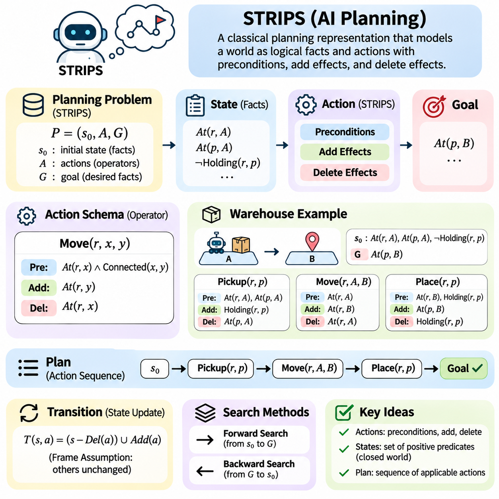{width="7.268055555555556in" height="7.268055555555556in"}

STRIPS, or Stanford Research Institute Problem Solver, is a foundational representation framework in classical artificial intelligence planning. It describes how an intelligent agent can achieve goals by applying actions that modify a symbolic representation of the environment. Developed for early robotic planning research, STRIPS introduced a structured method for expressing action preconditions and effects, establishing principles that remain central to automated planning systems.

The central idea of STRIPS is to represent the world as a collection of logical facts and describe actions as transformations of those facts. Rather than modeling every physical detail, STRIPS focuses on properties relevant to planning decisions. This abstraction allows a planner to reason about possible action sequences without simulating the complete environment. Its simplicity makes it suitable for studying the fundamental relationship between states, actions, and goals.

A STRIPS planning problem consists of an initial state, a set of available actions, and a goal specification. The initial state describes the facts known to be true before planning begins. Actions determine which state transformations are permitted, while the goal specifies the conditions that must eventually hold. A valid plan is a sequence of applicable actions that transforms the initial state into one satisfying every required goal condition.

States in STRIPS are commonly represented as sets of positive ground predicates. A predicate describes a property or relationship involving specific objects, such as At(Robot1, RoomA) or Holding(Robot1, Box1). Under the closed-world assumption, any ground predicate not explicitly included in the state is considered false. This representation provides a compact and logically precise description of the planning environment.

STRIPS actions are defined using three primary components: preconditions, add effects, and delete effects. Preconditions specify the facts that must hold before an action can execute. Add effects identify facts that become true afterward, while delete effects identify facts that become false. These components define the logical behavior of an action and provide the mechanism through which the planner constructs successor states.

An action is applicable when all its preconditions are satisfied in the current state. For example, a robot can move from RoomA to RoomB only when it is located in RoomA and the rooms are connected. If either condition is absent, the movement action cannot be applied. This rule ensures that the planner explores only transitions consistent with the action definitions and the current symbolic representation.

The add list specifies facts introduced by an action. When a robot moves into RoomB, the predicate At(Robot1, RoomB) is added to the resulting state. The delete list removes facts invalidated by the same action, such as At(Robot1, RoomA). Together, these operations represent state changes without requiring a complete reconstruction of the environment after every action.

The STRIPS transition mechanism applies an action by removing its delete effects from the current state and then inserting its add effects. Facts unaffected by either list remain unchanged. This behavior reflects the frame assumption, which states that properties persist unless explicitly modified. By representing only changes, STRIPS avoids repeatedly describing every property that remains constant after an operation.

Action schemas provide reusable descriptions of operations involving variable objects. A movement schema might be written conceptually as Move(robot, source, destination), with parameters identifying the robot and locations. Specific action instances are created by substituting concrete objects for these parameters. This grounding process enables one general operator to represent many possible actions within a planning domain.

Consider a simple warehouse environment containing a robot, several storage locations, and movable packages. The initial state may indicate that Robot1 is at LocationA, Package1 is at LocationA, and the robot is not carrying anything. The objective is to transport Package1 to LocationB. STRIPS represents this task through movement, pickup, and placement actions, each with explicitly defined preconditions and effects.

A pickup action may require the robot and package to occupy the same location while the robot\'s gripper is empty. Its add effects establish that the robot is holding the package, while its delete effects remove the package\'s previous location and the gripper\'s empty status. A placement action reverses the relevant relationships. These definitions allow the planner to construct a logically consistent transportation sequence.

The goal specification in STRIPS is typically expressed as a conjunction of positive predicates. A delivery goal might require At(Package1, LocationB) and At(Package2, LocationC) to become true simultaneously. The planner does not necessarily need to establish every possible environmental fact. It only needs to reach a state containing the required goal predicates while respecting all action preconditions.

STRIPS planning can be performed through forward state-space search, beginning with the initial state and applying applicable actions to generate successors. Each resulting state becomes a candidate for further exploration. The process continues until a state satisfies the goal specification. Standard search algorithms, including breadth-first search and heuristic search, can operate on this representation to identify valid action sequences.

Backward planning provides another approach by reasoning from the goal toward the initial state. The planner selects actions whose effects can establish required goal predicates and determines the conditions needed before those actions execute. This process, known as goal regression, can focus reasoning on actions relevant to the objective. However, selected actions must not destroy other required conditions.

The interaction between actions creates important planning challenges. An action may establish one goal while deleting a fact needed for another goal. Such interference requires the planner to consider ordering constraints and dependencies. For example, moving a robot away from a pickup location before collecting a package may invalidate the pickup preconditions. STRIPS makes these conflicts explicit through its precondition and effect lists.

The expressive power of basic STRIPS is intentionally limited. Traditional formulations primarily use positive conjunctive preconditions, positive goals, and deterministic add-delete effects. They do not directly represent arbitrary logical formulas, numeric resources, action durations, or probabilistic outcomes. These restrictions simplify planning algorithms but limit the representation of complex environments without additional modeling techniques.

The closed-world assumption is especially important when interpreting STRIPS states. A fact absent from the current state is treated as false rather than unknown. This simplifies logical evaluation but assumes the planning model contains sufficient information about relevant environmental properties. In partially observable environments, this assumption may be inappropriate because missing information does not necessarily imply that a condition is false.

STRIPS also assumes that action effects are deterministic and that the environment changes according to the modeled operations. Executing an applicable action produces a predictable successor state. Real robotic environments may contain sensor errors, unexpected obstacles, and execution failures that violate these assumptions. Such situations require execution monitoring, state estimation, or extensions to classical planning representations.

The compactness of STRIPS is one of its major advantages. Action schemas describe only the conditions necessary for execution and the facts modified afterward. Unchanged properties are preserved automatically, reducing representational redundancy. This structure supports systematic search, formal reasoning, and reusable planning-domain definitions, making STRIPS a valuable foundation for both educational examples and automated planning research.

Despite its compact representation, STRIPS planning can become computationally difficult as the number of objects and actions increases. Grounding parameterized operators may generate many action instances, while combinations of predicates produce large state spaces. Efficient planners therefore employ reachability analysis, heuristic estimation, pruning, and other optimization methods to reduce unnecessary exploration.

STRIPS provides a conceptual foundation for the Planning Domain Definition Language, commonly known as PDDL. PDDL generalizes classical action descriptions and supports standardized representations of planning domains and problems. Basic PDDL action schemas retain the central STRIPS concepts of parameters, preconditions, and effects. More expressive PDDL features extend these foundations to accommodate additional planning requirements.

In robotics, STRIPS-style representations can describe task-level operations such as navigating, grasping, transporting, and releasing objects. A symbolic planner determines the required sequence, while lower-level motion planners and controllers execute the corresponding physical actions. This separation connects high-level logical reasoning with practical robotic behavior, although geometric feasibility and execution uncertainty must be addressed by additional components.

The correctness of a STRIPS domain depends on accurate action modeling. Missing delete effects may allow contradictory facts to remain true, while incomplete preconditions may permit impossible operations. Domain validation should therefore examine action consistency, reachable states, goal satisfaction, and expected state transitions. Carefully designed test scenarios help identify modeling errors before the representation is integrated into a larger planning system.

STRIPS remains significant because it demonstrates how complex goal-directed behavior can emerge from simple symbolic rules. By defining states as logical facts and actions as explicit modifications, it transforms planning into a structured search over possible futures. Understanding STRIPS provides a foundation for studying PDDL, state-space planning, heuristic planning, planning graphs, and more advanced architectures that integrate symbolic reasoning with autonomous intelligent systems.

## 04.04 PDDL Planning Language [w/Code]

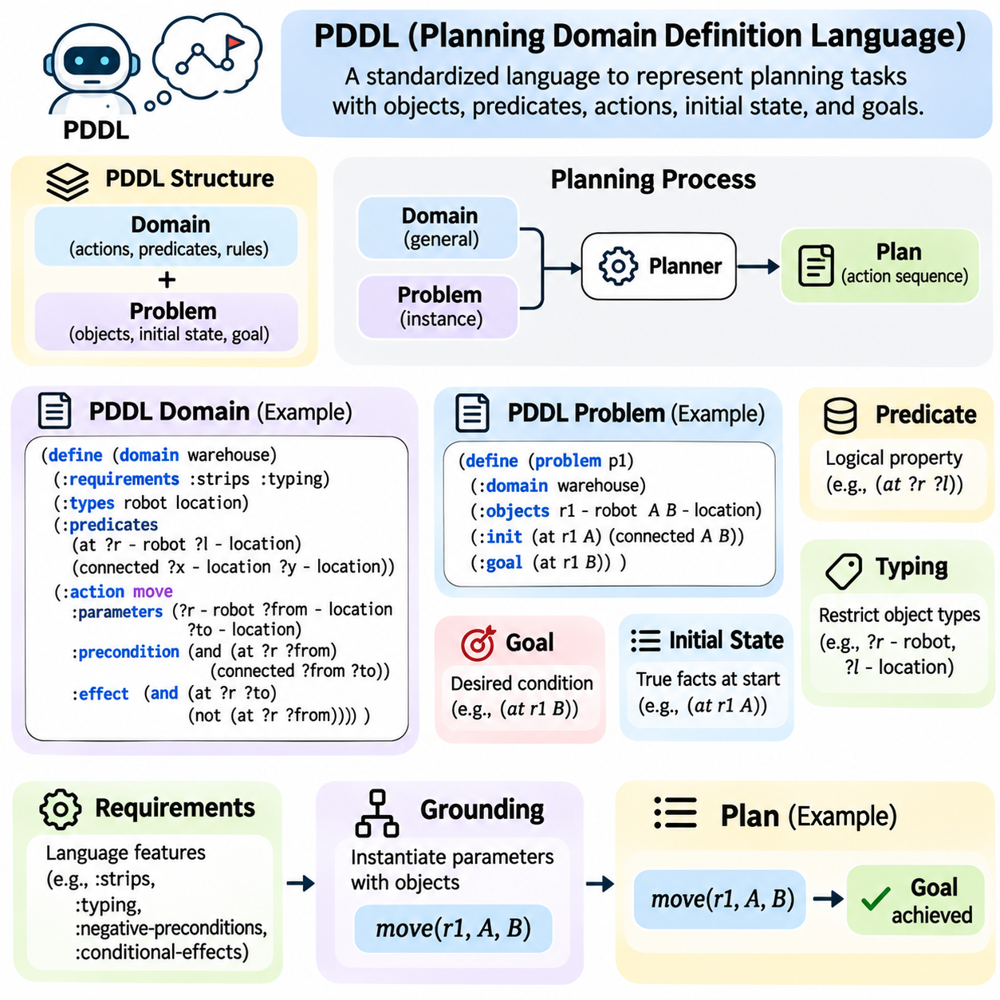{width="7.268055555555556in" height="7.268055555555556in"}

Planning Domain Definition Language, commonly known as PDDL, is a standardized language for representing automated planning problems in artificial intelligence. It provides a formal syntax for describing objects, predicates, actions, initial conditions, and goals. By separating domain knowledge from individual problem instances, PDDL enables planning algorithms to operate on reusable models and supports systematic comparison between different planning approaches.

PDDL was introduced to establish a common representation for automated planning research and benchmarking. Earlier planning systems often relied on specialized domain descriptions that were difficult to exchange between implementations. PDDL addressed this limitation by defining a shared language for expressing planning tasks. Its adoption has supported the development of general-purpose planners and standardized experimental evaluation.

The fundamental organization of PDDL separates a planning task into a domain definition and a problem definition. The domain describes general rules governing possible actions and relationships between objects. The problem specifies the particular objects, initial state, and desired goals for one scenario. This separation allows the same domain model to support numerous planning problems without repeatedly redefining the underlying action logic.

A PDDL domain definition typically begins with a domain name and declarations describing supported language features. These declarations identify requirements such as STRIPS-style actions, typed objects, or additional logical expressions. The domain then defines predicates and action schemas that describe possible operations. This structure enables planning software to interpret the available capabilities and construct valid state transitions.

Predicates represent logical properties and relationships within the planning environment. A predicate such as at(?robot, ?location) expresses the location of a robot, while connected(?from, ?to) describes a relationship between locations. Variables are conventionally identified using a question-mark prefix. Predicates provide the symbolic vocabulary through which initial states, action preconditions, effects, and goals are expressed.

PDDL supports typed parameters that restrict which objects can be substituted into action schemas. A movement action may require one parameter of type robot and two parameters of type location. These restrictions prevent inappropriate combinations, such as using a package where a location is required. Type declarations also help planners organize objects and reduce the number of irrelevant grounded action instances.

Actions in PDDL are represented through named schemas containing parameters, preconditions, and effects. Parameters identify the participating objects, while preconditions describe the conditions required for execution. Effects specify how the symbolic state changes after the action occurs. This structure extends the central principles of STRIPS and provides a consistent mechanism for defining reusable operations across planning domains.

Consider a movement action that transfers a robot between two connected locations. Its preconditions require the robot to occupy the source location and a connection to exist between source and destination. Its effects establish the robot\'s presence at the destination and remove its previous location. This description allows a planner to generate valid movement sequences without explicitly listing every possible route.

PDDL uses a parenthesized syntax inspired by Lisp to represent logical expressions and planning constructs. Expressions such as (at robot1 roomA) identify ground facts, while (and \...) combines multiple conditions. Negation is represented through the not operator when supported by the relevant language feature. This syntax provides a structured format that can be parsed and interpreted consistently by automated planning tools.

A PDDL problem definition identifies the domain to which the problem belongs and declares the objects participating in the scenario. It also specifies the initial state and goal expression. For example, a warehouse problem may include robots, packages, storage locations, and delivery destinations. The initial state describes their starting relationships, while the goal identifies the required final arrangement.

The initial state in classical PDDL generally lists the ground facts that are true before planning begins. Under the closed-world assumption, facts not included are treated as false. This representation allows the planner to construct a complete logical state from a compact set of assertions. Accurate initialization is important because all subsequent state transitions depend on the correctness of the starting conditions.

Goal expressions define the conditions that a successful plan must satisfy. In basic STRIPS-style PDDL, goals are commonly represented as conjunctions of positive predicates. More expressive language requirements allow additional logical constructs. The planner searches for an action sequence whose execution produces a state satisfying the goal formula, regardless of other environmental properties not constrained by that formula.

PDDL requirements declarations identify which language features a domain uses. Common requirements include :strips, :typing, :negative-preconditions, and :conditional-effects. These declarations help determine whether a particular planner supports the domain. Because planning engines implement different subsets of PDDL, compatibility must be verified rather than assumed from the presence of a syntactically valid domain file.

Grounding is the process of replacing action parameters with concrete objects defined in the problem. A general movement schema can generate many specific actions involving different robots and locations. The resulting grounded actions form the operational choices available during planning. Although grounding simplifies subsequent search, the number of generated instances may become large in domains containing many objects.

PDDL extends basic STRIPS representations through features that support more expressive planning models. Depending on the language version and declared requirements, domains may include negative preconditions, disjunctions, quantified expressions, and conditional effects. These constructs allow more sophisticated logical relationships to be represented. However, increased expressiveness can also introduce additional computational complexity.

Conditional effects allow an action to produce different logical changes depending on conditions satisfied during execution. For example, a delivery operation might update a completion predicate only when a package has reached its assigned destination. Such effects provide flexibility beyond unconditional add and delete lists. Their use requires planner support for the corresponding PDDL feature and careful interpretation of effect conditions.

Numeric fluents extend planning representations by associating numerical values with properties such as fuel, energy, capacity, or accumulated cost. Actions may increase, decrease, or assign these values according to their effects. A transportation planner can therefore model fuel consumption or resource availability. Numeric planning expands the applicability of PDDL beyond purely Boolean state descriptions.

Temporal extensions introduce durative actions that occupy intervals rather than occur instantaneously. A durative action may specify conditions that must hold at its beginning, throughout its execution, or at its completion. Effects may also occur at different temporal points. These capabilities enable planning systems to represent overlapping activities, operational deadlines, and scheduling constraints in more realistic environments.

Plan optimization can be expressed through metric declarations that specify quantities to minimize or maximize. A planning problem may seek to minimize total action cost, travel distance, or elapsed execution time. The planner evaluates candidate solutions according to the declared objective when it supports the relevant metric features. This separates logical goal satisfaction from the additional requirement of obtaining a high-quality plan.

PDDL plays an important role in heuristic planning because its structured action descriptions can be analyzed to estimate goal distance. Planners may construct relaxed planning problems, identify relevant actions, or calculate heuristic values from preconditions and effects. These estimates guide state-space search toward promising solutions. The standardized representation allows different heuristic methods to be evaluated on comparable planning tasks.

Practical PDDL development requires careful coordination between domain modeling and problem formulation. Incorrect predicates, incomplete action effects, or inconsistent object types can produce invalid plans or unsolvable problems. Syntax validation alone cannot guarantee semantic correctness. Developers should therefore test action applicability, inspect generated plans, and verify that the modeled transitions reflect the intended operational behavior.

PDDL is widely used in planning benchmarks, research environments, and educational implementations. Standardized domain and problem files allow planners to be compared using measures such as solution coverage, computation time, memory consumption, and plan quality. Benchmark collections also expose differences in planner capabilities across logical, numeric, and temporal domains. Such comparisons support reproducible research and algorithm development.

In robotics, PDDL can represent high-level tasks such as navigation, object pickup, transportation, and assembly. A task planner generates symbolic action sequences, while motion planners and controllers determine how those actions are physically executed. This layered architecture connects logical planning with real-world operations. Execution monitoring and replanning remain necessary when environmental conditions differ from the symbolic model.

The principal advantage of PDDL is its ability to express planning knowledge in a reusable, interpretable, and implementation-independent format. Its limitations arise from the difficulty of accurately modeling complex environments and from differences in feature support among planning engines. Nevertheless, PDDL remains a central foundation for automated planning, connecting classical STRIPS concepts with heuristic search, temporal reasoning, resource management, and intelligent robotic systems.

## 04.05 State Space Planning [w/Code]

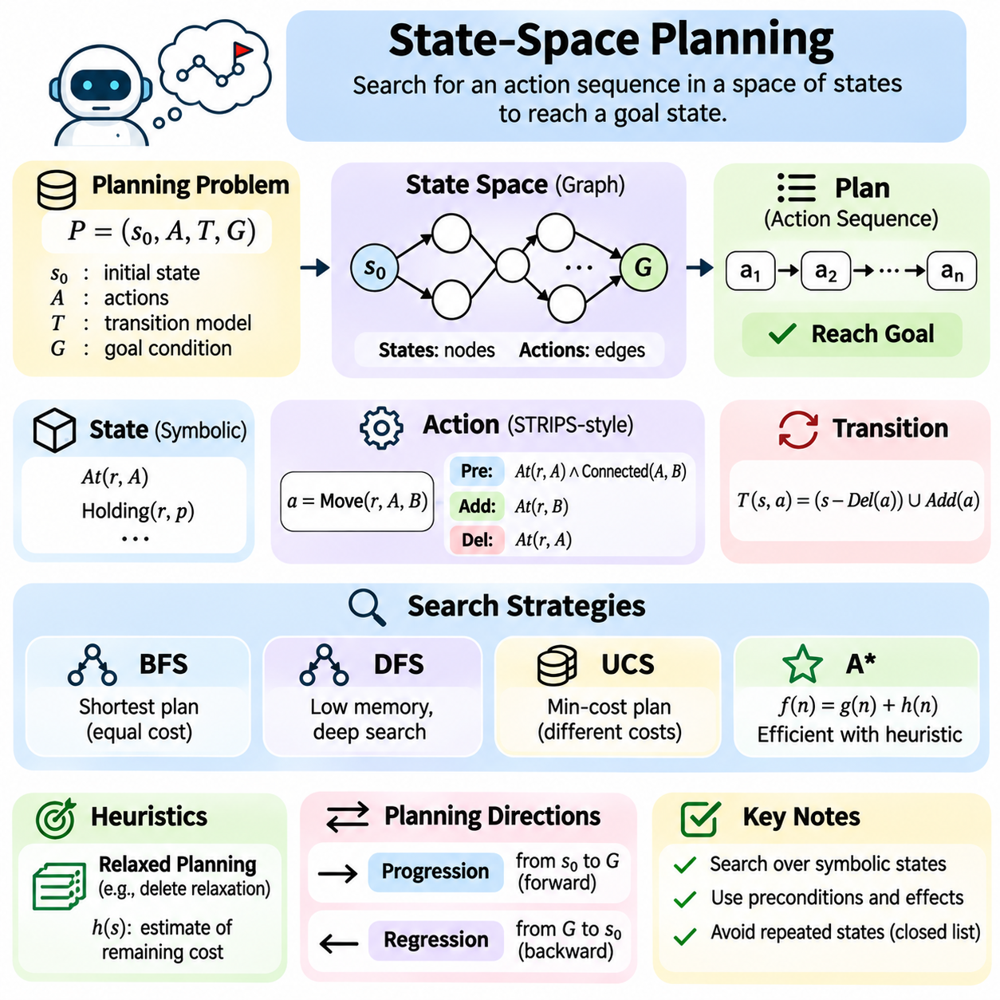{width="7.268055555555556in" height="7.268055555555556in"}

State-space planning is a fundamental approach in classical artificial intelligence that formulates planning as a search through possible configurations of an environment. Each state represents relevant facts about the world, while actions define transitions between states. The objective is to discover a sequence of applicable actions that transforms an initial state into one satisfying the specified goal conditions.

A state-space planning problem consists of an initial state, a set of actions, a transition model, and a goal specification. The initial state identifies the starting configuration, while the goal describes the conditions required for success. The transition model determines how actions modify states. Together, these components establish an implicit graph in which states are nodes and applicable actions define directed edges.

States are commonly represented using sets of logical predicates that describe objects, properties, and relationships. For example, At(Robot1, RoomA) indicates a robot\'s location, while Holding(Robot1, Box1) describes possession of an object. A state contains the facts considered true under the planning model. This symbolic representation allows the planner to compare states and evaluate action applicability systematically.

Actions define the available operations and specify their preconditions and effects. Preconditions determine whether an action can execute in a particular state, while effects describe the resulting modifications. In STRIPS-style planning, effects are divided into add and delete lists. Applying an action removes its delete effects and introduces its add effects, producing a successor state while preserving unrelated facts.

Forward state-space planning begins with the initial state and explores the consequences of applicable actions. Each action generates a successor state that may be examined for goal satisfaction or expanded further. The planner continues until it discovers a goal state or exhausts the reachable search space. This approach is often called progression planning because reasoning advances in the same direction as execution.

Backward state-space planning begins with the goal conditions and reasons toward the initial state. Rather than generating complete successor states, it regresses goal descriptions through actions capable of achieving them. Each regression step identifies the conditions that must hold before an selected action. This method can concentrate exploration on goal-relevant actions, although interactions between conditions require careful handling.

Goal regression requires an action to contribute to the current goal without destroying conditions that must remain satisfied. The planner removes goals established by the selected action and introduces the action\'s preconditions. The resulting regressed goal describes an earlier requirement. Repeating this process produces a sequence of subgoal descriptions that may eventually be satisfied by the initial state.

The distinction between progression and regression affects search efficiency. Forward planning explores reachable states from the initial configuration, potentially generating actions unrelated to the final objective. Backward planning focuses on conditions relevant to the goal but may generate inconsistent subgoal combinations. The preferable direction depends on the branching structure, goal specificity, and available domain knowledge.

Breadth-first search provides a straightforward strategy for exploring state spaces when every action has equal cost. It expands states according to their depth, ensuring that the first discovered goal has the minimum number of actions under standard assumptions. However, the number of stored frontier states may increase exponentially. Consequently, breadth-first planning becomes expensive in domains with large branching factors.

Depth-first search explores one sequence of actions deeply before considering alternatives. Its memory requirements are generally smaller than those of breadth-first search, but it may spend considerable effort following unproductive paths. Without appropriate restrictions, cycles can prevent termination. Depth limits, repeated-state detection, and systematic backtracking help control these problems in practical planning implementations.

Uniform-cost search extends state-space planning to actions with different numerical costs. Instead of prioritizing the shallowest state, it expands the frontier state with the lowest accumulated path cost. With nonnegative action costs and suitable assumptions, this strategy can identify minimum-cost solutions. Its effectiveness is limited by the number of states that must be examined before the optimal goal is reached.

Heuristic search improves planning efficiency by estimating the remaining cost of reaching the goal. A heuristic function assigns a value to each state, guiding exploration toward promising alternatives. Algorithms such as A\\\* combine accumulated cost with estimated remaining cost. When the heuristic is admissible and the search assumptions are satisfied, A\\\* can preserve optimality while reducing unnecessary exploration.

Planning heuristics can be derived from relaxed versions of the original problem. Delete relaxation ignores negative action effects, allowing facts to remain true once established. This simplification produces a problem that is often easier to analyze. Estimates derived from relaxed planning can guide search effectively, although ignoring destructive interactions may underestimate the difficulty of achieving the actual goal.

Repeated-state detection is essential because different action sequences may lead to identical configurations. Without duplicate detection, the planner may repeatedly explore equivalent states and waste computational resources. A visited-state set or closed list records previously examined configurations. State hashing and canonical representations can make duplicate detection efficient, particularly when the state space contains many recurring patterns.

Dead-end states represent configurations from which the goal cannot be achieved. Some dead ends arise because required resources have been consumed or necessary actions have become impossible. Identifying these states early prevents wasted exploration. Dead-end detection may use logical invariants, reachability analysis, heuristic estimates, or domain-specific constraints to recognize situations that cannot lead to successful plans.

The branching factor determines how many applicable actions can be generated from a typical state. A large branching factor increases the number of candidate paths and can make exhaustive search impractical. Grounded action filtering, relevance analysis, and pruning techniques help reduce unnecessary expansion. Effective planning systems balance search completeness against computational efficiency and available memory.

State-space planning must also consider the relationship between plan feasibility and plan optimality. A feasible plan reaches the goal while satisfying every action precondition. An optimal plan minimizes a selected objective, such as action count, execution cost, or energy consumption. Some planning algorithms guarantee optimality under defined assumptions, while satisficing planners prioritize finding useful solutions within practical time limits.

The correctness of state-space search depends on accurate transition modeling. Missing preconditions may permit impossible actions, while incorrect effects can create inconsistent successor states. State invariants provide additional checks on valid configurations. Domain validation should therefore examine action applicability, transition consistency, goal evaluation, and the preservation of required environmental constraints.

Search-space abstraction can reduce complexity by ignoring details that are not essential to high-level decisions. For example, a warehouse planner may initially reason about storage zones rather than exact robot coordinates. Once a symbolic route is selected, lower-level planning can determine precise movements. This hierarchical separation improves scalability but requires consistency between abstract decisions and executable actions.

State-space planning is closely connected to PDDL because standardized domain descriptions provide the action schemas and predicates required for search. A PDDL parser constructs an internal representation of the domain and problem, while a grounding component generates applicable action instances. The search engine then evaluates states and transitions. This separation supports reusable planning algorithms across different application domains.

In robotics, state-space planning can organize navigation, object manipulation, and task execution. A mobile robot may need to move toward a package, pick it up, travel to another location, and release it. Symbolic state-space search determines the task sequence, while motion planning and control systems handle continuous physical execution. This combination connects discrete reasoning with real-world robotic operations.

Dynamic environments introduce challenges because the state observed during execution may differ from the state predicted during planning. Obstacles, equipment failures, or unexpected resource changes can invalidate previously generated actions. Execution monitoring detects these deviations and updates the current state. Replanning then searches for a new sequence from the revised configuration toward the remaining goals.

The performance of state-space planners is commonly evaluated using solution coverage, planning time, memory consumption, expanded states, and plan quality. Completeness indicates whether a method can find a solution when one exists under its assumptions. Optimality concerns whether the selected plan minimizes the defined cost. These criteria provide a systematic basis for comparing search strategies and heuristic methods.

State-space planning establishes a direct connection between classical search algorithms and goal-directed reasoning. By representing actions as state transitions, it transforms planning into a structured exploration of possible futures. Its principles support forward and backward planning, heuristic search, PDDL-based systems, and robotic task planning. Understanding these mechanisms provides a foundation for more advanced planning methods and autonomous intelligent systems.

## 04.06 Plan Space Planning

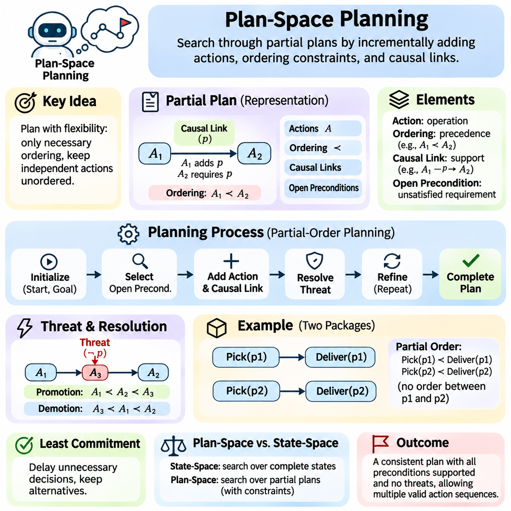{width="7.268055555555556in" height="7.268055555555556in"}

Plan-space planning is a classical artificial intelligence approach that searches through partially specified plans rather than complete environmental states. Instead of constructing a fixed action sequence immediately, it incrementally introduces actions, ordering constraints, and dependencies. This approach preserves flexibility during planning and allows independent actions to remain unordered until their relative execution order becomes necessary.

The central principle of plan-space planning is that a plan can represent multiple valid action sequences simultaneously. A partial plan specifies only the relationships required to achieve its goals. Actions without direct dependencies may be executed in different orders, provided all constraints remain satisfied. This representation reduces premature commitments and distinguishes plan-space reasoning from conventional state-space search.

A partial plan typically contains a set of actions, ordering constraints, causal links, and unresolved preconditions. Actions represent operations that may occur during execution, while ordering constraints specify required precedence relationships. Causal links explain how one action establishes a condition needed by another. Unresolved preconditions identify requirements that the planner must still satisfy before the plan becomes complete.

Plan-space planning often begins with two special actions representing the beginning and end of execution. The initial action establishes the facts available in the starting state, while the goal action requires the desired final conditions. The planner gradually inserts additional actions between these boundaries. Planning succeeds when all required conditions are supported and every potential interference has been resolved.

Partial-order planning is the most widely recognized form of plan-space planning. It avoids imposing a total order on actions unless logical dependencies require one. For example, two robots may independently collect packages from separate locations. If neither operation depends on the other, the plan does not need to specify which collection occurs first. This flexibility can support alternative execution schedules.

Causal links are fundamental structures used to represent dependencies between actions. A causal link indicates that one action establishes a proposition required by another action and that the proposition must remain true between them. For example, a pickup action may establish Holding(Robot1, Package1), which a delivery action requires. The link records the logical support connecting these operations.

Open preconditions are conditions required by planned actions that have not yet been established by any supporting action. The planner selects an open precondition and identifies an action capable of satisfying it. This supporting action may already exist in the partial plan or may need to be introduced. The planner then creates a causal link and adds any necessary ordering constraints to preserve the relationship.

Plan refinement is the process of transforming an incomplete partial plan into a more constrained and executable representation. Each refinement resolves an outstanding planning flaw, such as an unsupported precondition or an interference threat. Refinement may introduce actions, establish causal links, or impose additional ordering requirements. The process continues until the plan satisfies all correctness conditions.

Threat detection is essential because an action may invalidate a condition protected by a causal link. Suppose one action establishes that a robot holds a package and another action requires that condition. An intervening action that releases the package threatens the link. The planner must ensure that the threatening action cannot occur between the producer and consumer of the protected condition.

Threat resolution commonly uses promotion and demotion. Promotion orders a threatening action after the action that consumes the protected condition. Demotion places the threatening action before the action that establishes the condition. Both strategies prevent interference without unnecessarily ordering unrelated operations. If neither ordering is consistent with existing constraints, the planner must explore another refinement.

Ordering constraints define a partial precedence relation among actions. They must remain consistent and cannot introduce cycles that require an action to precede itself. A valid partial order admits at least one total ordering of its actions. Such a total ordering is called a linearization. Different linearizations may correspond to different executable sequences while preserving the same causal dependencies.

Consider a warehouse task requiring two packages to reach separate destinations. A plan-space planner may introduce pickup and delivery actions for both packages without fixing their complete execution order. Each delivery depends on its corresponding pickup, but independent operations may remain unordered. Additional constraints are introduced only when shared robots, locations, or resources create dependencies.

Least commitment is a defining principle of plan-space planning. The planner delays decisions that are not required to establish correctness. By avoiding unnecessary action ordering, it preserves alternative solutions and may reduce backtracking caused by premature choices. However, maintaining flexible partial plans introduces additional reasoning requirements for causal support, interference detection, and constraint consistency.

Plan-space search differs from state-space search in the objects it explores. State-space search expands complete states generated by applying actions, while plan-space search expands partial plans through refinement operations. A search node therefore represents a set of possible action sequences rather than one environmental configuration. The planner seeks a complete, consistent partial plan instead of a particular goal state.

Search strategies can guide the selection of unresolved flaws and possible refinements. A planner may prioritize preconditions with few supporting actions or threats with limited resolution options. Such choices can reduce branching and identify contradictions earlier. Heuristic evaluation may estimate remaining refinement effort, unresolved dependencies, or the difficulty of satisfying outstanding conditions.

Plan-space planning can exploit concurrency because independent actions need not be totally ordered. However, the absence of an ordering constraint does not automatically guarantee safe simultaneous execution. Resource conflicts, temporal constraints, and physical interactions may impose additional restrictions. Practical systems must distinguish logical independence from actual concurrency feasibility when generating executable schedules.

The computational complexity of plan-space planning arises from alternative supporting actions, ordering choices, and threat-resolution possibilities. A single open precondition may have several candidate achievers, while multiple threats can create branching refinements. Search efficiency depends on effective flaw selection, constraint propagation, and early detection of inconsistent partial plans.

Constraint propagation helps maintain consistency as the plan develops. When new ordering relationships are introduced, their implications may restrict other possible refinements. Detecting cycles or incompatible dependencies early prevents exploration of impossible plans. Additional constraints may represent object bindings, resource availability, or temporal relationships, depending on the planning formalism.

Plan correctness requires every action precondition to be supported by an appropriate causal relationship and every causal threat to be resolved. Ordering constraints must remain consistent, and the plan must connect the initial conditions to the required goals. When these conditions hold under the classical planning assumptions, a valid linearization can provide an executable action sequence satisfying the goal specification.

Plan-space planning has important connections to hierarchical planning and workflow coordination. High-level activities can be decomposed into subtasks while preserving partial ordering relationships. Manufacturing processes, logistics workflows, and distributed operations often contain tasks that are dependent in some respects but independent in others. Partial plans provide a natural representation for these structures.

In robotic systems, plan-space planning can coordinate navigation, manipulation, inspection, and delivery activities. A robot may need to acquire an object before transporting it, while unrelated inspection tasks can remain unordered. Multiple robots may perform independent operations, provided shared resources and safety constraints are respected. This approach supports flexible task organization above low-level motion planning.

Plan-space planning also has limitations. Maintaining causal links and resolving threats can become expensive in domains with many interacting actions. Numeric resources, continuous motion, uncertain outcomes, and action durations require extensions beyond basic classical formulations. Consequently, practical applications often combine partial-order reasoning with scheduling, constraint solving, execution monitoring, and replanning.

Evaluation of plan-space planners considers solution coverage, search effort, memory consumption, plan quality, and flexibility. The number of refinement steps and unresolved flaws provides additional insight into search behavior. A partial-order plan may represent several valid execution sequences, making flexibility an important property beyond action count. Comparisons should also account for the computational cost of obtaining executable linearizations.

Ultimately, plan-space planning demonstrates that intelligent planning need not determine every action position in advance. By reasoning about causal dependencies, unresolved requirements, and interference threats, it constructs plans through incremental refinement. Its principles establish a foundation for partial-order planning, flexible workflow execution, hierarchical task organization, and autonomous systems that must coordinate interdependent activities.

## 04.07 Heuristic Planning

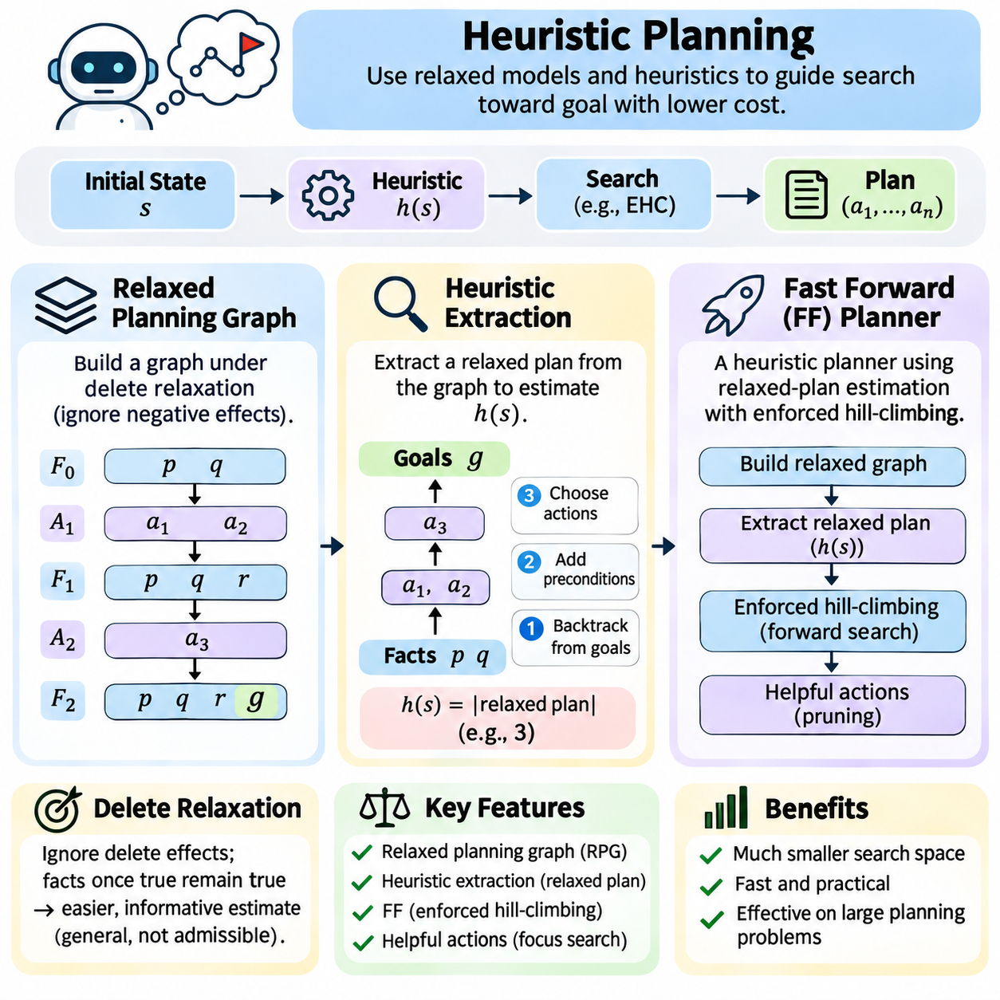{width="7.268055555555556in" height="7.268055555555556in"}

Heuristic planning is an approach to automated planning that uses informed estimates to guide the search for action sequences capable of achieving specified goals. Classical planning problems often contain enormous state spaces, making exhaustive exploration computationally impractical. Heuristics estimate the remaining effort required to reach a goal, allowing planners to prioritize promising states and reduce unnecessary search.

The effectiveness of heuristic planning depends on constructing estimates that reflect the structure of the planning problem. A heuristic function assigns a numerical value to a state, representing its estimated distance or cost to the goal. Lower values generally indicate more promising states. These estimates need not be exact, but their accuracy and computational cost strongly influence planning efficiency, scalability, and solution quality.

Many planning heuristics are derived from relaxed versions of the original problem. Relaxation removes selected constraints to create a simpler problem whose solution provides information about the original task. A widely used technique is delete relaxation, which ignores the negative effects of actions. Once a proposition becomes true in the relaxed problem, it remains true, simplifying the analysis of goal reachability.

Delete relaxation transforms a planning problem into one where actions accumulate facts without removing previously established conditions. This eliminates destructive interactions between actions and often makes goal achievement easier to estimate. However, the relaxed problem may permit combinations that are impossible in reality. Consequently, relaxed estimates provide useful guidance but may underestimate the actual difficulty of achieving goals.

A relaxed planning graph represents the propagation of reachable facts and applicable actions under delete relaxation. It is organized into alternating fact layers and action layers. The initial fact layer contains propositions true in the current state. Each subsequent action layer includes actions whose preconditions are available, while the next fact layer accumulates their positive effects and previously established facts.

Graph expansion continues until all required goal propositions appear in a fact layer or no additional facts can be generated. If the graph reaches a fixed point without satisfying the goals, the relaxed problem is unsolvable from the current state. Because delete effects are ignored, this also implies that the original classical planning problem has no solution. Otherwise, the graph provides information for estimating goal distance.

The depth at which goals first become reachable provides a simple heuristic estimate. A level-based heuristic may use the first fact layer containing every goal proposition. This estimate reflects a relaxed parallel planning horizon rather than the exact number of sequential actions. Although inexpensive, it may fail to capture the total effort required when many actions contribute to different goals.

More informative heuristics can be obtained by extracting a relaxed plan from the planning graph. Relaxed-plan extraction begins at a goal-containing layer and works backward to identify actions supporting the required propositions. The preconditions of selected actions become new subgoals at earlier layers. Repeating this process produces a collection of actions that achieves the goals within the delete-relaxed model.

Heuristic extraction must consider shared dependencies between goals. A single action may establish several required propositions, allowing the extracted relaxed plan to reuse that action. Conversely, different goals may require separate supporting actions. The number of selected actions provides an estimate of planning effort. Because delete effects are ignored, this estimate is informative but does not generally guarantee admissibility.

The Fast Forward planner, commonly called FF, is a landmark heuristic planning system built around relaxed-plan estimation. It uses a STRIPS-style representation and constructs a relaxed planning graph to estimate the effort needed to achieve goals. Rather than relying solely on simple goal counts or graph depth, FF extracts a relaxed plan and uses its action count as a heuristic value.

FF employs enforced hill-climbing as its principal search strategy. From the current state, it searches for a reachable state with a strictly better heuristic value and then continues from that state. Breadth-first exploration can be used within each improvement search. This approach often makes rapid progress toward goals, although heuristic plateaus and dead ends can create difficulties.

Enforced hill-climbing differs from ordinary hill-climbing because it can explore several transitions before finding an improved state. It does not require every immediate successor to have a lower heuristic value. However, the method is not complete in general planning domains and may fail when progress requires entering regions from which no better heuristic state is reachable. FF therefore includes a fallback best-first search strategy.

Helpful actions provide another important optimization in FF. They are selected from actions applicable in the current state that appear relevant to the first step of the extracted relaxed plan. Prioritizing these actions reduces the effective branching factor and concentrates search on operations likely to support goal achievement. Nevertheless, helpful-action pruning may exclude actions required by a valid solution.

The FF heuristic estimates the number of actions in an extracted relaxed plan rather than the true optimal cost. This distinction is important because relaxed plans ignore negative interactions and may select actions differently from an optimal real plan. The heuristic is therefore generally inadmissible. FF emphasizes efficient discovery of satisfactory plans rather than guaranteeing minimum-cost solutions.

Relaxed planning graphs and FF heuristics are closely related but serve different roles. The graph provides a layered representation of relaxed reachability, while extraction selects supporting actions from that representation. The resulting action count becomes a heuristic used by the search algorithm. This separation allows graph construction, support selection, and state exploration to be analyzed independently.

Heuristic extraction quality depends on how supporting actions are selected. When several actions can establish the same proposition, a planner may prefer those with lower estimated costs or greater relevance to other subgoals. Greedy selection can produce compact relaxed plans quickly, but it may overlook better combinations. Consequently, different extraction policies can generate different heuristic values for the same state.

Goal interactions remain a central limitation of delete-relaxed heuristics. Two actions may individually support different goals while interfering with each other in the original problem. Since the relaxed graph ignores deletions, it may incorrectly treat both achievements as permanently available. This can create optimistic estimates and mislead search in domains involving exclusive resources, reversible actions, or tightly coupled constraints.

Heuristic computation also introduces a tradeoff between informativeness and processing cost. A detailed relaxed-plan extraction may provide stronger guidance than a simple goal-count heuristic, but it requires additional computation for every evaluated state. Planning performance depends on whether the reduction in expanded states compensates for this overhead. Efficient implementations reuse data structures and avoid unnecessary graph expansion.

In practical planning systems, heuristic estimates may be combined with action costs, state novelty, preferred operators, or alternative search strategies. Cost-sensitive variants estimate the resources required to reach the goal rather than merely counting actions. However, changing the objective requires corresponding adjustments to relaxed-plan extraction and search evaluation. The chosen heuristic must reflect the intended planning criterion.

Heuristic planning is particularly useful in logistics, manufacturing, workflow automation, and robotic task planning. A warehouse robot may need to collect several packages and deliver them to different locations. Relaxed planning identifies actions that appear necessary for these goals, while heuristic search explores feasible execution sequences. Actual plans must still respect movement constraints, object availability, and action dependencies.

In robotics, heuristic planning can operate as a symbolic task-planning layer above motion planning and control. The heuristic estimates progress toward task-level goals, while geometric planners evaluate whether movements and manipulations are physically feasible. This separation supports efficient high-level reasoning, but symbolic estimates cannot replace collision checking, resource validation, or execution monitoring in real environments.

The performance of heuristic planners is commonly evaluated using planning time, expanded states, solution coverage, memory consumption, and plan quality. Comparisons should also measure heuristic computation overhead and sensitivity to domain structure. A heuristic that performs well in logistics may behave differently in manipulation or scheduling tasks. Benchmarking across diverse planning domains helps identify these strengths and limitations.

Relaxed planning graphs, heuristic extraction, and the FF planner demonstrate how structural knowledge can transform classical planning search. Instead of treating all reachable states equally, the planner estimates which states are closer to satisfying the goals. These techniques provide a foundation for modern heuristic planning, combining symbolic action models, relaxed reasoning, and informed search to solve complex goal-directed problems.

## 04.08 GraphPlan Algorithm [w/Code]

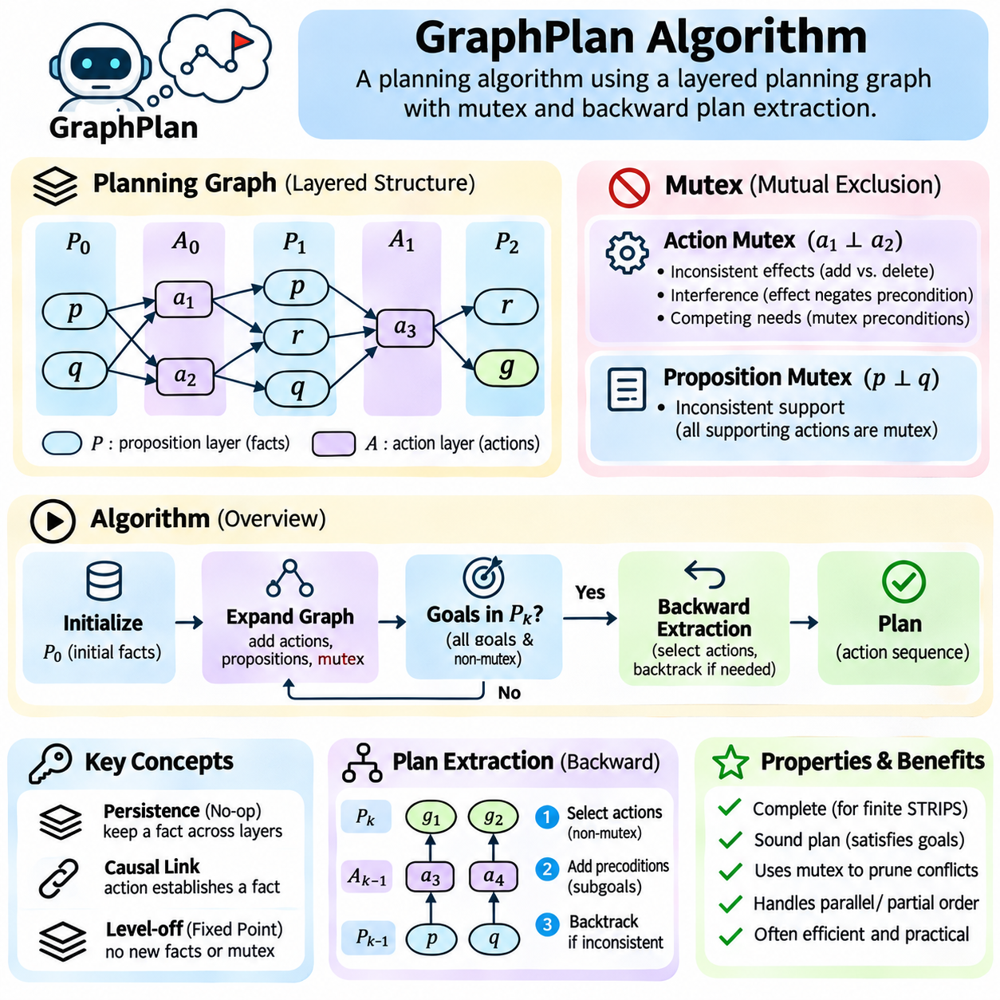{width="7.268055555555556in" height="7.268055555555556in"}

GraphPlan is a classical artificial intelligence planning algorithm that combines a layered planning graph with backward solution extraction. It was designed to solve deterministic planning problems efficiently by representing reachable propositions, applicable actions, and conflicts between them. Rather than exploring complete state sequences directly, GraphPlan organizes planning information into successive levels and searches for a consistent set of actions achieving the goals.

The planning graph consists of alternating proposition layers and action layers. A proposition layer represents facts that may hold at a particular planning level, while an action layer contains operations whose preconditions are available at the preceding level. Directed connections represent preconditions and effects. This layered structure compactly describes many possible action combinations without explicitly enumerating every reachable world state.

Graph construction begins with the initial proposition layer, containing facts true in the initial state. The algorithm identifies actions whose preconditions appear in this layer and places them in the next action layer. Their positive and negative effects determine the following proposition layer. Repeating this expansion creates an increasingly detailed representation of possible future conditions and the actions capable of producing them.

GraphPlan introduces persistence actions, commonly called no-op actions, to represent facts remaining true between successive layers. A persistence action requires a proposition and reproduces that proposition at the next level. These actions allow facts to survive even when no ordinary action explicitly establishes them again. Persistence is essential for representing conditions that must remain available across multiple planning steps.

Mutual exclusion, abbreviated as mutex, is a defining feature of GraphPlan. Mutex relationships identify actions or propositions that cannot coexist within the same planning level. These restrictions prevent the graph from treating incompatible combinations as valid. By recording conflicts explicitly, GraphPlan provides stronger reachability information than a relaxed planning graph that ignores destructive interactions.

Action mutex relationships arise from several forms of interference. Two actions are mutually exclusive when their effects conflict, when one action negates another action\'s precondition, or when their preconditions are mutually exclusive. These cases are commonly described as inconsistent effects, interference, and competing needs. Identifying them prevents incompatible operations from being selected together during plan extraction.

Proposition mutex relationships indicate that two facts cannot simultaneously hold at a given level. In GraphPlan, this commonly occurs when every pair of actions capable of supporting the two propositions is mutually exclusive. This condition is called inconsistent support. Proposition mutex relationships are recalculated as the graph expands, allowing previously incompatible facts to become jointly achievable at later levels.

The planning graph represents a sequence of progressively broader reachability approximations. Proposition layers accumulate potentially achievable facts, while mutex relationships generally become less restrictive as additional levels are introduced. A proposition appearing in a layer does not guarantee that it can participate in a complete valid plan. GraphPlan therefore combines graph-based reachability analysis with explicit solution extraction.

Goal testing begins by examining whether every required goal proposition appears in the current proposition layer. The algorithm also verifies that no pair of goal propositions is mutually exclusive. If either condition fails, the graph must be expanded further. If both conditions hold, backward plan extraction can begin, although the presence of nonmutex goals does not itself guarantee a valid solution.

Backward extraction starts from the goal propositions at the final graph level. The algorithm selects a set of actions from the preceding action layer whose effects collectively establish those goals. Selected actions must not be mutually exclusive. Their preconditions become the subgoals for the previous proposition layer, producing a recursive search through the planning graph toward the initial state.

During extraction, several alternative action sets may support the same goals. GraphPlan explores these alternatives through systematic backtracking when a candidate set produces inconsistent subgoals. If no valid supporting combination exists at the current level, extraction fails for that level. The graph can then be expanded and extraction attempted again using the additional reachability information.

GraphPlan employs memoization to avoid repeatedly solving identical failed subgoal combinations. When extraction determines that a particular goal set cannot be supported at a specific level, the failure is recorded. Subsequent searches encountering the same combination can terminate that branch immediately. This technique reduces redundant reasoning and improves performance in planning problems with overlapping dependencies.

The planning graph eventually reaches a fixed point, or levels off, when proposition sets and mutex relationships stop changing between successive levels. At this stage, further expansion introduces no new reachability information. However, extraction may still benefit from additional time levels in some cases. GraphPlan uses stabilization and recorded extraction failures to determine when continued expansion cannot produce a solution.

Under finite classical STRIPS-style assumptions, GraphPlan is complete and can determine whether a solution exists. When it returns a plan, the plan satisfies the specified action and goal constraints. Its level-by-level extraction finds a solution with the minimum number of parallel action layers. This does not necessarily minimize the total number of actions, execution cost, or resource consumption.

Parallel action representation is an important characteristic of GraphPlan. Actions selected within the same layer are compatible according to the algorithm\'s mutex rules. Consequently, a solution can be expressed as a sequence of action sets rather than a strictly sequential list. Compatible actions may be linearized into a valid sequential plan, although actual simultaneous execution requires additional resource and timing analysis.

Consider a logistics problem involving packages, vehicles, and destinations. The initial proposition layer describes package locations and vehicle availability. Action layers may contain loading, unloading, and movement operations. Mutex relationships prevent incompatible combinations, such as a vehicle simultaneously occupying conflicting locations. Backward extraction identifies compatible actions that deliver the required packages.

GraphPlan differs from ordinary forward state-space planning because it does not generate every complete successor state. Instead, its graph combines information from many possible trajectories into shared proposition and action layers. This representation can reduce redundant reachability calculations. However, the backward extraction phase may still encounter combinatorial complexity when many alternative action combinations satisfy intermediate goals.

The relationship between GraphPlan and heuristic planning is especially important. Planning graphs provide structural information that can guide state-space search even when GraphPlan\'s original extraction procedure is not used. Goal-level estimates, mutex-based measures, and relaxed planning graphs derive useful information from layered reachability. These ideas influenced later heuristic planners, including systems based on delete relaxation.

A relaxed planning graph differs from the original GraphPlan graph primarily in its treatment of negative effects and mutex relationships. Delete-relaxed methods ignore action deletions and typically omit mutex constraints, making graph construction and relaxed-plan extraction simpler. Original GraphPlan retains interference information and searches for an executable plan. The distinction separates approximate heuristic estimation from exact planning.

The computational cost of GraphPlan depends on the number of grounded propositions, applicable actions, mutex relationships, and extraction alternatives. Large domains can produce substantial graph structures even without explicit state enumeration. Efficient implementations use compact representations, incremental mutex computation, and memoized failures. Grounding and preprocessing are also important for limiting unnecessary actions.

GraphPlan is particularly suitable for explaining the relationship between logical planning and constraint satisfaction. Each extraction level requires selecting supporting actions while respecting mutex restrictions and predecessor requirements. This resembles a constraint satisfaction problem in which action choices must satisfy compatibility and support constraints. The planning graph supplies the structure needed to organize these decisions.

In robotics, GraphPlan can support symbolic task planning for navigation, manipulation, and coordinated operations. A robot may need to approach an object, grasp it, move to a destination, and release it. The planning graph represents possible action dependencies and conflicts. However, continuous motion, uncertain perception, resource limits, and real-time safety constraints require additional planning and control mechanisms.

GraphPlan performance can be evaluated through planning time, graph size, number of expanded levels, mutex computation overhead, extraction backtracking, and solution quality. The minimum parallel-plan horizon is a useful metric, but it should not be confused with minimum execution time under realistic action durations. Benchmark comparisons should distinguish graph construction cost from the computational effort required for solution extraction.

GraphPlan established an influential connection between layered reachability, mutual exclusion reasoning, and backward search. Its planning graph provides a compact representation of possible actions and facts, while extraction converts this information into a consistent plan. These principles remain important in classical planning, heuristic development, constraint-based reasoning, and the design of intelligent systems requiring structured goal-directed behavior.

## 04.09 Hierarchical Task Networks HTN

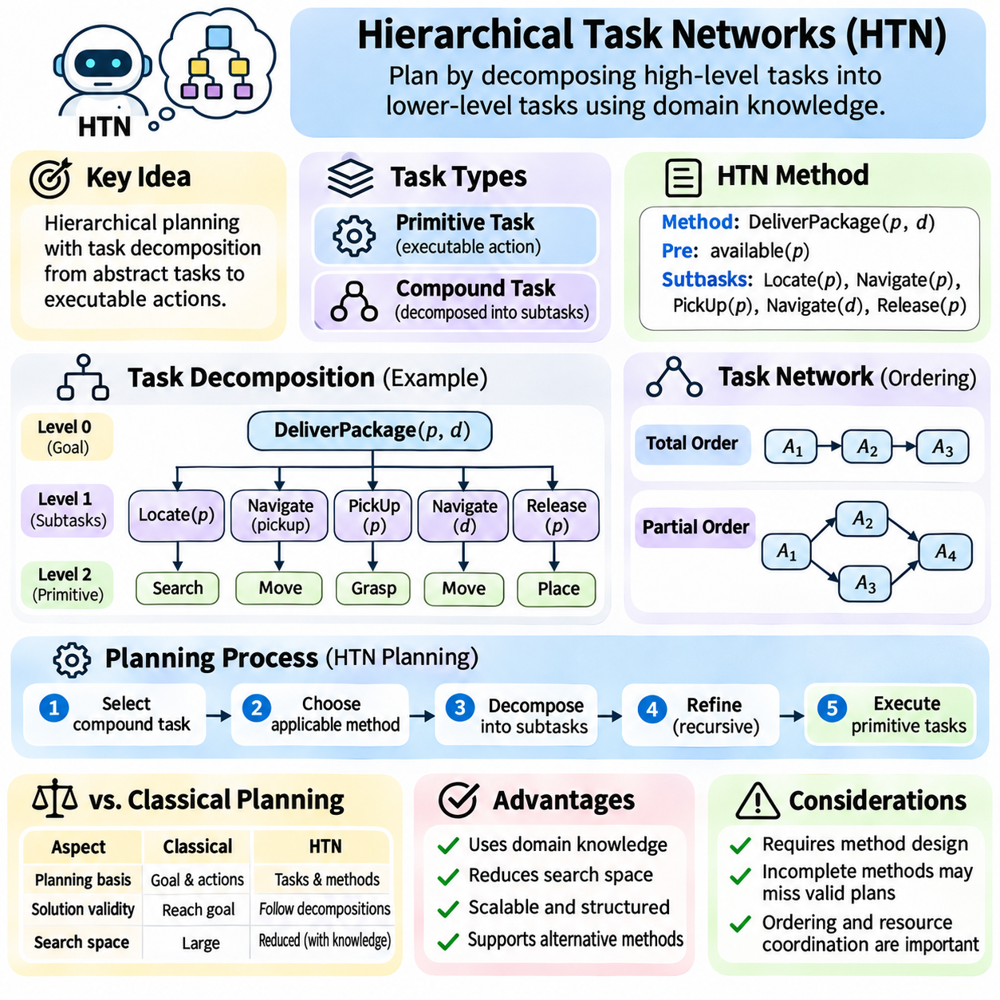{width="7.268055555555556in" height="7.268055555555556in"}

Hierarchical Task Network planning is a structured approach to automated planning that organizes complex activities into progressively smaller tasks. Unlike classical planning methods that primarily search for action sequences satisfying logical goals, HTN planning uses domain-specific decomposition knowledge to describe how tasks should be performed. This hierarchical structure connects high-level objectives with executable operations.

The fundamental distinction in HTN planning is between primitive and compound tasks. Primitive tasks correspond to executable actions whose preconditions and effects can be evaluated against the current state. Compound tasks represent higher-level activities that require further decomposition. A planning problem begins with an initial state and a task network describing activities to accomplish, possibly including ordering and other constraints.

Task decomposition is the central reasoning mechanism of HTN planning. A compound task is replaced by a network of subtasks according to an applicable decomposition method. Each method specifies the circumstances under which a particular refinement is valid and the activities required to complete it. Repeated decomposition eventually produces primitive tasks that can be executed in an order consistent with the network constraints.

An HTN method typically contains a task specification, applicability conditions, and a subtask network. The task specification identifies the compound activity being refined, while applicability conditions determine when the method can be selected. The subtask network defines the resulting activities and their relationships. Multiple methods may describe alternative ways to accomplish the same compound task under different circumstances.

Consider a warehouse delivery task involving a package and destination. A compound task such as DeliverPackage may be decomposed into LocatePackage, NavigateToPickup, PickUpPackage, NavigateToDestination, and ReleasePackage. Some subtasks may themselves require further decomposition. The resulting hierarchy captures operational knowledge that would otherwise need to be discovered through extensive low-level search.

Task networks represent more than simple lists of activities. They may include ordering constraints, variable bindings, and relationships between subtasks. A totally ordered task network requires tasks to follow a fixed sequence, while a partially ordered network permits alternative valid arrangements. These distinctions affect both planning complexity and the flexibility available during execution.

Primitive operators define the executable foundation of an HTN domain. Similar to STRIPS actions, they may specify preconditions and effects that determine state transitions. During planning, an operator can be applied only when its preconditions hold in the relevant state. Its effects update the symbolic representation, allowing subsequent tasks to be evaluated against the resulting conditions.

HTN planning commonly performs recursive refinement until every compound task has been replaced by primitive operations. The planner selects an eligible compound task, chooses an applicable method, and inserts its subtasks into the network. If a decomposition creates an inconsistency or an impossible execution path, the planner may backtrack and try another method. This process combines hierarchical reasoning with systematic search.

Total-order HTN planning is comparatively straightforward because tasks are processed in a prescribed order. The planner can simulate primitive actions sequentially and update the current state after each operation. Partial-order HTN planning is more complex because several task orderings may remain possible. The planner must ensure that selected refinements preserve ordering constraints and allow a feasible execution sequence.

HTN planning differs from goal-based classical planning in its treatment of solution validity. Classical planning primarily requires a sequence of applicable actions that achieves a goal condition. HTN planning additionally requires the primitive action sequence to be obtainable through permitted task decompositions. Consequently, a physically feasible sequence may still be rejected if it does not conform to the specified hierarchical methods.

Domain knowledge is both the primary strength and an important limitation of HTN planning. Well-designed decomposition methods can guide the planner toward operationally meaningful solutions and eliminate large portions of irrelevant search. However, incomplete methods may prevent the discovery of otherwise feasible plans. Incorrect or overly restrictive decompositions can also introduce unnecessary dependencies and reduce flexibility.

Hierarchical abstraction improves planning scalability by separating strategic decisions from operational details. A high-level transportation task may first determine whether a package should travel by truck or autonomous robot. Lower-level methods then refine the selected transportation strategy into loading, navigation, and unloading operations. This structure allows planning decisions to reflect domain expertise at multiple levels.

Method selection can depend on environmental conditions, available resources, and operational policies. For example, a delivery task may use an indoor robot when the destination is inside a facility and a different method when outdoor transportation is required. Preconditions on decomposition methods help encode these alternatives. The planner selects a method whose applicability conditions are satisfied in the relevant planning context.

Task ordering and resource coordination are especially important when multiple activities share equipment or personnel. Two tasks may be logically independent but compete for the same robot, workstation, or charging station. Basic HTN models may require additional resource constraints or scheduling mechanisms to represent such conflicts. Integrated approaches combine hierarchical decomposition with resource-aware planning and temporal reasoning.

Hierarchical decomposition also supports reusable planning knowledge. A method for inspecting equipment can be applied to many inspection missions with different objects and locations. Parameters allow the same abstract procedure to operate on multiple task instances. Reusable methods reduce duplicated planning logic and simplify maintenance when operational procedures change across a family of related applications.

HTN planning systems may use depth-first search, backtracking, heuristic guidance, or constraint propagation to explore alternative decompositions. Search performance depends on the number of available methods, decomposition depth, and interactions among subtasks. Heuristics can prioritize promising methods or estimate the remaining primitive effort. Effective control strategies are particularly valuable in domains with many hierarchical alternatives.

Formal HTN planning languages provide structured representations of tasks, methods, operators, and initial task networks. HDDL, the Hierarchical Domain Definition Language, extends PDDL-style modeling concepts to hierarchical planning. Such languages help separate domain descriptions from planning engines and support reproducible experiments. Their expressiveness depends on the specific language features and planner implementation.

HTN planning is closely related to workflow modeling because both describe how complex activities are organized into dependent operations. Business processes, manufacturing procedures, and maintenance workflows often contain reusable task structures and conditional alternatives. Hierarchical methods can encode these procedures while permitting the planner to select appropriate refinements according to the current operating conditions.

In robotics, HTN planning provides a natural bridge between mission-level objectives and executable robot behaviors. A mission such as InspectBuilding may be decomposed into NavigateToArea, AcquireSensorData, AnalyzeResults, and ReportFindings. Each activity can be refined into robot-specific operations. Motion planning and control systems then handle geometric feasibility and continuous physical execution beneath the symbolic task hierarchy.

Multi-robot systems can use hierarchical task networks to organize cooperative missions. A high-level task may be decomposed into transportation, inspection, and communication activities assigned to different robots. Ordering constraints express dependencies, while additional allocation and scheduling mechanisms handle shared resources. Partial-order structures can preserve opportunities for parallel execution when tasks are independent.

Dynamic environments require HTN plans to adapt when assumptions become invalid. Unexpected obstacles, equipment failures, or changing mission priorities may make a selected method unsuitable. Execution monitoring can detect such changes and trigger replanning or alternative task decomposition. Practical systems must determine whether to repair the affected subtask, reconsider its parent method, or reconstruct a larger portion of the plan.

HTN planning does not automatically guarantee optimal solutions. A valid hierarchical decomposition may produce an executable plan without minimizing action count, execution time, or resource consumption. Optimality depends on the search strategy, cost model, and completeness of explored alternatives. Restricting search to domain-approved methods may improve practical relevance while excluding globally optimal plans available outside the hierarchy.

The performance of HTN planners can be evaluated through solution coverage, planning time, decomposition depth, expanded search nodes, and plan quality. Method reuse, execution feasibility, and adaptation to changing conditions provide additional practical criteria. Benchmarking should distinguish the quality of hierarchical domain knowledge from the efficiency of the planning algorithm because both strongly influence results.

Hierarchical Task Network planning demonstrates how procedural knowledge and symbolic reasoning can be combined to solve complex planning problems. By refining compound tasks into executable operations, HTN systems preserve meaningful relationships between strategic objectives and operational actions. Their principles support scalable task organization, reusable domain models, robotic mission planning, and intelligent systems requiring structured execution.

## 04.10 Temporal Planning

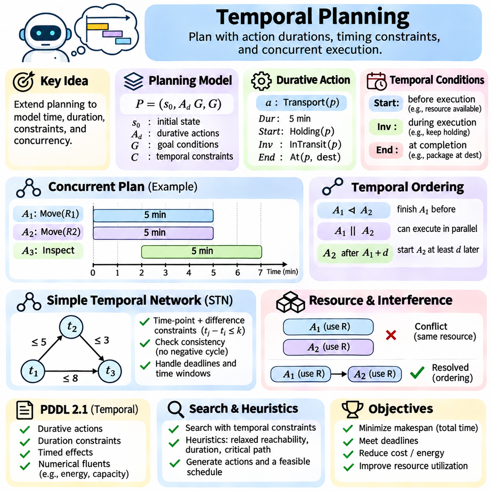{width="7.268055555555556in" height="7.268055555555556in"}

Temporal planning extends classical artificial intelligence planning by explicitly representing action durations, timing constraints, and concurrent execution. Traditional planning often treats actions as instantaneous transitions between states, while temporal planning models activities that occupy intervals of time. This distinction is essential when tasks overlap, resources are shared, or goals must be achieved within specified deadlines.

A temporal planning problem includes an initial state, a collection of actions, goal conditions, and temporal constraints. Actions may have fixed or variable durations, while constraints specify when activities can begin or end. The planner must identify both a valid set of actions and a feasible schedule. Success requires satisfying logical preconditions, temporal relationships, and any additional operational restrictions.

Durative actions are fundamental elements of temporal planning. Unlike instantaneous actions, a durative action has a start time, an end time, and a duration. Its conditions and effects may occur at different points during execution. For example, a robot transportation action may require possession of a package at departure and establish the package\'s new location only after transportation finishes.

Temporal conditions are commonly divided into conditions required at the start, conditions maintained throughout execution, and conditions required at the end. Start conditions determine whether an activity can begin, while invariant conditions must remain satisfied during its duration. End conditions govern successful completion. This distinction allows planners to represent operations whose requirements change over time.

Temporal effects describe changes occurring at action boundaries or, in more expressive models, continuously during execution. A robot may reserve a loading station when an operation begins and release it when the operation ends. Battery energy may decrease throughout movement. Representing these effects accurately prevents a planner from assuming that resources or conditions remain unchanged during extended activities.

Concurrency allows multiple actions to execute during overlapping time intervals. Two robots may independently transport packages while another system performs inspection. Temporal planning determines whether these operations can coexist without violating logical or resource constraints. Parallel execution can reduce overall completion time, but overlapping activities must be checked for interference and compatibility.

Temporal ordering constraints express relationships between action start and end events. One task may need to finish before another begins, while two activities may be permitted to overlap. Some operations require synchronization at particular milestones. These relationships are more expressive than simple sequential ordering because they describe dependencies among temporal events rather than only among actions.

Simple Temporal Networks, commonly abbreviated STNs, provide a mathematical representation for temporal constraints. An STN uses time-point variables and difference constraints to specify allowable relationships between events. Constraints can express minimum delays, maximum separations, and deadlines. Consistency checking determines whether values can be assigned to all time points without violating these relationships.

An STN constraint can be written as a bound on the difference between two time points. For example, a transportation operation may require its completion time to occur between five and eight minutes after departure. Such constraints can be transformed into a weighted directed graph. Shortest-path algorithms and negative-cycle detection provide mechanisms for testing temporal consistency.

Temporal planning also requires reasoning about action interference. Two activities may individually be valid but incompatible when executed simultaneously. For example, one action may require a loading platform to remain available while another attempts to occupy it. Temporal planners must preserve required conditions throughout relevant intervals and prevent conflicting effects from invalidating concurrent operations.

Resource constraints introduce additional complexity because activities may compete for limited equipment, energy, personnel, or workspace. A robot charging station may serve only one vehicle at a time, while a computing system may support several tasks within a fixed capacity. Resource-aware temporal planning combines scheduling decisions with logical action selection to ensure feasible allocation.

Temporal planning objectives frequently involve minimizing makespan, the elapsed time between plan initiation and completion. Other objectives include reducing energy consumption, meeting deadlines, or balancing resource utilization. A plan with fewer actions is not necessarily faster because action durations and opportunities for concurrency determine total execution time. Optimization therefore requires explicit temporal reasoning.

Temporal Planning Domain Definition Language extensions, particularly PDDL 2.1, support durative actions and numerical fluents. Durative action descriptions can specify duration constraints, start conditions, invariant conditions, end conditions, and timed effects. Numerical expressions can represent quantities such as energy or capacity. These features allow temporal planning problems to be described using standardized symbolic models.

Search-based temporal planners explore combinations of action choices and timing decisions. Some systems generate partially ordered actions and subsequently verify temporal feasibility, while others integrate scheduling constraints directly into search. Heuristic estimates may consider relaxed reachability, action durations, or critical-path information. The effectiveness of these methods depends on how tightly logical and temporal reasoning interact.

Critical-path reasoning identifies chains of dependent activities that constrain the earliest possible completion time. Even when many actions can execute concurrently, a sequence of mandatory dependencies may determine the minimum achievable makespan. Estimating this path provides useful guidance for scheduling and heuristic search. However, resource conflicts can increase completion time beyond dependency-based lower bounds.

## 04.11 Probabilistic Planning

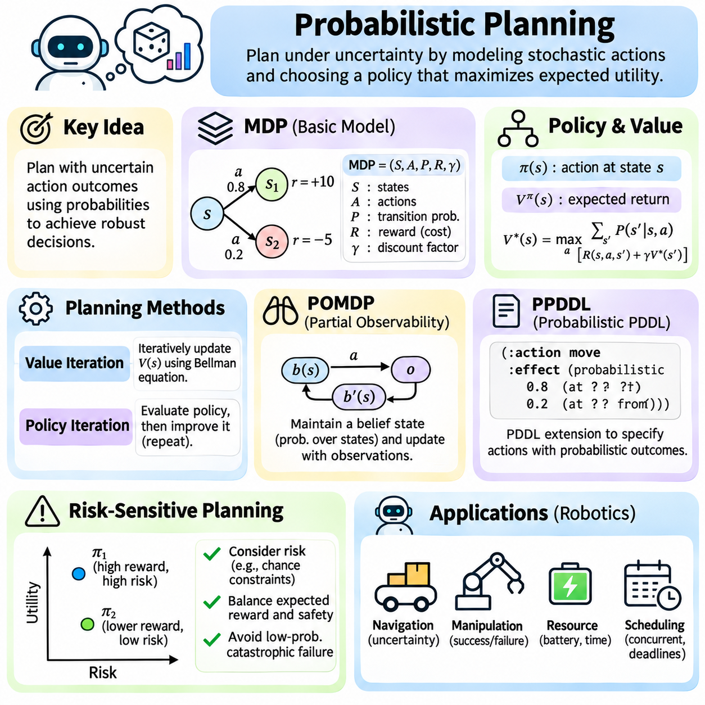{width="7.268055555555556in" height="7.268055555555556in"}

Probabilistic planning extends classical artificial intelligence planning by explicitly representing uncertainty in action outcomes, environmental changes, and system behavior. Traditional deterministic planning assumes that each action produces a predictable result, while probabilistic planning considers multiple possible outcomes with associated probabilities. This approach is essential for intelligent agents operating in dynamic and uncertain environments.

A probabilistic planning problem consists of states, actions, transition probabilities, rewards or costs, and objectives. Instead of defining a single successor state for each action, the transition model specifies a probability distribution over possible next states. The planner evaluates how alternative actions influence future conditions and selects decisions that maximize expected utility or satisfy probabilistic performance requirements.

Uncertainty may originate from imperfect actuators, environmental disturbances, incomplete observations, or unpredictable external events. A mobile robot may attempt to move forward but experience wheel slip, localization errors, or unexpected obstacles. A manipulation system may successfully grasp an object or fail because of uncertain contact conditions. Probabilistic models represent these variations rather than assuming flawless execution.

Markov Decision Processes, commonly called MDPs, provide a fundamental mathematical framework for probabilistic planning. An MDP contains a state space, an action space, transition probabilities, a reward function, and a decision horizon or discount factor. The Markov property assumes that the current state contains sufficient information to predict future transitions given the selected action, without requiring the complete historical trajectory.

A policy is a decision rule that determines which action an agent should select in each state. Unlike a fixed action sequence, a policy can adapt to different outcomes encountered during execution. This distinction is important because probabilistic actions may lead to several possible successor states. A robust planning system therefore computes conditional behavior rather than relying exclusively on a predetermined sequence.

The value function expresses the expected cumulative reward obtainable from a state under a particular policy or optimal decision strategy. It combines immediate rewards with the expected value of future states. Bellman equations establish recursive relationships between current decisions and future outcomes. These relationships provide the mathematical foundation for evaluating policies and computing optimal behavior in Markov decision processes.

Value iteration is a dynamic programming algorithm that repeatedly updates state values using the Bellman optimality equation. Each update evaluates available actions by combining immediate rewards with probability-weighted future values. Under standard discounted finite-state assumptions, the estimates converge toward the optimal value function. An optimal policy can then be derived by selecting actions with the highest expected return.

Policy iteration provides an alternative approach by alternating between policy evaluation and policy improvement. Policy evaluation estimates the expected return obtained by following the current policy. Policy improvement selects better actions using these estimates. Repeating the process eventually produces an optimal policy under appropriate finite-state assumptions, although computational efficiency depends on the structure and size of the problem.

Planning horizons determine how far into the future the decision process evaluates consequences. Finite-horizon planning considers a limited number of decisions and may produce policies that depend on the remaining time. Infinite-horizon planning evaluates continuing operation, commonly using discounted rewards to ensure bounded returns. The horizon influences both computational complexity and the balance between immediate and long-term objectives.

Probabilistic planning can also represent uncertain action effects through probabilistic extensions of symbolic planning languages. PPDDL extends PDDL-style descriptions with probabilistic outcomes, allowing actions to produce alternative effects according to specified distributions. Such representations connect classical action models with stochastic state transitions and support benchmark problems involving uncertain execution.

Partially Observable Markov Decision Processes, or POMDPs, extend probabilistic planning to situations where the true system state cannot be observed directly. Instead of maintaining a single known state, the agent maintains a belief state representing a probability distribution over possible states. Observations update this belief through Bayesian inference, allowing decisions to account for uncertainty in both the environment and perception.

Belief-state planning introduces additional computational complexity because the planner reasons over probability distributions rather than individual states. An action may change the physical environment while also influencing the information available to the agent. Active sensing and information-gathering actions become valuable when reducing uncertainty improves subsequent decisions. Practical algorithms often rely on approximation to manage large belief spaces.

Risk-sensitive probabilistic planning considers more than expected reward. Two policies may have similar expected performance but very different probabilities of catastrophic failure. Risk measures, chance constraints, and conditional value at risk can express preferences for safer outcomes. These techniques are important in autonomous systems where low-probability failures may have severe consequences.

Probabilistic planning is especially relevant to robotics because sensing, movement, manipulation, and interaction with physical environments are inherently uncertain. A robot navigating an unfamiliar area may select routes according to estimated obstacle probabilities and traversal risks. Manipulation planning may evaluate grasp success probabilities. The planner can adapt its decisions as new observations update the estimated state.

The computational demands of probabilistic planning increase with the number of states, actions, possible outcomes, and planning horizon. Exact dynamic programming becomes difficult in large environments because of the curse of dimensionality. Approximate methods, sampling-based planning, Monte Carlo Tree Search, and factored representations can reduce computational requirements while sacrificing some guarantees of optimality.

## 04.12 Planning in Robotics

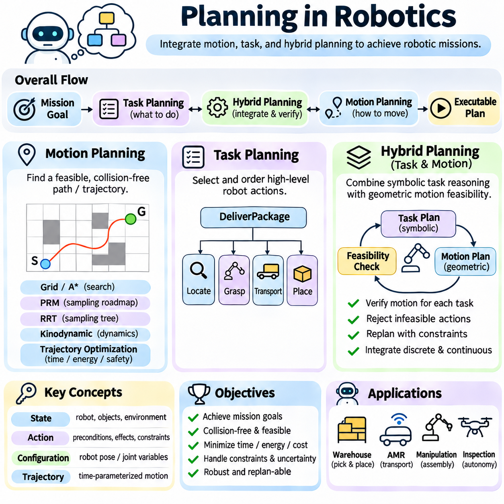{width="7.268055555555556in" height="7.268055555555556in"}

Planning in robotics connects high-level mission objectives with physical actions performed in dynamic environments. Unlike purely symbolic planning, robotic planning must account for geometry, motion constraints, sensing uncertainty, and actuator limitations. A complete robotic planning system determines what actions should be performed, how the robot can execute them, and how execution should adapt when environmental conditions change.

Robotic planning is commonly organized into motion planning, task planning, and hybrid planning. Motion planning determines feasible movements through physical space, while task planning selects and orders meaningful operations. Hybrid planning integrates discrete decisions with continuous physical behavior. These components operate at different abstraction levels but must exchange information to produce executable and reliable robotic missions.

Motion planning searches for collision-free paths or trajectories connecting an initial configuration to a desired configuration. The configuration space represents the robot\'s possible positions and orientations, including joint variables for articulated mechanisms. Obstacles define forbidden regions within this space. A valid solution must satisfy geometric constraints and, when required, additional kinematic or dynamic restrictions.

Configuration-space reasoning transforms geometric collision problems into mathematical search problems. A mobile robot may be represented by its planar position and heading, while a robotic manipulator requires multiple joint coordinates. The dimensionality of the configuration space influences planning complexity. High-dimensional robots often require sampling-based methods because exhaustive discretization becomes computationally expensive.

Classical motion planning algorithms include graph search, potential fields, and geometric decomposition methods. Grid-based approaches represent free space using discrete cells and apply algorithms such as A\\\* to identify feasible routes. These techniques are effective when environmental maps are available and motion constraints are manageable. However, discretization resolution affects accuracy, memory consumption, and computational requirements.

Sampling-based motion planners address complex configuration spaces by exploring selected configurations rather than constructing complete geometric representations. Probabilistic Roadmaps build reusable connectivity graphs, while Rapidly-exploring Random Trees incrementally explore reachable regions. These methods are particularly useful for articulated robots and cluttered environments. Their performance depends on sampling strategies and collision-checking efficiency.

Kinodynamic planning extends geometric path planning by considering velocity, acceleration, steering, and other motion constraints. A geometrically valid path may be impossible for a vehicle with limited turning radius or acceleration capability. Kinodynamic planners search for trajectories that satisfy system dynamics. This distinction is essential for autonomous vehicles, mobile manipulators, and robots operating at significant speeds.

Trajectory optimization improves candidate motions by minimizing objectives such as travel distance, energy consumption, execution time, or collision risk. Optimization methods adjust trajectories while enforcing physical constraints. Model Predictive Control can repeatedly optimize short-horizon trajectories using updated state estimates. Such methods connect motion planning with feedback control and support adaptation during execution.

Task planning operates at a higher abstraction level by selecting actions required to achieve mission objectives. A warehouse robot may need to locate an item, approach a shelf, grasp a package, transport it, and deliver it. Symbolic representations describe action preconditions, effects, and dependencies. Classical planning algorithms, hierarchical task networks, and temporal planners can organize these operations into valid task sequences.

Task planning depends on meaningful symbolic descriptions of the environment. Objects, locations, robot capabilities, and operational states are represented through predicates and action models. For example, a PickObject action may require the robot to be near the object and its gripper to be available. Successful execution changes symbolic facts describing object possession and gripper occupancy, enabling subsequent planning decisions.

Hierarchical task planning is especially useful for complex robotic missions because abstract objectives can be decomposed into reusable procedures. An inspection mission may contain navigation, sensing, data processing, and reporting activities. Each activity can be refined into robot-specific operations. This structure separates mission-level reasoning from implementation details and supports coordination across heterogeneous robotic platforms.

Task and motion planning are strongly interdependent. A symbolic plan may specify that a robot should grasp an object, but the action is executable only if a collision-free approach and feasible grasp configuration exist. Conversely, motion planning requires target configurations derived from task decisions. Task and Motion Planning integrates these levels by evaluating symbolic choices against geometric and physical feasibility.

Integrated Task and Motion Planning systems often alternate between discrete search and continuous feasibility checking. A symbolic planner proposes an action sequence, and geometric planners verify navigation, manipulation, and placement requirements. When a motion constraint invalidates an action, the system can reject the candidate and explore alternatives. Constraint feedback prevents repeated selection of physically impossible task combinations.

Hybrid planning combines discrete operational modes with continuous state evolution. A mobile robot may switch among navigation, docking, charging, and manipulation modes while its position, velocity, and energy change continuously. Hybrid system models describe these modes, their transition conditions, and associated dynamics. Planning must ensure that both discrete transitions and continuous trajectories satisfy operational requirements.

Uncertainty complicates robotic planning because maps, object poses, actuator responses, and environmental behavior may be imperfectly known. Probabilistic state estimation provides beliefs about the current environment, while robust or belief-space planning accounts for uncertain outcomes. Replanning incorporates new observations during execution. These mechanisms are essential when robots interact with changing environments rather than fixed laboratory conditions.

## 04.13 Planning Systems Architecture

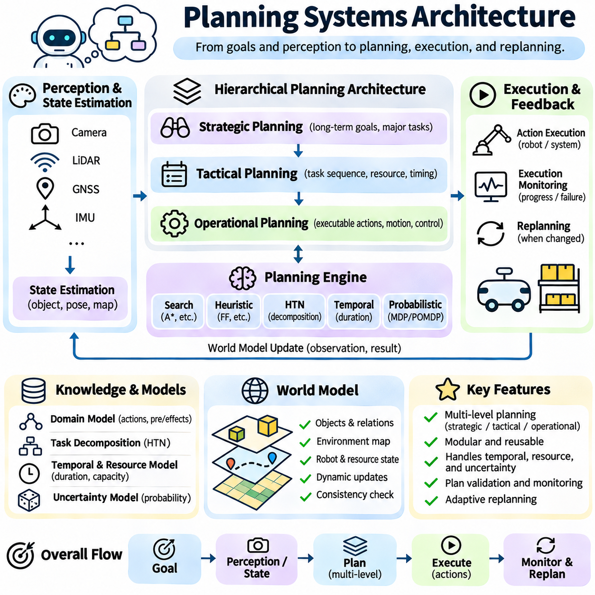{width="7.268055555555556in" height="7.268055555555556in"}

Planning systems architecture defines how an intelligent agent transforms goals, environmental information, and operational constraints into executable plans. A complete architecture integrates knowledge representation, state estimation, planning algorithms, execution management, and feedback mechanisms. Rather than treating planning as an isolated search problem, system architecture establishes how reasoning components interact with perception, control, and external services.

The architecture commonly separates strategic planning, tactical planning, and operational execution. Strategic planning identifies long-term objectives and major task dependencies, while tactical planning determines concrete action sequences and resource assignments. Operational execution converts selected actions into commands for physical or software systems. This separation supports modular development and allows different planning methods to operate at appropriate abstraction levels.

A planning system begins with a representation of the current world state and desired goals. The state model describes relevant objects, properties, relationships, and available resources. Goals specify conditions that should become true or performance criteria that should be optimized. A well-defined planning interface separates these descriptions from the internal search algorithm, allowing multiple planning engines to operate on compatible problem representations.

Knowledge representation provides the semantic foundation of planning architecture. Symbolic models may use predicates, objects, actions, preconditions, and effects to describe the environment. More expressive systems incorporate numerical variables, temporal constraints, uncertainty, and hierarchical task structures. The representation must balance expressive power with computational efficiency because complex models can substantially increase planning difficulty.

The world model maintains information about the environment and the agent\'s operational context. It may combine static knowledge, such as facility layouts and equipment capabilities, with dynamic information about object locations, robot positions, and resource availability. Updates from perception and external databases modify this representation. Consistency mechanisms are required to prevent planning decisions from relying on outdated or contradictory facts.

State estimation connects sensory observations with the symbolic and numerical models used by the planner. Cameras, LiDAR, positioning systems, and other sensors produce measurements that may contain uncertainty. Estimation modules transform these observations into object states, occupancy information, and confidence estimates. Planning components then use this information to evaluate action feasibility and determine whether existing plans remain valid.

The planning engine is responsible for selecting actions that satisfy goals and operational constraints. Depending on the problem, it may employ state-space search, heuristic planning, hierarchical task networks, temporal planning, or probabilistic decision processes. Different engines offer distinct capabilities and computational tradeoffs. A modular architecture can select or combine planners according to task complexity, uncertainty, and available resources.

A planning domain model defines the actions available to the system and the conditions governing their execution. Each action typically specifies parameters, applicability conditions, expected effects, and relevant costs. Temporal systems may also include durations and resource requirements. Separating domain models from planning algorithms improves reuse, supports independent validation, and simplifies adaptation to different applications.

Task decomposition enables complex missions to be organized into manageable activities. Hierarchical planning modules refine abstract objectives into subtasks, while lower-level planners determine executable operations. For example, a warehouse delivery mission may be decomposed into item identification, navigation, loading, transportation, and unloading. The architecture must preserve dependencies and exchange feasibility information between planning levels.

Plan validation checks whether generated plans satisfy logical, temporal, resource, and safety constraints before execution. A symbolic action sequence may be logically correct but physically impossible because of geometric obstacles or insufficient battery capacity. Validation modules can reject such plans or request revisions. Independent validation is especially important when planning algorithms use approximations or incomplete environmental models.

The execution manager translates approved plans into commands for controllers, robots, applications, or external services. It maintains the execution state, dispatches actions, and tracks completion or failure. Preconditions may be checked immediately before action execution because the environment can change after planning. Execution management therefore provides a controlled interface between abstract reasoning and real-world operations.

Execution monitoring compares observed system behavior with expected plan outcomes. Sensors and operational feedback indicate whether actions have started, completed, failed, or produced unexpected effects. Monitoring modules update the world model and identify deviations from planned conditions. These observations enable the architecture to detect problems early and determine whether execution can continue safely.

Replanning allows the system to adapt when environmental changes invalidate the current plan. A robot may encounter a blocked corridor, unavailable charging station, or failed manipulation attempt. The planner can generate an alternative sequence using the updated state. Incremental repair methods may preserve unaffected plan segments, reducing computation and avoiding unnecessary disruption to ongoing operations.

Resource management coordinates shared assets such as robots, processors, batteries, workstations, and communication channels. Planning decisions must account for availability, capacity, and competing demands. Scheduling components allocate resources across tasks and enforce timing constraints. In multi-agent systems, centralized or distributed coordination mechanisms may be required to prevent conflicts and maintain operational efficiency.

Safety architecture establishes constraints that planning and execution must respect. Collision avoidance, restricted operating regions, emergency conditions, and equipment limitations may be represented as planning restrictions. However, safety-critical protections should not depend exclusively on the planner. Independent monitoring and control mechanisms must enforce essential limits even when planning software fails or produces an unsafe command.

## 04.14 Case Studies

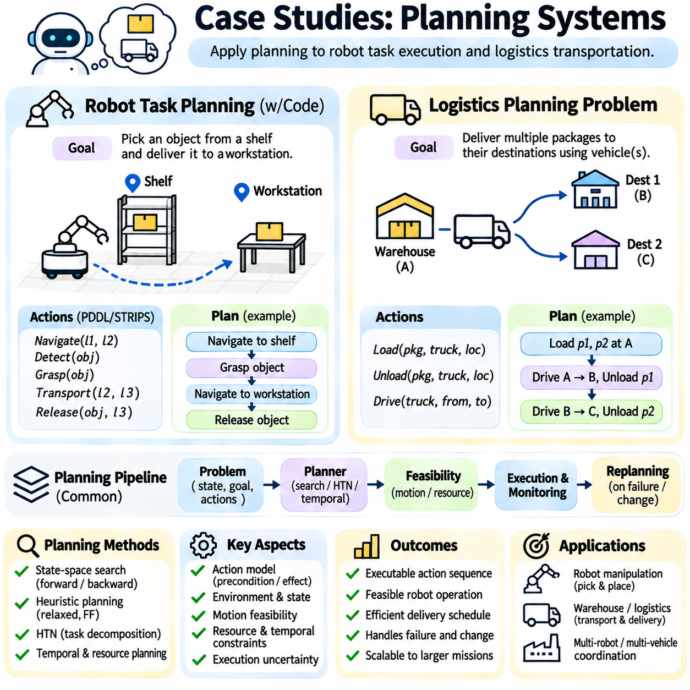{width="7.268055555555556in" height="7.268055555555556in"}

Case studies in planning systems demonstrate how abstract planning principles are applied to practical problems involving robots, transportation, and resource coordination. Robot task planning focuses on selecting and executing actions in physical environments, while logistics planning addresses the movement of goods between locations. Both applications illustrate how symbolic states, action models, goal conditions, and search algorithms support structured decision-making.

A robot task planning problem begins with a description of the robot\'s capabilities, the current environment, and the desired mission outcome. The planning system represents relevant objects, locations, operational states, and available actions. For example, a mobile manipulator may need to retrieve an object from a storage shelf and deliver it to a workstation. The planner must determine an action sequence that satisfies all required preconditions.

The initial state may specify that the robot is located at a charging station, its gripper is empty, and the target object is stored on a shelf. The goal state requires the object to be delivered to a designated workstation. Actions such as Navigate, DetectObject, GraspObject, TransportObject, and ReleaseObject describe possible operations. Each action includes conditions that determine when it can execute and effects that update the state.

A Navigate action requires a valid destination and a feasible route, while a GraspObject action requires the robot to reach an appropriate manipulation position. The grasp operation changes the symbolic state from an empty gripper to an occupied gripper. ReleaseObject reverses this relationship and establishes the object\'s destination. These state transitions allow the planner to reason about dependencies between navigation and manipulation.

Classical planning algorithms can solve the symbolic portion of this problem by searching for an action sequence that achieves the delivery goal. Forward state-space search explores applicable actions from the initial state, while backward reasoning identifies actions capable of satisfying the goal. Heuristic planning can estimate remaining effort using relaxed action models. The selected algorithm influences planning time and search efficiency.

Hierarchical Task Network planning provides an alternative by decomposing the delivery mission into reusable subtasks. A DeliverObject task may be refined into LocateObject, ApproachObject, PickObject, NavigateToDestination, and PlaceObject. Each subtask can be decomposed further when necessary. This structure captures operational procedures and reduces the need to discover every action dependency through unrestricted search.

Symbolic task planning alone cannot guarantee physical feasibility. A robot may select a valid PickObject action even when the object is unreachable or obstructed. Motion planning must verify collision-free navigation, manipulator reachability, and valid grasp configurations. Integrated Task and Motion Planning connects symbolic decisions with geometric feasibility checks, allowing physically impossible action choices to be rejected.

Robot execution introduces uncertainty because localization, object detection, grasping, and movement may fail. Execution monitoring compares expected action outcomes with sensor observations. If the robot cannot grasp an object, the system may retry with another grasp configuration or select an alternative task sequence. Replanning uses the updated state to recover from failures without necessarily restarting the entire mission.

The logistics planning problem generalizes transportation tasks across multiple packages, vehicles, and destinations. A logistics domain typically defines locations, transportation connections, vehicle capacities, and package assignments. The objective is to move packages from their initial locations to specified destinations. The planner must select loading, transportation, and unloading actions while preserving operational constraints.

A simplified logistics problem may contain two packages, one truck, and several connected locations. Initially, both packages are stored at a warehouse, while their destinations differ. The truck can carry packages between locations but must be present at the loading or unloading site. The planner must determine which packages to load, where to drive, and when to unload them to satisfy the delivery goals.

Symbolic logistics actions commonly include Load, Unload, and Drive. Load requires the package and vehicle to occupy the same location and sufficient capacity to be available. Unload requires the package to be inside the vehicle at the destination. Drive changes the vehicle\'s location according to permitted transportation connections. These preconditions and effects define the state transitions available to the planner.

The logistics problem becomes more complex when several vehicles, transportation modes, and delivery deadlines are introduced. Trucks may operate within cities, while aircraft transport packages between airports. A package may require multiple transfers before reaching its destination. Planning must coordinate these operations while respecting connectivity, vehicle availability, and location-specific restrictions.

Temporal planning extends logistics models by assigning durations to loading, driving, unloading, and transfer operations. Vehicles may perform independent deliveries concurrently, while shared loading equipment creates scheduling conflicts. Resource-aware planning considers vehicle capacities, fuel or battery levels, and facility availability. The resulting solution must satisfy both logical delivery goals and temporal feasibility requirements.

Heuristic search can improve logistics planning efficiency by estimating the remaining transportation effort. Distance-based estimates, relaxed planning graphs, and landmark reasoning can guide the selection of promising actions. However, simplified heuristics may underestimate costs when capacity restrictions, transfers, or resource conflicts are ignored. Accurate evaluation requires balancing heuristic quality against computational overhead.

Both case studies highlight the importance of connecting planning algorithms with execution architecture. Robot task planning emphasizes perception, physical feasibility, and recovery from uncertain actions, while logistics planning emphasizes transportation dependencies, resource allocation, and scheduling. Their shared principles demonstrate how classical planning methods can be extended into practical intelligent systems that coordinate actions toward explicit operational goals.
