**Volume 01. Classical AI Search and Planning**

# 05. Probabilistic Reasoning

## 05.01 Introduction to Uncertainty

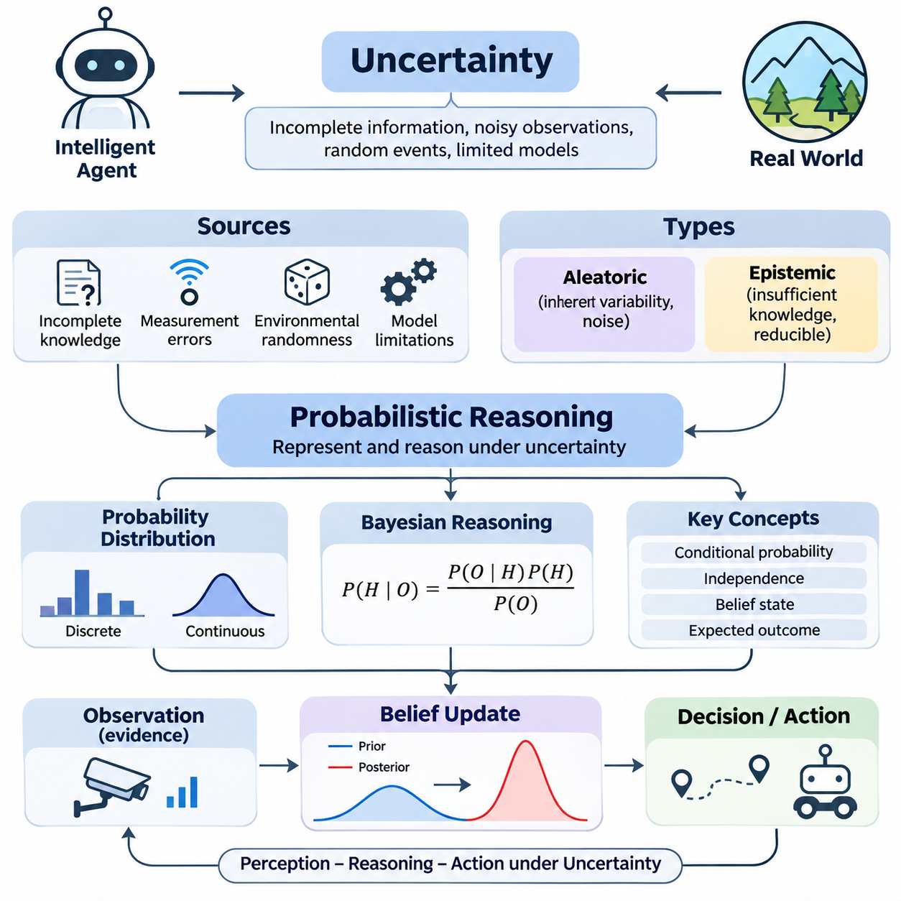{width="7.268055555555556in" height="7.268055555555556in"}

Uncertainty is a fundamental characteristic of intelligent systems operating in real-world environments. Unlike deterministic problems, where actions produce predictable outcomes, uncertain environments contain incomplete information, noisy observations, and unpredictable events. Artificial intelligence must therefore represent not only what is known but also what is possible, allowing decisions to remain rational when complete certainty cannot be achieved.

Classical artificial intelligence often assumes that the current state of an environment is fully observable and that actions have deterministic effects. These assumptions simplify search, planning, and logical inference, but they rarely hold in practical applications. Autonomous robots, medical diagnostic systems, and intelligent monitoring platforms must operate with ambiguous evidence, imperfect sensors, and environmental conditions that change over time.

Uncertainty arises from several distinct sources, including incomplete knowledge, measurement errors, environmental randomness, and limitations in computational models. An intelligent agent may lack information about hidden variables or encounter observations corrupted by noise. Even when the underlying physical process follows deterministic laws, insufficient measurements and approximate models can make its future behavior difficult to predict accurately.

A useful distinction separates aleatoric uncertainty from epistemic uncertainty. Aleatoric uncertainty describes inherent variability in observations or processes, such as random disturbances and measurement noise. Epistemic uncertainty results from insufficient knowledge about the system or its parameters. Additional observations may reduce epistemic uncertainty, while irreducible aleatoric uncertainty generally remains even when the underlying model is well understood.

Probabilistic reasoning provides a mathematical framework for representing uncertainty through probability distributions rather than fixed truth assignments. Instead of declaring that an event will definitely occur, an intelligent system assigns probabilities to alternative outcomes. These probabilities express uncertainty under a specified model and available information, enabling the system to compare hypotheses and select actions according to their expected consequences.

The distinction between uncertainty and ignorance is important when designing intelligent agents. Uncertainty describes limited confidence regarding possible outcomes, whereas ignorance refers to missing knowledge that may prevent meaningful probability assignments. A system can possess a probability distribution while remaining uncertain about its predictions. However, assigning numerical probabilities without sufficient evidence or defensible assumptions may create misleading confidence.

Probability distributions represent how belief or likelihood is allocated across possible states of a system. A discrete distribution assigns probabilities to individual outcomes, while a continuous distribution describes uncertainty using a probability density function. Both representations allow intelligent agents to calculate expectations, evaluate risks, and estimate the likelihood of events relevant to planning, perception, and decision-making.

An intelligent agent operating under uncertainty maintains an internal representation of possible environmental states. This representation is often called a belief state, which describes the agent\'s uncertainty about the actual state of the world. Rather than selecting actions from a single assumed state, the agent evaluates alternative possibilities and updates its beliefs whenever new observations become available.

Observations play a central role in reducing uncertainty, but they do not necessarily reveal the true environmental state. A camera may misclassify an object, a distance sensor may report inaccurate measurements, and a communication system may deliver delayed information. Probabilistic reasoning treats observations as evidence whose reliability must be considered before conclusions are drawn or actions are executed.

Bayesian reasoning provides a systematic mechanism for updating beliefs when new evidence becomes available. Prior probabilities describe initial beliefs, while likelihood functions express how probable an observation is under different hypotheses. Bayes\' theorem combines these quantities to produce posterior probabilities, allowing intelligent agents to revise their understanding without discarding previously accumulated knowledge.

Conditional probability captures relationships between events when additional information is available. For example, the probability that a robot encounters an obstacle may depend on its location, operating environment, and sensor observations. By conditioning predictions on relevant variables, an intelligent system can represent contextual dependencies and avoid treating all environmental outcomes as equally likely or independent.

Independence assumptions help reduce the complexity of probabilistic models. When two variables are conditionally independent given another variable, their relationship can be represented more efficiently without explicitly modeling every possible interaction. Such assumptions support scalable probabilistic inference, but incorrect independence assumptions may produce inaccurate conclusions, especially in systems with strongly correlated sensors or environmental factors.

Uncertainty also affects the relationship between perception and action. A robot may detect an object ahead but remain uncertain whether it is stationary, moving, or incorrectly identified. Its navigation controller must consider these possibilities before choosing a trajectory. A probabilistic decision process can balance expected progress against collision risk, demonstrating how uncertain perception directly influences operational behavior.

Decision-making under uncertainty requires more than selecting the most probable environmental state. An action associated with the most likely outcome may still create unacceptable consequences if less probable outcomes are dangerous. Expected utility provides a framework for combining outcome probabilities with rewards, costs, and penalties, allowing intelligent systems to evaluate decisions according to their consequences rather than prediction confidence alone.

Risk-sensitive decision-making extends expected-value reasoning by considering the severity and distribution of possible losses. In safety-critical applications, rare but catastrophic outcomes may deserve greater attention than ordinary performance variations. Autonomous vehicles, industrial robots, and medical systems therefore require decision policies that account for uncertainty, safety constraints, and the consequences of incorrect predictions.

Temporal uncertainty emerges when environmental states evolve and observations arrive sequentially. A system must estimate its current condition using historical measurements while predicting how that condition may change. Hidden Markov models, dynamic Bayesian networks, and state estimation filters provide structured approaches for reasoning about sequences, hidden states, and transitions under uncertain observations.

Probabilistic state estimation is particularly important in autonomous robotics. A mobile robot rarely knows its exact position because wheel encoders accumulate errors, inertial sensors drift, and environmental measurements contain noise. Localization algorithms combine motion predictions with sensor observations to estimate a probability distribution over possible robot poses, enabling navigation even when individual measurements are unreliable.

Sensor fusion reduces uncertainty by integrating information from multiple measurement sources. Cameras, LiDAR, radar, inertial sensors, and satellite positioning systems provide different perspectives on environmental conditions. Their observations may have different error distributions, update frequencies, and failure characteristics. Probabilistic fusion methods combine these measurements while accounting for their reliability and statistical dependencies.

Uncertainty representation must also distinguish confidence from accuracy. A model may assign high probability to an incorrect prediction, producing overconfidence, while another model may express substantial uncertainty despite being statistically reliable. Calibration evaluates whether predicted probabilities correspond to observed outcome frequencies, providing an important criterion for assessing the practical trustworthiness of probabilistic reasoning systems.

Model uncertainty becomes especially significant when intelligent agents encounter conditions different from those represented during development. Changes in lighting, terrain, sensor configuration, or operational context can invalidate previously learned assumptions. Detecting distribution shifts and unexpected observations helps prevent an agent from relying excessively on predictions generated outside the conditions where its probabilistic model has been validated.

Probabilistic reasoning introduces computational challenges because exact inference may require evaluating a large number of possible states and dependencies. As the number of variables increases, the computational cost can grow rapidly. Approximate inference techniques address this difficulty by estimating probability distributions through sampling, numerical approximation, or simplified representations, trading computational efficiency against estimation accuracy.

The quality of probabilistic reasoning depends on the assumptions, observations, and mathematical models used to represent the environment. Incorrect likelihood functions, biased prior distributions, and unmodeled dependencies can distort posterior beliefs. Consequently, probabilistic systems require validation against representative data, sensitivity analysis, and continuous examination of whether their uncertainty estimates remain consistent with observed behavior.

Uncertainty-aware artificial intelligence establishes a bridge between classical search, planning, and intelligent control. Search algorithms identify possible actions, planning systems organize actions toward objectives, and probabilistic reasoning evaluates uncertain states and outcomes. Integrating these capabilities allows agents to operate beyond fully observable deterministic environments and supports more adaptive behavior in dynamic, partially observable settings.

The central objective of reasoning under uncertainty is not to eliminate every unknown factor but to make rational decisions despite incomplete knowledge. By representing beliefs, updating them with evidence, and evaluating the consequences of alternative actions, intelligent systems can respond systematically to unpredictable conditions. These principles establish the foundation for Bayesian networks, probabilistic inference, temporal models, and autonomous decision-making.

## 05.02 Probability Theory Review

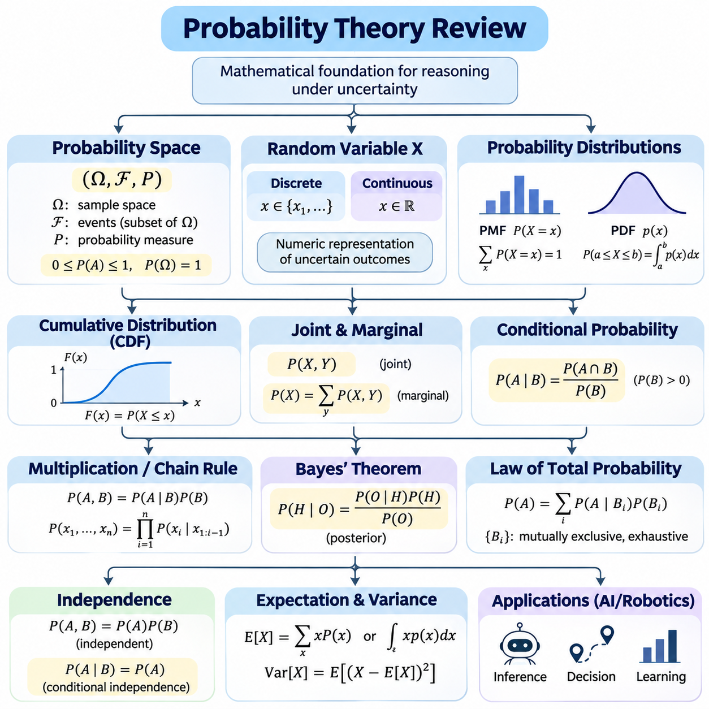{width="7.268055555555556in" height="7.268055555555556in"}

Probability theory provides the mathematical foundation for reasoning about uncertain events, incomplete observations, and unpredictable outcomes. In artificial intelligence, probability allows an agent to represent degrees of belief rather than relying exclusively on deterministic statements. This framework supports inference, prediction, decision-making, and learning when available information does not uniquely determine the true state of an environment.

A probability space consists of a sample space, a collection of events, and a probability measure. The sample space contains all possible outcomes of an experiment or process, while an event represents a subset of those outcomes. The probability measure assigns values between zero and one to events, satisfying nonnegativity, normalization, and countable additivity. These axioms establish a consistent mathematical interpretation of uncertainty.

Random variables provide a numerical representation of uncertain outcomes. A discrete random variable takes values from a finite or countably infinite set, while a continuous random variable may take values across an interval. Random variables allow complex environmental properties, such as robot position, sensor measurements, component failures, and object classifications, to be represented mathematically and analyzed using probability distributions.

A probability mass function assigns probabilities to individual values of a discrete random variable. The sum of all assigned probabilities must equal one. For continuous random variables, a probability density function describes how probability is distributed across possible values. Probabilities over intervals are calculated by integrating the density, while the probability of an individual point is zero for an absolutely continuous distribution.

The cumulative distribution function describes the probability that a random variable takes a value less than or equal to a specified threshold. It applies to both discrete and continuous distributions and provides a unified representation of uncertainty. Cumulative distributions are particularly useful for evaluating threshold conditions, estimating failure probabilities, and determining whether measurements remain within acceptable operating limits.

Joint probability distributions represent the simultaneous behavior of multiple random variables. They describe how different quantities vary together and provide the foundation for modeling relationships between environmental states and observations. For example, a robot localization system may represent the joint distribution of position, orientation, and sensor measurements to capture dependencies that cannot be expressed through isolated probabilities.

Marginal probability distributions describe individual variables within a larger joint distribution. Marginalization removes variables that are not directly relevant by summing or integrating over their possible values. This operation allows an intelligent system to focus on a specific state while accounting for uncertainty in other variables. Marginalization is a fundamental operation in Bayesian networks and probabilistic inference algorithms.

Conditional probability represents the likelihood of an event given that another event has occurred. It is defined as the probability of their intersection divided by the probability of the conditioning event, provided that the latter is positive. Conditional probability allows intelligent agents to incorporate contextual information, such as sensor observations or environmental conditions, when estimating uncertain states.

The multiplication rule expresses a joint probability as the product of a conditional probability and a marginal probability. Applying this rule repeatedly produces the chain rule of probability, which decomposes a joint distribution into conditional factors. This decomposition is essential for constructing structured probabilistic models and representing complex relationships without treating every possible variable combination independently.

Bayes\' theorem provides a mathematical mechanism for reversing conditional probabilities. It combines a prior probability with the likelihood of observed evidence to calculate a posterior probability. In artificial intelligence, this relationship supports belief updating, diagnostic reasoning, classification, and state estimation. Its effectiveness depends on the validity of the prior assumptions and the likelihood model used to interpret observations.

The law of total probability calculates the probability of an event by considering a collection of mutually exclusive and exhaustive alternatives. Each alternative contributes according to its probability and the conditional likelihood of the event. This principle is important when an intelligent agent must reason over hidden environmental states, uncertain causes, or multiple hypotheses that collectively explain an observation.

Statistical independence occurs when knowledge of one event does not change the probability of another. For random variables, independence means that their joint distribution factors into the product of their marginal distributions. Conditional independence is a different property that holds when variables become independent after conditioning on additional information. These distinctions are central to efficient probabilistic model design.

Expectation describes the probability-weighted average of a random variable and provides a fundamental measure of its central tendency. In discrete distributions, expectation is calculated through a weighted sum, while continuous distributions use integration. Expected values are widely applied to estimate future rewards, operational costs, energy consumption, and other quantities relevant to intelligent decision-making under uncertainty.

Variance measures the expected squared deviation of a random variable from its mean, while standard deviation expresses dispersion in the original measurement units. These quantities describe how strongly possible outcomes fluctuate around their expected value. In robotic systems, variance can represent uncertainty in position estimates, sensor readings, or predicted motion, helping controllers distinguish reliable estimates from uncertain ones.

Covariance describes how two random variables vary together, while correlation normalizes this relationship to provide a dimensionless measure of linear association. Positive covariance indicates that variables tend to increase together, whereas negative covariance indicates opposing variation. Covariance matrices are especially important in multivariate estimation, sensor fusion, and Kalman filtering because they represent uncertainty and cross-variable dependencies.

Common probability distributions provide reusable models for different types of uncertainty. Bernoulli distributions represent binary outcomes, binomial distributions describe counts of successes across independent trials, and categorical distributions represent multiple discrete alternatives. Poisson distributions model event counts under specified assumptions, while Gaussian distributions describe continuous uncertainty and are widely used in estimation and statistical modeling.

The Gaussian distribution is characterized by its mean and variance and plays a central role in probabilistic artificial intelligence. Its mathematical properties support efficient estimation, linear transformations, and analytical inference in many models. Multivariate Gaussian distributions extend this representation to correlated variables, allowing position, velocity, orientation approximations, and sensor measurements to be modeled jointly.

Entropy measures the uncertainty associated with a probability distribution. A distribution concentrated on one outcome has lower entropy than a distribution spread across many plausible outcomes. In artificial intelligence, entropy helps quantify uncertainty in classification, state estimation, and information gathering. Information gain measures the expected reduction in entropy produced by an observation and can guide active sensing and exploration.

The law of large numbers explains why averages of repeated observations converge toward their expected value under appropriate assumptions. The central limit theorem describes conditions under which normalized sums or averages approach a Gaussian distribution. These results provide theoretical foundations for statistical estimation, sampling methods, and uncertainty analysis, although their applicability depends on assumptions about dependence and distributional behavior.

Monte Carlo methods approximate probabilistic quantities using randomly generated samples. Instead of evaluating complicated probability distributions analytically, an algorithm estimates expectations or event probabilities from simulated outcomes. These methods are useful when exact calculations become computationally expensive or mathematically intractable. Their accuracy depends on sample quality, sample size, and the statistical properties of the estimator.

Probability theory also supports decision-making through expected utility and risk evaluation. An intelligent agent can compare actions by combining the probabilities of possible outcomes with their associated rewards or costs. However, maximizing expected value alone may be insufficient in safety-critical environments. Risk-sensitive methods additionally consider uncertainty, extreme losses, and constraints that limit the probability of unacceptable outcomes.

In practical artificial intelligence systems, probability models must be evaluated against observed data rather than accepted solely because they are mathematically consistent. Incorrect distributional assumptions, biased observations, and unmodeled dependencies can produce misleading conclusions. Calibration, statistical validation, and sensitivity analysis help determine whether predicted probabilities accurately reflect operational uncertainty and remain reliable under changing conditions.

Probability theory connects classical artificial intelligence with Bayesian networks, hidden Markov models, dynamic state estimation, and partially observable decision processes. Its concepts provide the language for representing uncertain states, combining evidence, and evaluating alternative actions. A strong understanding of probability distributions, conditional dependence, expectation, and inference establishes the mathematical basis for building intelligent systems capable of operating reliably under uncertainty.

## 05.03 Bayesian Networks

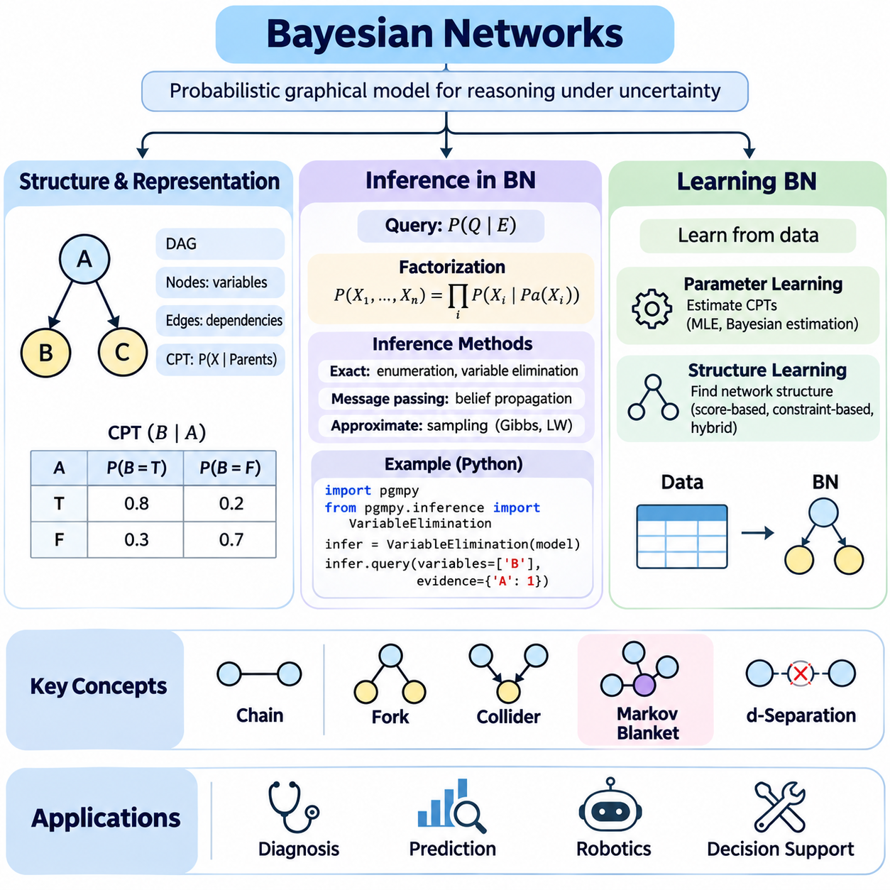{width="7.268055555555556in" height="7.268055555555556in"}

Bayesian networks provide a structured probabilistic framework for representing uncertain relationships among variables. They combine probability theory with graph-based knowledge representation, allowing intelligent systems to reason about complex dependencies without explicitly enumerating every possible outcome. These models are widely applied to diagnosis, prediction, decision support, robotics, and other domains where observations are incomplete or uncertain.

A Bayesian network consists of a directed acyclic graph and a collection of conditional probability distributions. Each node represents a random variable, while directed edges indicate direct probabilistic dependencies encoded by the model. The absence of an edge can express conditional independence under appropriate graphical conditions. This structure allows a joint probability distribution to be factorized into smaller, computationally manageable components.

The directed acyclic graph establishes the structural foundation of a Bayesian network. Directed edges connect parent variables to child variables, and cycles are prohibited to preserve a valid factorization. Each variable is associated with a conditional probability distribution given its parents. Root variables have prior probability distributions because they do not depend on other variables within the network.

Conditional probability tables provide a common representation for discrete Bayesian networks. Each table specifies the probability of a variable taking particular values under every configuration of its parent variables. For continuous variables, conditional probability distributions may use Gaussian models or other parameterized representations. These local probability models collectively define the complete joint distribution represented by the network.

The factorization property is a central advantage of Bayesian networks. Instead of storing a full joint probability table whose size may grow exponentially with the number of variables, the network represents local conditional relationships. The joint probability of all variables equals the product of their conditional probabilities given their respective parents, enabling compact representation when the underlying dependency structure is sufficiently sparse.

Conditional independence determines how information propagates through a Bayesian network. Graphical structures such as chains, forks, and colliders describe different dependency patterns. In a chain or fork, conditioning on the intermediate variable can block information flow, while conditioning on a collider or its descendant may activate a previously blocked path. These relationships are formally characterized through d-separation.

The Markov blanket of a variable consists of its parents, children, and the other parents of its children. Given its Markov blanket, the variable is conditionally independent of all remaining variables in the network. This property supports efficient local reasoning, feature selection, and probabilistic inference by identifying the variables directly relevant to predicting or updating a particular node.

Bayesian networks distinguish between observational dependencies and causal interpretations. A directed edge expresses a dependency within the probabilistic factorization but does not automatically establish causation. Causal interpretation requires additional assumptions about the data-generating process and interventions. This distinction is important when networks are used for diagnosis, explanation, or decision-making involving possible changes to environmental conditions.

Inference in Bayesian networks involves calculating probabilities of unobserved variables given available evidence. Evidence variables are assigned observed values, while query variables represent the quantities of interest. The inference process updates probability distributions according to the network structure and conditional probability models, allowing intelligent agents to revise beliefs as new observations become available.

Predictive inference estimates the probability of downstream variables using information about their predecessors. Diagnostic inference reasons in the opposite direction, estimating possible causes from observed effects. Intercausal inference examines relationships between alternative explanations of shared observations. These inference patterns demonstrate how Bayesian networks support reasoning in multiple directions despite their directed graphical representation.

Exact inference computes mathematically precise probabilities under the specified network model. Enumeration evaluates relevant variable combinations, while variable elimination improves efficiency by summing out hidden variables through intermediate factors. The order of elimination strongly influences computational complexity because poorly chosen orders can create large intermediate factors and substantially increase memory requirements.

Belief propagation provides another approach to probabilistic inference by exchanging messages between connected variables or factors. In tree-structured networks, suitable message-passing algorithms can compute exact marginal probabilities efficiently. For networks containing undirected cycles, junction tree methods can support exact inference after graph transformation, although their computational cost depends strongly on the resulting clique sizes.

Approximate inference becomes necessary when exact computation is prohibitively expensive. Sampling-based methods estimate posterior probabilities using randomly generated assignments, while likelihood weighting incorporates observed evidence into sample weights. Gibbs sampling updates variables conditionally within a Markov chain. These methods trade exactness for computational feasibility and require careful evaluation of convergence and estimation error.

Learning Bayesian networks involves estimating their probabilistic parameters, discovering their graphical structure, or performing both tasks together. Parameter learning assumes that the dependency structure is known and determines conditional probability distributions from data. Structure learning searches for a graph that adequately represents observed dependencies. The reliability of both processes depends on data quality, sample size, and modeling assumptions.

Maximum likelihood estimation determines network parameters by selecting values that maximize the probability of observed training data. For fully observed discrete networks, conditional probability estimates can be derived from frequency counts. However, limited observations may produce unstable estimates or zero probabilities for unseen configurations, motivating smoothing techniques and Bayesian parameter estimation.

Bayesian parameter learning incorporates prior distributions over model parameters and updates them using observed data. Dirichlet priors are commonly used for categorical conditional probability distributions because they provide convenient posterior updates. This approach expresses uncertainty about estimated parameters and can improve stability when training datasets are small or contain infrequently observed variable configurations.

Structure learning determines which directed edges should appear in the Bayesian network. Score-based approaches evaluate candidate graphs using criteria such as Bayesian information criterion or Bayesian scoring methods. Constraint-based approaches examine statistical independence relationships to infer possible graph structures. Hybrid approaches combine these strategies to balance computational efficiency and structural accuracy.

Learning network structures is computationally challenging because the number of possible directed acyclic graphs increases rapidly with the number of variables. Practical algorithms therefore use heuristic search, greedy optimization, or restricted candidate structures. Domain knowledge can constrain allowable edges, prohibit implausible relationships, and improve interpretability while reducing the computational search space.

Incomplete datasets introduce additional difficulties because some variables may be missing or only indirectly observed. Expectation-maximization can estimate parameters by alternating between estimating latent-variable expectations and updating model parameters. More general Bayesian approaches integrate over uncertainty in missing values and parameters. Missing-data assumptions must be examined carefully because systematic missingness can bias learned relationships.

Model evaluation determines whether a learned Bayesian network represents relevant dependencies and produces reliable probabilistic predictions. Predictive log-likelihood, held-out data performance, calibration, and structural stability provide complementary evaluation criteria. A network that fits training data well may still generalize poorly, making independent validation essential for practical deployment.

In robotics, Bayesian networks can represent relationships among environmental conditions, sensor observations, component states, and operational risks. A mobile robot may combine uncertain obstacle detections, localization confidence, and sensor reliability to estimate environmental hazards. Such models support diagnostic reasoning and decision assistance, although dynamic state estimation often requires temporal extensions such as dynamic Bayesian networks.

Bayesian networks establish a bridge between symbolic knowledge representation and quantitative probabilistic reasoning. Their graphical structure makes dependencies explicit, while conditional distributions support systematic belief updating. Through representation, inference, and learning, Bayesian networks provide a foundation for building interpretable intelligent systems that can integrate uncertain evidence and make informed decisions in complex environments.

## 05.04 Exact Inference Methods

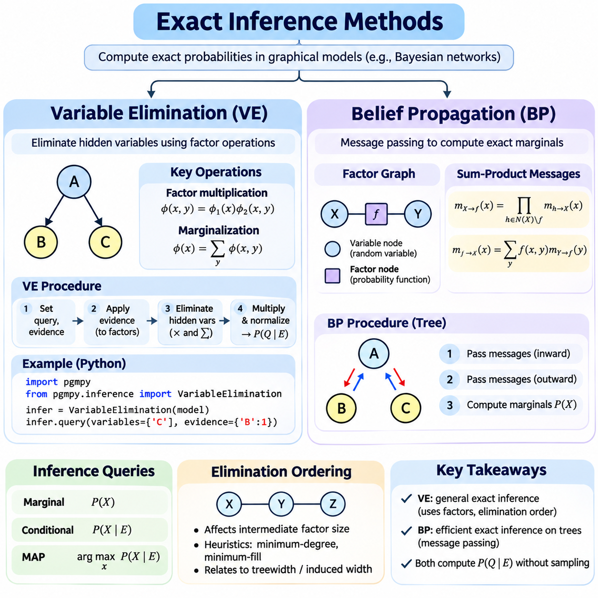{width="7.268055555555556in" height="7.268055555555556in"}

Exact inference methods provide mathematically precise probability calculations within probabilistic graphical models. Given a network structure, conditional probability distributions, and observed evidence, these methods compute posterior probabilities without sampling approximations. They are fundamental to Bayesian reasoning because they establish reference solutions against which approximate inference algorithms can be evaluated and validated.

The objective of exact inference is to determine the probability distribution of query variables conditioned on available evidence. In Bayesian networks, this requires combining local conditional probability factors and eliminating variables that are not directly relevant to the query. Although the underlying probability calculations are conceptually straightforward, direct enumeration becomes computationally expensive as the number of interconnected variables increases.

Variable elimination is an exact inference algorithm that reduces redundant computation by systematically removing hidden variables from a factorized probability distribution. Instead of constructing the complete joint distribution, the algorithm operates on smaller factors derived from conditional probability tables. By multiplying relevant factors and summing over eliminated variables, it computes the desired posterior distribution while preserving mathematical correctness.

A factor is a function that assigns numerical values to configurations of a set of variables. In Bayesian networks, conditional probability tables can be treated as factors, and inference proceeds through operations on these mathematical objects. Factor multiplication combines compatible variable assignments, while factor marginalization sums over unwanted variables. These two operations form the computational foundation of variable elimination.

The variable elimination process begins by identifying query variables, evidence variables, and hidden variables. Observed evidence is incorporated into the relevant factors, reducing their domains where appropriate. Hidden variables are then eliminated according to a selected ordering. Each elimination step combines all factors containing the target variable and marginalizes that variable, producing a new factor for subsequent calculations.

After all designated hidden variables have been eliminated, the remaining factors are multiplied to obtain an unnormalized distribution over the query variables. Normalization converts these values into valid posterior probabilities whose sum equals one. This final operation ensures that the resulting distribution represents the conditional probability of the requested variables given the observed evidence.

The computational efficiency of variable elimination depends strongly on the elimination ordering. Eliminating a highly connected variable early may create large intermediate factors involving many remaining variables. A different ordering can substantially reduce memory consumption and arithmetic operations. Consequently, selecting an effective elimination order is often as important as implementing the factor operations correctly.

Graph-based heuristics help identify efficient elimination orders without exhaustively evaluating every possibility. The minimum-degree heuristic favors variables with fewer current connections, while the minimum-fill heuristic selects variables expected to introduce fewer additional edges during elimination. These approaches do not always produce optimal orderings, but they often reduce intermediate factor sizes and improve practical inference performance.

The complexity of variable elimination is closely related to the induced width of the elimination ordering and the treewidth of the underlying graph. For variables with bounded domain sizes, computational requirements generally grow exponentially with the largest intermediate factor scope. Networks with sparse, well-structured dependencies can therefore support efficient exact inference, while densely connected networks may remain computationally challenging.

Variable elimination can answer marginal probability queries, conditional probability queries, and maximum a posteriori estimation problems with suitable modifications. Standard sum-product elimination computes probability distributions, while max-product variants support optimization over selected variables. However, the distinction between marginal MAP and joint most probable explanation problems requires careful treatment because maximization and summation operations are not generally interchangeable.

Belief propagation provides an alternative exact inference framework based on exchanging local messages between connected variables or factors. Rather than repeatedly constructing intermediate factors for each query, message-passing algorithms distribute probabilistic information throughout a graphical structure. In tree-structured networks, belief propagation computes exact marginal distributions efficiently through coordinated local calculations.

In a factor graph, variable nodes represent random variables, while factor nodes represent functions describing probabilistic relationships. Messages from variable nodes combine incoming information from neighboring factors, excluding the destination factor. Messages from factor nodes combine the local factor with incoming messages and sum over variables other than the recipient, producing probabilistic information relevant to that variable.

The sum-product algorithm implements belief propagation for marginal probability inference. Messages are passed along edges until the necessary information has reached the target variables. In tree-structured factor graphs, an inward and outward message-passing schedule can compute all single-variable marginals exactly. The absence of cycles ensures that information can be propagated without repeatedly counting the same dependencies.

Belief propagation can also operate directly on Bayesian network structures through messages representing predictive and diagnostic information. Predictive messages communicate information from ancestors, while diagnostic messages communicate evidence from descendants. Combining these contributions allows a node to update its local belief. The underlying computations remain consistent with probability factorization and conditional independence relationships.

The distinction between tree-structured and multiply connected networks is essential. Ordinary belief propagation is exact on trees and other structures that admit an equivalent acyclic factor representation. When undirected cycles are present, iterative loopy belief propagation may be applied, but convergence is not guaranteed, and converged results are not necessarily exact. Exact inference in such networks requires additional structural techniques.

Junction tree algorithms extend exact message passing to networks containing complex dependencies. The original graph is transformed through moralization and triangulation, and variables are grouped into cliques connected by a tree structure. Probability factors are assigned to these cliques, allowing messages to propagate between neighboring clusters while preserving the consistency of shared variables.

The running intersection property ensures that every variable appearing in multiple junction tree cliques also appears in every clique along the path connecting them. This property supports consistent marginalization and message passing. Although junction trees enable exact inference in networks with cycles, their computational requirements can become substantial when triangulation produces large cliques.

Variable elimination and belief propagation share the same mathematical foundation of factor multiplication and marginalization. Variable elimination organizes these operations according to an elimination sequence, while belief propagation organizes them as messages across a graphical structure. Junction tree propagation can be understood as a reusable organization of related factor computations, particularly when multiple posterior queries must be answered.

Evidence incorporation is a critical step in both approaches. Observed variables constrain compatible assignments, and their likelihood contributions influence posterior probabilities throughout the network. Hard evidence specifies observed values, while soft evidence represents uncertain observational information through likelihood factors. Correct evidence handling is essential because inconsistent or incorrectly normalized factors can produce misleading inference results.

Numerical stability becomes important when probability calculations involve many small values. Repeated multiplication can cause floating-point underflow, particularly in large networks or when evidence is unlikely. Log-domain computations, message normalization, and carefully designed factor representations help reduce numerical errors. These techniques preserve the intended probability calculations while improving implementation reliability.

Exact inference algorithms must also address practical memory and computational constraints. Factor tables can become extremely large when intermediate scopes contain many variables, even if the original network has relatively compact conditional probability tables. Efficient implementations exploit sparse factors, caching, structured distributions, and graph decomposition where applicable to reduce unnecessary computation and storage.

In robotic applications, exact inference can support diagnostic reasoning about sensor failures, component conditions, and discrete environmental hypotheses. A robot may combine uncertain sensor observations with prior failure probabilities to estimate the likelihood of alternative fault conditions. However, continuous high-dimensional state estimation often requires specialized analytical models or approximate inference because generic exact factor operations may be impractical.

The selection between variable elimination and belief propagation depends on network topology, query requirements, and available computational resources. Variable elimination offers a direct and flexible method for individual queries, while belief propagation efficiently distributes information across tree structures. Junction tree methods extend exact message passing to more general networks, but their scalability remains constrained by graph structure and clique size.

Exact inference methods establish the computational foundation for reliable probabilistic reasoning. Variable elimination demonstrates how factorization and marginalization avoid unnecessary enumeration, while belief propagation shows how conditional independence enables distributed probability calculations. Understanding their mathematical principles, structural assumptions, and computational limitations prepares intelligent systems for advanced Bayesian inference and uncertainty-aware decision-making.

## 05.05 Approximate Inference

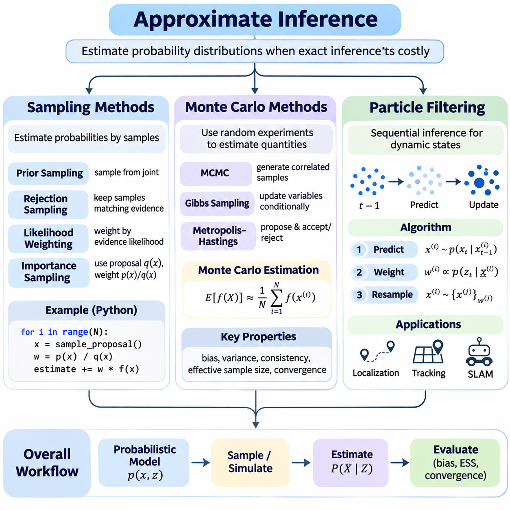{width="7.268055555555556in" height="7.268055555555556in"}

Approximate inference methods estimate probability distributions when exact inference becomes computationally expensive or mathematically intractable. Complex Bayesian networks, high-dimensional state spaces, and nonlinear relationships often prevent efficient analytical solutions. Approximate inference addresses these limitations by replacing exhaustive probability calculations with numerical estimation, enabling intelligent systems to reason under uncertainty using finite computational resources.

Sampling methods approximate probability distributions by generating representative outcomes from a probabilistic model. Instead of calculating every possible configuration, an algorithm uses sampled values to estimate probabilities, expectations, and statistical properties. As the number of suitable samples increases, estimates can approach their theoretical values under appropriate assumptions, although convergence rates depend on the sampling strategy and distribution.

Prior sampling generates observations by following the conditional probability structure of a Bayesian network. Variables are sampled in topological order, ensuring that parent values are available before sampling their children. This method efficiently generates samples from the joint distribution but may become inefficient for posterior inference when the available evidence describes rare events.

Rejection sampling incorporates observed evidence by discarding generated samples that do not match the evidence conditions. The remaining samples approximate the posterior distribution over unobserved variables. Although conceptually simple, rejection sampling becomes inefficient when evidence has low probability because most generated samples are rejected, increasing computational requirements.

Likelihood weighting improves evidence-based sampling by fixing observed variables and assigning weights according to their conditional likelihoods. Unobserved variables are sampled from their conditional distributions, while evidence probabilities contribute to sample importance. This approach avoids rejecting samples but may suffer from highly uneven weights, especially when evidence is unlikely under the proposal distribution.

Importance sampling estimates expectations under a target distribution using samples generated from a different proposal distribution. Each sample receives a weight reflecting the ratio between the target and proposal densities. Effective proposal distributions concentrate computational effort on important regions of the state space. Poor proposals can produce high-variance estimates and extremely low effective sample sizes.

Markov chain Monte Carlo methods generate dependent samples through a stochastic process designed to approach a target distribution. Rather than sampling independently, each new state depends on the preceding state. Under suitable conditions, the chain converges toward a stationary distribution corresponding to the desired posterior. Practical performance depends on mixing behavior, initialization, and the number of iterations.

Gibbs sampling is a Markov chain Monte Carlo technique that repeatedly updates individual variables using their conditional distributions given the remaining variables. It is particularly convenient when these conditional distributions are easy to sample. However, strongly correlated variables or separated probability modes may cause slow mixing, requiring many iterations to explore the posterior distribution adequately.

The Metropolis-Hastings algorithm proposes candidate states and accepts or rejects them according to a probability rule that preserves the target stationary distribution. Its flexibility allows sampling from complicated distributions without requiring direct sampling from the posterior. Proposal design strongly influences efficiency because excessively small moves produce slow exploration, while excessively large moves may lead to frequent rejection.

Monte Carlo methods estimate mathematical quantities through repeated random experiments. For example, an expected value can be approximated by averaging a function evaluated over samples from the relevant distribution. Under appropriate assumptions, estimation error generally decreases as sample size increases. Standard Monte Carlo integration often exhibits an error rate proportional to the inverse square root of the number of independent samples.

Monte Carlo estimators must be evaluated in terms of bias, variance, and consistency. An unbiased estimator has an expected value equal to the target quantity, while variance measures fluctuations across repeated estimates. Consistency describes convergence toward the correct value as the sample count increases. These properties help determine whether a sampling algorithm provides reliable approximations within available computational budgets.

Effective sample size measures how much useful information is contained in weighted or correlated samples. In importance sampling, highly concentrated weights indicate that relatively few samples dominate the estimate. For Markov chain Monte Carlo, autocorrelation reduces the information gained from successive samples. Monitoring effective sample size helps identify inefficient sampling and supports decisions about additional computation.

Convergence diagnostics assess whether sampling algorithms have sufficiently explored their target distributions. Trace analysis, autocorrelation measurements, and comparisons between independent chains can reveal poor mixing or unstable estimates. However, no finite diagnostic can guarantee convergence in every situation. Reliable probabilistic inference therefore requires combining statistical diagnostics with domain knowledge and sensitivity analysis.

Variance reduction techniques improve Monte Carlo efficiency without necessarily increasing the number of samples. Stratified sampling, control variates, antithetic sampling, and carefully designed importance distributions can reduce estimation variability. Their effectiveness depends on the problem structure and estimator design. These methods are especially valuable when each sample requires expensive simulation or probabilistic evaluation.

Sequential Monte Carlo methods extend sampling-based inference to systems whose hidden states evolve over time. Instead of estimating a static distribution, they maintain a collection of weighted samples representing the current belief about a dynamic state. As new observations arrive, the sample population is updated recursively, allowing probabilistic tracking without storing the complete history of possible states.

Particle filtering is a sequential Monte Carlo technique widely used for nonlinear and non-Gaussian state estimation. Each particle represents a possible system state and carries an associated importance weight. The collection of particles approximates the posterior belief distribution, enabling multiple hypotheses to be represented simultaneously. This capability is particularly useful when uncertainty cannot be adequately described by a single Gaussian distribution.

A particle filter typically follows prediction, measurement update, and resampling operations. During prediction, particles are propagated through a state transition model that incorporates process uncertainty. During measurement update, particle weights are adjusted using the likelihood of the latest observation. Resampling then concentrates particles in regions supported by evidence while reducing the influence of unlikely hypotheses.

The prediction stage represents the evolution of uncertainty through system dynamics. For a mobile robot, particles may encode alternative positions and orientations after a movement command. Motion noise causes particles to spread according to the transition model. This representation captures uncertainty arising from wheel slip, actuator variation, and imperfect motion prediction without requiring linear system assumptions.

The measurement update incorporates sensor observations into the particle distribution. Each particle is evaluated according to how well its predicted observation agrees with the actual measurement. Particles consistent with the evidence receive larger weights, while inconsistent particles receive smaller weights. The observation likelihood model is therefore critical because incorrect sensor assumptions can distort the estimated posterior distribution.

Resampling addresses weight degeneracy, a condition in which most particles carry negligible importance weights. Methods such as multinomial, systematic, and stratified resampling generate a new population according to normalized weights. Although resampling reduces weight concentration, excessive resampling can eliminate particle diversity and cause sample impoverishment, particularly when process noise is small.

Particle degeneracy and sample impoverishment impose important practical limitations. A finite particle population may fail to represent low-probability regions that later become relevant. Adaptive resampling, improved proposal distributions, particle rejuvenation, and increased particle counts can mitigate these effects. Nevertheless, computational requirements often increase substantially as state dimensionality grows.

In robotics, particle filters are commonly applied to localization, object tracking, and multi-hypothesis state estimation. Monte Carlo localization represents possible robot poses as weighted particles and updates them using motion commands and sensor measurements. This approach can recover from ambiguous observations and represent multiple plausible locations, provided that sufficient particles and suitable observation models are available.

Approximate inference requires balancing estimation accuracy, computational cost, memory consumption, and response latency. Sampling methods provide flexible representations of uncertainty, Monte Carlo techniques support numerical probability estimation, and particle filtering enables recursive reasoning in dynamic environments. Together, these approaches extend probabilistic artificial intelligence to complex systems where exact inference is impractical.

## 05.06 Hidden Markov Models

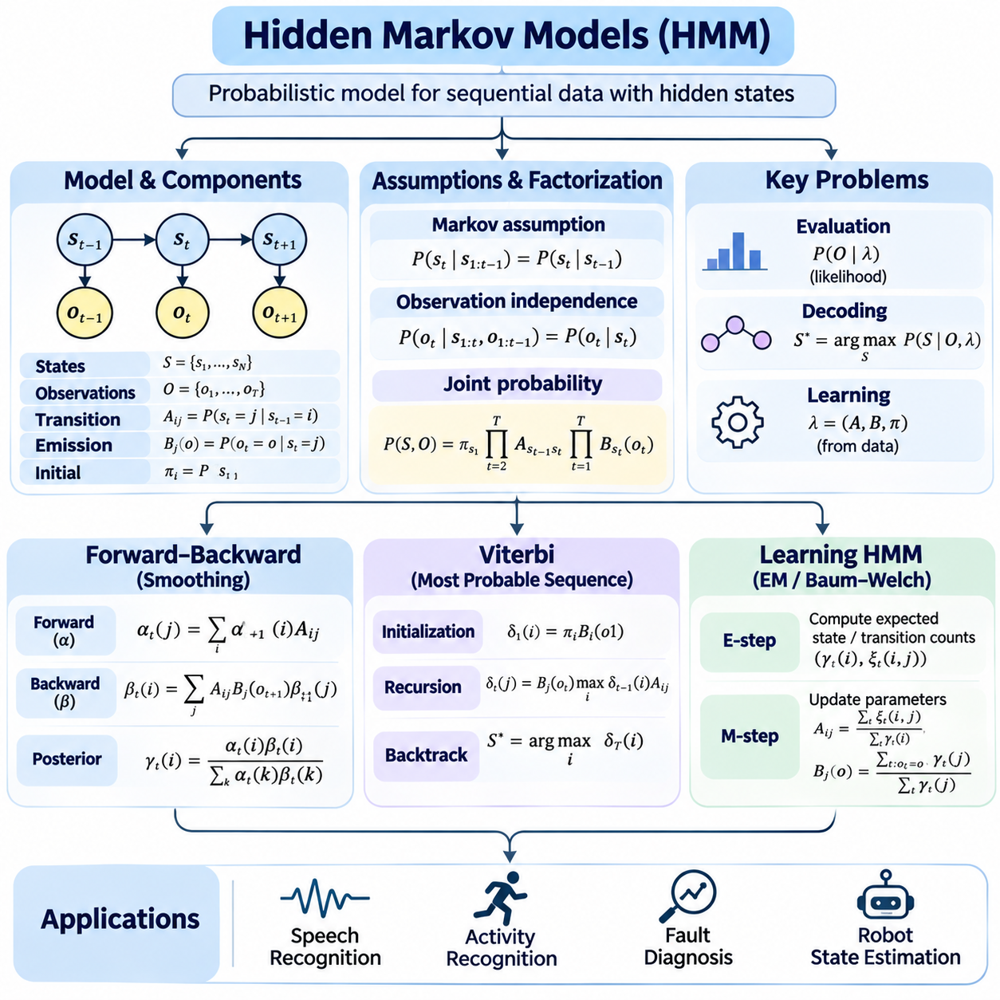{width="7.268055555555556in" height="7.268055555555556in"}

Hidden Markov models provide a probabilistic framework for representing sequential systems whose internal states cannot be observed directly. Instead, hidden states are inferred from sequences of observable measurements generated by those states. This approach is useful in speech recognition, activity recognition, fault diagnosis, and robotic state estimation, where temporal relationships provide information that individual observations cannot capture.

A hidden Markov model consists of hidden states, observable outputs, transition probabilities, emission probabilities, and an initial state distribution. Transition probabilities describe how hidden states evolve over time, while emission probabilities describe the likelihood of observations under particular states. Together, these components define a generative probabilistic model for sequential data and support systematic inference about unobserved system behavior.

The first-order Markov assumption states that the next hidden state depends only on the current hidden state rather than the complete history of preceding states. The observation independence assumption states that each observation depends only on its corresponding hidden state. These assumptions simplify temporal probability calculations and enable efficient dynamic programming algorithms, although they may not adequately describe systems with long-range dependencies.

The joint probability of a hidden state sequence and an observation sequence can be factorized into an initial state probability, successive transition probabilities, and emission probabilities. This factorization transforms a potentially complex temporal distribution into a product of local terms. Consequently, hidden Markov models avoid explicitly enumerating every possible sequence when performing common inference tasks.

Three fundamental computational problems characterize hidden Markov models. Evaluation determines the probability of an observed sequence under a specified model. Decoding identifies the most probable hidden state sequence corresponding to the observations. Learning estimates model parameters from available sequences. These problems are addressed through forward-backward procedures, Viterbi decoding, and parameter estimation algorithms.

The forward algorithm computes the probability of an observation sequence using recursive dynamic programming. At each time step, a forward variable represents the joint probability of observations up to that time and the current hidden state. The algorithm combines previous forward probabilities with transition and emission probabilities, avoiding repeated calculations across overlapping state sequences.

Forward recursion begins by multiplying initial state probabilities by the likelihood of the first observation. Subsequent steps propagate probability mass through possible state transitions and incorporate each new observation. Summing the final forward probabilities produces the likelihood of the complete observation sequence. Computational complexity grows linearly with sequence length and quadratically with the number of states for a dense transition matrix.

The backward algorithm calculates the probability of future observations conditioned on a particular hidden state at the current time. Starting from the end of the sequence, backward variables are recursively propagated toward earlier time steps. Each update combines transition probabilities, subsequent observation likelihoods, and backward probabilities, providing complementary information to the forward calculation.

The forward-backward algorithm combines forward and backward variables to calculate smoothed posterior probabilities for hidden states. Unlike filtering, which uses observations available up to the current time, smoothing incorporates evidence from the entire observation sequence. This distinction is important when later observations clarify ambiguous earlier states, as occurs in trajectory reconstruction and offline activity recognition.

Forward-backward inference can also estimate posterior probabilities of transitions between consecutive hidden states. These pairwise probabilities describe how likely particular transitions were given all available observations. They are essential for parameter learning because they provide expected transition counts and state occupancy statistics without requiring direct observation of the hidden state sequence.

Numerical stability is a major concern when processing long observation sequences. Repeated multiplication of probabilities smaller than one can cause floating-point underflow. Scaling factors can normalize forward and backward variables at each time step, while log-domain computations provide another stable representation. These techniques preserve the intended probabilistic calculations and support reliable likelihood evaluation.

The Viterbi algorithm identifies the single most probable hidden state sequence for a given observation sequence. It uses dynamic programming to retain the highest-probability partial path ending in each state at every time step. Unlike the forward algorithm, which sums contributions from alternative paths, Viterbi decoding selects the maximum-probability predecessor at each transition.

Viterbi decoding begins with initialization using initial state and emission probabilities. During recursion, each candidate state receives the maximum probability among paths arriving from previous states. The algorithm stores backpointers identifying the selected predecessors. After the final state is chosen, backtracking reconstructs the complete optimal hidden state sequence efficiently.

The distinction between Viterbi decoding and posterior state estimation is fundamental. Viterbi identifies the most probable complete sequence, while forward-backward smoothing determines the marginal posterior probability of each state at each time step. Selecting the most probable state independently at every time step does not necessarily produce the globally most probable sequence and may violate transition constraints.

Log-domain Viterbi computation replaces products of probabilities with sums of logarithms. This transformation reduces numerical underflow and simplifies comparison between candidate paths. Impossible transitions can be represented by negative infinity in log space. Efficient implementations use vectorized operations and structured transition matrices to reduce computational overhead when processing large state spaces.

Learning hidden Markov models involves estimating initial state probabilities, transition probabilities, and emission parameters from sequential observations. When hidden state labels are available, supervised learning can estimate parameters through observed frequencies or appropriate statistical estimators. When states are unobserved, learning becomes a latent-variable estimation problem requiring methods that account for uncertainty in state assignments.

The Baum-Welch algorithm is a specialized expectation-maximization procedure for learning hidden Markov model parameters from unlabeled sequences. During the expectation step, forward-backward inference computes posterior state occupancy and transition probabilities. During the maximization step, these expected statistics are used to update initial probabilities, transition probabilities, and emission parameters.

Baum-Welch learning iteratively improves or maintains the observed-data likelihood under suitable exact expectation-maximization updates. However, the algorithm may converge to a local optimum rather than the globally best parameter configuration. Initialization therefore strongly influences the resulting model. Multiple training runs, informed parameter initialization, and independent validation can improve practical reliability.

Emission models determine how hidden states generate observable measurements. Discrete hidden Markov models use categorical observation probabilities, while continuous models may use Gaussian or Gaussian mixture distributions. More flexible emission functions can represent complex sensor measurements, but they increase parameter requirements and may complicate estimation, regularization, and interpretation.

Model selection requires determining the number of hidden states and the complexity of transition and emission distributions. Too few states may fail to represent important temporal patterns, while too many states can overfit training sequences. Held-out likelihood, predictive performance, information criteria, and application-specific validation help evaluate alternative model configurations and their generalization capabilities.

Hidden Markov models can represent uncertainty in robot operating modes, component health, and discrete motion states. For example, a mobile robot may infer whether it is moving normally, slipping, or experiencing actuator degradation from sequential sensor measurements. Temporal inference reduces sensitivity to isolated noisy observations, although model assumptions and emission quality strongly influence diagnostic reliability.

The relationship between hidden Markov models and dynamic Bayesian networks provides a broader perspective on temporal probabilistic reasoning. A standard hidden Markov model can be represented as a dynamic Bayesian network containing one hidden state variable and one observation variable per time step. More general dynamic Bayesian networks extend this structure to multiple interacting state variables and richer dependencies.

Practical deployment requires attention to computational latency, missing observations, changing operating conditions, and model mismatch. Online filtering supports real-time state estimation, while smoothing and Viterbi decoding are useful when complete observation sequences are available. Robust implementations must also evaluate numerical stability, transition constraints, and sensitivity to distribution shifts across operational environments.

Hidden Markov models establish a foundation for probabilistic reasoning over time by combining state transitions, observation likelihoods, and recursive inference. Forward-backward algorithms provide likelihood evaluation and posterior smoothing, Viterbi decoding identifies optimal state sequences, and learning algorithms estimate model parameters from data. Together, these methods support interpretable sequential reasoning in intelligent systems operating under uncertainty.

## 05.07 Dynamic Bayesian Networks

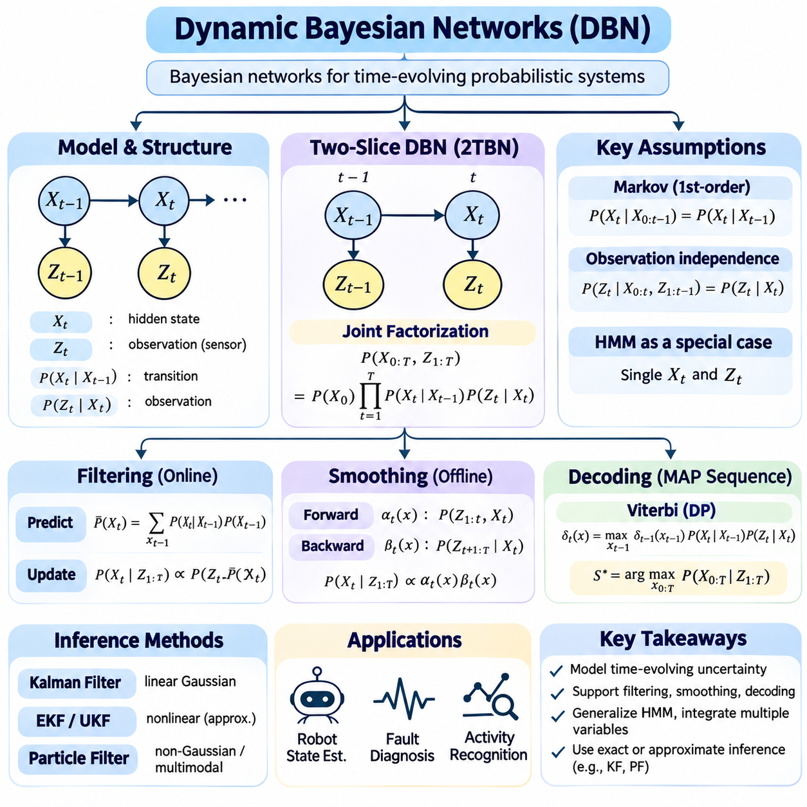{width="7.268055555555556in" height="7.268055555555556in"}

Dynamic Bayesian networks extend Bayesian networks to represent probabilistic relationships that evolve over time. They model how hidden system states change, how observations are generated, and how uncertainty propagates between successive time steps. By combining graphical structure with temporal dependencies, these networks provide a general framework for state estimation, prediction, diagnosis, and sequential reasoning in intelligent systems.

A dynamic Bayesian network consists of random variables organized into time-indexed slices. Each slice represents the system at a particular time and may contain hidden states, observations, control inputs, and environmental variables. Directed edges describe dependencies within a slice or across consecutive slices. This representation makes temporal relationships explicit while preserving the conditional independence properties of Bayesian networks.

The two-slice temporal Bayesian network is a common representation for specifying dynamic models. It defines relationships within an initial time slice and dependencies between two consecutive slices. The same transition structure is typically repeated across time, allowing a compact model to represent sequences of arbitrary length. Initial probability distributions describe the starting conditions, while transition models describe subsequent evolution.

The first-order Markov assumption states that the next system state depends on the current state rather than the entire preceding history. This assumption simplifies probabilistic modeling by restricting temporal dependencies to adjacent time steps. More complex systems may require higher-order dependencies or augmented state variables that summarize relevant historical information while maintaining a manageable graphical structure.

State transition models describe how hidden variables evolve between time steps. These models may depend on previous states, control actions, environmental disturbances, and process noise. In robotics, a transition model can represent how position, velocity, and operating conditions change after a movement command. Probabilistic transitions account for uncertainty caused by actuator errors, external disturbances, and imperfect dynamics.

Observation models connect hidden states to measurable quantities. They specify the probability of sensor measurements given the underlying system state and relevant environmental conditions. Multiple observation variables may represent cameras, LiDAR, inertial sensors, or diagnostic signals. Conditional independence assumptions can simplify sensor integration, but correlated measurement errors must be modeled when those assumptions are invalid.

The joint probability distribution of a dynamic Bayesian network factorizes according to its temporal graph structure. Initial state probabilities describe the beginning of a sequence, while conditional distributions describe state transitions and observations at later times. This factorization avoids storing a complete joint distribution over every variable and time step, making long sequential models more manageable.

Filtering estimates the current hidden state using observations collected up to the present time. Each filtering cycle consists of prediction and correction operations. Prediction propagates the previous belief distribution through the state transition model, while correction incorporates the likelihood of the latest observation. This recursive structure supports online inference without repeatedly processing the complete observation history.

Prediction estimates future states before new measurements become available. By propagating a current belief through one or more transition steps, a dynamic Bayesian network can represent uncertainty about possible future conditions. Prediction horizons influence reliability because process uncertainty generally accumulates over time. This capability supports anticipatory control, maintenance planning, and risk assessment.

Smoothing estimates past hidden states using observations from both earlier and later time steps. Unlike filtering, which operates with information available at the current time, smoothing uses future evidence to refine historical estimates. Fixed-interval smoothing processes a complete sequence, while fixed-lag smoothing revises recent states using a limited observation delay. These approaches are useful for trajectory reconstruction and offline analysis.

Decoding identifies a likely sequence of hidden states that explains observed measurements. Maximum a posteriori sequence estimation searches for the most probable complete state trajectory rather than estimating each state independently. Dynamic programming can solve this problem efficiently for certain discrete temporal structures. More complex networks may require specialized optimization or approximate inference methods.

Hidden Markov models are a special case of dynamic Bayesian networks containing a single hidden state variable and an observation variable at each time step. Dynamic Bayesian networks generalize this representation by supporting multiple interacting hidden variables and richer dependency structures. This flexibility enables models of coupled processes, hierarchical operating modes, and relationships among different physical subsystems.

Kalman filters can also be interpreted within the dynamic Bayesian network framework. Linear Gaussian state transitions and observation models produce Gaussian belief distributions that can be updated analytically. Extended and unscented Kalman filters approximate inference for certain nonlinear systems. Particle filters provide a sampling-based alternative when distributions are non-Gaussian or contain multiple competing hypotheses.

Exact inference in dynamic Bayesian networks becomes difficult when many state variables interact within each time slice. Although temporal factorization reduces redundant computation, intermediate probability factors may grow rapidly with the network\'s dependency structure. Variable elimination and junction tree algorithms can perform exact calculations when computational requirements remain manageable, while approximate methods improve scalability.

Approximate inference techniques include particle filtering, variational inference, and structured sampling approaches. Particle methods represent beliefs through weighted state samples, while variational methods approximate complex posterior distributions using simpler parameterized families. The choice depends on state dimensionality, nonlinear behavior, distribution complexity, and real-time computational constraints.

Learning dynamic Bayesian networks involves estimating transition parameters, observation parameters, and sometimes the underlying dependency structure. When hidden states are available during training, parameter estimation can use supervised statistical methods. When states are unobserved, expectation-maximization or Bayesian learning methods can infer parameters while accounting for uncertainty in latent state trajectories.

Structure learning determines which variables influence one another within and across time slices. Candidate dependencies may be evaluated through statistical scores, conditional independence tests, or domain-specific constraints. Temporal ordering helps restrict possible relationships, but observational data alone may not establish causal direction. Prior knowledge is especially valuable when learning physical systems with known operational relationships.

Dynamic Bayesian networks can incorporate control inputs to represent systems influenced by deliberate actions. Actions modify state transition probabilities, allowing the model to predict how interventions may affect future states. When combined with reward functions and action-selection mechanisms, these representations connect probabilistic state estimation with partially observable decision processes and uncertainty-aware planning.

Model uncertainty and distribution shifts create challenges during long-term operation. Transition probabilities learned under one operating condition may become inaccurate when equipment ages or environmental characteristics change. Adaptive parameter estimation, online learning, and change detection can help maintain predictive performance. However, uncontrolled model adaptation may introduce instability and requires careful validation.

Missing observations can be handled by omitting unavailable measurement updates while continuing state prediction. Irregular sampling intervals may require time-dependent transition models or explicit treatment of elapsed time. Delayed measurements introduce additional complications because they contain information about earlier states. Robust temporal inference must account for these conditions without introducing inconsistent state updates.

In autonomous robotics, dynamic Bayesian networks can integrate localization, motion estimation, sensor health, and environmental uncertainty. A mobile robot may estimate position and operating mode while considering wheel slip, sensor reliability, and obstacle observations. Modeling these interacting variables supports more informative state estimation than treating every subsystem independently, although computational complexity must be controlled.

Dynamic Bayesian networks also support industrial monitoring, predictive maintenance, and fault diagnosis. Hidden variables can represent equipment degradation, operating conditions, and component failures, while observations represent vibration, temperature, and performance measurements. Temporal dependencies help distinguish persistent faults from isolated sensor noise and support probabilistic predictions of future equipment conditions.

Practical implementation requires balancing model expressiveness, inference accuracy, computational latency, and memory consumption. Sparse dependency structures, efficient factor representations, and carefully selected inference algorithms can improve performance. Validation should examine prediction accuracy, probability calibration, robustness to missing data, and behavior under changing conditions rather than relying solely on training likelihood.

Dynamic Bayesian networks provide a unified framework for representing uncertainty across interconnected variables and time. Their graphical structure expresses conditional dependencies, while recursive inference supports filtering, prediction, smoothing, and decoding. By extending static Bayesian reasoning to evolving systems, they establish a foundation for probabilistic robotics, temporal diagnosis, and intelligent decision-making under uncertainty.

## 05.08 Kalman Filter and Extensions [w/Code]

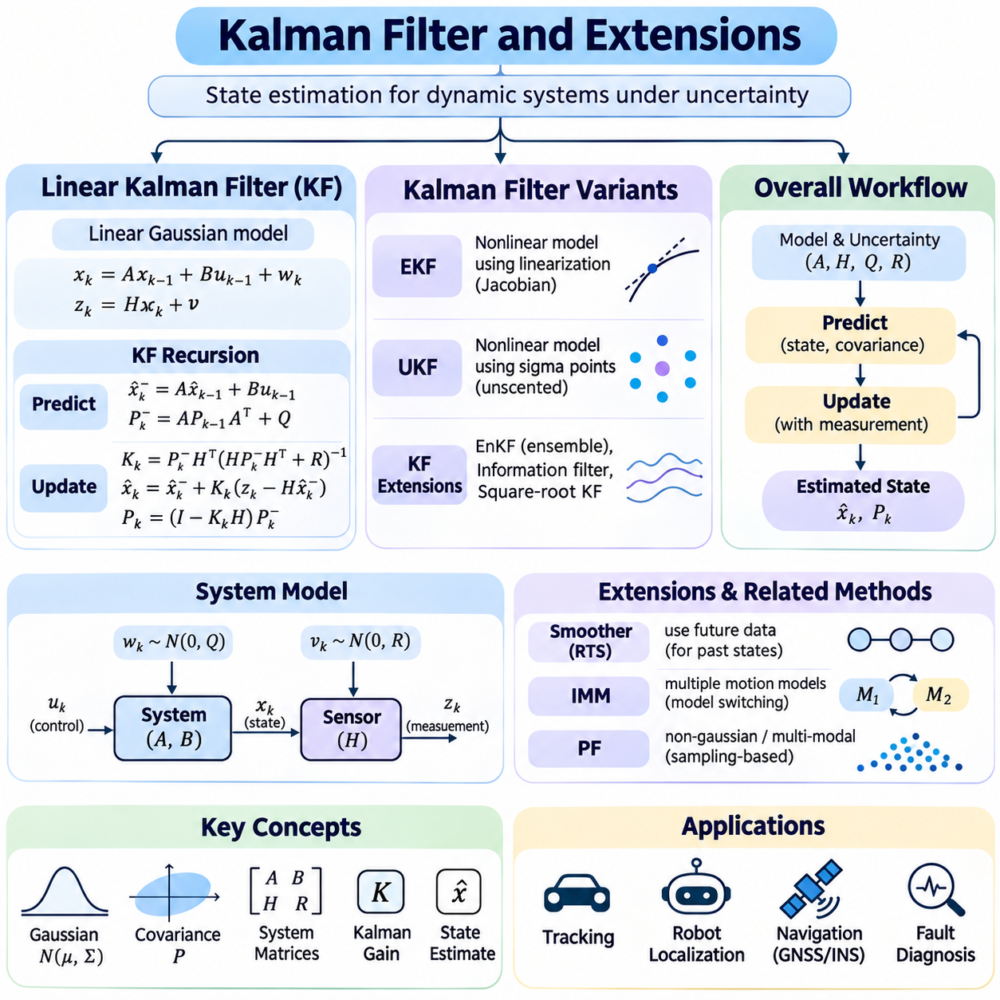{width="7.268055555555556in" height="7.268055555555556in"}

The Kalman filter is a recursive probabilistic estimation algorithm designed to infer the hidden state of a dynamic system from noisy measurements. It combines predictions derived from a mathematical motion model with observations collected from sensors. By explicitly representing estimation uncertainty, the filter provides a systematic framework for tracking, navigation, sensor fusion, and control applications where measurements are incomplete or unreliable.

A standard Kalman filter assumes linear state transitions, linear observation relationships, and Gaussian process and measurement noise. The system state is represented by a vector containing quantities such as position, velocity, or acceleration. A covariance matrix describes uncertainty in the estimated state. These assumptions allow the posterior state distribution to remain Gaussian and be characterized completely by its mean and covariance.

The state transition model predicts how the system evolves between consecutive time steps. A transition matrix maps the previous state into the predicted state, while a control matrix incorporates known external inputs. Process noise represents unmodeled dynamics and random disturbances. Its covariance determines how much uncertainty is added during prediction and strongly influences the filter\'s responsiveness to unexpected system behavior.

The prediction stage propagates both the estimated state and its covariance through the dynamic model. The predicted mean represents the expected system state before receiving a new measurement. The predicted covariance accounts for uncertainty inherited from the previous estimate and additional process noise. This separation between prediction and measurement correction enables efficient sequential estimation without retaining the complete observation history.

The measurement model describes how the hidden state generates observable sensor values. An observation matrix maps state variables into measurement space, while measurement noise captures sensor inaccuracies. The measurement covariance specifies the expected reliability and correlation of observations. Accurate measurement modeling is essential because underestimated sensor uncertainty can cause excessive confidence in unreliable observations.

During correction, the innovation represents the difference between an actual measurement and its predicted value. The innovation covariance combines uncertainty from the predicted state and the measurement model. These quantities determine whether incoming measurements are consistent with current expectations. Large innovations may indicate unexpected motion, sensor errors, incorrect model assumptions, or previously unmodeled disturbances.

The Kalman gain determines how strongly the filter adjusts its predicted state using the latest innovation. A relatively large gain gives greater influence to the measurement, while a smaller gain favors the model prediction. The gain is calculated from predicted covariance and measurement uncertainty. This mechanism provides a principled balance between trusting sensor observations and trusting the dynamic model.

After incorporating a measurement, the corrected state estimate becomes the basis for the next prediction cycle. The covariance is updated to reflect the information gained from the observation. Numerically stable implementations may use the Joseph covariance update form to preserve symmetry and reduce loss of positive semidefiniteness. Maintaining valid covariance matrices is critical for reliable uncertainty representation.

The Kalman filter is optimal in the minimum mean-square-error sense for linear systems with Gaussian uncertainties when its probabilistic assumptions are satisfied. Its performance depends on correct system matrices, noise statistics, and initial conditions. Model mismatch or inaccurate covariance parameters can produce biased estimates, inconsistent uncertainty, or divergence, making practical validation essential.

The extended Kalman filter generalizes Kalman filtering to nonlinear dynamic and measurement models. It approximates nonlinear functions through first-order Taylor expansion around the current estimated state. Jacobian matrices describe local sensitivity and replace the fixed linear transition and observation matrices. This approximation allows recursive Gaussian estimation but can become inaccurate when nonlinearities are strong.

Extended Kalman filtering typically evaluates the state transition Jacobian during prediction and the observation Jacobian during correction. The resulting covariance propagation approximates how uncertainty evolves through nonlinear transformations. Poor linearization points can produce significant estimation errors. Strong nonlinearities, multimodal uncertainty, and large initialization errors may therefore compromise convergence and consistency.

The unscented Kalman filter addresses nonlinear estimation using deterministic sampling rather than explicit Jacobian linearization. It constructs sigma points around the estimated mean and propagates them through nonlinear system functions. The transformed points are then combined to estimate the predicted mean and covariance. This approach can capture nonlinear effects more accurately than first-order linearization for suitable distributions.

Sigma-point selection determines how the unscented Kalman filter represents uncertainty. Weights and scaling parameters influence the reconstructed mean and covariance after nonlinear transformation. Although the unscented approach avoids analytical Jacobians, it still generally maintains a Gaussian approximation of the belief distribution. Its performance depends on appropriate numerical settings and well-conditioned covariance matrices.

The extended and unscented Kalman filters offer different compromises between computational cost and nonlinear approximation accuracy. Extended filtering can be efficient when Jacobians are available and nonlinearities are moderate. Unscented filtering may be preferable when derivatives are difficult to derive or nonlinear transformations are significant. Neither method universally outperforms the other across all models and operating conditions.

Information filters express Gaussian estimation using an information matrix and information vector rather than covariance and state mean. The information matrix is the inverse covariance when the covariance is nonsingular. This representation can simplify measurement fusion and exploit sparsity in certain estimation problems. It is especially relevant to distributed estimation, mapping, and systems combining many independent observations.

Square-root Kalman filters propagate matrix factors instead of directly manipulating full covariance matrices. Cholesky or QR-based operations can improve numerical stability and help maintain positive semidefinite uncertainty representations. These methods are valuable when estimation systems operate over long periods or encounter poorly conditioned matrices. Their additional implementation complexity is often justified in precision-sensitive applications.

Adaptive Kalman filtering adjusts model or measurement uncertainty parameters when operating conditions change. Innovation statistics can reveal whether assumed noise covariances remain consistent with observed behavior. Adaptive schemes may update process or measurement covariance to account for changing sensor quality or system dynamics. However, uncontrolled adaptation can destabilize estimation and requires safeguards and validation.

Kalman filtering also supports asynchronous and multisensor fusion. Sensors operating at different frequencies can contribute updates whenever measurements become available. The prediction model propagates the state between updates, while sensor-specific observation models incorporate each measurement. Correlated sensor errors and delayed observations require special treatment to avoid double-counting information or introducing inconsistent estimates.

In autonomous robotics, Kalman filters combine measurements from inertial sensors, wheel encoders, GNSS receivers, and other positioning systems. The estimated state may contain position, velocity, orientation, and sensor biases. Nonlinear orientation representations and changing reference frames require careful mathematical treatment. Error-state Kalman filters are commonly used to estimate small corrections around a nominal navigation trajectory.

For mobile robots, estimation accuracy depends on realistic motion models and appropriate uncertainty parameters. Wheel slip, uneven terrain, GNSS multipath, and inertial drift can violate nominal assumptions. Innovation gating and outlier rejection help prevent unreliable measurements from corrupting the state estimate. Nevertheless, aggressive rejection may discard valid observations during rapid maneuvers or unusual operating conditions.

Observability determines whether hidden state variables can be reconstructed from available measurements and system dynamics. Some states may remain unobservable when sensors lack sufficient independent information. For example, inertial measurements alone cannot indefinitely constrain absolute position without additional references. Observability analysis guides sensor selection, system modeling, and maneuver design for reliable estimation.

Filter consistency describes whether reported uncertainty realistically reflects estimation errors. Normalized innovation squared and normalized estimation error squared are commonly used diagnostic statistics when their assumptions and required reference information are available. Persistent inconsistency may indicate incorrect noise models, unmodeled correlations, or linearization errors. Evaluation should include both estimation accuracy and uncertainty calibration.

Kalman filters provide a foundation for recursive state estimation by integrating dynamic predictions, sensor observations, and uncertainty propagation. Linear Kalman filtering offers exact Gaussian inference under its assumptions, while extended, unscented, information-form, and square-root variants address broader modeling and numerical requirements. Together, these methods support reliable estimation in robotics, navigation, tracking, and intelligent control systems.

## 05.09 POMDP Overview

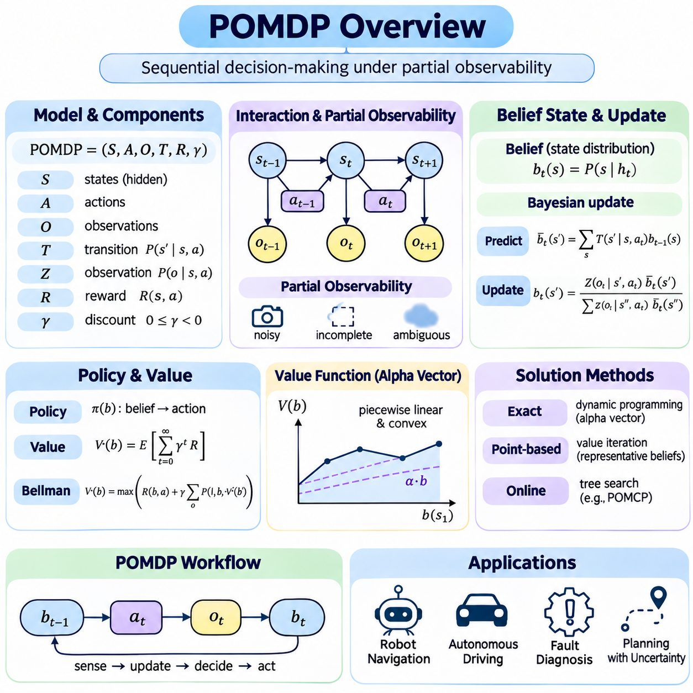{width="7.268055555555556in" height="7.268055555555556in"}

A partially observable Markov decision process provides a mathematical framework for sequential decision-making when the true state of an environment cannot be observed directly. Unlike fully observable decision models, a POMDP requires an intelligent agent to reason about uncertainty while selecting actions. It integrates probabilistic state estimation, action-dependent transitions, uncertain observations, and long-term reward optimization into a unified decision framework.

A POMDP is commonly defined by a set of states, actions, observations, transition probabilities, observation probabilities, rewards, and a discount factor. States represent possible environmental conditions, while actions describe decisions available to the agent. Transition probabilities characterize how actions influence future states, and observation probabilities describe the sensor information generated by those states. Rewards express the desirability of outcomes.

Partial observability arises when sensors provide incomplete, ambiguous, delayed, or noisy information about the environment. A robot may detect an obstacle without accurately determining its position, or an autonomous vehicle may encounter uncertain road conditions. Rather than assuming a single known state, the agent maintains a probability distribution over possible states. This distribution captures uncertainty and provides the information required for rational decision-making.

The belief state is the central representation used in POMDP reasoning. It assigns a probability to each possible hidden state based on the history of actions and observations. Under the Markov and observation assumptions, the current belief is a sufficient statistic for decision-making, eliminating the need to retain the complete interaction history. Belief states transform partially observable problems into fully observable decision processes over probability distributions.

Belief updating combines prediction and observation correction through Bayesian inference. After executing an action, the transition model predicts the distribution of possible next states. When a new observation arrives, the observation model adjusts these probabilities according to measurement likelihoods. The resulting posterior distribution becomes the next belief state, allowing uncertainty to be updated recursively as the agent interacts with its environment.

Actions influence both the physical environment and the information available to the agent. Moving toward an object may improve visual recognition, while changing a sensor orientation may reduce localization uncertainty. Consequently, an action can have immediate operational value and additional informational value. This dual influence distinguishes partially observable planning from decision-making approaches that treat sensing and control as independent processes.

The reward function defines the objectives of the decision-making system. Rewards may encourage task completion, efficient resource use, accurate navigation, or safe operation, while penalties discourage collisions, delays, and unnecessary actions. A discount factor determines the relative importance of future rewards compared with immediate rewards. The optimal policy seeks to maximize expected cumulative discounted reward while accounting for uncertainty and future consequences.

A POMDP policy maps belief states to actions rather than mapping directly observed physical states to actions. Because beliefs represent distributions, the policy must consider multiple possible environmental conditions simultaneously. An action that appears optimal under the most likely state may be undesirable when less probable but dangerous states are considered. Belief-dependent policies therefore provide a principled mechanism for uncertainty-aware behavior.

The value function expresses the expected cumulative reward obtainable from a particular belief state under a policy. Bellman recursion relates current value to immediate reward and expected future value after possible observations. This recursive formulation provides the theoretical basis for optimal planning. However, belief spaces are generally continuous, even when the underlying state and action sets are finite, making exact optimization computationally challenging.

For finite-state POMDPs with finite horizons, the optimal value function is piecewise linear and convex when rewards are maximized. Alpha vectors represent linear components of the value function over the belief simplex. Dynamic programming can update these vectors through successive planning stages. Although mathematically elegant, the number of candidate vectors can increase rapidly, creating substantial computational and memory requirements.

Exact POMDP planning becomes difficult as the number of states, actions, observations, and planning steps increases. Each action may generate several possible observations, producing branching future belief trajectories. The resulting complexity limits exact methods to relatively small problems or carefully structured models. This computational challenge motivates approximate planning techniques that sacrifice some optimality to improve practical scalability.

Point-based value iteration approximates POMDP planning by concentrating computation on a selected collection of reachable belief states. Rather than updating the value function across the entire belief space, it performs backups at representative beliefs. This strategy can substantially reduce computational demands when reachable beliefs occupy a limited region. Performance depends on belief selection, approximation quality, and the coverage of relevant operating conditions.

Online POMDP planning computes actions using the current belief and a limited search into possible future outcomes. Tree-search methods expand candidate actions and observations while allocating computation to promising branches. Monte Carlo approaches approximate expected returns through simulated trajectories. Online planning is attractive for dynamic environments, although real-time performance depends on search depth, simulation quality, and available computational resources.

Monte Carlo tree search can be adapted to partially observable problems by maintaining sampled state hypotheses or particle-based beliefs. Simulated actions and observations generate possible future trajectories, allowing the planner to estimate action values. Exploration mechanisms balance investigating uncertain choices against exploiting promising actions. Particle depletion and inaccurate simulation models can degrade planning quality, especially when informative observations are rare.

Information-gathering actions are particularly important in POMDPs because reducing uncertainty may improve future decisions. A robot might reposition itself to inspect an occluded region before choosing a navigation path. Such actions may provide little immediate reward but increase expected future performance. The value of information emerges naturally when belief-dependent planning accounts for how observations affect subsequent action choices.

Exploration and exploitation describe competing priorities in uncertain decision-making. Exploration gathers information that may improve future decisions, while exploitation selects actions expected to deliver immediate task benefits. In a POMDP, these priorities are intertwined because actions can change both the environment and the agent\'s knowledge. Effective policies consider the cost of sensing, uncertainty reduction, task progress, and long-term consequences.

Safety constraints introduce additional requirements beyond maximizing expected reward. Low-probability events may have severe consequences, making risk-sensitive objectives and constrained POMDP formulations relevant. Collision probabilities, resource limitations, and operational restrictions can influence action selection. Expected reward optimization alone does not guarantee safety, so practical systems often combine probabilistic planning with independent safety mechanisms.

Model accuracy strongly influences POMDP performance. Transition models must represent action outcomes, while observation models must describe sensor reliability and ambiguity. Incorrect probabilities can distort belief updates and produce poor action choices. Model learning, uncertainty calibration, and validation under changing conditions are therefore essential. Robust formulations may explicitly account for uncertainty in transition and observation parameters.

POMDPs connect probabilistic inference with reinforcement learning and decision theory. When transition and observation models are known, planning methods can compute policies through model-based optimization. When models are unknown, learning methods may estimate dynamics or improve policies through interaction. Combining learning with partial observability creates additional challenges because the agent must distinguish uncertainty about hidden states from uncertainty about model parameters.

In autonomous robotics, POMDPs support navigation, active perception, manipulation, and human-robot interaction. A mobile robot can select routes while considering uncertain localization and obstacle information. A manipulation system may choose additional sensing actions before attempting a grasp. These applications demonstrate how belief-aware planning can improve decisions when perception is incomplete and actions have uncertain outcomes.

Multiagent environments extend partially observable decision-making to interactions among several agents. Each agent may possess different observations, objectives, and beliefs about the environment. Decentralized POMDP formulations represent cooperative decision-making under distributed information, but their computational complexity is substantially greater. Communication, coordination, and shared belief estimation become important design considerations.

Practical POMDP deployment requires balancing planning accuracy, computational latency, model complexity, and operational reliability. Belief representations may use discrete distributions, Gaussian approximations, or weighted particles depending on the state space. Approximate solvers must be evaluated for decision quality, robustness, and scalability. Real-time systems may employ hierarchical planning, limited horizons, and simplified models to satisfy execution constraints.

POMDPs provide a unified foundation for intelligent decision-making under partial observability. Belief states represent uncertainty, Bayesian updates incorporate observations, and policies select actions according to expected long-term consequences. By integrating inference, planning, and information gathering, POMDPs extend classical decision processes toward autonomous systems capable of reasoning and acting effectively when the true environment state remains uncertain.

## 05.10 Probabilistic Reasoning in Robotics

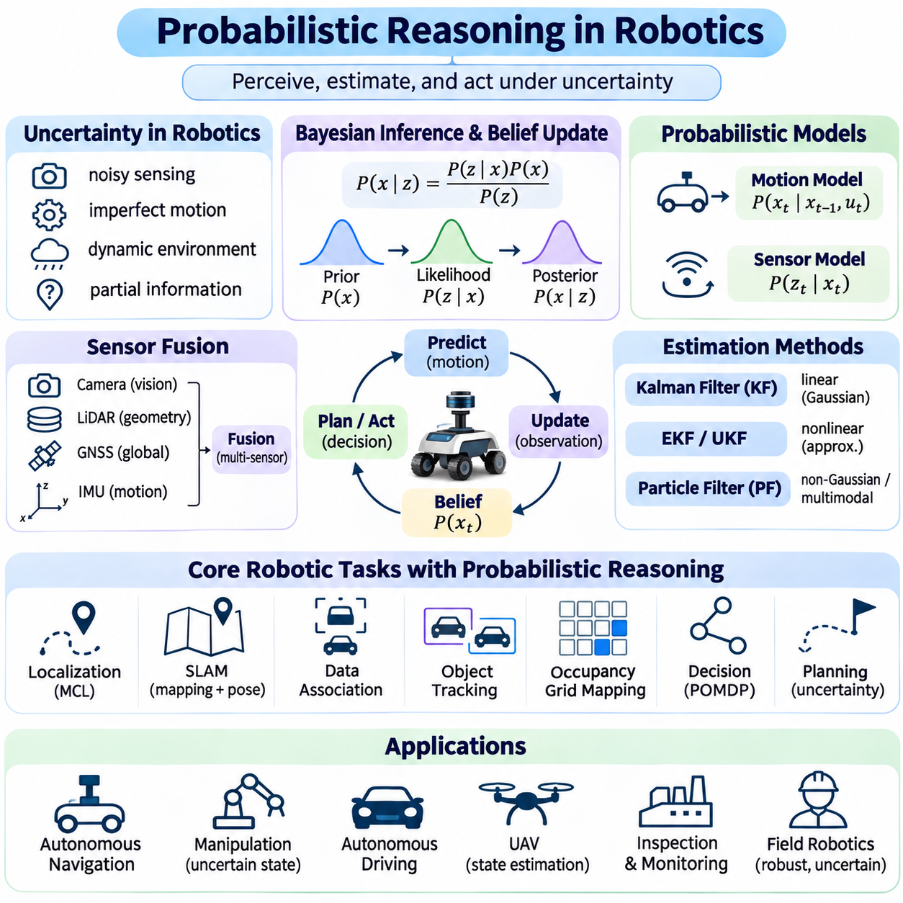{width="7.268055555555556in" height="7.268055555555556in"}

Probabilistic reasoning enables robots to perceive, estimate, and act in environments where information is incomplete and measurements are uncertain. Sensors introduce noise, actuators produce imperfect motion, and environmental conditions change unpredictably. Rather than assuming that every observation is correct, probabilistic robotics represents uncertainty explicitly and uses mathematical inference to support reliable navigation, manipulation, perception, and autonomous decision-making.

A probabilistic robotic system maintains beliefs about quantities that cannot be measured perfectly, including position, velocity, orientation, object identity, and environmental conditions. These beliefs may be represented by Gaussian distributions, discrete probabilities, or weighted samples. The choice of representation depends on the structure of uncertainty, computational resources, and required estimation accuracy. Belief updates integrate predictions with incoming sensor evidence.

Bayesian inference provides the foundation for combining prior knowledge with new observations. A prior distribution represents the robot\'s belief before receiving a measurement, while the likelihood describes how probable the measurement is under different states. Bayes\' rule produces a posterior distribution reflecting both sources of information. Recursive Bayesian filtering applies this process repeatedly as the robot moves and receives new measurements.

Robot motion models predict changes in state caused by control commands and physical dynamics. Wheel encoder measurements, steering angles, inertial signals, and actuator commands provide information about expected motion. However, wheel slip, uneven terrain, calibration errors, and mechanical disturbances introduce uncertainty. Probabilistic transition models represent these effects and propagate uncertainty through successive motion predictions.

Sensor models describe how observations depend on the robot\'s state and surrounding environment. Cameras provide visual features, LiDAR measures geometric structure, GNSS estimates global position, and inertial sensors measure motion-related quantities. Each sensor has different noise characteristics, failure modes, and environmental limitations. Probabilistic measurement models express these properties and determine how strongly observations should influence state estimates.

Sensor fusion combines complementary measurements to produce more informative estimates than individual sensors can provide. Inertial sensors offer high-frequency motion information but accumulate drift, while GNSS provides global references that may suffer from multipath and signal blockage. LiDAR and cameras contribute environmental constraints. Effective fusion accounts for uncertainty, temporal alignment, coordinate transformations, and correlations between measurements.

Kalman filtering provides efficient recursive estimation when uncertainty can be represented adequately by Gaussian distributions. Extended and unscented Kalman filters support nonlinear motion and observation relationships through different approximation strategies. Error-state filters are frequently used in inertial navigation to estimate corrections to nominal trajectories. Their reliability depends on accurate noise models, observability, and consistent covariance propagation.

Particle filtering represents uncertainty through weighted hypotheses rather than a single Gaussian distribution. Each particle describes a possible robot state, and its weight reflects agreement with sensor observations. Prediction, measurement weighting, and resampling recursively update the particle population. This approach is especially useful for global localization, ambiguous environments, and situations involving multiple plausible robot poses.

Monte Carlo localization estimates a robot\'s position and orientation by maintaining particles distributed across a known map. Motion updates propagate particles according to odometry uncertainty, while sensor updates evaluate agreement between predicted and observed environmental features. As evidence accumulates, particles concentrate around likely poses. Recovery mechanisms may be required when the robot is unexpectedly displaced or localization becomes unreliable.

Simultaneous localization and mapping addresses the coupled problem of estimating robot motion while constructing an environmental map. Uncertainty arises because map features and robot poses depend on imperfect observations. Probabilistic SLAM methods represent these dependencies using filters, factor graphs, or optimization-based formulations. Loop closure measurements can reduce accumulated drift, although incorrect associations may introduce substantial estimation errors.

Data association determines which observed features correspond to previously mapped landmarks or tracked objects. Incorrect associations can corrupt localization, mapping, and tracking estimates. Probabilistic methods evaluate correspondence hypotheses using measurement likelihoods, geometric consistency, and prior information. Multiple-hypothesis tracking and robust estimation techniques help manage ambiguity, particularly in crowded or visually repetitive environments.

Probabilistic object tracking estimates the evolving states of moving entities from uncertain observations. State variables may include position, velocity, orientation, and motion mode. Kalman-based trackers, particle filters, and interacting multiple-model estimators support different motion assumptions. Tracking systems must also handle missed detections, false alarms, occlusions, and changes in object behavior without becoming excessively confident.

Occupancy grid mapping represents environmental space as cells associated with probabilities of occupancy. Sensor measurements update beliefs about whether individual cells contain obstacles. Log-odds representations simplify repeated Bayesian updates under common independence assumptions. Although occupancy grids are practical for navigation, cell correlations, dynamic obstacles, and sensor model errors can limit the accuracy of their uncertainty estimates.

Probabilistic perception extends beyond geometric localization to semantic understanding. Object classifiers and segmentation models provide confidence estimates about categories, surfaces, and traversability. These outputs can inform higher-level reasoning, but classification confidence is not automatically equivalent to calibrated probability. Reliable robotic perception requires calibration, uncertainty evaluation, and appropriate treatment of unfamiliar environmental conditions.

Uncertainty-aware planning considers both expected outcomes and the risks associated with uncertain states. A robot may choose a longer route when localization confidence is low or obstacle information is incomplete. Belief-space planning evaluates actions according to their influence on future states and observations. Partially observable Markov decision processes provide a formal framework for integrating uncertain perception with sequential action selection.

Active perception allows a robot to select actions that improve its understanding of the environment. Repositioning a camera, approaching a landmark, or changing a viewing angle may reduce ambiguity before a critical decision. Such actions trade immediate task progress for information that improves future performance. Probabilistic planning evaluates these tradeoffs through expected information gain, task rewards, and operational constraints.

Robotic manipulation requires reasoning about uncertain object poses, contact conditions, friction, and grasp stability. Visual measurements may provide incomplete estimates of object geometry, while contact sensors reveal information during interaction. Probabilistic state estimation combines these observations to improve grasping and assembly decisions. Contact-rich tasks remain challenging because physical interactions introduce discontinuities and complex uncertainty.

Terrain uncertainty is especially important for outdoor autonomous robots. Surface friction, slope, deformation, and wheel-ground interaction affect mobility and control performance. Probabilistic terrain models can estimate traversability and predict the likelihood of slip or loss of traction. Combining geometric perception with motion feedback supports adaptive navigation, although changing ground conditions require continuous reassessment.

Probabilistic fault diagnosis evaluates competing explanations for abnormal robotic behavior. Sensor degradation, actuator faults, communication delays, and environmental disturbances may produce similar symptoms. Bayesian networks and temporal probabilistic models combine diagnostic evidence over time. Such reasoning supports fault detection, isolation, and recovery decisions, but dependable operation also requires independent safety monitoring and validated fallback behavior.

Real-time robotic systems must balance inference accuracy with computational latency and memory limitations. High-dimensional probabilistic models can become expensive when many sensors and interacting states are considered. Sparse representations, selective updates, efficient matrix operations, and adaptive sampling can reduce computational demands. Estimation pipelines should prioritize timely, consistent outputs rather than maximum theoretical precision alone.

Validation of probabilistic robotics requires evaluating both state estimation accuracy and uncertainty quality. Position errors, trajectory consistency, innovation statistics, and probability calibration provide complementary evidence. Testing should include sensor dropout, environmental changes, unexpected motion, and distribution shifts. A system that reports accurate estimates under normal conditions may still be unreliable if its confidence becomes unjustifiably high during failures.

Probabilistic reasoning connects robotic perception, state estimation, mapping, planning, and control through a common representation of uncertainty. Bayesian filters maintain evolving beliefs, sensor fusion integrates complementary evidence, and uncertainty-aware planning selects actions under incomplete information. Together, these methods support autonomous robots that can adapt to noisy measurements, uncertain dynamics, and changing environments while maintaining informed operational decisions.

## 05.11 Case Studies

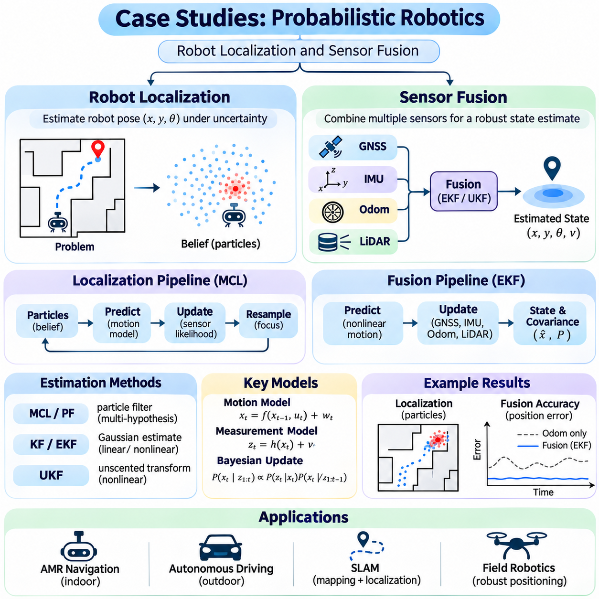{width="7.268055555555556in" height="7.268055555555556in"}

Robot localization and sensor fusion are representative applications of probabilistic reasoning in autonomous robotics. Localization estimates a robot\'s position and orientation within an environment, while sensor fusion combines observations from multiple sources to improve estimation reliability. Both problems involve uncertain measurements, imperfect motion models, and changing environmental conditions. Practical case studies demonstrate how probabilistic algorithms transform noisy data into actionable state estimates.

A typical robot localization case begins with a mobile platform operating in a known indoor environment. The robot carries wheel encoders, an inertial measurement unit, and a two-dimensional LiDAR sensor. Wheel odometry estimates incremental motion, while LiDAR measurements provide geometric references to the surrounding map. Because neither source is perfectly accurate, the localization system must combine motion predictions with sensor observations while maintaining uncertainty.

The localization state commonly includes planar position and heading, represented by horizontal coordinates and orientation angle. A motion model predicts the next state using wheel velocities or commanded movements. Process noise accounts for wheel slip, encoder errors, and imperfect kinematic assumptions. The predicted state distribution becomes the prior belief, which is subsequently corrected using measurements from the environment.

Monte Carlo localization provides a practical solution when the robot\'s initial position is uncertain. A particle filter maintains multiple candidate poses distributed throughout the known map. Each particle is propagated according to the motion model and assigned a weight based on the agreement between predicted and observed LiDAR measurements. Resampling concentrates computational effort on plausible locations while retaining alternative hypotheses when ambiguity remains.

Consider a warehouse robot moving through corridors with similar geometric structures. Several locations may produce nearly identical LiDAR scans, creating multiple plausible localization hypotheses. A Gaussian estimator may struggle to represent these separated possibilities, whereas particle filtering can preserve distinct pose clusters. As the robot encounters unique landmarks, measurement likelihoods increasingly favor the correct region and reduce localization ambiguity.

Localization performance depends strongly on the accuracy of the sensor likelihood model. LiDAR observations can be evaluated against an occupancy grid or distance-field map to estimate measurement consistency. Unexpected obstacles, reflective surfaces, and moving people may produce measurements that disagree with the static map. Robust likelihood functions reduce the influence of such observations and prevent isolated sensor errors from dominating the posterior belief.

A localization system must also handle unexpected displacement and temporary loss of tracking. If a robot is physically moved without corresponding odometry updates, its existing belief may become incorrect. Particle injection, global relocalization, and adaptive sampling can restore plausible state hypotheses. Recovery mechanisms should recognize inconsistent observations rather than continuing to report high confidence in an increasingly inaccurate pose estimate.

Localization evaluation requires reference trajectories obtained from an independent positioning system or carefully validated ground truth. Position error, heading error, recovery time, and estimation consistency provide complementary performance indicators. Tests should include long corridors, repeated structures, dynamic obstacles, and sensor interruptions. Computational latency and update frequency are equally important because delayed localization can compromise navigation and control.

A second case study considers an outdoor autonomous mobile robot equipped with GNSS, an inertial measurement unit, wheel encoders, and LiDAR. GNSS provides global positioning information, inertial sensors measure angular velocity and specific force, and wheel encoders estimate traveled distance. LiDAR contributes relative geometric constraints. Combining these measurements allows the robot to maintain state estimates when individual sensing modalities become unreliable.

An extended Kalman filter can integrate these measurements through nonlinear state prediction and sequential observation updates. The estimated state may include position, velocity, orientation, gyroscope bias, and accelerometer bias. Inertial integration propagates the navigation state at high frequency, while GNSS and other sensors provide corrections when measurements become available. Covariance propagation represents the growing uncertainty between correction events.

Inertial measurements are especially useful for short-term motion estimation because they are available at high rates. However, accelerometer and gyroscope biases accumulate into velocity, position, and orientation errors during integration. Bias estimation is therefore an important component of inertial sensor fusion. Calibration, gravity compensation, coordinate transformations, and accurate timestamps are necessary to prevent systematic errors from overwhelming the filter.

GNSS measurements provide an absolute positioning reference but can degrade near buildings, trees, tunnels, and other signal obstructions. Multipath propagation and satellite geometry influence measurement quality. A fusion system should adjust measurement uncertainty according to available quality indicators and reject clearly inconsistent observations. During GNSS outages, inertial and odometry predictions maintain continuity, although their uncertainty generally increases over time.

Wheel odometry contributes useful motion constraints, particularly when satellite positioning is temporarily unavailable. Nevertheless, encoder-derived displacement becomes unreliable during wheel slip, skidding, or operation on deformable terrain. Probabilistic fusion can increase odometry uncertainty when slip indicators are detected. Comparing wheel motion against inertial measurements and external positioning references helps identify inconsistencies before they significantly affect state estimation.

LiDAR-based odometry provides relative motion estimates by aligning geometric observations across consecutive scans or against a local map. These estimates can constrain drift during periods of poor GNSS reception. However, sparse environments, moving objects, and repetitive structures can weaken geometric observability. Reliable fusion must account for registration uncertainty and avoid treating correlated estimates as independent measurements.

Temporal synchronization is essential because sensors often operate at different frequencies and experience different communication delays. An inertial sensor may produce hundreds of measurements per second, while GNSS and LiDAR provide less frequent updates. Timestamp errors can create apparent motion inconsistencies even when individual sensors are accurate. Practical systems use synchronized clocks, measurement buffering, and delayed-update strategies to preserve temporal consistency.

Coordinate frame management is equally important in multisensor estimation. GNSS measurements may use geographic coordinates, inertial navigation may operate in a local Cartesian frame, and LiDAR observations are expressed relative to the sensor body. Extrinsic calibration defines the rigid transformations between sensors and the robot platform. Incorrect frame conventions, lever-arm offsets, or orientation calibration can introduce persistent errors that probabilistic filtering cannot automatically eliminate.

Sensor fusion must explicitly consider correlations between measurements. For example, LiDAR odometry and map-based localization may reuse overlapping observations, while multiple navigation outputs may depend on the same inertial data. Treating these estimates as statistically independent can underestimate uncertainty and produce overconfident results. Cross-covariance modeling, joint estimation, or conservative fusion methods can mitigate this problem.

Innovation-based monitoring provides a practical method for detecting abnormal measurements and model inconsistencies. The innovation compares an incoming observation with the value predicted by the current state estimate. Its covariance provides a statistical scale for evaluating the discrepancy. Normalized innovation tests can support measurement gating, although their thresholds must reflect model assumptions and the desired balance between rejecting outliers and preserving valid data.

A robust fusion architecture should distinguish estimation failures from safety-critical operational decisions. Large covariance, repeated measurement rejection, or inconsistent sensor outputs may indicate degraded localization quality. The robot can respond by reducing speed, requesting additional observations, switching navigation modes, or entering a controlled safe state. Such responses require explicit operational policies and independent safety controls rather than relying solely on filter confidence.

Experimental comparison can evaluate standalone GNSS, wheel odometry, inertial navigation, and integrated sensor fusion under identical operating conditions. Reference trajectories should cover open outdoor areas, obstructed environments, uneven surfaces, and deliberate sensor interruptions. Metrics may include position error, heading error, drift rate, availability, recovery time, and uncertainty consistency. Ablation experiments reveal the contribution of individual sensors.

Both case studies demonstrate that probabilistic estimation quality depends on more than selecting an advanced algorithm. Accurate calibration, realistic noise models, robust measurement handling, temporal alignment, and representative validation are essential. Particle filtering addresses ambiguous localization hypotheses, while Kalman-based fusion efficiently combines complementary navigation measurements. The appropriate method depends on uncertainty structure, sensor configuration, and operational constraints.

Robot localization and sensor fusion illustrate how probabilistic reasoning supports dependable autonomous operation under incomplete information. Recursive Bayesian estimation maintains evolving beliefs, motion models predict system behavior, and sensor observations correct accumulated uncertainty. By integrating statistical inference with practical engineering safeguards, autonomous robots can improve navigation continuity, estimation reliability, and operational awareness across diverse environments.
