**Volume 01. Classical AI Search and Planning**

# 05. Probabilistic Reasoning

## 05.01 Introduction to Uncertainty

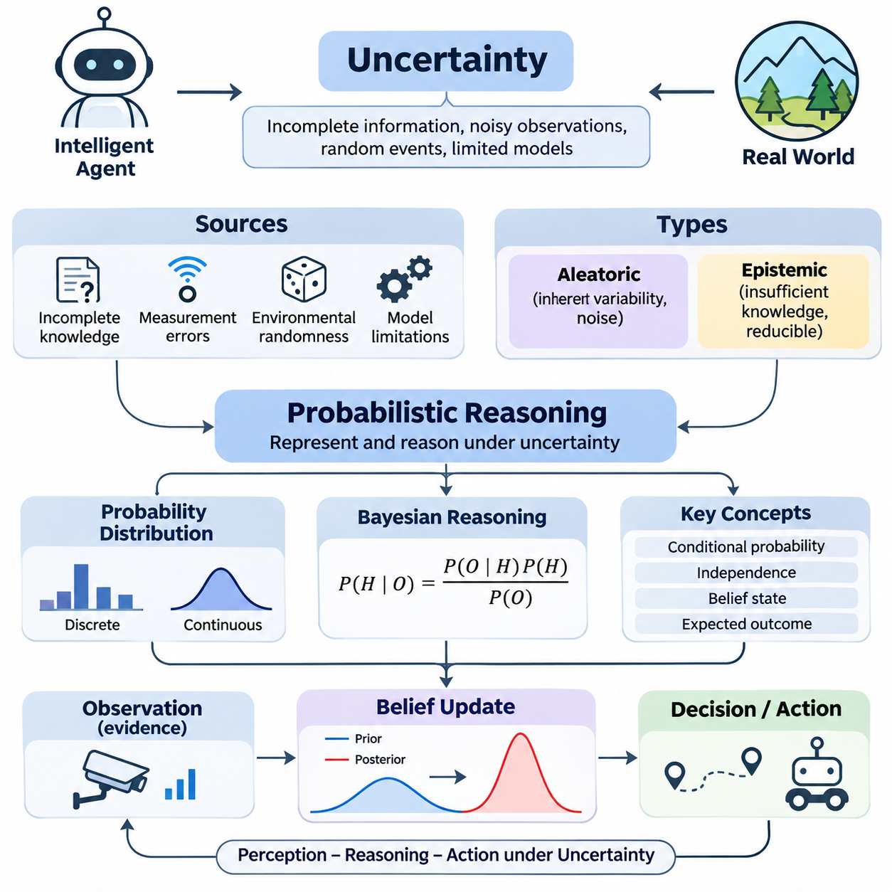{width="7.268055555555556in" height="7.268055555555556in"}

불확실성(Uncertainty)은 실제 환경(Real-World Environment)에서 작동하는 지능형 시스템(Intelligent System)의 근본적인 특성이다. 결정론적 문제(Deterministic Problem)에서는 행동(Action)이 예측 가능한 결과를 생성하지만, 불확실한 환경에는 불완전한 정보(Incomplete Information), 잡음이 포함된 관측(Noisy Observation), 예측할 수 없는 사건(Unpredictable Event)이 존재한다. 따라서 인공지능(Artificial Intelligence)은 알려진 사실뿐만 아니라 발생 가능한 상황도 표현해야 하며, 완전한 확실성을 확보할 수 없는 조건에서도 합리적인 의사결정(Rational Decision-Making)을 수행할 수 있어야 한다.

고전적 인공지능(Classical Artificial Intelligence)은 환경의 현재 상태(Current State)를 완전히 관측할 수 있고, 행동의 결과가 결정론적(Deterministic)이라고 가정하는 경우가 많다. 이러한 가정은 탐색(Search), 계획(Planning), 논리적 추론(Logical Inference)을 단순화하지만 실제 응용 환경에서는 성립하기 어렵다. 자율 로봇(Autonomous Robot), 의료 진단 시스템(Medical Diagnostic System), 지능형 모니터링 플랫폼(Intelligent Monitoring Platform)은 모호한 증거(Ambiguous Evidence), 불완전한 센서(Imperfect Sensor), 시간에 따라 변화하는 환경 조건을 처리해야 한다.

불확실성(Uncertainty)은 불완전한 지식(Incomplete Knowledge), 측정 오차(Measurement Error), 환경적 무작위성(Environmental Randomness), 계산 모델(Computational Model)의 한계 등 다양한 원인에서 발생한다. 지능형 에이전트(Intelligent Agent)는 숨겨진 변수(Hidden Variable)에 대한 정보를 확보하지 못하거나 잡음(Noise)에 의해 왜곡된 관측값을 수신할 수 있다. 실제 물리적 과정이 결정론적 법칙(Deterministic Law)을 따르더라도 측정 정보가 부족하거나 근사 모델(Approximate Model)을 사용하면 미래의 동작을 정확하게 예측하기 어려워진다.

불확실성은 우연적 불확실성(Aleatoric Uncertainty)과 인식적 불확실성(Epistemic Uncertainty)으로 구분할 수 있다. 우연적 불확실성은 무작위 교란(Random Disturbance)이나 측정 잡음(Measurement Noise)처럼 관측 또는 과정에 내재된 변동성을 의미한다. 인식적 불확실성은 시스템이나 모델 매개변수(Model Parameter)에 대한 지식 부족에서 발생한다. 추가 관측을 통해 인식적 불확실성을 감소시킬 수 있지만, 제거할 수 없는 우연적 불확실성은 모델을 충분히 이해한 이후에도 일반적으로 남아 있다.

확률적 추론(Probabilistic Reasoning)은 고정된 참·거짓 판단(Fixed Truth Assignment) 대신 확률분포(Probability Distribution)를 사용하여 불확실성을 표현하는 수학적 체계(Mathematical Framework)를 제공한다. 지능형 시스템은 특정 사건이 반드시 발생한다고 선언하는 대신 가능한 결과에 확률을 부여한다. 이러한 확률은 주어진 모델과 이용 가능한 정보에 따른 불확실성을 나타내며, 시스템이 가설(Hypothesis)을 비교하고 예상되는 결과에 따라 행동을 선택하도록 지원한다.

불확실성(Uncertainty)과 무지(Ignorance)의 차이는 지능형 에이전트(Intelligent Agent)를 설계할 때 중요하다. 불확실성은 가능한 결과에 대한 제한된 확신을 의미하지만, 무지는 의미 있는 확률을 부여하는 데 필요한 지식이 부족한 상태를 의미한다. 시스템은 확률분포(Probability Distribution)를 보유하면서도 예측에 대한 불확실성을 가질 수 있다. 그러나 충분한 증거나 타당한 가정 없이 수치적 확률을 부여하면 실제보다 높은 확신을 나타내는 잘못된 결과가 발생할 수 있다.

확률분포(Probability Distribution)는 시스템의 가능한 상태에 믿음(Belief)이나 발생 가능성(Likelihood)이 어떻게 배분되는지를 표현한다. 이산 확률분포(Discrete Probability Distribution)는 개별 결과에 확률을 할당하며, 연속 확률분포(Continuous Probability Distribution)는 확률밀도함수(Probability Density Function)를 사용하여 불확실성을 나타낸다. 두 표현 방식 모두 지능형 에이전트가 기댓값(Expectation)을 계산하고 위험(Risk)을 평가하며 계획, 인식, 의사결정과 관련된 사건의 발생 가능성을 추정하도록 지원한다.

불확실한 환경에서 작동하는 지능형 에이전트(Intelligent Agent)는 가능한 환경 상태를 내부적으로 표현하고 유지한다. 이러한 표현을 신념 상태(Belief State)라고 하며, 실제 세계의 상태에 대한 에이전트의 불확실성을 나타낸다. 에이전트는 하나의 상태를 확정적으로 가정하여 행동을 선택하는 대신 여러 가능성을 평가한다. 또한 새로운 관측(New Observation)이 확보될 때마다 신념 상태를 갱신하여 환경에 대한 이해를 지속적으로 개선한다.

관측(Observation)은 불확실성을 감소시키는 데 핵심적인 역할을 하지만 실제 환경 상태(True Environmental State)를 반드시 정확하게 나타내지는 않는다. 카메라(Camera)는 객체를 잘못 분류할 수 있고, 거리 센서(Distance Sensor)는 부정확한 측정값을 보고할 수 있으며, 통신 시스템(Communication System)은 지연된 정보를 전달할 수 있다. 확률적 추론(Probabilistic Reasoning)은 관측을 증거(Evidence)로 취급하고, 결론을 도출하거나 행동을 실행하기 전에 해당 증거의 신뢰성(Reliability)을 고려한다.

베이즈 추론(Bayesian Reasoning)은 새로운 증거가 확보될 때 믿음(Belief)을 체계적으로 갱신하는 방법을 제공한다. 사전확률(Prior Probability)은 초기 믿음을 나타내며, 우도함수(Likelihood Function)는 서로 다른 가설에서 특정 관측이 발생할 가능성을 표현한다. 베이즈 정리(Bayes\' Theorem)는 이러한 정보를 결합하여 사후확률(Posterior Probability)을 계산한다. 이를 통해 지능형 에이전트는 이전에 축적한 지식을 유지하면서 새로운 관측에 따라 환경에 대한 판단을 수정할 수 있다.

조건부 확률(Conditional Probability)은 추가 정보가 주어졌을 때 사건 사이의 관계를 표현한다. 예를 들어 로봇(Robot)이 장애물(Obstacle)을 만날 확률은 현재 위치(Location), 운영 환경(Operating Environment), 센서 관측(Sensor Observation)에 따라 달라질 수 있다. 지능형 시스템은 관련 변수에 조건을 부여하여 상황별 의존성(Contextual Dependency)을 표현할 수 있으며, 모든 환경적 결과가 동일한 가능성을 가지거나 서로 독립적이라고 가정하는 오류를 방지할 수 있다.

독립성 가정(Independence Assumption)은 확률 모델(Probabilistic Model)의 복잡도를 감소시키는 데 도움이 된다. 두 변수가 다른 변수에 대해 조건부 독립(Conditional Independence)이라면 모든 상호작용을 명시적으로 모델링하지 않고도 관계를 효율적으로 표현할 수 있다. 이러한 가정은 확장 가능한 확률적 추론(Scalable Probabilistic Inference)을 지원하지만, 잘못된 독립성 가정은 부정확한 결론을 생성할 수 있다. 특히 센서 측정값이나 환경적 요인이 강한 상관관계(Correlation)를 가지는 시스템에서는 주의가 필요하다.

불확실성(Uncertainty)은 인식(Perception)과 행동(Action) 사이의 관계에도 영향을 미친다. 로봇은 전방의 객체를 감지하더라도 해당 객체가 정지 상태인지, 이동 중인지, 잘못 식별된 것인지 확신하지 못할 수 있다. 따라서 주행 제어기(Navigation Controller)는 이동 경로(Trajectory)를 선택하기 전에 이러한 가능성을 고려해야 한다. 확률적 의사결정 과정(Probabilistic Decision Process)은 예상되는 이동 효율과 충돌 위험(Collision Risk) 사이의 균형을 평가하여 불확실한 인식 결과가 실제 행동에 반영되도록 한다.

불확실성하의 의사결정(Decision-Making Under Uncertainty)은 가장 가능성이 높은 환경 상태를 선택하는 것만으로 충분하지 않다. 가장 높은 확률을 가진 결과에 적합한 행동이라도 발생 가능성이 낮은 다른 결과에서 심각한 피해를 초래할 수 있다. 기대효용(Expected Utility)은 결과의 발생 확률과 보상(Reward), 비용(Cost), 벌점(Penalty)을 결합하는 평가 체계를 제공한다. 이를 통해 지능형 시스템은 단순한 예측 확신도가 아니라 행동의 실제 결과를 기준으로 의사결정을 수행할 수 있다.

위험 민감형 의사결정(Risk-Sensitive Decision-Making)은 가능한 손실의 심각도와 분포를 고려하여 기댓값 기반 추론(Expected-Value Reasoning)을 확장한다. 안전 필수 응용(Safety-Critical Application)에서는 발생 확률이 낮더라도 치명적인 결과(Catastrophic Outcome)를 초래할 수 있는 사건이 일반적인 성능 변동보다 중요할 수 있다. 따라서 자율주행 차량(Autonomous Vehicle), 산업용 로봇(Industrial Robot), 의료 시스템(Medical System)은 불확실성, 안전 제약(Safety Constraint), 잘못된 예측의 결과를 함께 고려하는 의사결정 정책(Decision Policy)이 필요하다.

시간적 불확실성(Temporal Uncertainty)은 환경 상태가 시간에 따라 변화하고 관측이 순차적으로 도착할 때 발생한다. 시스템은 과거 측정값(Historical Measurement)을 활용하여 현재 상태를 추정하는 동시에 미래의 상태 변화를 예측해야 한다. 은닉 마르코프 모델(Hidden Markov Model), 동적 베이즈 네트워크(Dynamic Bayesian Network), 상태 추정 필터(State Estimation Filter)는 불확실한 관측 조건에서 시계열(Sequence), 은닉 상태(Hidden State), 상태 전이(State Transition)를 체계적으로 추론하는 방법을 제공한다.

확률적 상태 추정(Probabilistic State Estimation)은 자율 로봇(Autonomous Robotics)에서 특히 중요하다. 이동 로봇(Mobile Robot)은 바퀴 인코더(Wheel Encoder)의 누적 오차, 관성 센서(Inertial Sensor)의 드리프트(Drift), 환경 측정값의 잡음으로 인해 자신의 정확한 위치를 알기 어렵다. 위치 추정 알고리즘(Localization Algorithm)은 이동 예측(Motion Prediction)과 센서 관측(Sensor Observation)을 결합하여 가능한 로봇 자세(Robot Pose)에 대한 확률분포를 추정하며, 개별 측정값이 불안정한 상황에서도 주행을 지원한다.

센서 융합(Sensor Fusion)은 여러 측정 장치에서 수집한 정보를 통합하여 불확실성을 감소시킨다. 카메라(Camera), 라이다(LiDAR), 레이더(Radar), 관성 센서(Inertial Sensor), 위성 위치 측정 시스템(Satellite Positioning System)은 환경에 대한 서로 다른 정보를 제공한다. 각 센서는 오차분포(Error Distribution), 갱신 주기(Update Frequency), 고장 특성(Failure Characteristic)이 다를 수 있다. 확률적 융합 기법(Probabilistic Fusion Method)은 이러한 측정값의 신뢰성과 통계적 의존성(Statistical Dependency)을 고려하여 정보를 결합한다.

불확실성 표현(Uncertainty Representation)에서는 확신도(Confidence)와 정확도(Accuracy)를 구분해야 한다. 모델(Model)은 잘못된 예측에 높은 확률을 부여하여 과신(Overconfidence)을 나타낼 수 있으며, 반대로 통계적으로 신뢰할 수 있는 모델이 상당한 불확실성을 표현할 수도 있다. 보정(Calibration)은 예측 확률(Predicted Probability)이 실제 관측된 결과의 발생 빈도(Observed Outcome Frequency)와 일치하는지를 평가하며, 확률적 추론 시스템의 실질적인 신뢰성(Trustworthiness)을 판단하는 중요한 기준을 제공한다.

모델 불확실성(Model Uncertainty)은 지능형 에이전트가 개발 과정에서 경험하지 못한 환경 조건을 만날 때 특히 중요해진다. 조명(Lighting), 지형(Terrain), 센서 구성(Sensor Configuration), 운영 상황(Operational Context)의 변화는 기존에 학습한 가정을 무효화할 수 있다. 분포 변화(Distribution Shift)와 예상하지 못한 관측(Unexpected Observation)을 탐지하면 검증된 운영 조건을 벗어난 상황에서 생성된 예측에 에이전트가 지나치게 의존하는 문제를 줄일 수 있다.

확률적 추론(Probabilistic Reasoning)은 많은 가능한 상태와 의존성을 평가해야 하므로 계산적 어려움(Computational Challenge)을 수반한다. 변수(Variable)의 수가 증가하면 정확 추론(Exact Inference)에 필요한 계산 비용(Computational Cost)이 급격하게 증가할 수 있다. 근사 추론(Approximate Inference)은 표본추출(Sampling), 수치적 근사(Numerical Approximation), 단순화된 표현(Simplified Representation)을 사용하여 확률분포를 추정한다. 이러한 접근법은 계산 효율성(Computational Efficiency)과 추정 정확도(Estimation Accuracy) 사이의 절충을 통해 복잡한 문제를 처리한다.

확률적 추론의 품질은 환경을 표현하는 가정(Assumption), 관측(Observation), 수학적 모델(Mathematical Model)에 따라 결정된다. 부정확한 우도함수(Likelihood Function), 편향된 사전확률(Biased Prior Probability), 모델에 반영되지 않은 의존성(Unmodeled Dependency)은 사후 믿음(Posterior Belief)을 왜곡할 수 있다. 따라서 확률적 시스템(Probabilistic System)은 대표성 있는 데이터(Representative Data)를 이용한 검증(Validation), 민감도 분석(Sensitivity Analysis), 불확실성 추정값과 실제 관측 결과 사이의 일관성(Consistency)에 대한 지속적인 평가가 필요하다.

불확실성을 고려하는 인공지능(Uncertainty-Aware Artificial Intelligence)은 고전적 탐색(Classical Search), 계획(Planning), 지능형 제어(Intelligent Control)를 연결하는 역할을 한다. 탐색 알고리즘(Search Algorithm)은 가능한 행동을 식별하고, 계획 시스템(Planning System)은 목표 달성을 위한 행동을 구성하며, 확률적 추론(Probabilistic Reasoning)은 불확실한 상태와 결과를 평가한다. 이러한 기능의 통합은 완전 관측 가능한 결정론적 환경(Fully Observable Deterministic Environment)을 넘어 동적이고 부분 관측 가능한 환경(Dynamic and Partially Observable Environment)에서 적응적인 행동을 가능하게 한다.

불확실성하의 추론(Reasoning Under Uncertainty)의 핵심 목표는 모든 미지의 요소(Unknown Factor)를 제거하는 것이 아니라 불완전한 지식(Incomplete Knowledge) 속에서도 합리적인 의사결정(Rational Decision-Making)을 수행하는 것이다. 지능형 시스템은 믿음(Belief)을 표현하고, 증거(Evidence)를 이용하여 이를 갱신하며, 대안적 행동(Alternative Action)의 결과를 평가함으로써 예측하기 어려운 상황에 체계적으로 대응할 수 있다. 이러한 원리는 베이즈 네트워크(Bayesian Network), 확률적 추론(Probabilistic Inference), 시간적 모델(Temporal Model), 자율 의사결정(Autonomous Decision-Making)의 기초를 형성한다.

## 05.02 Probability Theory Review

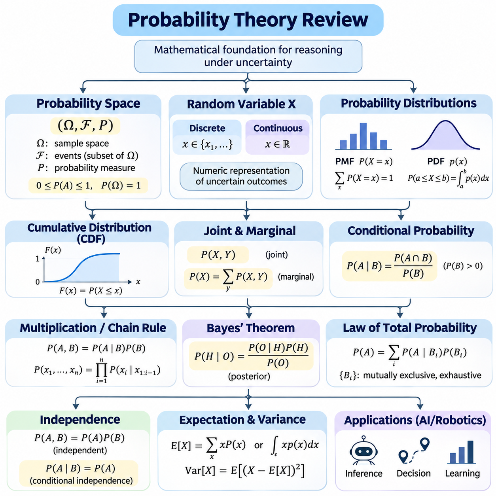{width="7.268055555555556in" height="7.268055555555556in"}

확률 이론(Probability Theory)은 불확실한 사건(Uncertain Event), 불완전한 관측(Incomplete Observation), 예측할 수 없는 결과(Unpredictable Outcome)를 추론하기 위한 수학적 기초(Mathematical Foundation)를 제공한다. 인공지능(Artificial Intelligence)에서 확률은 결정론적 명제(Deterministic Statement)에만 의존하는 대신 믿음의 정도(Degree of Belief)를 표현할 수 있도록 한다. 이러한 체계는 이용 가능한 정보만으로 환경의 실제 상태를 유일하게 결정할 수 없는 상황에서 추론(Inference), 예측(Prediction), 의사결정(Decision-Making), 학습(Learning)을 지원한다.

확률 공간(Probability Space)은 표본 공간(Sample Space), 사건의 집합(Collection of Events), 확률 측도(Probability Measure)로 구성된다. 표본 공간은 실험이나 과정에서 발생할 수 있는 모든 결과를 포함하며, 사건(Event)은 이러한 결과의 부분집합(Subset)을 의미한다. 확률 측도는 사건에 0과 1 사이의 값을 할당하며, 비음수성(Nonnegativity), 정규화(Normalization), 가산 가법성(Countable Additivity)을 만족해야 한다. 이러한 공리(Axiom)는 불확실성을 일관성 있게 해석하기 위한 수학적 기반을 확립한다.

확률변수(Random Variable)는 불확실한 결과를 수치적으로 표현하는 수단이다. 이산 확률변수(Discrete Random Variable)는 유한하거나 가산 무한한 집합(Countably Infinite Set)의 값을 가지며, 연속 확률변수(Continuous Random Variable)는 일정한 구간에 걸친 값을 가질 수 있다. 확률변수를 이용하면 로봇 위치(Robot Position), 센서 측정값(Sensor Measurement), 부품 고장(Component Failure), 객체 분류(Object Classification)와 같은 복잡한 환경적 특성을 수학적으로 표현하고 확률분포(Probability Distribution)를 통해 분석할 수 있다.

확률질량함수(Probability Mass Function)는 이산 확률변수(Discrete Random Variable)의 개별 값에 확률을 할당하며, 모든 확률의 합은 1이어야 한다. 연속 확률변수(Continuous Random Variable)의 경우 확률밀도함수(Probability Density Function)가 가능한 값의 범위에 확률이 어떻게 분포하는지를 나타낸다. 특정 구간의 확률은 확률밀도를 적분(Integration)하여 계산하며, 절대연속분포(Absolutely Continuous Distribution)에서 개별 점이 발생할 확률은 0이다.

누적분포함수(Cumulative Distribution Function)는 확률변수(Random Variable)가 특정 임계값(Threshold) 이하의 값을 가질 확률을 나타낸다. 누적분포함수는 이산분포(Discrete Distribution)와 연속분포(Continuous Distribution) 모두에 적용되며, 불확실성을 통합적으로 표현하는 방법을 제공한다. 특히 임계 조건(Threshold Condition)을 평가하고 고장 확률(Failure Probability)을 추정하며 측정값이 허용 가능한 운영 한계(Operating Limit) 내에 존재하는지를 판단하는 데 유용하다.

결합확률분포(Joint Probability Distribution)는 여러 확률변수(Random Variable)의 동시적인 동작을 표현한다. 이는 서로 다른 물리량이 함께 변화하는 방식을 설명하며, 환경 상태(Environmental State)와 관측(Observation) 사이의 관계를 모델링하는 기초를 제공한다. 예를 들어 로봇 위치 추정 시스템(Robot Localization System)은 위치(Position), 방향(Orientation), 센서 측정값(Sensor Measurement)의 결합분포를 표현하여 개별 확률만으로 설명하기 어려운 변수 사이의 의존성(Dependency)을 나타낼 수 있다.

주변확률분포(Marginal Probability Distribution)는 더 큰 결합확률분포(Joint Probability Distribution)에 포함된 개별 변수의 확률적 특성을 나타낸다. 주변화(Marginalization)는 직접적으로 관련되지 않은 변수의 가능한 값에 대해 합산(Summation)하거나 적분(Integration)하여 해당 변수를 제거하는 과정이다. 이를 통해 지능형 시스템(Intelligent System)은 다른 변수의 불확실성을 고려하면서 특정 상태에 집중할 수 있다. 주변화는 베이즈 네트워크(Bayesian Network)와 확률적 추론 알고리즘(Probabilistic Inference Algorithm)의 기본 연산이다.

조건부 확률(Conditional Probability)은 다른 사건이 발생했다는 조건에서 특정 사건이 발생할 가능성을 나타낸다. 조건이 되는 사건의 확률이 0보다 클 때, 조건부 확률은 두 사건의 교집합 확률(Intersection Probability)을 조건 사건의 확률로 나눈 값으로 정의된다. 조건부 확률을 이용하면 지능형 에이전트(Intelligent Agent)는 센서 관측(Sensor Observation)이나 환경 조건(Environmental Condition)과 같은 상황 정보를 반영하여 불확실한 상태를 추정할 수 있다.

곱셈 법칙(Multiplication Rule)은 결합확률(Joint Probability)을 조건부 확률(Conditional Probability)과 주변확률(Marginal Probability)의 곱으로 표현한다. 이 법칙을 반복적으로 적용하면 결합분포를 여러 조건부 확률 인자로 분해하는 확률의 연쇄 법칙(Chain Rule of Probability)을 얻을 수 있다. 이러한 분해는 구조화된 확률 모델(Structured Probabilistic Model)을 구성하고 가능한 모든 변수 조합을 독립적으로 처리하지 않으면서 복잡한 관계를 표현하는 데 필수적이다.

베이즈 정리(Bayes\' Theorem)는 조건부 확률(Conditional Probability)의 방향을 역으로 계산할 수 있는 수학적 방법을 제공한다. 사전확률(Prior Probability)과 관측된 증거의 우도(Likelihood)를 결합하여 사후확률(Posterior Probability)을 계산한다. 인공지능(Artificial Intelligence)에서는 이러한 관계를 이용하여 믿음 갱신(Belief Updating), 진단 추론(Diagnostic Reasoning), 분류(Classification), 상태 추정(State Estimation)을 수행한다. 그 효과는 사전 가정(Prior Assumption)과 관측 해석에 사용되는 우도 모델(Likelihood Model)의 타당성에 따라 달라진다.

전확률 법칙(Law of Total Probability)은 상호 배타적(Mutually Exclusive)이면서 전체 경우를 포괄하는(Exhaustive) 대안들의 집합을 고려하여 사건의 확률을 계산한다. 각 대안은 자신의 발생 확률과 해당 조건에서 사건이 발생할 조건부 가능성(Conditional Likelihood)에 따라 전체 확률에 기여한다. 이 원리는 지능형 에이전트(Intelligent Agent)가 숨겨진 환경 상태(Hidden Environmental State), 불확실한 원인(Uncertain Cause), 관측을 설명하는 여러 가설(Multiple Hypotheses)을 추론해야 할 때 중요하다.

통계적 독립성(Statistical Independence)은 한 사건에 대한 정보가 다른 사건의 확률을 변화시키지 않는 특성을 의미한다. 확률변수(Random Variable)의 경우 독립성은 결합분포(Joint Distribution)가 각 변수의 주변분포(Marginal Distribution)의 곱으로 분해될 수 있음을 의미한다. 조건부 독립성(Conditional Independence)은 추가 정보에 대한 조건을 부여한 이후 변수들이 독립적이 되는 별개의 특성이다. 이러한 차이는 효율적인 확률 모델 설계(Probabilistic Model Design)의 핵심 요소이다.

기댓값(Expectation)은 확률변수(Random Variable)의 가능한 값에 확률을 가중치로 적용한 평균이며, 중심 경향(Central Tendency)을 나타내는 기본적인 척도이다. 이산분포(Discrete Distribution)에서는 가중합(Weighted Sum)을 통해 계산하고, 연속분포(Continuous Distribution)에서는 적분(Integration)을 사용한다. 기댓값은 미래 보상(Future Reward), 운영 비용(Operational Cost), 에너지 소비(Energy Consumption) 등 불확실한 환경에서 지능형 의사결정(Intelligent Decision-Making)에 필요한 다양한 물리량을 추정하는 데 활용된다.

분산(Variance)은 확률변수(Random Variable)가 평균(Mean)에서 벗어나는 정도를 제곱하여 평균한 값이며, 표준편차(Standard Deviation)는 이러한 산포도(Dispersion)를 원래 측정 단위로 표현한다. 두 지표는 가능한 결과가 기댓값(Expected Value) 주변에서 얼마나 크게 변동하는지를 설명한다. 로봇 시스템(Robotic System)에서는 분산을 이용하여 위치 추정(Position Estimation), 센서 측정(Sensor Measurement), 예측된 움직임(Predicted Motion)의 불확실성을 표현하고 신뢰할 수 있는 추정값과 불확실한 추정값을 구분할 수 있다.

공분산(Covariance)은 두 확률변수(Random Variable)가 함께 변화하는 방식을 나타내며, 상관계수(Correlation Coefficient)는 이러한 관계를 정규화하여 단위가 없는 선형 연관성(Linear Association)의 척도를 제공한다. 양의 공분산(Positive Covariance)은 두 변수가 함께 증가하는 경향을 나타내고, 음의 공분산(Negative Covariance)은 반대 방향으로 변화하는 경향을 나타낸다. 공분산 행렬(Covariance Matrix)은 불확실성과 변수 간 의존성(Cross-Variable Dependency)을 표현하므로 다변량 추정(Multivariate Estimation), 센서 융합(Sensor Fusion), 칼만 필터링(Kalman Filtering)에서 특히 중요하다.

대표적인 확률분포(Probability Distribution)는 다양한 유형의 불확실성을 표현하기 위한 재사용 가능한 모델을 제공한다. 베르누이 분포(Bernoulli Distribution)는 이진 결과(Binary Outcome)를 나타내고, 이항분포(Binomial Distribution)는 독립 시행(Independent Trial)에서 발생하는 성공 횟수를 설명한다. 범주형 분포(Categorical Distribution)는 여러 이산적 대안을 표현한다. 포아송 분포(Poisson Distribution)는 특정 가정에서 사건 발생 횟수를 모델링하며, 가우시안 분포(Gaussian Distribution)는 연속적인 불확실성을 표현하고 추정 및 통계 모델링에 널리 사용된다.

가우시안 분포(Gaussian Distribution)는 평균(Mean)과 분산(Variance)으로 정의되며, 확률적 인공지능(Probabilistic Artificial Intelligence)에서 핵심적인 역할을 수행한다. 이러한 분포의 수학적 특성은 다양한 모델에서 효율적인 추정(Efficient Estimation), 선형 변환(Linear Transformation), 해석적 추론(Analytical Inference)을 지원한다. 다변량 가우시안 분포(Multivariate Gaussian Distribution)는 상관관계가 있는 변수로 표현 범위를 확장하여 위치(Position), 속도(Velocity), 방향의 근사값(Orientation Approximation), 센서 측정값(Sensor Measurement)을 결합하여 모델링할 수 있도록 한다.

엔트로피(Entropy)는 확률분포(Probability Distribution)에 포함된 불확실성의 정도를 측정한다. 하나의 결과에 확률이 집중된 분포는 여러 가능한 결과에 확률이 분산된 분포보다 낮은 엔트로피를 가진다. 인공지능(Artificial Intelligence)에서 엔트로피는 분류(Classification), 상태 추정(State Estimation), 정보 수집(Information Gathering)의 불확실성을 정량화하는 데 사용된다. 정보 이득(Information Gain)은 관측으로 인해 기대되는 엔트로피 감소량을 나타내며, 능동적 센싱(Active Sensing)과 탐색(Exploration)을 안내하는 기준으로 활용할 수 있다.

큰 수의 법칙(Law of Large Numbers)은 적절한 가정이 성립할 때 반복 관측의 평균이 기댓값(Expected Value)에 수렴하는 이유를 설명한다. 중심극한정리(Central Limit Theorem)는 특정 조건에서 정규화된 합계나 평균의 분포가 가우시안 분포(Gaussian Distribution)에 가까워지는 현상을 설명한다. 이러한 결과는 통계적 추정(Statistical Estimation), 표본추출 방법(Sampling Method), 불확실성 분석(Uncertainty Analysis)의 이론적 기초를 제공하지만, 적용 가능성은 변수의 의존성(Dependence)과 분포적 특성(Distributional Behavior)에 관한 가정에 따라 달라진다.

몬테카를로 방법(Monte Carlo Method)은 무작위로 생성된 표본(Random Sample)을 사용하여 확률적 물리량을 근사적으로 계산한다. 복잡한 확률분포(Probability Distribution)를 해석적으로 계산하는 대신 시뮬레이션 결과(Simulated Outcome)를 이용하여 기댓값(Expectation)이나 사건 확률(Event Probability)을 추정한다. 이러한 방법은 정확한 계산이 지나치게 많은 연산을 요구하거나 수학적으로 처리하기 어려운 경우에 유용하다. 추정 정확도(Estimation Accuracy)는 표본의 품질(Sample Quality), 표본 수(Sample Size), 추정량(Estimator)의 통계적 특성에 따라 달라진다.

확률 이론(Probability Theory)은 기대효용(Expected Utility)과 위험 평가(Risk Evaluation)를 통해 의사결정(Decision-Making)도 지원한다. 지능형 에이전트(Intelligent Agent)는 가능한 결과의 발생 확률을 관련 보상(Reward)이나 비용(Cost)과 결합하여 행동을 비교할 수 있다. 그러나 안전 필수 환경(Safety-Critical Environment)에서는 기댓값(Expected Value)을 최대화하는 것만으로 충분하지 않을 수 있다. 위험 민감형 방법(Risk-Sensitive Method)은 불확실성, 극단적 손실(Extreme Loss), 허용할 수 없는 결과의 발생 확률을 제한하는 제약조건(Constraint)을 추가로 고려한다.

실제 인공지능 시스템(Artificial Intelligence System)에서 확률 모델(Probability Model)은 수학적으로 일관성이 있다는 이유만으로 수용되어서는 안 되며, 관측 데이터(Observed Data)를 통해 평가되어야 한다. 잘못된 분포 가정(Distributional Assumption), 편향된 관측(Biased Observation), 모델에 반영되지 않은 의존성(Unmodeled Dependency)은 오해를 유발하는 결론을 생성할 수 있다. 확률 보정(Calibration), 통계적 검증(Statistical Validation), 민감도 분석(Sensitivity Analysis)은 예측 확률이 실제 운영 불확실성(Operational Uncertainty)을 정확하게 반영하고 변화하는 조건에서도 신뢰성을 유지하는지 판단하는 데 도움이 된다.

확률 이론(Probability Theory)은 고전적 인공지능(Classical Artificial Intelligence)을 베이즈 네트워크(Bayesian Network), 은닉 마르코프 모델(Hidden Markov Model), 동적 상태 추정(Dynamic State Estimation), 부분 관측 의사결정 과정(Partially Observable Decision Process)과 연결한다. 확률 이론의 개념은 불확실한 상태를 표현하고 증거(Evidence)를 결합하며 대안적 행동(Alternative Action)을 평가하기 위한 공통 언어를 제공한다. 확률분포(Probability Distribution), 조건부 의존성(Conditional Dependence), 기댓값(Expectation), 추론(Inference)에 대한 충분한 이해는 불확실한 환경에서도 신뢰성 있게 작동하는 지능형 시스템(Intelligent System)을 구축하기 위한 수학적 기반을 확립한다.

## 05.03 Bayesian Networks

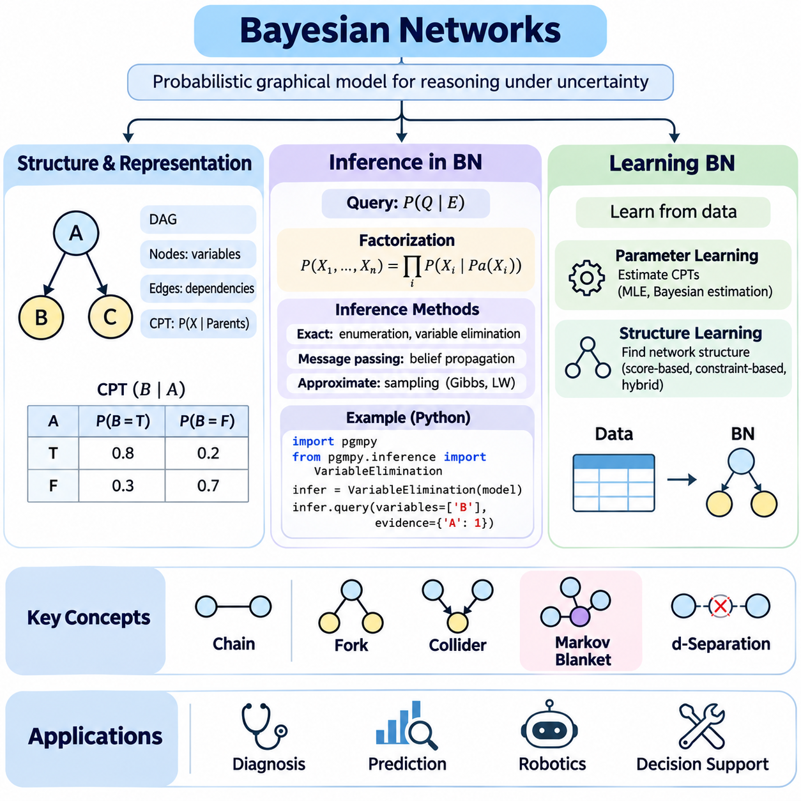{width="7.268055555555556in" height="7.268055555555556in"}

베이즈 네트워크(Bayesian Network)는 변수 사이의 불확실한 관계를 표현하기 위한 구조화된 확률적 체계(Structured Probabilistic Framework)를 제공한다. 확률 이론(Probability Theory)과 그래프 기반 지식 표현(Graph-Based Knowledge Representation)을 결합하여 지능형 시스템(Intelligent System)이 가능한 모든 결과를 명시적으로 열거하지 않고도 복잡한 의존성(Dependency)을 추론할 수 있도록 한다. 이러한 모델은 관측이 불완전하거나 불확실한 진단(Diagnosis), 예측(Prediction), 의사결정 지원(Decision Support), 로봇공학(Robotics) 등 다양한 분야에서 활용된다.

베이즈 네트워크(Bayesian Network)는 방향성 비순환 그래프(Directed Acyclic Graph, DAG)와 조건부 확률분포(Conditional Probability Distribution)의 집합으로 구성된다. 각 노드(Node)는 확률변수(Random Variable)를 나타내며, 방향성 간선(Directed Edge)은 모델에 표현된 직접적인 확률적 의존성(Probabilistic Dependency)을 나타낸다. 간선이 존재하지 않는 경우 적절한 그래프 조건에서 조건부 독립성(Conditional Independence)을 표현할 수 있다. 이러한 구조는 결합확률분포(Joint Probability Distribution)를 계산적으로 관리 가능한 작은 구성요소로 분해할 수 있도록 한다.

방향성 비순환 그래프(Directed Acyclic Graph)는 베이즈 네트워크(Bayesian Network)의 구조적 기반을 형성한다. 방향성 간선(Directed Edge)은 부모 변수(Parent Variable)와 자식 변수(Child Variable)를 연결하며, 유효한 확률분포 분해(Factorization)를 유지하기 위해 순환 구조(Cycle)는 허용되지 않는다. 각 변수에는 부모 변수가 주어졌을 때의 조건부 확률분포(Conditional Probability Distribution)가 연결된다. 루트 변수(Root Variable)는 네트워크 내부의 다른 변수에 의존하지 않으므로 사전확률분포(Prior Probability Distribution)를 가진다.

조건부 확률표(Conditional Probability Table, CPT)는 이산 베이즈 네트워크(Discrete Bayesian Network)를 표현하는 일반적인 방법이다. 각 확률표는 부모 변수(Parent Variable)의 모든 값 조합에 대해 특정 변수가 각각의 값을 가질 확률을 정의한다. 연속 변수(Continuous Variable)의 경우 조건부 확률분포(Conditional Probability Distribution)는 가우시안 모델(Gaussian Model)이나 다른 매개변수화된 표현(Parameterized Representation)을 사용할 수 있다. 이러한 지역 확률 모델(Local Probability Model)은 결합되어 네트워크가 표현하는 전체 결합분포(Joint Distribution)를 정의한다.

인수분해 특성(Factorization Property)은 베이즈 네트워크(Bayesian Network)의 핵심적인 장점이다. 변수의 수가 증가함에 따라 크기가 지수적으로 증가할 수 있는 전체 결합확률표(Full Joint Probability Table)를 저장하는 대신 지역적인 조건부 관계(Local Conditional Relationship)를 표현한다. 모든 변수의 결합확률(Joint Probability)은 각 변수의 부모가 주어졌을 때의 조건부 확률을 곱한 값과 같다. 이를 통해 기본 의존성 구조(Dependency Structure)가 충분히 희소한 경우 확률분포를 간결하게 표현할 수 있다.

조건부 독립성(Conditional Independence)은 베이즈 네트워크(Bayesian Network)에서 정보가 전달되는 방식을 결정한다. 연쇄 구조(Chain), 분기 구조(Fork), 충돌 구조(Collider)와 같은 그래프 구조(Graphical Structure)는 서로 다른 의존성 패턴(Dependency Pattern)을 설명한다. 연쇄 구조나 분기 구조에서는 중간 변수에 조건을 부여하면 정보 전달 경로가 차단될 수 있지만, 충돌 변수나 그 자손 변수에 조건을 부여하면 이전에 차단되어 있던 경로가 활성화될 수 있다. 이러한 관계는 d-분리(d-Separation)를 통해 형식적으로 정의된다.

변수의 마르코프 블랭킷(Markov Blanket)은 해당 변수의 부모(Parent), 자식(Child), 그리고 자식의 다른 부모(Other Parents of Children)로 구성된다. 마르코프 블랭킷이 주어지면 해당 변수는 네트워크의 나머지 모든 변수와 조건부 독립(Conditionally Independent)이 된다. 이러한 특성은 특정 노드를 예측하거나 갱신하는 데 직접적으로 관련된 변수를 식별하여 효율적인 지역 추론(Local Reasoning), 특징 선택(Feature Selection), 확률적 추론(Probabilistic Inference)을 지원한다.

베이즈 네트워크(Bayesian Network)는 관측적 의존성(Observational Dependency)과 인과적 해석(Causal Interpretation)을 구분한다. 방향성 간선(Directed Edge)은 확률분포의 인수분해(Probabilistic Factorization)에서 의존성을 표현하지만, 그 자체로 인과관계(Causation)를 확립하지는 않는다. 인과적 해석에는 데이터 생성 과정(Data-Generating Process)과 개입(Intervention)에 관한 추가적인 가정이 필요하다. 이러한 구분은 네트워크를 진단(Diagnosis), 설명(Explanation), 환경 조건의 변경을 포함하는 의사결정(Decision-Making)에 활용할 때 중요하다.

베이즈 네트워크의 추론(Inference in Bayesian Networks)은 이용 가능한 증거(Evidence)가 주어졌을 때 관측되지 않은 변수의 확률을 계산하는 과정이다. 증거 변수(Evidence Variable)에는 관측값이 할당되며, 질의 변수(Query Variable)는 추론하고자 하는 대상을 나타낸다. 추론 과정은 네트워크 구조(Network Structure)와 조건부 확률 모델(Conditional Probability Model)에 따라 확률분포를 갱신하며, 지능형 에이전트(Intelligent Agent)가 새로운 관측을 확보할 때마다 믿음(Belief)을 수정할 수 있도록 한다.

예측 추론(Predictive Inference)은 선행 변수(Predecessor Variable)의 정보를 이용하여 하위 변수(Downstream Variable)의 확률을 추정한다. 진단 추론(Diagnostic Inference)은 반대 방향으로 추론하여 관측된 결과(Observed Effect)로부터 가능한 원인(Possible Cause)을 추정한다. 원인 간 추론(Intercausal Inference)은 공통된 관측 결과에 대한 대안적 설명(Alternative Explanation) 사이의 관계를 분석한다. 이러한 추론 방식은 베이즈 네트워크가 방향성 그래프 표현(Directed Graphical Representation)을 사용하면서도 여러 방향으로 추론할 수 있음을 보여준다.

정확 추론(Exact Inference)은 지정된 네트워크 모델(Network Model)에 따라 수학적으로 정확한 확률을 계산한다. 열거법(Enumeration)은 관련 변수의 값 조합을 평가하며, 변수 제거법(Variable Elimination)은 중간 인자(Intermediate Factor)를 이용하여 은닉 변수(Hidden Variable)를 합산 제거함으로써 계산 효율을 개선한다. 변수 제거 순서(Elimination Order)는 계산 복잡도(Computational Complexity)에 큰 영향을 미치며, 부적절한 순서는 거대한 중간 인자를 생성하여 메모리 요구량(Memory Requirement)을 크게 증가시킬 수 있다.

신념 전파(Belief Propagation)는 연결된 변수나 인자 사이에서 메시지(Message)를 교환하여 확률적 추론(Probabilistic Inference)을 수행하는 또 다른 접근법이다. 트리 구조 네트워크(Tree-Structured Network)에서는 적절한 메시지 전달 알고리즘(Message-Passing Algorithm)을 통해 정확한 주변확률(Marginal Probability)을 효율적으로 계산할 수 있다. 무방향 순환(Undirected Cycle)이 포함된 네트워크에서는 접합 트리 방법(Junction Tree Method)이 그래프 변환(Graph Transformation) 이후 정확 추론을 지원할 수 있지만, 계산 비용은 생성된 클리크(Clique)의 크기에 크게 의존한다.

근사 추론(Approximate Inference)은 정확한 계산에 필요한 비용이 지나치게 클 때 필요하다. 표본추출 기반 방법(Sampling-Based Method)은 무작위로 생성한 변수 할당(Random Assignment)을 이용하여 사후확률(Posterior Probability)을 추정하며, 우도 가중법(Likelihood Weighting)은 관측된 증거를 표본 가중치(Sample Weight)에 반영한다. 깁스 샘플링(Gibbs Sampling)은 마르코프 연쇄(Markov Chain) 내에서 변수들을 조건부로 갱신한다. 이러한 방법은 계산 가능성(Computational Feasibility)을 확보하는 대신 정확성을 일부 희생하며, 수렴성(Convergence)과 추정 오차(Estimation Error)를 신중하게 평가해야 한다.

베이즈 네트워크 학습(Bayesian Network Learning)은 확률 매개변수(Probabilistic Parameter)를 추정하거나 그래프 구조(Graph Structure)를 발견하거나 두 작업을 함께 수행하는 과정이다. 매개변수 학습(Parameter Learning)은 의존성 구조(Dependency Structure)가 알려져 있다고 가정하고 데이터로부터 조건부 확률분포(Conditional Probability Distribution)를 결정한다. 구조 학습(Structure Learning)은 관측된 의존성을 적절하게 표현하는 그래프를 탐색한다. 두 과정의 신뢰성은 데이터 품질(Data Quality), 표본 수(Sample Size), 모델링 가정(Modeling Assumption)에 따라 달라진다.

최대우도추정(Maximum Likelihood Estimation, MLE)은 관측된 학습 데이터(Training Data)의 발생 확률을 최대화하는 매개변수 값을 선택한다. 모든 변수가 관측된 이산 네트워크(Discrete Network)에서는 빈도 계수(Frequency Count)를 통해 조건부 확률 추정값(Conditional Probability Estimate)을 계산할 수 있다. 그러나 관측 수가 제한적이면 추정값이 불안정해지거나 관측되지 않은 변수 조합에 대해 확률이 0으로 계산될 수 있다. 이러한 문제를 완화하기 위해 평활화 기법(Smoothing Technique)과 베이즈 매개변수 추정(Bayesian Parameter Estimation)을 활용한다.

베이즈 매개변수 학습(Bayesian Parameter Learning)은 모델 매개변수(Model Parameter)에 대한 사전분포(Prior Distribution)를 도입하고 관측 데이터를 이용하여 이를 갱신한다. 디리클레 사전분포(Dirichlet Prior)는 범주형 조건부 확률분포(Categorical Conditional Probability Distribution)에 편리한 사후 갱신(Posterior Update)을 제공하므로 널리 사용된다. 이러한 접근법은 추정된 매개변수의 불확실성(Parameter Uncertainty)을 표현하며, 학습 데이터셋(Training Dataset)이 작거나 특정 변수 조합의 관측 빈도가 낮은 경우 추정 안정성을 개선할 수 있다.

구조 학습(Structure Learning)은 베이즈 네트워크(Bayesian Network)에 어떤 방향성 간선(Directed Edge)을 포함해야 하는지 결정한다. 점수 기반 접근법(Score-Based Approach)은 베이즈 정보 기준(Bayesian Information Criterion, BIC)이나 베이즈 점수화 방법(Bayesian Scoring Method)을 사용하여 후보 그래프(Candidate Graph)를 평가한다. 제약 기반 접근법(Constraint-Based Approach)은 통계적 독립성 관계(Statistical Independence Relationship)를 검사하여 가능한 그래프 구조를 추론한다. 혼합 접근법(Hybrid Approach)은 이러한 전략을 결합하여 계산 효율성과 구조적 정확성(Structural Accuracy)의 균형을 추구한다.

네트워크 구조 학습(Network Structure Learning)은 변수의 수가 증가함에 따라 가능한 방향성 비순환 그래프(Directed Acyclic Graph)의 수가 급격하게 증가하므로 계산적으로 어렵다. 실제 알고리즘(Practical Algorithm)은 휴리스틱 탐색(Heuristic Search), 탐욕적 최적화(Greedy Optimization), 제한된 후보 구조(Restricted Candidate Structure)를 사용한다. 도메인 지식(Domain Knowledge)은 허용 가능한 간선을 제한하고, 타당하지 않은 관계를 배제하며, 해석 가능성(Interpretability)을 개선하는 동시에 계산적 탐색 공간(Computational Search Space)을 줄일 수 있다.

불완전한 데이터셋(Incomplete Dataset)은 일부 변수가 누락되거나 간접적으로만 관측되기 때문에 추가적인 어려움을 발생시킨다. 기댓값 최대화(Expectation-Maximization, EM)는 잠재변수(Latent Variable)의 기댓값을 추정하는 단계와 모델 매개변수(Model Parameter)를 갱신하는 단계를 반복하여 매개변수를 추정할 수 있다. 보다 일반적인 베이즈 접근법(Bayesian Approach)은 결측값(Missing Value)과 매개변수의 불확실성을 적분하여 처리한다. 체계적인 결측(Systematic Missingness)은 학습된 관계에 편향(Bias)을 유발할 수 있으므로 결측 데이터 가정(Missing-Data Assumption)을 신중하게 검토해야 한다.

모델 평가(Model Evaluation)는 학습된 베이즈 네트워크(Bayesian Network)가 관련 의존성을 적절하게 표현하고 신뢰할 수 있는 확률적 예측(Probabilistic Prediction)을 생성하는지 판단한다. 예측 로그우도(Predictive Log-Likelihood), 검증용 데이터 성능(Held-Out Data Performance), 확률 보정(Calibration), 구조적 안정성(Structural Stability)은 서로 보완적인 평가 기준을 제공한다. 학습 데이터(Training Data)에 잘 적합한 네트워크라도 새로운 데이터에 대한 일반화 성능(Generalization Performance)이 낮을 수 있으므로 실제 배포(Practical Deployment)에는 독립적인 검증(Independent Validation)이 필수적이다.

로봇공학(Robotics)에서 베이즈 네트워크(Bayesian Network)는 환경 조건(Environmental Condition), 센서 관측(Sensor Observation), 구성요소 상태(Component State), 운영 위험(Operational Risk) 사이의 관계를 표현할 수 있다. 이동 로봇(Mobile Robot)은 불확실한 장애물 감지(Uncertain Obstacle Detection), 위치 추정 신뢰도(Localization Confidence), 센서 신뢰성(Sensor Reliability)을 결합하여 환경적 위험(Environmental Hazard)을 추정할 수 있다. 이러한 모델은 진단 추론(Diagnostic Reasoning)과 의사결정 지원(Decision Assistance)에 활용되지만, 동적 상태 추정(Dynamic State Estimation)에는 동적 베이즈 네트워크(Dynamic Bayesian Network)와 같은 시간적 확장(Temporal Extension)이 필요한 경우가 많다.

베이즈 네트워크(Bayesian Network)는 기호적 지식 표현(Symbolic Knowledge Representation)과 정량적 확률 추론(Quantitative Probabilistic Reasoning)을 연결하는 기반을 제공한다. 그래프 구조(Graph Structure)는 변수 사이의 의존성을 명시적으로 나타내며, 조건부 확률분포(Conditional Probability Distribution)는 체계적인 믿음 갱신(Belief Updating)을 지원한다. 표현(Representation), 추론(Inference), 학습(Learning)을 통해 베이즈 네트워크는 불확실한 증거를 통합하고 복잡한 환경에서 정보에 기반한 의사결정(Informed Decision-Making)을 수행할 수 있는 해석 가능한 지능형 시스템(Interpretable Intelligent System)을 구축하기 위한 기초를 제공한다.

## 05.04 Exact Inference Methods

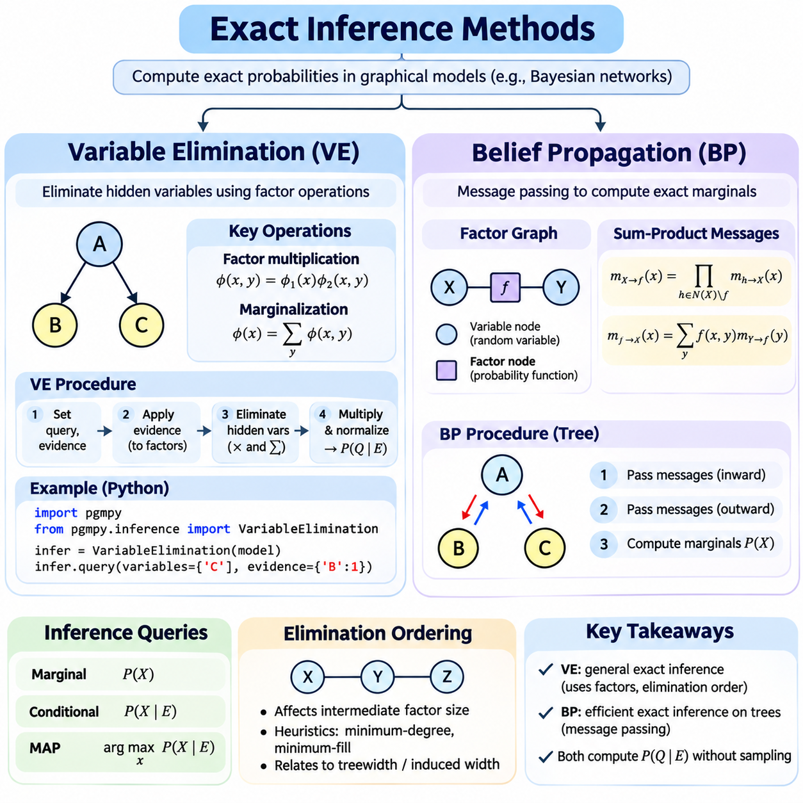{width="7.268055555555556in" height="7.268055555555556in"}

정확 추론 방법(Exact Inference Methods)은 확률적 그래프 모델(Probabilistic Graphical Model)에서 수학적으로 정확한 확률 계산을 제공한다. 네트워크 구조(Network Structure), 조건부 확률분포(Conditional Probability Distribution), 관측된 증거(Observed Evidence)가 주어지면 이러한 방법은 표본추출 근사(Sampling Approximation)를 사용하지 않고 사후확률(Posterior Probability)을 계산한다. 정확 추론은 근사 추론 알고리즘(Approximate Inference Algorithm)의 성능을 평가하고 검증할 수 있는 기준 결과(Reference Solution)를 제공하므로 베이즈 추론(Bayesian Reasoning)의 중요한 기초가 된다.

정확 추론(Exact Inference)의 목적은 이용 가능한 증거(Evidence)를 조건으로 질의 변수(Query Variable)의 확률분포(Probability Distribution)를 결정하는 것이다. 베이즈 네트워크(Bayesian Network)에서는 지역 조건부 확률 인자(Local Conditional Probability Factor)를 결합하고 질의와 직접적으로 관련되지 않은 변수를 제거해야 한다. 기본적인 확률 계산은 개념적으로 단순하지만, 서로 연결된 변수의 수가 증가하면 직접 열거(Direct Enumeration)에 필요한 계산 비용(Computational Cost)이 급격하게 증가한다.

변수 제거법(Variable Elimination)은 인수분해된 확률분포(Factorized Probability Distribution)에서 은닉 변수(Hidden Variable)를 체계적으로 제거하여 중복 계산(Redundant Computation)을 줄이는 정확 추론 알고리즘(Exact Inference Algorithm)이다. 전체 결합분포(Full Joint Distribution)를 구성하는 대신 조건부 확률표(Conditional Probability Table)에서 생성된 작은 인자(Factor)를 대상으로 연산한다. 관련 인자를 곱하고 제거 대상 변수에 대해 합산함으로써 수학적 정확성을 유지하면서 원하는 사후분포(Posterior Distribution)를 계산한다.

인자(Factor)는 변수 집합(Set of Variables)의 값 조합에 수치값을 할당하는 함수(Function)이다. 베이즈 네트워크(Bayesian Network)에서는 조건부 확률표(Conditional Probability Table)를 인자로 취급할 수 있으며, 추론은 이러한 수학적 객체(Mathematical Object)에 대한 연산으로 진행된다. 인자 곱셈(Factor Multiplication)은 서로 호환되는 변수 할당(Variable Assignment)을 결합하고, 인자 주변화(Factor Marginalization)는 불필요한 변수에 대해 합산한다. 이 두 연산은 변수 제거법(Variable Elimination)의 계산적 기반을 형성한다.

변수 제거 과정(Variable Elimination Process)은 질의 변수(Query Variable), 증거 변수(Evidence Variable), 은닉 변수(Hidden Variable)를 식별하는 단계에서 시작한다. 관측된 증거는 관련 인자에 반영되며, 필요한 경우 변수의 정의역(Domain)이 축소된다. 이후 선택된 제거 순서(Elimination Ordering)에 따라 은닉 변수를 제거한다. 각 제거 단계에서는 대상 변수를 포함하는 모든 인자를 결합하고 해당 변수를 주변화하여 이후 계산에 사용할 새로운 인자를 생성한다.

지정된 모든 은닉 변수(Hidden Variable)가 제거되면 남아 있는 인자(Factor)를 곱하여 질의 변수(Query Variable)에 대한 비정규화 분포(Unnormalized Distribution)를 얻는다. 정규화(Normalization)는 이러한 값을 합계가 1인 유효한 사후확률(Posterior Probability)로 변환한다. 이 마지막 연산을 통해 결과 분포(Resulting Distribution)가 관측된 증거(Observed Evidence)를 조건으로 하는 질의 변수의 조건부 확률(Conditional Probability)을 올바르게 나타내도록 한다.

변수 제거법(Variable Elimination)의 계산 효율성(Computational Efficiency)은 변수 제거 순서(Elimination Ordering)에 크게 의존한다. 연결성이 높은 변수(Highly Connected Variable)를 초기에 제거하면 많은 변수를 포함하는 거대한 중간 인자(Intermediate Factor)가 생성될 수 있다. 반면 다른 제거 순서를 선택하면 메모리 사용량(Memory Consumption)과 산술 연산(Arithmetic Operation)을 크게 줄일 수 있다. 따라서 효과적인 제거 순서를 선택하는 것은 인자 연산을 정확하게 구현하는 것만큼 중요하다.

그래프 기반 휴리스틱(Graph-Based Heuristic)은 가능한 모든 제거 순서를 평가하지 않고도 효율적인 순서를 찾도록 지원한다. 최소 차수 휴리스틱(Minimum-Degree Heuristic)은 현재 연결 수가 적은 변수를 우선하며, 최소 채움 휴리스틱(Minimum-Fill Heuristic)은 제거 과정에서 추가되는 간선(Additional Edge)의 수가 적을 것으로 예상되는 변수를 선택한다. 이러한 접근법이 항상 최적 순서(Optimal Ordering)를 보장하지는 않지만, 중간 인자의 크기를 줄이고 실제 추론 성능(Practical Inference Performance)을 개선하는 데 도움이 된다.

변수 제거법(Variable Elimination)의 복잡도(Complexity)는 제거 순서에 따른 유도 폭(Induced Width)과 기본 그래프(Underlying Graph)의 트리폭(Treewidth)에 밀접하게 관련된다. 변수의 정의역 크기(Domain Size)가 제한되어 있다면 계산 요구량(Computational Requirement)은 일반적으로 가장 큰 중간 인자의 변수 범위(Factor Scope)에 따라 지수적으로 증가한다. 따라서 희소하고 구조화된 의존성(Sparse and Structured Dependency)을 가진 네트워크는 효율적인 정확 추론을 지원할 수 있지만, 연결 밀도가 높은 네트워크(Dense Network)는 여전히 계산적으로 어려울 수 있다.

변수 제거법(Variable Elimination)은 적절한 수정(Modification)을 통해 주변확률 질의(Marginal Probability Query), 조건부 확률 질의(Conditional Probability Query), 최대 사후확률 추정(Maximum A Posteriori Estimation)을 처리할 수 있다. 일반적인 합-곱 제거(Sum-Product Elimination)는 확률분포를 계산하며, 최대-곱 변형(Max-Product Variant)은 선택된 변수에 대한 최적화를 지원한다. 그러나 주변 최대 사후확률(Marginal MAP)과 결합 최빈 설명(Joint Most Probable Explanation)은 서로 구분해야 한다. 최대화(Maximization)와 합산(Summation) 연산은 일반적으로 교환할 수 없기 때문이다.

신념 전파(Belief Propagation)는 연결된 변수(Variable) 또는 인자(Factor) 사이에서 지역 메시지(Local Message)를 교환하는 정확 추론 체계(Exact Inference Framework)를 제공한다. 각 질의에 대해 중간 인자를 반복적으로 구성하는 대신 메시지 전달 알고리즘(Message-Passing Algorithm)을 통해 확률적 정보를 그래프 구조(Graphical Structure) 전체에 분산한다. 트리 구조 네트워크(Tree-Structured Network)에서는 조정된 지역 계산(Coordinated Local Computation)을 통해 정확한 주변분포(Marginal Distribution)를 효율적으로 계산할 수 있다.

인자 그래프(Factor Graph)에서 변수 노드(Variable Node)는 확률변수(Random Variable)를 나타내고, 인자 노드(Factor Node)는 확률적 관계(Probabilistic Relationship)를 설명하는 함수를 나타낸다. 변수 노드에서 전달되는 메시지는 목적지 인자를 제외한 이웃 인자로부터 수신한 정보를 결합한다. 인자 노드에서 전달되는 메시지는 지역 인자(Local Factor)와 수신 메시지(Incoming Message)를 결합한 후 수신 대상 변수를 제외한 나머지 변수에 대해 합산하여 해당 변수와 관련된 확률 정보를 생성한다.

합-곱 알고리즘(Sum-Product Algorithm)은 주변확률 추론(Marginal Probability Inference)을 위한 신념 전파(Belief Propagation)를 구현한다. 필요한 정보가 대상 변수(Target Variable)에 도달할 때까지 간선(Edge)을 따라 메시지가 전달된다. 트리 구조 인자 그래프(Tree-Structured Factor Graph)에서는 내부 방향과 외부 방향으로 진행되는 메시지 전달 일정(Inward and Outward Message-Passing Schedule)을 통해 모든 단일 변수 주변확률(Single-Variable Marginal Probability)을 정확하게 계산할 수 있다. 순환 구조(Cycle)가 없으므로 동일한 의존성을 반복적으로 계산하지 않고 정보를 전달할 수 있다.

신념 전파(Belief Propagation)는 예측 정보(Predictive Information)와 진단 정보(Diagnostic Information)를 나타내는 메시지를 통해 베이즈 네트워크 구조(Bayesian Network Structure)에서 직접 작동할 수도 있다. 예측 메시지(Predictive Message)는 조상 변수(Ancestor Variable)로부터 정보를 전달하고, 진단 메시지(Diagnostic Message)는 자손 변수(Descendant Variable)로부터 증거를 전달한다. 이러한 정보를 결합하면 노드(Node)는 지역 믿음(Local Belief)을 갱신할 수 있다. 기본 계산은 확률 인수분해(Probability Factorization)와 조건부 독립성(Conditional Independence) 관계를 따른다.

트리 구조 네트워크(Tree-Structured Network)와 다중 연결 네트워크(Multiply Connected Network)의 차이는 중요하다. 일반적인 신념 전파(Belief Propagation)는 트리 및 동등한 비순환 인자 표현(Acyclic Factor Representation)이 가능한 구조에서 정확하다. 무방향 순환(Undirected Cycle)이 존재하면 반복적 순환 신념 전파(Iterative Loopy Belief Propagation)를 적용할 수 있지만, 수렴(Convergence)이 보장되지 않으며 수렴한 결과도 반드시 정확한 것은 아니다. 이러한 네트워크에서 정확 추론(Exact Inference)을 수행하려면 추가적인 구조적 기법(Structural Technique)이 필요하다.

접합 트리 알고리즘(Junction Tree Algorithm)은 복잡한 의존성(Complex Dependency)을 포함하는 네트워크로 정확 메시지 전달(Exact Message Passing)을 확장한다. 원래 그래프(Original Graph)는 도덕화(Moralization)와 삼각화(Triangulation)를 거쳐 변환되며, 변수들은 트리 구조(Tree Structure)로 연결된 클리크(Clique)로 그룹화된다. 확률 인자(Probability Factor)는 이러한 클리크에 할당되며, 공유 변수(Shared Variable)의 일관성을 유지하면서 인접 클러스터(Neighboring Cluster) 사이에 메시지를 전달할 수 있다.

연속 교집합 속성(Running Intersection Property)은 여러 접합 트리 클리크(Junction Tree Clique)에 나타나는 모든 변수가 해당 클리크들을 연결하는 경로상의 모든 클리크에도 포함되도록 보장한다. 이러한 특성은 일관된 주변화(Consistent Marginalization)와 메시지 전달(Message Passing)을 지원한다. 접합 트리(Junction Tree)는 순환 구조를 포함하는 네트워크에서도 정확 추론(Exact Inference)을 가능하게 하지만, 삼각화(Triangulation) 과정에서 큰 클리크가 생성되면 계산 요구량(Computational Requirement)이 상당히 증가할 수 있다.

변수 제거법(Variable Elimination)과 신념 전파(Belief Propagation)는 인자 곱셈(Factor Multiplication)과 주변화(Marginalization)라는 동일한 수학적 기반을 공유한다. 변수 제거법은 이러한 연산을 변수 제거 순서(Elimination Sequence)에 따라 구성하고, 신념 전파는 그래프 구조(Graphical Structure)를 따라 전달되는 메시지(Message)로 구성한다. 접합 트리 전파(Junction Tree Propagation)는 특히 여러 사후확률 질의(Posterior Query)를 처리할 때 관련 인자 계산을 재사용 가능한 형태로 구성하는 방법으로 이해할 수 있다.

증거 반영(Evidence Incorporation)은 두 접근법 모두에서 중요한 단계이다. 관측 변수(Observed Variable)는 가능한 변수 할당(Variable Assignment)을 제한하며, 관측값의 우도 기여도(Likelihood Contribution)는 네트워크 전체의 사후확률(Posterior Probability)에 영향을 미친다. 확정 증거(Hard Evidence)는 관측된 값을 지정하고, 연성 증거(Soft Evidence)는 우도 인자(Likelihood Factor)를 통해 불확실한 관측 정보를 표현한다. 잘못되거나 일관성이 없는 증거 처리(Evidence Handling)는 오해를 유발하는 추론 결과를 생성할 수 있으므로 정확한 처리가 필수적이다.

수치적 안정성(Numerical Stability)은 확률 계산에 매우 작은 값이 많이 포함될 때 중요해진다. 반복적인 곱셈은 특히 대규모 네트워크(Large Network)나 발생 가능성이 낮은 증거(Unlikely Evidence)를 처리할 때 부동소수점 언더플로(Float-Point Underflow)를 발생시킬 수 있다. 로그 영역 계산(Log-Domain Computation), 메시지 정규화(Message Normalization), 신중하게 설계된 인자 표현(Factor Representation)은 수치 오차(Numerical Error)를 줄이는 데 도움이 된다. 이러한 기법은 의도한 확률 계산을 유지하면서 구현 신뢰성(Implementation Reliability)을 개선한다.

정확 추론 알고리즘(Exact Inference Algorithm)은 실제 메모리와 계산 자원의 제약(Computational Constraint)도 고려해야 한다. 원래 네트워크의 조건부 확률표(Conditional Probability Table)가 비교적 작더라도 중간 인자(Intermediate Factor)에 많은 변수가 포함되면 인자 테이블(Factor Table)의 크기가 매우 커질 수 있다. 효율적인 구현(Efficient Implementation)은 적용 가능한 경우 희소 인자(Sparse Factor), 캐싱(Caching), 구조화된 분포(Structured Distribution), 그래프 분해(Graph Decomposition)를 활용하여 불필요한 계산과 저장 공간을 줄인다.

로봇 응용(Robotic Application)에서 정확 추론(Exact Inference)은 센서 고장(Sensor Failure), 구성요소 상태(Component Condition), 이산 환경 가설(Discrete Environmental Hypothesis)에 관한 진단 추론(Diagnostic Reasoning)을 지원할 수 있다. 로봇은 불확실한 센서 관측(Uncertain Sensor Observation)과 사전 고장 확률(Prior Failure Probability)을 결합하여 대안적 고장 상태(Alternative Fault Condition)의 발생 가능성을 추정할 수 있다. 그러나 연속적인 고차원 상태 추정(Continuous High-Dimensional State Estimation)에서는 일반적인 정확 인자 연산(Exact Factor Operation)이 비현실적일 수 있으므로 특수한 해석적 모델(Analytical Model)이나 근사 추론(Approximate Inference)이 필요한 경우가 많다.

변수 제거법(Variable Elimination)과 신념 전파(Belief Propagation)의 선택은 네트워크 위상(Network Topology), 질의 요구사항(Query Requirement), 이용 가능한 계산 자원(Computational Resource)에 따라 달라진다. 변수 제거법은 개별 질의(Individual Query)에 대해 직접적이고 유연한 방법을 제공하며, 신념 전파는 트리 구조(Tree Structure) 전체에 정보를 효율적으로 분산한다. 접합 트리 방법(Junction Tree Method)은 보다 일반적인 네트워크로 정확 메시지 전달(Exact Message Passing)을 확장하지만, 확장성(Scalability)은 그래프 구조와 클리크 크기(Clique Size)에 의해 제한된다.

정확 추론 방법(Exact Inference Methods)은 신뢰할 수 있는 확률적 추론(Probabilistic Reasoning)의 계산적 기반을 확립한다. 변수 제거법(Variable Elimination)은 인수분해(Factorization)와 주변화(Marginalization)를 통해 불필요한 열거(Enumeration)를 피하는 방법을 보여주며, 신념 전파(Belief Propagation)는 조건부 독립성(Conditional Independence)을 이용하여 분산된 확률 계산(Distributed Probability Calculation)을 수행하는 방법을 설명한다. 이러한 방법의 수학적 원리(Mathematical Principle), 구조적 가정(Structural Assumption), 계산적 한계(Computational Limitation)를 이해하는 것은 고급 베이즈 추론(Advanced Bayesian Inference)과 불확실성 인식 의사결정(Uncertainty-Aware Decision-Making)을 구현하기 위한 중요한 기초가 된다.

## 05.05 Approximate Inference

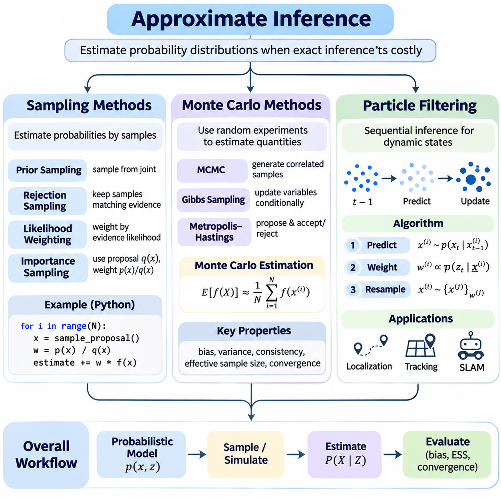{width="7.268055555555556in" height="7.268055555555556in"}

근사 추론 방법(Approximate Inference Methods)은 정확 추론(Exact Inference)의 계산 비용이 지나치게 높거나 수학적으로 처리하기 어려운 경우 확률분포(Probability Distribution)를 추정한다. 복잡한 베이즈 네트워크(Bayesian Network), 고차원 상태 공간(High-Dimensional State Space), 비선형 관계(Nonlinear Relationship)는 효율적인 해석적 해법(Analytical Solution)을 어렵게 만든다. 근사 추론은 모든 확률을 계산하는 대신 수치적 추정(Numerical Estimation)을 활용하여 제한된 계산 자원(Computational Resource)으로 불확실성을 추론할 수 있도록 한다.

표본추출 방법(Sampling Methods)은 확률 모델(Probabilistic Model)에서 대표적인 결과를 생성하여 확률분포(Probability Distribution)를 근사한다. 가능한 모든 변수 조합을 계산하는 대신 추출된 표본(Sample)을 사용하여 확률(Probability), 기댓값(Expectation), 통계적 특성(Statistical Property)을 추정한다. 적절한 가정이 성립하면 표본 수가 증가함에 따라 추정값은 이론적 값(Theoretical Value)에 가까워질 수 있지만, 수렴 속도(Convergence Rate)는 표본추출 전략(Sampling Strategy)과 분포의 특성에 따라 달라진다.

사전 표본추출(Prior Sampling)은 베이즈 네트워크(Bayesian Network)의 조건부 확률 구조(Conditional Probability Structure)를 따라 관측값을 생성한다. 변수는 위상 정렬 순서(Topological Order)에 따라 표본추출되므로 자식 변수를 추출하기 전에 부모 변수(Parent Variable)의 값이 결정된다. 이 방법은 결합확률분포(Joint Probability Distribution)에서 표본을 효율적으로 생성하지만, 이용 가능한 증거(Evidence)가 드문 사건(Rare Event)을 나타내는 경우 사후 추론(Posterior Inference)의 효율성이 낮아질 수 있다.

거부 표본추출(Rejection Sampling)은 관측된 증거(Observed Evidence)와 일치하지 않는 표본을 제거하여 증거를 반영한다. 남아 있는 표본은 관측되지 않은 변수의 사후분포(Posterior Distribution)를 근사한다. 개념적으로 단순하지만, 증거의 발생 확률(Evidence Probability)이 낮으면 생성된 표본 대부분이 거부되므로 비효율적이다. 이로 인해 충분한 유효 표본(Valid Sample)을 확보하기 위한 계산 요구량(Computational Requirement)이 증가한다.

우도 가중법(Likelihood Weighting)은 관측 변수(Observed Variable)를 고정하고 해당 변수의 조건부 우도(Conditional Likelihood)에 따라 가중치(Weight)를 부여하여 증거 기반 표본추출(Evidence-Based Sampling)을 개선한다. 관측되지 않은 변수는 조건부 분포(Conditional Distribution)에서 추출하고, 증거 확률(Evidence Probability)은 표본의 중요도(Sample Importance)에 반영된다. 이 방법은 표본 거부를 피할 수 있지만, 증거가 제안분포(Proposal Distribution)에서 발생하기 어려운 경우 가중치가 매우 불균등해질 수 있다.

중요도 표본추출(Importance Sampling)은 목표분포(Target Distribution)와 다른 제안분포(Proposal Distribution)에서 생성된 표본을 이용하여 기댓값(Expectation)을 추정한다. 각 표본에는 목표밀도(Target Density)와 제안밀도(Proposal Density)의 비율을 반영하는 가중치가 부여된다. 효과적인 제안분포는 상태 공간(State Space)의 중요한 영역에 계산 자원을 집중시킨다. 반면 부적절한 제안분포는 높은 분산(High Variance)과 매우 낮은 유효 표본 크기(Effective Sample Size)를 초래할 수 있다.

마르코프 연쇄 몬테카를로 방법(Markov Chain Monte Carlo Methods, MCMC)은 목표분포(Target Distribution)에 접근하도록 설계된 확률적 과정(Stochastic Process)을 통해 서로 의존적인 표본을 생성한다. 독립적으로 표본을 추출하는 대신 새로운 상태(New State)는 이전 상태(Previous State)에 의존한다. 적절한 조건에서 마르코프 연쇄(Markov Chain)는 원하는 사후분포(Posterior Distribution)에 해당하는 정상분포(Stationary Distribution)로 수렴한다. 실제 성능은 혼합 특성(Mixing Behavior), 초기화(Initialization), 반복 횟수(Number of Iterations)에 따라 달라진다.

깁스 샘플링(Gibbs Sampling)은 나머지 변수들이 주어졌을 때의 조건부 분포(Conditional Distribution)를 이용하여 개별 변수를 반복적으로 갱신하는 마르코프 연쇄 몬테카를로 기법(Markov Chain Monte Carlo Technique)이다. 조건부 분포에서 표본을 쉽게 생성할 수 있을 때 특히 편리하다. 그러나 변수 사이의 상관관계(Correlation)가 강하거나 확률분포의 최빈 영역(Probability Mode)이 서로 분리되어 있으면 혼합 속도(Mixing Speed)가 느려질 수 있으며, 사후분포를 충분히 탐색하기 위해 많은 반복이 필요하다.

메트로폴리스-헤이스팅스 알고리즘(Metropolis-Hastings Algorithm)은 후보 상태(Candidate State)를 제안하고 목표 정상분포(Target Stationary Distribution)를 유지하는 확률 규칙(Probability Rule)에 따라 이를 수용하거나 거부한다. 이 방법은 사후분포(Posterior Distribution)에서 직접 표본을 추출하지 않고도 복잡한 분포를 처리할 수 있다. 제안 방식(Proposal Design)은 효율성에 큰 영향을 미치며, 이동 폭이 지나치게 작으면 탐색이 느려지고 지나치게 크면 거부 빈도가 높아질 수 있다.

몬테카를로 방법(Monte Carlo Methods)은 반복적인 무작위 실험(Random Experiment)을 통해 수학적 물리량(Mathematical Quantity)을 추정한다. 예를 들어 관련 확률분포(Probability Distribution)에서 추출한 표본에 함수를 적용하고 그 결과를 평균하여 기댓값(Expected Value)을 근사할 수 있다. 적절한 가정이 성립하면 표본 수가 증가할수록 추정 오차(Estimation Error)는 일반적으로 감소한다. 표준 몬테카를로 적분(Standard Monte Carlo Integration)의 오차는 독립 표본 수의 제곱근에 반비례하는 비율로 감소하는 경우가 많다.

몬테카를로 추정량(Monte Carlo Estimator)은 편향(Bias), 분산(Variance), 일치성(Consistency)을 기준으로 평가해야 한다. 비편향 추정량(Unbiased Estimator)은 기댓값이 목표 물리량(Target Quantity)과 같으며, 분산은 반복 추정 사이에서 발생하는 변동을 나타낸다. 일치성은 표본 수가 증가할 때 추정값이 올바른 값으로 수렴하는 특성을 의미한다. 이러한 특성은 제한된 계산 예산(Computational Budget) 내에서 표본추출 알고리즘(Sampling Algorithm)이 신뢰할 수 있는 근삿값을 제공하는지 판단하는 데 도움이 된다.

유효 표본 크기(Effective Sample Size, ESS)는 가중치가 부여되거나 서로 상관된 표본에 포함된 유용한 정보량을 측정한다. 중요도 표본추출(Importance Sampling)에서는 가중치가 소수 표본에 집중되면 상대적으로 적은 표본이 추정 결과를 지배한다. 마르코프 연쇄 몬테카를로(Markov Chain Monte Carlo)에서는 자기상관(Autocorrelation)이 연속 표본으로부터 얻는 정보량을 감소시킨다. 유효 표본 크기를 감시하면 비효율적인 표본추출을 식별하고 추가 계산의 필요성을 판단할 수 있다.

수렴 진단(Convergence Diagnostics)은 표본추출 알고리즘(Sampling Algorithm)이 목표분포(Target Distribution)를 충분히 탐색했는지 평가한다. 추적 분석(Trace Analysis), 자기상관 측정(Autocorrelation Measurement), 독립적인 연쇄 사이의 비교(Independent Chain Comparison)는 불충분한 혼합(Poor Mixing)이나 불안정한 추정(Unstable Estimation)을 발견하는 데 도움이 된다. 그러나 유한한 진단 결과만으로 모든 상황에서 수렴을 보장할 수는 없다. 따라서 신뢰할 수 있는 확률적 추론(Probabilistic Inference)을 위해서는 통계적 진단(Statistical Diagnostics), 도메인 지식(Domain Knowledge), 민감도 분석(Sensitivity Analysis)을 결합해야 한다.

분산 감소 기법(Variance Reduction Techniques)은 표본 수를 반드시 증가시키지 않고도 몬테카를로 방법(Monte Carlo Method)의 효율성을 개선한다. 층화 표본추출(Stratified Sampling), 제어 변량(Control Variates), 대칭 표본추출(Antithetic Sampling), 정교하게 설계된 중요도 분포(Importance Distribution)는 추정 변동성(Estimation Variability)을 감소시킬 수 있다. 효과는 문제 구조(Problem Structure)와 추정량 설계(Estimator Design)에 따라 달라진다. 이러한 기법은 각 표본에 비용이 많이 드는 시뮬레이션(Simulation)이나 확률 평가(Probabilistic Evaluation)가 필요한 경우 특히 유용하다.

순차적 몬테카를로 방법(Sequential Monte Carlo Methods, SMC)은 표본추출 기반 추론(Sampling-Based Inference)을 은닉 상태(Hidden State)가 시간에 따라 변화하는 시스템으로 확장한다. 정적인 분포(Static Distribution)를 추정하는 대신 동적 상태(Dynamic State)에 대한 현재 믿음(Current Belief)을 표현하는 가중 표본(Weighted Sample)의 집합을 유지한다. 새로운 관측이 도착하면 표본 집합(Sample Population)을 재귀적으로 갱신하여 가능한 상태의 전체 이력(Complete State History)을 저장하지 않고도 확률적 추적(Probabilistic Tracking)을 수행할 수 있다.

파티클 필터링(Particle Filtering)은 비선형(Nonlinear) 및 비가우시안(Non-Gaussian) 상태 추정(State Estimation)에 널리 사용되는 순차적 몬테카를로 기법(Sequential Monte Carlo Technique)이다. 각 파티클(Particle)은 가능한 시스템 상태(System State)를 나타내며 관련 중요도 가중치(Importance Weight)를 가진다. 파티클 집합(Particle Set)은 사후 믿음 분포(Posterior Belief Distribution)를 근사하여 여러 가설(Multiple Hypotheses)을 동시에 표현할 수 있도록 한다. 이러한 기능은 단일 가우시안 분포(Single Gaussian Distribution)로 불확실성을 충분히 설명하기 어려운 경우 특히 유용하다.

파티클 필터(Particle Filter)는 일반적으로 예측(Prediction), 측정 갱신(Measurement Update), 재표본추출(Resampling) 연산으로 구성된다. 예측 단계에서는 과정 불확실성(Process Uncertainty)을 포함하는 상태 전이 모델(State Transition Model)에 따라 파티클을 전파한다. 측정 갱신 단계에서는 최신 관측의 우도(Likelihood)를 이용하여 파티클 가중치(Particle Weight)를 조정한다. 이후 재표본추출은 가능성이 낮은 가설의 영향을 줄이면서 관측 증거가 지지하는 영역에 파티클을 집중시킨다.

예측 단계(Prediction Stage)는 시스템 동역학(System Dynamics)을 통해 불확실성이 시간에 따라 변화하는 과정을 표현한다. 이동 로봇(Mobile Robot)의 경우 파티클은 이동 명령(Movement Command) 이후 가능한 위치(Position)와 방향(Orientation)을 나타낼 수 있다. 운동 잡음(Motion Noise)은 상태 전이 모델(Transition Model)에 따라 파티클을 분산시킨다. 이러한 표현은 선형 시스템 가정(Linear System Assumption) 없이도 바퀴 미끄러짐(Wheel Slip), 구동기 변동(Actuator Variation), 불완전한 운동 예측(Imperfect Motion Prediction)으로 발생하는 불확실성을 포착한다.

측정 갱신(Measurement Update)은 센서 관측(Sensor Observation)을 파티클 분포(Particle Distribution)에 반영한다. 각 파티클은 해당 상태에서 예측한 관측값(Predicted Observation)이 실제 측정값(Actual Measurement)과 얼마나 일치하는지를 기준으로 평가된다. 증거와 일치하는 파티클에는 높은 가중치가 부여되고, 일치하지 않는 파티클에는 낮은 가중치가 부여된다. 따라서 관측 우도 모델(Observation Likelihood Model)은 매우 중요하며, 잘못된 센서 가정(Sensor Assumption)은 추정된 사후분포(Posterior Distribution)를 왜곡할 수 있다.

재표본추출(Resampling)은 대부분의 파티클이 무시할 수 있을 정도로 작은 중요도 가중치(Importance Weight)를 갖는 가중치 퇴화(Weight Degeneracy) 문제를 해결한다. 다항 재표본추출(Multinomial Resampling), 체계적 재표본추출(Systematic Resampling), 층화 재표본추출(Stratified Resampling)은 정규화된 가중치(Normalized Weight)에 따라 새로운 파티클 집합을 생성한다. 재표본추출은 가중치 집중 현상을 줄이지만, 지나치게 자주 수행하면 파티클 다양성(Particle Diversity)이 감소하여 특히 과정 잡음(Process Noise)이 작은 경우 표본 고갈(Sample Impoverishment)을 초래할 수 있다.

파티클 퇴화(Particle Degeneracy)와 표본 고갈(Sample Impoverishment)은 중요한 실제적 한계를 발생시킨다. 유한한 파티클 집합(Finite Particle Population)은 이후 중요해질 수 있는 낮은 확률 영역(Low-Probability Region)을 충분히 표현하지 못할 수 있다. 적응형 재표본추출(Adaptive Resampling), 개선된 제안분포(Improved Proposal Distribution), 파티클 재활성화(Particle Rejuvenation), 파티클 수 증가(Increased Particle Count)는 이러한 문제를 완화할 수 있다. 그러나 상태 차원(State Dimensionality)이 증가하면 계산 요구량(Computational Requirement)이 크게 증가하는 경우가 많다.

로봇공학(Robotics)에서 파티클 필터(Particle Filter)는 위치 추정(Localization), 객체 추적(Object Tracking), 다중 가설 상태 추정(Multi-Hypothesis State Estimation)에 일반적으로 적용된다. 몬테카를로 위치 추정(Monte Carlo Localization, MCL)은 가능한 로봇 자세(Robot Pose)를 가중 파티클(Weighted Particle)로 표현하고 이동 명령(Motion Command)과 센서 측정값(Sensor Measurement)을 이용하여 갱신한다. 이 접근법은 충분한 파티클과 적절한 관측 모델(Observation Model)이 제공된다면 모호한 관측(Ambiguous Observation)에서 회복하고 여러 가능한 위치를 동시에 표현할 수 있다.

근사 추론(Approximate Inference)은 추정 정확도(Estimation Accuracy), 계산 비용(Computational Cost), 메모리 사용량(Memory Consumption), 응답 지연(Response Latency) 사이의 균형을 고려해야 한다. 표본추출 방법(Sampling Methods)은 불확실성을 유연하게 표현하고, 몬테카를로 기법(Monte Carlo Techniques)은 수치적 확률 추정(Numerical Probability Estimation)을 지원하며, 파티클 필터링(Particle Filtering)은 동적 환경(Dynamic Environment)에서 재귀적 추론(Recursive Reasoning)을 가능하게 한다. 이러한 접근법은 정확 추론(Exact Inference)이 현실적으로 어려운 복잡한 시스템으로 확률적 인공지능(Probabilistic Artificial Intelligence)의 적용 범위를 확장한다.

## 05.06 Hidden Markov Models

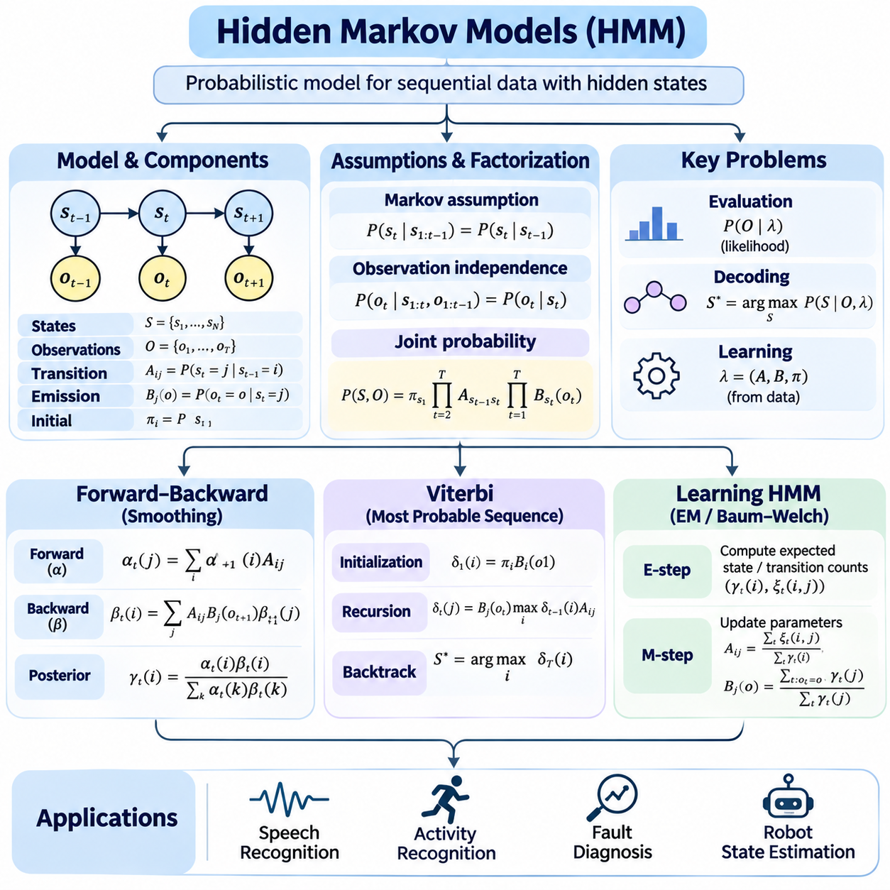{width="7.268055555555556in" height="7.268055555555556in"}

은닉 마르코프 모델(Hidden Markov Model, HMM)은 내부 상태(Internal State)를 직접 관측할 수 없는 순차적 시스템(Sequential System)을 표현하기 위한 확률적 체계(Probabilistic Framework)를 제공한다. 은닉 상태(Hidden State)는 해당 상태에서 생성된 관측 가능한 측정값(Observable Measurement)의 시퀀스를 통해 추론된다. 이러한 접근법은 개별 관측만으로 파악하기 어려운 정보를 시간적 관계(Temporal Relationship)를 통해 추출할 수 있으므로 음성 인식(Speech Recognition), 활동 인식(Activity Recognition), 고장 진단(Fault Diagnosis), 로봇 상태 추정(Robotic State Estimation)에 유용하다.

은닉 마르코프 모델(Hidden Markov Model)은 은닉 상태(Hidden State), 관측 출력(Observable Output), 전이 확률(Transition Probability), 방출 확률(Emission Probability), 초기 상태 분포(Initial State Distribution)로 구성된다. 전이 확률은 은닉 상태가 시간에 따라 변화하는 방식을 설명하고, 방출 확률은 특정 상태에서 관측값이 발생할 가능성을 나타낸다. 이러한 구성요소는 순차 데이터(Sequential Data)에 대한 생성적 확률 모델(Generative Probabilistic Model)을 정의하며, 관측되지 않은 시스템 동작(System Behavior)을 체계적으로 추론할 수 있도록 한다.

1차 마르코프 가정(First-Order Markov Assumption)은 다음 은닉 상태(Next Hidden State)가 이전 상태의 전체 이력(Complete History)이 아니라 현재 은닉 상태(Current Hidden State)에만 의존한다고 정의한다. 관측 독립성 가정(Observation Independence Assumption)은 각 관측값이 해당 시점의 은닉 상태에만 의존한다고 정의한다. 이러한 가정은 시간적 확률 계산(Temporal Probability Calculation)을 단순화하고 효율적인 동적 계획법 알고리즘(Dynamic Programming Algorithm)을 가능하게 하지만, 장거리 의존성(Long-Range Dependency)이 있는 시스템을 충분히 설명하지 못할 수 있다.

은닉 상태 시퀀스(Hidden State Sequence)와 관측 시퀀스(Observation Sequence)의 결합확률(Joint Probability)은 초기 상태 확률(Initial State Probability), 연속적인 전이 확률(Transition Probability), 방출 확률(Emission Probability)의 곱으로 인수분해(Factorization)할 수 있다. 이러한 인수분해는 복잡한 시간적 분포(Temporal Distribution)를 지역 항(Local Term)의 곱으로 변환한다. 따라서 은닉 마르코프 모델은 일반적인 추론 작업(Inference Task)을 수행할 때 가능한 모든 상태 시퀀스를 명시적으로 열거하지 않아도 된다.

은닉 마르코프 모델(Hidden Markov Model)은 세 가지 기본적인 계산 문제(Computational Problem)를 가진다. 평가(Evaluation)는 지정된 모델에서 관측 시퀀스가 발생할 확률을 계산한다. 복호화(Decoding)는 관측값에 대응하는 가장 가능성이 높은 은닉 상태 시퀀스(Hidden State Sequence)를 식별한다. 학습(Learning)은 이용 가능한 시퀀스로부터 모델 매개변수(Model Parameter)를 추정한다. 이러한 문제는 순방향-역방향 절차(Forward-Backward Procedure), 비터비 복호화(Viterbi Decoding), 매개변수 추정 알고리즘(Parameter Estimation Algorithm)을 통해 해결된다.

순방향 알고리즘(Forward Algorithm)은 재귀적 동적 계획법(Recursive Dynamic Programming)을 사용하여 관측 시퀀스(Observation Sequence)의 확률을 계산한다. 각 시간 단계(Time Step)에서 순방향 변수(Forward Variable)는 해당 시점까지의 관측값과 현재 은닉 상태(Current Hidden State)의 결합확률(Joint Probability)을 나타낸다. 알고리즘은 이전 순방향 확률(Forward Probability)에 전이 확률(Transition Probability)과 방출 확률(Emission Probability)을 결합하여 중복되는 상태 시퀀스의 반복 계산을 방지한다.

순방향 재귀(Forward Recursion)는 초기 상태 확률(Initial State Probability)에 첫 번째 관측값의 우도(Likelihood)를 곱하는 과정에서 시작한다. 이후 단계에서는 가능한 상태 전이(State Transition)를 통해 확률 질량(Probability Mass)을 전달하고 새로운 관측값을 반영한다. 마지막 순방향 확률을 모두 합산하면 전체 관측 시퀀스의 우도(Sequence Likelihood)를 얻는다. 전이 행렬(Transition Matrix)이 밀집된 경우 계산 복잡도(Computational Complexity)는 시퀀스 길이에 선형적으로, 상태 수에 대해서는 제곱에 비례하여 증가한다.

역방향 알고리즘(Backward Algorithm)은 현재 시점의 특정 은닉 상태(Hidden State)를 조건으로 미래 관측값(Future Observation)이 발생할 확률을 계산한다. 시퀀스의 마지막 시점에서 시작하여 역방향 변수(Backward Variable)를 이전 시간 단계로 재귀적으로 전달한다. 각 갱신 과정은 전이 확률(Transition Probability), 다음 관측값의 우도(Observation Likelihood), 역방향 확률(Backward Probability)을 결합하여 순방향 계산(Forward Calculation)을 보완하는 정보를 제공한다.

순방향-역방향 알고리즘(Forward-Backward Algorithm)은 순방향 변수(Forward Variable)와 역방향 변수(Backward Variable)를 결합하여 은닉 상태(Hidden State)의 평활화된 사후확률(Smoothed Posterior Probability)을 계산한다. 현재 시점까지 이용 가능한 관측값만 사용하는 필터링(Filtering)과 달리 평활화(Smoothing)는 전체 관측 시퀀스의 증거(Evidence)를 활용한다. 이러한 차이는 이후 관측값이 이전의 모호한 상태(Ambiguous State)를 명확하게 설명하는 궤적 재구성(Trajectory Reconstruction)과 오프라인 활동 인식(Offline Activity Recognition)에서 중요하다.

순방향-역방향 추론(Forward-Backward Inference)은 연속된 은닉 상태 사이의 전이(Transition)에 대한 사후확률(Posterior Probability)도 추정할 수 있다. 이러한 쌍별 확률(Pairwise Probability)은 이용 가능한 모든 관측값을 고려했을 때 특정 상태 전이가 발생했을 가능성을 나타낸다. 이는 은닉 상태 시퀀스를 직접 관측하지 않고도 기대 전이 횟수(Expected Transition Count)와 상태 점유 통계(State Occupancy Statistics)를 계산할 수 있으므로 매개변수 학습(Parameter Learning)에 필수적이다.

수치적 안정성(Numerical Stability)은 긴 관측 시퀀스(Long Observation Sequence)를 처리할 때 중요한 문제이다. 1보다 작은 확률을 반복적으로 곱하면 부동소수점 언더플로(Floating-Point Underflow)가 발생할 수 있다. 스케일링 계수(Scaling Factor)를 이용하여 각 시간 단계의 순방향 변수와 역방향 변수를 정규화(Normalization)하거나 로그 영역 계산(Log-Domain Computation)을 사용하면 안정적인 표현이 가능하다. 이러한 기법은 의도한 확률 계산을 유지하면서 신뢰할 수 있는 우도 평가(Likelihood Evaluation)를 지원한다.

비터비 알고리즘(Viterbi Algorithm)은 주어진 관측 시퀀스(Observation Sequence)에 대해 가장 가능성이 높은 단일 은닉 상태 시퀀스(Hidden State Sequence)를 식별한다. 동적 계획법(Dynamic Programming)을 사용하여 각 시간 단계에서 특정 상태로 끝나는 부분 경로(Partial Path) 중 확률이 가장 높은 경로를 유지한다. 대안적 경로(Alternative Path)의 확률을 합산하는 순방향 알고리즘(Forward Algorithm)과 달리 비터비 복호화(Viterbi Decoding)는 각 전이에서 최대 확률을 갖는 이전 상태를 선택한다.

비터비 복호화(Viterbi Decoding)는 초기 상태 확률(Initial State Probability)과 방출 확률(Emission Probability)을 이용한 초기화(Initialization)에서 시작한다. 재귀 단계(Recursion Stage)에서는 이전 상태로부터 도달하는 경로 중 최대 확률을 각 후보 상태(Candidate State)에 할당한다. 알고리즘은 선택된 이전 상태를 나타내는 역추적 포인터(Backpointer)를 저장한다. 마지막 상태를 선택한 이후 역추적(Backtracking)을 수행하여 전체 최적 은닉 상태 시퀀스(Optimal Hidden State Sequence)를 효율적으로 복원한다.

비터비 복호화(Viterbi Decoding)와 사후 상태 추정(Posterior State Estimation)의 차이는 근본적으로 중요하다. 비터비 알고리즘은 전체 시퀀스 중 가장 가능성이 높은 경로(Most Probable Complete Sequence)를 찾지만, 순방향-역방향 평활화(Forward-Backward Smoothing)는 각 시간 단계에서 개별 상태의 주변 사후확률(Marginal Posterior Probability)을 계산한다. 각 시점에서 가장 가능성이 높은 상태를 독립적으로 선택하면 전체적으로 가장 가능성이 높은 시퀀스가 되지 않을 수 있으며, 상태 전이 제약조건(Transition Constraint)을 위반할 수도 있다.

로그 영역 비터비 계산(Log-Domain Viterbi Computation)은 확률의 곱셈을 로그값의 덧셈으로 변환한다. 이러한 변환은 수치적 언더플로(Numerical Underflow)를 줄이고 후보 경로(Candidate Path) 사이의 비교를 단순화한다. 불가능한 상태 전이(Impossible Transition)는 로그 공간(Log Space)에서 음의 무한대(Negative Infinity)로 표현할 수 있다. 효율적인 구현(Efficient Implementation)은 벡터화 연산(Vectorized Operation)과 구조화된 전이 행렬(Structured Transition Matrix)을 활용하여 대규모 상태 공간(Large State Space)의 계산 부담을 줄인다.

은닉 마르코프 모델 학습(Hidden Markov Model Learning)은 순차적 관측값(Sequential Observation)으로부터 초기 상태 확률(Initial State Probability), 전이 확률(Transition Probability), 방출 매개변수(Emission Parameter)를 추정하는 과정이다. 은닉 상태 레이블(Hidden State Label)이 제공되면 지도 학습(Supervised Learning)을 통해 관측 빈도(Observed Frequency)나 적절한 통계적 추정량(Statistical Estimator)으로 매개변수를 추정할 수 있다. 상태를 관측할 수 없는 경우 학습은 상태 할당(State Assignment)의 불확실성을 고려해야 하는 잠재변수 추정 문제(Latent-Variable Estimation Problem)가 된다.

바움-웰치 알고리즘(Baum-Welch Algorithm)은 레이블이 없는 시퀀스(Unlabeled Sequence)에서 은닉 마르코프 모델(Hidden Markov Model)의 매개변수를 학습하기 위한 특수한 기댓값 최대화 절차(Expectation-Maximization Procedure)이다. 기댓값 단계(Expectation Step)에서는 순방향-역방향 추론(Forward-Backward Inference)을 통해 사후 상태 점유 확률(Posterior State Occupancy Probability)과 전이 확률(Transition Probability)을 계산한다. 최대화 단계(Maximization Step)에서는 이러한 기대 통계량(Expected Statistics)을 이용하여 초기 확률, 전이 확률, 방출 매개변수를 갱신한다.

바움-웰치 학습(Baum-Welch Learning)은 적절한 정확 기댓값 최대화 갱신(Exact Expectation-Maximization Update)이 적용되는 경우 관측 데이터 우도(Observed-Data Likelihood)를 반복적으로 개선하거나 유지한다. 그러나 알고리즘은 전역 최적해(Global Optimum)가 아닌 지역 최적해(Local Optimum)에 수렴할 수 있다. 따라서 초기화(Initialization)는 최종 모델에 큰 영향을 미친다. 여러 차례의 학습 실행(Multiple Training Runs), 사전 지식을 반영한 매개변수 초기화(Informed Parameter Initialization), 독립적인 검증(Independent Validation)은 실제 신뢰성을 개선할 수 있다.

방출 모델(Emission Model)은 은닉 상태(Hidden State)가 관측 가능한 측정값(Observable Measurement)을 생성하는 방식을 결정한다. 이산 은닉 마르코프 모델(Discrete Hidden Markov Model)은 범주형 관측 확률(Categorical Observation Probability)을 사용하고, 연속 모델(Continuous Model)은 가우시안 분포(Gaussian Distribution)나 가우시안 혼합분포(Gaussian Mixture Distribution)를 사용할 수 있다. 보다 유연한 방출 함수(Emission Function)는 복잡한 센서 측정값을 표현할 수 있지만, 매개변수 요구량(Parameter Requirement)을 증가시키고 추정(Estimation), 정규화(Regularization), 해석(Interpretation)을 어렵게 만들 수 있다.

모델 선택(Model Selection)은 은닉 상태(Hidden State)의 수와 전이분포(Transition Distribution) 및 방출분포(Emission Distribution)의 복잡도를 결정하는 과정이다. 상태 수가 지나치게 적으면 중요한 시간적 패턴(Temporal Pattern)을 표현하지 못할 수 있으며, 지나치게 많으면 학습 시퀀스(Training Sequence)에 과적합(Overfitting)될 수 있다. 검증용 데이터 우도(Held-Out Likelihood), 예측 성능(Predictive Performance), 정보 기준(Information Criterion), 응용 분야별 검증(Application-Specific Validation)은 다양한 모델 구성(Model Configuration)과 일반화 능력(Generalization Capability)을 평가하는 데 도움이 된다.

은닉 마르코프 모델(Hidden Markov Model)은 로봇의 운영 모드(Operating Mode), 구성요소 건전성(Component Health), 이산 운동 상태(Discrete Motion State)의 불확실성을 표현할 수 있다. 예를 들어 이동 로봇(Mobile Robot)은 연속적인 센서 측정값(Sequential Sensor Measurement)을 통해 정상 주행(Normal Motion), 미끄러짐(Slipping), 구동기 성능 저하(Actuator Degradation) 여부를 추론할 수 있다. 시간적 추론(Temporal Inference)은 개별적인 잡음 관측(Noisy Observation)에 대한 민감도를 낮추지만, 진단 신뢰성(Diagnostic Reliability)은 모델 가정(Model Assumption)과 방출 모델의 품질(Emission Quality)에 크게 의존한다.

은닉 마르코프 모델(Hidden Markov Model)과 동적 베이즈 네트워크(Dynamic Bayesian Network)의 관계는 시간적 확률 추론(Temporal Probabilistic Reasoning)에 대한 보다 넓은 관점을 제공한다. 표준 은닉 마르코프 모델(Standard Hidden Markov Model)은 각 시간 단계에 하나의 은닉 상태 변수(Hidden State Variable)와 하나의 관측 변수(Observation Variable)를 포함하는 동적 베이즈 네트워크로 표현할 수 있다. 보다 일반적인 동적 베이즈 네트워크는 이 구조를 여러 상호작용 상태 변수(Interacting State Variable)와 복잡한 의존성(Richer Dependency)으로 확장한다.

실제 배포(Practical Deployment)에서는 계산 지연(Computational Latency), 결측 관측(Missing Observation), 변화하는 운영 조건(Changing Operating Condition), 모델 불일치(Model Mismatch)를 고려해야 한다. 온라인 필터링(Online Filtering)은 실시간 상태 추정(Real-Time State Estimation)을 지원하며, 평활화(Smoothing)와 비터비 복호화(Viterbi Decoding)는 전체 관측 시퀀스를 이용할 수 있을 때 유용하다. 견고한 구현(Robust Implementation)을 위해서는 수치적 안정성(Numerical Stability), 전이 제약조건(Transition Constraint), 운영 환경의 분포 변화(Distribution Shift)에 대한 민감도도 평가해야 한다.

은닉 마르코프 모델(Hidden Markov Model)은 상태 전이(State Transition), 관측 우도(Observation Likelihood), 재귀적 추론(Recursive Inference)을 결합하여 시간에 따른 확률적 추론(Probabilistic Reasoning)의 기반을 확립한다. 순방향-역방향 알고리즘(Forward-Backward Algorithm)은 우도 평가(Likelihood Evaluation)와 사후 평활화(Posterior Smoothing)를 제공하고, 비터비 복호화(Viterbi Decoding)는 최적 상태 시퀀스(Optimal State Sequence)를 식별하며, 학습 알고리즘(Learning Algorithm)은 데이터로부터 모델 매개변수(Model Parameter)를 추정한다. 이러한 방법은 불확실한 환경에서 작동하는 지능형 시스템(Intelligent System)의 해석 가능한 순차적 추론(Interpretable Sequential Reasoning)을 지원한다.

## 05.07 Dynamic Bayesian Networks

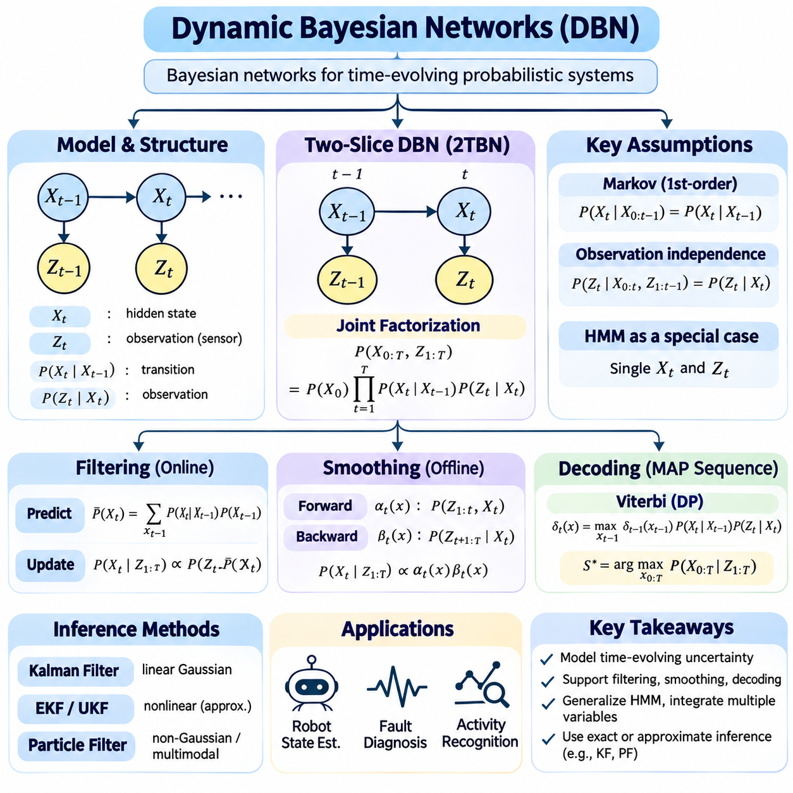{width="7.268055555555556in" height="7.268055555555556in"}

동적 베이즈 네트워크(Dynamic Bayesian Network, DBN)는 베이즈 네트워크(Bayesian Network)를 확장하여 시간에 따라 변화하는 확률적 관계(Probabilistic Relationship)를 표현한다. 이 모델은 은닉된 시스템 상태(Hidden System State)가 어떻게 변화하고, 관측값(Observation)이 어떻게 생성되며, 불확실성(Uncertainty)이 연속된 시간 단계(Time Step) 사이에서 어떻게 전파되는지를 모델링한다. 그래프 구조(Graphical Structure)와 시간적 의존성(Temporal Dependency)을 결합하여 지능형 시스템(Intelligent System)의 상태 추정(State Estimation), 예측(Prediction), 진단(Diagnosis), 순차적 추론(Sequential Reasoning)을 위한 일반적인 체계를 제공한다.

동적 베이즈 네트워크(Dynamic Bayesian Network)는 시간 인덱스가 부여된 슬라이스(Time-Indexed Slice)로 구성된 확률변수(Random Variable)를 포함한다. 각 시간 슬라이스(Time Slice)는 특정 시점의 시스템을 나타내며, 은닉 상태(Hidden State), 관측값(Observation), 제어 입력(Control Input), 환경 변수(Environmental Variable)를 포함할 수 있다. 방향성 간선(Directed Edge)은 동일한 슬라이스 내부 또는 연속된 슬라이스 사이의 의존성(Dependency)을 설명한다. 이러한 표현은 베이즈 네트워크의 조건부 독립성(Conditional Independence)을 유지하면서 시간적 관계를 명시적으로 나타낸다.

2-슬라이스 시간적 베이즈 네트워크(Two-Slice Temporal Bayesian Network, 2TBN)는 동적 모델(Dynamic Model)을 정의하기 위한 일반적인 표현 방법이다. 초기 시간 슬라이스(Initial Time Slice) 내부의 관계와 연속된 두 슬라이스 사이의 의존성을 정의한다. 일반적으로 동일한 전이 구조(Transition Structure)가 시간에 따라 반복되므로 간결한 모델로 임의 길이의 시퀀스(Sequence)를 표현할 수 있다. 초기 확률분포(Initial Probability Distribution)는 시작 조건(Initial Condition)을 설명하고, 전이 모델(Transition Model)은 이후의 상태 변화를 나타낸다.

1차 마르코프 가정(First-Order Markov Assumption)은 다음 시스템 상태(Next System State)가 이전의 전체 이력(Complete History)이 아니라 현재 상태(Current State)에 의존한다고 정의한다. 이러한 가정은 시간적 의존성(Temporal Dependency)을 인접한 시간 단계로 제한하여 확률적 모델링(Probabilistic Modeling)을 단순화한다. 더 복잡한 시스템에서는 고차 의존성(Higher-Order Dependency)이나 관련 과거 정보를 요약하는 확장 상태변수(Augmented State Variable)가 필요할 수 있으며, 이를 통해 관리 가능한 그래프 구조(Graphical Structure)를 유지할 수 있다.

상태 전이 모델(State Transition Model)은 은닉 변수(Hidden Variable)가 시간 단계 사이에서 어떻게 변화하는지를 설명한다. 이러한 모델은 이전 상태(Previous State), 제어 동작(Control Action), 환경 교란(Environmental Disturbance), 과정 잡음(Process Noise)에 의존할 수 있다. 로봇공학(Robotics)에서 전이 모델은 이동 명령(Movement Command) 이후 위치(Position), 속도(Velocity), 운영 조건(Operating Condition)이 변화하는 방식을 표현한다. 확률적 전이(Probabilistic Transition)는 구동기 오차(Actuator Error), 외부 교란(External Disturbance), 불완전한 동역학(Imperfect Dynamics)으로 발생하는 불확실성을 반영한다.

관측 모델(Observation Model)은 은닉 상태(Hidden State)를 측정 가능한 물리량(Measurable Quantity)과 연결한다. 이 모델은 실제 시스템 상태(Underlying System State)와 관련 환경 조건(Environmental Condition)이 주어졌을 때 센서 측정값(Sensor Measurement)이 발생할 확률을 정의한다. 여러 관측 변수(Observation Variable)는 카메라(Camera), 라이다(LiDAR), 관성 센서(Inertial Sensor), 진단 신호(Diagnostic Signal)를 나타낼 수 있다. 조건부 독립성 가정(Conditional Independence Assumption)은 센서 통합(Sensor Integration)을 단순화하지만, 측정 오차(Measurement Error) 사이에 상관관계가 존재하면 이를 모델에 반영해야 한다.

동적 베이즈 네트워크(Dynamic Bayesian Network)의 결합확률분포(Joint Probability Distribution)는 시간적 그래프 구조(Temporal Graph Structure)에 따라 인수분해(Factorization)된다. 초기 상태 확률(Initial State Probability)은 시퀀스의 시작을 설명하고, 조건부 분포(Conditional Distribution)는 이후 시점의 상태 전이(State Transition)와 관측(Observation)을 나타낸다. 이러한 인수분해는 모든 변수와 시간 단계에 대한 전체 결합분포(Full Joint Distribution)를 저장할 필요를 줄여 긴 순차 모델(Sequential Model)을 보다 효율적으로 관리할 수 있도록 한다.

필터링(Filtering)은 현재 시점까지 수집된 관측값(Observation)을 이용하여 현재 은닉 상태(Current Hidden State)를 추정한다. 각 필터링 주기(Filtering Cycle)는 예측(Prediction)과 보정(Correction) 연산으로 구성된다. 예측은 이전 믿음 분포(Previous Belief Distribution)를 상태 전이 모델(State Transition Model)을 통해 전파하고, 보정은 최신 관측값의 우도(Likelihood)를 반영한다. 이러한 재귀적 구조(Recursive Structure)는 전체 관측 이력(Observation History)을 반복적으로 처리하지 않고도 온라인 추론(Online Inference)을 지원한다.

예측(Prediction)은 새로운 측정값(Measurement)이 제공되기 전에 미래 상태(Future State)를 추정한다. 현재 믿음(Current Belief)을 하나 이상의 전이 단계(Transition Step)에 걸쳐 전파하면 동적 베이즈 네트워크(Dynamic Bayesian Network)는 가능한 미래 조건(Future Condition)에 대한 불확실성을 표현할 수 있다. 예측 구간(Prediction Horizon)은 신뢰성에 영향을 미치며, 일반적으로 과정 불확실성(Process Uncertainty)은 시간이 지남에 따라 누적된다. 이러한 기능은 선제적 제어(Anticipatory Control), 유지보수 계획(Maintenance Planning), 위험 평가(Risk Assessment)를 지원한다.

평활화(Smoothing)는 이전과 이후 시간 단계의 관측값(Observation)을 모두 이용하여 과거 은닉 상태(Past Hidden State)를 추정한다. 현재 시점에 이용 가능한 정보만 사용하는 필터링(Filtering)과 달리 평활화는 미래 증거(Future Evidence)를 활용하여 과거 추정값(Historical Estimate)을 개선한다. 고정 구간 평활화(Fixed-Interval Smoothing)는 전체 시퀀스를 처리하고, 고정 지연 평활화(Fixed-Lag Smoothing)는 제한된 관측 지연(Observation Delay)을 이용하여 최근 상태를 수정한다. 이러한 접근법은 궤적 재구성(Trajectory Reconstruction)과 오프라인 분석(Offline Analysis)에 유용하다.

복호화(Decoding)는 관측된 측정값(Observed Measurement)을 설명하는 가능성이 높은 은닉 상태 시퀀스(Hidden State Sequence)를 식별한다. 최대 사후확률 시퀀스 추정(Maximum A Posteriori Sequence Estimation)은 각 상태를 독립적으로 추정하는 대신 전체 상태 궤적(State Trajectory) 중 가장 가능성이 높은 경로를 탐색한다. 특정 이산 시간 구조(Discrete Temporal Structure)에서는 동적 계획법(Dynamic Programming)을 통해 효율적으로 해결할 수 있다. 보다 복잡한 네트워크에서는 특수한 최적화(Specialized Optimization) 또는 근사 추론(Approximate Inference)이 필요할 수 있다.

은닉 마르코프 모델(Hidden Markov Model, HMM)은 각 시간 단계에 하나의 은닉 상태 변수(Hidden State Variable)와 하나의 관측 변수(Observation Variable)를 포함하는 동적 베이즈 네트워크(Dynamic Bayesian Network)의 특수한 형태이다. 동적 베이즈 네트워크는 여러 상호작용 은닉 변수(Interacting Hidden Variable)와 더욱 풍부한 의존성 구조(Dependency Structure)를 지원하여 이러한 표현을 일반화한다. 이러한 유연성(Flexibility)은 결합된 과정(Coupled Process), 계층적 운영 모드(Hierarchical Operating Mode), 서로 다른 물리적 하위 시스템(Physical Subsystem) 사이의 관계를 모델링할 수 있도록 한다.

칼만 필터(Kalman Filter) 역시 동적 베이즈 네트워크(Dynamic Bayesian Network) 체계에서 해석할 수 있다. 선형 가우시안 상태 전이(Linear Gaussian State Transition)와 관측 모델(Observation Model)은 해석적으로 갱신할 수 있는 가우시안 믿음 분포(Gaussian Belief Distribution)를 생성한다. 확장 칼만 필터(Extended Kalman Filter, EKF)와 무향 칼만 필터(Unscented Kalman Filter, UKF)는 특정 비선형 시스템(Nonlinear System)에 대한 추론을 근사한다. 파티클 필터(Particle Filter)는 분포가 비가우시안(Non-Gaussian)이거나 여러 경쟁 가설(Competing Hypothesis)을 포함하는 경우 표본추출 기반 대안(Sampling-Based Alternative)을 제공한다.

동적 베이즈 네트워크(Dynamic Bayesian Network)에서 정확 추론(Exact Inference)은 각 시간 슬라이스(Time Slice) 내부에서 많은 상태변수(State Variable)가 상호작용할 때 어려워진다. 시간적 인수분해(Temporal Factorization)는 중복 계산(Redundant Computation)을 줄이지만, 중간 확률 인자(Intermediate Probability Factor)는 네트워크의 의존성 구조(Dependency Structure)에 따라 급격하게 증가할 수 있다. 변수 제거법(Variable Elimination)과 접합 트리 알고리즘(Junction Tree Algorithm)은 계산 요구량이 관리 가능한 경우 정확한 계산을 수행할 수 있으며, 근사 방법(Approximate Method)은 확장성(Scalability)을 개선한다.

근사 추론 기법(Approximate Inference Technique)에는 파티클 필터링(Particle Filtering), 변분 추론(Variational Inference), 구조화된 표본추출 접근법(Structured Sampling Approach)이 포함된다. 파티클 기반 방법(Particle Method)은 가중 상태 표본(Weighted State Sample)을 통해 믿음(Belief)을 표현하고, 변분 방법(Variational Method)은 단순한 매개변수화 분포(Parameterized Distribution)를 사용하여 복잡한 사후분포(Posterior Distribution)를 근사한다. 방법의 선택은 상태 차원(State Dimensionality), 비선형 동작(Nonlinear Behavior), 분포 복잡도(Distribution Complexity), 실시간 계산 제약조건(Real-Time Computational Constraint)에 따라 달라진다.

동적 베이즈 네트워크 학습(Dynamic Bayesian Network Learning)은 전이 매개변수(Transition Parameter), 관측 매개변수(Observation Parameter), 경우에 따라 기본 의존성 구조(Dependency Structure)를 추정하는 과정이다. 학습 과정에서 은닉 상태(Hidden State)를 확인할 수 있다면 지도 통계 방법(Supervised Statistical Method)을 이용하여 매개변수를 추정할 수 있다. 상태를 관측할 수 없는 경우에는 기댓값 최대화(Expectation-Maximization) 또는 베이즈 학습 방법(Bayesian Learning Method)을 통해 잠재 상태 궤적(Latent State Trajectory)의 불확실성을 고려하면서 매개변수를 추론할 수 있다.

구조 학습(Structure Learning)은 동일한 시간 슬라이스 내부와 서로 다른 시간 슬라이스 사이에서 어떤 변수가 다른 변수에 영향을 미치는지 결정한다. 후보 의존성(Candidate Dependency)은 통계적 점수(Statistical Score), 조건부 독립성 검정(Conditional Independence Test), 도메인별 제약조건(Domain-Specific Constraint)을 통해 평가할 수 있다. 시간적 순서(Temporal Ordering)는 가능한 관계를 제한하는 데 도움이 되지만, 관측 데이터(Observational Data)만으로 인과적 방향(Causal Direction)을 확립할 수는 없다. 사전 지식(Prior Knowledge)은 알려진 운영 관계(Operational Relationship)를 가진 물리 시스템(Physical System)을 학습할 때 특히 유용하다.

동적 베이즈 네트워크(Dynamic Bayesian Network)는 의도적인 행동(Deliberate Action)의 영향을 받는 시스템을 표현하기 위해 제어 입력(Control Input)을 포함할 수 있다. 행동(Action)은 상태 전이 확률(State Transition Probability)을 변화시키므로 개입(Intervention)이 미래 상태에 미치는 영향을 예측할 수 있다. 보상 함수(Reward Function)와 행동 선택 메커니즘(Action-Selection Mechanism)을 결합하면 이러한 표현은 확률적 상태 추정(Probabilistic State Estimation)을 부분 관측 의사결정 과정(Partially Observable Decision Process) 및 불확실성 인식 계획(Uncertainty-Aware Planning)과 연결한다.

모델 불확실성(Model Uncertainty)과 분포 변화(Distribution Shift)는 장기간 운영(Long-Term Operation)에서 중요한 문제를 발생시킨다. 특정 운영 조건(Operating Condition)에서 학습한 전이 확률(Transition Probability)은 장비 노후화(Equipment Aging)나 환경 특성(Environmental Characteristic)의 변화로 부정확해질 수 있다. 적응형 매개변수 추정(Adaptive Parameter Estimation), 온라인 학습(Online Learning), 변화 감지(Change Detection)는 예측 성능(Predictive Performance)을 유지하는 데 도움이 된다. 그러나 통제되지 않은 모델 적응(Model Adaptation)은 불안정성(Instability)을 유발할 수 있으므로 신중한 검증(Validation)이 필요하다.

누락된 관측값(Missing Observation)은 이용할 수 없는 측정 갱신(Measurement Update)을 생략하면서 상태 예측(State Prediction)을 계속 수행하는 방식으로 처리할 수 있다. 불규칙한 표본추출 간격(Irregular Sampling Interval)은 시간 의존적 전이 모델(Time-Dependent Transition Model)이나 경과 시간(Elapsed Time)에 대한 명시적인 처리가 필요할 수 있다. 지연된 측정값(Delayed Measurement)은 이전 상태에 대한 정보를 포함하므로 추가적인 복잡성을 발생시킨다. 견고한 시간적 추론(Robust Temporal Inference)은 일관성이 없는 상태 갱신(Inconsistent State Update)을 발생시키지 않으면서 이러한 조건을 고려해야 한다.

자율 로봇공학(Autonomous Robotics)에서 동적 베이즈 네트워크(Dynamic Bayesian Network)는 위치 추정(Localization), 운동 추정(Motion Estimation), 센서 건전성(Sensor Health), 환경 불확실성(Environmental Uncertainty)을 통합할 수 있다. 이동 로봇(Mobile Robot)은 바퀴 미끄러짐(Wheel Slip), 센서 신뢰성(Sensor Reliability), 장애물 관측(Obstacle Observation)을 고려하면서 위치(Position)와 운영 모드(Operating Mode)를 추정할 수 있다. 이러한 상호작용 변수(Interacting Variable)를 모델링하면 각 하위 시스템을 독립적으로 처리하는 것보다 풍부한 상태 추정(State Estimation)이 가능하지만, 계산 복잡도(Computational Complexity)를 제어해야 한다.

동적 베이즈 네트워크(Dynamic Bayesian Network)는 산업 모니터링(Industrial Monitoring), 예지보전(Predictive Maintenance), 고장 진단(Fault Diagnosis)도 지원한다. 은닉 변수(Hidden Variable)는 장비 열화(Equipment Degradation), 운영 조건(Operating Condition), 구성요소 고장(Component Failure)을 나타낼 수 있으며, 관측값(Observation)은 진동(Vibration), 온도(Temperature), 성능 측정값(Performance Measurement)을 나타낸다. 시간적 의존성(Temporal Dependency)은 지속적인 고장(Persistent Fault)과 일시적인 센서 잡음(Isolated Sensor Noise)을 구분하고 미래 장비 상태(Future Equipment Condition)에 대한 확률적 예측(Probabilistic Prediction)을 지원한다.

실제 구현(Practical Implementation)에서는 모델 표현력(Model Expressiveness), 추론 정확도(Inference Accuracy), 계산 지연(Computational Latency), 메모리 사용량(Memory Consumption) 사이의 균형이 필요하다. 희소한 의존성 구조(Sparse Dependency Structure), 효율적인 인자 표현(Efficient Factor Representation), 신중하게 선택한 추론 알고리즘(Inference Algorithm)은 성능을 개선할 수 있다. 검증(Validation)은 학습 우도(Training Likelihood)에만 의존하지 않고 예측 정확도(Prediction Accuracy), 확률 보정(Probability Calibration), 결측 데이터에 대한 견고성(Robustness to Missing Data), 변화하는 조건에서의 동작(Behavior Under Changing Conditions)을 평가해야 한다.

동적 베이즈 네트워크(Dynamic Bayesian Network)는 상호 연결된 변수(Interconnected Variable)와 시간에 걸친 불확실성(Uncertainty)을 표현하기 위한 통합 체계(Unified Framework)를 제공한다. 그래프 구조(Graphical Structure)는 조건부 의존성(Conditional Dependency)을 나타내며, 재귀적 추론(Recursive Inference)은 필터링(Filtering), 예측(Prediction), 평활화(Smoothing), 복호화(Decoding)를 지원한다. 정적 베이즈 추론(Static Bayesian Reasoning)을 시간에 따라 변화하는 시스템(Evolving System)으로 확장함으로써 확률적 로봇공학(Probabilistic Robotics), 시간적 진단(Temporal Diagnosis), 불확실성 하의 지능형 의사결정(Intelligent Decision-Making Under Uncertainty)을 위한 기반을 확립한다.

## 05.08 Kalman Filter and Extensions [w/Code]

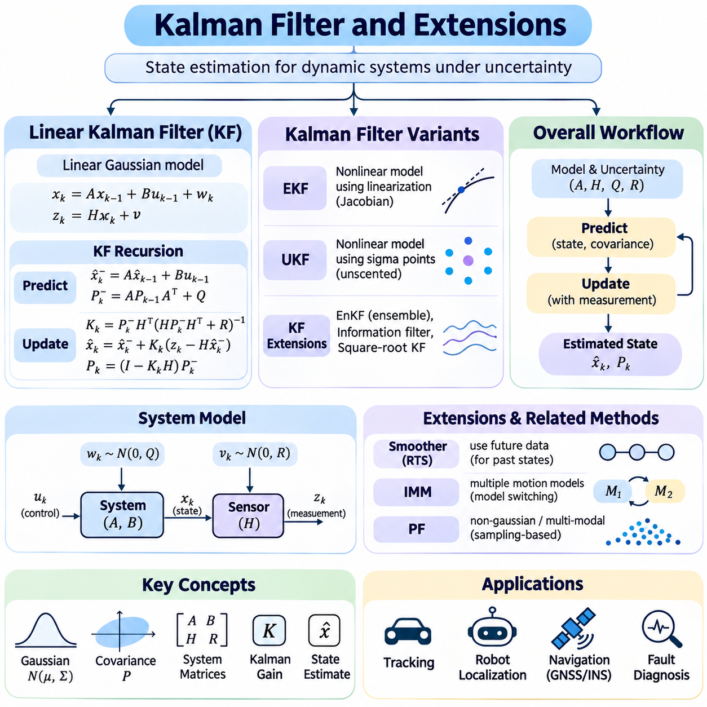{width="7.268055555555556in" height="7.268055555555556in"}

칼만 필터(Kalman Filter)는 잡음이 포함된 측정값(Noisy Measurement)으로부터 동적 시스템(Dynamic System)의 은닉 상태(Hidden State)를 추정하도록 설계된 재귀적 확률 추정 알고리즘(Recursive Probabilistic Estimation Algorithm)이다. 수학적 운동 모델(Mathematical Motion Model)에서 도출된 예측값(Prediction)과 센서(Sensor)에서 수집한 관측값(Observation)을 결합한다. 추정 불확실성(Estimation Uncertainty)을 명시적으로 표현함으로써 측정값이 불완전하거나 신뢰하기 어려운 추적(Tracking), 항법(Navigation), 센서 융합(Sensor Fusion), 제어(Control) 응용을 위한 체계적인 기반을 제공한다.

표준 칼만 필터(Standard Kalman Filter)는 선형 상태 전이(Linear State Transition), 선형 관측 관계(Linear Observation Relationship), 가우시안 과정 잡음(Gaussian Process Noise), 가우시안 측정 잡음(Gaussian Measurement Noise)을 가정한다. 시스템 상태(System State)는 위치(Position), 속도(Velocity), 가속도(Acceleration)와 같은 물리량을 포함하는 상태 벡터(State Vector)로 표현된다. 공분산 행렬(Covariance Matrix)은 추정 상태의 불확실성을 나타낸다. 이러한 가정을 통해 사후 상태 분포(Posterior State Distribution)는 가우시안 분포(Gaussian Distribution)를 유지하며 평균(Mean)과 공분산(Covariance)만으로 완전히 표현할 수 있다.

상태 전이 모델(State Transition Model)은 연속된 시간 단계(Time Step) 사이에서 시스템이 어떻게 변화하는지를 예측한다. 전이 행렬(Transition Matrix)은 이전 상태(Previous State)를 예측 상태(Predicted State)로 변환하며, 제어 행렬(Control Matrix)은 알려진 외부 입력(External Input)을 반영한다. 과정 잡음(Process Noise)은 모델링되지 않은 동역학(Unmodeled Dynamics)과 무작위 교란(Random Disturbance)을 나타낸다. 과정 잡음 공분산(Process Noise Covariance)은 예측 과정에서 추가되는 불확실성의 크기를 결정하며, 예상하지 못한 시스템 동작에 대한 필터의 반응성(Responsiveness)에 큰 영향을 미친다.

예측 단계(Prediction Stage)는 동적 모델(Dynamic Model)을 통해 추정 상태(Estimated State)와 공분산(Covariance)을 함께 전파한다. 예측 평균(Predicted Mean)은 새로운 측정값을 수신하기 전의 예상 시스템 상태(Expected System State)를 나타낸다. 예측 공분산(Predicted Covariance)은 이전 추정값에서 전달된 불확실성과 추가적인 과정 잡음(Process Noise)을 반영한다. 예측과 측정 보정(Measurement Correction)을 분리하는 구조는 전체 관측 이력(Observation History)을 저장하지 않고도 효율적인 순차적 추정(Sequential Estimation)을 가능하게 한다.

측정 모델(Measurement Model)은 은닉 상태(Hidden State)가 관측 가능한 센서값(Observable Sensor Value)을 생성하는 방식을 설명한다. 관측 행렬(Observation Matrix)은 상태변수(State Variable)를 측정 공간(Measurement Space)으로 변환하며, 측정 잡음(Measurement Noise)은 센서의 부정확성을 나타낸다. 측정 공분산(Measurement Covariance)은 관측값의 예상 신뢰도(Reliability)와 상관관계(Correlation)를 정의한다. 센서 불확실성(Sensor Uncertainty)을 과소평가하면 신뢰할 수 없는 관측값에 지나치게 높은 확신을 부여할 수 있으므로 정확한 측정 모델링(Measurement Modeling)이 필수적이다.

보정 단계(Correction Stage)에서 혁신값(Innovation)은 실제 측정값(Actual Measurement)과 예측 측정값(Predicted Measurement)의 차이를 나타낸다. 혁신 공분산(Innovation Covariance)은 예측 상태(Predicted State)의 불확실성과 측정 모델(Measurement Model)의 불확실성을 결합한다. 이러한 값은 새롭게 입력된 측정값이 현재 예측과 일치하는지를 판단하는 데 사용된다. 큰 혁신값은 예상하지 못한 운동(Unexpected Motion), 센서 오류(Sensor Error), 잘못된 모델 가정(Incorrect Model Assumption), 이전에 모델링되지 않은 교란(Unmodeled Disturbance)을 의미할 수 있다.

칼만 이득(Kalman Gain)은 필터가 최신 혁신값(Innovation)을 이용하여 예측 상태(Predicted State)를 얼마나 강하게 보정할지를 결정한다. 상대적으로 큰 이득(Gain)은 측정값(Measurement)에 더 큰 영향을 부여하고, 작은 이득은 모델 예측(Model Prediction)을 더 신뢰한다. 칼만 이득은 예측 공분산(Predicted Covariance)과 측정 불확실성(Measurement Uncertainty)을 이용하여 계산된다. 이러한 메커니즘은 센서 관측(Sensor Observation)과 동적 모델(Dynamic Model) 사이의 신뢰도를 원칙적으로 조정하는 방법을 제공한다.

측정값을 반영한 이후 보정된 상태 추정값(Corrected State Estimate)은 다음 예측 주기(Prediction Cycle)의 기준이 된다. 공분산(Covariance)은 관측값으로부터 획득한 정보(Information)를 반영하도록 갱신된다. 수치적으로 안정적인 구현(Numerically Stable Implementation)에서는 대칭성(Symmetry)을 유지하고 양의 준정부호성(Positive Semidefiniteness)의 손실을 줄이기 위해 조셉 공분산 갱신 형식(Joseph Covariance Update Form)을 사용할 수 있다. 유효한 공분산 행렬(Valid Covariance Matrix)을 유지하는 것은 신뢰할 수 있는 불확실성 표현(Uncertainty Representation)에 매우 중요하다.

칼만 필터(Kalman Filter)는 확률적 가정(Probabilistic Assumption)이 충족되는 선형 시스템(Linear System)과 가우시안 불확실성(Gaussian Uncertainty)에서 최소 평균제곱오차(Minimum Mean-Square Error) 기준으로 최적의 추정 성능을 제공한다. 성능은 올바른 시스템 행렬(System Matrix), 잡음 통계(Noise Statistics), 초기 조건(Initial Condition)에 의존한다. 모델 불일치(Model Mismatch)나 부정확한 공분산 매개변수(Covariance Parameter)는 편향된 추정(Biased Estimation), 일관성이 없는 불확실성(Inconsistent Uncertainty), 추정 발산(Estimation Divergence)을 발생시킬 수 있으므로 실제 환경에서의 검증(Practical Validation)이 필수적이다.

확장 칼만 필터(Extended Kalman Filter, EKF)는 칼만 필터링(Kalman Filtering)을 비선형 동적 모델(Nonlinear Dynamic Model)과 비선형 측정 모델(Nonlinear Measurement Model)로 일반화한다. 현재 추정 상태(Current Estimated State)를 중심으로 1차 테일러 전개(First-Order Taylor Expansion)를 수행하여 비선형 함수(Nonlinear Function)를 근사한다. 야코비안 행렬(Jacobian Matrix)은 국소 민감도(Local Sensitivity)를 나타내며 고정된 선형 전이 행렬(Linear Transition Matrix)과 관측 행렬(Observation Matrix)을 대체한다. 이러한 근사는 재귀적 가우시안 추정(Recursive Gaussian Estimation)을 가능하게 하지만 비선형성이 강한 경우 정확도가 낮아질 수 있다.

확장 칼만 필터링(Extended Kalman Filtering)은 일반적으로 예측 단계에서 상태 전이 야코비안(State Transition Jacobian)을 계산하고, 보정 단계에서 관측 야코비안(Observation Jacobian)을 계산한다. 공분산 전파(Covariance Propagation)는 비선형 변환(Nonlinear Transformation)을 통해 불확실성이 변화하는 방식을 근사한다. 부정확한 선형화 지점(Linearization Point)은 상당한 추정 오차(Estimation Error)를 발생시킬 수 있다. 따라서 강한 비선형성(Strong Nonlinearity), 다봉형 불확실성(Multimodal Uncertainty), 큰 초기화 오차(Large Initialization Error)는 수렴성(Convergence)과 일관성(Consistency)을 저하시킬 수 있다.

무향 칼만 필터(Unscented Kalman Filter, UKF)는 명시적인 야코비안 선형화(Jacobian Linearization) 대신 결정론적 표본추출(Deterministic Sampling)을 사용하여 비선형 추정(Nonlinear Estimation)을 수행한다. 추정 평균(Estimated Mean) 주변에 시그마 포인트(Sigma Point)를 생성하고 이를 비선형 시스템 함수(Nonlinear System Function)에 통과시킨다. 변환된 포인트(Transformed Point)를 결합하여 예측 평균(Predicted Mean)과 공분산(Covariance)을 추정한다. 이러한 접근법은 적절한 분포 조건에서 1차 선형화보다 비선형 효과(Nonlinear Effect)를 정확하게 반영할 수 있다.

시그마 포인트 선택(Sigma-Point Selection)은 무향 칼만 필터(Unscented Kalman Filter)가 불확실성을 표현하는 방식을 결정한다. 가중치(Weight)와 스케일링 매개변수(Scaling Parameter)는 비선형 변환 이후 재구성되는 평균(Mean)과 공분산(Covariance)에 영향을 미친다. 무향 접근법(Unscented Approach)은 해석적 야코비안(Analytical Jacobian)을 필요로 하지 않지만, 일반적으로 믿음 분포(Belief Distribution)에 대한 가우시안 근사(Gaussian Approximation)를 유지한다. 성능은 적절한 수치 설정(Numerical Setting)과 양호한 조건의 공분산 행렬(Well-Conditioned Covariance Matrix)에 의존한다.

확장 칼만 필터(Extended Kalman Filter)와 무향 칼만 필터(Unscented Kalman Filter)는 계산 비용(Computational Cost)과 비선형 근사 정확도(Nonlinear Approximation Accuracy) 사이에서 서로 다른 절충안을 제공한다. 야코비안(Jacobian)을 쉽게 구할 수 있고 비선형성이 중간 수준이라면 확장 칼만 필터가 효율적일 수 있다. 미분값(Derivative)을 도출하기 어렵거나 비선형 변환(Nonlinear Transformation)의 영향이 크다면 무향 칼만 필터가 유리할 수 있다. 그러나 모든 모델과 운영 조건에서 어느 한 방법이 항상 우수한 것은 아니다.

정보 필터(Information Filter)는 공분산(Covariance)과 상태 평균(State Mean) 대신 정보 행렬(Information Matrix)과 정보 벡터(Information Vector)를 사용하여 가우시안 추정(Gaussian Estimation)을 표현한다. 공분산 행렬이 비특이 행렬(Nonsingular Matrix)인 경우 정보 행렬은 공분산의 역행렬(Inverse Covariance)에 해당한다. 이러한 표현은 측정 융합(Measurement Fusion)을 단순화하고 특정 추정 문제에서 희소성(Sparsity)을 활용할 수 있다. 특히 분산 추정(Distributed Estimation), 지도 작성(Mapping), 다수의 독립 관측값(Independent Observation)을 결합하는 시스템에서 중요하다.

제곱근 칼만 필터(Square-Root Kalman Filter)는 전체 공분산 행렬(Full Covariance Matrix)을 직접 처리하는 대신 행렬 인자(Matrix Factor)를 전파한다. 촐레스키 분해(Cholesky Decomposition) 또는 QR 분해(QR Decomposition)에 기반한 연산은 수치적 안정성(Numerical Stability)을 개선하고 양의 준정부호 불확실성 표현(Positive Semidefinite Uncertainty Representation)을 유지하는 데 도움이 된다. 이러한 방법은 추정 시스템이 장기간 작동하거나 조건수가 나쁜 행렬(Ill-Conditioned Matrix)을 처리해야 할 때 유용하다. 구현 복잡도(Implementation Complexity)는 증가하지만 정밀도가 중요한 응용에서는 이러한 비용이 정당화될 수 있다.

적응형 칼만 필터링(Adaptive Kalman Filtering)은 운영 조건(Operating Condition)이 변화할 때 모델 또는 측정 불확실성 매개변수(Uncertainty Parameter)를 조정한다. 혁신 통계(Innovation Statistics)는 가정한 잡음 공분산(Noise Covariance)이 실제 관측 동작(Observed Behavior)과 일치하는지를 판단하는 데 활용할 수 있다. 적응형 기법(Adaptive Scheme)은 센서 품질(Sensor Quality)이나 시스템 동역학(System Dynamics)의 변화를 반영하기 위해 과정 공분산(Process Covariance) 또는 측정 공분산(Measurement Covariance)을 갱신할 수 있다. 그러나 통제되지 않은 적응(Uncontrolled Adaptation)은 추정 불안정성(Estimation Instability)을 초래할 수 있으므로 보호 장치(Safeguard)와 검증(Validation)이 필요하다.

칼만 필터링(Kalman Filtering)은 비동기식 센서 융합(Asynchronous Sensor Fusion)과 다중 센서 융합(Multisensor Fusion)도 지원한다. 서로 다른 주파수(Frequency)로 작동하는 센서는 측정값이 제공될 때마다 상태 갱신(State Update)에 참여할 수 있다. 예측 모델(Prediction Model)은 갱신 사이의 상태를 전파하고, 센서별 관측 모델(Sensor-Specific Observation Model)은 각 측정값을 반영한다. 상관된 센서 오차(Correlated Sensor Error)와 지연된 관측값(Delayed Observation)은 정보의 중복 계산(Double-Counting Information)이나 일관성이 없는 추정(Inconsistent Estimate)을 방지하기 위해 별도로 처리해야 한다.

자율 로봇공학(Autonomous Robotics)에서 칼만 필터(Kalman Filter)는 관성 센서(Inertial Sensor), 휠 엔코더(Wheel Encoder), 위성항법시스템 수신기(GNSS Receiver), 기타 위치 측정 시스템(Positioning System)의 데이터를 결합한다. 추정 상태(Estimated State)는 위치(Position), 속도(Velocity), 자세(Orientation), 센서 바이어스(Sensor Bias)를 포함할 수 있다. 비선형 자세 표현(Nonlinear Orientation Representation)과 변화하는 기준 좌표계(Reference Frame)는 신중한 수학적 처리가 필요하다. 오차 상태 칼만 필터(Error-State Kalman Filter, ESKF)는 기준 항법 궤적(Nominal Navigation Trajectory) 주변의 작은 보정값(Small Correction)을 추정하는 데 널리 사용된다.

이동 로봇(Mobile Robot)의 추정 정확도(Estimation Accuracy)는 현실적인 운동 모델(Motion Model)과 적절한 불확실성 매개변수(Uncertainty Parameter)에 의존한다. 바퀴 미끄러짐(Wheel Slip), 불균일한 지형(Uneven Terrain), 위성항법 다중경로(GNSS Multipath), 관성 센서 드리프트(Inertial Drift)는 기본 모델 가정(Nominal Model Assumption)을 위반할 수 있다. 혁신값 게이팅(Innovation Gating)과 이상치 제거(Outlier Rejection)는 신뢰할 수 없는 측정값이 상태 추정(State Estimate)을 손상시키는 것을 방지한다. 그러나 지나치게 공격적인 제거는 급격한 기동(Rapid Maneuver)이나 비정상적인 운영 조건(Unusual Operating Condition)에서 유효한 관측값까지 버릴 수 있다.

관측 가능성(Observability)은 이용 가능한 측정값(Measurement)과 시스템 동역학(System Dynamics)으로부터 은닉 상태변수(Hidden State Variable)를 복원할 수 있는지를 결정한다. 센서가 충분한 독립 정보(Independent Information)를 제공하지 못하면 일부 상태는 관측 불가능(Unobservable)한 상태로 남을 수 있다. 예를 들어 관성 측정값(Inertial Measurement)만으로는 추가적인 기준 정보(Reference Information) 없이 절대 위치(Absolute Position)를 무기한 정확하게 제한할 수 없다. 관측 가능성 분석(Observability Analysis)은 신뢰할 수 있는 추정을 위한 센서 선정(Sensor Selection), 시스템 모델링(System Modeling), 기동 설계(Maneuver Design)의 기준을 제공한다.

필터 일관성(Filter Consistency)은 보고된 불확실성(Reported Uncertainty)이 실제 추정 오차(Estimation Error)를 현실적으로 반영하는지를 나타낸다. 정규화 혁신 제곱(Normalized Innovation Squared, NIS)과 정규화 추정 오차 제곱(Normalized Estimation Error Squared, NEES)은 필요한 가정과 기준 정보(Reference Information)가 충족될 때 일반적으로 사용되는 진단 통계량(Diagnostic Statistic)이다. 지속적인 불일치(Persistent Inconsistency)는 잘못된 잡음 모델(Incorrect Noise Model), 모델링되지 않은 상관관계(Unmodeled Correlation), 선형화 오차(Linearization Error)를 나타낼 수 있다. 따라서 평가(Evaluation)에는 추정 정확도뿐 아니라 불확실성 보정(Uncertainty Calibration)도 포함해야 한다.

칼만 필터(Kalman Filter)는 동적 예측(Dynamic Prediction), 센서 관측(Sensor Observation), 불확실성 전파(Uncertainty Propagation)를 통합하여 재귀적 상태 추정(Recursive State Estimation)의 기반을 제공한다. 선형 칼만 필터링(Linear Kalman Filtering)은 가정이 충족되는 경우 정확한 가우시안 추론(Exact Gaussian Inference)을 제공하며, 확장형(Extended), 무향형(Unscented), 정보 형식(Information-Form), 제곱근 형식(Square-Root Form)은 보다 폭넓은 모델링 및 수치 계산 요구사항을 처리한다. 이러한 방법들은 로봇공학(Robotics), 항법(Navigation), 추적(Tracking), 지능형 제어 시스템(Intelligent Control System)에서 신뢰할 수 있는 상태 추정(Reliable State Estimation)을 지원한다.

## 05.09 POMDP Overview

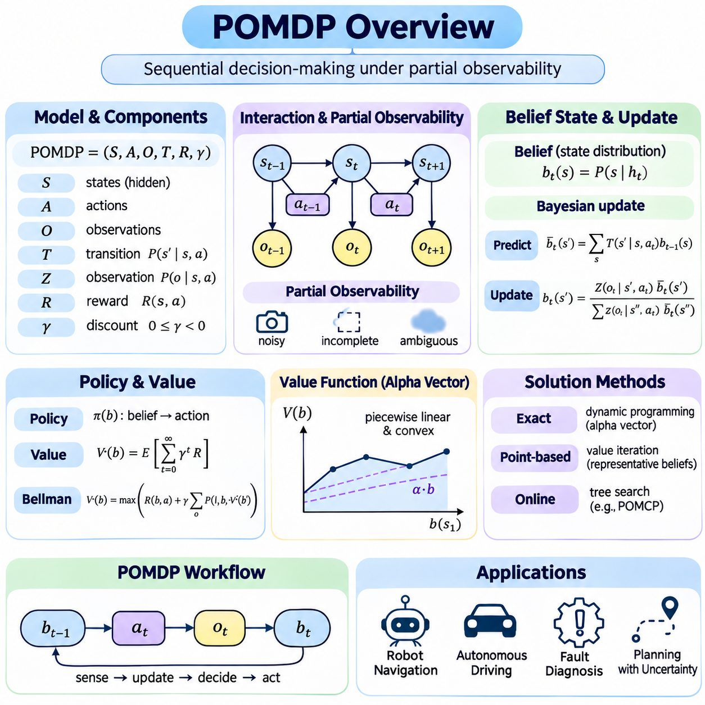{width="7.268055555555556in" height="7.268055555555556in"}

부분 관측 마르코프 의사결정 과정(Partially Observable Markov Decision Process, POMDP)은 환경의 실제 상태(True State)를 직접 관측할 수 없는 상황에서 순차적 의사결정(Sequential Decision-Making)을 수행하기 위한 수학적 체계(Mathematical Framework)를 제공한다. 완전 관측 의사결정 모델(Fully Observable Decision Model)과 달리 POMDP에서는 지능형 에이전트(Intelligent Agent)가 행동을 선택하면서 불확실성(Uncertainty)을 추론해야 한다. 확률적 상태 추정(Probabilistic State Estimation), 행동 의존적 상태 전이(Action-Dependent Transition), 불확실한 관측(Uncertain Observation), 장기 보상 최적화(Long-Term Reward Optimization)를 통합된 의사결정 체계(Unified Decision Framework)로 결합한다.

POMDP는 일반적으로 상태 집합(State Set), 행동 집합(Action Set), 관측 집합(Observation Set), 전이 확률(Transition Probability), 관측 확률(Observation Probability), 보상(Reward), 할인 계수(Discount Factor)로 정의된다. 상태(State)는 가능한 환경 조건(Environmental Condition)을 나타내고, 행동(Action)은 에이전트가 선택할 수 있는 의사결정을 설명한다. 전이 확률은 행동이 미래 상태(Future State)에 미치는 영향을 나타내며, 관측 확률은 해당 상태에서 생성되는 센서 정보(Sensor Information)를 설명한다. 보상은 결과의 바람직한 정도(Desirability)를 표현한다.

부분 관측성(Partial Observability)은 센서가 환경에 대해 불완전하거나 모호하고, 지연되거나 잡음이 포함된 정보(Incomplete, Ambiguous, Delayed, or Noisy Information)를 제공할 때 발생한다. 로봇은 장애물(Obstacle)을 감지하더라도 정확한 위치를 파악하지 못할 수 있으며, 자율주행 차량(Autonomous Vehicle)은 불확실한 도로 조건(Road Condition)에 직면할 수 있다. 에이전트는 하나의 알려진 상태를 가정하는 대신 가능한 상태에 대한 확률분포(Probability Distribution)를 유지한다. 이 분포는 불확실성을 표현하고 합리적인 의사결정(Rational Decision-Making)에 필요한 정보를 제공한다.

믿음 상태(Belief State)는 POMDP 추론(POMDP Reasoning)에 사용되는 핵심 표현이다. 행동과 관측의 이력(History of Actions and Observations)을 기반으로 가능한 각 은닉 상태(Hidden State)에 확률을 할당한다. 마르코프 가정(Markov Assumption)과 관측 가정(Observation Assumption)이 성립하면 현재 믿음 상태(Current Belief State)는 의사결정을 위한 충분통계량(Sufficient Statistic)이 되므로 전체 상호작용 이력(Complete Interaction History)을 유지할 필요가 없다. 믿음 상태는 부분 관측 문제(Partially Observable Problem)를 확률분포 공간(Probability Distribution Space)에서의 완전 관측 의사결정 과정(Fully Observable Decision Process)으로 변환한다.

믿음 갱신(Belief Updating)은 베이즈 추론(Bayesian Inference)을 통해 예측(Prediction)과 관측 보정(Observation Correction)을 결합한다. 행동을 실행한 이후 전이 모델(Transition Model)은 가능한 다음 상태(Next State)의 확률분포를 예측한다. 새로운 관측값이 도착하면 관측 모델(Observation Model)은 측정 우도(Measurement Likelihood)에 따라 이러한 확률을 조정한다. 결과적으로 생성된 사후분포(Posterior Distribution)는 다음 믿음 상태가 되며, 에이전트가 환경과 상호작용하는 동안 불확실성을 재귀적으로 갱신할 수 있도록 한다.

행동(Action)은 물리적 환경(Physical Environment)과 에이전트가 이용할 수 있는 정보(Available Information)에 모두 영향을 미친다. 객체를 향해 이동하면 시각적 인식(Visual Recognition)이 개선될 수 있으며, 센서 방향(Sensor Orientation)을 변경하면 위치 추정 불확실성(Localization Uncertainty)이 감소할 수 있다. 따라서 하나의 행동은 즉각적인 운영 가치(Operational Value)와 추가적인 정보 가치(Informational Value)를 동시에 가진다. 이러한 이중 영향(Dual Influence)은 감지(Sensing)와 제어(Control)를 독립적인 과정으로 취급하는 의사결정 접근법과 부분 관측 계획(Partially Observable Planning)을 구별하는 중요한 특징이다.

보상 함수(Reward Function)는 의사결정 시스템(Decision-Making System)의 목표를 정의한다. 보상은 작업 완료(Task Completion), 효율적인 자원 사용(Efficient Resource Use), 정확한 항법(Accurate Navigation), 안전한 운영(Safe Operation)을 장려할 수 있으며, 페널티(Penalty)는 충돌(Collision), 지연(Delay), 불필요한 행동(Unnecessary Action)을 억제한다. 할인 계수(Discount Factor)는 즉각적인 보상(Immediate Reward)에 비해 미래 보상(Future Reward)이 갖는 상대적 중요도를 결정한다. 최적 정책(Optimal Policy)은 불확실성과 미래 결과(Future Consequence)를 고려하면서 기대 누적 할인 보상(Expected Cumulative Discounted Reward)을 최대화한다.

POMDP 정책(POMDP Policy)은 직접 관측된 물리적 상태(Physical State)가 아니라 믿음 상태(Belief State)를 행동(Action)에 대응시킨다. 믿음은 확률분포(Probability Distribution)를 나타내므로 정책은 여러 가능한 환경 조건(Environmental Condition)을 동시에 고려해야 한다. 가장 가능성이 높은 상태(Most Likely State)에서 최적으로 보이는 행동이라도 발생 가능성은 낮지만 위험한 상태(Dangerous State)를 고려하면 바람직하지 않을 수 있다. 따라서 믿음 의존적 정책(Belief-Dependent Policy)은 불확실성을 고려한 행동(Uncertainty-Aware Behavior)을 위한 원칙적인 메커니즘을 제공한다.

가치 함수(Value Function)는 특정 믿음 상태(Belief State)에서 정책(Policy)을 따를 때 얻을 수 있는 기대 누적 보상(Expected Cumulative Reward)을 나타낸다. 벨만 재귀(Bellman Recursion)는 현재 가치(Current Value)를 즉각적인 보상(Immediate Reward) 및 가능한 관측 이후의 기대 미래 가치(Expected Future Value)와 연결한다. 이러한 재귀적 공식화(Recursive Formulation)는 최적 계획(Optimal Planning)의 이론적 기반을 제공한다. 그러나 기본 상태 집합(State Set)과 행동 집합(Action Set)이 유한하더라도 믿음 공간(Belief Space)은 일반적으로 연속적이므로 정확한 최적화(Exact Optimization)는 계산적으로 어렵다.

유한 상태 POMDP(Finite-State POMDP)의 유한 계획 구간(Finite Horizon)에서는 보상을 최대화할 때 최적 가치 함수(Optimal Value Function)가 구간별 선형 볼록 함수(Piecewise Linear and Convex Function)가 된다. 알파 벡터(Alpha Vector)는 믿음 단체(Belief Simplex) 위에서 가치 함수의 선형 구성요소(Linear Component)를 나타낸다. 동적 계획법(Dynamic Programming)은 연속적인 계획 단계(Planning Stage)를 통해 이러한 벡터를 갱신할 수 있다. 수학적으로 정교한 접근법이지만 후보 벡터(Candidate Vector)의 수가 빠르게 증가하여 상당한 계산 및 메모리 요구량(Computational and Memory Requirement)을 발생시킬 수 있다.

정확한 POMDP 계획(Exact POMDP Planning)은 상태(State), 행동(Action), 관측(Observation), 계획 단계(Planning Step)의 수가 증가할수록 어려워진다. 각 행동은 여러 가능한 관측값을 생성할 수 있으며, 이는 분기하는 미래 믿음 궤적(Future Belief Trajectory)을 형성한다. 이러한 복잡성(Complexity)으로 인해 정확한 방법(Exact Method)은 비교적 작은 문제나 신중하게 구조화된 모델에 제한되는 경우가 많다. 이러한 계산 문제는 실용적인 확장성(Practical Scalability)을 개선하기 위해 일부 최적성(Optimality)을 희생하는 근사 계획 기법(Approximate Planning Technique)의 필요성을 높인다.

점 기반 가치 반복법(Point-Based Value Iteration)은 도달 가능한 믿음 상태(Reachable Belief State)의 선택된 집합에 계산을 집중하여 POMDP 계획을 근사한다. 전체 믿음 공간(Belief Space)에서 가치 함수(Value Function)를 갱신하는 대신 대표적인 믿음(Representative Belief)에서 백업 연산(Backup Operation)을 수행한다. 도달 가능한 믿음이 제한된 영역에 분포하는 경우 이러한 전략은 계산 요구량(Computational Demand)을 크게 줄일 수 있다. 성능은 믿음 선택(Belief Selection), 근사 품질(Approximation Quality), 관련 운영 조건(Operating Condition)의 포괄 범위에 의존한다.

온라인 POMDP 계획(Online POMDP Planning)은 현재 믿음(Current Belief)을 기반으로 가능한 미래 결과(Future Outcome)에 대해 제한된 탐색(Limited Search)을 수행하여 행동을 계산한다. 트리 탐색 방법(Tree-Search Method)은 후보 행동(Candidate Action)과 관측(Observation)을 확장하면서 유망한 분기(Promising Branch)에 계산 자원을 할당한다. 몬테카를로 접근법(Monte Carlo Approach)은 시뮬레이션 궤적(Simulated Trajectory)을 통해 기대 수익(Expected Return)을 근사한다. 온라인 계획은 동적 환경(Dynamic Environment)에 적합하지만 실시간 성능(Real-Time Performance)은 탐색 깊이(Search Depth), 시뮬레이션 품질(Simulation Quality), 이용 가능한 계산 자원(Computational Resource)에 따라 달라진다.

몬테카를로 트리 탐색(Monte Carlo Tree Search, MCTS)은 표본추출된 상태 가설(Sampled State Hypothesis)이나 파티클 기반 믿음(Particle-Based Belief)을 유지하는 방식으로 부분 관측 문제(Partially Observable Problem)에 적용할 수 있다. 시뮬레이션된 행동과 관측은 가능한 미래 궤적(Future Trajectory)을 생성하며, 계획기는 이를 이용하여 행동 가치(Action Value)를 추정한다. 탐색 메커니즘(Exploration Mechanism)은 불확실한 선택을 조사하는 탐색(Exploration)과 유망한 행동을 활용하는 이용(Exploitation) 사이의 균형을 조정한다. 파티클 고갈(Particle Depletion)과 부정확한 시뮬레이션 모델(Inaccurate Simulation Model)은 특히 정보량이 높은 관측(Informative Observation)이 드문 경우 계획 품질(Planning Quality)을 저하시킬 수 있다.

정보 수집 행동(Information-Gathering Action)은 불확실성을 줄이면 미래 의사결정(Future Decision-Making)이 개선될 수 있으므로 POMDP에서 특히 중요하다. 로봇은 항법 경로(Navigation Path)를 선택하기 전에 가려진 영역(Occluded Region)을 관찰하기 위해 자신의 위치를 변경할 수 있다. 이러한 행동은 즉각적인 보상(Immediate Reward)이 거의 없더라도 기대 미래 성능(Expected Future Performance)을 향상시킬 수 있다. 정보 가치(Value of Information)는 관측이 이후 행동 선택(Subsequent Action Selection)에 미치는 영향을 믿음 의존적 계획(Belief-Dependent Planning)이 고려할 때 자연스럽게 나타난다.

탐색(Exploration)과 이용(Exploitation)은 불확실한 의사결정(Uncertain Decision-Making)에서 서로 경쟁하는 우선순위를 설명한다. 탐색은 미래 의사결정을 개선할 수 있는 정보를 수집하고, 이용은 즉각적인 작업 이익(Immediate Task Benefit)을 제공할 것으로 예상되는 행동을 선택한다. POMDP에서는 행동이 환경과 에이전트의 지식(Knowledge)을 동시에 변화시킬 수 있으므로 두 우선순위가 밀접하게 연결된다. 효과적인 정책(Effective Policy)은 감지 비용(Sensing Cost), 불확실성 감소(Uncertainty Reduction), 작업 진행(Task Progress), 장기적 결과(Long-Term Consequence)를 함께 고려한다.

안전 제약조건(Safety Constraint)은 기대 보상(Expected Reward)의 최대화 이상의 추가 요구사항을 도입한다. 발생 확률이 낮은 사건(Low-Probability Event)이라도 심각한 결과를 초래할 수 있으므로 위험 민감형 목적함수(Risk-Sensitive Objective)와 제약형 POMDP(Constrained POMDP)가 중요해진다. 충돌 확률(Collision Probability), 자원 제한(Resource Limitation), 운영 제한(Operational Restriction)은 행동 선택(Action Selection)에 영향을 미칠 수 있다. 기대 보상 최적화(Expected Reward Optimization)만으로 안전을 보장할 수는 없으므로 실제 시스템에서는 확률적 계획(Probabilistic Planning)과 독립적인 안전 메커니즘(Independent Safety Mechanism)을 결합하는 경우가 많다.

모델 정확도(Model Accuracy)는 POMDP 성능에 큰 영향을 미친다. 전이 모델(Transition Model)은 행동 결과(Action Outcome)를 표현해야 하며, 관측 모델(Observation Model)은 센서 신뢰성(Sensor Reliability)과 모호성(Ambiguity)을 설명해야 한다. 잘못된 확률(Incorrect Probability)은 믿음 갱신(Belief Update)을 왜곡하고 부적절한 행동 선택(Poor Action Choice)을 초래할 수 있다. 따라서 모델 학습(Model Learning), 불확실성 보정(Uncertainty Calibration), 변화하는 조건에서의 검증(Validation Under Changing Conditions)이 필수적이다. 견고한 공식화(Robust Formulation)는 전이 및 관측 매개변수(Transition and Observation Parameter)의 불확실성을 명시적으로 고려할 수도 있다.

POMDP는 확률적 추론(Probabilistic Inference)을 강화학습(Reinforcement Learning) 및 의사결정 이론(Decision Theory)과 연결한다. 전이 모델(Transition Model)과 관측 모델(Observation Model)이 알려진 경우 계획 방법(Planning Method)은 모델 기반 최적화(Model-Based Optimization)를 통해 정책(Policy)을 계산할 수 있다. 모델을 알 수 없는 경우 학습 방법(Learning Method)은 상호작용(Interaction)을 통해 동역학(Dynamics)을 추정하거나 정책을 개선할 수 있다. 학습과 부분 관측성(Partial Observability)을 결합하면 에이전트가 은닉 상태의 불확실성(Hidden-State Uncertainty)과 모델 매개변수의 불확실성(Model-Parameter Uncertainty)을 구별해야 하므로 추가적인 문제가 발생한다.

자율 로봇공학(Autonomous Robotics)에서 POMDP는 항법(Navigation), 능동 인지(Active Perception), 조작(Manipulation), 인간-로봇 상호작용(Human-Robot Interaction)을 지원한다. 이동 로봇(Mobile Robot)은 불확실한 위치 추정(Localization)과 장애물 정보(Obstacle Information)를 고려하면서 경로를 선택할 수 있다. 로봇 조작 시스템(Manipulation System)은 파지(Grasp)를 시도하기 전에 추가적인 감지 행동(Sensing Action)을 선택할 수 있다. 이러한 응용은 인지(Perception)가 불완전하고 행동 결과(Action Outcome)가 불확실한 상황에서 믿음 인식 계획(Belief-Aware Planning)이 의사결정을 개선할 수 있음을 보여준다.

다중 에이전트 환경(Multiagent Environment)은 부분 관측 의사결정(Partially Observable Decision-Making)을 여러 에이전트 사이의 상호작용으로 확장한다. 각 에이전트는 환경에 대해 서로 다른 관측값(Observation), 목표(Objective), 믿음(Belief)을 가질 수 있다. 분산형 POMDP(Decentralized POMDP, Dec-POMDP)는 분산된 정보(Distributed Information) 아래에서의 협력적 의사결정(Cooperative Decision-Making)을 표현하지만, 계산 복잡도(Computational Complexity)는 상당히 증가한다. 통신(Communication), 조정(Coordination), 공유 믿음 추정(Shared Belief Estimation)은 중요한 설계 고려사항이 된다.

실제 POMDP 배포(Practical POMDP Deployment)에서는 계획 정확도(Planning Accuracy), 계산 지연(Computational Latency), 모델 복잡도(Model Complexity), 운영 신뢰성(Operational Reliability) 사이의 균형이 필요하다. 믿음 표현(Belief Representation)은 상태 공간(State Space)에 따라 이산분포(Discrete Distribution), 가우시안 근사(Gaussian Approximation), 가중 파티클(Weighted Particle)을 사용할 수 있다. 근사 해법(Approximate Solver)은 의사결정 품질(Decision Quality), 견고성(Robustness), 확장성(Scalability)을 기준으로 평가해야 한다. 실시간 시스템(Real-Time System)은 실행 제약조건(Execution Constraint)을 충족하기 위해 계층적 계획(Hierarchical Planning), 제한된 계획 구간(Limited Horizon), 단순화된 모델(Simplified Model)을 사용할 수 있다.

POMDP는 부분 관측성(Partial Observability) 아래에서 지능형 의사결정(Intelligent Decision-Making)을 수행하기 위한 통합된 기반(Unified Foundation)을 제공한다. 믿음 상태(Belief State)는 불확실성을 표현하고, 베이즈 갱신(Bayesian Update)은 관측값을 반영하며, 정책(Policy)은 기대되는 장기적 결과(Expected Long-Term Consequence)에 따라 행동을 선택한다. 추론(Inference), 계획(Planning), 정보 수집(Information Gathering)을 통합함으로써 POMDP는 환경의 실제 상태(True Environment State)가 불확실한 상황에서도 효과적으로 추론하고 행동할 수 있는 자율 시스템(Autonomous System)으로 고전적 의사결정 과정(Classical Decision Process)을 확장한다.

## 05.10 Probabilistic Reasoning in Robotics

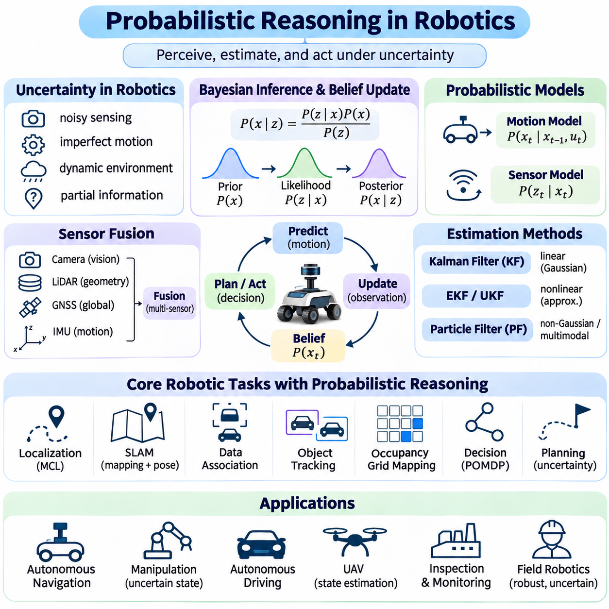{width="7.268055555555556in" height="7.268055555555556in"}

확률적 추론(Probabilistic Reasoning)은 정보가 불완전하고 측정값에 불확실성이 존재하는 환경에서 로봇이 인지(Perception), 추정(Estimation), 행동(Action)을 수행할 수 있도록 한다. 센서(Sensor)는 잡음(Noise)을 발생시키고, 구동기(Actuator)는 불완전한 운동(Imperfect Motion)을 생성하며, 환경 조건(Environmental Condition)은 예측하기 어렵게 변화한다. 확률적 로봇공학(Probabilistic Robotics)은 모든 관측값이 정확하다고 가정하는 대신 불확실성(Uncertainty)을 명시적으로 표현하고 수학적 추론(Mathematical Inference)을 활용하여 신뢰할 수 있는 항법(Navigation), 조작(Manipulation), 인지(Perception), 자율적 의사결정(Autonomous Decision-Making)을 지원한다.

확률적 로봇 시스템(Probabilistic Robotic System)은 위치(Position), 속도(Velocity), 자세(Orientation), 객체 식별(Object Identity), 환경 조건(Environmental Condition)과 같이 완벽하게 측정할 수 없는 물리량에 대한 믿음(Belief)을 유지한다. 이러한 믿음은 가우시안 분포(Gaussian Distribution), 이산 확률(Discrete Probability), 가중 표본(Weighted Sample)으로 표현할 수 있다. 표현 방법의 선택은 불확실성의 구조(Uncertainty Structure), 계산 자원(Computational Resource), 요구되는 추정 정확도(Estimation Accuracy)에 따라 달라진다. 믿음 갱신(Belief Update)은 예측값(Prediction)과 새롭게 입력되는 센서 증거(Sensor Evidence)를 통합한다.

베이즈 추론(Bayesian Inference)은 사전 지식(Prior Knowledge)과 새로운 관측값(New Observation)을 결합하기 위한 기반을 제공한다. 사전분포(Prior Distribution)는 측정값을 수신하기 전 로봇의 믿음을 나타내며, 우도(Likelihood)는 서로 다른 상태에서 해당 측정값이 발생할 가능성을 설명한다. 베이즈 정리(Bayes\' Rule)는 두 정보원을 모두 반영하는 사후분포(Posterior Distribution)를 생성한다. 재귀적 베이즈 필터링(Recursive Bayesian Filtering)은 로봇이 이동하고 새로운 측정값을 수신할 때마다 이러한 과정을 반복적으로 적용한다.

로봇 운동 모델(Robot Motion Model)은 제어 명령(Control Command)과 물리적 동역학(Physical Dynamics)에 의해 발생하는 상태 변화(State Change)를 예측한다. 휠 엔코더 측정값(Wheel Encoder Measurement), 조향각(Steering Angle), 관성 신호(Inertial Signal), 구동기 명령(Actuator Command)은 예상 운동(Expected Motion)에 대한 정보를 제공한다. 그러나 바퀴 미끄러짐(Wheel Slip), 불균일한 지형(Uneven Terrain), 보정 오차(Calibration Error), 기계적 교란(Mechanical Disturbance)은 불확실성을 발생시킨다. 확률적 전이 모델(Probabilistic Transition Model)은 이러한 영향을 표현하고 연속적인 운동 예측(Motion Prediction)을 통해 불확실성을 전파한다.

센서 모델(Sensor Model)은 관측값(Observation)이 로봇의 상태(Robot State)와 주변 환경(Surrounding Environment)에 어떻게 의존하는지를 설명한다. 카메라(Camera)는 시각적 특징(Visual Feature)을 제공하고, 라이다(LiDAR)는 기하학적 구조(Geometric Structure)를 측정하며, 위성항법시스템(GNSS)은 전역 위치(Global Position)를 추정하고, 관성 센서(Inertial Sensor)는 운동 관련 물리량(Motion-Related Quantity)을 측정한다. 각 센서는 서로 다른 잡음 특성(Noise Characteristic), 고장 유형(Failure Mode), 환경적 한계(Environmental Limitation)를 가진다. 확률적 측정 모델(Probabilistic Measurement Model)은 이러한 특성을 표현하고 관측값이 상태 추정(State Estimate)에 미치는 영향의 크기를 결정한다.

센서 융합(Sensor Fusion)은 상호 보완적인 측정값(Complementary Measurement)을 결합하여 개별 센서보다 더 많은 정보를 포함하는 추정값(Estimate)을 생성한다. 관성 센서(Inertial Sensor)는 높은 주파수의 운동 정보(High-Frequency Motion Information)를 제공하지만 드리프트(Drift)가 누적되며, 위성항법시스템(GNSS)은 전역 기준(Global Reference)을 제공하지만 다중경로(Multipath)와 신호 차단(Signal Blockage)의 영향을 받을 수 있다. 라이다(LiDAR)와 카메라(Camera)는 환경적 제약정보(Environmental Constraint)를 제공한다. 효과적인 융합은 불확실성(Uncertainty), 시간 정렬(Temporal Alignment), 좌표 변환(Coordinate Transformation), 측정값 사이의 상관관계(Correlation)를 고려해야 한다.

칼만 필터링(Kalman Filtering)은 불확실성을 가우시안 분포(Gaussian Distribution)로 적절하게 표현할 수 있는 경우 효율적인 재귀적 추정(Recursive Estimation)을 제공한다. 확장 칼만 필터(Extended Kalman Filter, EKF)와 무향 칼만 필터(Unscented Kalman Filter, UKF)는 서로 다른 근사 전략(Approximation Strategy)을 통해 비선형 운동 관계(Nonlinear Motion Relationship)와 관측 관계(Observation Relationship)를 처리한다. 오차 상태 필터(Error-State Filter)는 관성 항법(Inertial Navigation)에서 기준 궤적(Nominal Trajectory)에 대한 보정값(Correction)을 추정하는 데 자주 사용된다. 이러한 필터의 신뢰성은 정확한 잡음 모델(Noise Model), 관측 가능성(Observability), 일관된 공분산 전파(Consistent Covariance Propagation)에 의존한다.

파티클 필터링(Particle Filtering)은 단일 가우시안 분포(Single Gaussian Distribution) 대신 가중 가설(Weighted Hypothesis)을 통해 불확실성을 표현한다. 각 파티클(Particle)은 가능한 로봇 상태(Robot State)를 나타내며, 가중치(Weight)는 센서 관측값(Sensor Observation)과의 일치 정도를 반영한다. 예측(Prediction), 측정 가중치 부여(Measurement Weighting), 재표본추출(Resampling)은 파티클 집합(Particle Population)을 재귀적으로 갱신한다. 이러한 접근법은 전역 위치 추정(Global Localization), 모호한 환경(Ambiguous Environment), 여러 가능한 로봇 자세(Robot Pose)가 존재하는 상황에서 특히 유용하다.

몬테카를로 위치 추정(Monte Carlo Localization, MCL)은 알려진 지도(Known Map) 전체에 분포된 파티클(Particle)을 유지하여 로봇의 위치(Position)와 방향(Orientation)을 추정한다. 운동 갱신(Motion Update)은 주행거리계 불확실성(Odometry Uncertainty)에 따라 파티클을 전파하고, 센서 갱신(Sensor Update)은 예측된 환경 특징(Predicted Environmental Feature)과 실제 관측된 특징(Observed Feature)의 일치 정도를 평가한다. 증거(Evidence)가 누적되면 파티클은 가능성이 높은 자세(Likely Pose) 주변에 집중된다. 로봇이 예상하지 못한 위치로 이동하거나 위치 추정(Localization)의 신뢰성이 저하되는 경우 복구 메커니즘(Recovery Mechanism)이 필요할 수 있다.

동시 위치 추정 및 지도 작성(Simultaneous Localization and Mapping, SLAM)은 로봇 운동(Robot Motion)을 추정하면서 환경 지도(Environmental Map)를 구축하는 결합 문제(Coupled Problem)를 다룬다. 지도 특징(Map Feature)과 로봇 자세(Robot Pose)는 불완전한 관측값(Imperfect Observation)에 의존하므로 불확실성이 발생한다. 확률적 SLAM(Probabilistic SLAM)은 필터(Filter), 인자 그래프(Factor Graph), 최적화 기반 공식화(Optimization-Based Formulation)를 이용하여 이러한 의존성을 표현한다. 루프 폐쇄 측정(Loop Closure Measurement)은 누적 드리프트(Accumulated Drift)를 감소시킬 수 있지만, 잘못된 대응 관계(Incorrect Association)는 상당한 추정 오차(Estimation Error)를 발생시킬 수 있다.

데이터 연관(Data Association)은 관측된 특징(Observed Feature)이 이전에 지도에 등록된 랜드마크(Mapped Landmark) 또는 추적 중인 객체(Tracked Object) 중 어느 것에 대응하는지를 결정한다. 잘못된 연관(Incorrect Association)은 위치 추정(Localization), 지도 작성(Mapping), 추적(Tracking)의 결과를 손상시킬 수 있다. 확률적 방법(Probabilistic Method)은 측정 우도(Measurement Likelihood), 기하학적 일관성(Geometric Consistency), 사전 정보(Prior Information)를 이용하여 대응 가설(Correspondence Hypothesis)을 평가한다. 다중 가설 추적(Multiple-Hypothesis Tracking)과 강건 추정 기법(Robust Estimation Technique)은 혼잡하거나 시각적으로 반복적인 환경에서 발생하는 모호성(Ambiguity)을 관리하는 데 도움이 된다.

확률적 객체 추적(Probabilistic Object Tracking)은 불확실한 관측값(Uncertain Observation)으로부터 움직이는 객체(Moving Object)의 변화하는 상태(Evolving State)를 추정한다. 상태변수(State Variable)는 위치(Position), 속도(Velocity), 방향(Orientation), 운동 모드(Motion Mode)를 포함할 수 있다. 칼만 기반 추적기(Kalman-Based Tracker), 파티클 필터(Particle Filter), 상호작용 다중 모델 추정기(Interacting Multiple-Model Estimator)는 서로 다른 운동 가정(Motion Assumption)을 지원한다. 추적 시스템(Tracking System)은 과도한 확신(Excessive Confidence)을 갖지 않으면서 미검출(Missed Detection), 오경보(False Alarm), 가림(Occlusion), 객체 행동 변화(Change in Object Behavior)를 처리해야 한다.

점유 격자 지도 작성(Occupancy Grid Mapping)은 환경 공간(Environmental Space)을 점유 확률(Occupancy Probability)이 할당된 셀(Cell)로 표현한다. 센서 측정값(Sensor Measurement)은 각 셀에 장애물(Obstacle)이 존재하는지에 대한 믿음(Belief)을 갱신한다. 로그 오즈 표현(Log-Odds Representation)은 일반적인 독립성 가정(Independence Assumption) 아래에서 반복적인 베이즈 갱신(Bayesian Update)을 단순화한다. 점유 격자(Occupancy Grid)는 항법(Navigation)에 실용적이지만, 셀 사이의 상관관계(Cell Correlation), 동적 장애물(Dynamic Obstacle), 센서 모델 오차(Sensor Model Error)는 불확실성 추정(Uncertainty Estimation)의 정확도를 제한할 수 있다.

확률적 인지(Probabilistic Perception)는 기하학적 위치 추정(Geometric Localization)을 넘어 의미적 이해(Semantic Understanding)로 확장된다. 객체 분류기(Object Classifier)와 분할 모델(Segmentation Model)은 객체 범주(Object Category), 표면(Surface), 주행 가능성(Traversability)에 대한 신뢰도 추정값(Confidence Estimate)을 제공한다. 이러한 출력은 상위 수준 추론(Higher-Level Reasoning)에 활용될 수 있지만, 분류 신뢰도(Classification Confidence)가 자동으로 보정된 확률(Calibrated Probability)과 동일해지는 것은 아니다. 신뢰할 수 있는 로봇 인지(Robotic Perception)를 위해서는 확률 보정(Calibration), 불확실성 평가(Uncertainty Evaluation), 익숙하지 않은 환경 조건(Unfamiliar Environmental Condition)에 대한 적절한 처리가 필요하다.

불확실성 인식 계획(Uncertainty-Aware Planning)은 예상 결과(Expected Outcome)와 불확실한 상태(Uncertain State)에 관련된 위험(Risk)을 함께 고려한다. 로봇은 위치 추정 신뢰도(Localization Confidence)가 낮거나 장애물 정보(Obstacle Information)가 불완전한 경우 더 긴 경로(Route)를 선택할 수 있다. 믿음 공간 계획(Belief-Space Planning)은 행동(Action)이 미래 상태(Future State)와 관측(Observation)에 미치는 영향을 기준으로 평가한다. 부분 관측 마르코프 의사결정 과정(Partially Observable Markov Decision Process, POMDP)은 불확실한 인지(Uncertain Perception)를 순차적 행동 선택(Sequential Action Selection)과 통합하기 위한 공식적인 체계를 제공한다.

능동 인지(Active Perception)는 로봇이 환경에 대한 이해(Understanding)를 개선하는 행동(Action)을 선택할 수 있도록 한다. 카메라 위치 변경(Camera Repositioning), 랜드마크 접근(Approaching a Landmark), 관측 각도 변경(Changing a Viewing Angle)은 중요한 의사결정 전에 모호성(Ambiguity)을 줄일 수 있다. 이러한 행동은 즉각적인 작업 진행(Task Progress)을 일부 희생하는 대신 미래 성능(Future Performance)을 개선하는 정보를 획득한다. 확률적 계획(Probabilistic Planning)은 기대 정보 이득(Expected Information Gain), 작업 보상(Task Reward), 운영 제약조건(Operational Constraint)을 통해 이러한 절충 관계(Tradeoff)를 평가한다.

로봇 조작(Robotic Manipulation)은 불확실한 객체 자세(Object Pose), 접촉 조건(Contact Condition), 마찰(Friction), 파지 안정성(Grasp Stability)에 대한 추론을 필요로 한다. 시각적 측정값(Visual Measurement)은 객체 형상(Object Geometry)에 대한 불완전한 추정값을 제공할 수 있으며, 접촉 센서(Contact Sensor)는 상호작용(Interaction) 과정에서 추가 정보를 제공한다. 확률적 상태 추정(Probabilistic State Estimation)은 이러한 관측값을 결합하여 파지(Grasping)와 조립(Assembly) 의사결정을 개선한다. 접촉이 많은 작업(Contact-Rich Task)은 물리적 상호작용(Physical Interaction)이 불연속성(Discontinuity)과 복잡한 불확실성(Complex Uncertainty)을 발생시키므로 여전히 어려운 문제로 남아 있다.

지형 불확실성(Terrain Uncertainty)은 실외 자율 로봇(Outdoor Autonomous Robot)에서 특히 중요하다. 표면 마찰(Surface Friction), 경사(Slope), 지반 변형(Deformation), 바퀴-지면 상호작용(Wheel-Ground Interaction)은 이동 성능(Mobility Performance)과 제어 성능(Control Performance)에 영향을 미친다. 확률적 지형 모델(Probabilistic Terrain Model)은 주행 가능성(Traversability)을 추정하고 미끄러짐(Slip)이나 접지력 상실(Loss of Traction)의 발생 가능성을 예측할 수 있다. 기하학적 인지(Geometric Perception)와 운동 피드백(Motion Feedback)을 결합하면 적응형 항법(Adaptive Navigation)을 지원할 수 있지만, 변화하는 지면 조건(Ground Condition)에 대해서는 지속적인 재평가(Continuous Reassessment)가 필요하다.

확률적 고장 진단(Probabilistic Fault Diagnosis)은 비정상적인 로봇 동작(Abnormal Robotic Behavior)에 대한 여러 경쟁 설명(Competing Explanation)을 평가한다. 센서 성능 저하(Sensor Degradation), 구동기 고장(Actuator Fault), 통신 지연(Communication Delay), 환경 교란(Environmental Disturbance)은 유사한 증상(Symptom)을 발생시킬 수 있다. 베이즈 네트워크(Bayesian Network)와 시간적 확률 모델(Temporal Probabilistic Model)은 시간에 따른 진단 증거(Diagnostic Evidence)를 결합한다. 이러한 추론은 고장 감지(Fault Detection), 고장 분리(Fault Isolation), 복구 의사결정(Recovery Decision)을 지원하지만, 신뢰할 수 있는 운영을 위해서는 독립적인 안전 감시(Independent Safety Monitoring)와 검증된 대체 동작(Validated Fallback Behavior)도 필요하다.

실시간 로봇 시스템(Real-Time Robotic System)은 추론 정확도(Inference Accuracy), 계산 지연(Computational Latency), 메모리 제한(Memory Limitation) 사이의 균형을 유지해야 한다. 많은 센서(Sensor)와 상호작용 상태(Interacting State)를 고려하면 고차원 확률 모델(High-Dimensional Probabilistic Model)의 계산 비용이 증가할 수 있다. 희소 표현(Sparse Representation), 선택적 갱신(Selective Update), 효율적인 행렬 연산(Efficient Matrix Operation), 적응형 표본추출(Adaptive Sampling)은 계산 요구량(Computational Demand)을 줄일 수 있다. 추정 파이프라인(Estimation Pipeline)은 이론적으로 가능한 최대 정밀도(Maximum Theoretical Precision)만을 추구하기보다 적시에 제공되는 일관된 출력(Timely and Consistent Output)을 우선해야 한다.

확률적 로봇공학(Probabilistic Robotics)의 검증(Validation)은 상태 추정 정확도(State Estimation Accuracy)와 불확실성 품질(Uncertainty Quality)을 모두 평가해야 한다. 위치 오차(Position Error), 궤적 일관성(Trajectory Consistency), 혁신 통계(Innovation Statistics), 확률 보정(Probability Calibration)은 상호 보완적인 평가 근거를 제공한다. 시험(Testing)에는 센서 데이터 손실(Sensor Dropout), 환경 변화(Environmental Change), 예상하지 못한 운동(Unexpected Motion), 분포 변화(Distribution Shift)를 포함해야 한다. 정상 조건(Normal Condition)에서 정확한 추정값을 제공하는 시스템이라도 고장 상황(Failure Condition)에서 근거 없이 높은 신뢰도(Unjustifiably High Confidence)를 보고한다면 신뢰할 수 없다.

확률적 추론(Probabilistic Reasoning)은 불확실성(Uncertainty)에 대한 공통 표현(Common Representation)을 통해 로봇 인지(Robotic Perception), 상태 추정(State Estimation), 지도 작성(Mapping), 계획(Planning), 제어(Control)를 연결한다. 베이즈 필터(Bayesian Filter)는 변화하는 믿음(Evolving Belief)을 유지하고, 센서 융합(Sensor Fusion)은 상호 보완적인 증거(Complementary Evidence)를 통합하며, 불확실성 인식 계획(Uncertainty-Aware Planning)은 불완전한 정보(Incomplete Information) 아래에서 행동을 선택한다. 이러한 방법들은 자율 로봇(Autonomous Robot)이 잡음이 포함된 측정값(Noisy Measurement), 불확실한 동역학(Uncertain Dynamics), 변화하는 환경(Changing Environment)에 적응하면서 충분한 정보를 바탕으로 운영 의사결정(Informed Operational Decision)을 수행하도록 지원한다.

## 05.11 Case Studies

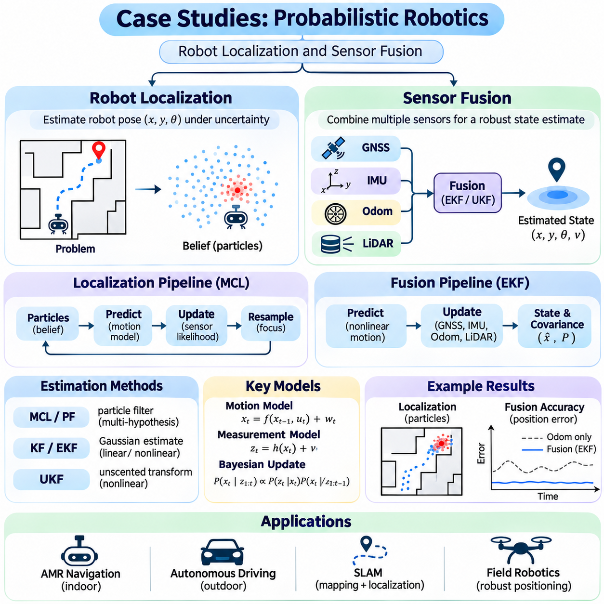{width="7.268055555555556in" height="7.268055555555556in"}

로봇 위치 추정(Robot Localization)과 센서 융합(Sensor Fusion)은 자율 로봇공학(Autonomous Robotics)에서 확률적 추론(Probabilistic Reasoning)을 적용하는 대표적인 사례이다. 위치 추정은 환경 내에서 로봇의 위치(Position)와 방향(Orientation)을 추정하며, 센서 융합은 여러 정보원(Source)에서 수집한 관측값(Observation)을 결합하여 추정 신뢰성(Estimation Reliability)을 향상시킨다. 두 문제 모두 불확실한 측정값(Uncertain Measurement), 불완전한 운동 모델(Imperfect Motion Model), 변화하는 환경 조건(Changing Environmental Condition)을 포함한다. 실제 사례 연구(Practical Case Study)는 확률적 알고리즘(Probabilistic Algorithm)이 잡음이 포함된 데이터를 행동에 활용할 수 있는 상태 추정값(Actionable State Estimate)으로 변환하는 과정을 보여준다.

일반적인 로봇 위치 추정 사례(Robot Localization Case)는 알려진 실내 환경(Known Indoor Environment)에서 작동하는 이동 플랫폼(Mobile Platform)으로 시작한다. 로봇에는 휠 엔코더(Wheel Encoder), 관성 측정 장치(Inertial Measurement Unit, IMU), 2차원 라이다 센서(Two-Dimensional LiDAR Sensor)가 장착된다. 휠 오도메트리(Wheel Odometry)는 증분 운동(Incremental Motion)을 추정하고, 라이다 측정값(LiDAR Measurement)은 주변 지도(Surrounding Map)에 대한 기하학적 기준(Geometric Reference)을 제공한다. 어느 정보원도 완벽하게 정확하지 않으므로 위치 추정 시스템(Localization System)은 불확실성을 유지하면서 운동 예측(Motion Prediction)과 센서 관측(Sensor Observation)을 결합해야 한다.

위치 추정 상태(Localization State)는 일반적으로 수평 좌표(Horizontal Coordinate)와 방향각(Orientation Angle)으로 표현되는 평면 위치(Planar Position)와 헤딩(Heading)을 포함한다. 운동 모델(Motion Model)은 바퀴 속도(Wheel Velocity) 또는 명령된 이동(Commanded Movement)을 이용하여 다음 상태(Next State)를 예측한다. 과정 잡음(Process Noise)은 바퀴 미끄러짐(Wheel Slip), 엔코더 오차(Encoder Error), 불완전한 운동학적 가정(Imperfect Kinematic Assumption)을 반영한다. 예측 상태 분포(Predicted State Distribution)는 사전 믿음(Prior Belief)이 되며, 이후 환경으로부터 획득한 측정값을 이용하여 보정된다.

몬테카를로 위치 추정(Monte Carlo Localization, MCL)은 로봇의 초기 위치(Initial Position)가 불확실할 때 실용적인 해결 방법을 제공한다. 파티클 필터(Particle Filter)는 알려진 지도(Known Map) 전체에 분포된 여러 후보 자세(Candidate Pose)를 유지한다. 각 파티클(Particle)은 운동 모델(Motion Model)에 따라 전파되며, 예측된 라이다 측정값(Predicted LiDAR Measurement)과 실제 관측값(Observed Measurement)의 일치 정도에 따라 가중치(Weight)가 부여된다. 재표본추출(Resampling)은 계산 자원(Computational Effort)을 가능성이 높은 위치(Plausible Location)에 집중시키면서 모호성이 남아 있는 경우 대안 가설(Alternative Hypothesis)을 유지한다.

유사한 기하학적 구조(Similar Geometric Structure)를 가진 복도를 이동하는 창고 로봇(Warehouse Robot)을 고려할 수 있다. 여러 위치에서 거의 동일한 라이다 스캔(LiDAR Scan)이 생성될 수 있으므로 복수의 위치 추정 가설(Localization Hypothesis)이 형성된다. 가우시안 추정기(Gaussian Estimator)는 서로 분리된 가능성을 표현하는 데 어려움을 겪을 수 있지만, 파티클 필터링(Particle Filtering)은 서로 다른 자세 군집(Pose Cluster)을 유지할 수 있다. 로봇이 고유한 랜드마크(Unique Landmark)를 관측하면 측정 우도(Measurement Likelihood)가 올바른 영역(Correct Region)에 점차 높은 확률을 부여하여 위치 추정 모호성(Localization Ambiguity)을 감소시킨다.

위치 추정 성능(Localization Performance)은 센서 우도 모델(Sensor Likelihood Model)의 정확도에 크게 의존한다. 라이다 관측값(LiDAR Observation)은 점유 격자 지도(Occupancy Grid Map) 또는 거리장 지도(Distance-Field Map)와 비교하여 측정 일관성(Measurement Consistency)을 평가할 수 있다. 예상하지 못한 장애물(Unexpected Obstacle), 반사 표면(Reflective Surface), 이동하는 사람(Moving Person)은 정적 지도(Static Map)와 일치하지 않는 측정값을 생성할 수 있다. 강건한 우도 함수(Robust Likelihood Function)는 이러한 관측값의 영향을 줄이고 개별 센서 오류(Isolated Sensor Error)가 사후 믿음(Posterior Belief)을 지배하지 못하도록 한다.

위치 추정 시스템(Localization System)은 예상하지 못한 위치 이동(Unexpected Displacement)과 일시적인 추적 손실(Temporary Loss of Tracking)도 처리해야 한다. 로봇이 오도메트리 갱신(Odometry Update) 없이 물리적으로 이동하면 기존 믿음(Existing Belief)이 부정확해질 수 있다. 파티클 주입(Particle Injection), 전역 재위치 추정(Global Relocalization), 적응형 표본추출(Adaptive Sampling)은 가능한 상태 가설(Plausible State Hypothesis)을 복원할 수 있다. 복구 메커니즘(Recovery Mechanism)은 점점 부정확해지는 자세 추정값(Pose Estimate)에 대해 높은 신뢰도를 계속 보고하는 대신 일관성이 없는 관측값(Inconsistent Observation)을 인식해야 한다.

위치 추정 평가(Localization Evaluation)에는 독립적인 위치 측정 시스템(Independent Positioning System) 또는 신중하게 검증된 실제 기준값(Ground Truth)에서 획득한 기준 궤적(Reference Trajectory)이 필요하다. 위치 오차(Position Error), 헤딩 오차(Heading Error), 복구 시간(Recovery Time), 추정 일관성(Estimation Consistency)은 상호 보완적인 성능 지표(Performance Indicator)를 제공한다. 시험(Testing)에는 긴 복도(Long Corridor), 반복 구조(Repeated Structure), 동적 장애물(Dynamic Obstacle), 센서 중단(Sensor Interruption)을 포함해야 한다. 계산 지연(Computational Latency)과 갱신 주파수(Update Frequency)도 중요하며, 지연된 위치 추정(Delayed Localization)은 항법(Navigation)과 제어(Control)의 성능을 저하시킬 수 있다.

두 번째 사례 연구(Case Study)는 위성항법시스템(GNSS), 관성 측정 장치(Inertial Measurement Unit, IMU), 휠 엔코더(Wheel Encoder), 라이다(LiDAR)를 장착한 실외 자율 이동 로봇(Outdoor Autonomous Mobile Robot)을 대상으로 한다. GNSS는 전역 위치 정보(Global Positioning Information)를 제공하고, 관성 센서(Inertial Sensor)는 각속도(Angular Velocity)와 비중력 가속도(Specific Force)를 측정하며, 휠 엔코더는 이동 거리(Traveled Distance)를 추정한다. 라이다는 상대적인 기하학적 제약(Relative Geometric Constraint)을 제공한다. 이러한 측정값을 결합하면 개별 센서 방식(Sensing Modality)의 신뢰성이 저하되는 상황에서도 로봇이 상태 추정값(State Estimate)을 유지할 수 있다.

확장 칼만 필터(Extended Kalman Filter, EKF)는 비선형 상태 예측(Nonlinear State Prediction)과 순차적 관측 갱신(Sequential Observation Update)을 통해 이러한 측정값을 통합할 수 있다. 추정 상태(Estimated State)는 위치(Position), 속도(Velocity), 자세(Orientation), 자이로스코프 바이어스(Gyroscope Bias), 가속도계 바이어스(Accelerometer Bias)를 포함할 수 있다. 관성 적분(Inertial Integration)은 높은 주파수로 항법 상태(Navigation State)를 전파하고, GNSS와 다른 센서는 측정값이 제공될 때 보정(Correction)을 수행한다. 공분산 전파(Covariance Propagation)는 보정 사이에 증가하는 불확실성(Growing Uncertainty)을 표현한다.

관성 측정값(Inertial Measurement)은 높은 주파수(High Rate)로 제공되므로 단기 운동 추정(Short-Term Motion Estimation)에 특히 유용하다. 그러나 가속도계 바이어스(Accelerometer Bias)와 자이로스코프 바이어스(Gyroscope Bias)는 적분(Integration) 과정에서 속도(Velocity), 위치(Position), 자세(Orientation)의 오차로 누적된다. 따라서 바이어스 추정(Bias Estimation)은 관성 센서 융합(Inertial Sensor Fusion)의 중요한 구성요소이다. 보정(Calibration), 중력 보상(Gravity Compensation), 좌표 변환(Coordinate Transformation), 정확한 타임스탬프(Accurate Timestamp)는 체계적 오차(Systematic Error)가 필터의 추정 결과를 지배하지 않도록 하는 데 필요하다.

GNSS 측정값(GNSS Measurement)은 절대 위치 기준(Absolute Positioning Reference)을 제공하지만 건물(Building), 나무(Tree), 터널(Tunnel), 기타 신호 장애물(Signal Obstruction) 주변에서 성능이 저하될 수 있다. 다중경로 전파(Multipath Propagation)와 위성 기하학적 배치(Satellite Geometry)는 측정 품질(Measurement Quality)에 영향을 미친다. 융합 시스템(Fusion System)은 이용 가능한 품질 지표(Quality Indicator)에 따라 측정 불확실성(Measurement Uncertainty)을 조정하고 명백하게 일관성이 없는 관측값(Inconsistent Observation)을 제거해야 한다. GNSS 신호 중단(GNSS Outage) 중에는 관성 및 오도메트리 예측(Inertial and Odometry Prediction)이 연속성을 유지하지만, 일반적으로 불확실성은 시간이 지남에 따라 증가한다.

휠 오도메트리(Wheel Odometry)는 특히 위성 위치 측정(Satellite Positioning)을 일시적으로 사용할 수 없는 상황에서 유용한 운동 제약(Motion Constraint)을 제공한다. 그러나 바퀴 미끄러짐(Wheel Slip), 측면 미끄러짐(Skidding), 변형 가능한 지형(Deformable Terrain)에서의 주행 중에는 엔코더 기반 변위(Encoder-Derived Displacement)의 신뢰성이 저하된다. 확률적 융합(Probabilistic Fusion)은 미끄러짐 지표(Slip Indicator)가 감지되면 오도메트리 불확실성(Odometry Uncertainty)을 증가시킬 수 있다. 바퀴 운동(Wheel Motion)을 관성 측정값(Inertial Measurement) 및 외부 위치 기준(External Positioning Reference)과 비교하면 상태 추정(State Estimation)에 큰 영향을 미치기 전에 불일치(Inconsistency)를 식별하는 데 도움이 된다.

라이다 오도메트리(LiDAR-Based Odometry)는 연속된 스캔(Consecutive Scan) 또는 지역 지도(Local Map)에 대한 기하학적 관측값(Geometric Observation)을 정합(Alignment)하여 상대 운동(Relative Motion)을 추정한다. 이러한 추정값은 GNSS 수신 상태가 좋지 않은 기간에 드리프트(Drift)를 제한할 수 있다. 그러나 희소한 환경(Sparse Environment), 움직이는 객체(Moving Object), 반복적인 구조(Repetitive Structure)는 기하학적 관측 가능성(Geometric Observability)을 저하시킬 수 있다. 신뢰할 수 있는 융합은 정합 불확실성(Registration Uncertainty)을 고려하고 상관된 추정값(Correlated Estimate)을 독립적인 측정값(Independent Measurement)으로 취급하지 않아야 한다.

시간 동기화(Temporal Synchronization)는 센서가 서로 다른 주파수(Frequency)로 작동하고 서로 다른 통신 지연(Communication Delay)을 경험하기 때문에 필수적이다. 관성 센서(Inertial Sensor)는 초당 수백 개의 측정값을 생성할 수 있지만, GNSS와 라이다(LiDAR)는 상대적으로 낮은 주파수로 갱신된다. 타임스탬프 오차(Timestamp Error)는 개별 센서가 정확하더라도 겉보기 운동 불일치(Apparent Motion Inconsistency)를 발생시킬 수 있다. 실제 시스템(Practical System)은 동기화된 시계(Synchronized Clock), 측정 버퍼링(Measurement Buffering), 지연 갱신 전략(Delayed-Update Strategy)을 사용하여 시간적 일관성(Temporal Consistency)을 유지한다.

좌표계 관리(Coordinate Frame Management) 역시 다중 센서 추정(Multisensor Estimation)에서 중요하다. GNSS 측정값은 지리 좌표(Geographic Coordinate)를 사용할 수 있고, 관성 항법(Inertial Navigation)은 지역 직교 좌표계(Local Cartesian Frame)에서 작동할 수 있으며, 라이다 관측값(LiDAR Observation)은 센서 본체(Sensor Body)를 기준으로 표현된다. 외부 파라미터 보정(Extrinsic Calibration)은 센서와 로봇 플랫폼 사이의 강체 변환(Rigid Transformation)을 정의한다. 잘못된 좌표계 규약(Frame Convention), 레버 암 오프셋(Lever-Arm Offset), 자세 보정(Orientation Calibration)은 확률적 필터링(Probabilistic Filtering)만으로 자동 제거할 수 없는 지속적인 오차(Persistent Error)를 발생시킬 수 있다.

센서 융합(Sensor Fusion)은 측정값 사이의 상관관계(Correlation)를 명시적으로 고려해야 한다. 예를 들어 라이다 오도메트리(LiDAR Odometry)와 지도 기반 위치 추정(Map-Based Localization)은 서로 중복되는 관측값(Overlapping Observation)을 재사용할 수 있으며, 여러 항법 출력(Navigation Output)이 동일한 관성 데이터(Inertial Data)에 의존할 수 있다. 이러한 추정값을 통계적으로 독립적(Statistically Independent)이라고 취급하면 불확실성을 과소평가하고 지나치게 확신하는 결과(Overconfident Result)를 생성할 수 있다. 교차 공분산 모델링(Cross-Covariance Modeling), 공동 추정(Joint Estimation), 보수적 융합 방법(Conservative Fusion Method)은 이러한 문제를 완화할 수 있다.

혁신값 기반 감시(Innovation-Based Monitoring)는 비정상적인 측정값(Abnormal Measurement)과 모델 불일치(Model Inconsistency)를 감지하는 실용적인 방법을 제공한다. 혁신값(Innovation)은 입력된 관측값(Incoming Observation)을 현재 상태 추정값(Current State Estimate)으로 예측한 값과 비교한다. 혁신 공분산(Innovation Covariance)은 이러한 차이를 평가하기 위한 통계적 척도(Statistical Scale)를 제공한다. 정규화 혁신 검정(Normalized Innovation Test)은 측정값 게이팅(Measurement Gating)을 지원할 수 있지만, 임계값(Threshold)은 모델 가정(Model Assumption)과 이상치 제거(Outlier Rejection) 및 유효 데이터 보존(Valid Data Preservation) 사이의 균형을 반영해야 한다.

강건한 융합 아키텍처(Robust Fusion Architecture)는 추정 실패(Estimation Failure)와 안전이 중요한 운영 의사결정(Safety-Critical Operational Decision)을 구별해야 한다. 큰 공분산(Large Covariance), 반복적인 측정값 제거(Repeated Measurement Rejection), 일관성이 없는 센서 출력(Inconsistent Sensor Output)은 위치 추정 품질(Localization Quality)이 저하되었음을 나타낼 수 있다. 로봇은 속도 감소(Speed Reduction), 추가 관측 요청(Additional Observation Request), 항법 모드 전환(Navigation Mode Switching), 제어된 안전 상태 진입(Controlled Safe State Entry)으로 대응할 수 있다. 이러한 대응에는 필터 신뢰도(Filter Confidence)에만 의존하지 않는 명시적인 운영 정책(Operational Policy)과 독립적인 안전 제어(Independent Safety Control)가 필요하다.

실험적 비교(Experimental Comparison)는 동일한 운영 조건(Operating Condition)에서 독립형 GNSS(Standalone GNSS), 휠 오도메트리(Wheel Odometry), 관성 항법(Inertial Navigation), 통합 센서 융합(Integrated Sensor Fusion)을 평가할 수 있다. 기준 궤적(Reference Trajectory)은 개방된 실외 지역(Open Outdoor Area), 장애물이 있는 환경(Obstructed Environment), 불균일한 지면(Uneven Surface), 의도적인 센서 중단(Deliberate Sensor Interruption)을 포함해야 한다. 평가 지표(Metric)에는 위치 오차(Position Error), 헤딩 오차(Heading Error), 드리프트율(Drift Rate), 가용성(Availability), 복구 시간(Recovery Time), 불확실성 일관성(Uncertainty Consistency)이 포함될 수 있다. 제거 실험(Ablation Experiment)은 개별 센서(Individual Sensor)의 기여도를 확인하는 데 사용된다.

두 사례 연구(Case Study)는 확률적 추정 품질(Probabilistic Estimation Quality)이 단순히 고급 알고리즘(Advanced Algorithm)을 선택하는 것 이상의 요소에 의존한다는 사실을 보여준다. 정확한 보정(Accurate Calibration), 현실적인 잡음 모델(Realistic Noise Model), 강건한 측정값 처리(Robust Measurement Handling), 시간 정렬(Temporal Alignment), 대표성 있는 검증(Representative Validation)이 필수적이다. 파티클 필터링(Particle Filtering)은 모호한 위치 추정 가설(Ambiguous Localization Hypothesis)을 처리하고, 칼만 기반 융합(Kalman-Based Fusion)은 상호 보완적인 항법 측정값(Complementary Navigation Measurement)을 효율적으로 결합한다. 적절한 방법은 불확실성 구조(Uncertainty Structure), 센서 구성(Sensor Configuration), 운영 제약조건(Operational Constraint)에 따라 결정된다.

로봇 위치 추정(Robot Localization)과 센서 융합(Sensor Fusion)은 확률적 추론(Probabilistic Reasoning)이 불완전한 정보(Incomplete Information) 아래에서 신뢰할 수 있는 자율 운영(Dependable Autonomous Operation)을 지원하는 방식을 보여준다. 재귀적 베이즈 추정(Recursive Bayesian Estimation)은 변화하는 믿음(Evolving Belief)을 유지하고, 운동 모델(Motion Model)은 시스템 동작(System Behavior)을 예측하며, 센서 관측값(Sensor Observation)은 누적된 불확실성(Accumulated Uncertainty)을 보정한다. 통계적 추론(Statistical Inference)과 실제 공학적 안전장치(Practical Engineering Safeguard)를 통합함으로써 자율 로봇(Autonomous Robot)은 다양한 환경에서 항법 연속성(Navigation Continuity), 추정 신뢰성(Estimation Reliability), 운영 상황 인식(Operational Awareness)을 향상시킬 수 있다.
