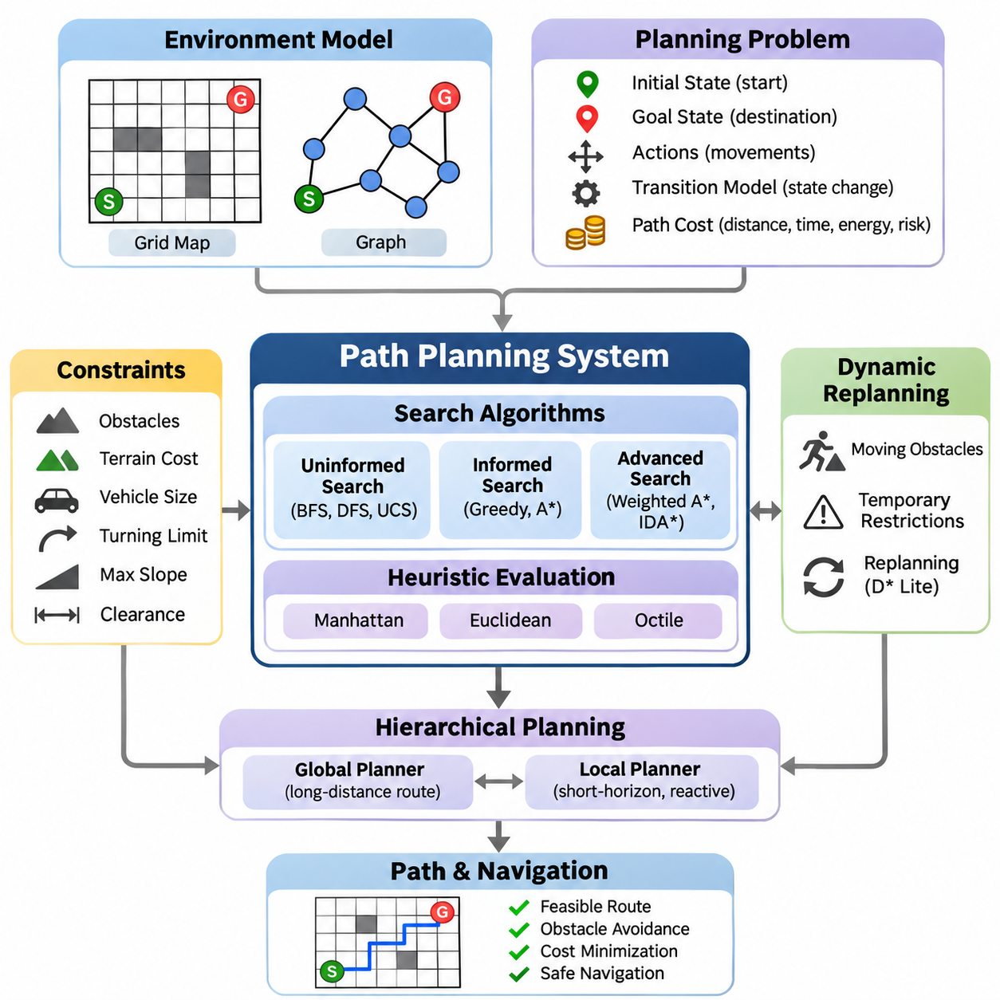
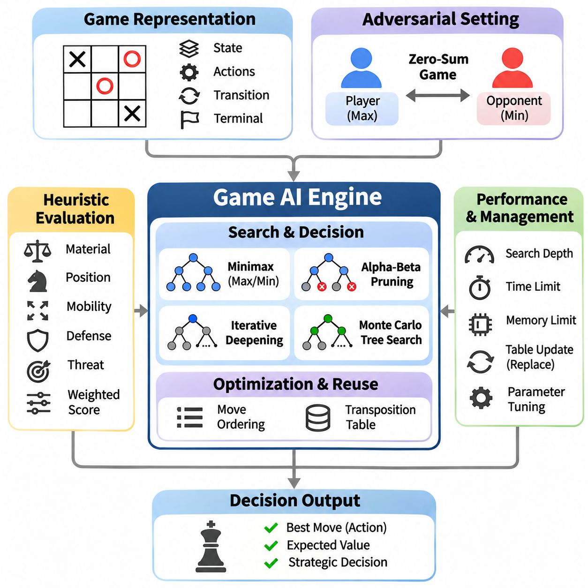
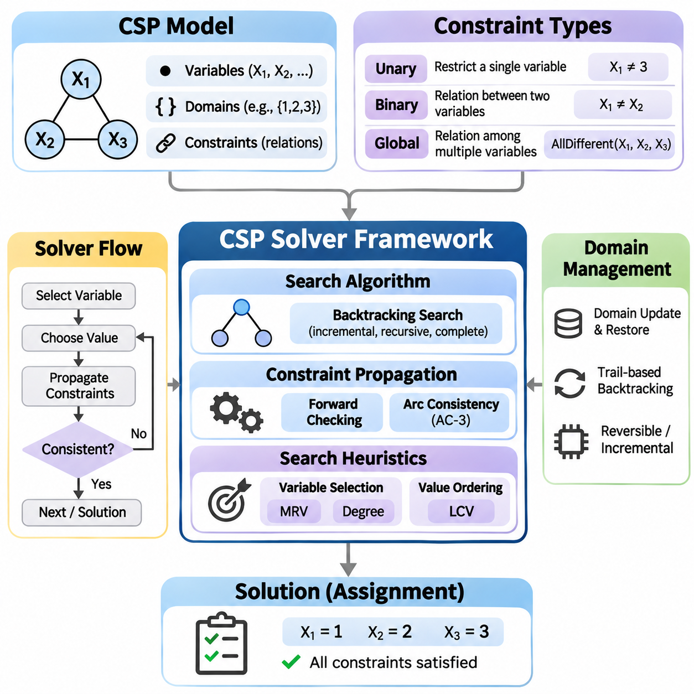
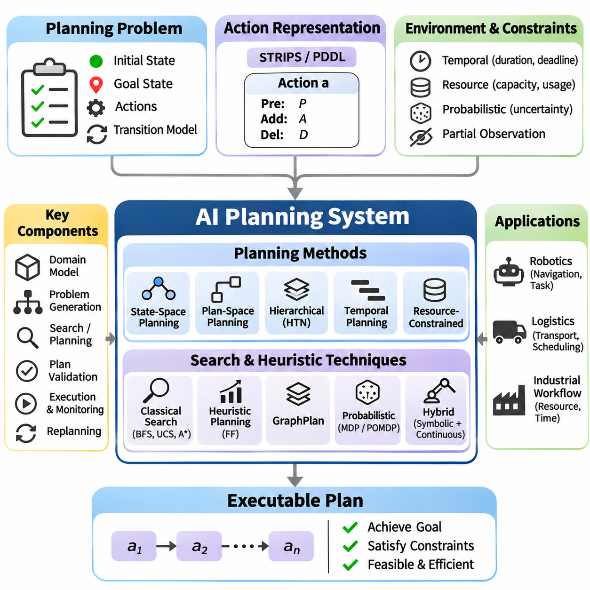
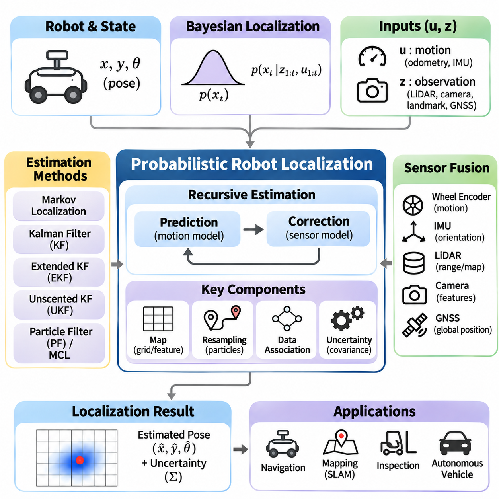
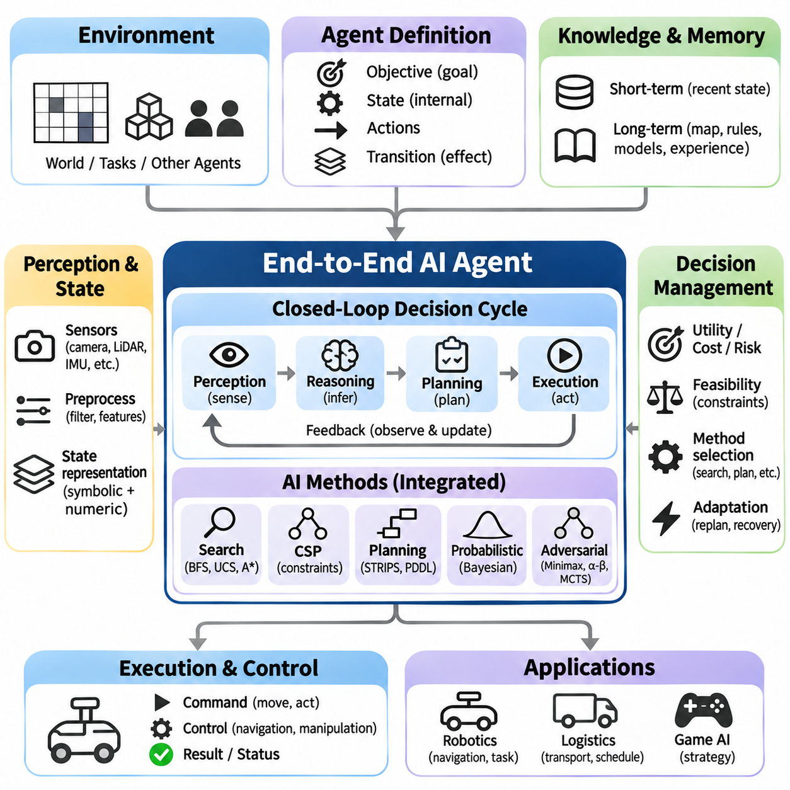

**Volume 01. Classical AI Search and Planning**


# 06. Integrated Projects

## 06.01 Path Planning System [w/Code]

{width="7.268055555555556in" height="7.268055555555556in"}

A path planning system is an integrated artificial intelligence application that determines a feasible and efficient route from an initial position to a target destination. It combines state-space search, heuristic evaluation, environmental representation, and constraint handling. The system must identify traversable regions, avoid obstacles, and minimize operational costs while maintaining reliable navigation under changing environmental conditions.

The fundamental architecture begins with an environment model representing accessible locations, obstacles, and movement relationships. Grid maps divide the environment into discrete cells, while graph representations describe locations as vertices connected by edges. Each edge may contain distance, travel time, energy consumption, or risk information. The selected representation determines the resolution, computational complexity, and practical capabilities of the planner.

A planning problem is formally defined through an initial state, goal state, available actions, transition model, and path cost function. The initial state describes the agent\'s current location, while the goal specifies the desired destination. Actions define permissible movements between states. The transition model determines the consequences of each action, allowing the planner to construct candidate paths and evaluate their feasibility.

Uninformed search algorithms provide foundational approaches for exploring possible routes without domain-specific guidance. Breadth-First Search identifies shortest paths in terms of edge count when all transitions have equal cost. Depth-First Search explores individual branches but does not guarantee optimality. Uniform-Cost Search expands states according to accumulated path cost, enabling optimal route discovery when edge costs are nonnegative.

Informed search algorithms improve computational efficiency by incorporating heuristic estimates of the remaining distance to the destination. Greedy Best-First Search prioritizes states with low estimated remaining cost but may produce suboptimal solutions. A\\\* Search combines accumulated cost and estimated future cost through the evaluation function f(n) = g(n) + h(n), balancing systematic exploration with goal-directed navigation.

The effectiveness of A\\\* depends heavily on heuristic quality. Manhattan distance is suitable for four-directional grid movement, while Euclidean distance represents straight-line geometric separation. Octile distance is useful for eight-directional grids with appropriate diagonal costs. Admissible heuristics never overestimate the remaining optimal cost, while consistent heuristics preserve a useful relationship between neighboring states.

Weighted A\\\* modifies the evaluation function by multiplying the heuristic estimate by a factor greater than one. This approach generally reduces search effort at the expense of optimality guarantees. Iterative Deepening A\\\* combines heuristic search with bounded memory consumption. Algorithm selection therefore requires balancing solution quality, computational resources, planning latency, and the operational requirements of the navigation system.

Environmental constraints are essential for transforming abstract search results into executable navigation routes. Obstacles define prohibited regions, while terrain conditions may impose movement penalties or directional restrictions. Vehicle dimensions, turning limitations, maximum slope, and clearance requirements further constrain feasible paths. Collision checking must account for the complete physical footprint rather than treating the agent as a dimensionless point.

A practical grid-based planner typically maintains an open set containing candidate states and a closed set containing processed states. Each state records its accumulated cost, heuristic estimate, and predecessor relationship. The planner repeatedly selects a promising state, evaluates neighboring transitions, and updates costs when better routes are discovered. Once the goal is reached, predecessor links reconstruct the final path.

Efficient implementation requires careful selection of supporting data structures. Priority queues accelerate retrieval of the lowest-cost candidate, while hash-based structures support rapid state lookup. Parent maps preserve route reconstruction information without storing complete paths for every candidate. Duplicate detection, stale-entry handling, and deterministic tie-breaking improve computational efficiency, correctness, and reproducibility.

Real-world navigation environments frequently change after the initial route has been calculated. Moving obstacles, temporary restrictions, and newly detected hazards can invalidate planned trajectories. Dynamic replanning addresses these changes by updating the environment representation and searching for alternative routes. Incremental algorithms such as D\\\* Lite reuse previous search information, reducing unnecessary computation when map changes are localized.

Hierarchical planning separates long-distance route selection from detailed local navigation. A global planner identifies a route through the known environment, while a local planner generates short-horizon movements that respond to nearby obstacles. This separation improves scalability and responsiveness. The local planner must respect the global objective while continuously checking immediate safety, vehicle dynamics, and environmental constraints.

Path planning and motion planning are closely related but represent different levels of decision-making. Path planning primarily determines geometric connectivity between locations, whereas motion planning incorporates physical feasibility and movement dynamics. A geometrically valid route may be impossible for a vehicle with limited steering capability. Motion-aware planners therefore consider orientation, curvature, velocity, acceleration, and collision constraints.

Constraint satisfaction techniques provide additional mechanisms for enforcing navigation requirements. Hard constraints prohibit unsafe movements, while soft constraints express preferences such as reduced travel time or lower energy consumption. Resource limitations, restricted operating zones, and scheduling requirements can also be incorporated. Integrating constraint evaluation with search prevents the planner from selecting routes that violate essential operational conditions.

Probabilistic reasoning becomes important when environmental information or localization estimates are uncertain. Sensor measurements may contain noise, maps may be incomplete, and obstacle positions may change unpredictably. Bayesian estimation and probabilistic localization provide uncertainty-aware state information. A risk-aware planner can incorporate collision probabilities or uncertainty penalties into route evaluation rather than relying exclusively on deterministic assumptions.

A complete robotic navigation system connects perception, localization, mapping, planning, and control through a coordinated processing pipeline. Sensors observe the surrounding environment, localization estimates the robot pose, and mapping maintains spatial information. The planner generates a feasible route from the estimated state to the destination. A motion controller then converts the planned route into executable steering and velocity commands.

The planning architecture should distinguish strategic decisions from low-level control operations. Mission planning determines destinations and task priorities, global planning selects navigation corridors, and local planning generates collision-aware motion references. Feedback from the controller and perception system updates the planning state. This layered structure supports modular development, systematic testing, and replacement of individual algorithms.

Route quality can be evaluated using multiple performance criteria rather than distance alone. Common measurements include total path length, accumulated traversal cost, execution time, memory consumption, and the number of expanded states. Physical navigation introduces additional criteria such as clearance, path smoothness, energy efficiency, and successful arrival rate. These metrics reveal tradeoffs between computational efficiency and operational reliability.

Experimental benchmarking should compare planning algorithms under identical environmental conditions. Test scenarios may include empty grids, dense obstacle fields, narrow passages, irregular terrain, and dynamically changing obstacles. Map dimensions, obstacle distributions, movement rules, and random seeds should be controlled. Repeated trials help distinguish systematic performance differences from variations caused by individual environmental configurations.

Correctness testing must verify that every generated path begins at the specified initial state, reaches the intended destination, and contains only valid transitions. Collision tests confirm that intermediate movements remain within accessible regions. Optimality tests compare algorithm outputs against established reference solutions where applicable. Unreachable destinations, invalid coordinates, disconnected regions, and exhausted computational budgets require explicit handling.

Software engineering practices are necessary for transforming a research implementation into a reusable planning framework. Environment models, search algorithms, heuristic functions, cost evaluators, and visualization interfaces should be implemented as independent components. Clear interfaces allow multiple algorithms to operate on common map representations. Automated unit tests and integration tests support maintenance as system capabilities expand.

The system should expose configurable parameters governing map resolution, connectivity, heuristic selection, obstacle inflation, and planning limits. Configuration files enable controlled experimentation without modifying core algorithm implementations. Structured logging records search progress, planning outcomes, and failure conditions. Performance profiling identifies bottlenecks in neighbor generation, collision checking, priority queue operations, and memory allocation.

Visualization supports both algorithm development and operational diagnosis. A graphical interface can display the environment map, initial and target positions, obstacles, explored states, and final route. Animated search progression helps explain how different algorithms prioritize candidate states. Runtime overlays showing costs, expanded nodes, and planning duration provide useful evidence for debugging and educational comparison.

Simulation provides a controlled environment for evaluating planning behavior before deployment on physical equipment. Synthetic maps allow developers to introduce obstacles, alter terrain costs, and reproduce difficult navigation scenarios. Robot simulation can additionally test whether generated paths satisfy kinematic constraints. Simulation results should be interpreted carefully because real sensors, actuators, and environmental conditions introduce additional uncertainty.

Deployment on autonomous mobile robots requires integration with localization systems, obstacle detection, and motion controllers. The planner must accommodate localization drift, sensor delays, and actuator response characteristics. Planning frequency should reflect environmental dynamics and available computational resources. Safety-critical obstacle avoidance and emergency stopping must remain effective even when route computation is delayed or unsuccessful.

Robust failure handling is particularly important in autonomous navigation. A planner may encounter blocked destinations, inconsistent maps, excessive search complexity, or unexpected changes in traversability. The system should identify these conditions and report meaningful failure states. Recovery strategies may include replanning, selecting an alternative destination, waiting for obstacles to clear, or requesting supervisory intervention.

The integrated project demonstrates how classical search algorithms, heuristic reasoning, constraint satisfaction, and probabilistic estimation contribute to a unified navigation capability. Its educational value extends beyond finding a route through a map. By connecting algorithmic theory with modular software, simulation, benchmarking, and robotic execution, the project establishes a practical foundation for increasingly sophisticated autonomous planning systems.

경로 계획 시스템(Path Planning System)은 초기 위치에서 목표 목적지까지 실행 가능하고 효율적인 경로를 결정하는 통합 인공지능(Artificial Intelligence) 응용 시스템이다. 이 시스템은 상태 공간 탐색(State-Space Search), 휴리스틱 평가(Heuristic Evaluation), 환경 표현(Environmental Representation), 제약조건 처리(Constraint Handling)를 결합한다. 시스템은 변화하는 환경 조건에서도 안정적인 탐색을 유지하면서 이동 가능한 영역을 식별하고, 장애물을 회피하며, 운영 비용을 최소화해야 한다.

기본 아키텍처(Fundamental Architecture)는 접근 가능한 위치, 장애물, 이동 관계를 표현하는 환경 모델(Environment Model)에서 시작한다. 격자 지도(Grid Map)는 환경을 개별 셀(Cell)로 분할하며, 그래프 표현(Graph Representation)은 위치를 정점(Vertex)으로, 위치 간 연결을 간선(Edge)으로 나타낸다. 각 간선에는 거리, 이동 시간, 에너지 소비량, 위험도 등의 정보가 포함될 수 있다. 선택한 표현 방식은 해상도(Resolution), 계산 복잡도(Computational Complexity), 계획기의 실제 활용 능력을 결정한다.

계획 문제(Planning Problem)는 초기 상태(Initial State), 목표 상태(Goal State), 사용 가능한 행동(Action), 상태 전이 모델(Transition Model), 경로 비용 함수(Path Cost Function)를 통해 공식적으로 정의된다. 초기 상태는 에이전트(Agent)의 현재 위치를 나타내며, 목표 상태는 원하는 목적지를 지정한다. 행동은 상태 간 허용되는 이동을 정의한다. 상태 전이 모델은 각 행동의 결과를 결정하므로, 계획기는 후보 경로를 구성하고 실행 가능성을 평가할 수 있다.

비정보 탐색 알고리즘(Uninformed Search Algorithm)은 도메인별 사전 지식 없이 가능한 경로를 탐색하는 기본 접근법을 제공한다. 너비 우선 탐색(Breadth-First Search)은 모든 전이 비용이 동일할 때 간선 수를 기준으로 최단 경로를 찾는다. 깊이 우선 탐색(Depth-First Search)은 개별 분기를 탐색하지만 최적성을 보장하지 않는다. 균일 비용 탐색(Uniform-Cost Search)은 누적 경로 비용에 따라 상태를 확장하며, 간선 비용이 음수가 아닐 때 최적 경로를 탐색할 수 있다.

정보 탐색 알고리즘(Informed Search Algorithm)은 목적지까지 남은 거리를 추정하는 휴리스틱(Heuristic)을 활용하여 계산 효율성을 향상시킨다. 탐욕적 최선 우선 탐색(Greedy Best-First Search)은 예상 잔여 비용이 낮은 상태를 우선하지만 최적이 아닌 해를 생성할 수 있다. A\\\* 탐색(A\\\* Search)은 평가 함수(Evaluation Function) f(n) = g(n) + h(n)을 통해 누적 비용과 예상 미래 비용을 결합하여 체계적인 탐색과 목표 지향적 탐색의 균형을 유지한다.

A\\\*의 효율성은 휴리스틱 품질(Heuristic Quality)에 크게 의존한다. 맨해튼 거리(Manhattan Distance)는 네 방향 격자 이동에 적합하며, 유클리드 거리(Euclidean Distance)는 두 위치 사이의 직선 기하학적 거리를 나타낸다. 옥타일 거리(Octile Distance)는 적절한 대각선 이동 비용을 적용한 여덟 방향 격자에서 유용하다. 허용적 휴리스틱(Admissible Heuristic)은 최적 잔여 비용을 과대평가하지 않으며, 일관적 휴리스틱(Consistent Heuristic)은 인접 상태 사이의 비용 관계를 유지한다.

가중 A\\\* 탐색(Weighted A\\\* Search)은 휴리스틱 추정값에 1보다 큰 가중치를 곱하여 평가 함수를 수정한다. 이 접근법은 일반적으로 최적성 보장의 일부를 희생하는 대신 탐색 연산량을 줄인다. 반복 심화 A\\\* 탐색(Iterative Deepening A\\\* Search)은 휴리스틱 탐색과 제한된 메모리 사용을 결합한다. 따라서 알고리즘 선택에서는 해의 품질, 계산 자원, 계획 지연 시간(Planning Latency), 내비게이션 시스템(Navigation System)의 운영 요구사항을 함께 고려해야 한다.

환경 제약조건(Environmental Constraints)은 추상적인 탐색 결과를 실제 실행 가능한 이동 경로로 변환하는 데 필수적이다. 장애물은 이동이 금지된 영역을 정의하며, 지형 조건(Terrain Conditions)은 이동 비용이나 방향 제한을 부과할 수 있다. 차량 크기, 회전 제한, 최대 경사도, 최소 이격거리(Clearance) 요구사항도 실행 가능한 경로를 제한한다. 충돌 검사(Collision Checking)는 에이전트를 크기가 없는 점으로 취급하지 않고 전체 물리적 점유 영역(Physical Footprint)을 고려해야 한다.

실용적인 격자 기반 계획기(Grid-Based Planner)는 일반적으로 후보 상태를 저장하는 열린 집합(Open Set)과 처리된 상태를 저장하는 닫힌 집합(Closed Set)을 유지한다. 각 상태는 누적 비용, 휴리스틱 추정값, 이전 상태와의 연결 관계를 기록한다. 계획기는 유망한 상태를 반복적으로 선택하고 인접 상태 전이를 평가하며, 더 나은 경로가 발견되면 비용을 갱신한다. 목표에 도달하면 이전 상태 연결을 역추적하여 최종 경로를 복원한다.

효율적인 구현을 위해서는 적절한 자료구조(Data Structure)를 선택해야 한다. 우선순위 큐(Priority Queue)는 비용이 가장 낮은 후보를 빠르게 검색하며, 해시 기반 구조(Hash-Based Structure)는 신속한 상태 조회를 지원한다. 부모 상태 맵(Parent Map)은 모든 후보에 전체 경로를 저장하지 않고도 경로 복원 정보를 유지한다. 중복 상태 탐지(Duplicate Detection), 오래된 큐 항목 처리(Stale-Entry Handling), 결정적 동률 처리(Deterministic Tie-Breaking)는 계산 효율성, 정확성, 재현성(Reproducibility)을 향상시킨다.

실제 내비게이션 환경은 초기 경로가 계산된 이후에도 빈번하게 변화한다. 이동 장애물, 일시적인 통행 제한, 새롭게 감지된 위험 요소는 기존 계획 경로를 무효화할 수 있다. 동적 재계획(Dynamic Replanning)은 환경 표현을 갱신하고 대체 경로를 탐색하여 이러한 변화에 대응한다. D\\\* Lite와 같은 증분 탐색 알고리즘(Incremental Search Algorithm)은 이전 탐색 정보를 재사용하여 지도 변화가 국소적으로 발생할 때 불필요한 계산을 줄인다.

계층적 계획(Hierarchical Planning)은 장거리 경로 선택과 세부적인 지역 내비게이션을 분리한다. 전역 계획기(Global Planner)는 알려진 환경을 통과하는 경로를 결정하고, 지역 계획기(Local Planner)는 주변 장애물에 대응하는 단기 이동 경로를 생성한다. 이러한 분리는 확장성(Scalability)과 응답성(Responsiveness)을 향상시킨다. 지역 계획기는 즉각적인 안전성, 차량 동역학(Vehicle Dynamics), 환경 제약조건을 지속적으로 확인하면서 전역 목표를 준수해야 한다.

경로 계획(Path Planning)과 동작 계획(Motion Planning)은 밀접하게 연관되어 있지만 서로 다른 의사결정 수준을 나타낸다. 경로 계획은 주로 위치 간 기하학적 연결성을 결정하는 반면, 동작 계획은 물리적 실행 가능성과 이동 동역학을 포함한다. 기하학적으로 유효한 경로라도 조향 능력이 제한된 차량에는 실행 불가능할 수 있다. 따라서 동작을 고려하는 계획기(Motion-Aware Planner)는 방향, 곡률, 속도, 가속도, 충돌 제약조건을 함께 고려한다.

제약 충족 기법(Constraint Satisfaction Techniques)은 내비게이션 요구사항을 강제하기 위한 추가적인 메커니즘을 제공한다. 강한 제약조건(Hard Constraint)은 안전하지 않은 이동을 금지하며, 약한 제약조건(Soft Constraint)은 이동 시간 단축이나 에너지 소비 감소와 같은 선호도를 표현한다. 자원 제한, 운영 제한 구역, 일정 요구사항도 통합할 수 있다. 탐색 과정에 제약조건 평가를 결합하면 필수 운영 조건을 위반하는 경로가 선택되는 것을 방지할 수 있다.

확률적 추론(Probabilistic Reasoning)은 환경 정보나 위치 추정값에 불확실성이 존재할 때 중요해진다. 센서 측정값에는 잡음(Noise)이 포함될 수 있고, 지도는 불완전할 수 있으며, 장애물 위치는 예측하기 어렵게 변화할 수 있다. 베이지안 추정(Bayesian Estimation)과 확률적 위치 추정(Probabilistic Localization)은 불확실성을 고려한 상태 정보를 제공한다. 위험 인식 계획기(Risk-Aware Planner)는 결정론적 가정에만 의존하지 않고 충돌 확률이나 불확실성 페널티를 경로 평가에 반영할 수 있다.

완전한 로봇 내비게이션 시스템(Robotic Navigation System)은 인지(Perception), 위치 추정(Localization), 지도 작성(Mapping), 계획(Planning), 제어(Control)를 조정된 처리 파이프라인(Processing Pipeline)으로 연결한다. 센서는 주변 환경을 관측하고, 위치 추정은 로봇의 자세와 위치(Pose)를 계산하며, 지도 작성은 공간 정보를 유지한다. 계획기는 추정된 상태에서 목적지까지 실행 가능한 경로를 생성하고, 동작 제어기(Motion Controller)는 계획된 경로를 실행 가능한 조향 및 속도 명령으로 변환한다.

계획 아키텍처(Planning Architecture)는 전략적 의사결정과 저수준 제어 동작을 구분해야 한다. 임무 계획(Mission Planning)은 목적지와 작업 우선순위를 결정하고, 전역 계획(Global Planning)은 이동 통로를 선택하며, 지역 계획(Local Planning)은 충돌을 고려한 동작 참조값을 생성한다. 제어기와 인지 시스템의 피드백(Feedback)은 계획 상태를 갱신한다. 이러한 계층 구조는 모듈형 개발(Modular Development), 체계적인 시험, 개별 알고리즘의 교체를 지원한다.

경로 품질(Path Quality)은 거리뿐 아니라 다양한 성능 기준을 사용하여 평가할 수 있다. 일반적인 측정 항목에는 전체 경로 길이, 누적 이동 비용, 실행 시간, 메모리 사용량, 확장된 상태 수가 포함된다. 물리적 내비게이션에서는 이격거리, 경로 평활성(Path Smoothness), 에너지 효율성, 목표 도달 성공률도 중요하다. 이러한 지표는 계산 효율성과 운영 신뢰성(Operational Reliability) 사이의 절충 관계(Tradeoff)를 보여준다.

실험 벤치마킹(Experimental Benchmarking)은 동일한 환경 조건에서 계획 알고리즘을 비교해야 한다. 시험 시나리오(Test Scenario)에는 빈 격자, 장애물이 밀집된 영역, 좁은 통로, 불규칙한 지형, 동적으로 변화하는 장애물이 포함될 수 있다. 지도 크기, 장애물 분포, 이동 규칙, 난수 시드(Random Seed)를 통제해야 한다. 반복 실험은 개별 환경 구성의 차이에서 발생하는 변동과 알고리즘의 체계적인 성능 차이를 구분하는 데 도움이 된다.

정확성 시험(Correctness Testing)은 생성된 모든 경로가 지정된 초기 상태에서 시작하여 목표 목적지에 도달하고, 유효한 상태 전이만 포함하는지 검증해야 한다. 충돌 시험(Collision Test)은 중간 이동 구간이 접근 가능한 영역 내부에 유지되는지 확인한다. 최적성 시험(Optimality Test)은 적용 가능한 경우 알고리즘 결과를 검증된 기준 해(Reference Solution)와 비교한다. 도달 불가능한 목적지, 잘못된 좌표, 분리된 영역, 계산 자원 한도 초과 상황도 명시적으로 처리해야 한다.

소프트웨어 공학(Software Engineering) 실무는 연구용 구현을 재사용 가능한 계획 프레임워크(Planning Framework)로 발전시키는 데 필요하다. 환경 모델, 탐색 알고리즘, 휴리스틱 함수, 비용 평가기(Cost Evaluator), 시각화 인터페이스(Visualization Interface)는 독립적인 구성요소로 구현해야 한다. 명확한 인터페이스는 여러 알고리즘이 공통 지도 표현을 활용하도록 한다. 자동화된 단위 시험(Unit Test)과 통합 시험(Integration Test)은 시스템 기능이 확장될 때 유지보수를 지원한다.

시스템은 지도 해상도, 연결성(Connectivity), 휴리스틱 선택, 장애물 팽창(Obstacle Inflation), 계획 한도를 제어하는 설정 매개변수(Configuration Parameter)를 제공해야 한다. 설정 파일(Configuration File)을 사용하면 핵심 알고리즘 구현을 수정하지 않고도 통제된 실험을 수행할 수 있다. 구조화된 로깅(Structured Logging)은 탐색 진행 상황, 계획 결과, 실패 조건을 기록한다. 성능 프로파일링(Performance Profiling)은 인접 상태 생성, 충돌 검사, 우선순위 큐 연산, 메모리 할당 과정의 병목 현상을 식별한다.

시각화(Visualization)는 알고리즘 개발과 운영 진단을 모두 지원한다. 그래픽 인터페이스(Graphical Interface)는 환경 지도, 초기 위치, 목표 위치, 장애물, 탐색된 상태, 최종 경로를 표시할 수 있다. 탐색 진행 과정을 애니메이션(Animation)으로 표현하면 알고리즘별 후보 상태 우선순위 결정 방식을 이해하는 데 도움이 된다. 비용, 확장 노드 수, 계획 소요 시간을 표시하는 실행 정보 오버레이(Runtime Overlay)는 디버깅(Debugging)과 교육용 비교에 유용한 근거를 제공한다.

시뮬레이션(Simulation)은 실제 장비에 배포하기 전에 통제된 환경에서 계획 동작을 평가할 수 있도록 한다. 합성 지도(Synthetic Map)를 사용하면 개발자가 장애물을 추가하고 지형 비용을 변경하며 어려운 내비게이션 시나리오를 재현할 수 있다. 로봇 시뮬레이션은 생성된 경로가 운동학적 제약조건(Kinematic Constraints)을 만족하는지도 시험할 수 있다. 실제 센서, 구동기(Actuator), 환경 조건은 추가적인 불확실성을 발생시키므로 시뮬레이션 결과를 신중하게 해석해야 한다.

자율이동로봇(Autonomous Mobile Robot)에 배포하려면 위치 추정 시스템, 장애물 감지, 동작 제어기와의 통합이 필요하다. 계획기는 위치 추정 오차의 누적(Localization Drift), 센서 지연(Sensor Delay), 구동기 응답 특성을 수용해야 한다. 계획 주기(Planning Frequency)는 환경의 동적 특성과 사용 가능한 계산 자원을 고려하여 결정해야 한다. 경로 계산이 지연되거나 실패하더라도 안전 필수 장애물 회피(Safety-Critical Obstacle Avoidance)와 비상 정지(Emergency Stopping)는 정상적으로 작동해야 한다.

견고한 실패 처리(Robust Failure Handling)는 자율 내비게이션에서 특히 중요하다. 계획기는 차단된 목적지, 일관성이 없는 지도, 과도한 탐색 복잡도, 예상하지 못한 이동 가능 영역의 변화에 직면할 수 있다. 시스템은 이러한 조건을 식별하고 의미 있는 실패 상태(Failure State)를 보고해야 한다. 복구 전략(Recovery Strategy)에는 재계획, 대체 목적지 선택, 장애물이 제거될 때까지 대기, 감독자의 개입 요청 등이 포함될 수 있다.

이 통합 프로젝트(Integrated Project)는 고전적 탐색 알고리즘(Classical Search Algorithm), 휴리스틱 추론(Heuristic Reasoning), 제약 충족(Constraint Satisfaction), 확률적 추정(Probabilistic Estimation)이 통합된 내비게이션 기능에 어떻게 기여하는지 보여준다. 교육적 가치는 단순히 지도에서 경로를 찾는 수준을 넘어선다. 알고리즘 이론을 모듈형 소프트웨어, 시뮬레이션, 벤치마킹, 로봇 실행과 연결함으로써 더욱 정교한 자율 계획 시스템(Autonomous Planning System)을 위한 실용적인 기반을 구축한다.

## 06.02 Game AI Engine [w/Code]

{width="7.268055555555556in" height="7.268055555555556in"}

A Game AI Engine is an integrated artificial intelligence system designed to make strategic decisions in competitive environments. It combines game-state representation, adversarial search, heuristic evaluation, and decision optimization. Unlike conventional pathfinding, game intelligence must anticipate the actions of competing agents. The engine evaluates possible outcomes and selects moves that maximize strategic advantage under defined computational constraints.

The foundation of a Game AI Engine is a formal representation of the game environment. Each state describes the current board configuration, active player, available actions, and terminal conditions. A transition function determines how the environment changes after a legal move. This representation allows the engine to construct a game tree in which nodes represent states and edges represent actions, providing a structured foundation for adversarial reasoning.

Two-player zero-sum games provide a fundamental framework for studying competitive decision-making. In these environments, one player\'s advantage corresponds to the other player\'s disadvantage. The engine assumes that both participants attempt to optimize their outcomes. This assumption transforms move selection into an adversarial optimization problem, requiring the system to consider not only immediate rewards but also the strongest possible responses from an opponent.

The Minimax algorithm provides a classical solution for deterministic, perfect-information, two-player zero-sum games. It recursively evaluates possible moves while alternating between maximizing and minimizing players. The maximizing player selects actions that increase the evaluation score, while the minimizing player selects actions that decrease it. This process identifies a move that achieves the best guaranteed outcome against an optimal opponent.

Although Minimax provides a theoretically sound decision framework, its computational requirements increase rapidly with search depth. A game with branching factor b and search depth d may require examining approximately O(b\^d) nodes. Complex games therefore make exhaustive exploration impractical. Practical engines restrict search depth and estimate the strategic value of intermediate positions using evaluation functions rather than exploring every possible continuation.

Alpha-Beta Pruning improves Minimax efficiency by eliminating branches that cannot influence the final decision. The algorithm maintains alpha and beta bounds representing the best alternatives established for the maximizing and minimizing players. When a branch cannot improve the relevant bound, further exploration becomes unnecessary. With effective move ordering, Alpha-Beta Pruning can substantially reduce the number of evaluated positions without changing the Minimax result.

Move ordering is an essential optimization technique because the effectiveness of Alpha-Beta Pruning depends on which actions are explored first. Promising moves, tactical threats, captures, and previously successful actions can receive higher priority. Searching strong candidates early produces tighter pruning bounds. Practical engines combine domain-specific ordering rules with information obtained from previous searches to improve efficiency under limited computation budgets.

Evaluation functions estimate the strategic quality of nonterminal game states. Their design depends on the game\'s rules and objectives. Common features include material advantage, positional control, mobility, defensive strength, and potential threats. A weighted evaluation function combines these characteristics into a numerical score. The quality of this estimate strongly influences decision-making when the search cannot reach terminal positions.

An effective evaluation function must balance immediate tactical opportunities with long-term strategic objectives. Excessive emphasis on short-term rewards may produce aggressive but unstable decisions, while overly conservative evaluations can prevent the engine from exploiting favorable opportunities. Feature normalization and weight calibration improve consistency. Evaluation parameters may be selected manually or optimized through automated experiments against reference opponents.

Iterative Deepening Search addresses uncertainty about available computation time by repeatedly executing depth-limited searches. The engine first searches shallow game trees and progressively increases the depth while resources remain available. Each completed iteration produces a valid candidate move. Information from earlier iterations can improve move ordering, allowing deeper searches to benefit from previous computation while preserving a usable decision when time expires.

Transposition Tables reduce redundant computation by storing evaluations of game states encountered through different action sequences. A hashing mechanism, commonly Zobrist Hashing, generates compact identifiers for board configurations. Stored entries may include evaluation scores, search depth, bound types, and preferred moves. When a previously analyzed position reappears, the engine can reuse compatible information rather than repeating the entire search.

Efficient transposition management requires attention to memory limitations and entry validity. Hash collisions must be handled appropriately, and stored evaluations must be interpreted according to their search depth and bound classification. Replacement policies determine which entries remain available when memory becomes full. Correct integration with Alpha-Beta Pruning improves performance while preventing cached information from producing invalid search conclusions.

Monte Carlo Tree Search provides an alternative decision-making framework based on selective exploration and statistical evaluation. Rather than expanding the entire game tree uniformly, it concentrates computation on promising actions. A typical search cycle performs selection, expansion, simulation, and backpropagation. Repeated simulations update estimates of action quality, allowing the engine to allocate additional exploration toward strategically valuable regions.

The Upper Confidence Bound for Trees method balances exploration and exploitation during Monte Carlo Tree Search. It favors actions with strong estimated rewards while allocating some computation to less frequently examined alternatives. The exploration coefficient controls this balance. Excessive exploitation may overlook promising moves, whereas excessive exploration can waste resources. Parameter selection therefore influences both decision quality and computational efficiency.

Minimax and Monte Carlo Tree Search represent different approaches to adversarial reasoning. Minimax emphasizes explicit opponent modeling and deterministic evaluation, making it effective in games with manageable branching structures and strong evaluation functions. Monte Carlo Tree Search emphasizes statistical sampling and adaptive exploration. Their relative performance depends on game complexity, simulation quality, available computation, and the reliability of state evaluation.

Stochastic games introduce uncertainty through random events such as dice rolls, shuffled cards, or probabilistic outcomes. Expectiminimax extends adversarial search by incorporating chance nodes that represent possible random events. Each chance node evaluates outcomes according to their probabilities. This approach enables the engine to optimize expected utility rather than assuming deterministic transitions, although the additional branching can significantly increase computational requirements.

Imperfect-information games create additional challenges because players cannot observe the complete environment state. Hidden cards, concealed actions, and incomplete observations require reasoning over possible states or beliefs. The engine must distinguish observable information from unknown variables. Sampling, probabilistic inference, and information-set search techniques can support decisions that account for uncertainty without assuming access to unavailable opponent information.

A modular Game AI Engine separates game rules, state transitions, legal action generation, search algorithms, and evaluation functions. The game environment defines valid behavior independently of the decision engine. Search components operate through standardized interfaces, allowing multiple algorithms to be compared on identical games. This architecture improves maintainability, testability, and extensibility across different competitive environments.

The decision pipeline begins by receiving the current game state and identifying legal actions. The selected search algorithm explores possible continuations and requests evaluations when necessary. Intermediate results are stored in supporting data structures, while time and depth limits regulate computation. The engine ultimately returns a legal move together with optional diagnostic information such as evaluation score, explored nodes, and search depth.

A simplified Tic-Tac-Toe engine provides a useful starting point for implementation because its state space is small enough for exhaustive search. Minimax can evaluate terminal outcomes and identify optimal moves without requiring complex heuristics. The project demonstrates alternating player roles, recursive state exploration, terminal detection, and move selection. It also provides a reference environment for verifying the correctness of adversarial search algorithms.

Connect Four introduces a larger search space and more demanding positional reasoning. An effective engine evaluates horizontal, vertical, and diagonal threats while considering immediate winning opportunities and defensive requirements. Alpha-Beta Pruning, move ordering, and depth-limited evaluation become increasingly important. This environment demonstrates how heuristic design and search optimization interact when exhaustive game-tree exploration is no longer practical.

A simplified chess engine provides a more advanced integration scenario involving diverse piece movements, tactical interactions, and positional strategy. Legal move generation must enforce game rules, while the evaluation function considers material balance, mobility, king safety, and board control. Iterative deepening, transposition tables, and Alpha-Beta Pruning support deeper analysis. The resulting system illustrates the architecture of practical classical game engines.

Testing must verify both game-rule correctness and search behavior. Legal move generators should reject invalid actions, terminal-state detection must identify completed games, and state transitions must preserve game consistency. Search tests should compare decisions against known optimal outcomes in small environments. Additional tests can verify pruning correctness, transposition-table behavior, and deterministic results under controlled configurations.

Performance benchmarking evaluates decision quality alongside computational efficiency. Relevant metrics include nodes searched per second, maximum completed search depth, decision latency, memory consumption, and competitive win rate. Engines should be tested against random agents, heuristic baselines, and alternative search configurations. Repeated matches with balanced starting conditions help distinguish meaningful improvements from random variation or first-player advantage.

Engineering considerations become increasingly important when the engine operates under real-time constraints. Search must respect move deadlines, maintain predictable resource consumption, and return valid decisions when computation is interrupted. Profiling identifies expensive operations such as move generation, state copying, hashing, and evaluation. Efficient state updates and incremental calculations can reduce overhead and improve practical search depth.

Classical Game AI can also be compared with machine-learning-based approaches. Traditional engines rely on explicit rules, handcrafted evaluations, and structured search, while learning-based systems may estimate policies or state values from experience. Hybrid architectures combine learned evaluation models with classical search procedures. Such integration demonstrates how symbolic reasoning and statistical learning can complement each other in complex decision-making environments.

The integrated Game AI Engine project connects adversarial search theory with practical software architecture, optimization, experimentation, and competitive evaluation. By implementing Minimax, Alpha-Beta Pruning, iterative deepening, transposition tables, and Monte Carlo Tree Search within a common framework, the system provides a reusable foundation for intelligent decision-making. These principles extend beyond games to strategic planning, resource competition, and multi-agent artificial intelligence.

게임 인공지능 엔진(Game AI Engine)은 경쟁 환경에서 전략적 의사결정을 수행하도록 설계된 통합 인공지능(Artificial Intelligence) 시스템이다. 이 시스템은 게임 상태 표현(Game-State Representation), 적대적 탐색(Adversarial Search), 휴리스틱 평가(Heuristic Evaluation), 의사결정 최적화(Decision Optimization)를 결합한다. 일반적인 경로 탐색과 달리 게임 인공지능은 경쟁 에이전트(Competing Agent)의 행동을 예측해야 한다. 엔진은 가능한 결과를 평가하고 정해진 계산 제약조건 내에서 전략적 이점을 극대화하는 행동을 선택한다.

게임 인공지능 엔진의 기초는 게임 환경을 형식적으로 표현하는 것이다. 각 상태(State)는 현재 보드 구성(Board Configuration), 행동할 차례인 플레이어(Active Player), 사용 가능한 행동(Available Action), 종료 조건(Terminal Condition)을 나타낸다. 상태 전이 함수(Transition Function)는 합법적인 수(Legal Move)가 실행된 이후 환경이 어떻게 변화하는지 결정한다. 이러한 표현을 통해 엔진은 노드(Node)가 상태를 나타내고 간선(Edge)이 행동을 나타내는 게임 트리(Game Tree)를 구성하여 적대적 추론(Adversarial Reasoning)의 구조적 기반을 제공한다.

2인 제로섬 게임(Two-Player Zero-Sum Game)은 경쟁적 의사결정을 연구하기 위한 기본적인 프레임워크(Framework)를 제공한다. 이러한 환경에서는 한 플레이어의 이익이 다른 플레이어의 손실에 대응한다. 엔진은 두 참가자가 모두 자신의 결과를 최적화하려고 한다고 가정한다. 이러한 가정은 행동 선택을 적대적 최적화 문제(Adversarial Optimization Problem)로 변환하며, 시스템이 즉각적인 보상뿐 아니라 상대방이 선택할 수 있는 가장 강력한 대응까지 고려하도록 요구한다.

미니맥스 알고리즘(Minimax Algorithm)은 결정론적(Deterministic)이고 완전정보(Perfect Information)를 제공하는 2인 제로섬 게임을 위한 고전적인 해결 방법이다. 이 알고리즘은 최대화 플레이어(Maximizing Player)와 최소화 플레이어(Minimizing Player)의 역할을 번갈아 적용하면서 가능한 행동을 재귀적으로 평가한다. 최대화 플레이어는 평가 점수를 높이는 행동을 선택하고, 최소화 플레이어는 점수를 낮추는 행동을 선택한다. 이러한 과정은 최적으로 행동하는 상대방에 대해 보장 가능한 최선의 결과를 달성하는 수를 식별한다.

미니맥스는 이론적으로 타당한 의사결정 프레임워크를 제공하지만, 탐색 깊이(Search Depth)가 증가함에 따라 계산 요구량이 급격히 증가한다. 분기 계수(Branching Factor)가 b이고 탐색 깊이가 d인 게임에서는 약 O(b\^d)개의 노드를 검사해야 할 수 있다. 따라서 복잡한 게임에서는 완전 탐색(Exhaustive Search)이 현실적으로 어렵다. 실용적인 엔진은 탐색 깊이를 제한하고 모든 가능한 후속 상태를 탐색하는 대신 평가 함수(Evaluation Function)를 사용하여 중간 상태의 전략적 가치를 추정한다.

알파-베타 가지치기(Alpha-Beta Pruning)는 최종 의사결정에 영향을 주지 않는 분기를 제거하여 미니맥스의 효율성을 향상시킨다. 이 알고리즘은 최대화 플레이어와 최소화 플레이어가 현재까지 확보한 최선의 대안을 나타내는 알파(Alpha)와 베타(Beta) 경계를 유지한다. 특정 분기가 관련 경계를 개선할 수 없으면 추가 탐색이 불필요해진다. 효과적인 수 정렬(Move Ordering)을 적용하면 미니맥스 결과를 변경하지 않으면서 평가해야 하는 위치의 수를 크게 줄일 수 있다.

수 정렬(Move Ordering)은 알파-베타 가지치기의 효율성이 어떤 행동을 먼저 탐색하는지에 따라 달라지므로 중요한 최적화 기법이다. 유망한 수, 전술적 위협(Tactical Threat), 기물 포획(Capture), 이전 탐색에서 성공적이었던 행동에 높은 우선순위를 부여할 수 있다. 강력한 후보를 먼저 탐색하면 가지치기 경계가 더욱 엄격해진다. 실용적인 엔진은 도메인별 정렬 규칙(Domain-Specific Ordering Rule)과 이전 탐색에서 얻은 정보를 결합하여 제한된 계산 예산 내에서 효율성을 향상시킨다.

평가 함수(Evaluation Function)는 종료되지 않은 게임 상태의 전략적 품질을 추정한다. 평가 함수의 설계는 게임 규칙과 목표에 따라 달라진다. 일반적인 특징(Feature)에는 기물 우위(Material Advantage), 위치 통제(Positional Control), 이동 가능성(Mobility), 방어 능력(Defensive Strength), 잠재적 위협(Potential Threat)이 포함된다. 가중 평가 함수(Weighted Evaluation Function)는 이러한 특징을 결합하여 수치 점수를 생성한다. 탐색이 종료 상태까지 도달하지 못할 때 평가의 품질은 의사결정에 큰 영향을 미친다.

효과적인 평가 함수는 즉각적인 전술적 기회와 장기적인 전략적 목표 사이의 균형을 유지해야 한다. 단기 보상을 지나치게 강조하면 공격적이지만 불안정한 의사결정이 발생할 수 있으며, 지나치게 보수적인 평가는 유리한 기회를 활용하지 못하게 할 수 있다. 특징 정규화(Feature Normalization)와 가중치 보정(Weight Calibration)은 평가의 일관성을 향상시킨다. 평가 매개변수(Evaluation Parameter)는 수동으로 설정하거나 기준 상대방과의 자동화된 실험을 통해 최적화할 수 있다.

반복 심화 탐색(Iterative Deepening Search)은 사용 가능한 계산 시간의 불확실성을 해결하기 위해 깊이 제한 탐색(Depth-Limited Search)을 반복적으로 실행한다. 엔진은 먼저 얕은 게임 트리를 탐색하고 자원이 허용되는 동안 탐색 깊이를 점진적으로 증가시킨다. 완료된 각 반복은 유효한 후보 수를 생성한다. 이전 반복에서 얻은 정보는 수 정렬을 개선하여 더 깊은 탐색에 활용되며, 제한 시간이 종료되더라도 사용 가능한 의사결정 결과를 유지할 수 있다.

전이표(Transposition Table)는 서로 다른 행동 순서를 통해 도달한 동일한 게임 상태의 평가 결과를 저장하여 중복 계산을 줄인다. 일반적으로 조브리스트 해싱(Zobrist Hashing)과 같은 해싱 메커니즘(Hashing Mechanism)을 사용하여 보드 구성의 간결한 식별자를 생성한다. 저장 항목에는 평가 점수, 탐색 깊이, 경계 유형(Bound Type), 선호하는 수(Preferred Move)가 포함될 수 있다. 이전에 분석한 위치가 다시 나타나면 엔진은 전체 탐색을 반복하는 대신 호환되는 정보를 재사용할 수 있다.

효율적인 전이표 관리를 위해서는 메모리 제한과 저장 항목의 유효성을 고려해야 한다. 해시 충돌(Hash Collision)은 적절하게 처리해야 하며, 저장된 평가 결과는 탐색 깊이와 경계 분류에 따라 해석해야 한다. 교체 정책(Replacement Policy)은 메모리가 가득 찼을 때 어떤 항목을 유지할지 결정한다. 알파-베타 가지치기와 올바르게 통합하면 캐시 정보(Cached Information)로 인해 잘못된 탐색 결론이 발생하는 것을 방지하면서 성능을 향상시킬 수 있다.

몬테카를로 트리 탐색(Monte Carlo Tree Search, MCTS)은 선택적 탐색(Selective Exploration)과 통계적 평가(Statistical Evaluation)를 기반으로 하는 대안적인 의사결정 프레임워크를 제공한다. 전체 게임 트리를 균일하게 확장하는 대신 유망한 행동에 계산 자원을 집중한다. 일반적인 탐색 과정은 선택(Selection), 확장(Expansion), 시뮬레이션(Simulation), 역전파(Backpropagation)로 구성된다. 반복적인 시뮬레이션은 행동 품질에 대한 추정값을 갱신하여 전략적으로 가치 있는 영역에 추가 탐색 자원을 배분하도록 한다.

트리 탐색을 위한 신뢰 상한(Upper Confidence Bound for Trees, UCT) 방법은 몬테카를로 트리 탐색 과정에서 탐색(Exploration)과 활용(Exploitation)의 균형을 유지한다. 이 방법은 예상 보상이 높은 행동을 선호하면서도 탐색 횟수가 적은 대안에 일정한 계산 자원을 할당한다. 탐색 계수(Exploration Coefficient)는 이러한 균형을 제어한다. 활용에 지나치게 집중하면 유망한 수를 놓칠 수 있고, 탐색에 지나치게 집중하면 자원이 낭비될 수 있다. 따라서 매개변수 선택은 의사결정 품질과 계산 효율성에 모두 영향을 미친다.

미니맥스와 몬테카를로 트리 탐색은 적대적 추론에 대한 서로 다른 접근법을 나타낸다. 미니맥스는 명시적인 상대방 모델링(Opponent Modeling)과 결정론적 평가(Deterministic Evaluation)를 강조하므로, 관리 가능한 분기 구조와 강력한 평가 함수를 가진 게임에서 효과적이다. 몬테카를로 트리 탐색은 통계적 표본 추출(Statistical Sampling)과 적응형 탐색(Adaptive Exploration)을 강조한다. 두 방법의 상대적 성능은 게임 복잡도, 시뮬레이션 품질, 사용 가능한 계산 자원, 상태 평가의 신뢰성에 따라 달라진다.

확률적 게임(Stochastic Game)은 주사위 굴리기, 카드 섞기, 확률적 결과와 같은 무작위 사건을 통해 불확실성을 도입한다. 기대 미니맥스(Expectiminimax)는 가능한 무작위 사건을 나타내는 확률 노드(Chance Node)를 포함하여 적대적 탐색을 확장한다. 각 확률 노드는 발생 확률에 따라 결과를 평가한다. 이러한 접근법은 결정론적 상태 전이를 가정하는 대신 기대 효용(Expected Utility)을 최적화하도록 하지만, 추가적인 분기로 인해 계산 요구량이 크게 증가할 수 있다.

불완전정보 게임(Imperfect-Information Game)은 플레이어가 전체 환경 상태를 관측할 수 없기 때문에 추가적인 어려움을 발생시킨다. 숨겨진 카드, 비공개 행동, 불완전한 관측은 가능한 상태 또는 신념 상태(Belief State)에 대한 추론을 요구한다. 엔진은 관측 가능한 정보와 알려지지 않은 변수를 구분해야 한다. 표본 추출(Sampling), 확률적 추론(Probabilistic Inference), 정보 집합 탐색(Information-Set Search) 기법은 상대방의 비공개 정보에 접근할 수 있다고 가정하지 않으면서 불확실성을 고려한 의사결정을 지원할 수 있다.

모듈형 게임 인공지능 엔진(Modular Game AI Engine)은 게임 규칙(Game Rule), 상태 전이(State Transition), 합법적 행동 생성(Legal Action Generation), 탐색 알고리즘(Search Algorithm), 평가 함수(Evaluation Function)를 분리한다. 게임 환경은 의사결정 엔진과 독립적으로 유효한 행동을 정의한다. 탐색 구성요소는 표준화된 인터페이스(Standardized Interface)를 통해 작동하므로 동일한 게임에서 여러 알고리즘을 비교할 수 있다. 이러한 아키텍처는 유지보수성(Maintainability), 시험 가능성(Testability), 확장성(Extensibility)을 향상시킨다.

의사결정 파이프라인(Decision Pipeline)은 현재 게임 상태를 수신하고 합법적인 행동을 식별하는 과정에서 시작한다. 선택된 탐색 알고리즘은 가능한 후속 상태를 탐색하고 필요할 때 평가를 요청한다. 중간 결과는 지원 자료구조에 저장되며, 시간 제한과 깊이 제한은 계산량을 조절한다. 엔진은 최종적으로 합법적인 수를 반환하며, 선택적으로 평가 점수, 탐색된 노드 수, 탐색 깊이와 같은 진단 정보(Diagnostic Information)를 함께 제공한다.

단순화된 틱택토 엔진(Tic-Tac-Toe Engine)은 상태 공간이 완전 탐색을 수행할 수 있을 만큼 작기 때문에 구현을 시작하기에 유용하다. 미니맥스는 복잡한 휴리스틱 없이 종료 결과를 평가하고 최적의 수를 식별할 수 있다. 이 프로젝트는 플레이어 역할 교대, 재귀적 상태 탐색(Recursive State Exploration), 종료 상태 탐지(Terminal Detection), 행동 선택(Move Selection)을 보여준다. 또한 적대적 탐색 알고리즘의 정확성을 검증하기 위한 기준 환경(Reference Environment)을 제공한다.

커넥트 포(Connect Four)는 더 큰 탐색 공간과 복잡한 위치 추론(Positional Reasoning)을 요구한다. 효과적인 엔진은 수평, 수직, 대각선 방향의 위협을 평가하면서 즉각적인 승리 기회와 방어 요구사항을 고려한다. 알파-베타 가지치기, 수 정렬, 깊이 제한 평가(Depth-Limited Evaluation)의 중요성이 더욱 커진다. 이 환경은 완전한 게임 트리 탐색이 현실적으로 어려워질 때 휴리스틱 설계와 탐색 최적화가 어떻게 상호작용하는지 보여준다.

단순화된 체스 엔진(Simplified Chess Engine)은 다양한 기물 이동, 전술적 상호작용, 위치 전략을 포함하는 더욱 발전된 통합 시나리오를 제공한다. 합법적 수 생성(Legal Move Generation)은 게임 규칙을 준수해야 하며, 평가 함수는 기물 균형(Material Balance), 이동 가능성, 킹 안전성(King Safety), 보드 통제(Board Control)를 고려한다. 반복 심화, 전이표, 알파-베타 가지치기는 더 깊은 분석을 지원한다. 결과적으로 이 시스템은 실용적인 고전적 게임 엔진의 아키텍처를 보여준다.

시험(Testing)은 게임 규칙의 정확성과 탐색 동작을 모두 검증해야 한다. 합법적 수 생성기(Legal Move Generator)는 잘못된 행동을 거부해야 하며, 종료 상태 탐지는 완료된 게임을 식별해야 하고, 상태 전이는 게임의 일관성을 유지해야 한다. 탐색 시험(Search Test)은 작은 환경에서 알려진 최적 결과와 의사결정을 비교해야 한다. 추가 시험을 통해 가지치기의 정확성, 전이표 동작, 통제된 설정에서의 결정론적 결과를 검증할 수 있다.

성능 벤치마킹(Performance Benchmarking)은 계산 효율성과 함께 의사결정 품질을 평가한다. 관련 지표에는 초당 탐색 노드 수(Nodes Searched per Second), 완료된 최대 탐색 깊이, 의사결정 지연 시간(Decision Latency), 메모리 소비량, 경쟁 승률(Competitive Win Rate)이 포함된다. 엔진은 무작위 에이전트(Random Agent), 휴리스틱 기준 모델(Heuristic Baseline), 대체 탐색 설정과 비교하여 시험해야 한다. 시작 조건을 균형 있게 설정한 반복 대국은 무작위 변동이나 선공 이점(First-Player Advantage)과 실질적인 성능 향상을 구분하는 데 도움이 된다.

엔진이 실시간 제약조건(Real-Time Constraints)에서 작동할 때는 엔지니어링 고려사항(Engineering Considerations)이 더욱 중요해진다. 탐색은 행동 결정 시한(Move Deadline)을 준수하고, 예측 가능한 자원 소비를 유지하며, 계산이 중단되더라도 유효한 의사결정을 반환해야 한다. 프로파일링(Profiling)은 수 생성, 상태 복사(State Copying), 해싱(Hashing), 평가와 같은 비용이 높은 연산을 식별한다. 효율적인 상태 갱신(State Update)과 증분 계산(Incremental Calculation)은 오버헤드(Overhead)를 줄이고 실제 탐색 깊이를 향상시킬 수 있다.

고전적 게임 인공지능(Classical Game AI)은 기계학습 기반 접근법(Machine-Learning-Based Approach)과도 비교할 수 있다. 전통적인 엔진은 명시적인 규칙, 수작업으로 설계된 평가 함수(Handcrafted Evaluation Function), 구조화된 탐색(Structured Search)에 의존하는 반면, 학습 기반 시스템은 경험을 통해 정책(Policy)이나 상태 가치(State Value)를 추정할 수 있다. 하이브리드 아키텍처(Hybrid Architecture)는 학습된 평가 모델(Learned Evaluation Model)과 고전적 탐색 절차를 결합한다. 이러한 통합은 복잡한 의사결정 환경에서 기호적 추론(Symbolic Reasoning)과 통계적 학습(Statistical Learning)이 서로 보완할 수 있음을 보여준다.

통합 게임 인공지능 엔진 프로젝트(Integrated Game AI Engine Project)는 적대적 탐색 이론(Adversarial Search Theory)을 실용적인 소프트웨어 아키텍처, 최적화, 실험, 경쟁 평가(Competitive Evaluation)와 연결한다. 미니맥스, 알파-베타 가지치기, 반복 심화, 전이표, 몬테카를로 트리 탐색을 공통 프레임워크 안에서 구현함으로써 지능형 의사결정(Intelligent Decision-Making)을 위한 재사용 가능한 기반을 제공한다. 이러한 원리는 게임을 넘어 전략적 계획(Strategic Planning), 자원 경쟁(Resource Competition), 다중 에이전트 인공지능(Multi-Agent Artificial Intelligence)으로 확장될 수 있다.

## 06.03 CSP Solver Framework [w/Code]

{width="7.268055555555556in" height="7.268055555555556in"}

A Constraint Satisfaction Problem (CSP) Solver Framework is an integrated artificial intelligence system designed to solve problems defined by variables, domains, and constraints. Instead of directly searching for a sequence of actions, the framework searches for assignments that satisfy specified relationships. It provides a reusable computational foundation for scheduling, resource allocation, configuration, timetabling, and other combinatorial decision problems.

A CSP is formally represented as a collection of variables, their associated domains, and a set of constraints. Each variable represents an unknown decision, while its domain defines the possible values it may receive. Constraints specify permitted combinations of assignments. A complete solution assigns a value to every variable while satisfying all mandatory constraints, transforming the original problem into a structured mathematical search task.

The solver architecture separates problem modeling from search execution. A modeling layer defines variables, domains, and constraint relationships, while a solving layer explores candidate assignments. A validation layer checks consistency and solution completeness. This separation enables different algorithms to operate on the same problem representation and supports systematic comparison of search strategies without modifying application-specific definitions.

Constraints may be unary, binary, or global depending on the number of variables involved. Unary constraints restrict individual variable domains, while binary constraints define relationships between pairs of variables. Global constraints express relationships involving larger variable groups. The AllDifferent constraint, for example, requires assigned values to be distinct and can exploit specialized propagation algorithms to reduce unnecessary exploration.

Backtracking Search provides the fundamental solving mechanism for classical CSPs. The algorithm assigns values to variables incrementally and checks whether each partial assignment remains consistent. When a conflict occurs, the solver reverses previous decisions and explores alternative values. This recursive process systematically examines possible assignments while rejecting inconsistent branches before complete solutions are constructed.

Although basic backtracking is complete for finite CSPs, its computational requirements can become prohibitive as problem size increases. A problem containing n variables with domain size d may have as many as d\^n complete assignments. Effective solvers therefore combine backtracking with constraint propagation and search heuristics. These techniques eliminate impossible values early and reduce the number of branches requiring explicit exploration.

Forward Checking is a lightweight constraint propagation technique applied after each assignment. When a variable receives a value, the solver removes incompatible values from the domains of neighboring unassigned variables. If any domain becomes empty, the current branch is recognized as inconsistent. Forward Checking prevents some unnecessary recursive exploration but does not detect every inconsistency among variables that remain unassigned.

Arc Consistency provides stronger propagation by ensuring that every remaining value of a variable has compatible support in the domain of each connected variable. The AC-3 algorithm repeatedly revises directed arcs until no additional values can be removed or a domain becomes empty. By propagating the consequences of domain reductions, AC-3 can identify contradictions that Forward Checking would otherwise discover later.

Generalized Arc Consistency extends the same principle to constraints involving more than two variables. Every retained value must participate in at least one satisfying combination for each relevant constraint. Specialized propagators can enforce consistency efficiently for common global constraints. Stronger propagation often reduces search substantially, although the additional computational cost must be balanced against the complexity of the problem.

Variable selection heuristics determine which unassigned variable should be processed next. The Minimum Remaining Values heuristic prioritizes variables with the smallest current domains, exposing difficult decisions early. The Degree Heuristic favors variables participating in many constraints involving other unassigned variables. Combining these strategies helps the solver identify contradictions quickly and reduce unnecessary branching.

Value ordering heuristics determine the sequence in which candidate assignments are examined. The Least Constraining Value heuristic prefers values that eliminate the fewest options from neighboring variables. This approach preserves flexibility for future assignments and can improve the speed of finding a feasible solution. Its effectiveness depends on the constraint structure and the computational overhead required to estimate each value\'s impact.

A practical solver integrates variable selection, value ordering, propagation, and backtracking into a coordinated execution cycle. The solver selects an unassigned variable, chooses a candidate value, applies relevant constraints, and updates remaining domains. If propagation detects a contradiction, the solver restores the previous state and tries another value. Successful branches continue until every variable has a consistent assignment.

Efficient domain management is essential because recursive search repeatedly modifies candidate values. Copying complete domain structures at every decision is simple but may consume excessive memory. Trail-based restoration records domain changes and reverses them during backtracking. Reversible data structures and incremental propagation can further reduce overhead, allowing the framework to handle larger problems with more complex constraint relationships.

Constraint graphs provide a structural representation of relationships between variables. Vertices represent variables, while edges connect variables participating in shared binary constraints. Sparse graphs may permit efficient decomposition into smaller subproblems, whereas densely connected graphs often require more extensive propagation. Graph structure can guide variable ordering, identify independent components, and support specialized solving strategies.

Local Search offers an alternative to systematic backtracking by iteratively improving candidate assignments. Hill Climbing modifies assignments to reduce constraint violations but may become trapped in local minima. Simulated Annealing occasionally accepts unfavorable changes to escape such regions. Min-Conflicts Search repeatedly modifies variables involved in violated constraints, making it effective for certain large-scale CSPs.

Systematic search and local search provide different operational guarantees. Backtracking with sound propagation can establish satisfiability or unsatisfiability for finite problems when allowed to complete. Local search often finds useful assignments quickly but generally cannot prove that no solution exists. A reusable framework should support both approaches and expose their distinct termination conditions, performance characteristics, and solution guarantees.

Scheduling problems demonstrate how CSP modeling converts operational requirements into formal constraints. Variables may represent task start times, assigned machines, or execution periods. Domains specify available resources and permitted time intervals. Constraints enforce precedence relationships, prevent resource conflicts, and maintain capacity limits. A solver can then identify schedules satisfying all mandatory operational requirements.

Timetabling extends constraint satisfaction to the allocation of activities across shared time and location resources. Variables may describe classroom assignments, instructors, or meeting periods. Constraints prevent overlapping resource usage and enforce availability requirements. Additional preferences, such as balanced workloads or preferred time slots, may be represented through optimization objectives or weighted soft constraints rather than strict feasibility conditions.

Resource allocation problems require assigning limited resources to competing tasks while respecting capacity and compatibility restrictions. Variables identify resource choices, and constraints define allowable assignments. The solver must prevent over-allocation and ensure that operational requirements remain satisfied. When multiple feasible solutions exist, an optimization layer may minimize cost, balance utilization, or improve overall allocation efficiency.

Advanced CSP frameworks may incorporate constraint optimization, conflict-directed backjumping, nogood recording, and symmetry breaking. Conflict-directed methods use information about failed assignments to avoid unnecessary backtracking. Nogood recording stores combinations known to be inconsistent. Symmetry breaking removes equivalent solutions from consideration. These techniques improve search efficiency when problems contain repeated structures or complex dependencies.

A reusable software implementation should define standardized interfaces for variables, domains, constraints, propagators, and search strategies. Constraint objects evaluate consistency and may provide domain filtering operations. Search components coordinate assignment decisions and backtracking. The framework should allow new constraint types and heuristic policies to be introduced without requiring substantial changes to the solver\'s core execution logic.

Correctness testing must verify constraint evaluation, domain restoration, propagation behavior, and solution validity. Small reference problems with known solutions provide useful regression tests. Unsatisfiable instances verify that the solver correctly identifies contradictions, while multiple-solution problems test enumeration behavior. Property-based testing can generate structured assignments and compare solver outputs against independently validated constraints.

Performance benchmarking should measure solving time, explored search nodes, backtracking operations, propagation calls, and peak memory consumption. Experiments should compare basic backtracking against Forward Checking, AC-3, and heuristic-enhanced configurations. Problem size, domain cardinality, constraint density, and constraint tightness should be varied systematically. Repeated trials help establish reproducible performance trends across different problem classes.

Integration with established optimization libraries provides an additional reference for evaluating a custom framework. General-purpose constraint programming tools and satisfiability-based solvers offer mature propagation and search capabilities. Comparing their results with a custom implementation helps identify modeling limitations and performance bottlenecks. Such comparisons should distinguish differences in supported constraint types, optimization features, and solving guarantees.

The integrated CSP Solver Framework project connects classical constraint satisfaction theory with modular software engineering and practical optimization applications. By combining backtracking, propagation, heuristic selection, local search, and systematic evaluation, it establishes a flexible foundation for solving structured decision problems. The same principles extend to automated planning, industrial scheduling, robotics, configuration systems, and intelligent resource management.

제약 충족 문제 해결 프레임워크(Constraint Satisfaction Problem Solver Framework)는 변수(Variable), 도메인(Domain), 제약조건(Constraint)으로 정의되는 문제를 해결하도록 설계된 통합 인공지능(Artificial Intelligence) 시스템이다. 이 프레임워크는 행동의 순서를 직접 탐색하는 대신 지정된 관계를 만족하는 변수 할당(Variable Assignment)을 탐색한다. 일정 계획(Scheduling), 자원 할당(Resource Allocation), 구성 관리(Configuration), 시간표 작성(Timetabling), 기타 조합적 의사결정(Combinatorial Decision-Making) 문제를 해결하기 위한 재사용 가능한 계산 기반을 제공한다.

제약 충족 문제(Constraint Satisfaction Problem, CSP)는 변수의 집합, 각 변수에 연결된 도메인, 제약조건의 집합으로 형식적으로 표현된다. 각 변수는 결정되지 않은 의사결정 항목을 나타내며, 도메인은 해당 변수에 할당할 수 있는 값의 범위를 정의한다. 제약조건은 허용되는 변수 할당 조합을 지정한다. 완전한 해(Complete Solution)는 모든 필수 제약조건을 만족하면서 모든 변수에 값을 할당한 결과이며, 이를 통해 원래 문제는 구조화된 수학적 탐색 문제(Mathematical Search Problem)로 변환된다.

해결기 아키텍처(Solver Architecture)는 문제 모델링(Problem Modeling)과 탐색 실행(Search Execution)을 분리한다. 모델링 계층(Modeling Layer)은 변수, 도메인, 제약조건 간 관계를 정의하며, 해결 계층(Solving Layer)은 후보 할당을 탐색한다. 검증 계층(Validation Layer)은 일관성(Consistency)과 해의 완전성(Solution Completeness)을 확인한다. 이러한 분리는 서로 다른 알고리즘이 동일한 문제 표현에서 작동하도록 하며, 응용 분야별 정의를 수정하지 않고 탐색 전략을 체계적으로 비교할 수 있도록 한다.

제약조건은 관련된 변수의 수에 따라 단항 제약조건(Unary Constraint), 이항 제약조건(Binary Constraint), 전역 제약조건(Global Constraint)으로 구분할 수 있다. 단항 제약조건은 개별 변수의 도메인을 제한하며, 이항 제약조건은 두 변수 사이의 관계를 정의한다. 전역 제약조건은 더 큰 변수 집합에 적용되는 관계를 표현한다. 예를 들어 모두 다름 제약조건(AllDifferent Constraint)은 할당된 값이 서로 달라야 함을 요구하며, 특수한 전파 알고리즘(Propagation Algorithm)을 활용하여 불필요한 탐색을 줄일 수 있다.

백트래킹 탐색(Backtracking Search)은 고전적인 제약 충족 문제를 해결하는 기본 메커니즘이다. 이 알고리즘은 변수에 값을 점진적으로 할당하고 각 부분 할당(Partial Assignment)이 일관성을 유지하는지 확인한다. 충돌(Conflict)이 발생하면 해결기는 이전 결정을 되돌리고 대체 값을 탐색한다. 이러한 재귀적 과정(Recursive Process)은 가능한 할당을 체계적으로 검사하면서 완전한 해가 구성되기 전에 일관성이 없는 분기를 제거한다.

기본 백트래킹은 유한한 제약 충족 문제(Finite CSP)에 대해 완전성(Completeness)을 보장하지만, 문제 크기가 증가하면 계산 요구량이 지나치게 커질 수 있다. 도메인 크기가 d인 변수 n개로 구성된 문제에는 최대 d\^n개의 완전한 할당이 존재할 수 있다. 따라서 효과적인 해결기는 백트래킹에 제약 전파(Constraint Propagation)와 탐색 휴리스틱(Search Heuristic)을 결합한다. 이러한 기법은 불가능한 값을 조기에 제거하고 명시적으로 탐색해야 하는 분기의 수를 줄인다.

전방 검사(Forward Checking)는 각 변수 할당 이후 적용되는 비교적 가벼운 제약 전파 기법이다. 변수에 값이 할당되면 해결기는 아직 할당되지 않은 인접 변수의 도메인에서 호환되지 않는 값을 제거한다. 어떤 도메인이라도 비어 있게 되면 현재 분기는 일관성이 없는 것으로 판단한다. 전방 검사는 일부 불필요한 재귀 탐색을 방지하지만, 아직 할당되지 않은 변수들 사이의 모든 불일치를 탐지하지는 못한다.

호 일관성(Arc Consistency)은 변수에 남아 있는 모든 값이 연결된 각 변수의 도메인에서 호환 가능한 대응 값(Support)을 갖도록 보장하는 더 강력한 전파 기법이다. AC-3 알고리즘(AC-3 Algorithm)은 추가로 제거할 값이 없어지거나 특정 도메인이 비어 있을 때까지 방향성 호(Directed Arc)를 반복적으로 수정한다. 도메인 축소의 결과를 전파함으로써 AC-3는 전방 검사에서 나중에 발견할 모순을 더 이른 단계에서 식별할 수 있다.

일반화된 호 일관성(Generalized Arc Consistency)은 동일한 원리를 두 개 이상의 변수가 관련된 제약조건으로 확장한다. 유지되는 모든 값은 관련 제약조건마다 이를 만족하는 적어도 하나의 값 조합에 참여할 수 있어야 한다. 특수 전파기(Specialized Propagator)는 일반적인 전역 제약조건에 대해 효율적으로 일관성을 강제할 수 있다. 강력한 전파는 탐색량을 크게 줄일 수 있지만, 추가 계산 비용과 문제의 복잡도 사이에서 균형을 유지해야 한다.

변수 선택 휴리스틱(Variable Selection Heuristic)은 아직 할당되지 않은 변수 중 어떤 변수를 다음에 처리할지 결정한다. 최소 잔여 값 휴리스틱(Minimum Remaining Values, MRV)은 현재 도메인 크기가 가장 작은 변수를 우선하여 어려운 결정을 조기에 드러낸다. 차수 휴리스틱(Degree Heuristic)은 다른 미할당 변수들과 관련된 제약조건에 많이 참여하는 변수를 선호한다. 이러한 전략을 결합하면 해결기가 모순을 빠르게 식별하고 불필요한 분기 탐색을 줄이는 데 도움이 된다.

값 정렬 휴리스틱(Value Ordering Heuristic)은 후보 할당을 검사하는 순서를 결정한다. 최소 제약 값 휴리스틱(Least Constraining Value, LCV)은 인접 변수의 선택 가능성을 가장 적게 제거하는 값을 우선한다. 이러한 접근법은 향후 할당을 위한 유연성을 유지하고 실행 가능한 해를 찾는 속도를 향상시킬 수 있다. 효과는 제약조건의 구조와 각 값이 미치는 영향을 추정하는 데 필요한 계산 오버헤드(Computational Overhead)에 따라 달라진다.

실용적인 해결기는 변수 선택, 값 정렬, 제약 전파, 백트래킹을 조정된 실행 주기(Execution Cycle)로 통합한다. 해결기는 할당되지 않은 변수를 선택하고 후보 값을 결정한 다음 관련 제약조건을 적용하여 남은 도메인을 갱신한다. 전파 과정에서 모순이 감지되면 이전 상태를 복원하고 다른 값을 시도한다. 성공적인 분기는 모든 변수에 일관된 값이 할당될 때까지 계속 진행된다.

효율적인 도메인 관리(Domain Management)는 재귀 탐색이 후보 값을 반복적으로 수정하기 때문에 필수적이다. 모든 의사결정 단계에서 전체 도메인 구조를 복사하는 방법은 단순하지만 과도한 메모리를 소비할 수 있다. 변경 이력 기반 복원(Trail-Based Restoration)은 도메인의 변경 사항을 기록하고 백트래킹 과정에서 이를 되돌린다. 복원 가능한 자료구조(Reversible Data Structure)와 증분 전파(Incremental Propagation)는 오버헤드를 추가로 줄여 프레임워크가 더욱 복잡한 제약 관계를 가진 대규모 문제를 처리하도록 지원한다.

제약 그래프(Constraint Graph)는 변수 사이의 관계를 구조적으로 표현한다. 정점(Vertex)은 변수를 나타내며, 간선(Edge)은 동일한 이항 제약조건에 참여하는 변수들을 연결한다. 희소 그래프(Sparse Graph)는 문제를 작은 하위 문제로 효율적으로 분해할 수 있는 반면, 밀집 그래프(Dense Graph)는 더 광범위한 제약 전파가 필요할 수 있다. 그래프 구조는 변수 정렬을 안내하고 독립적인 구성요소를 식별하며 특수한 해결 전략을 지원할 수 있다.

지역 탐색(Local Search)은 후보 할당을 반복적으로 개선하여 체계적인 백트래킹 탐색을 대체할 수 있는 접근법을 제공한다. 언덕 오르기 탐색(Hill Climbing)은 제약조건 위반을 줄이도록 할당을 수정하지만 지역 최솟값(Local Minimum)에 갇힐 수 있다. 모의 담금질(Simulated Annealing)은 이러한 영역에서 벗어나기 위해 때때로 불리한 변경을 허용한다. 최소 충돌 탐색(Min-Conflicts Search)은 위반된 제약조건에 관련된 변수를 반복적으로 수정하므로 특정 대규모 제약 충족 문제에서 효과적이다.

체계적 탐색(Systematic Search)과 지역 탐색(Local Search)은 서로 다른 운영상의 보장(Operational Guarantee)을 제공한다. 올바른 제약 전파를 결합한 백트래킹은 유한한 문제에서 탐색이 완료되도록 허용하면 만족 가능성(Satisfiability) 또는 불만족 가능성(Unsatisfiability)을 판정할 수 있다. 지역 탐색은 유용한 할당을 빠르게 찾는 경우가 많지만 일반적으로 해가 존재하지 않음을 증명할 수 없다. 재사용 가능한 프레임워크는 두 접근법을 모두 지원하고 서로 다른 종료 조건, 성능 특성, 해의 보장 수준을 명확하게 제공해야 한다.

일정 계획 문제(Scheduling Problem)는 제약 충족 문제 모델링이 운영 요구사항을 형식적 제약조건으로 변환하는 방법을 보여준다. 변수는 작업 시작 시간(Task Start Time), 할당된 기계(Assigned Machine), 실행 기간(Execution Period)을 나타낼 수 있다. 도메인은 사용 가능한 자원과 허용되는 시간 구간을 지정한다. 제약조건은 선후행 관계(Precedence Relationship)를 강제하고 자원 충돌을 방지하며 용량 제한(Capacity Limit)을 유지한다. 해결기는 모든 필수 운영 요구사항을 만족하는 일정을 식별할 수 있다.

시간표 작성(Timetabling)은 공유된 시간과 장소 자원에 활동을 할당하는 문제로 제약 충족을 확장한다. 변수는 강의실 배정(Classroom Assignment), 강사(Instructor), 회의 시간(Meeting Period)을 나타낼 수 있다. 제약조건은 자원의 중복 사용을 방지하고 가용성 요구사항(Availability Requirement)을 강제한다. 업무량 균형(Balanced Workload)이나 선호 시간대(Preferred Time Slot)와 같은 추가 선호사항은 엄격한 실행 가능성 조건 대신 최적화 목적함수(Optimization Objective) 또는 가중 약한 제약조건(Weighted Soft Constraint)으로 표현할 수 있다.

자원 할당 문제(Resource Allocation Problem)는 용량과 호환성 제한을 준수하면서 제한된 자원을 경쟁하는 작업에 배정해야 한다. 변수는 자원 선택을 나타내고 제약조건은 허용 가능한 할당을 정의한다. 해결기는 자원의 초과 할당(Over-Allocation)을 방지하고 운영 요구사항이 충족되도록 해야 한다. 여러 실행 가능한 해가 존재할 경우 최적화 계층(Optimization Layer)은 비용을 최소화하거나 활용률(Utilization)의 균형을 맞추고 전체 할당 효율성을 향상시킬 수 있다.

고급 제약 충족 문제 프레임워크(Advanced CSP Framework)는 제약 최적화(Constraint Optimization), 충돌 지향 백점프(Conflict-Directed Backjumping), 불가능 조합 기록(Nogood Recording), 대칭성 제거(Symmetry Breaking)를 포함할 수 있다. 충돌 지향 기법은 실패한 할당 정보를 활용하여 불필요한 백트래킹을 방지한다. 불가능 조합 기록은 일관성이 없다고 알려진 값의 조합을 저장한다. 대칭성 제거는 동등한 해를 탐색 대상에서 제외한다. 이러한 기법은 반복적인 구조나 복잡한 의존성을 가진 문제에서 탐색 효율성을 향상시킨다.

재사용 가능한 소프트웨어 구현(Reusable Software Implementation)은 변수, 도메인, 제약조건, 전파기, 탐색 전략을 위한 표준화된 인터페이스(Standardized Interface)를 정의해야 한다. 제약조건 객체(Constraint Object)는 일관성을 평가하고 도메인 필터링(Domain Filtering) 연산을 제공할 수 있다. 탐색 구성요소(Search Component)는 할당 결정과 백트래킹을 조정한다. 프레임워크는 해결기의 핵심 실행 논리(Core Execution Logic)를 크게 변경하지 않고도 새로운 제약조건 유형과 휴리스틱 정책(Heuristic Policy)을 추가할 수 있어야 한다.

정확성 시험(Correctness Testing)은 제약조건 평가, 도메인 복원, 전파 동작, 해의 유효성(Solution Validity)을 검증해야 한다. 알려진 해를 가진 작은 기준 문제(Reference Problem)는 회귀 시험(Regression Test)에 유용하다. 해가 없는 문제 사례(Unsatisfiable Instance)는 해결기가 모순을 올바르게 식별하는지 검증하며, 여러 해를 가진 문제는 해 열거 동작(Solution Enumeration Behavior)을 시험한다. 속성 기반 시험(Property-Based Testing)은 구조화된 할당을 생성하고 해결기 출력을 독립적으로 검증된 제약조건과 비교할 수 있다.

성능 벤치마킹(Performance Benchmarking)은 해결 시간(Solving Time), 탐색된 노드 수, 백트래킹 연산 수, 전파 호출 수, 최대 메모리 소비량(Peak Memory Consumption)을 측정해야 한다. 실험에서는 기본 백트래킹을 전방 검사, AC-3, 휴리스틱 강화 설정과 비교해야 한다. 문제 크기, 도메인 크기(Domain Cardinality), 제약 밀도(Constraint Density), 제약 강도(Constraint Tightness)를 체계적으로 변화시켜야 한다. 반복 실험은 서로 다른 문제 유형에서 재현 가능한 성능 추세를 확인하는 데 도움이 된다.

기존 최적화 라이브러리(Optimization Library)와의 통합은 사용자 정의 프레임워크(Custom Framework)를 평가하기 위한 추가적인 기준을 제공한다. 범용 제약 프로그래밍 도구(General-Purpose Constraint Programming Tool)와 만족 가능성 기반 해결기(Satisfiability-Based Solver)는 성숙한 전파 및 탐색 기능을 제공한다. 이들의 결과를 사용자 정의 구현과 비교하면 모델링 한계와 성능 병목 현상(Performance Bottleneck)을 식별하는 데 도움이 된다. 이러한 비교에서는 지원되는 제약조건 유형, 최적화 기능, 해결 보장 수준의 차이를 구분해야 한다.

통합 제약 충족 문제 해결 프레임워크 프로젝트(Integrated CSP Solver Framework Project)는 고전적인 제약 충족 이론(Classical Constraint Satisfaction Theory)을 모듈형 소프트웨어 공학(Modular Software Engineering) 및 실용적인 최적화 응용 분야와 연결한다. 백트래킹, 제약 전파, 휴리스틱 선택, 지역 탐색, 체계적인 평가를 결합하여 구조화된 의사결정 문제를 해결하기 위한 유연한 기반을 구축한다. 이러한 원리는 자동 계획(Automated Planning), 산업 일정 계획(Industrial Scheduling), 로보틱스(Robotics), 구성 관리 시스템(Configuration System), 지능형 자원 관리(Intelligent Resource Management)로 확장될 수 있다.

## 06.04 AI Planning System [w/Code]

{width="7.268055555555556in" height="7.268055555555556in"}

An AI Planning System is an integrated artificial intelligence framework designed to generate sequences of actions that transform an initial state into a desired goal state. Unlike reactive decision systems, planning explicitly reasons about future consequences before executing actions. It combines symbolic state representation, action modeling, search algorithms, and constraint evaluation to produce executable plans for complex tasks involving multiple dependencies.

The foundation of an AI Planning System is a formal planning problem consisting of an initial state, goal conditions, available actions, and a transition model. States describe relevant properties of the environment, while goals specify conditions that must eventually become true. Actions define how states can change. A valid plan is an ordered or partially ordered collection of actions whose execution satisfies the goal conditions under the assumed environment model.

Classical planning assumes a finite environment with deterministic actions, complete observability, and a known initial state. Under these assumptions, the planning problem can be represented using logical predicates describing objects and their relationships. The planner searches for actions that establish desired conditions while preserving necessary preconditions. These assumptions simplify reasoning and provide a foundation for understanding more advanced planning systems.

STRIPS provides a classical representation for describing planning actions through preconditions, add effects, and delete effects. Preconditions specify the conditions required before an action can execute. Add effects describe facts that become true, while delete effects identify facts that become false. Applying an action updates the current state by removing deleted facts and introducing added facts, creating a systematic basis for symbolic planning.

The Planning Domain Definition Language, or PDDL, provides a standardized language for expressing planning domains and problem instances. Domain definitions describe predicates, action schemas, and applicable requirements. Problem definitions specify objects, initial conditions, and goals. Separating reusable domain knowledge from individual problem instances enables planners to solve multiple tasks without rewriting the underlying action models.

State-space planning searches through possible environment states to identify a valid sequence of actions. Forward planning begins at the initial state and applies applicable actions until a goal is reached. Backward planning reasons from desired goals toward conditions that could establish them. Both approaches transform planning into a search problem, allowing classical algorithms such as breadth-first search, uniform-cost search, and A\\\* to support plan generation.

Plan-space planning searches over partially specified plans rather than complete environment states. It introduces actions, ordering constraints, and causal links to establish required conditions. Threat detection identifies actions that could invalidate causal relationships, while constraint resolution preserves consistency. Partial-order planning delays unnecessary ordering decisions, allowing independent actions to remain unordered until their relationships become relevant.

Heuristic planning improves efficiency by estimating the remaining effort required to achieve the goal. Relaxed planning problems often ignore delete effects, making approximate solutions easier to compute. Relaxed planning graphs reveal reachable facts and useful action dependencies. Heuristic estimates derived from these structures guide search toward promising states, reducing unnecessary exploration in large planning problems.

The Fast Forward planner, commonly called FF, demonstrates the effectiveness of heuristic planning. It constructs relaxed planning information and extracts an approximate plan to estimate distance from the goal. Enforced hill climbing uses this guidance to locate improving states, with additional search mechanisms handling difficult regions. The approach illustrates how approximate reasoning can accelerate symbolic planning without requiring exhaustive exploration.

GraphPlan represents planning through a layered graph containing alternating proposition and action levels. The graph records reachable facts, applicable actions, and mutual exclusion relationships. Planning proceeds by expanding these levels and attempting to extract a consistent action sequence. Mutual exclusion analysis identifies incompatible actions and propositions, reducing invalid combinations and supporting systematic plan construction.

Hierarchical Task Network planning decomposes complex tasks into smaller subtasks using predefined methods. High-level activities describe strategic objectives, while decomposition rules specify how those activities can be accomplished. Primitive tasks correspond to executable actions. This hierarchical representation incorporates procedural domain knowledge and can reduce search complexity when reliable task decomposition methods are available.

Temporal planning extends classical planning by representing action durations, deadlines, and overlapping activities. Actions may consume time and interact through temporal constraints. A planner must determine both which actions to execute and when they should occur. Temporal consistency is essential when coordinating shared resources, parallel operations, and tasks whose execution windows depend on preceding activities.

Resource-constrained planning introduces limitations on equipment, personnel, energy, and operational capacity. Actions may require exclusive resources or consume quantities that cannot be replenished immediately. The planner must ensure that resource usage remains feasible throughout execution. Constraint satisfaction techniques can support allocation decisions, while optimization objectives balance completion time, operational cost, and resource efficiency.

Probabilistic planning addresses environments where action outcomes are uncertain. Instead of assuming that every action produces one predictable successor state, the planner considers multiple possible outcomes with associated probabilities. Markov Decision Processes provide a mathematical framework for sequential decisions under uncertainty. Policies map states to actions, enabling adaptive behavior when observed outcomes differ from initial expectations.

Partially observable planning introduces uncertainty about the current environment state. The agent maintains a belief state representing possible conditions and their probabilities. Actions may change the environment, while observations update the agent\'s knowledge. Partially Observable Markov Decision Processes extend probabilistic planning to this setting, although exact solutions become computationally expensive as state and observation spaces grow.

Robotic planning integrates symbolic task reasoning with physical motion constraints. A task planner may determine that a robot must navigate to a workstation, collect an object, and deliver it to another location. A motion planner then determines physically feasible trajectories for individual actions. Combining these levels prevents symbolic plans from relying on movements or manipulations that the robot cannot execute.

Hybrid planning systems coordinate discrete decisions with continuous physical processes. Symbolic actions describe tasks and logical conditions, while continuous models represent position, velocity, energy, or actuator behavior. Interfaces between these representations validate whether planned actions are physically achievable. Such integration is particularly important in autonomous robotics, industrial automation, and systems operating under dynamic constraints.

A practical planning architecture separates domain modeling, problem generation, search execution, plan validation, and action execution. The domain model describes reusable action semantics, while the problem generator constructs the current planning instance. The planner searches for a solution, and the validator checks its consistency. An execution manager dispatches actions and monitors whether expected effects occur.

Plan execution requires continuous coordination between predicted and observed states. After an action completes, the system compares actual outcomes with the effects expected by the planning model. Unexpected results may invalidate subsequent actions or introduce new constraints. Execution monitoring detects these discrepancies and determines whether the current plan remains applicable or requires modification.

Replanning enables an AI system to recover from environmental changes, failed actions, or newly introduced objectives. The planner constructs a revised problem using the latest available state information. It may generate a completely new plan or repair the remaining portion of the existing plan. Efficient replanning reduces disruption and allows autonomous systems to maintain progress despite uncertain operational conditions.

A logistics planning project provides a practical environment for integrating symbolic reasoning and search. Objects may represent packages, vehicles, and locations, while actions describe loading, unloading, and transportation. Preconditions enforce vehicle availability and object location requirements. The planner generates action sequences that deliver packages to designated destinations while satisfying operational constraints.

A robotic task planning project extends these concepts to autonomous execution. The robot may receive a mission involving navigation, object manipulation, inspection, and delivery. Each task has preconditions and expected effects, while dependencies determine execution order. The system generates a mission plan, coordinates lower-level controllers, and updates its state representation as actions complete or unexpected events occur.

Correctness testing verifies that generated plans satisfy action preconditions and achieve the specified goals. A plan validator simulates action execution from the initial state and checks intermediate transitions. Invalid actions, missing prerequisites, and unreachable goals must be detected explicitly. Reference planning problems with known solutions provide regression tests for search algorithms, domain definitions, and execution logic.

Performance benchmarking evaluates planning time, search-node expansion, memory consumption, plan length, and execution cost. Different planning algorithms should be compared using identical domains and problem instances. Experiments may vary the number of objects, available actions, goal dependencies, and resource restrictions. Repeated evaluations reveal scalability limits and help identify appropriate algorithms for different planning environments.

The integrated AI Planning System project connects classical search, logical representation, constraint satisfaction, heuristic reasoning, and probabilistic decision-making within a unified software framework. By combining domain modeling, plan generation, validation, execution monitoring, and replanning, it establishes a reusable foundation for intelligent automation. These principles support robotics, logistics, industrial workflows, and increasingly autonomous decision systems.

인공지능 계획 시스템(AI Planning System)은 초기 상태(Initial State)를 원하는 목표 상태(Goal State)로 변환하는 행동 순서(Action Sequence)를 생성하도록 설계된 통합 인공지능 프레임워크(Artificial Intelligence Framework)이다. 반응형 의사결정 시스템(Reactive Decision System)과 달리 계획 시스템은 행동을 실행하기 전에 미래의 결과를 명시적으로 추론한다. 이 시스템은 기호적 상태 표현(Symbolic State Representation), 행동 모델링(Action Modeling), 탐색 알고리즘(Search Algorithm), 제약조건 평가(Constraint Evaluation)를 결합하여 여러 의존성을 포함하는 복잡한 작업에 대한 실행 가능한 계획을 생성한다.

인공지능 계획 시스템의 기초는 초기 상태, 목표 조건(Goal Condition), 사용 가능한 행동(Available Action), 상태 전이 모델(Transition Model)로 구성되는 형식적 계획 문제(Formal Planning Problem)이다. 상태는 환경의 관련 속성을 설명하며, 목표는 최종적으로 참이 되어야 하는 조건을 지정한다. 행동은 상태가 어떻게 변화할 수 있는지 정의한다. 유효한 계획(Valid Plan)은 가정된 환경 모델(Environment Model)에서 실행했을 때 목표 조건을 만족시키는 순서화되거나 부분적으로 순서화된 행동의 집합이다.

고전적 계획(Classical Planning)은 결정론적 행동(Deterministic Action), 완전 관측 가능성(Complete Observability), 알려진 초기 상태를 가진 유한 환경(Finite Environment)을 가정한다. 이러한 가정에서 계획 문제는 객체와 객체 사이의 관계를 설명하는 논리적 술어(Logical Predicate)를 사용하여 표현할 수 있다. 계획기(Planner)는 필요한 전제조건(Precondition)을 유지하면서 원하는 조건을 성립시키는 행동을 탐색한다. 이러한 가정은 추론을 단순화하고 더욱 발전된 계획 시스템을 이해하기 위한 기반을 제공한다.

스트립스(STRIPS)는 전제조건(Precondition), 추가 효과(Add Effect), 삭제 효과(Delete Effect)를 통해 계획 행동을 설명하는 고전적인 표현 방식이다. 전제조건은 행동을 실행하기 전에 충족해야 하는 조건을 지정한다. 추가 효과는 참이 되는 사실을 설명하며, 삭제 효과는 거짓이 되는 사실을 식별한다. 행동을 적용하면 삭제 대상 사실을 제거하고 추가 대상 사실을 도입하여 현재 상태를 갱신하며, 이를 통해 기호적 계획(Symbolic Planning)을 위한 체계적인 기반을 형성한다.

계획 도메인 정의 언어(Planning Domain Definition Language, PDDL)는 계획 도메인(Planning Domain)과 문제 인스턴스(Problem Instance)를 표현하기 위한 표준화된 언어를 제공한다. 도메인 정의(Domain Definition)는 술어, 행동 스키마(Action Schema), 적용 가능한 요구사항을 설명한다. 문제 정의(Problem Definition)는 객체, 초기 조건, 목표를 지정한다. 재사용 가능한 도메인 지식(Domain Knowledge)과 개별 문제 인스턴스를 분리하면 기본 행동 모델을 다시 작성하지 않고도 여러 작업을 해결할 수 있다.

상태 공간 계획(State-Space Planning)은 가능한 환경 상태를 탐색하여 유효한 행동 순서를 식별한다. 전방 계획(Forward Planning)은 초기 상태에서 시작하여 목표에 도달할 때까지 적용 가능한 행동을 실행한다. 후방 계획(Backward Planning)은 원하는 목표에서 출발하여 목표를 성립시킬 수 있는 조건을 역방향으로 추론한다. 두 접근법 모두 계획을 탐색 문제(Search Problem)로 변환하므로 너비 우선 탐색(Breadth-First Search), 균일 비용 탐색(Uniform-Cost Search), A\\\* 탐색(A\\\* Search)과 같은 고전적 알고리즘을 계획 생성에 활용할 수 있다.

계획 공간 계획(Plan-Space Planning)은 완전한 환경 상태 대신 부분적으로 지정된 계획(Partially Specified Plan)을 탐색한다. 필요한 조건을 성립시키기 위해 행동, 순서 제약조건(Ordering Constraint), 인과 연결(Causal Link)을 도입한다. 위협 탐지(Threat Detection)는 인과 관계를 무효화할 수 있는 행동을 식별하며, 제약조건 해결(Constraint Resolution)은 일관성을 유지한다. 부분 순서 계획(Partial-Order Planning)은 불필요한 순서 결정을 지연시켜 독립적인 행동들이 서로의 관계가 중요해질 때까지 순서가 지정되지 않은 상태로 남도록 한다.

휴리스틱 계획(Heuristic Planning)은 목표 달성에 필요한 잔여 작업량을 추정하여 효율성을 향상시킨다. 완화된 계획 문제(Relaxed Planning Problem)는 삭제 효과를 무시하는 경우가 많아 근사해(Approximate Solution)를 더 쉽게 계산할 수 있다. 완화된 계획 그래프(Relaxed Planning Graph)는 도달 가능한 사실과 유용한 행동 의존성을 보여준다. 이러한 구조에서 도출한 휴리스틱 추정값(Heuristic Estimate)은 탐색을 유망한 상태로 유도하여 대규모 계획 문제에서 불필요한 탐색을 줄인다.

패스트 포워드 계획기(Fast Forward Planner, FF)는 휴리스틱 계획의 효율성을 보여준다. 이 계획기는 완화된 계획 정보(Relaxed Planning Information)를 구성하고 근사 계획을 추출하여 목표까지의 거리를 추정한다. 강제 언덕 오르기 탐색(Enforced Hill Climbing)은 이러한 정보를 활용하여 개선된 상태를 찾으며, 추가 탐색 메커니즘은 어려운 영역을 처리한다. 이 접근법은 완전 탐색(Exhaustive Search)에 의존하지 않고도 근사 추론(Approximate Reasoning)을 통해 기호적 계획을 가속할 수 있음을 보여준다.

그래프플랜(GraphPlan)은 명제 계층(Proposition Level)과 행동 계층(Action Level)이 번갈아 나타나는 계층형 그래프(Layered Graph)를 통해 계획을 표현한다. 이 그래프는 도달 가능한 사실, 적용 가능한 행동, 상호 배제 관계(Mutual Exclusion Relationship)를 기록한다. 계획 과정은 이러한 계층을 확장하고 일관된 행동 순서를 추출하는 방식으로 진행된다. 상호 배제 분석(Mutual Exclusion Analysis)은 양립할 수 없는 행동과 명제를 식별하여 유효하지 않은 조합을 줄이고 체계적인 계획 구성을 지원한다.

계층적 작업 네트워크 계획(Hierarchical Task Network Planning, HTN Planning)은 미리 정의된 방법(Method)을 사용하여 복잡한 작업을 더 작은 하위 작업(Subtask)으로 분해한다. 상위 수준 활동(High-Level Activity)은 전략적 목표를 설명하며, 분해 규칙(Decomposition Rule)은 해당 활동을 수행하는 방법을 지정한다. 기본 작업(Primitive Task)은 실행 가능한 행동에 대응한다. 이러한 계층적 표현은 절차적 도메인 지식(Procedural Domain Knowledge)을 포함하며, 신뢰할 수 있는 작업 분해 방법이 존재할 때 탐색 복잡도를 줄일 수 있다.

시간 계획(Temporal Planning)은 행동 지속 시간(Action Duration), 마감 시한(Deadline), 중첩되는 활동(Overlapping Activity)을 표현하여 고전적 계획을 확장한다. 행동은 시간을 소비하며 시간적 제약조건(Temporal Constraint)을 통해 상호작용할 수 있다. 계획기는 어떤 행동을 실행할지뿐 아니라 언제 실행할지도 결정해야 한다. 시간적 일관성(Temporal Consistency)은 공유 자원, 병렬 작업(Parallel Operation), 선행 활동에 따라 실행 가능 시간 구간이 달라지는 작업을 조정할 때 필수적이다.

자원 제약 계획(Resource-Constrained Planning)은 장비, 인력, 에너지, 운영 용량에 대한 제한을 도입한다. 행동은 독점적인 자원(Exclusive Resource)을 요구하거나 즉시 보충할 수 없는 자원을 소비할 수 있다. 계획기는 실행 과정 전체에서 자원 사용이 실행 가능한 상태를 유지하도록 보장해야 한다. 제약 충족 기법(Constraint Satisfaction Technique)은 할당 결정을 지원할 수 있으며, 최적화 목적함수(Optimization Objective)는 완료 시간, 운영 비용, 자원 효율성 사이의 균형을 유지한다.

확률적 계획(Probabilistic Planning)은 행동 결과가 불확실한 환경을 다룬다. 모든 행동이 하나의 예측 가능한 후속 상태(Successor State)를 생성한다고 가정하는 대신, 계획기는 관련 확률을 가진 여러 가능한 결과를 고려한다. 마르코프 의사결정 과정(Markov Decision Process, MDP)은 불확실성 아래에서 순차적 의사결정(Sequential Decision-Making)을 수행하기 위한 수학적 프레임워크를 제공한다. 정책(Policy)은 상태를 행동에 대응시켜 관측된 결과가 초기 예상과 달라질 때 적응형 행동(Adaptive Behavior)을 가능하게 한다.

부분 관측 계획(Partially Observable Planning)은 현재 환경 상태에 대한 불확실성을 도입한다. 에이전트(Agent)는 가능한 환경 조건과 해당 확률을 나타내는 신념 상태(Belief State)를 유지한다. 행동은 환경을 변화시킬 수 있으며, 관측(Observation)은 에이전트의 지식을 갱신한다. 부분 관측 마르코프 의사결정 과정(Partially Observable Markov Decision Process, POMDP)은 확률적 계획을 이러한 환경으로 확장하지만, 상태 공간과 관측 공간이 커질수록 정확한 해를 계산하는 데 많은 계산 자원이 필요하다.

로봇 계획(Robotic Planning)은 기호적 작업 추론(Symbolic Task Reasoning)과 물리적 동작 제약조건(Physical Motion Constraint)을 통합한다. 작업 계획기(Task Planner)는 로봇이 작업장으로 이동하고 물체를 수집한 다음 다른 위치로 운반해야 한다고 결정할 수 있다. 동작 계획기(Motion Planner)는 개별 행동을 위한 물리적으로 실행 가능한 궤적(Trajectory)을 결정한다. 이러한 수준을 결합하면 로봇이 실행할 수 없는 이동이나 조작에 의존하는 기호적 계획을 방지할 수 있다.

하이브리드 계획 시스템(Hybrid Planning System)은 이산적 의사결정(Discrete Decision)과 연속적인 물리적 과정(Continuous Physical Process)을 조정한다. 기호적 행동(Symbolic Action)은 작업과 논리적 조건을 설명하며, 연속 모델(Continuous Model)은 위치, 속도, 에너지, 구동기(Actuator)의 동작을 표현한다. 이러한 표현 사이의 인터페이스(Interface)는 계획된 행동이 물리적으로 실행 가능한지 검증한다. 이러한 통합은 자율 로보틱스(Autonomous Robotics), 산업 자동화(Industrial Automation), 동적 제약조건에서 작동하는 시스템에서 특히 중요하다.

실용적인 계획 아키텍처(Planning Architecture)는 도메인 모델링(Domain Modeling), 문제 생성(Problem Generation), 탐색 실행(Search Execution), 계획 검증(Plan Validation), 행동 실행(Action Execution)을 분리한다. 도메인 모델(Domain Model)은 재사용 가능한 행동 의미론(Action Semantics)을 설명하며, 문제 생성기(Problem Generator)는 현재 계획 인스턴스를 구성한다. 계획기는 해를 탐색하고 검증기는 일관성을 확인한다. 실행 관리자(Execution Manager)는 행동을 전달하고 예상한 효과가 발생하는지 감시한다.

계획 실행(Plan Execution)은 예측된 상태와 관측된 상태 사이의 지속적인 조정을 요구한다. 행동이 완료되면 시스템은 실제 결과를 계획 모델에서 예상한 효과와 비교한다. 예상하지 못한 결과는 후속 행동을 무효화하거나 새로운 제약조건을 도입할 수 있다. 실행 감시(Execution Monitoring)는 이러한 불일치를 탐지하고 현재 계획을 계속 적용할 수 있는지 또는 수정이 필요한지 결정한다.

재계획(Replanning)은 환경 변화, 행동 실패, 새롭게 도입된 목표로부터 인공지능 시스템이 복구할 수 있도록 한다. 계획기는 최신 상태 정보를 사용하여 수정된 문제를 구성한다. 완전히 새로운 계획을 생성하거나 기존 계획의 남은 부분을 수정할 수 있다. 효율적인 재계획은 운영 중단을 줄이고 불확실한 운영 조건에서도 자율 시스템이 작업 진행 상태를 유지하도록 지원한다.

물류 계획 프로젝트(Logistics Planning Project)는 기호적 추론(Symbolic Reasoning)과 탐색을 통합하기 위한 실용적인 환경을 제공한다. 객체(Object)는 화물, 차량, 위치를 나타낼 수 있으며, 행동은 적재(Loading), 하역(Unloading), 운송(Transportation)을 설명한다. 전제조건은 차량 가용성(Vehicle Availability)과 객체 위치 요구사항을 강제한다. 계획기는 운영 제약조건을 만족하면서 화물을 지정된 목적지로 운송하는 행동 순서를 생성한다.

로봇 작업 계획 프로젝트(Robotic Task Planning Project)는 이러한 개념을 자율 실행(Autonomous Execution)으로 확장한다. 로봇은 내비게이션(Navigation), 물체 조작(Object Manipulation), 검사(Inspection), 배송(Delivery)을 포함하는 임무를 받을 수 있다. 각 작업에는 전제조건과 예상 효과가 있으며, 의존성(Dependency)은 실행 순서를 결정한다. 시스템은 임무 계획(Mission Plan)을 생성하고 하위 수준 제어기(Lower-Level Controller)를 조정하며, 행동이 완료되거나 예상하지 못한 사건이 발생할 때 상태 표현을 갱신한다.

정확성 시험(Correctness Testing)은 생성된 계획이 행동의 전제조건을 만족하고 지정된 목표를 달성하는지 검증한다. 계획 검증기(Plan Validator)는 초기 상태에서 행동 실행을 시뮬레이션하고 중간 상태 전이(Intermediate Transition)를 확인한다. 유효하지 않은 행동, 누락된 선행 조건(Missing Prerequisite), 도달 불가능한 목표(Unreachable Goal)는 명시적으로 탐지해야 한다. 알려진 해를 가진 기준 계획 문제(Reference Planning Problem)는 탐색 알고리즘, 도메인 정의, 실행 논리에 대한 회귀 시험(Regression Test)을 제공한다.

성능 벤치마킹(Performance Benchmarking)은 계획 시간(Planning Time), 탐색 노드 확장(Search-Node Expansion), 메모리 소비량(Memory Consumption), 계획 길이(Plan Length), 실행 비용(Execution Cost)을 평가한다. 서로 다른 계획 알고리즘은 동일한 도메인과 문제 인스턴스를 사용하여 비교해야 한다. 실험에서는 객체 수, 사용 가능한 행동, 목표 의존성(Goal Dependency), 자원 제한을 변화시킬 수 있다. 반복 평가는 확장성 한계(Scalability Limit)를 드러내고 서로 다른 계획 환경에 적합한 알고리즘을 식별하는 데 도움이 된다.

통합 인공지능 계획 시스템 프로젝트(Integrated AI Planning System Project)는 고전적 탐색(Classical Search), 논리적 표현(Logical Representation), 제약 충족(Constraint Satisfaction), 휴리스틱 추론(Heuristic Reasoning), 확률적 의사결정(Probabilistic Decision-Making)을 통합 소프트웨어 프레임워크(Unified Software Framework) 안에서 연결한다. 도메인 모델링, 계획 생성, 검증, 실행 감시, 재계획을 결합함으로써 지능형 자동화(Intelligent Automation)를 위한 재사용 가능한 기반을 구축한다. 이러한 원리는 로보틱스(Robotics), 물류(Logistics), 산업 워크플로(Industrial Workflow), 점차 자율성이 높아지는 의사결정 시스템(Autonomous Decision System)을 지원한다.

## 06.05 Probabilistic Robot Localization [w/Code]

{width="7.268055555555556in" height="7.268055555555556in"}

Probabilistic Robot Localization is an integrated artificial intelligence system that estimates a robot\'s position and orientation under uncertain sensing and motion conditions. Instead of assuming that the robot occupies one perfectly known location, the system maintains a probability distribution over possible poses. This approach combines Bayesian inference, motion modeling, sensor processing, and recursive estimation to support reliable autonomous navigation.

The localization problem is defined by a robot state, a sequence of control inputs, and observations collected from the environment. For a mobile robot operating on a plane, the state commonly includes horizontal position and heading angle. Control inputs describe commanded or measured movement, while observations provide information about surrounding features. The objective is to estimate the current pose using all relevant information available over time.

Bayesian localization represents uncertainty through a belief distribution over robot states. The belief expresses how likely each possible pose is given previous controls and sensor observations. Recursive Bayesian filtering updates this belief through prediction and correction. Prediction estimates the effects of robot motion, while correction incorporates new measurements to improve the estimate and reduce uncertainty when observations are informative.

The prediction stage uses a probabilistic motion model to estimate how the robot\'s state changes after a control input. Wheel odometry, commanded velocities, and inertial measurements may provide motion information. However, wheel slip, actuator errors, and imperfect calibration introduce uncertainty. The model therefore represents a distribution of possible successor states rather than assuming that commanded motion produces an exact displacement.

The correction stage uses a sensor model to evaluate how well observations agree with predicted robot states. Range sensors, cameras, landmarks, and positioning systems can provide measurements. A measurement likelihood assigns greater probability to states that explain the observations. Combining these likelihoods with the predicted belief produces a posterior distribution that reflects both motion uncertainty and environmental evidence.

Markov Localization represents the robot\'s belief over a discretized state space. A grid-based implementation assigns probabilities to possible locations and orientations. Motion updates redistribute probability according to the transition model, while measurement updates increase or decrease the likelihood of individual states. This method can represent multiple location hypotheses but becomes computationally expensive as spatial resolution increases.

Kalman Filtering provides an efficient estimation framework for systems with linear dynamics and Gaussian uncertainty. It maintains a state estimate and covariance matrix describing estimation uncertainty. Prediction propagates the state and covariance through the motion model, while correction incorporates sensor measurements using the Kalman gain. Under its modeling assumptions, the filter provides a mathematically structured method for recursive state estimation.

The Extended Kalman Filter extends Kalman Filtering to nonlinear motion and observation models. It linearizes nonlinear functions around the current estimate using Jacobian matrices. This approximation enables localization with robot kinematics and nonlinear sensor relationships. However, significant nonlinearities, inaccurate initialization, or inconsistent noise assumptions can degrade performance because the estimated uncertainty may not fully represent the true distribution.

The Unscented Kalman Filter addresses nonlinear estimation by propagating carefully selected sigma points through nonlinear functions. These points approximate how the state distribution changes without explicitly calculating Jacobian matrices. The resulting mean and covariance estimates can capture nonlinear effects more accurately than first-order linearization in some conditions. Its computational cost and performance depend on state dimension and model characteristics.

Particle Filtering represents the belief distribution using a collection of weighted state samples called particles. Each particle describes a possible robot pose, while its weight indicates consistency with observations. Motion prediction propagates particles through the probabilistic motion model. Measurement updates adjust their weights, allowing the particle population to approximate complex and potentially multimodal localization distributions.

Monte Carlo Localization applies particle filtering specifically to robot pose estimation. Particles are initialized across plausible locations, propagated using odometry, and weighted against sensor observations and a known map. Resampling concentrates computational resources on likely hypotheses. This method supports global localization and recovery from uncertain initial positions, although performance depends on particle diversity and measurement quality.

Resampling is a critical component of particle-based localization because repeated weight updates may leave only a few particles with meaningful probability. Systematic and stratified resampling can reduce sampling variance compared with simple random selection. Excessive resampling may cause particle impoverishment, especially when motion uncertainty is low. Adaptive particle counts and controlled sample injection can improve robustness.

Sensor fusion combines measurements from multiple sources to improve localization accuracy and reliability. Wheel encoders provide relative displacement, inertial measurement units provide rotational and acceleration information, and LiDAR or cameras observe environmental structure. GNSS may provide global position outdoors. Effective fusion accounts for sensor uncertainty, calibration errors, timing differences, and correlations between measurements.

Map-based localization compares sensor observations with a previously constructed representation of the environment. Occupancy grids describe obstacle probabilities, while feature maps represent landmarks and geometric structures. A localization algorithm evaluates how well predicted observations match the stored map. Accurate map alignment improves pose estimation, but environmental changes and outdated maps can introduce systematic measurement errors.

Landmark-based localization uses recognizable environmental features whose positions are known or estimated. Measurements may include landmark distance, bearing, or visual appearance. Data association determines which observed feature corresponds to which map landmark. Incorrect associations can produce substantial estimation errors, particularly in repetitive environments. Robust matching and measurement validation are therefore essential.

Localization differs from Simultaneous Localization and Mapping because localization generally assumes that a suitable map already exists. SLAM estimates both robot trajectory and environmental structure, creating additional dependencies between pose and map uncertainty. A complete robotic navigation system may use SLAM during map construction and localization during routine operation. Both processes rely on probabilistic estimation and consistent sensor interpretation.

A practical localization architecture separates sensor acquisition, preprocessing, motion prediction, measurement correction, and pose publication. Sensor interfaces collect timestamped observations, while preprocessing removes invalid data and applies calibration. The estimator maintains the belief state and performs recursive updates. The resulting pose and uncertainty estimates are provided to navigation, planning, and control components through standardized interfaces.

Coordinate transformations are essential when combining measurements from sensors mounted at different positions and orientations. Robot localization commonly distinguishes map, odometry, robot-base, and sensor coordinate frames. Transformations convert observations into compatible representations. Incorrect frame definitions or calibration parameters can introduce systematic errors that persist even when the underlying probabilistic estimator is implemented correctly.

Time synchronization is equally important because localization combines measurements generated at different rates and timestamps. Delayed observations may correspond to robot states that no longer match the latest prediction. Timestamp-aware processing, interpolation, and buffered state estimation help maintain temporal consistency. Poor synchronization can cause apparent sensor disagreement and reduce localization accuracy during rapid movement.

A simulation-based localization project provides a controlled environment for testing probabilistic estimation. A virtual robot moves through a known map while simulated sensors generate noisy measurements. Ground-truth poses enable direct comparison with estimated trajectories. By varying motion noise, measurement uncertainty, and environmental geometry, experiments can reveal how different algorithms respond to changing localization conditions.

An implementation project may compare grid-based Markov Localization, Extended Kalman Filtering, and Monte Carlo Localization using consistent motion and observation models where appropriate. Each method should expose its estimated pose, uncertainty representation, and computational requirements. Comparisons must account for differences in assumptions, initialization, and state representation rather than treating all estimators as interchangeable.

Localization evaluation measures position error, orientation error, convergence time, computational latency, and estimation consistency. Root Mean Square Error summarizes trajectory accuracy, while covariance-based consistency tests assess whether reported uncertainty agrees with observed errors. Particle-based systems may additionally monitor effective sample size. Recovery performance should be tested after temporary sensor loss or deliberate pose disturbances.

Robustness testing introduces wheel slip, sensor dropout, incorrect measurements, and environmental changes. The estimator should recognize reduced confidence rather than continuously reporting unjustified precision. Innovation gating, outlier rejection, and sensor health monitoring can limit the influence of unreliable observations. Recovery mechanisms may expand the search distribution or reinitialize localization when the current belief becomes inconsistent.

The integrated Probabilistic Robot Localization project connects Bayesian reasoning, stochastic motion models, sensor fusion, and recursive estimation within a reusable robotics framework. By implementing prediction, correction, uncertainty management, validation, and recovery mechanisms, the system provides a foundation for reliable autonomous navigation. These principles support mobile robots, autonomous vehicles, industrial inspection platforms, and other physical AI systems.

확률적 로봇 위치 추정(Probabilistic Robot Localization)은 불확실한 센싱(Sensing) 및 이동 조건에서 로봇의 위치(Position)와 방향(Orientation)을 추정하는 통합 인공지능(Artificial Intelligence) 시스템이다. 로봇이 하나의 정확하게 알려진 위치에 존재한다고 가정하는 대신, 가능한 자세(Pose)에 대한 확률 분포(Probability Distribution)를 유지한다. 이러한 접근법은 베이지안 추론(Bayesian Inference), 이동 모델링(Motion Modeling), 센서 처리(Sensor Processing), 재귀적 추정(Recursive Estimation)을 결합하여 신뢰할 수 있는 자율 내비게이션(Autonomous Navigation)을 지원한다.

위치 추정 문제(Localization Problem)는 로봇 상태(Robot State), 제어 입력(Control Input)의 순서, 환경에서 수집한 관측값(Observation)으로 정의된다. 평면에서 이동하는 모바일 로봇(Mobile Robot)의 상태는 일반적으로 수평 위치와 진행 방향각(Heading Angle)을 포함한다. 제어 입력은 명령되거나 측정된 이동을 설명하며, 관측값은 주변 환경의 특징에 대한 정보를 제공한다. 목표는 시간에 따라 이용할 수 있는 모든 관련 정보를 활용하여 현재 자세(Current Pose)를 추정하는 것이다.

베이지안 위치 추정(Bayesian Localization)은 로봇 상태에 대한 신념 분포(Belief Distribution)를 통해 불확실성을 표현한다. 신념은 이전 제어 입력과 센서 관측값을 고려했을 때 각 자세가 얼마나 가능성이 높은지를 나타낸다. 재귀적 베이지안 필터링(Recursive Bayesian Filtering)은 예측(Prediction)과 보정(Correction)을 통해 이러한 신념을 갱신한다. 예측은 로봇 이동의 영향을 추정하고, 보정은 새로운 측정값을 반영하여 추정 결과를 개선하며 관측 정보가 유효할 때 불확실성을 감소시킨다.

예측 단계(Prediction Stage)는 확률적 이동 모델(Probabilistic Motion Model)을 사용하여 제어 입력 이후 로봇 상태가 어떻게 변화하는지 추정한다. 휠 오도메트리(Wheel Odometry), 명령 속도(Commanded Velocity), 관성 측정값(Inertial Measurement)은 이동 정보를 제공할 수 있다. 그러나 바퀴 미끄러짐(Wheel Slip), 구동기 오차(Actuator Error), 불완전한 보정(Imperfect Calibration)은 불확실성을 발생시킨다. 따라서 이동 모델은 명령된 움직임이 정확한 변위를 생성한다고 가정하는 대신 가능한 후속 상태의 확률 분포를 표현한다.

보정 단계(Correction Stage)는 센서 모델(Sensor Model)을 사용하여 관측값이 예측된 로봇 상태와 얼마나 일치하는지 평가한다. 거리 센서(Range Sensor), 카메라(Camera), 랜드마크(Landmark), 위치 측정 시스템(Positioning System)은 측정값을 제공할 수 있다. 측정 우도(Measurement Likelihood)는 관측값을 잘 설명하는 상태에 더 높은 확률을 부여한다. 이러한 우도를 예측 신념(Predicted Belief)과 결합하면 이동 불확실성과 환경 관측 정보를 모두 반영하는 사후 확률 분포(Posterior Distribution)가 생성된다.

마르코프 위치 추정(Markov Localization)은 이산화된 상태 공간(Discretized State Space)에 대한 로봇의 신념을 표현한다. 격자 기반 구현(Grid-Based Implementation)은 가능한 위치와 방향에 확률을 할당한다. 이동 갱신(Motion Update)은 상태 전이 모델(Transition Model)에 따라 확률을 재분배하고, 측정 갱신(Measurement Update)은 개별 상태의 가능성을 증가시키거나 감소시킨다. 이 방법은 여러 위치 가설(Location Hypothesis)을 표현할 수 있지만 공간 해상도(Spatial Resolution)가 증가할수록 계산 비용이 커진다.

칼만 필터링(Kalman Filtering)은 선형 동역학(Linear Dynamics)과 가우시안 불확실성(Gaussian Uncertainty)을 가진 시스템을 위한 효율적인 추정 프레임워크(Estimation Framework)를 제공한다. 상태 추정값(State Estimate)과 추정 불확실성을 설명하는 공분산 행렬(Covariance Matrix)을 유지한다. 예측은 이동 모델을 통해 상태와 공분산을 전파하고, 보정은 칼만 이득(Kalman Gain)을 사용하여 센서 측정값을 반영한다. 모델링 가정이 충족되면 재귀적 상태 추정을 위한 수학적으로 체계적인 방법을 제공한다.

확장 칼만 필터(Extended Kalman Filter, EKF)는 칼만 필터링을 비선형 이동 모델(Nonlinear Motion Model)과 비선형 관측 모델(Nonlinear Observation Model)로 확장한다. 야코비안 행렬(Jacobian Matrix)을 사용하여 현재 추정값 주변에서 비선형 함수를 선형화(Linearization)한다. 이러한 근사는 로봇 운동학(Robot Kinematics)과 비선형 센서 관계를 활용한 위치 추정을 가능하게 한다. 그러나 강한 비선형성, 부정확한 초기화, 일관되지 않은 잡음 가정은 추정된 불확실성이 실제 분포를 충분히 표현하지 못하게 하여 성능을 저하시킬 수 있다.

언센티드 칼만 필터(Unscented Kalman Filter, UKF)는 신중하게 선택한 시그마 포인트(Sigma Point)를 비선형 함수에 통과시켜 비선형 추정 문제를 처리한다. 이러한 점들은 야코비안 행렬을 명시적으로 계산하지 않고도 상태 분포가 어떻게 변화하는지 근사한다. 결과적으로 계산된 평균(Mean)과 공분산(Covariance)은 특정 조건에서 1차 선형화(First-Order Linearization)보다 비선형 효과를 더 정확하게 반영할 수 있다. 계산 비용과 성능은 상태 차원(State Dimension)과 모델 특성에 따라 달라진다.

파티클 필터링(Particle Filtering)은 파티클(Particle)이라고 하는 가중 상태 표본(Weighted State Sample)의 집합을 사용하여 신념 분포를 표현한다. 각 파티클은 가능한 로봇 자세를 설명하며, 가중치(Weight)는 관측값과의 일치 정도를 나타낸다. 이동 예측은 확률적 이동 모델을 통해 파티클을 전파한다. 측정 갱신은 파티클의 가중치를 조정하여 파티클 집합이 복잡하고 여러 최빈값을 가질 수 있는 다봉형 위치 추정 분포(Multimodal Localization Distribution)를 근사하도록 한다.

몬테카를로 위치 추정(Monte Carlo Localization, MCL)은 파티클 필터링을 로봇 자세 추정에 적용한 방법이다. 파티클은 가능한 위치 전반에 초기화되고 오도메트리(Odometry)를 사용하여 전파되며, 센서 관측값과 알려진 지도(Known Map)를 비교하여 가중치가 부여된다. 재표본 추출(Resampling)은 가능성이 높은 가설에 계산 자원을 집중한다. 이 방법은 전역 위치 추정(Global Localization)과 불확실한 초기 위치로부터의 복구를 지원하지만, 성능은 파티클 다양성(Particle Diversity)과 측정 품질에 따라 달라진다.

재표본 추출(Resampling)은 반복적인 가중치 갱신으로 인해 소수의 파티클만 의미 있는 확률을 갖게 될 수 있으므로 파티클 기반 위치 추정의 핵심 구성요소이다. 체계적 재표본 추출(Systematic Resampling)과 층화 재표본 추출(Stratified Resampling)은 단순 무작위 선택(Simple Random Selection)에 비해 표본 추출 분산(Sampling Variance)을 줄일 수 있다. 지나친 재표본 추출은 특히 이동 불확실성이 낮을 때 파티클 고갈(Particle Impoverishment)을 발생시킬 수 있다. 적응형 파티클 수(Adaptive Particle Count)와 제어된 표본 주입(Controlled Sample Injection)은 강건성을 향상시킬 수 있다.

센서 융합(Sensor Fusion)은 여러 정보원의 측정값을 결합하여 위치 추정의 정확성과 신뢰성을 향상시킨다. 휠 엔코더(Wheel Encoder)는 상대 변위(Relative Displacement)를 제공하고, 관성 측정 장치(Inertial Measurement Unit, IMU)는 회전 및 가속도 정보를 제공하며, 라이다(LiDAR)와 카메라는 환경 구조를 관측한다. 위성항법시스템(Global Navigation Satellite System, GNSS)은 실외에서 전역 위치(Global Position)를 제공할 수 있다. 효과적인 융합은 센서 불확실성, 보정 오차, 시간 차이, 측정값 사이의 상관관계(Correlation)를 고려한다.

지도 기반 위치 추정(Map-Based Localization)은 센서 관측값을 미리 구축된 환경 표현(Environment Representation)과 비교한다. 점유 격자(Occupancy Grid)는 장애물 존재 확률을 설명하며, 특징 지도(Feature Map)는 랜드마크와 기하학적 구조를 표현한다. 위치 추정 알고리즘은 예측 관측값이 저장된 지도와 얼마나 일치하는지 평가한다. 정확한 지도 정합(Map Alignment)은 자세 추정을 개선하지만, 환경 변화와 오래된 지도는 체계적인 측정 오차(Systematic Measurement Error)를 발생시킬 수 있다.

랜드마크 기반 위치 추정(Landmark-Based Localization)은 위치가 알려져 있거나 추정된 식별 가능한 환경 특징을 활용한다. 측정값에는 랜드마크까지의 거리(Distance), 방위각(Bearing), 시각적 외형(Visual Appearance)이 포함될 수 있다. 데이터 연관(Data Association)은 관측된 특징이 지도상의 어떤 랜드마크에 대응하는지 결정한다. 잘못된 연관은 특히 반복적인 환경(Repetitive Environment)에서 상당한 추정 오차를 발생시킬 수 있다. 따라서 강건한 정합(Robust Matching)과 측정 검증(Measurement Validation)이 필수적이다.

위치 추정(Localization)은 일반적으로 적절한 지도가 이미 존재한다고 가정한다는 점에서 동시 위치 추정 및 지도 작성(Simultaneous Localization and Mapping, SLAM)과 구별된다. SLAM은 로봇 궤적(Robot Trajectory)과 환경 구조(Environmental Structure)를 동시에 추정하므로 자세와 지도 불확실성 사이에 추가적인 의존성이 발생한다. 완전한 로봇 내비게이션 시스템은 지도 구축 단계에서 SLAM을 사용하고 일반적인 운영 단계에서는 위치 추정을 사용할 수 있다. 두 과정 모두 확률적 추정과 일관된 센서 해석에 의존한다.

실용적인 위치 추정 아키텍처(Localization Architecture)는 센서 데이터 수집(Sensor Acquisition), 전처리(Preprocessing), 이동 예측(Motion Prediction), 측정 보정(Measurement Correction), 자세 정보 발행(Pose Publication)을 분리한다. 센서 인터페이스(Sensor Interface)는 타임스탬프(Timestamp)가 포함된 관측값을 수집하며, 전처리는 유효하지 않은 데이터를 제거하고 보정값을 적용한다. 추정기(Estimator)는 신념 상태를 유지하고 재귀적 갱신을 수행한다. 결과로 얻은 자세와 불확실성 추정값은 표준화된 인터페이스를 통해 내비게이션, 계획, 제어 구성요소에 제공된다.

좌표 변환(Coordinate Transformation)은 서로 다른 위치와 방향에 장착된 센서의 측정값을 결합할 때 필수적이다. 로봇 위치 추정은 일반적으로 지도(Map), 오도메트리(Odometry), 로봇 기준 좌표계(Robot-Base Coordinate Frame), 센서 좌표계(Sensor Coordinate Frame)를 구분한다. 좌표 변환은 관측값을 서로 호환 가능한 표현으로 변환한다. 잘못된 좌표계 정의(Frame Definition)나 보정 매개변수(Calibration Parameter)는 기본 확률 추정기가 올바르게 구현되었더라도 지속적인 체계적 오차(Systematic Error)를 발생시킬 수 있다.

시간 동기화(Time Synchronization) 역시 위치 추정이 서로 다른 주기와 타임스탬프로 생성된 측정값을 결합하기 때문에 중요하다. 지연된 관측값(Delayed Observation)은 최신 예측과 더 이상 일치하지 않는 로봇 상태에 대응할 수 있다. 타임스탬프 인식 처리(Timestamp-Aware Processing), 보간(Interpolation), 버퍼 기반 상태 추정(Buffered State Estimation)은 시간적 일관성(Temporal Consistency)을 유지하는 데 도움이 된다. 불완전한 동기화는 센서 간 불일치가 발생한 것처럼 보이게 하며 빠른 이동 중 위치 추정 정확도를 저하시킬 수 있다.

시뮬레이션 기반 위치 추정 프로젝트(Simulation-Based Localization Project)는 확률적 추정을 시험하기 위한 통제된 환경을 제공한다. 가상 로봇(Virtual Robot)은 알려진 지도에서 이동하며 시뮬레이션 센서(Simulated Sensor)는 잡음이 포함된 측정값을 생성한다. 실제 기준 자세(Ground-Truth Pose)를 사용하면 추정 궤적(Estimated Trajectory)과 직접 비교할 수 있다. 이동 잡음(Motion Noise), 측정 불확실성(Measurement Uncertainty), 환경 기하 구조(Environmental Geometry)를 변화시키면 서로 다른 알고리즘이 위치 추정 조건의 변화에 어떻게 반응하는지 확인할 수 있다.

구현 프로젝트(Implementation Project)는 적절한 경우 일관된 이동 모델과 관측 모델을 사용하여 격자 기반 마르코프 위치 추정(Grid-Based Markov Localization), 확장 칼만 필터링(Extended Kalman Filtering), 몬테카를로 위치 추정(Monte Carlo Localization)을 비교할 수 있다. 각 방법은 추정 자세, 불확실성 표현(Uncertainty Representation), 계산 요구사항(Computational Requirement)을 제공해야 한다. 비교 과정에서는 모든 추정기를 상호 교환 가능한 것으로 취급하지 않고 가정, 초기화, 상태 표현의 차이를 고려해야 한다.

위치 추정 평가(Localization Evaluation)는 위치 오차(Position Error), 방향 오차(Orientation Error), 수렴 시간(Convergence Time), 계산 지연 시간(Computational Latency), 추정 일관성(Estimation Consistency)을 측정한다. 평균 제곱근 오차(Root Mean Square Error, RMSE)는 궤적 정확도(Trajectory Accuracy)를 요약하며, 공분산 기반 일관성 시험(Covariance-Based Consistency Test)은 보고된 불확실성이 실제 관측 오차와 일치하는지 평가한다. 파티클 기반 시스템은 추가로 유효 표본 크기(Effective Sample Size)를 감시할 수 있다. 일시적인 센서 손실이나 의도적인 자세 교란 이후의 복구 성능도 시험해야 한다.

강건성 시험(Robustness Testing)은 바퀴 미끄러짐, 센서 데이터 손실(Sensor Dropout), 잘못된 측정값, 환경 변화를 도입한다. 추정기는 근거 없는 높은 정밀도를 지속적으로 보고하는 대신 신뢰도 감소를 인식해야 한다. 혁신값 게이팅(Innovation Gating), 이상값 제거(Outlier Rejection), 센서 상태 감시(Sensor Health Monitoring)는 신뢰할 수 없는 관측값의 영향을 제한할 수 있다. 복구 메커니즘(Recovery Mechanism)은 현재 신념이 일관성을 잃었을 때 탐색 분포를 확장하거나 위치 추정을 다시 초기화할 수 있다.

통합 확률적 로봇 위치 추정 프로젝트(Integrated Probabilistic Robot Localization Project)는 베이지안 추론(Bayesian Reasoning), 확률적 이동 모델(Stochastic Motion Model), 센서 융합(Sensor Fusion), 재귀적 추정(Recursive Estimation)을 재사용 가능한 로보틱스 프레임워크(Reusable Robotics Framework) 안에서 연결한다. 예측, 보정, 불확실성 관리(Uncertainty Management), 검증(Validation), 복구 메커니즘을 구현함으로써 신뢰할 수 있는 자율 내비게이션을 위한 기반을 제공한다. 이러한 원리는 모바일 로봇(Mobile Robot), 자율주행 차량(Autonomous Vehicle), 산업 검사 플랫폼(Industrial Inspection Platform), 기타 피지컬 인공지능 시스템(Physical AI System)을 지원한다.

## 06.06 End to End AI Agent [w/Code]

{width="7.268055555555556in" height="7.268055555555556in"}

An End-to-End AI Agent is an integrated intelligent system that perceives its environment, reasons about available information, plans actions, and executes decisions to achieve defined objectives. Unlike isolated algorithms, an autonomous agent connects multiple computational components through a continuous decision cycle. This architecture combines classical search, constraint satisfaction, adversarial reasoning, probabilistic inference, and automated planning within a unified operational framework.

The agent architecture begins with a formal definition of the environment, internal state, available actions, and performance objectives. The environment generates observations, while the agent maintains information required for decision-making. Actions modify the environment through defined transition mechanisms. The system must select actions that advance its goals while respecting operational constraints, uncertainty, and available computational resources.

The perception component transforms raw observations into structured information suitable for reasoning. Sensors, simulated environments, or software interfaces provide data describing external conditions. Preprocessing removes invalid information and converts observations into standardized representations. The resulting perceptual state supports state estimation, constraint evaluation, and planning without requiring every decision module to process raw environmental data.

State representation provides the foundation for consistent decision-making across the agent architecture. Symbolic variables describe discrete conditions, while numerical values represent measurable properties. A state may include the agent\'s location, available resources, task progress, and environmental constraints. Maintaining a consistent representation allows search algorithms, planners, and execution modules to exchange information without incompatible assumptions.

The reasoning component evaluates current conditions and determines which decisions are logically feasible. Rule-based inference identifies applicable actions, while constraint satisfaction eliminates assignments that violate requirements. A Constraint Satisfaction Problem solver can allocate resources, assign tasks, or resolve scheduling conflicts. Integrating these capabilities prevents the agent from selecting actions that are logically valid but operationally infeasible.

Search algorithms enable the agent to explore possible future states and identify promising action sequences. Breadth-First Search provides systematic exploration, while Uniform-Cost Search considers accumulated action costs. A\\\* combines path cost with heuristic estimates to prioritize efficient solutions. Algorithm selection depends on state-space size, cost structure, available heuristics, and the computational limits imposed by the operating environment.

Automated planning converts high-level objectives into executable action sequences. Planning operators define preconditions and effects, allowing the system to predict how actions transform the environment. STRIPS-style representations provide a structured foundation for symbolic planning. The planner generates a sequence of actions that satisfies goal conditions while preserving required dependencies and avoiding conflicts between operational activities.

Hierarchical planning improves scalability by decomposing complex objectives into smaller tasks. Strategic goals define the desired outcomes, while tactical planning determines the actions required to achieve them. Execution-level components translate selected actions into commands supported by the environment. This separation allows the agent to coordinate long-term objectives with short-term decisions without requiring a single algorithm to solve every level of the problem.

Probabilistic reasoning allows the agent to operate when observations and action outcomes are uncertain. A belief state represents possible environmental conditions rather than assuming perfect knowledge. Bayesian filtering updates this belief using predicted transitions and new observations. The resulting uncertainty estimates influence action selection, enabling the agent to distinguish reliable information from incomplete or ambiguous environmental evidence.

Adversarial reasoning becomes important when the environment contains competing agents. Minimax evaluates possible opponent responses, while Alpha-Beta Pruning reduces unnecessary exploration. Monte Carlo Tree Search offers an alternative based on selective simulation and statistical evaluation. These techniques allow the agent to anticipate competitive behavior and select strategies that account for the decisions of other intelligent participants.

The decision manager coordinates reasoning, search, planning, and uncertainty estimation. It evaluates candidate actions according to expected utility, feasibility, execution cost, and risk. When several strategies are available, the manager selects an appropriate method based on current conditions. This coordination prevents individual algorithms from operating independently and ensures that decisions remain aligned with the agent\'s overall objectives.

The execution component translates selected actions into commands that affect the environment. In a simulated world, commands update the game or task state through transition functions. In robotic applications, commands may activate navigation, manipulation, or inspection controllers. Execution feedback confirms whether actions completed successfully and provides information needed to update the agent\'s internal representation.

A closed-loop control architecture continuously connects perception, reasoning, planning, action, and feedback. After executing an action, the agent observes the resulting environment and compares actual outcomes with predicted effects. Unexpected changes trigger state updates and may require new decisions. This feedback mechanism enables adaptive operation and prevents the system from relying indefinitely on assumptions established before execution.

Memory management preserves information that remains useful across decision cycles. Short-term memory stores recent observations, active goals, and intermediate planning results. Longer-term knowledge may contain environment maps, action models, constraints, and previously successful strategies. Consistent memory updates prevent outdated information from influencing decisions and support efficient reuse of relevant knowledge.

An integrated agent framework should separate environmental interfaces, state estimation, reasoning, planning, execution, and monitoring into reusable modules. Standardized data structures define how observations, states, actions, and results are exchanged. Modular interfaces allow individual algorithms to be replaced without redesigning the entire system. This architecture supports experimentation, debugging, and deployment across multiple application environments.

A grid-world simulation provides a practical starting point for implementing the complete agent. The environment contains obstacles, destinations, resources, and possible dynamic changes. The agent observes its surroundings, estimates its position, searches for feasible routes, and executes movement commands. Constraints may restrict energy consumption or access to particular regions, while replanning handles unexpected obstacles or changes in objectives.

A robotic mission scenario extends the framework to coordinated physical tasks. An autonomous mobile robot may navigate to a workstation, inspect an object, transport materials, and return to a charging station. The planner determines task dependencies, the CSP solver allocates resources, and localization estimates the robot\'s pose. Execution monitoring detects failures and requests revised plans when operational conditions change.

Multi-agent environments introduce coordination and competition between autonomous participants. Cooperative agents may share tasks and resources, while competitive agents attempt to maximize conflicting objectives. The system must represent interactions, communication constraints, and shared environmental conditions. Classical planning, constraint satisfaction, and adversarial search provide complementary methods for managing these relationships.

Failure handling is essential because perception errors, invalid assumptions, and unsuccessful actions can interrupt autonomous operation. The agent should detect inconsistent states, unreachable goals, and execution failures. Recovery procedures may include retrying actions, selecting alternative plans, or entering a safe state. Explicit failure reporting supports diagnosis and prevents the system from repeatedly executing actions that cannot achieve the intended result.

Testing should evaluate both individual modules and their interactions within the complete agent. Unit tests verify state transitions, constraint checking, search correctness, and planning logic. Integration tests examine data exchange and execution sequencing. End-to-end tests determine whether the agent can achieve specified goals under realistic environmental conditions, including uncertainty, changing constraints, and unexpected events.

Performance evaluation measures task completion rate, planning latency, search-node expansion, execution cost, resource utilization, and recovery success. Experiments should compare configurations with different search algorithms, heuristics, and reasoning methods. Repeated trials under controlled conditions help identify performance bottlenecks and determine whether improvements in individual modules translate into better overall agent behavior.

Reproducibility requires consistent configuration management, controlled random seeds, structured logging, and clearly defined evaluation scenarios. Logs should record observations, state estimates, selected actions, planning results, and execution outcomes. These records support debugging and comparison across experiments. Versioned environment definitions and algorithm settings allow results to be reproduced and independently validated.

Deployment introduces additional requirements involving computational limits, communication reliability, timing constraints, and operational safety. The agent must ensure that decision-making remains responsive under available hardware resources. Critical actions require validation before execution, while monitoring mechanisms detect abnormal behavior. Separating safety enforcement from high-level planning helps prevent reasoning errors from directly producing unsafe physical actions.

The integrated End-to-End AI Agent project demonstrates how classical artificial intelligence techniques can operate together as a complete autonomous system. By combining perception, state estimation, constraint satisfaction, search, planning, execution, and feedback, the framework transforms isolated algorithms into coordinated intelligent behavior. Its reusable architecture provides a foundation for robotics, logistics, autonomous systems, and complex decision-making applications.

엔드투엔드 인공지능 에이전트(End-to-End AI Agent)는 환경을 인식하고, 이용 가능한 정보를 추론하며, 행동을 계획하고, 정의된 목표를 달성하기 위해 의사결정을 실행하는 통합 지능형 시스템(Integrated Intelligent System)이다. 개별 알고리즘과 달리 자율 에이전트(Autonomous Agent)는 여러 계산 구성요소를 연속적인 의사결정 주기(Decision Cycle)로 연결한다. 이러한 아키텍처는 고전적 탐색(Classical Search), 제약 충족(Constraint Satisfaction), 적대적 추론(Adversarial Reasoning), 확률적 추론(Probabilistic Inference), 자동 계획(Automated Planning)을 통합 운영 프레임워크(Unified Operational Framework) 안에서 결합한다.

에이전트 아키텍처(Agent Architecture)는 환경(Environment), 내부 상태(Internal State), 사용 가능한 행동(Available Action), 성능 목표(Performance Objective)를 형식적으로 정의하는 것에서 시작한다. 환경은 관측값(Observation)을 생성하며, 에이전트는 의사결정에 필요한 정보를 유지한다. 행동은 정의된 상태 전이 메커니즘(Transition Mechanism)을 통해 환경을 변화시킨다. 시스템은 운영 제약조건(Operational Constraint), 불확실성(Uncertainty), 사용 가능한 계산 자원(Computational Resource)을 준수하면서 목표 달성에 기여하는 행동을 선택해야 한다.

인식 구성요소(Perception Component)는 원시 관측값(Raw Observation)을 추론에 적합한 구조화된 정보(Structured Information)로 변환한다. 센서(Sensor), 시뮬레이션 환경(Simulated Environment), 소프트웨어 인터페이스(Software Interface)는 외부 조건을 설명하는 데이터를 제공한다. 전처리(Preprocessing)는 유효하지 않은 정보를 제거하고 관측값을 표준화된 표현(Standardized Representation)으로 변환한다. 결과로 생성된 인식 상태(Perceptual State)는 모든 의사결정 모듈이 원시 환경 데이터를 직접 처리하지 않고도 상태 추정(State Estimation), 제약조건 평가(Constraint Evaluation), 계획 수립(Planning)을 수행하도록 지원한다.

상태 표현(State Representation)은 에이전트 아키텍처 전반에서 일관된 의사결정을 수행하기 위한 기반을 제공한다. 기호적 변수(Symbolic Variable)는 이산적 조건(Discrete Condition)을 설명하며, 수치값(Numerical Value)은 측정 가능한 속성을 나타낸다. 상태에는 에이전트의 위치(Location), 사용 가능한 자원(Available Resource), 작업 진행 상태(Task Progress), 환경 제약조건(Environmental Constraint)이 포함될 수 있다. 일관된 표현을 유지하면 탐색 알고리즘, 계획기(Planner), 실행 모듈(Execution Module)이 서로 충돌하는 가정 없이 정보를 교환할 수 있다.

추론 구성요소(Reasoning Component)는 현재 조건을 평가하고 논리적으로 실행 가능한 의사결정을 결정한다. 규칙 기반 추론(Rule-Based Inference)은 적용 가능한 행동을 식별하며, 제약 충족은 요구사항을 위반하는 할당을 제거한다. 제약 충족 문제 해결기(Constraint Satisfaction Problem Solver)는 자원을 할당하고 작업을 배정하거나 일정 충돌(Scheduling Conflict)을 해결할 수 있다. 이러한 기능을 통합하면 에이전트가 논리적으로는 유효하지만 운영상 실행 불가능한 행동을 선택하는 것을 방지할 수 있다.

탐색 알고리즘(Search Algorithm)은 에이전트가 가능한 미래 상태(Future State)를 탐색하고 유망한 행동 순서(Action Sequence)를 식별하도록 한다. 너비 우선 탐색(Breadth-First Search)은 체계적인 탐색을 제공하며, 균일 비용 탐색(Uniform-Cost Search)은 누적 행동 비용(Accumulated Action Cost)을 고려한다. A\\\* 탐색(A\\\* Search)은 경로 비용(Path Cost)과 휴리스틱 추정값(Heuristic Estimate)을 결합하여 효율적인 해를 우선적으로 탐색한다. 알고리즘 선택은 상태 공간(State Space)의 크기, 비용 구조(Cost Structure), 사용 가능한 휴리스틱(Heuristic), 운영 환경에서 부과되는 계산 제한에 따라 달라진다.

자동 계획(Automated Planning)은 상위 수준 목표(High-Level Objective)를 실행 가능한 행동 순서로 변환한다. 계획 연산자(Planning Operator)는 전제조건(Precondition)과 효과(Effect)를 정의하여 행동이 환경을 어떻게 변화시키는지 예측할 수 있도록 한다. 스트립스 방식 표현(STRIPS-Style Representation)은 기호적 계획(Symbolic Planning)을 위한 구조화된 기반을 제공한다. 계획기는 필요한 의존성(Dependency)을 유지하고 운영 활동 사이의 충돌을 방지하면서 목표 조건(Goal Condition)을 만족하는 행동 순서를 생성한다.

계층적 계획(Hierarchical Planning)은 복잡한 목표를 더 작은 작업으로 분해하여 확장성(Scalability)을 향상시킨다. 전략적 목표(Strategic Goal)는 원하는 결과를 정의하며, 전술적 계획(Tactical Planning)은 이를 달성하는 데 필요한 행동을 결정한다. 실행 수준 구성요소(Execution-Level Component)는 선택된 행동을 환경에서 지원하는 명령으로 변환한다. 이러한 분리는 단일 알고리즘이 모든 수준의 문제를 해결하도록 요구하지 않으면서 장기 목표와 단기 의사결정을 조정할 수 있도록 한다.

확률적 추론(Probabilistic Reasoning)은 관측값과 행동 결과가 불확실한 상황에서도 에이전트가 작동하도록 한다. 신념 상태(Belief State)는 완전한 지식을 가정하는 대신 가능한 환경 조건을 표현한다. 베이지안 필터링(Bayesian Filtering)은 예측된 상태 전이(Predicted Transition)와 새로운 관측값을 사용하여 신념을 갱신한다. 결과로 얻은 불확실성 추정값(Uncertainty Estimate)은 행동 선택에 영향을 주며, 에이전트가 신뢰할 수 있는 정보와 불완전하거나 모호한 환경 관측 정보를 구분하도록 한다.

적대적 추론(Adversarial Reasoning)은 환경에 경쟁 에이전트(Competing Agent)가 존재할 때 중요해진다. 미니맥스(Minimax)는 상대방의 가능한 대응을 평가하며, 알파-베타 가지치기(Alpha-Beta Pruning)는 불필요한 탐색을 줄인다. 몬테카를로 트리 탐색(Monte Carlo Tree Search)은 선택적 시뮬레이션(Selective Simulation)과 통계적 평가(Statistical Evaluation)를 기반으로 하는 대안적인 접근법을 제공한다. 이러한 기법은 에이전트가 경쟁 행동을 예측하고 다른 지능형 참여자의 의사결정을 고려하는 전략을 선택하도록 한다.

의사결정 관리자(Decision Manager)는 추론, 탐색, 계획, 불확실성 추정(Uncertainty Estimation)을 조정한다. 이 구성요소는 기대 효용(Expected Utility), 실행 가능성(Feasibility), 실행 비용(Execution Cost), 위험(Risk)을 기준으로 후보 행동(Candidate Action)을 평가한다. 여러 전략을 사용할 수 있는 경우 현재 조건에 따라 적절한 방법을 선택한다. 이러한 조정은 개별 알고리즘이 독립적으로 작동하는 것을 방지하고 의사결정이 에이전트의 전체 목표와 일치하도록 보장한다.

실행 구성요소(Execution Component)는 선택된 행동을 환경에 영향을 주는 명령으로 변환한다. 시뮬레이션 환경(Simulated World)에서는 명령이 상태 전이 함수(Transition Function)를 통해 게임 또는 작업 상태를 갱신한다. 로보틱스 응용 분야(Robotic Application)에서는 명령이 내비게이션(Navigation), 조작(Manipulation), 검사(Inspection) 제어기를 활성화할 수 있다. 실행 피드백(Execution Feedback)은 행동이 성공적으로 완료되었는지 확인하고 에이전트의 내부 표현을 갱신하는 데 필요한 정보를 제공한다.

폐루프 제어 아키텍처(Closed-Loop Control Architecture)는 인식, 추론, 계획, 행동, 피드백을 지속적으로 연결한다. 행동을 실행한 이후 에이전트는 결과 환경을 관측하고 실제 결과를 예측된 효과(Predicted Effect)와 비교한다. 예상하지 못한 변화는 상태 갱신(State Update)을 유발하며 새로운 의사결정을 요구할 수 있다. 이러한 피드백 메커니즘(Feedback Mechanism)은 적응형 운영(Adaptive Operation)을 가능하게 하고 실행 이전에 설정한 가정에 시스템이 무기한 의존하는 것을 방지한다.

메모리 관리(Memory Management)는 여러 의사결정 주기에 걸쳐 유용한 정보를 보존한다. 단기 메모리(Short-Term Memory)는 최근 관측값, 활성 목표(Active Goal), 중간 계획 결과(Intermediate Planning Result)를 저장한다. 장기 지식(Long-Term Knowledge)에는 환경 지도(Environment Map), 행동 모델(Action Model), 제약조건, 이전에 성공한 전략이 포함될 수 있다. 일관된 메모리 갱신은 오래된 정보가 의사결정에 영향을 주는 것을 방지하고 관련 지식의 효율적인 재사용을 지원한다.

통합 에이전트 프레임워크(Integrated Agent Framework)는 환경 인터페이스(Environmental Interface), 상태 추정, 추론, 계획, 실행, 감시(Monitoring)를 재사용 가능한 모듈(Reusable Module)로 분리해야 한다. 표준화된 자료구조(Standardized Data Structure)는 관측값, 상태, 행동, 결과가 교환되는 방식을 정의한다. 모듈형 인터페이스(Modular Interface)를 사용하면 전체 시스템을 재설계하지 않고도 개별 알고리즘을 교체할 수 있다. 이러한 아키텍처는 여러 응용 환경에서 실험(Experimentation), 디버깅(Debugging), 배포(Deployment)를 지원한다.

격자 세계 시뮬레이션(Grid-World Simulation)은 완전한 에이전트를 구현하기 위한 실용적인 출발점을 제공한다. 환경에는 장애물(Obstacle), 목적지(Destination), 자원(Resource), 가능한 동적 변화(Dynamic Change)가 포함된다. 에이전트는 주변 환경을 관측하고 자신의 위치를 추정하며 실행 가능한 경로를 탐색하고 이동 명령을 실행한다. 제약조건은 에너지 소비(Energy Consumption)나 특정 영역에 대한 접근을 제한할 수 있으며, 재계획(Replanning)은 예상하지 못한 장애물이나 목표 변경을 처리한다.

로봇 임무 시나리오(Robotic Mission Scenario)는 프레임워크를 조정된 물리적 작업(Coordinated Physical Task)으로 확장한다. 자율 이동 로봇(Autonomous Mobile Robot, AMR)은 작업장으로 이동하여 물체를 검사하고 자재를 운송한 다음 충전소(Charging Station)로 복귀할 수 있다. 계획기는 작업 의존성(Task Dependency)을 결정하고, 제약 충족 문제 해결기는 자원을 할당하며, 위치 추정(Localization)은 로봇 자세(Robot Pose)를 추정한다. 실행 감시는 실패를 탐지하고 운영 조건이 변화할 때 수정된 계획을 요청한다.

다중 에이전트 환경(Multi-Agent Environment)은 자율적인 참여자 사이의 협력(Cooperation)과 경쟁(Competition)을 도입한다. 협력 에이전트(Cooperative Agent)는 작업과 자원을 공유할 수 있으며, 경쟁 에이전트(Competitive Agent)는 서로 충돌하는 목표를 극대화하려고 한다. 시스템은 상호작용(Interaction), 통신 제약조건(Communication Constraint), 공유 환경 조건(Shared Environmental Condition)을 표현해야 한다. 고전적 계획, 제약 충족, 적대적 탐색은 이러한 관계를 관리하기 위한 상호 보완적인 방법을 제공한다.

실패 처리(Failure Handling)는 인식 오류(Perception Error), 잘못된 가정(Invalid Assumption), 실패한 행동(Unsuccessful Action)이 자율 운영을 중단시킬 수 있으므로 필수적이다. 에이전트는 일관성이 없는 상태(Inconsistent State), 도달 불가능한 목표(Unreachable Goal), 실행 실패(Execution Failure)를 탐지해야 한다. 복구 절차(Recovery Procedure)에는 행동 재시도(Action Retry), 대체 계획(Alternative Plan) 선택, 안전 상태(Safe State) 진입이 포함될 수 있다. 명시적인 실패 보고(Failure Reporting)는 문제 진단을 지원하고 목표를 달성할 수 없는 행동을 반복적으로 실행하는 것을 방지한다.

시험(Testing)은 개별 모듈과 완전한 에이전트 내부에서 발생하는 모듈 간 상호작용을 모두 평가해야 한다. 단위 시험(Unit Test)은 상태 전이, 제약조건 검사(Constraint Checking), 탐색 정확성(Search Correctness), 계획 논리(Planning Logic)를 검증한다. 통합 시험(Integration Test)은 데이터 교환(Data Exchange)과 실행 순서(Execution Sequencing)를 검사한다. 엔드투엔드 시험(End-to-End Test)은 불확실성, 변화하는 제약조건, 예상하지 못한 사건을 포함한 현실적인 환경 조건에서 에이전트가 지정된 목표를 달성할 수 있는지 확인한다.

성능 평가(Performance Evaluation)는 작업 완료율(Task Completion Rate), 계획 지연 시간(Planning Latency), 탐색 노드 확장(Search-Node Expansion), 실행 비용(Execution Cost), 자원 활용률(Resource Utilization), 복구 성공률(Recovery Success Rate)을 측정한다. 실험에서는 서로 다른 탐색 알고리즘, 휴리스틱(Heuristic), 추론 방법(Reasoning Method)을 사용하는 구성을 비교해야 한다. 통제된 조건에서 반복 실험을 수행하면 성능 병목 현상(Performance Bottleneck)을 식별하고 개별 모듈의 개선이 전체 에이전트 동작 향상으로 이어지는지 판단할 수 있다.

재현성(Reproducibility)을 확보하려면 일관된 구성 관리(Configuration Management), 통제된 난수 시드(Random Seed), 구조화된 로깅(Structured Logging), 명확하게 정의된 평가 시나리오(Evaluation Scenario)가 필요하다. 로그(Log)는 관측값, 상태 추정값, 선택된 행동, 계획 결과, 실행 결과를 기록해야 한다. 이러한 기록은 디버깅과 실험 간 비교를 지원한다. 버전 관리된 환경 정의(Versioned Environment Definition)와 알고리즘 설정(Algorithm Setting)은 결과를 재현하고 독립적으로 검증할 수 있도록 한다.

배포(Deployment)는 계산 제한(Computational Limit), 통신 신뢰성(Communication Reliability), 시간 제약조건(Timing Constraint), 운영 안전성(Operational Safety)과 관련된 추가 요구사항을 도입한다. 에이전트는 사용 가능한 하드웨어 자원(Hardware Resource)에서 의사결정의 응답성(Responsiveness)을 유지해야 한다. 중요한 행동은 실행 전에 검증해야 하며, 감시 메커니즘(Monitoring Mechanism)은 비정상적인 동작(Abnormal Behavior)을 탐지한다. 안전성 강제 기능(Safety Enforcement)을 상위 수준 계획(High-Level Planning)과 분리하면 추론 오류가 직접적으로 위험한 물리적 행동을 발생시키는 것을 방지하는 데 도움이 된다.

통합 엔드투엔드 인공지능 에이전트 프로젝트(Integrated End-to-End AI Agent Project)는 고전적 인공지능 기법(Classical Artificial Intelligence Technique)이 완전한 자율 시스템(Autonomous System)으로 함께 작동하는 방법을 보여준다. 인식, 상태 추정, 제약 충족, 탐색, 계획, 실행, 피드백을 결합함으로써 개별 알고리즘을 조정된 지능형 행동(Coordinated Intelligent Behavior)으로 변환한다. 재사용 가능한 아키텍처는 로보틱스(Robotics), 물류(Logistics), 자율 시스템, 복잡한 의사결정 응용 분야(Complex Decision-Making Application)를 위한 기반을 제공한다.
