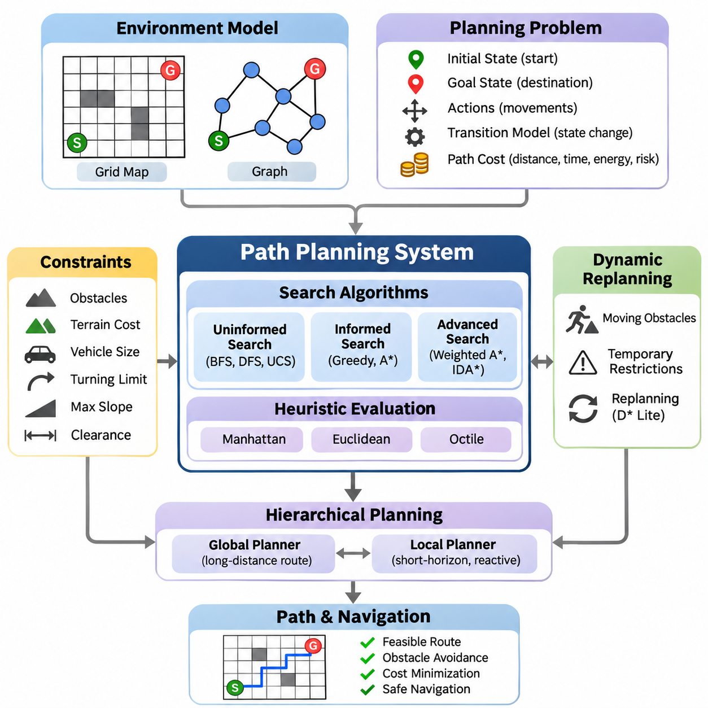
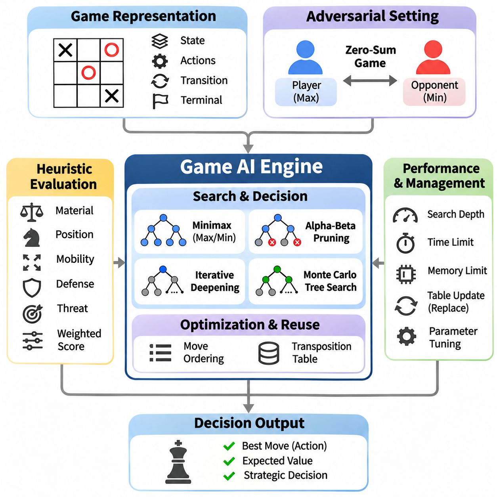
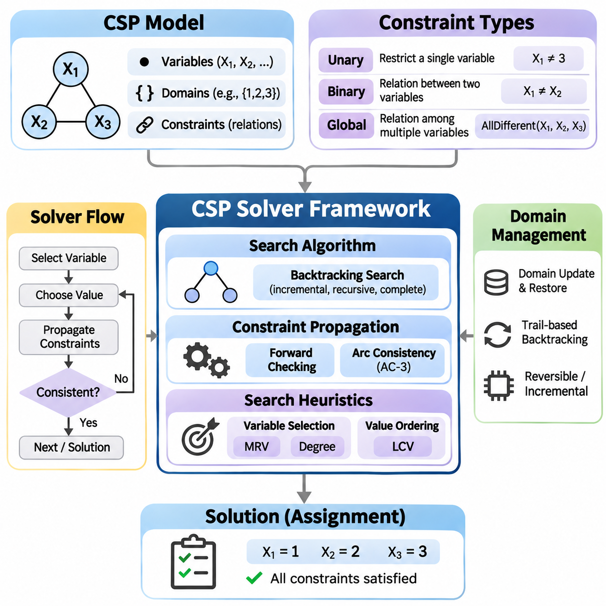
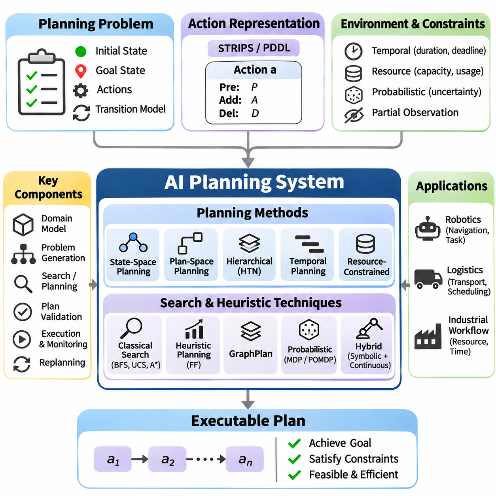
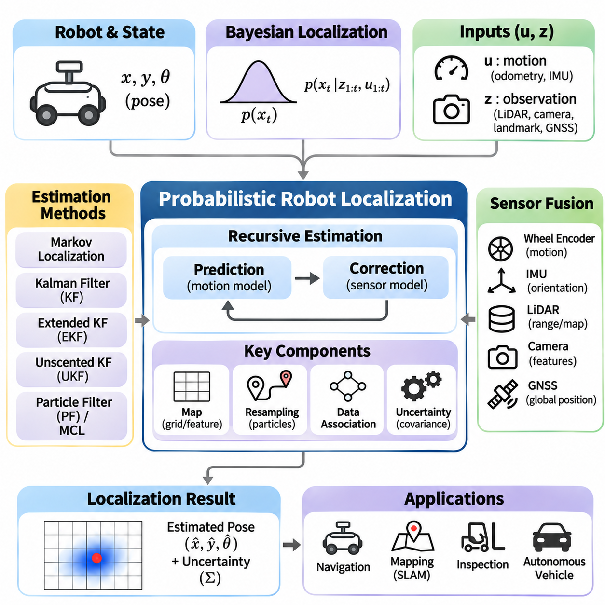
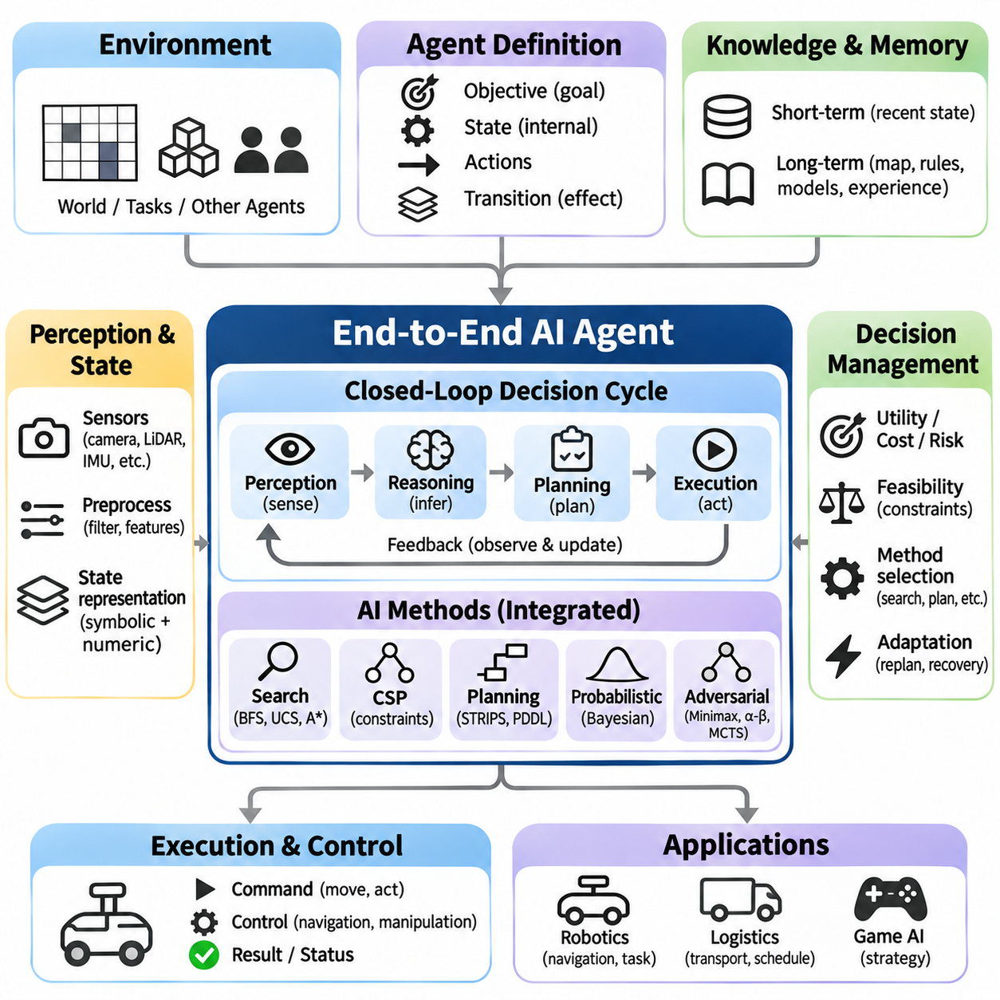

**Volume 01. Classical AI Search and Planning**

# 06. Integrated Projects

## 06.01 Path Planning System [w/Code]

{width="7.268055555555556in" height="7.268055555555556in"}

A path planning system is an integrated artificial intelligence application that determines a feasible and efficient route from an initial position to a target destination. It combines state-space search, heuristic evaluation, environmental representation, and constraint handling. The system must identify traversable regions, avoid obstacles, and minimize operational costs while maintaining reliable navigation under changing environmental conditions.

The fundamental architecture begins with an environment model representing accessible locations, obstacles, and movement relationships. Grid maps divide the environment into discrete cells, while graph representations describe locations as vertices connected by edges. Each edge may contain distance, travel time, energy consumption, or risk information. The selected representation determines the resolution, computational complexity, and practical capabilities of the planner.

A planning problem is formally defined through an initial state, goal state, available actions, transition model, and path cost function. The initial state describes the agent\'s current location, while the goal specifies the desired destination. Actions define permissible movements between states. The transition model determines the consequences of each action, allowing the planner to construct candidate paths and evaluate their feasibility.

Uninformed search algorithms provide foundational approaches for exploring possible routes without domain-specific guidance. Breadth-First Search identifies shortest paths in terms of edge count when all transitions have equal cost. Depth-First Search explores individual branches but does not guarantee optimality. Uniform-Cost Search expands states according to accumulated path cost, enabling optimal route discovery when edge costs are nonnegative.

Informed search algorithms improve computational efficiency by incorporating heuristic estimates of the remaining distance to the destination. Greedy Best-First Search prioritizes states with low estimated remaining cost but may produce suboptimal solutions. A\\\* Search combines accumulated cost and estimated future cost through the evaluation function f(n) = g(n) + h(n), balancing systematic exploration with goal-directed navigation.

The effectiveness of A\\\* depends heavily on heuristic quality. Manhattan distance is suitable for four-directional grid movement, while Euclidean distance represents straight-line geometric separation. Octile distance is useful for eight-directional grids with appropriate diagonal costs. Admissible heuristics never overestimate the remaining optimal cost, while consistent heuristics preserve a useful relationship between neighboring states.

Weighted A\\\* modifies the evaluation function by multiplying the heuristic estimate by a factor greater than one. This approach generally reduces search effort at the expense of optimality guarantees. Iterative Deepening A\\\* combines heuristic search with bounded memory consumption. Algorithm selection therefore requires balancing solution quality, computational resources, planning latency, and the operational requirements of the navigation system.

Environmental constraints are essential for transforming abstract search results into executable navigation routes. Obstacles define prohibited regions, while terrain conditions may impose movement penalties or directional restrictions. Vehicle dimensions, turning limitations, maximum slope, and clearance requirements further constrain feasible paths. Collision checking must account for the complete physical footprint rather than treating the agent as a dimensionless point.

A practical grid-based planner typically maintains an open set containing candidate states and a closed set containing processed states. Each state records its accumulated cost, heuristic estimate, and predecessor relationship. The planner repeatedly selects a promising state, evaluates neighboring transitions, and updates costs when better routes are discovered. Once the goal is reached, predecessor links reconstruct the final path.

Efficient implementation requires careful selection of supporting data structures. Priority queues accelerate retrieval of the lowest-cost candidate, while hash-based structures support rapid state lookup. Parent maps preserve route reconstruction information without storing complete paths for every candidate. Duplicate detection, stale-entry handling, and deterministic tie-breaking improve computational efficiency, correctness, and reproducibility.

Real-world navigation environments frequently change after the initial route has been calculated. Moving obstacles, temporary restrictions, and newly detected hazards can invalidate planned trajectories. Dynamic replanning addresses these changes by updating the environment representation and searching for alternative routes. Incremental algorithms such as D\\\* Lite reuse previous search information, reducing unnecessary computation when map changes are localized.

Hierarchical planning separates long-distance route selection from detailed local navigation. A global planner identifies a route through the known environment, while a local planner generates short-horizon movements that respond to nearby obstacles. This separation improves scalability and responsiveness. The local planner must respect the global objective while continuously checking immediate safety, vehicle dynamics, and environmental constraints.

Path planning and motion planning are closely related but represent different levels of decision-making. Path planning primarily determines geometric connectivity between locations, whereas motion planning incorporates physical feasibility and movement dynamics. A geometrically valid route may be impossible for a vehicle with limited steering capability. Motion-aware planners therefore consider orientation, curvature, velocity, acceleration, and collision constraints.

Constraint satisfaction techniques provide additional mechanisms for enforcing navigation requirements. Hard constraints prohibit unsafe movements, while soft constraints express preferences such as reduced travel time or lower energy consumption. Resource limitations, restricted operating zones, and scheduling requirements can also be incorporated. Integrating constraint evaluation with search prevents the planner from selecting routes that violate essential operational conditions.

Probabilistic reasoning becomes important when environmental information or localization estimates are uncertain. Sensor measurements may contain noise, maps may be incomplete, and obstacle positions may change unpredictably. Bayesian estimation and probabilistic localization provide uncertainty-aware state information. A risk-aware planner can incorporate collision probabilities or uncertainty penalties into route evaluation rather than relying exclusively on deterministic assumptions.

A complete robotic navigation system connects perception, localization, mapping, planning, and control through a coordinated processing pipeline. Sensors observe the surrounding environment, localization estimates the robot pose, and mapping maintains spatial information. The planner generates a feasible route from the estimated state to the destination. A motion controller then converts the planned route into executable steering and velocity commands.

The planning architecture should distinguish strategic decisions from low-level control operations. Mission planning determines destinations and task priorities, global planning selects navigation corridors, and local planning generates collision-aware motion references. Feedback from the controller and perception system updates the planning state. This layered structure supports modular development, systematic testing, and replacement of individual algorithms.

Route quality can be evaluated using multiple performance criteria rather than distance alone. Common measurements include total path length, accumulated traversal cost, execution time, memory consumption, and the number of expanded states. Physical navigation introduces additional criteria such as clearance, path smoothness, energy efficiency, and successful arrival rate. These metrics reveal tradeoffs between computational efficiency and operational reliability.

Experimental benchmarking should compare planning algorithms under identical environmental conditions. Test scenarios may include empty grids, dense obstacle fields, narrow passages, irregular terrain, and dynamically changing obstacles. Map dimensions, obstacle distributions, movement rules, and random seeds should be controlled. Repeated trials help distinguish systematic performance differences from variations caused by individual environmental configurations.

Correctness testing must verify that every generated path begins at the specified initial state, reaches the intended destination, and contains only valid transitions. Collision tests confirm that intermediate movements remain within accessible regions. Optimality tests compare algorithm outputs against established reference solutions where applicable. Unreachable destinations, invalid coordinates, disconnected regions, and exhausted computational budgets require explicit handling.

Software engineering practices are necessary for transforming a research implementation into a reusable planning framework. Environment models, search algorithms, heuristic functions, cost evaluators, and visualization interfaces should be implemented as independent components. Clear interfaces allow multiple algorithms to operate on common map representations. Automated unit tests and integration tests support maintenance as system capabilities expand.

The system should expose configurable parameters governing map resolution, connectivity, heuristic selection, obstacle inflation, and planning limits. Configuration files enable controlled experimentation without modifying core algorithm implementations. Structured logging records search progress, planning outcomes, and failure conditions. Performance profiling identifies bottlenecks in neighbor generation, collision checking, priority queue operations, and memory allocation.

Visualization supports both algorithm development and operational diagnosis. A graphical interface can display the environment map, initial and target positions, obstacles, explored states, and final route. Animated search progression helps explain how different algorithms prioritize candidate states. Runtime overlays showing costs, expanded nodes, and planning duration provide useful evidence for debugging and educational comparison.

Simulation provides a controlled environment for evaluating planning behavior before deployment on physical equipment. Synthetic maps allow developers to introduce obstacles, alter terrain costs, and reproduce difficult navigation scenarios. Robot simulation can additionally test whether generated paths satisfy kinematic constraints. Simulation results should be interpreted carefully because real sensors, actuators, and environmental conditions introduce additional uncertainty.

Deployment on autonomous mobile robots requires integration with localization systems, obstacle detection, and motion controllers. The planner must accommodate localization drift, sensor delays, and actuator response characteristics. Planning frequency should reflect environmental dynamics and available computational resources. Safety-critical obstacle avoidance and emergency stopping must remain effective even when route computation is delayed or unsuccessful.

Robust failure handling is particularly important in autonomous navigation. A planner may encounter blocked destinations, inconsistent maps, excessive search complexity, or unexpected changes in traversability. The system should identify these conditions and report meaningful failure states. Recovery strategies may include replanning, selecting an alternative destination, waiting for obstacles to clear, or requesting supervisory intervention.

The integrated project demonstrates how classical search algorithms, heuristic reasoning, constraint satisfaction, and probabilistic estimation contribute to a unified navigation capability. Its educational value extends beyond finding a route through a map. By connecting algorithmic theory with modular software, simulation, benchmarking, and robotic execution, the project establishes a practical foundation for increasingly sophisticated autonomous planning systems.

## 06.02 Game AI Engine [w/Code]

{width="7.268055555555556in" height="7.268055555555556in"}

A Game AI Engine is an integrated artificial intelligence system designed to make strategic decisions in competitive environments. It combines game-state representation, adversarial search, heuristic evaluation, and decision optimization. Unlike conventional pathfinding, game intelligence must anticipate the actions of competing agents. The engine evaluates possible outcomes and selects moves that maximize strategic advantage under defined computational constraints.

The foundation of a Game AI Engine is a formal representation of the game environment. Each state describes the current board configuration, active player, available actions, and terminal conditions. A transition function determines how the environment changes after a legal move. This representation allows the engine to construct a game tree in which nodes represent states and edges represent actions, providing a structured foundation for adversarial reasoning.

Two-player zero-sum games provide a fundamental framework for studying competitive decision-making. In these environments, one player\'s advantage corresponds to the other player\'s disadvantage. The engine assumes that both participants attempt to optimize their outcomes. This assumption transforms move selection into an adversarial optimization problem, requiring the system to consider not only immediate rewards but also the strongest possible responses from an opponent.

The Minimax algorithm provides a classical solution for deterministic, perfect-information, two-player zero-sum games. It recursively evaluates possible moves while alternating between maximizing and minimizing players. The maximizing player selects actions that increase the evaluation score, while the minimizing player selects actions that decrease it. This process identifies a move that achieves the best guaranteed outcome against an optimal opponent.

Although Minimax provides a theoretically sound decision framework, its computational requirements increase rapidly with search depth. A game with branching factor b and search depth d may require examining approximately O(b\^d) nodes. Complex games therefore make exhaustive exploration impractical. Practical engines restrict search depth and estimate the strategic value of intermediate positions using evaluation functions rather than exploring every possible continuation.

Alpha-Beta Pruning improves Minimax efficiency by eliminating branches that cannot influence the final decision. The algorithm maintains alpha and beta bounds representing the best alternatives established for the maximizing and minimizing players. When a branch cannot improve the relevant bound, further exploration becomes unnecessary. With effective move ordering, Alpha-Beta Pruning can substantially reduce the number of evaluated positions without changing the Minimax result.

Move ordering is an essential optimization technique because the effectiveness of Alpha-Beta Pruning depends on which actions are explored first. Promising moves, tactical threats, captures, and previously successful actions can receive higher priority. Searching strong candidates early produces tighter pruning bounds. Practical engines combine domain-specific ordering rules with information obtained from previous searches to improve efficiency under limited computation budgets.

Evaluation functions estimate the strategic quality of nonterminal game states. Their design depends on the game\'s rules and objectives. Common features include material advantage, positional control, mobility, defensive strength, and potential threats. A weighted evaluation function combines these characteristics into a numerical score. The quality of this estimate strongly influences decision-making when the search cannot reach terminal positions.

An effective evaluation function must balance immediate tactical opportunities with long-term strategic objectives. Excessive emphasis on short-term rewards may produce aggressive but unstable decisions, while overly conservative evaluations can prevent the engine from exploiting favorable opportunities. Feature normalization and weight calibration improve consistency. Evaluation parameters may be selected manually or optimized through automated experiments against reference opponents.

Iterative Deepening Search addresses uncertainty about available computation time by repeatedly executing depth-limited searches. The engine first searches shallow game trees and progressively increases the depth while resources remain available. Each completed iteration produces a valid candidate move. Information from earlier iterations can improve move ordering, allowing deeper searches to benefit from previous computation while preserving a usable decision when time expires.

Transposition Tables reduce redundant computation by storing evaluations of game states encountered through different action sequences. A hashing mechanism, commonly Zobrist Hashing, generates compact identifiers for board configurations. Stored entries may include evaluation scores, search depth, bound types, and preferred moves. When a previously analyzed position reappears, the engine can reuse compatible information rather than repeating the entire search.

Efficient transposition management requires attention to memory limitations and entry validity. Hash collisions must be handled appropriately, and stored evaluations must be interpreted according to their search depth and bound classification. Replacement policies determine which entries remain available when memory becomes full. Correct integration with Alpha-Beta Pruning improves performance while preventing cached information from producing invalid search conclusions.

Monte Carlo Tree Search provides an alternative decision-making framework based on selective exploration and statistical evaluation. Rather than expanding the entire game tree uniformly, it concentrates computation on promising actions. A typical search cycle performs selection, expansion, simulation, and backpropagation. Repeated simulations update estimates of action quality, allowing the engine to allocate additional exploration toward strategically valuable regions.

The Upper Confidence Bound for Trees method balances exploration and exploitation during Monte Carlo Tree Search. It favors actions with strong estimated rewards while allocating some computation to less frequently examined alternatives. The exploration coefficient controls this balance. Excessive exploitation may overlook promising moves, whereas excessive exploration can waste resources. Parameter selection therefore influences both decision quality and computational efficiency.

Minimax and Monte Carlo Tree Search represent different approaches to adversarial reasoning. Minimax emphasizes explicit opponent modeling and deterministic evaluation, making it effective in games with manageable branching structures and strong evaluation functions. Monte Carlo Tree Search emphasizes statistical sampling and adaptive exploration. Their relative performance depends on game complexity, simulation quality, available computation, and the reliability of state evaluation.

Stochastic games introduce uncertainty through random events such as dice rolls, shuffled cards, or probabilistic outcomes. Expectiminimax extends adversarial search by incorporating chance nodes that represent possible random events. Each chance node evaluates outcomes according to their probabilities. This approach enables the engine to optimize expected utility rather than assuming deterministic transitions, although the additional branching can significantly increase computational requirements.

Imperfect-information games create additional challenges because players cannot observe the complete environment state. Hidden cards, concealed actions, and incomplete observations require reasoning over possible states or beliefs. The engine must distinguish observable information from unknown variables. Sampling, probabilistic inference, and information-set search techniques can support decisions that account for uncertainty without assuming access to unavailable opponent information.

A modular Game AI Engine separates game rules, state transitions, legal action generation, search algorithms, and evaluation functions. The game environment defines valid behavior independently of the decision engine. Search components operate through standardized interfaces, allowing multiple algorithms to be compared on identical games. This architecture improves maintainability, testability, and extensibility across different competitive environments.

The decision pipeline begins by receiving the current game state and identifying legal actions. The selected search algorithm explores possible continuations and requests evaluations when necessary. Intermediate results are stored in supporting data structures, while time and depth limits regulate computation. The engine ultimately returns a legal move together with optional diagnostic information such as evaluation score, explored nodes, and search depth.

A simplified Tic-Tac-Toe engine provides a useful starting point for implementation because its state space is small enough for exhaustive search. Minimax can evaluate terminal outcomes and identify optimal moves without requiring complex heuristics. The project demonstrates alternating player roles, recursive state exploration, terminal detection, and move selection. It also provides a reference environment for verifying the correctness of adversarial search algorithms.

Connect Four introduces a larger search space and more demanding positional reasoning. An effective engine evaluates horizontal, vertical, and diagonal threats while considering immediate winning opportunities and defensive requirements. Alpha-Beta Pruning, move ordering, and depth-limited evaluation become increasingly important. This environment demonstrates how heuristic design and search optimization interact when exhaustive game-tree exploration is no longer practical.

A simplified chess engine provides a more advanced integration scenario involving diverse piece movements, tactical interactions, and positional strategy. Legal move generation must enforce game rules, while the evaluation function considers material balance, mobility, king safety, and board control. Iterative deepening, transposition tables, and Alpha-Beta Pruning support deeper analysis. The resulting system illustrates the architecture of practical classical game engines.

Testing must verify both game-rule correctness and search behavior. Legal move generators should reject invalid actions, terminal-state detection must identify completed games, and state transitions must preserve game consistency. Search tests should compare decisions against known optimal outcomes in small environments. Additional tests can verify pruning correctness, transposition-table behavior, and deterministic results under controlled configurations.

Performance benchmarking evaluates decision quality alongside computational efficiency. Relevant metrics include nodes searched per second, maximum completed search depth, decision latency, memory consumption, and competitive win rate. Engines should be tested against random agents, heuristic baselines, and alternative search configurations. Repeated matches with balanced starting conditions help distinguish meaningful improvements from random variation or first-player advantage.

Engineering considerations become increasingly important when the engine operates under real-time constraints. Search must respect move deadlines, maintain predictable resource consumption, and return valid decisions when computation is interrupted. Profiling identifies expensive operations such as move generation, state copying, hashing, and evaluation. Efficient state updates and incremental calculations can reduce overhead and improve practical search depth.

Classical Game AI can also be compared with machine-learning-based approaches. Traditional engines rely on explicit rules, handcrafted evaluations, and structured search, while learning-based systems may estimate policies or state values from experience. Hybrid architectures combine learned evaluation models with classical search procedures. Such integration demonstrates how symbolic reasoning and statistical learning can complement each other in complex decision-making environments.

The integrated Game AI Engine project connects adversarial search theory with practical software architecture, optimization, experimentation, and competitive evaluation. By implementing Minimax, Alpha-Beta Pruning, iterative deepening, transposition tables, and Monte Carlo Tree Search within a common framework, the system provides a reusable foundation for intelligent decision-making. These principles extend beyond games to strategic planning, resource competition, and multi-agent artificial intelligence.

## 06.03 CSP Solver Framework [w/Code]

{width="7.268055555555556in" height="7.268055555555556in"}

A Constraint Satisfaction Problem (CSP) Solver Framework is an integrated artificial intelligence system designed to solve problems defined by variables, domains, and constraints. Instead of directly searching for a sequence of actions, the framework searches for assignments that satisfy specified relationships. It provides a reusable computational foundation for scheduling, resource allocation, configuration, timetabling, and other combinatorial decision problems.

A CSP is formally represented as a collection of variables, their associated domains, and a set of constraints. Each variable represents an unknown decision, while its domain defines the possible values it may receive. Constraints specify permitted combinations of assignments. A complete solution assigns a value to every variable while satisfying all mandatory constraints, transforming the original problem into a structured mathematical search task.

The solver architecture separates problem modeling from search execution. A modeling layer defines variables, domains, and constraint relationships, while a solving layer explores candidate assignments. A validation layer checks consistency and solution completeness. This separation enables different algorithms to operate on the same problem representation and supports systematic comparison of search strategies without modifying application-specific definitions.

Constraints may be unary, binary, or global depending on the number of variables involved. Unary constraints restrict individual variable domains, while binary constraints define relationships between pairs of variables. Global constraints express relationships involving larger variable groups. The AllDifferent constraint, for example, requires assigned values to be distinct and can exploit specialized propagation algorithms to reduce unnecessary exploration.

Backtracking Search provides the fundamental solving mechanism for classical CSPs. The algorithm assigns values to variables incrementally and checks whether each partial assignment remains consistent. When a conflict occurs, the solver reverses previous decisions and explores alternative values. This recursive process systematically examines possible assignments while rejecting inconsistent branches before complete solutions are constructed.

Although basic backtracking is complete for finite CSPs, its computational requirements can become prohibitive as problem size increases. A problem containing n variables with domain size d may have as many as d\^n complete assignments. Effective solvers therefore combine backtracking with constraint propagation and search heuristics. These techniques eliminate impossible values early and reduce the number of branches requiring explicit exploration.

Forward Checking is a lightweight constraint propagation technique applied after each assignment. When a variable receives a value, the solver removes incompatible values from the domains of neighboring unassigned variables. If any domain becomes empty, the current branch is recognized as inconsistent. Forward Checking prevents some unnecessary recursive exploration but does not detect every inconsistency among variables that remain unassigned.

Arc Consistency provides stronger propagation by ensuring that every remaining value of a variable has compatible support in the domain of each connected variable. The AC-3 algorithm repeatedly revises directed arcs until no additional values can be removed or a domain becomes empty. By propagating the consequences of domain reductions, AC-3 can identify contradictions that Forward Checking would otherwise discover later.

Generalized Arc Consistency extends the same principle to constraints involving more than two variables. Every retained value must participate in at least one satisfying combination for each relevant constraint. Specialized propagators can enforce consistency efficiently for common global constraints. Stronger propagation often reduces search substantially, although the additional computational cost must be balanced against the complexity of the problem.

Variable selection heuristics determine which unassigned variable should be processed next. The Minimum Remaining Values heuristic prioritizes variables with the smallest current domains, exposing difficult decisions early. The Degree Heuristic favors variables participating in many constraints involving other unassigned variables. Combining these strategies helps the solver identify contradictions quickly and reduce unnecessary branching.

Value ordering heuristics determine the sequence in which candidate assignments are examined. The Least Constraining Value heuristic prefers values that eliminate the fewest options from neighboring variables. This approach preserves flexibility for future assignments and can improve the speed of finding a feasible solution. Its effectiveness depends on the constraint structure and the computational overhead required to estimate each value\'s impact.

A practical solver integrates variable selection, value ordering, propagation, and backtracking into a coordinated execution cycle. The solver selects an unassigned variable, chooses a candidate value, applies relevant constraints, and updates remaining domains. If propagation detects a contradiction, the solver restores the previous state and tries another value. Successful branches continue until every variable has a consistent assignment.

Efficient domain management is essential because recursive search repeatedly modifies candidate values. Copying complete domain structures at every decision is simple but may consume excessive memory. Trail-based restoration records domain changes and reverses them during backtracking. Reversible data structures and incremental propagation can further reduce overhead, allowing the framework to handle larger problems with more complex constraint relationships.

Constraint graphs provide a structural representation of relationships between variables. Vertices represent variables, while edges connect variables participating in shared binary constraints. Sparse graphs may permit efficient decomposition into smaller subproblems, whereas densely connected graphs often require more extensive propagation. Graph structure can guide variable ordering, identify independent components, and support specialized solving strategies.

Local Search offers an alternative to systematic backtracking by iteratively improving candidate assignments. Hill Climbing modifies assignments to reduce constraint violations but may become trapped in local minima. Simulated Annealing occasionally accepts unfavorable changes to escape such regions. Min-Conflicts Search repeatedly modifies variables involved in violated constraints, making it effective for certain large-scale CSPs.

Systematic search and local search provide different operational guarantees. Backtracking with sound propagation can establish satisfiability or unsatisfiability for finite problems when allowed to complete. Local search often finds useful assignments quickly but generally cannot prove that no solution exists. A reusable framework should support both approaches and expose their distinct termination conditions, performance characteristics, and solution guarantees.

Scheduling problems demonstrate how CSP modeling converts operational requirements into formal constraints. Variables may represent task start times, assigned machines, or execution periods. Domains specify available resources and permitted time intervals. Constraints enforce precedence relationships, prevent resource conflicts, and maintain capacity limits. A solver can then identify schedules satisfying all mandatory operational requirements.

Timetabling extends constraint satisfaction to the allocation of activities across shared time and location resources. Variables may describe classroom assignments, instructors, or meeting periods. Constraints prevent overlapping resource usage and enforce availability requirements. Additional preferences, such as balanced workloads or preferred time slots, may be represented through optimization objectives or weighted soft constraints rather than strict feasibility conditions.

Resource allocation problems require assigning limited resources to competing tasks while respecting capacity and compatibility restrictions. Variables identify resource choices, and constraints define allowable assignments. The solver must prevent over-allocation and ensure that operational requirements remain satisfied. When multiple feasible solutions exist, an optimization layer may minimize cost, balance utilization, or improve overall allocation efficiency.

Advanced CSP frameworks may incorporate constraint optimization, conflict-directed backjumping, nogood recording, and symmetry breaking. Conflict-directed methods use information about failed assignments to avoid unnecessary backtracking. Nogood recording stores combinations known to be inconsistent. Symmetry breaking removes equivalent solutions from consideration. These techniques improve search efficiency when problems contain repeated structures or complex dependencies.

A reusable software implementation should define standardized interfaces for variables, domains, constraints, propagators, and search strategies. Constraint objects evaluate consistency and may provide domain filtering operations. Search components coordinate assignment decisions and backtracking. The framework should allow new constraint types and heuristic policies to be introduced without requiring substantial changes to the solver\'s core execution logic.

Correctness testing must verify constraint evaluation, domain restoration, propagation behavior, and solution validity. Small reference problems with known solutions provide useful regression tests. Unsatisfiable instances verify that the solver correctly identifies contradictions, while multiple-solution problems test enumeration behavior. Property-based testing can generate structured assignments and compare solver outputs against independently validated constraints.

Performance benchmarking should measure solving time, explored search nodes, backtracking operations, propagation calls, and peak memory consumption. Experiments should compare basic backtracking against Forward Checking, AC-3, and heuristic-enhanced configurations. Problem size, domain cardinality, constraint density, and constraint tightness should be varied systematically. Repeated trials help establish reproducible performance trends across different problem classes.

Integration with established optimization libraries provides an additional reference for evaluating a custom framework. General-purpose constraint programming tools and satisfiability-based solvers offer mature propagation and search capabilities. Comparing their results with a custom implementation helps identify modeling limitations and performance bottlenecks. Such comparisons should distinguish differences in supported constraint types, optimization features, and solving guarantees.

The integrated CSP Solver Framework project connects classical constraint satisfaction theory with modular software engineering and practical optimization applications. By combining backtracking, propagation, heuristic selection, local search, and systematic evaluation, it establishes a flexible foundation for solving structured decision problems. The same principles extend to automated planning, industrial scheduling, robotics, configuration systems, and intelligent resource management.

## 06.04 AI Planning System [w/Code]

{width="7.268055555555556in" height="7.268055555555556in"}

An AI Planning System is an integrated artificial intelligence framework designed to generate sequences of actions that transform an initial state into a desired goal state. Unlike reactive decision systems, planning explicitly reasons about future consequences before executing actions. It combines symbolic state representation, action modeling, search algorithms, and constraint evaluation to produce executable plans for complex tasks involving multiple dependencies.

The foundation of an AI Planning System is a formal planning problem consisting of an initial state, goal conditions, available actions, and a transition model. States describe relevant properties of the environment, while goals specify conditions that must eventually become true. Actions define how states can change. A valid plan is an ordered or partially ordered collection of actions whose execution satisfies the goal conditions under the assumed environment model.

Classical planning assumes a finite environment with deterministic actions, complete observability, and a known initial state. Under these assumptions, the planning problem can be represented using logical predicates describing objects and their relationships. The planner searches for actions that establish desired conditions while preserving necessary preconditions. These assumptions simplify reasoning and provide a foundation for understanding more advanced planning systems.

STRIPS provides a classical representation for describing planning actions through preconditions, add effects, and delete effects. Preconditions specify the conditions required before an action can execute. Add effects describe facts that become true, while delete effects identify facts that become false. Applying an action updates the current state by removing deleted facts and introducing added facts, creating a systematic basis for symbolic planning.

The Planning Domain Definition Language, or PDDL, provides a standardized language for expressing planning domains and problem instances. Domain definitions describe predicates, action schemas, and applicable requirements. Problem definitions specify objects, initial conditions, and goals. Separating reusable domain knowledge from individual problem instances enables planners to solve multiple tasks without rewriting the underlying action models.

State-space planning searches through possible environment states to identify a valid sequence of actions. Forward planning begins at the initial state and applies applicable actions until a goal is reached. Backward planning reasons from desired goals toward conditions that could establish them. Both approaches transform planning into a search problem, allowing classical algorithms such as breadth-first search, uniform-cost search, and A\\\* to support plan generation.

Plan-space planning searches over partially specified plans rather than complete environment states. It introduces actions, ordering constraints, and causal links to establish required conditions. Threat detection identifies actions that could invalidate causal relationships, while constraint resolution preserves consistency. Partial-order planning delays unnecessary ordering decisions, allowing independent actions to remain unordered until their relationships become relevant.

Heuristic planning improves efficiency by estimating the remaining effort required to achieve the goal. Relaxed planning problems often ignore delete effects, making approximate solutions easier to compute. Relaxed planning graphs reveal reachable facts and useful action dependencies. Heuristic estimates derived from these structures guide search toward promising states, reducing unnecessary exploration in large planning problems.

The Fast Forward planner, commonly called FF, demonstrates the effectiveness of heuristic planning. It constructs relaxed planning information and extracts an approximate plan to estimate distance from the goal. Enforced hill climbing uses this guidance to locate improving states, with additional search mechanisms handling difficult regions. The approach illustrates how approximate reasoning can accelerate symbolic planning without requiring exhaustive exploration.

GraphPlan represents planning through a layered graph containing alternating proposition and action levels. The graph records reachable facts, applicable actions, and mutual exclusion relationships. Planning proceeds by expanding these levels and attempting to extract a consistent action sequence. Mutual exclusion analysis identifies incompatible actions and propositions, reducing invalid combinations and supporting systematic plan construction.

Hierarchical Task Network planning decomposes complex tasks into smaller subtasks using predefined methods. High-level activities describe strategic objectives, while decomposition rules specify how those activities can be accomplished. Primitive tasks correspond to executable actions. This hierarchical representation incorporates procedural domain knowledge and can reduce search complexity when reliable task decomposition methods are available.

Temporal planning extends classical planning by representing action durations, deadlines, and overlapping activities. Actions may consume time and interact through temporal constraints. A planner must determine both which actions to execute and when they should occur. Temporal consistency is essential when coordinating shared resources, parallel operations, and tasks whose execution windows depend on preceding activities.

Resource-constrained planning introduces limitations on equipment, personnel, energy, and operational capacity. Actions may require exclusive resources or consume quantities that cannot be replenished immediately. The planner must ensure that resource usage remains feasible throughout execution. Constraint satisfaction techniques can support allocation decisions, while optimization objectives balance completion time, operational cost, and resource efficiency.

Probabilistic planning addresses environments where action outcomes are uncertain. Instead of assuming that every action produces one predictable successor state, the planner considers multiple possible outcomes with associated probabilities. Markov Decision Processes provide a mathematical framework for sequential decisions under uncertainty. Policies map states to actions, enabling adaptive behavior when observed outcomes differ from initial expectations.

Partially observable planning introduces uncertainty about the current environment state. The agent maintains a belief state representing possible conditions and their probabilities. Actions may change the environment, while observations update the agent\'s knowledge. Partially Observable Markov Decision Processes extend probabilistic planning to this setting, although exact solutions become computationally expensive as state and observation spaces grow.

Robotic planning integrates symbolic task reasoning with physical motion constraints. A task planner may determine that a robot must navigate to a workstation, collect an object, and deliver it to another location. A motion planner then determines physically feasible trajectories for individual actions. Combining these levels prevents symbolic plans from relying on movements or manipulations that the robot cannot execute.

Hybrid planning systems coordinate discrete decisions with continuous physical processes. Symbolic actions describe tasks and logical conditions, while continuous models represent position, velocity, energy, or actuator behavior. Interfaces between these representations validate whether planned actions are physically achievable. Such integration is particularly important in autonomous robotics, industrial automation, and systems operating under dynamic constraints.

A practical planning architecture separates domain modeling, problem generation, search execution, plan validation, and action execution. The domain model describes reusable action semantics, while the problem generator constructs the current planning instance. The planner searches for a solution, and the validator checks its consistency. An execution manager dispatches actions and monitors whether expected effects occur.

Plan execution requires continuous coordination between predicted and observed states. After an action completes, the system compares actual outcomes with the effects expected by the planning model. Unexpected results may invalidate subsequent actions or introduce new constraints. Execution monitoring detects these discrepancies and determines whether the current plan remains applicable or requires modification.

Replanning enables an AI system to recover from environmental changes, failed actions, or newly introduced objectives. The planner constructs a revised problem using the latest available state information. It may generate a completely new plan or repair the remaining portion of the existing plan. Efficient replanning reduces disruption and allows autonomous systems to maintain progress despite uncertain operational conditions.

A logistics planning project provides a practical environment for integrating symbolic reasoning and search. Objects may represent packages, vehicles, and locations, while actions describe loading, unloading, and transportation. Preconditions enforce vehicle availability and object location requirements. The planner generates action sequences that deliver packages to designated destinations while satisfying operational constraints.

A robotic task planning project extends these concepts to autonomous execution. The robot may receive a mission involving navigation, object manipulation, inspection, and delivery. Each task has preconditions and expected effects, while dependencies determine execution order. The system generates a mission plan, coordinates lower-level controllers, and updates its state representation as actions complete or unexpected events occur.

Correctness testing verifies that generated plans satisfy action preconditions and achieve the specified goals. A plan validator simulates action execution from the initial state and checks intermediate transitions. Invalid actions, missing prerequisites, and unreachable goals must be detected explicitly. Reference planning problems with known solutions provide regression tests for search algorithms, domain definitions, and execution logic.

Performance benchmarking evaluates planning time, search-node expansion, memory consumption, plan length, and execution cost. Different planning algorithms should be compared using identical domains and problem instances. Experiments may vary the number of objects, available actions, goal dependencies, and resource restrictions. Repeated evaluations reveal scalability limits and help identify appropriate algorithms for different planning environments.

The integrated AI Planning System project connects classical search, logical representation, constraint satisfaction, heuristic reasoning, and probabilistic decision-making within a unified software framework. By combining domain modeling, plan generation, validation, execution monitoring, and replanning, it establishes a reusable foundation for intelligent automation. These principles support robotics, logistics, industrial workflows, and increasingly autonomous decision systems.

## 06.05 Probabilistic Robot Localization [w/Code]

{width="7.268055555555556in" height="7.268055555555556in"}

Probabilistic Robot Localization is an integrated artificial intelligence system that estimates a robot\'s position and orientation under uncertain sensing and motion conditions. Instead of assuming that the robot occupies one perfectly known location, the system maintains a probability distribution over possible poses. This approach combines Bayesian inference, motion modeling, sensor processing, and recursive estimation to support reliable autonomous navigation.

The localization problem is defined by a robot state, a sequence of control inputs, and observations collected from the environment. For a mobile robot operating on a plane, the state commonly includes horizontal position and heading angle. Control inputs describe commanded or measured movement, while observations provide information about surrounding features. The objective is to estimate the current pose using all relevant information available over time.

Bayesian localization represents uncertainty through a belief distribution over robot states. The belief expresses how likely each possible pose is given previous controls and sensor observations. Recursive Bayesian filtering updates this belief through prediction and correction. Prediction estimates the effects of robot motion, while correction incorporates new measurements to improve the estimate and reduce uncertainty when observations are informative.

The prediction stage uses a probabilistic motion model to estimate how the robot\'s state changes after a control input. Wheel odometry, commanded velocities, and inertial measurements may provide motion information. However, wheel slip, actuator errors, and imperfect calibration introduce uncertainty. The model therefore represents a distribution of possible successor states rather than assuming that commanded motion produces an exact displacement.

The correction stage uses a sensor model to evaluate how well observations agree with predicted robot states. Range sensors, cameras, landmarks, and positioning systems can provide measurements. A measurement likelihood assigns greater probability to states that explain the observations. Combining these likelihoods with the predicted belief produces a posterior distribution that reflects both motion uncertainty and environmental evidence.

Markov Localization represents the robot\'s belief over a discretized state space. A grid-based implementation assigns probabilities to possible locations and orientations. Motion updates redistribute probability according to the transition model, while measurement updates increase or decrease the likelihood of individual states. This method can represent multiple location hypotheses but becomes computationally expensive as spatial resolution increases.

Kalman Filtering provides an efficient estimation framework for systems with linear dynamics and Gaussian uncertainty. It maintains a state estimate and covariance matrix describing estimation uncertainty. Prediction propagates the state and covariance through the motion model, while correction incorporates sensor measurements using the Kalman gain. Under its modeling assumptions, the filter provides a mathematically structured method for recursive state estimation.

The Extended Kalman Filter extends Kalman Filtering to nonlinear motion and observation models. It linearizes nonlinear functions around the current estimate using Jacobian matrices. This approximation enables localization with robot kinematics and nonlinear sensor relationships. However, significant nonlinearities, inaccurate initialization, or inconsistent noise assumptions can degrade performance because the estimated uncertainty may not fully represent the true distribution.

The Unscented Kalman Filter addresses nonlinear estimation by propagating carefully selected sigma points through nonlinear functions. These points approximate how the state distribution changes without explicitly calculating Jacobian matrices. The resulting mean and covariance estimates can capture nonlinear effects more accurately than first-order linearization in some conditions. Its computational cost and performance depend on state dimension and model characteristics.

Particle Filtering represents the belief distribution using a collection of weighted state samples called particles. Each particle describes a possible robot pose, while its weight indicates consistency with observations. Motion prediction propagates particles through the probabilistic motion model. Measurement updates adjust their weights, allowing the particle population to approximate complex and potentially multimodal localization distributions.

Monte Carlo Localization applies particle filtering specifically to robot pose estimation. Particles are initialized across plausible locations, propagated using odometry, and weighted against sensor observations and a known map. Resampling concentrates computational resources on likely hypotheses. This method supports global localization and recovery from uncertain initial positions, although performance depends on particle diversity and measurement quality.

Resampling is a critical component of particle-based localization because repeated weight updates may leave only a few particles with meaningful probability. Systematic and stratified resampling can reduce sampling variance compared with simple random selection. Excessive resampling may cause particle impoverishment, especially when motion uncertainty is low. Adaptive particle counts and controlled sample injection can improve robustness.

Sensor fusion combines measurements from multiple sources to improve localization accuracy and reliability. Wheel encoders provide relative displacement, inertial measurement units provide rotational and acceleration information, and LiDAR or cameras observe environmental structure. GNSS may provide global position outdoors. Effective fusion accounts for sensor uncertainty, calibration errors, timing differences, and correlations between measurements.

Map-based localization compares sensor observations with a previously constructed representation of the environment. Occupancy grids describe obstacle probabilities, while feature maps represent landmarks and geometric structures. A localization algorithm evaluates how well predicted observations match the stored map. Accurate map alignment improves pose estimation, but environmental changes and outdated maps can introduce systematic measurement errors.

Landmark-based localization uses recognizable environmental features whose positions are known or estimated. Measurements may include landmark distance, bearing, or visual appearance. Data association determines which observed feature corresponds to which map landmark. Incorrect associations can produce substantial estimation errors, particularly in repetitive environments. Robust matching and measurement validation are therefore essential.

Localization differs from Simultaneous Localization and Mapping because localization generally assumes that a suitable map already exists. SLAM estimates both robot trajectory and environmental structure, creating additional dependencies between pose and map uncertainty. A complete robotic navigation system may use SLAM during map construction and localization during routine operation. Both processes rely on probabilistic estimation and consistent sensor interpretation.

A practical localization architecture separates sensor acquisition, preprocessing, motion prediction, measurement correction, and pose publication. Sensor interfaces collect timestamped observations, while preprocessing removes invalid data and applies calibration. The estimator maintains the belief state and performs recursive updates. The resulting pose and uncertainty estimates are provided to navigation, planning, and control components through standardized interfaces.

Coordinate transformations are essential when combining measurements from sensors mounted at different positions and orientations. Robot localization commonly distinguishes map, odometry, robot-base, and sensor coordinate frames. Transformations convert observations into compatible representations. Incorrect frame definitions or calibration parameters can introduce systematic errors that persist even when the underlying probabilistic estimator is implemented correctly.

Time synchronization is equally important because localization combines measurements generated at different rates and timestamps. Delayed observations may correspond to robot states that no longer match the latest prediction. Timestamp-aware processing, interpolation, and buffered state estimation help maintain temporal consistency. Poor synchronization can cause apparent sensor disagreement and reduce localization accuracy during rapid movement.

A simulation-based localization project provides a controlled environment for testing probabilistic estimation. A virtual robot moves through a known map while simulated sensors generate noisy measurements. Ground-truth poses enable direct comparison with estimated trajectories. By varying motion noise, measurement uncertainty, and environmental geometry, experiments can reveal how different algorithms respond to changing localization conditions.

An implementation project may compare grid-based Markov Localization, Extended Kalman Filtering, and Monte Carlo Localization using consistent motion and observation models where appropriate. Each method should expose its estimated pose, uncertainty representation, and computational requirements. Comparisons must account for differences in assumptions, initialization, and state representation rather than treating all estimators as interchangeable.

Localization evaluation measures position error, orientation error, convergence time, computational latency, and estimation consistency. Root Mean Square Error summarizes trajectory accuracy, while covariance-based consistency tests assess whether reported uncertainty agrees with observed errors. Particle-based systems may additionally monitor effective sample size. Recovery performance should be tested after temporary sensor loss or deliberate pose disturbances.

Robustness testing introduces wheel slip, sensor dropout, incorrect measurements, and environmental changes. The estimator should recognize reduced confidence rather than continuously reporting unjustified precision. Innovation gating, outlier rejection, and sensor health monitoring can limit the influence of unreliable observations. Recovery mechanisms may expand the search distribution or reinitialize localization when the current belief becomes inconsistent.

The integrated Probabilistic Robot Localization project connects Bayesian reasoning, stochastic motion models, sensor fusion, and recursive estimation within a reusable robotics framework. By implementing prediction, correction, uncertainty management, validation, and recovery mechanisms, the system provides a foundation for reliable autonomous navigation. These principles support mobile robots, autonomous vehicles, industrial inspection platforms, and other physical AI systems.

## 06.06 End to End AI Agent [w/Code]

{width="7.268055555555556in" height="7.268055555555556in"}

An End-to-End AI Agent is an integrated intelligent system that perceives its environment, reasons about available information, plans actions, and executes decisions to achieve defined objectives. Unlike isolated algorithms, an autonomous agent connects multiple computational components through a continuous decision cycle. This architecture combines classical search, constraint satisfaction, adversarial reasoning, probabilistic inference, and automated planning within a unified operational framework.

The agent architecture begins with a formal definition of the environment, internal state, available actions, and performance objectives. The environment generates observations, while the agent maintains information required for decision-making. Actions modify the environment through defined transition mechanisms. The system must select actions that advance its goals while respecting operational constraints, uncertainty, and available computational resources.

The perception component transforms raw observations into structured information suitable for reasoning. Sensors, simulated environments, or software interfaces provide data describing external conditions. Preprocessing removes invalid information and converts observations into standardized representations. The resulting perceptual state supports state estimation, constraint evaluation, and planning without requiring every decision module to process raw environmental data.

State representation provides the foundation for consistent decision-making across the agent architecture. Symbolic variables describe discrete conditions, while numerical values represent measurable properties. A state may include the agent\'s location, available resources, task progress, and environmental constraints. Maintaining a consistent representation allows search algorithms, planners, and execution modules to exchange information without incompatible assumptions.

The reasoning component evaluates current conditions and determines which decisions are logically feasible. Rule-based inference identifies applicable actions, while constraint satisfaction eliminates assignments that violate requirements. A Constraint Satisfaction Problem solver can allocate resources, assign tasks, or resolve scheduling conflicts. Integrating these capabilities prevents the agent from selecting actions that are logically valid but operationally infeasible.

Search algorithms enable the agent to explore possible future states and identify promising action sequences. Breadth-First Search provides systematic exploration, while Uniform-Cost Search considers accumulated action costs. A\\\* combines path cost with heuristic estimates to prioritize efficient solutions. Algorithm selection depends on state-space size, cost structure, available heuristics, and the computational limits imposed by the operating environment.

Automated planning converts high-level objectives into executable action sequences. Planning operators define preconditions and effects, allowing the system to predict how actions transform the environment. STRIPS-style representations provide a structured foundation for symbolic planning. The planner generates a sequence of actions that satisfies goal conditions while preserving required dependencies and avoiding conflicts between operational activities.

Hierarchical planning improves scalability by decomposing complex objectives into smaller tasks. Strategic goals define the desired outcomes, while tactical planning determines the actions required to achieve them. Execution-level components translate selected actions into commands supported by the environment. This separation allows the agent to coordinate long-term objectives with short-term decisions without requiring a single algorithm to solve every level of the problem.

Probabilistic reasoning allows the agent to operate when observations and action outcomes are uncertain. A belief state represents possible environmental conditions rather than assuming perfect knowledge. Bayesian filtering updates this belief using predicted transitions and new observations. The resulting uncertainty estimates influence action selection, enabling the agent to distinguish reliable information from incomplete or ambiguous environmental evidence.

Adversarial reasoning becomes important when the environment contains competing agents. Minimax evaluates possible opponent responses, while Alpha-Beta Pruning reduces unnecessary exploration. Monte Carlo Tree Search offers an alternative based on selective simulation and statistical evaluation. These techniques allow the agent to anticipate competitive behavior and select strategies that account for the decisions of other intelligent participants.

The decision manager coordinates reasoning, search, planning, and uncertainty estimation. It evaluates candidate actions according to expected utility, feasibility, execution cost, and risk. When several strategies are available, the manager selects an appropriate method based on current conditions. This coordination prevents individual algorithms from operating independently and ensures that decisions remain aligned with the agent\'s overall objectives.

The execution component translates selected actions into commands that affect the environment. In a simulated world, commands update the game or task state through transition functions. In robotic applications, commands may activate navigation, manipulation, or inspection controllers. Execution feedback confirms whether actions completed successfully and provides information needed to update the agent\'s internal representation.

A closed-loop control architecture continuously connects perception, reasoning, planning, action, and feedback. After executing an action, the agent observes the resulting environment and compares actual outcomes with predicted effects. Unexpected changes trigger state updates and may require new decisions. This feedback mechanism enables adaptive operation and prevents the system from relying indefinitely on assumptions established before execution.

Memory management preserves information that remains useful across decision cycles. Short-term memory stores recent observations, active goals, and intermediate planning results. Longer-term knowledge may contain environment maps, action models, constraints, and previously successful strategies. Consistent memory updates prevent outdated information from influencing decisions and support efficient reuse of relevant knowledge.

An integrated agent framework should separate environmental interfaces, state estimation, reasoning, planning, execution, and monitoring into reusable modules. Standardized data structures define how observations, states, actions, and results are exchanged. Modular interfaces allow individual algorithms to be replaced without redesigning the entire system. This architecture supports experimentation, debugging, and deployment across multiple application environments.

A grid-world simulation provides a practical starting point for implementing the complete agent. The environment contains obstacles, destinations, resources, and possible dynamic changes. The agent observes its surroundings, estimates its position, searches for feasible routes, and executes movement commands. Constraints may restrict energy consumption or access to particular regions, while replanning handles unexpected obstacles or changes in objectives.

A robotic mission scenario extends the framework to coordinated physical tasks. An autonomous mobile robot may navigate to a workstation, inspect an object, transport materials, and return to a charging station. The planner determines task dependencies, the CSP solver allocates resources, and localization estimates the robot\'s pose. Execution monitoring detects failures and requests revised plans when operational conditions change.

Multi-agent environments introduce coordination and competition between autonomous participants. Cooperative agents may share tasks and resources, while competitive agents attempt to maximize conflicting objectives. The system must represent interactions, communication constraints, and shared environmental conditions. Classical planning, constraint satisfaction, and adversarial search provide complementary methods for managing these relationships.

Failure handling is essential because perception errors, invalid assumptions, and unsuccessful actions can interrupt autonomous operation. The agent should detect inconsistent states, unreachable goals, and execution failures. Recovery procedures may include retrying actions, selecting alternative plans, or entering a safe state. Explicit failure reporting supports diagnosis and prevents the system from repeatedly executing actions that cannot achieve the intended result.

Testing should evaluate both individual modules and their interactions within the complete agent. Unit tests verify state transitions, constraint checking, search correctness, and planning logic. Integration tests examine data exchange and execution sequencing. End-to-end tests determine whether the agent can achieve specified goals under realistic environmental conditions, including uncertainty, changing constraints, and unexpected events.

Performance evaluation measures task completion rate, planning latency, search-node expansion, execution cost, resource utilization, and recovery success. Experiments should compare configurations with different search algorithms, heuristics, and reasoning methods. Repeated trials under controlled conditions help identify performance bottlenecks and determine whether improvements in individual modules translate into better overall agent behavior.

Reproducibility requires consistent configuration management, controlled random seeds, structured logging, and clearly defined evaluation scenarios. Logs should record observations, state estimates, selected actions, planning results, and execution outcomes. These records support debugging and comparison across experiments. Versioned environment definitions and algorithm settings allow results to be reproduced and independently validated.

Deployment introduces additional requirements involving computational limits, communication reliability, timing constraints, and operational safety. The agent must ensure that decision-making remains responsive under available hardware resources. Critical actions require validation before execution, while monitoring mechanisms detect abnormal behavior. Separating safety enforcement from high-level planning helps prevent reasoning errors from directly producing unsafe physical actions.

The integrated End-to-End AI Agent project demonstrates how classical artificial intelligence techniques can operate together as a complete autonomous system. By combining perception, state estimation, constraint satisfaction, search, planning, execution, and feedback, the framework transforms isolated algorithms into coordinated intelligent behavior. Its reusable architecture provides a foundation for robotics, logistics, autonomous systems, and complex decision-making applications.
